# 工程师的大数据：04：云存储 (1/3) 📚

在本节课中，我们将要学习大数据技术栈的基础——云存储。我们将探讨数据中心的真实构成，理解传统关系型数据库在处理海量数据时的局限性，并介绍现代大数据解决方案的核心思想。

欢迎回来。我将以一个问题开始这部分课程。

我想先回顾一些已经讨论过的内容。

你认为数据中心里有什么？你可能在电视上听说过数据中心。如今，到处都是拥有巨型数据中心的大公司。数据中心里有什么？你认为是什么？

是像这样进行秘密计算、让大语言模型（LLM）运行起来的地方吗？还是一台拥有100个CPU、100PB硬盘和1PB内存的巨型机器？抑或是大量廉价的小型机器？或者是一台拥有54个量子比特阵列的巨型量子计算机？

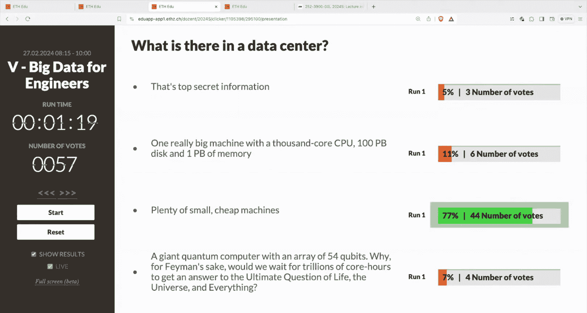

我想到的是Sycamore（谷歌的量子处理器），但我觉得在一次奇怪的实验中，其中一个量子比特失效了，所以降到了53个，但54个是设计目标。对吧？看看大家怎么说。

大多数人选择了同一个选项，并且大多数人是正确的。

如果你曾想象或理想化数据中心的样子，现实可能有些令人失望。但事实上，是的，它只是**装满廉价机器的房间**，这就是它的本质。

这些是廉价机器，其中一些基本上和你的笔记本电脑差不多。事实上，这有点夸张，因为数据中心的机器可能比你的笔记本电脑更强大一些，但它远没有PB级的内存或100PB的硬盘。实际上，这些东西今天甚至不存在。PB级的内存今天不存在。100PB的硬盘今天也不存在。我们唯一知道的做法就是使用大量内存和硬盘容量都较小的机器。好的，这就是数据中心的构成。稍后我会告诉你更多。

至少对你来说，数据中心大概就是这样。

---

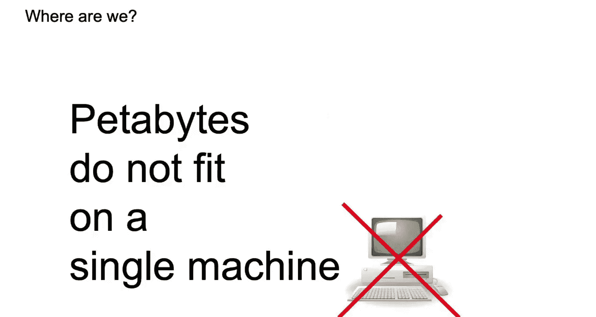

## 云存储 ☁️

那么，本次讲座的议程是什么？是大数据。我们需要查询大量数据，什么样的数据？一个例子是我们通过实验收集的数据，比如斯隆数字巡天（SDSS）。我查看了它直到2020年的第四阶段数据，并试图了解其中有多少数据。

我发现其中有**273 TB的数据**。它被组织在**68万个目录**中，包含**1.76亿个文件**。这是大量的数据，我们可以用SQL或其他语言查询这些数据，以发现黑洞、中子星、类星体等等。

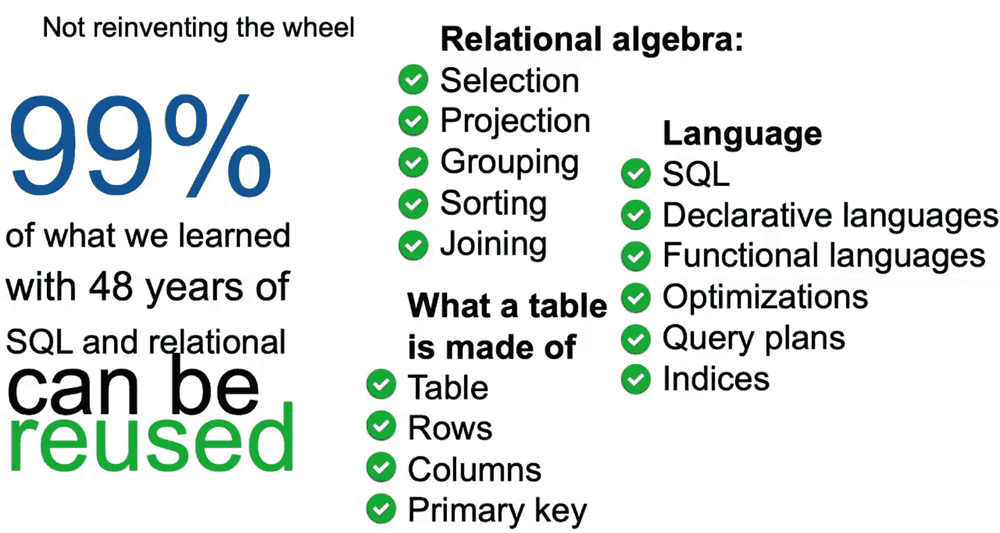

出现的第一个问题是：**我们把这些数据存储在哪里？** 因为数据量太大了。当然，这无法装进你的笔记本电脑。所以我们需要另一种方式。我们有什么？我们有关系型数据库。但关系型数据库的问题（至少在21世纪初）是，一个关系型数据库系统运行在一台机器上。

所以，如果你认为可以把这200 TB数据直接放进一个关系型数据库，请再想想，这行不通，因为那只是一台单独的机器。所以这不是一个选项。事实上，这正是21世纪初公司们遇到的问题：他们用尽了选择，因为他们需要的数据已经无法再放入我们当时拥有的系统中。

所以我们需要另一种解决方案。

---

但我有个好消息要告诉你。好消息是，自20世纪70年代（甚至更早）以来过去50年发生的一切，即使有了新技术，**仍然可以重用**。上周和本周我提到的选择、投影、分组、排序、连接等概念仍然适用。声明式函数式语言、优化、查询计划、希腊字母表示的索引等，仍然适用。我们仍然可以拥有这些。表由行、列、主键构成，这些我们也会沿用。但我们可能不止于此，我们会扩展到其他概念，这意味着我们学到的很多东西都可以重用。这是个非常好的消息。

---

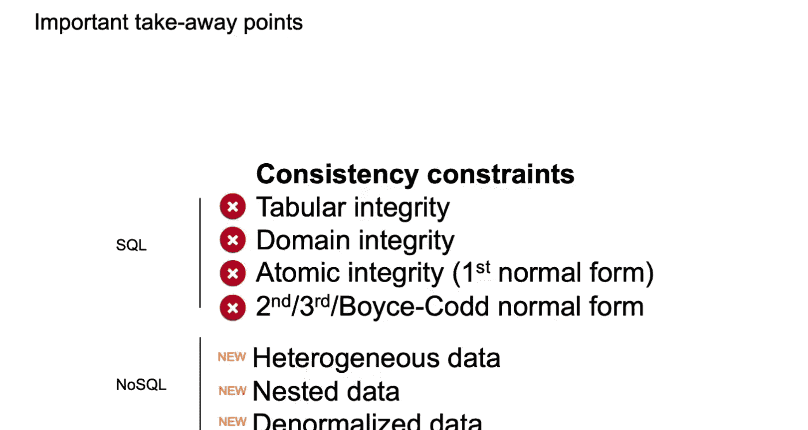

但有些东西会被抛弃，这不应该让你感到惊讶，因为我告诉过你范式（Normal Forms）将会消失。第二范式、第三范式、BC范式，所有这些都将消失。对于本课程的目的，你只需要知道范式是连接（Join）的反面——范式意味着拆分数据。抛弃范式意味着你将数据放回一个巨大的表中。

表完整性、域完整性、原子性完整性，这些基本上是使表成为表的东西。每一行中相同列的值一致，同一列中的所有数据具有相同类型，没有表中有表的情况。所有使表成为表的东西，我们都要抛弃。

我们将看到**异构**的数据，因为同一列中可能有不同类型的数据。我们将看到**嵌套**的数据，表中有表。我们将看到**非规范化**的数据，意味着它不是高范式的，只是一个我们将要查询的巨型表。

这个美丽的世界曾被称为“NoSQL”的流行词世界。现在这个词不那么流行了。当时每个人都在谈论NoSQL。这可能是15年前的ChatGPT。

所以，这实际上是即将出现的新内容，我们将花几周时间学习它。

---

那么，在接下来的几周里，我们将要**重建整个技术栈**。

这是什么意思？如果你看一个关系型数据库系统，比如70年代那些老旧的系统，它们运行在一台机器上。它只是一个需要安装的软件。事实上，PostgreSQL正是如此。它就像一个黑盒，你只需下载、安装，然后就可以与之交互。

我们需要重建所有组件，将其拆解，然后一层一层地重建。就像盖房子，你有地基、墙壁、电线、管道等等。我们将做同样的事情，构建大数据技术栈。这些是技术栈的所有层级，我们将用整个学期来完成。

第一层是**存储**。这就是我今天要讲的云存储，有很多花哨的技术名称。这是你存放数据的地方。

然后你有一个**编码**层。这是如何将数据转换为0和1，与本讲座关系不大。我只是提一下，但我们不会花太多时间。你可能听说过UTF-8。如果你创建文本文件，应该使用UTF-8。这基本上是一种让所有国际语言和特殊字符都能正常工作的方法，与只支持欧洲字符的ASCII或ISO-8859-1不同。UTF-8是当今的标准。所以这是编码方式，但我们同样不会花太多时间。

接下来是**索引**。如何表示数据？作为可以存储在磁盘上的文本。例子有XML、JSON、CSV。谁听说过CSV？好的，整个网络都是。当你下载数据时，通常会有CSV选项，这只是一种表示表格的方式。它是用文本表示的表格。XML、JSON是用文本表示的树结构。RDF/XML三元组是用文本表示的图。XBR是用文本表示的立方体。所以这些都是将数据存储为文本的语法。为什么？因为你想通过网络传输它，你想下载数据等等。所以我们需要语法。

然后，我们有**数据模型**，即如何对数据进行建模。对于表格，就是我上周讲的行、列等；对于树、图、立方体（虽然不在本课程中），它基本上是数据背后的模型，是你将要操作的数据的表示。

接着是**验证**。验证是对数据结构施加约束的过程，例如，确保一列中的所有值都是字符串或都是日期等。在像PostgreSQL这样的关系型数据库系统中，我们不太听说这个，因为它是强制的。如果没有确保数据结构的模式，你甚至无法开始处理数据。但在大数据中，我们实际上使其成为可选的而非强制的，因此它出现得更明确一些，所以我们会花一整周时间学习它。

**数据处理**是当数据在数据中心成千上万的机器间流动，并以某种方式最终产生结果的时候。这是我最喜欢的部分。所以我们会学习MapReduce和Apache Spark。

然后是**索引**，这对于快速查找数据非常方便。我也会在专门的一周里详细讲解。

接着是**数据存储**。这里开始看起来像是你卖给人们的产品。数据存储基本上是一种技术，你可能听说过一些名字：MongoDB（谁听说过MongoDB？），这是一个基于树结构的NoSQL产品的数据库公司。Couchbase也基于树结构。Hive基于立方体。HBase是Google Bigtable的开源版本。MongoDB也是一个NoSQL产品。Cassandra是Meta（Facebook）的HBase替代品等等。这被称为数据存储。这基本上是你销售或供人们下载和使用的东西，是其他一切功能的包装器。

然后，在数据存储之上可以实现的是，如果你有一个像SQL这样的真正的查询语言（还有其他针对不同数据形状的语言），你基本上让用户的生活变得更容易，因为他们可以用那种语言查询数据。

最后，最高层级是**用户界面**。事实上，我忘了加上它。但这是你放置LLM和GPT等自然语言界面的地方，它也将成为生态系统的一部分。但这不会成为本课程的一部分。只是让你知道它在那里。事实上，既然GPT如此擅长编写SQL，那么你可以想象它实际上可以帮助那些不懂SQL的人。

这就是技术栈，这是一个学期的工作量。当然，我们需要把数据存放在某个地方，这就是为什么今天我们只从技术栈的底层——存储开始。正如我所说，我们需要把数据存放在某个地方，特别是像天体物理学数据这样的数据。事实上，我总是听物理学家说信息是物理的，所以你拥有的任何信息最终都必须以原子和分子的形式存在于某个地方。

但我们需要弄清楚在哪里。

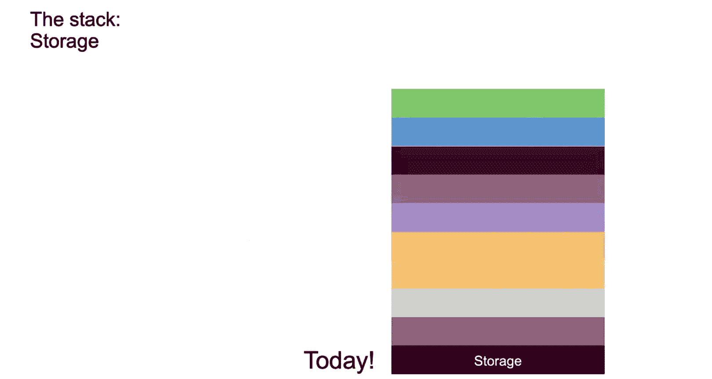

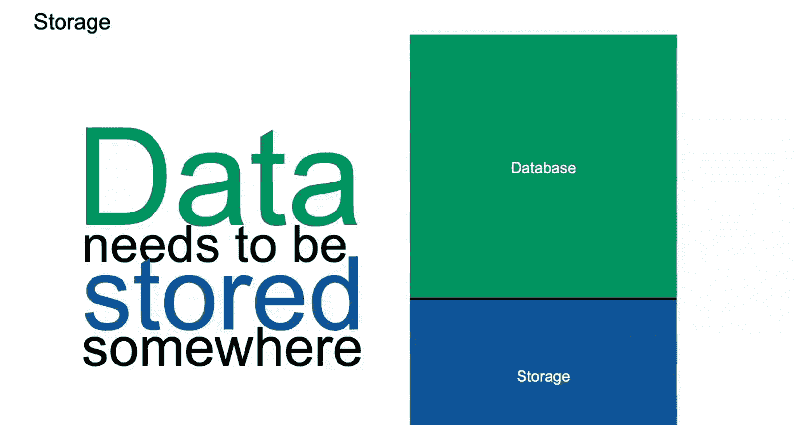

---

现在，这里有一个非常重要且绝对基本的观点需要理解。

有两种类型的系统。

一种系统像PostgreSQL。它基本上是**单体式**的，为你处理一切。这意味着你需要将数据导入其中，然后它会自己想办法存储和查询数据等等。这被称为ETL（提取、转换、加载）系统。这些是传统的数据库。它真的是一个封闭的系统，你只能从外部与之交互。这意味着它向你隐藏了复杂性，但也意味着你看不到内部。

但在21世纪初，出现了一种东西，或者更准确地说，是**重新出现**，因为这实际上在60年代就差不多是这样了。但在某些情况下，这正是你需要的。这被称为**数据湖**。

数据湖是一种带有目录和文件的文件系统。你只是把数据作为文件丢进去。但与左边系统的区别在于，你**能看到文件**，能看到目录，能看到文件，可以复制它们、下载它们、放到互联网上等等。所以你实际上是从文件系统中读取文件。这也被称为就地查询，因为你基本上是从数据所在的位置查询数据。

你在里面会有CSV文件、JSON文件、XML文件等等，各种文件。你可能也听说过这些，比如当你坐在Python笔记本前使用NumPy、Pandas等时，通常你就是在处理数据湖。事实上，对于某些用例来说，这很棒。但你需要知道，这不是唯一的东西。有些系统向你隐藏了一切，你甚至看不到任何文件，因为那是高度优化的隐藏状态。然后还有被称为数据湖的系统。区别清楚了吗？

好的，现在我们实际上关注的是数据湖，或者更具体地说，是**云中的数据湖**，而不仅仅是你笔记本电脑上的。

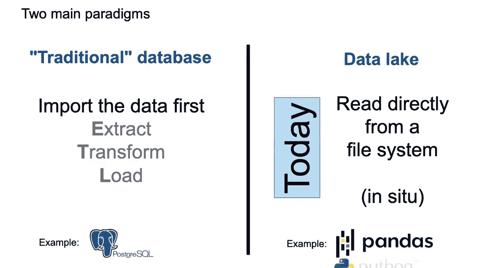

---

现在，如果我们从70年代开始，想把东西存储在单个磁盘上，这已经是一个硬盘了，我想你们可能已经见过了，对吧？这就是硬盘的样子。谁没见过？好的，大多数人都见过。这是一个硬盘。它有一个旋转的部分。这是机械硬盘，是我们今天仍然喜欢使用的更便宜的那种。

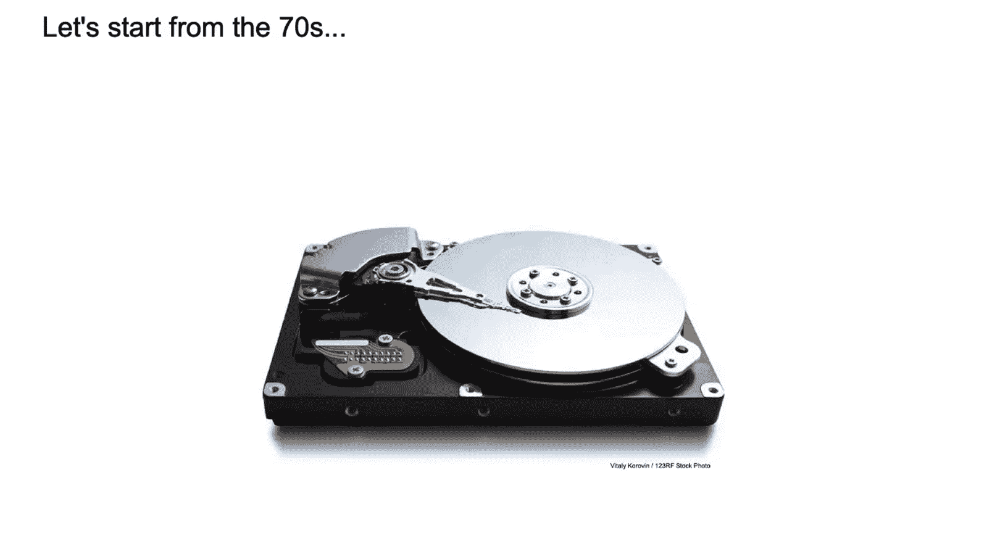

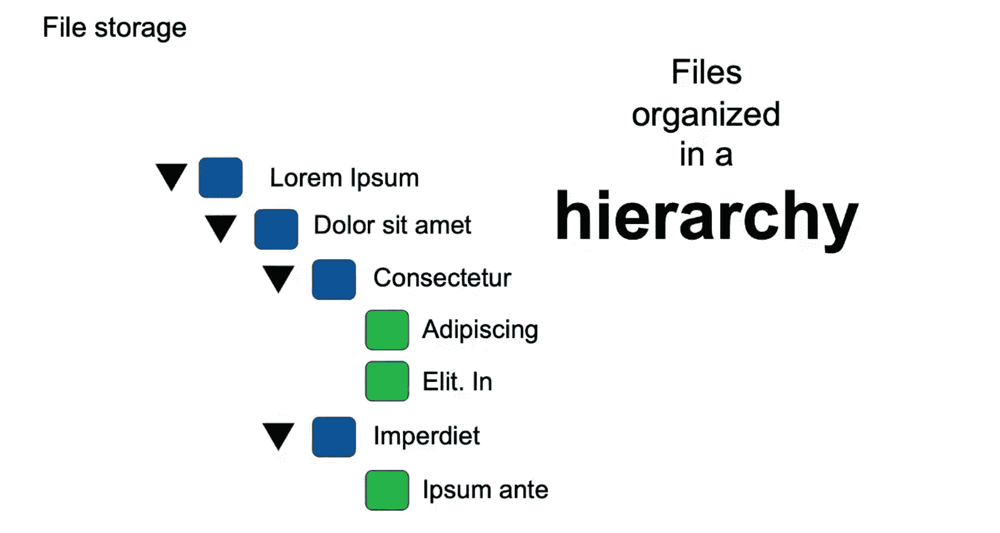

那里的文件以层次结构组织，你可以在里面有目录和文件。

此外，文件实际上被分割成**块**。所以，如果你的笔记本电脑上有一个文件，比如几兆字节，它并不是作为一个整体存储在磁盘上的。事实上，笔记本电脑会将其分割成**4KB的块**，很多这样的块，并且在你读取或写入时，是按块进行的。这被称为**块存储**。在你的笔记本电脑上，数据块大约是4KB。

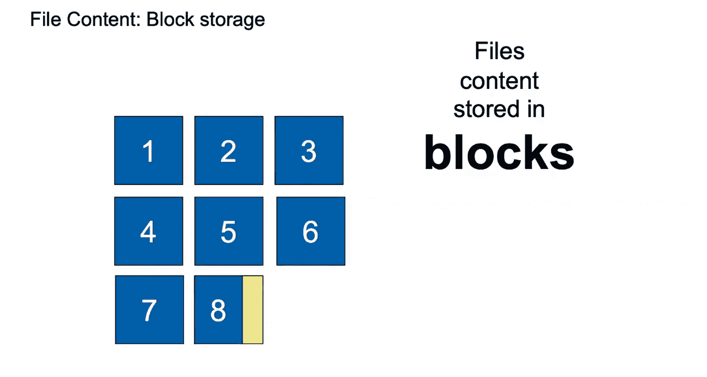

---

现在，如果你使用这种本地存储，并认为你可以通过用力敲打来塞进天体物理学数据集，那你就错了。因为这种带有硬盘的存储方式在本地机器上可以工作，在你的本地网络上也许可以工作（也许你们有些人在家有一个可以远程访问的硬盘），但如果有一百万人要远程连接到它，它就无法工作了。它之所以能工作，只是因为只有你一个人。广域网（WAN）是广域网络，事情在这里开始出现问题。在文件数量方面，我不知道你们中是否有人做过备份。如果你做备份，你会看到文件数量，可能有成千上万甚至数百万个文件。你笔记本电脑上肯定没有数十亿个文件，因为这也会突破我们现有系统的边界。

但问题是，对于大数据，我们确实需要那种规模的数量，对吧？那么，我们如何用云存储来解决这个问题呢？这就是我们将在9点15分休息后马上要看到的内容。

---

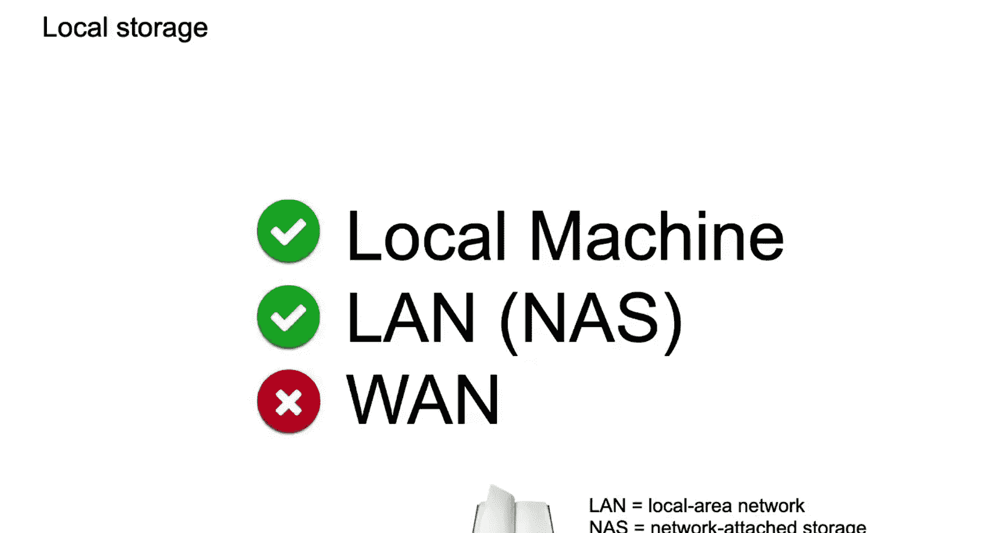

本节课中，我们一起学习了大数据技术栈的起点——云存储的基本概念。我们了解到数据中心由大量廉价机器构成，传统关系型数据库因单机限制无法处理海量数据。我们引入了数据湖的概念，它允许我们以文件形式直接存储和访问数据，为后续的大数据处理奠定了基础。下一节，我们将深入探讨云存储如何解决可扩展性和海量文件访问的问题。