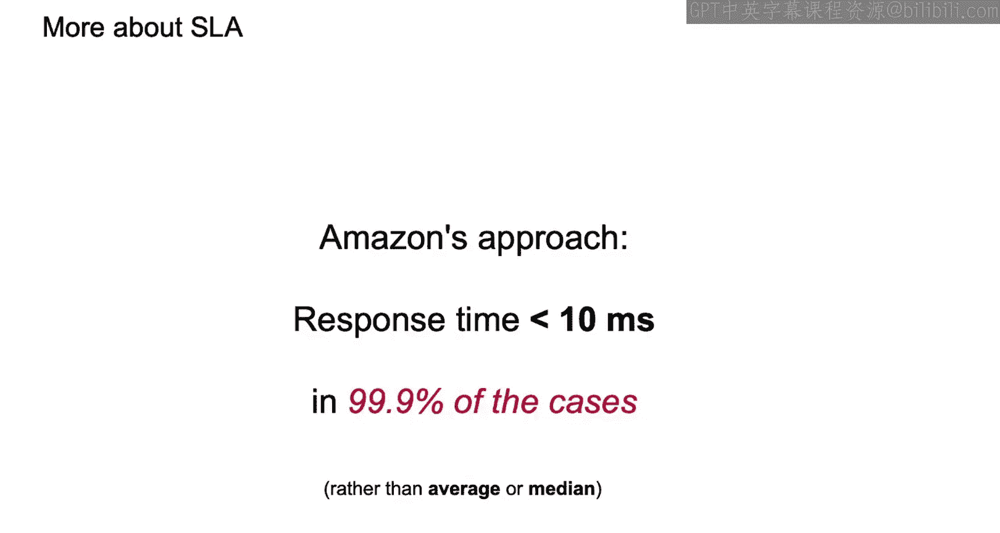
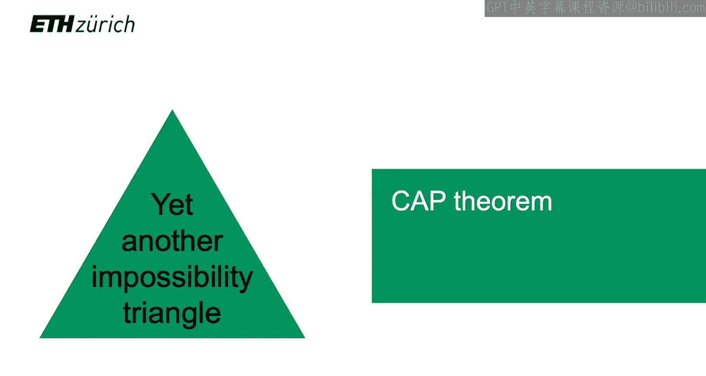
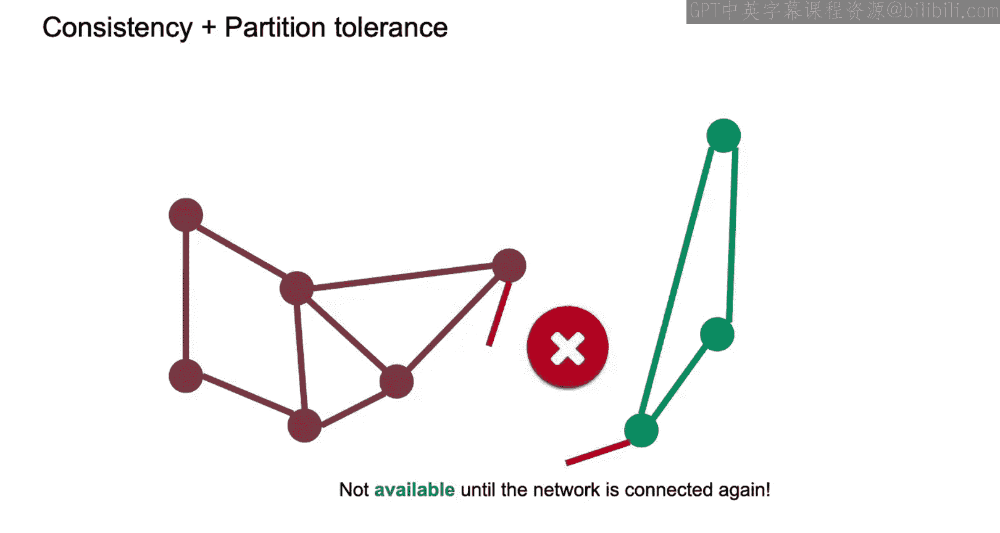
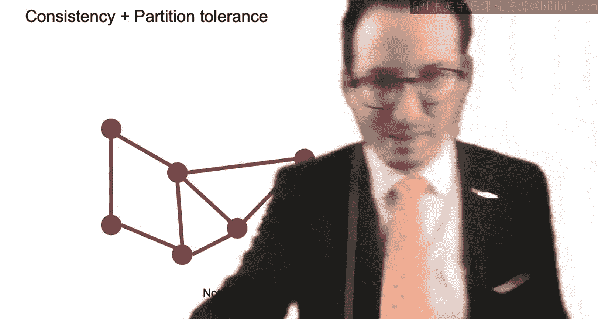
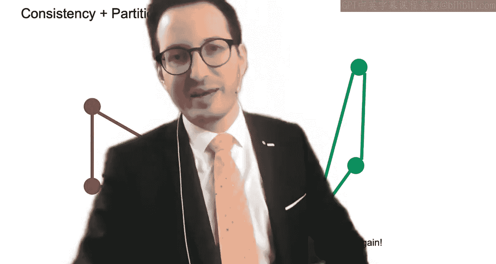
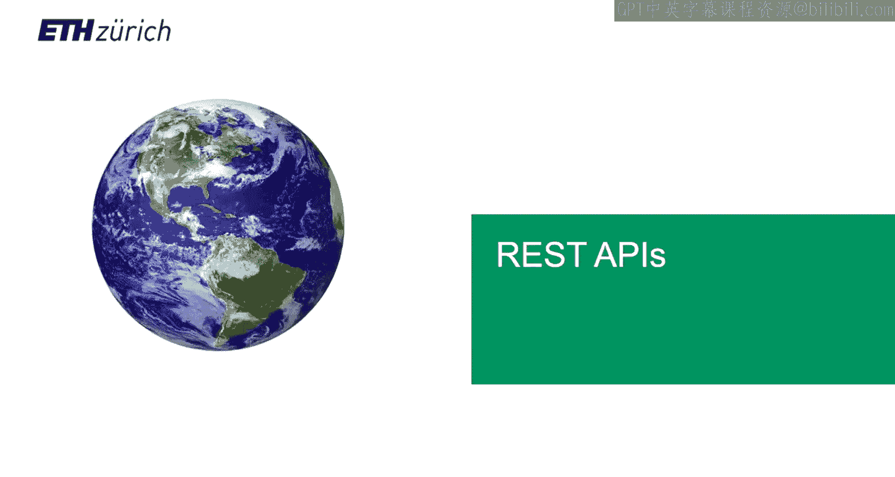
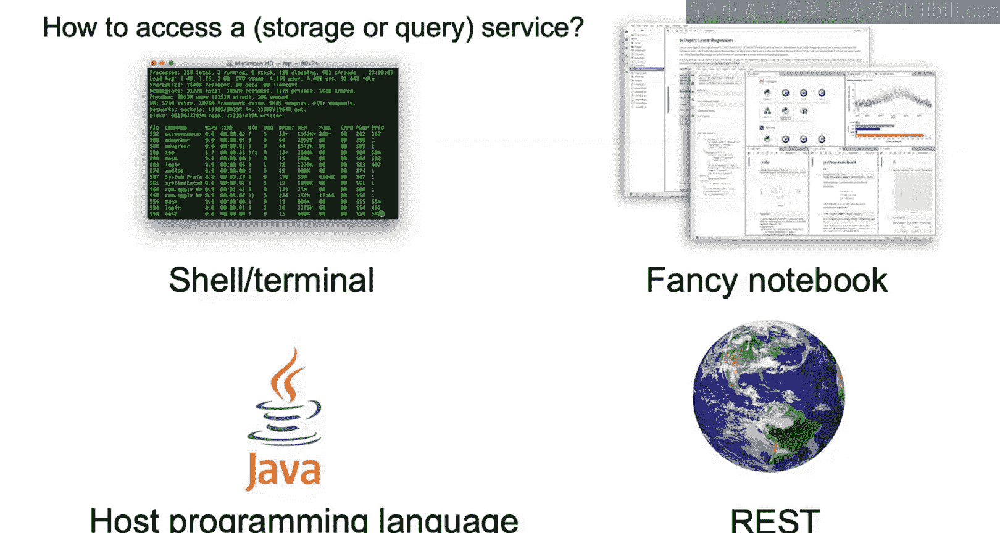
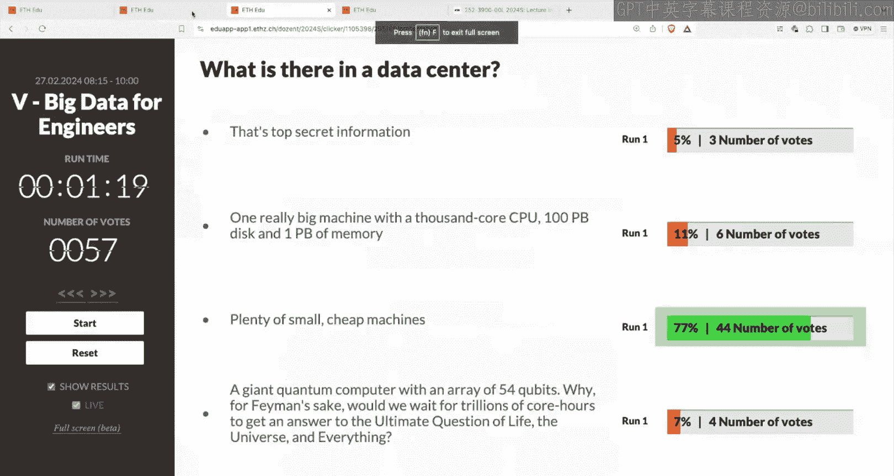
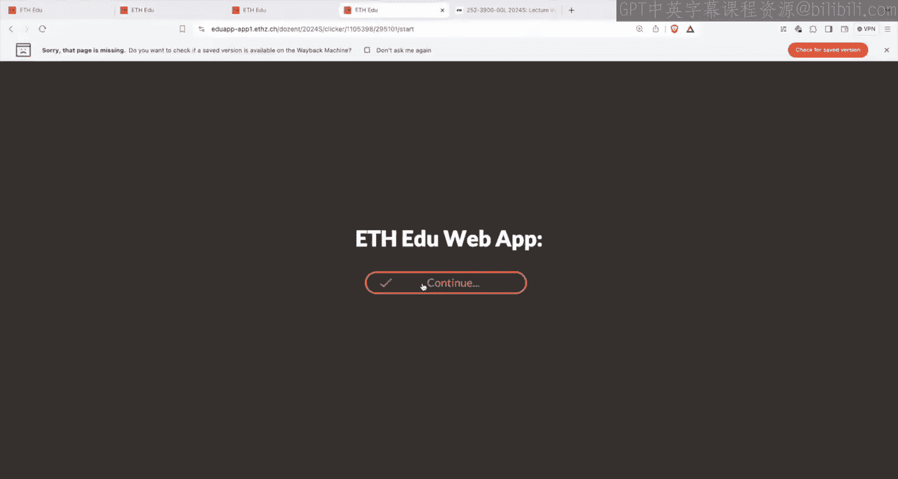
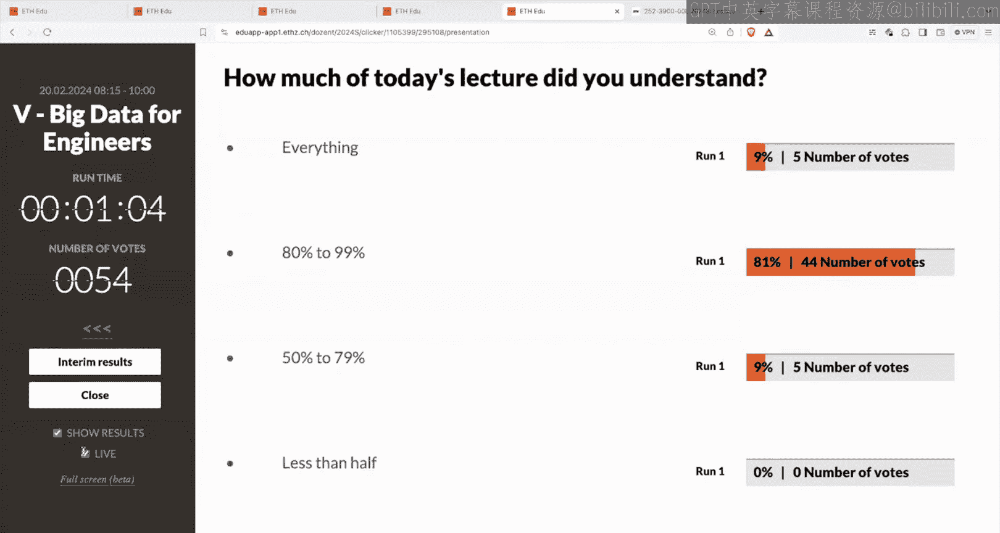

# 苏黎世联邦理工《工程师的大数据｜Big Data for Engineers - ETH Zurich - 2024》中英字幕 p05 3 - Cloud storage (2_3) - .zh_en -BV17FAmeFE9K_p5-

We comee back， everybody。 So let's take it from there after the this cliff anger。😊。

There is an analogy， in fact， in what we are doing。

 you might have felt that in order to scale up the。The the batteries in electric cars。

 this is exactly the same idea。 plenty of small cheap batteries。 and in fact。

 this is what you have by now in electric cars。 this is how you how you scale。So。

In order to make it work， we are going to throw， I love throwing things away。

 now you probably notice。 so we are going to throw away the whole hierarchy with directories and files。

 plot。And we make the data model almost trivial， meaning that the cloud storage that we're going to have to store our gigantic data set。

Is simply going to be what we call a key venue new model。

 It means that you have all of the files that now we are going to call them objects billions。

 trillions of them all they have is an ID an identifier right and so if you have the ID then you have the object。

So this is the data model。 We are going to have key value models all over the place in this lecture。

 But this is one of them。 This is an instance where we have the the data modeling of the。

 of the cloud storage that is。Almost trivial。呃。And we get what we call a global key value model。

 I literally mean global as in the whole planet because this cloud storage， as is done by Amazon。

 Google， Microsoft， A， and so on， is for the whole planet， It's a service。😊。

So how do we scale that because we need to actually make it happen？

So if one machine is not good enough， there are a few traits that you can try out。One of them。

Could be， for example， if you if you are playing video games and it's not powerful enough。

 you just try to find a bigger machine right with more memory。

 mock CPU and so on and even more and more and more and in many cases that kind of solves the problem。

 but you probably notice that it costs a lot of money and the problem that is that it keeps costing more and more and more money like every extra gigabyte that you add keeps getting more expensive。

 that's the problem with skating up。So instead of scaling up。

 we can have an approach of scaling out and now you know that this is what data centers do。

 instead of trying to find a bigger machine， I just buy plenty more small machines， plenty。Thousands。

 tens of thousands， millions。 if you， if you have multiple data centers， obedientience。

So that's called scalingating out again， remember scaling up bigger machines。

 scalingkating out more machines。 The opposite of scaling up is scaling down if you reduce， if you。

 if you buy smaller machines， the opposite of scaling out is scaling in if you reduce the number of machines。

 right。😊，So scaling out， but there is a third way that is incredibly important that I will show you thoroughlyly。

In this lecture， we will love to scale out。 We love to have plenty more more small machines。

 The reason is simple。 It's the costs because the costs of more and more and more machines that are small is almost linear Now it's another simplification。

 if you run into a supply shortage which actually happened in the previous years。

 then it might not be exactly linear。 if too many people want the machine。

 but it's more linear that's scaling up right scalingating up。

 in fact it's not just that it's exponential， it's even hyperbolic hyperbolic in the sense that there's an sim to。

 If you want today to to give me a machine that has a petabyte of memory and disk with 100 petabyte。

That's going to probably cost you 2illions of dollars because it just doesn't exist。

 And the efforts that you would have to actually put into building that are so gigantic that I don't even think anybody on the planet has enough money to do it。

 So this is just showing you the limits of scaling up。

 But a petabyte of memory and 100 petabyte of storage in a data center。 No problem at all。

 just by plenty of machines。 And you have that。 And we have more than that， in fact。

 by scalingkating out。So this is why we are going to scale out a lot， plenty of small machines。

But there is a failed approach。And it's actually nice that TthH Junis was here because there is in that start approach。

 this is a very valuable insight for those of you who might be considering funding startups based on who wants to fund a startup。

Not so many yet。 maybe the idea is going to to come to you in the in the coming。

 I don't know for some of you。 the mistake that many people make is that they immediately think we're going to。

Buy a lot of machines and， you know， good to your cloud and so on。 But in fact。

 when you build the first prototype， it's worth trying to make it fit on your laptop because very often the data actually fits on your laptop。

 You can compress it。 You can find ways， and you can make it faster just by writing better code。😊。

And this is much cheaper than going with skating out or skating up right So this is the reason why the first idea you should always。

 always have when you when it's not fast enough or there's not enough space。

 try to squeeze even more on a single machine。 This is always the first thing you should think of。

 And there is this beautiful quote that I love， you can have a second computer once you've shown you know how to use the first one。

 You wouldn't imagine what you can get of all of these laptops right here。

 Everything you can squeeze out of them， it's incredible just by learning all of these techniques and I'd also show you a bit of that the in the course。

嗯。All right。But when we go big data time， we reach petabyte scales， of course。

 that doesn't fit on the laptop。 and here we need to to scale out and we'll have plenty of machines。

So this is why we have data centers， data centers are the way to scale out。So now you know。

 because majority of you answered the question correctly， we have in a data center。

Tens of thousands of machines， P。 So it's， it's boring。

 It's just rooms that are filled with machines。I put all of magnitudes here， it's just with zeros。

 but it's approximate。There is kind of an upper bound for the number of machines in a data center that we consider to be around 100000 machinesBeyond that。

 you need more data centers。 You cannot keep them at the same location。

 The reason is actually very simple。 It has to be to do with energy and cooling is that。

A data center like like those that there are some in Zurich， by the way， in in the north of Zurich。

 There is even some， some some fiber optic ring around the city and some data centres。

 You might think it's in the mountains， right， There's these legends of all the data centres in the bunkers in the Swiss Mountains。

 But they are also right here in Zurich。嗯。We went to a field trip actually a few years ago with with the class and visited the data center。

And they told us， you know， the energy that this consumes is that of an airport。

 The data center has the electricity bit of an airport。And if you reach 100000。

 this is putting the system to its limit and then you even have staff having issues with cooling down the whole thing right so this is a physical limit to what you can achieve。

😊，Co there are ways you can still try to do it efficiently， Right， for example， at some places。

 you use the heat generate heat by the data center to heat apartments and flats for the。

 for the towns or cities that are around。 So you can use all of that。 But you。

 you do have this physical limit with the non machines， right。

 So think tens of thousands of machines in the data center。Now， in a single computer。

 I told you it's roughly your laptop， but actually it's a bit more than your laptop。

 slightly more than your laptop。 You can have。 I put 200。

 You know that it's all powers of two further calls。 right Again， it's just an approximation。

 Let's say 128 calls that you could have on on a machine can be 64，32 right。

 So this is the order of magnitude。 So you see it's not like millions of course。

 It's just a two or three digit number of course per machine on each machine。😊，In terms of storage。

 I already told you last week， we know how to build hard drives all the way to around 30 terabytes。

 I think 35 is on the agenda of some companies， but this is roughly the order magnitude。

 that's typically where you fit on a single machine in terms of Ram。

 you can have 16 GB that's still like your laptop， I think to date the highest we can achieve is6 terabytes on the same machine of a working memory。

 So the working memory， the Ram it looks like this。

 this is what this appears if you switch off the electricity right the one on top。

 if you switch off the electricity it's still there。

 So this is long termm storage and below its shock term， just the working memory。All right。

 but this gives you the order of magnitude。What about the network when you know that typically what you have at home is one gigabit maybe 10 gigabit per seconds for some offerings。

 you can go all the way to 100 gigabits per second and maybe even sometimes more you think of HPC and Fi band and so on so you can get a lot of bandwidth on a server but it's still limited and the fact that it's limited actually constraintstrain the sort of things we can build in terms of big data systems right but you have the numbers right now that you have in mind。

Now， what does it look like， well， even though I told you we are just buying thousands of these machines。

What you have in a data center is not just 1000 desks with a desktop computer on each desk， right。

 In fact， what you do instead is that you pile up the computer on top of each other in towels that look just like this。

 This is called a rack。And every single。Layer that you see in there。See， so this is the rack。

 every layer here is a machine。😊，Right， so you pile the machine up on top of each other。

 You can have maybe I don't know 10 or 20 machines piled up on top of each other。

 and then plenty of racks。 and then you have a room。 and then you have another room with again。

 plenty of racks。 but it looks like this。 There is a standardization of course of all of that because there have multiple providers。

 but they standardized the height so that it can be assembled with modularity， right。

 So this is called the rack unit R you， And then that's typically two or four rack units is the height of one of them。

No， I said these are computers。 It doesn't have to be computers。 You can also have your disks。

 So one layer is just going to have pen disks， for example。

 or you can have one layer that is just made of network switches。

 So network cables that are to dispat or the network routers is the name So this is very modular。

 and it's like your Lego game。 You basically build your racks and putting whatever you need。

 So typically， I think in the same rack， you might have like a couple of machines。

 and maybe below you're gonna have a couple of layer of hard drives and maybe I don't know at the top or below a network router that connects to the to the rest of the data center all modular。

So this is what there is。 This is an example of rack serverver。 In fact， I have one in my office。

 The program is that we move to another building and this is extremely heavy。

 So I don't manage anymore to transport it all by myself。

 but this is what it looks like So a single layer， a single server right and you can find them by the way。

 you can find them on some online shops。 if you want to see the specifications。

 there's a link on the the on the coursemod。 if you want to see what it looks like。😊，这。😊。

So this is what there is in a data center。 So now I it。 now， you know。

 maybe some of who was already in a data center。Some of you， okay， so you already know。

 but maybe some the others you will have an opportunity one day to visit one it's very。

 very impressive。Okay。So now let's move on to cloud storage， one of them， because now。

 you know that there's Amazon， there's Google and there's the Microsoft to the the big three。

 There's also also some other players。 but these are the main three。Now。

 we surprised to see Amazon here。Some of you， because a couple of years ago。

 some people were surprised like， what is a bookshop doing in in a big data lecture？

And what actually happened is that， yes， it was a bookshop。 Amazon was pretty much selling books。😊。

But they had a problem around the the busy periods。

 like Christmas and so on that suddenly they didn't have enough computers。

 And so they needed to buy computers in order to be able to continue selling over the Christmas periods。

 The problem is that once they did that， the rest of the year。

 the computers were wasted because they were unused。

And then they had the idea of renting them if we don't use the resources。

 why don't we rent the resources to everybody else and they can use the course and the memory and so on。

 And this is how a whole new subdivision was born known as Amazon Web services or AWS。

 And this is why now Amazon is one of the biggest players in terms of cloud services that that was basically born of that of renting out theused space。

😊，Now they are no longer alone。 There's Google Cloud， there's Microsoft， Asia and so on。

 So there's plenty of plenty of players out would there。But this is the market。😊。

What's Fer about them， the cloud players？Is that they more or less have the same offerings。

 just has different names， there might be a bit some differences in the details of the products。

So whenever I tell you about one of them， for example， Amazon S3。

 you'll have the same thing on Aure and you'll have the same thing in Google Cloud， right。

 Google Cloud St， Microsoft， A Bb St， A Data and so on。 So they all have these offerings。

 But S3 was the first one of its kind in terms of cloud services。 So I'm going to to show it to you。

😊，In fact。😊，What I at the same time don't like and like about S3。

 so let's start with what I don't like。I have no idea what it's made of because that's not public。

 So it it's basically just an API and a service that you can use。

 but we don't know how its implements it。Why do I like that I that for teaching it's great because I told you about data independence When you learn something。

 you first need to understand it seen from outside with the way you use it and only then you go inside in every week almost I'm going to do that。

 I'm first going to explain seen from outside and then I tell you what there is inside S 3。

 I have no choice because I don't know what's inside So it forceses me to explain it to you from from outside。

😊，So here's the model。In S3， it's a global cloud service。 You have so called buckets。

And in the buckets， you have。So they are identified with boque IDs and in the bucketquets you have objects。

The objects are your fight and that seat。's that's the model behind S three。

Not without these objects。There can be CSV files， XML files， JSON files。

 but that wasn't the first idea。The first idea was that these objects could be pixels。

 videos and so on In fact， that kind of storage is used by all the providers that allow you to upload your photos like I don't know Apple。

 Google and so on behind this is what there is there is ultimately a cloud service like that where each photo is an object each video is an object。

It even goes felt out and that。If you consider providers like Netflix， Amazon Prime， Disney+。

 and so on and so on， pretty sure a lot of you probably like to watch some series。嗯。

This is also where it stopped。So what happens when you have the latest Star Trek that you want to offer as SVOD。

 what you do is that you cut it into chunks of a few seconds， the whole series， we have five seconds。

 five seconds， five seconds， five seconds in different resolutions。And。You saw them as objects。

 So every five seconds， I just an I，5 second is another of magnitude corresponds to one object。

 What does streaming means mean， It means that you download5 seconds and then5 seconds and then five seconds as you watch the series。

If you don't have enough internet， you start downloading the lower resolution 5 seconds that are that take less space or you switch back to high resolution。

 but this is also supported by by your cloud storage like that。 In fact。

 if some of you have firewalls or monitors on your laptop， you will see Amazon。

 Google and Microsoft Azure Azure addresses in the backgrounds when you actually do this because this is all stored in the end over there。

RightSo it's used for pictures， videos and so on， but also for file backups when the backup services also rely on this。

 the encrypted storage often relies on these services as well。😊，And also big data， because of course。

 one day the data scientists discovered that this actually is also great to store data， XML， JN， CSV。

 and so on， and we'll see how for this course， it also works great。Alright。

 so we have buruques and in the boquets。 we have the objects。

So if you have the idea of doubleet plus the idea of the object。

 then you can retrieve the object that you're interested in。

 you can also upload an object with a new ID and so on。

Now it's interesting to know the limits because I told you your use case， it's a videos。

 pictures and so on。 So the limits of the size of an object is5 terytes。😊，5 TB。

 It cannot be bigger than that。 There are no buckets inside buckets。 I'll come back on the hierarchy。

 There are no buckets inside buckets to answer your question on only one level。

 So the question is are buckets inside buckets exactly。 So there are no buckets inside buckets。

 It's it's it's completely excludeded。 You cannot nest at all。Right。😊，呃。

But I'll come back on the hierarchy because there are a few things to say about that。

So maximum 50ytes。😊，There is a maximum of 100 buckets that you can create。 It's just to limit abuse。

 In fact， if you are， if you politely write a message to the superb and ask or more。

 they might give you more。 but there is by default this limit of10 of 100 buckets for winner accounts。

 right。So think of the burquette as a way to organize your objects right by by what you want to do。

 right， So this is。How it use all right now。Let's do a bit of law， you。Legal services。U。

When you are a company and you have customers that use your services。

 you want to have a contract between the two parties because they are paying you money and they want something in exchange for money and they want guarantees in exchange for money。

So the guarantees in terms of cloud services， they are usually expressed with plenty of nines that look like this。

 so the contracts are full of nines。So what do they mean， There's plenty of of things they can mean。

 In that case， it's about durability。A typical durability is expressed as 99。999999999%。

It means that every year。One object in 100 billion is lost。For whatever reason。

 maybe a hard drive crashed or the redundancy didn't work and so on。But you lose one object。

 every hundred billion。So most customers do not have that many objects。

 So it's unlikely they will ever lose something， but nevertheless。

 it's not going to be 100% because this is just real life。

 So what you have in your contract is a digit like that that says it's 99。999999。

 And you know that one year， there is a risk of losing one object。

If this is an unacceptable threshold because you do have many objects， then store it twice。

 for example， and then you can work on the probability， but then this is as the customer。All right。

Then there are other numbers that do not express durability。

 they express the availability of the service。For example。

 you might have in the contract these are just examples here that the service is available 99。

99% of the time， if you compute that over a year， it means that you might have one hour of downtime。

😊，Every year it might crash， be unavailable for one hour if you change the so we thought about nights。

If you change the number of nines。You basically get these orders of magnitudes， right。

 So 99% hit four days of I would age a year。All the way to 99。99999， which is4 seconds every year。

 right？And again， these things happen。 You probably heard it's in the news when it happens。

 for example， when the Swisscom network suddenly becomes unavailable and so on。

 So right this is real life， these things happen， but you can quantify them and try to to put limits or guarantees on the on the on the duration of an outage and again。

 it's all expressed with night SLA at the top means service level agreements。

 That's the name of the documents that you get whenever you use the service。 And if you use it。

 then you agree with the service level agreements。😊，Alright。😊，Again， something。

 it's only indicative because in the case of S 3， it's more like 300 milliseconds than 10 milliseconds。

And I think even in the in。Sorry。In the case of S3， you do not get a guarantee on that。 So again。

 this is just an example unrelated to S 3。What about the guarantee on the response type。

 like if you request something， how much time do you wait？Until you get it。Well， they could tell you。

 okay， on average， it's going to take 10 millisecond， but that's not what they do。 In fact。

 the way they do it is that they guarantee you a specific amount， for example，10 milliseconds。

In so and so many% of the cases。 So an example could be。

 we guarantee you you're going to get an answer below 10 mill seconds of waiting time。

But maybe once in 1 thousand0 cases， that's going to take longer， right。

 And you put a limit on on the on the the the percent of cases where that might actually take longer。

 We don't like average or median。 we really try to look at percent bodies。Again。

 I repeat 10 milliseconds is not the response time of S 3。 If you want something in your mind。

 it's more like a few hundred milliseconds of a typical response time for cloud storage。

All right， so that's so good， everybody following。😊，Okay。So this is the service level agreements。

 the legalese， if you want to call it legalies。嗯。Now we have something that is known as the CAP CRorM that is true not only for S3。

 it's true of any cloud service， any distributed service related to data。

It's an impossibility to triangle。 basically says you would like D and that and that。

 but you can't have it。 You can only have two of the three。

 but you cannot have the three at the same time。 So what out of these D and that it's C A and P actually。

 So they mean C for consistency。

A for availability and P for partition tolerance。And what the CP CRorM tells us is you can't have all three。

 you have to make a choice， you have to give up on one of these。

 So now I'm going to explain to you what they mean。So。Atomic consistency。 So the C consistency。

It's not the same thing as in acidI。 This is why I put this atomic in parenthees。

 It's not the same consistency as in acidid。 What we mean here with consistency in the context of distributed service with data。

Is that you might have 100 machines，100 nodes or 1000 nodes that are able to serve the data because if you have millions of people connected。

 it cannot be the same machine for everybody right so this is spread over the machines Maybe I don't know you have 1 thousand customer on each one of the thousand machines making it a million in total。

But in that case， atomic consistency means it doesn't matter with which machine you're speaking。

 they all give you the same thing， they all see the same data。

 So if you request the five seconds or the first five seconds of the first episode or the third season of Sa discovery。

 it doesn't matter which computer you are asking for it， you get the exact same five seconds。

 that's called consistency。You might not have consistency if。

 depending on the machine with which you connect， you might get something different。

 then it's not consistent， right。So this is the seat。Then there is the a。The A means。

The system is available， meaning you connect to it and it gives you an answer in a reasonable amount of time。

 like for example， in the cloud storage， you would expect like 300 milliseconds， then it's available。

😊，Not available means you try to connect to it。😮，But it hangs or it tells you， no， sorry。

 I'm not available right now， please come back in an hour， right？

Your customers are very our customers are very important to us， but please come back in an hour。

 So this is not available。 Available means you connect， you get an answer。So that's the a of C。And。

The why don't I have do I have P， I think I I introduce it like this， the P so partition tolerance。

So here's the key。You have a network of machines， all the computers that are connected with network cables in the data center。

They are connected with each other since they are serving the customers， they might have copies。

 some copy of the data available or they can transmit it over the network。Now。

 imagine that somewhere。There is an update。 For example， somebody wrote a comment on LinkedIn。

 So the comment is uploaded over there with the computer。 and then there is an update。

 Theres the new comments。Now it has to propagate。All over， right。

 because the other nodes have to start accessing that way。

So idea lead would propagate to the whole network of machines and at some point they all have the same view。

 but the problem is that that sort of things can happen。You might have a network cable that breaks。

 you might have I don't know， an earthquake， you might have a fire。

 you might have something that happens。And the network is partitioned。 The network is partitioned。

 It means that you have parted the network on the left， part of the network on the right。

 but they cannot speak to each other anymore。So this is called the partition of the network。

Pition tolerance means that when that happens。The system can still continue to work。

So it means that maybe I don't know is this is North America on the left and this is Asia on the right and maybe North America。

 they will connect to the nodes on the left in Asia they would connect to the nodes on the right and it works right。

 then it's called partition tolerance。However， right here， you see that。

It's not consistent in that case。Because the people in North America， they will see the new version。

The people in Asia they want， they would see an older version。So it means that in that case。

 it's partition to， it's available， but it's not consistent。

Because you don't see the same thing at the two places。Now， this is called a。

A system available partition to， you also have CP or PC systems that are to to the partition to。

To do the part of the network。😊，But they will just stop being available。 They will be consistent。

 but they will stop serving for a while， maybe for the duration of the partition。

 And then when it reconnects， they are available again。But they are consistent at no point in time。

 do they give inconsistent answers。 That's called a C CP system。 And finally， we have。A C or C， A。

 depending on the others， C， A means it's available and consistent。 But if the network partitions。

 that's it it crashes and that's that's good。 I just So there is another question。

 So how long between the updates between notes to consider we have consistency。嗯。

So the way would formulate it in terms of the duration is consistency。

Means hypothetically at the same time， So two people at the same time connect to the node。

 do they see the same data at the same time。So it's independent of the duration of the change。

You connect at the same time， do you see or not the same data。Now。

 if you are a theoretical physicist， you can argue， Yes yes， yes， yes yes。 But since Einstein。

 we know that it's impossible that everything is at the same time and so on。 But we are on earth。

 and it's smart enough that we that we that we don't see this kind of effect。 So you， if you。

 you could go there starting arguing with nanoseconds and so on。

 But this is just beyond what we are interested in in big data， right。

 So this is the way to look at it。 Yes， if you could to node。

 But if connect to node A and someone connect at another B， the data should be provod。😊。

Oh， yes。 But then if you connect to a node。

We try to understand your thinking。

So I think maybe you are focused on on my on my slide right here when I show you the propagation。

 the propagation， actually， I only showed it to you in order to illustrate why。

You cannot have C A and P， but basically， if you forget about this graph for a moment。

 you forget about this graph。What it means is a system。干啊。Choose to be part tolerant。

 It means that if there is a part of the network， it's not going to crash。

 it will continue to function properly。But if the network is partition。

 you have to make a choice between two things if you want to be partition the。Either you say。

 for the duration of the network partition， I make myself unavailable。

And then once the network partition stops， I propagate all of my updates and then everybody is consistent again or second option。

You say I'm partition Toent。 I'm not going to crash。But I'm going to remain available。

 The cost of that is that people on one side and people on the other side might have for a while for the duration of the network partition different version of the same data。

Now， the question that you are asking， I think when you ask about the propagation of the data over the network and you query at some node A and then it propagates to some node B。

 and do you see the same thing？What you have in mind is the normal function without network partition。

 right， because then there's no partition of the network。 But then you， you。

 you you the way to reason about T is more that。If you want to be consistent。You at every update。

Block for a little while the the the delivery of of the data until it has propagated and then you start serving again。

 but it's not going to be considered unavailable at that point。

 It's just that it takes a bit more time until this is done。

So now I'm not entirely sure if I answered your original question or not。If I didn't。

 we can take it offline， I did awesome， perfect。So for whom does that make sense， CAAP？Okay， awesome。

 so either you are C or CA or AP。Now beware， beware， beware。

 because now I see a proliferation of scientific papers by all the big players claiming to be CA A and B。

Do not let yourself be convinced by that。 You need to think critically。

The reason they are doing that is' marketing， they want to market it as always CA and P we are partition to rent consistent and available。

 It's a mental trick。 In fact， the reasoning is that if network partitions are very rare。

So rare that we don't care about them， then of course， we're always A and C， right。

 But the thing is the day that there is a network partition。Then they will have to make a choice。

 either they crash。Or they become unavailable or they become inconsistent。

 but you have to make a choice， you cannot be all three at the same time。All right。

 so that's the CAP COM。😊，All right， and in the case of S3。

 I don't actually know what they are because they say they are C and P。

 but that basically means they won't tell you what happens if there is a network partition。

Maybe one day there is one and then we will know。Okay。

 so next part that's called the rest API who already heard of rest。We never heard of rest。呼号的HTTP。

Okay， then you've heard of rest because rest is actually HTTP， but let me explain。

So。嗯。When you have a service can be S3， later， it can be HDFS map produce MongoDb like any service。

You have to offer a way to connect to it。You might do it on the shell。

 you open a shell and then you start writing stuff， or you might have a Jupiter notebook。

 that's also quite a convenient way of doing that， especially for teaching or you might expose it as an API through some programming language。

 then you write in Java R or C++ and so on Python。Or you expose it to rests。

Rest means you go through the web through the HTTP protocol。

 The web was invented here in Switzerland in 1989 by Sir Tim Bnaat in Geneva。

And I don't need to introduce it to you anymore because it's so famous。

But I can say a few words about the underlying way that the web works and the idea is that you type this in your address bar right so is this is the URL。

Universal resource locator。嗯。And the idea is that it's a web page so what you can have through these addresses are web pages。

 picture， and so on。But it turns out that this is not the only thing you can send over with these addresses。

 You can also send X M L， Json CSV。The idea of the web originally is it's humans talking to machines。

 You sit in front of a browser， you connect to a machine and get a web pitch。

 So it's between a human and a machine。Rest is the generalization of this from machine to machine instead of a human using this address。

 it's a machine， it's a program。😊，This is called the resource， these addresses right here。

We tend to call them URs， universal resource identifier。 You might have heard of URLs， Us。

 U IRIs and so on。I think I'm going to just call them URI for the duration of the lecture。

 I should say IRI but nobody says IRI so we just continue to say URI UL U I think doesn't exist anymore that that was dropped so the distinction between the two was dropped so there's only one kind of them。

HTTP is one way that they could start with， that's the one we use in the browsers。You also have FTP。

 mail to and so on and so on。 So they are actually other schemes， but this is called the scheme。

Then we have an authority that's the domain you can buy。

 you pay a few two digit number of francs every year。

 and then you can have your own domain like this。Then you have a path with the slashes slash slash slash slash slash。

Then you might have a question mark for a query that is in particular useful when you feel a form。

 for example， or parameters for the page。And then a fragments with the sharp。

 all the UIs look like this。 Sm authority path query fragments。For the lecture。

 I think we are just going to have HTTP all over the place because that's kind of the one that has established itself。

 but it doesn't necessarily mean that it's going over the web， but we'll come back to that later。Now。

 in the case of S 3， there is a rest API。 It means that you can access the objects and the buckets with resources like this with your eyes。

On the top， you have an example of burque UI where you have the name of the burqueette in orange。

 you need to replace it with the actual name， dot S3 dot blah， blah blah。 So in green。

 that would be the location of the data center。😊，And at the bottom you have the UI of an object right so you have the burhead ID in the domain and you have the object name after all the slash。

 right？😊，There is also an N down aid scheme called S3。

Where you directly say slash s buckett slash object name。

 this of course your browser will not understand， but if you use some tool in the ecosystem of S3。

 then the tools will actually understand the S3 sche as well， it's just equivalent to the HtP one。

So that's half of the web。In the Web， H T TP， every resource is identified with a UI。

 an image a video， a document， even abstract things can can be identified with resources。

 A light bulb can can be identified with a resource。And the second path is the methods。😊。

Once you have a resource， you can get it， you can put it， meaning you upload data， you can delete it。

 then when you try to get it again it's gone or you can post something。

 it means you interact with it in some way。Getting means that you're not modifying anything a side effect would mean that something changes right。

 but get doesn't modify anything you just politely ask to download a representation of the resource。

 an image a video or a data set that's get， you can get an object， you can get a burque。

 so at least the contents of a burque in that case。Then you can put you can put an object somewhere。

 but you need to know the UI for that So you put an object at a specific UI it's it important What does it important mean。

 it means that if you do it twice it's not different from doing it once right so if you put the same thing twice to some place then it's as if you had put it on once so put works that way if you do a get after a put you should get the same thing that you've just put right that's kind of logical。

Delette means that you request that the results becomes unaable so you get the 404 who had a 404 everybody knows 404 right that's the not funds。

 So if you do a delete and try a get after that you should get a 404 after all that。

Post is the kind of the everything else kind of method。Imagine， for example。

 the most common use case is you want to upload an object， but you don't know its ID yet。

 you don't know its a UI yet。 For example， you have a calendar and you have an API for the calendar。

 a rest API。 you want to create a calendar entry， but you don't have an UI yet。

 then you use posts and post will give you a U then you can use the UI to interact with it right so post is the most generic one。

 but it can have side effects and so on So that's also the most dangerous one。And that's it。

 so basically once you know the bucket your eyes and the object your eyes。

 you can interact with S3 with put D need get all the rest API。😊。

There are many other ways to interact with this three， but the rest API is one of them。Now。

 somebody asked earlier， that was a very good question。

 can you have a bucket in a bucketu in a bucketu in a bucket？The answer is no， you can't。

In cloud storage like this， object storage， there is no hierarchy， there are no directories。

 absolutely nothing。But you can cheat and pretend that there is a hierarchy。

 this is exactly what S3 is doing。So you see all of these object I here， these are all object I。

 you see the slashes as a human being， it looks like this， right。

 it looks like there are directories and so on。😊，That's only in your minds。

 S3 couldn't tell less about the slashes。 The slashes are just characters like any other to S 3。

 So there is no hierarchy。But you can pretend and say， okay， if there's a slash， I as a human。

 pretend that it's a directory。 And in fact， if you connect to the S3 interface over the over the web。

 you will see this nice displays with the directories and so on。

 And you can organize your data sets with the directories。

 But do not forget that S3 doesn't care about them and doesn't know about them。

 It's a simulation of hierarchy， but it's not a real hierarchy or whom does that make sense。Right。

Another thing and I'm going to end on that one， you can use S3 to host websites。

 in fact it's the cheapest way to host a website that is purely static meaning nothing changes。

 no interaction， it's just pages that don't move。That's the cheapest way beat Asia it can also be the same on Azure and Google。

 but basically this is very cheap to to host a website。

 The Jsononic website we had the Jsonic language throughout the semester is in fact， hosted on S3。

 very cheap。Okay， so I'm going to end right here just before you go， I like to check that you。

Put so just。You give me 30 more seconds。

Who just。Ask you this。

好。This is basically just a way for me to know if I'm too fast， I'm too slow， I should accelerate。

 I should slow down。So it's just a way for me to get an impression and after that you're good to go。

So my goal is the 80 to 99% bucket is。This means that the speed is right。诶。

If you understood less you know that we are here， I'm here。

 the T team is here you have the exercises so we are here to interact A3 is also here but it doesn't mean that we are not here too of course but this is perfect esymmetricsymmetric all right so we have people who understand everything we have most of you who understood 80% Thank you very much everybody the exercises on SQL please do not forget to do them this is how you learn and there is also a small Jsononic tutorial because by popular request I'm spreading Jsononic code over the semester to just do chunk by check Thank you very much everybody have a great week ahead and I see you next Tuesday at 8 AM thank you。

