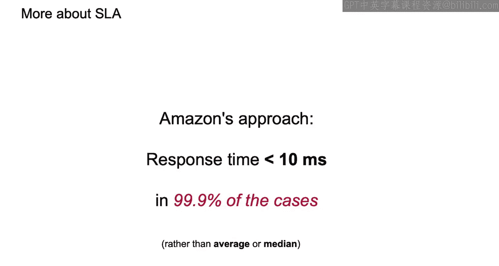
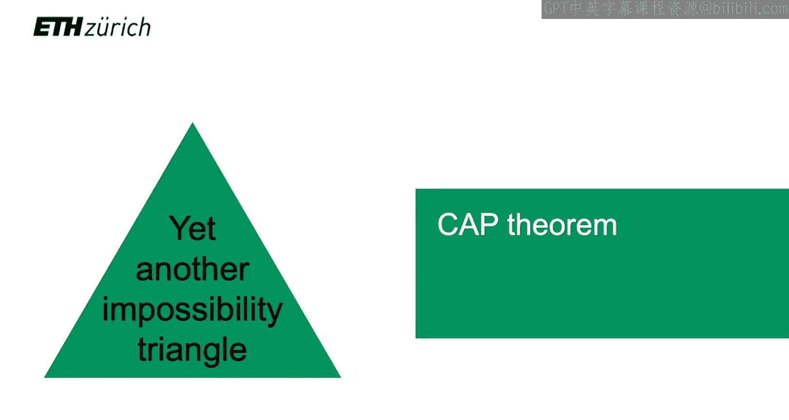
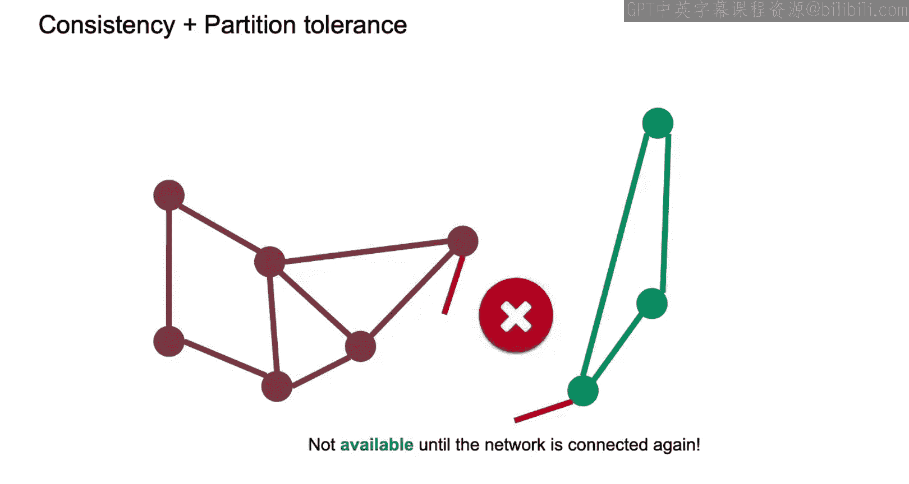
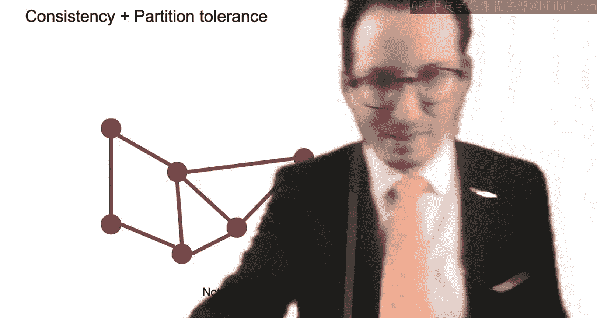
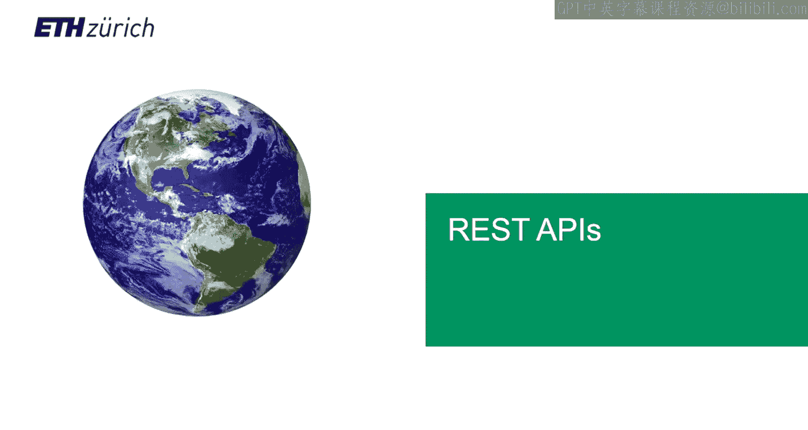
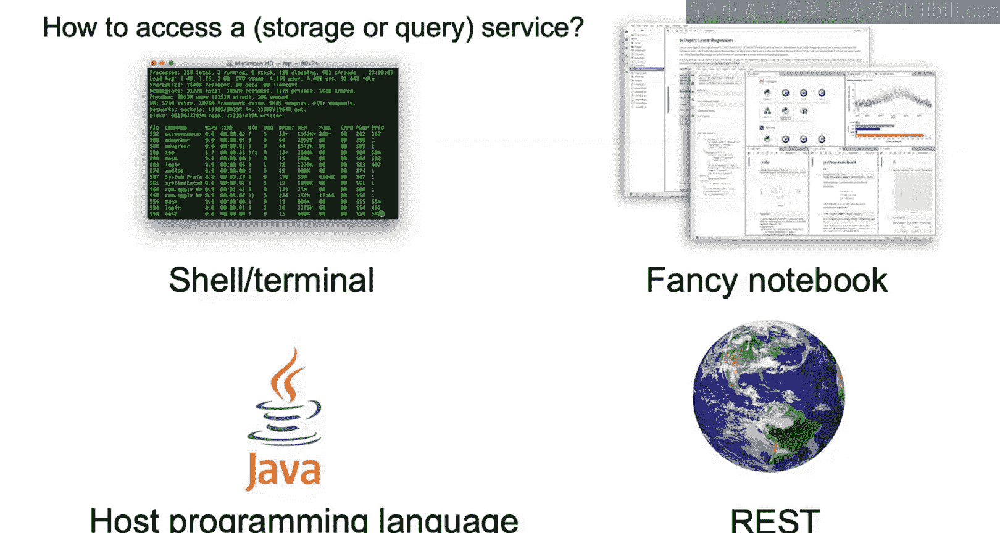
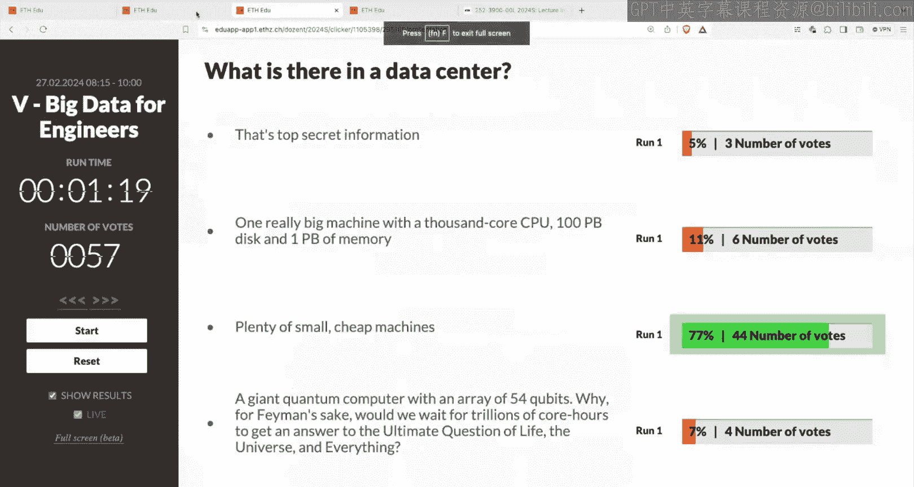
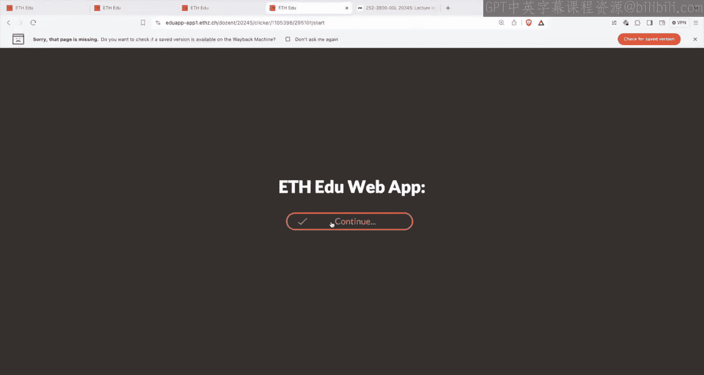
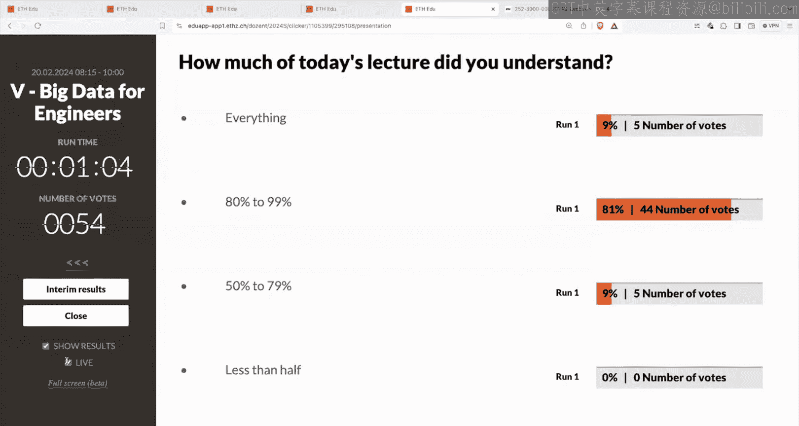

# 工程师的大数据：05：云存储 (2/3) 🗂️

在本节课中，我们将要学习云存储的核心概念，特别是如何通过扩展（Scale Out）而非升级（Scale Up）来处理海量数据。我们将深入探讨亚马逊S3等云存储服务的数据模型、架构特点以及其背后的理论限制。

## 从扩展说起

上一节我们介绍了处理大数据时面临的存储挑战。本节中我们来看看解决这些挑战的核心策略：扩展。

为了应对海量数据，我们摒弃了传统的目录和文件层级结构。新的数据模型变得极为简单：我们称之为**键值模型**。这意味着所有文件（现在称为对象）都只拥有一个唯一的标识符（ID）。如果你知道这个ID，你就可以获取对应的对象。其核心概念可以表示为：

**数据模型：键值对**
```
Key -> Value
(对象ID) -> (对象数据)
```

## 扩展的策略：向上 vs. 向外

当一台机器性能不足时，通常有三种应对策略。

以下是三种主要的扩展思路：

1.  **向上扩展**：购买更强大的单台机器（更多CPU、内存、存储）。这种方法成本高昂，且每增加一个单位的性能，其边际成本会急剧上升，存在物理和经济的上限。
2.  **向外扩展**：购买更多普通的小型机器。这是数据中心采用的方式，成本增长相对线性，是处理海量数据的可行方案。
3.  **优化代码**：在考虑扩展之前，首先尝试在单台机器（如你的笔记本电脑）上通过优化代码、压缩数据等方式解决问题。这通常是最经济高效的第一步。

## 数据中心的架构

当我们决定向外扩展时，就需要用到数据中心。一个数据中心容纳着成千上万台机器。

以下是数据中心内部的关键组件和规模：

*   **机器数量**：一个数据中心通常包含数万台机器，物理上限大约在10万台左右，受限于供电和冷却能力。
*   **单机规格**：每台服务器（远强于普通笔记本）可能拥有数十到数百个CPU核心、最高数TB的内存以及数十TB的存储空间。
*   **网络带宽**：服务器间的网络连接速度可达100 Gb/s甚至更高，但这仍然是构建大数据系统时的一个重要限制因素。
*   **物理布局**：机器被堆叠在机架中。每个机架像乐高积木一样模块化，可以容纳计算服务器、存储硬盘或网络交换机等不同组件。

## 云存储服务：以亚马逊S3为例

现在让我们将目光转向具体的云存储服务。市场主要由亚马逊AWS、谷歌云和微软Azure主导。亚马逊S3是此类服务的先驱。

S3的数据模型非常简单，包含两个核心概念：

*   **存储桶**：用于组织对象的容器。
*   **对象**：存储的基本单元，可以是任何文件（图片、视频、数据文件等）。每个对象通过其键（Key，即ID）来唯一标识。

其访问模式可以概括为：
```
GET /{bucket-name}/{object-key}
PUT /{bucket-name}/{object-key}
DELETE /{bucket-name}/{object-key}
```





关于S3，有几个重要的技术细节：

*   **对象大小**：单个对象最大为5 TB。
*   **无真实层级**：虽然对象键中可以使用“/”来模拟目录结构（如 `photos/2024/vacation.jpg`），但对S3而言，“/”只是键名中的一个普通字符，并无真正的文件夹概念。
*   **服务协议**：云服务提供商会通过**服务等级协议**来承诺服务质量，通常用多个“9”来表示，例如：
    *   **持久性**：99.999999999%（11个9）意味着每年每1000亿个对象中仅可能丢失一个。
    *   **可用性**：99.99%意味着每年服务中断时间不超过约1小时。

## 分布式系统的理论限制：CAP定理

对于S3或任何分布式数据服务，都存在一个根本性的理论约束，即**CAP定理**。

CAP定理指出，在分布式系统中，一致性、可用性和分区容错性三者不可兼得，最多只能同时满足其中两项。





以下是这三个术语的定义：


*   **一致性**：无论连接到哪个服务器节点，所有客户端都能读取到相同的最新数据。
*   **可用性**：每个向系统的请求都能在一定时间内收到响应（成功或失败）。
*   **分区容错性**：当网络发生分区（部分节点之间无法通信）时，系统仍能继续运行。

因此，系统设计必须在网络分区发生时做出权衡，通常表现为以下三种类型：

*   **CP系统**：保证一致性和分区容错性，但在分区期间可能变得不可用。
*   **AP系统**：保证可用性和分区容错性，但在分区期间可能返回不一致的数据。
*   **CA系统**：保证一致性和可用性，但无法容忍网络分区（在实际分布式环境中很难实现）。





## 如何与云存储交互：REST API

应用程序通过API与S3这样的服务进行交互，最常用的方式之一是**REST API**，它基于Web的HTTP协议。

一个REST API的核心要素是**资源标识符**和**操作方法**。

资源通过**统一资源标识符**来定位，其通用格式如下：
```
<scheme>://<authority>/<path>?<query>#<fragment>
```
例如，一个S3对象的URI可能看起来像：`https://my-bucket.s3.eu-central-1.amazonaws.com/dataset/file.csv`

针对一个资源，主要可以执行以下HTTP方法：

*   **GET**：获取资源（如下载对象）。
*   **PUT**：上传或替换资源（需指定完整URI）。此操作是**幂等**的（重复执行相同效果）。
*   **DELETE**：删除资源。
*   **POST**：向资源提交数据，通常用于创建新资源（其URI可能由服务器生成）。


## 总结







本节课中我们一起学习了云存储的基础。我们了解到，为了存储海量数据，云存储采用了简单的键值模型和向外扩展的策略，依托于由数万台机器组成的数据中心。我们以亚马逊S3为例，剖析了其无层级的数据结构、服务等级协议以及通过REST API进行交互的方式。最后，我们探讨了支配所有分布式数据系统的CAP定理，它揭示了在一致性、可用性和分区容错性之间必须做出的根本性权衡。理解这些概念是设计和运用大数据系统的基石。