# 苏黎世联邦理工《工程师的大数据｜Big Data for Engineers - ETH Zurich - 2024》中英字幕 p06 3 - Cloud storage (3_3) - .zh_en -BV17FAmeFE9K_p6-

Welcome， everybody in the lecture hall， welcome everybody on Zoom。 welcome everybody from the future。

 Today， we are going to finish discussing cloud storage。 You might remember Amazon S3。😊。

And before we start， I have a question for you。 and then I'll take it from there。

So。得 me。Which one of these？😮，Cannot be stored as an object on top of S 3。Anser A。

 is it the first episode of Star Trek discoveryy， answer B。

 is it the 300 petabyte data set containing proton collisions released by ser。

Uner C the static pages of the website， answer D an archived backup of my two terabyte heart disk。

Three can be stopped。Onest three。Ens。One of them cannot be stopped。我 three。As a single object， right？

Giving you a bit of time to wake up。For those of you who see this for the first time。

 you can go to the URL that you see on the top atu app dash upw do ttH dot cH and you can log in with the ETH。

Loin in password there or you can use the app on your smartphone。Alright。

 then let's look at the answers。 think there are many more people on the room and on chat on Zoom chat as those answering。

 but nevertheless。We have a majority and the majority is correct。

300s petabytes cannot be stored on top of S 3 because the size of the largest object you can put on S 3 is。

5  TB， exactly。 That's the largest you can do。 So 300 pet that needs to be done differently。

 The first episode of satt discovery， no problem that fits in 5  TB。

 The static pages of the website also fit in 5  TB。

 even if you would have file with all of them that still fits to have2  TB or hard disk is also no problem at all。

Okay。So， now。Let me switch back。With the states。Okay。So speaking about data sets。

So I told you there's many ways you can use S3 right。

 you can use it to store pictures to store videos if you are a subscribe video of demands on demand streaming service like Netflix。

 Disney+ and so on。 you can also use cloud storage as your backend if you are an encrypted storage provider。

 you can also use S3 as the backend。You can host static pages also at the back end。

 it's one of the cheapest ways of storing actually of hosting a static website。 and finally。

 we can put data， which is something that came a bit later。

 but you can also use a service like this to push your data set and then we see how you query them。

But I just wanted to say one thing that's also popped up in a discussion。So。

Even though the largest objects you can store on S3 are five terabytes in practice that may not always be a good idea。

The problem， if you try to upload from your laptop。

 let's say you want to upload a data set that is a single5 terabyte file。

What's going to happen is that you're going to start the transfer。

 but then there is a good chance it's going to fail for various reasons like for the network or whatever。

 and then you have to try a few times before it actually works This is because of the very large pile I'm sure you all experience this when you try to download。

 for example， even a OS updates might not work the first time you might you might need to try a second time。

This is the problem with extremely large fights。😊，So。There are two ways to solve this。One of them。

Is simply as a user to split your data set into smaller files， command D of your 100 megabytes。

 that's kind of a size that people tend to like and instead of uploading a single fiveterabs five terabyte object。

You will upload instead，5000 objects。😮，That are each one gigaby， for example。

The reason it works better is that the individual objects， most of them will succeed。

 And if some of them don't， you just try again。 But only with those that don't succeed。

 And that's actually much easier to handle， right， because the worst case。

 there's just a few objects you， you have to try again。

 instead of the whole5 TBab starting from scratch。 So this is the first thing you can do。

 And in fact， for data sets， people commonly do this。 If you look at this screen right here。

 you will see that these are plenty of。Objects， honest 3。And there are each 500 megabs。

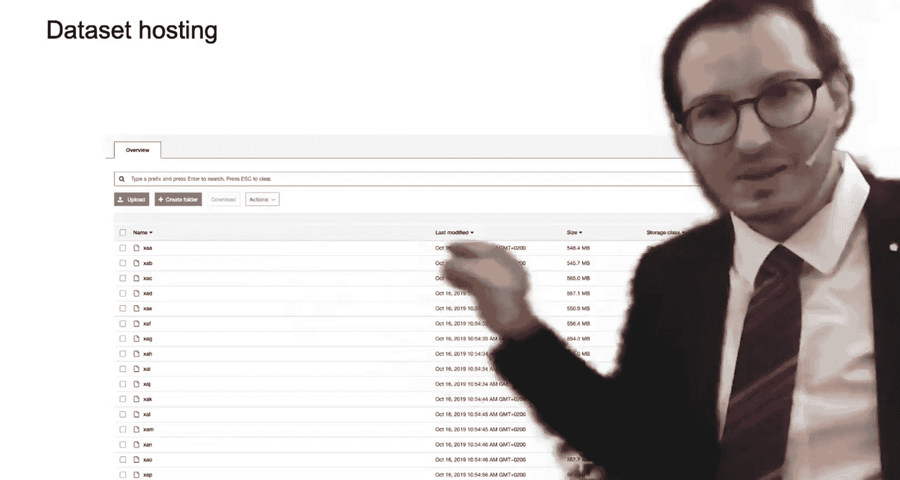

Right and they are， it doesn't matter how they are called。 It can be incremental integers。

 This is the the reason it's called like that。 I think I use the command line that automatically splits the lines over our multiple files and it uses these incremental letters。

 But what you see here is that we have multiple objects that each have have500 megabytes。

 We could have uploaded the entire data sets that would maybe have been a few hundred gigtes。

 I don't know。

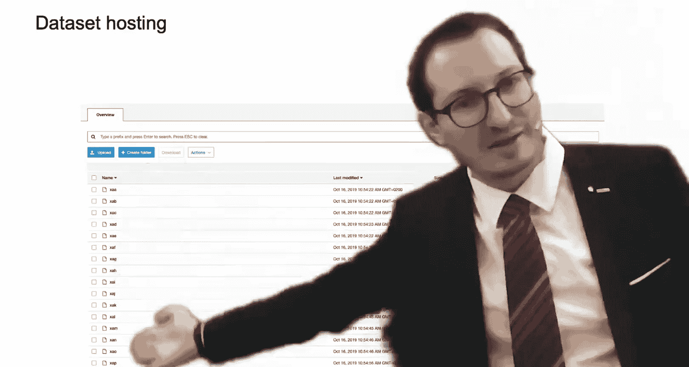

But again， that would have been tough。 It's much easier to upload many smaller objects。

 And on top of that， typically， a client is able to upload several of them in parallel。

 So you're not just uploading sequentially when at a time。 But you can， for example。

 upload 5 at the same time， right， So this is one of the reasons why a lot of data sets look like this。

😊，There is a second possibility， but it is a bit more advanced if you really。

 really want to upload the five terabyte data sets。

 but you would like to do it in a more reliable way， the S3 API， the rest API。

 if you look into more details has a way of not uploading in a single in a single time。

 but to cut the file into parts。And then you upload part 1， part 2， part 3 to the server。

 and at the end， once you have uploaded all of the partss。

You tell the theaby away all of these paths that I have uploaduded to you part 1，2。

3 and all the way to part 10 in that order。 Now please make them a single object。

 The API allows you to do that at the end， you will have your5 terabyte object。😡。

But the trick when you uploaded it was that you uploaded it into into different parts。 right。

 This is a bit more advanced。 And I think that not a lot of people actually do this。

 So the pre way is really to， to just cut it into multiple objects that are much smaller。😊，Allright。

 for whom is that here？All right， who experienced this。

 like trying to download or upload a huge file and it just didn't work the first time。

Right so this is practical experience。 This is really the everyday experience of of actually using systems like that。

 All right， so this is the first trick practical trick to cut it into smaller path。

 we' see that they are often called shas these paths。😊。

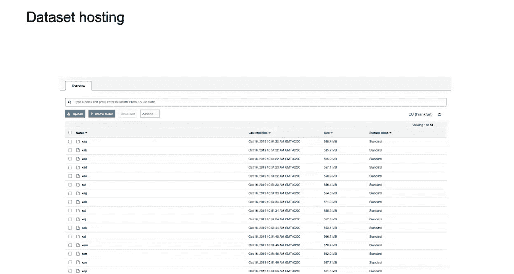

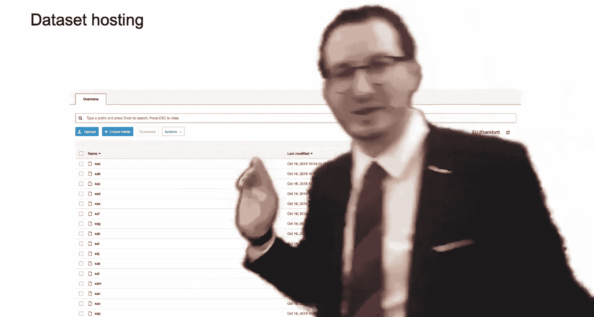

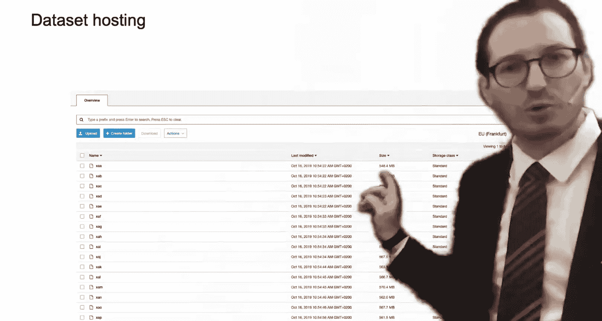

All right now， a few more concluding remarks on S3。😊，There are many ways people use S three。

 and there is a standardout way that has the the kind of the regular price that is always available。

 highly available。But some people do not care about availability。 For example。

 if this is a backup of your entire company data， you don't need to have it immediately if you。

 if there is a huge catastrophe that happens it， it's okay if you have it like 24 hours later or 48 hours later。

In that case， you can ask to pay less， it's cheaper。

But what you get in exchange for that is that you may need to wait a little bit until you actually have access to your data。

 Why， because it's not going to be directly connected to the internet， it might be stored。

 for example， on tapes。 You know， on tapes that are stored in some warehouse。

 And then the reason you need well two days that you need these little robots to go get the tapes and then connect them to the network。

 EthH also has that if you have data stored on EthH cell。

 they are backups that are actually stored on tapes。

 And you really have to imagine these warehouse with little robots that bring the tapes and stored the tapes。

In some， in some place， it's much， it's very cheap。

 The tapes as the cheapest way of storing data you can ever imagine。

So you can move the slider between how much you want to pay and how available you would like your data to be。

Next， I would like to quickly going to be short。 talk about Azure blo storage。

 which is really kind of the same thing as S3， but on a different provider， which is Asiazure。Why。

 because S3 doesn't have really any documentation on how it's implemented。

 there is no published paper， there are no details， so we don't really know how they actually did it。

But Azure did publish。 So there is a paper in which they explain how they do it。

 So it may not be that S3 is implemented in exactly the same way。

 but it can give you a small idea of how you you want to implement cloud storage。

 So I just want to very quickly。 There's not so many slides very quickly and high level explain a bit how the blob storage。

 The first thing I want to to say that on the high level。 they are pretty much the same。

 They are cloud storage services that allow you to store objects。

 There is a small few small differences。 for example， in the case of S3 to identify an object。

 it's a bucket Id plus an object I on S32 things on Azure， it's3。

 you identify any object with your account。 Think of your email address， for example。

 and then a container that would be the equivalent of a bucket。 And then a blob binary large objects。

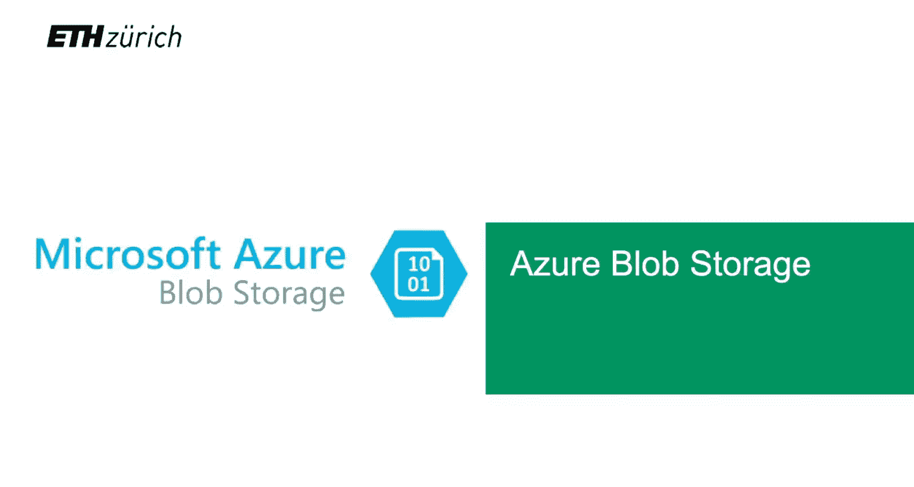

It it's blob。 So account container and blob。 if you consider that a bucket is a bit like a container。

 the only difference is that in S3， the bucketts are worldwide。

 you cannot have two people naming two buckets the same。 but in Asia within the same accounts。

 you need different container names， but worldwide it's no problem if two customers have the same container name because the account is also used to identify the object。

Then in terms of the API， S3 support， the parts， the parts is the way I told you this trick to upload in multiple parts and then at the end paste them all together in a single object in Asiaure。

 you have different ways of exposing the objects It's called block append and page don't worry too much about what they actually mean but it's basically different use cases。

 so there are some the blockss are basically ideal for people that want to store data sets and query the data as we in fact see today。

 a pending is a lot for logging， you know when you log things for example， if you have a website。

 a website keeps a log of everything that happens everybody who connects to the website at what time and so on the logs you always append at the end。

 you never modify the past data， you just keep app pending new things So there is a kind of storage system that is optimized for a pending and for Asia there is the last one optimized with pages the pages are basically to support。

The virtual machines running on the， on top of the system。

 But you don't need to understand the details of that。 All I'm saying is there are 3D。flavors。

Of these objects， S3 doesn't distinguish between them。

 Its just probably it has other ways to optimize。Then in terms of limits。

 you see that that depends whether it's block app page。

 the limit for the block system in Asia is much higher than 5 terabytes it's 190 why we will see today I will explain why。

Then append is much more limited， but for logs that's totally because you just start a new object。😊。

When you're done with one and 8  TB for the pages that would be similar to the to to S3。

 right But you see， the ball pack is kind of the same。 Like think of of of 100 GB to 100  TBte。

 right as the as the as the ball pack。Alright， so these are a few of the differences。

 But apart from that， it basically feels a little bit the same。

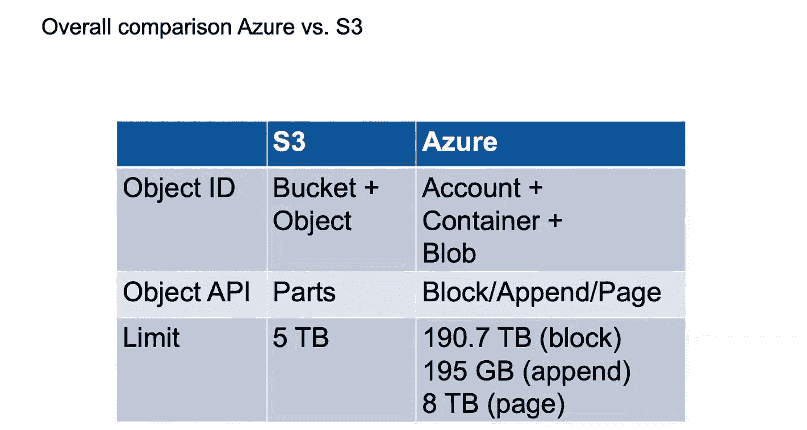

However， for Asia， we know how it's done inside。So the way it's done is that they have these rooms in the data center that are fit with machines that I already told you about and so they have every time 10 to 20 racks that themselves have maybe I don't know 18 storage nodes right you have to imagine that there might be a few computers in there but many of the nodes that are in there in fact full of hard drives right you might have I don't know like8 hard drives that that fit in one of the layers on the rack。

😊，In total， a room like that in the data center can store 30 petytes of data。

 one room can store 30 petytes of data。 you just multiply very approximately the number of hard drive times the size of one hard drive gives you approximately the storage limits that you can have in there。

Now a room like that， they have thousands of them， all over other planets。

 maybe they are a few in San Francisco， a few in Washington， a few in Hufurt， a few in Zurich。

 a few in Beijing and so on and so on and so on， it's all over other planet。

 plenty of rooms like that， so you can imagine that we are well into the exabyte， maybe even  Zabyte。

 maybe I don't know  Zabyte rangerench today， so a lot of capacity。

And what they try to do is they try to not go beyond 80% of the capacity。

 It means 80% in that case is like 24s。 If you reach 2ftes。

 then what happens is that you start moving the data to another place， maybe from Fkfur to Berlin。

 I don't know， as an example， but you try to keep it below 80%。

 because who already experienced the message that you on your laptop， the hard disk is full。

Some of youre right。 That's exactly the annoying thing thats starts happening。

 And then you start having the system slowing down and so on。 That is the reason。

 So you try to keep it at 80%。 And worst case， if it's beyond that。

 you just move it around to some different data center。

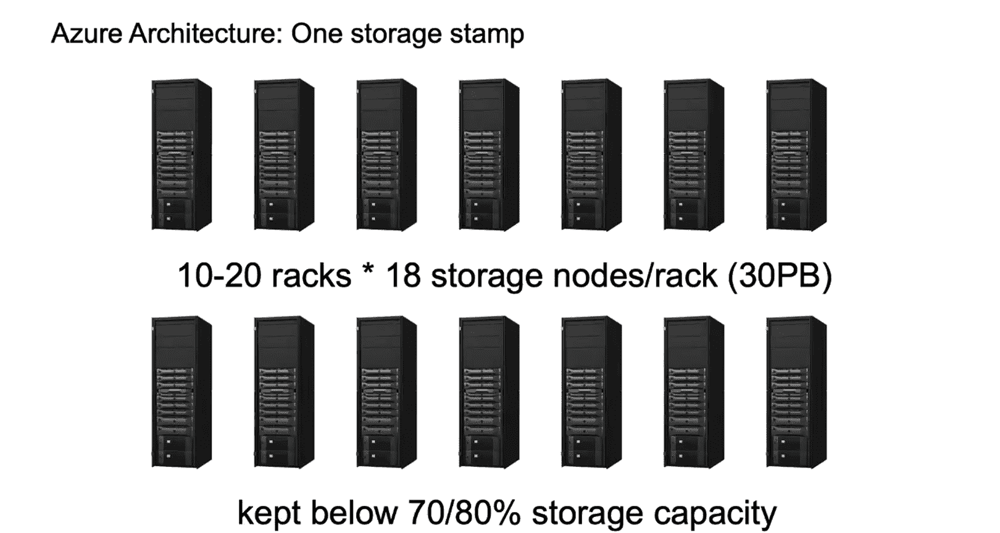

Now this is an illustration on the paper， this is an abstraction of that room right there with all the storage node on the logical level you can see it as layers。

 you don't need to know too much about them， but what I want to say here is that within the same room。

It's called the storage stamp。

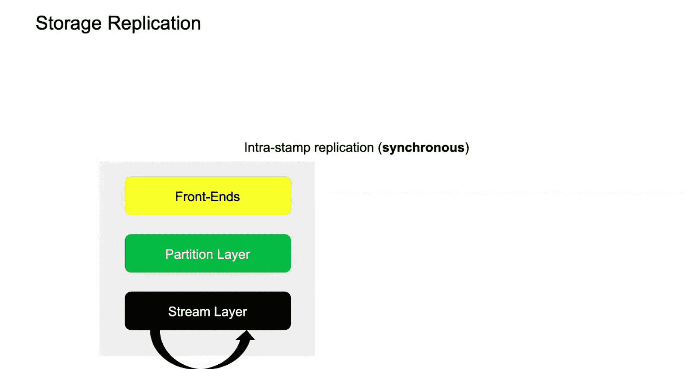

Within the same room， you might store the same data twice of three times。

 so it means that in these 30 petabyte， maybe in fact you can only stock 15 if you duplicate everything twice right it's just an extra security teams in case one of the hard drives fail so there is a so calledled replication。

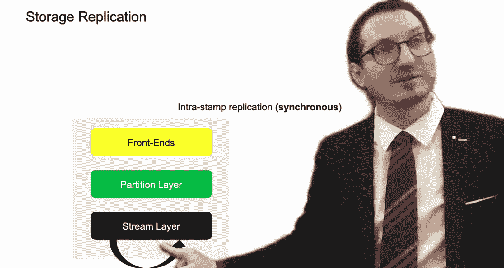

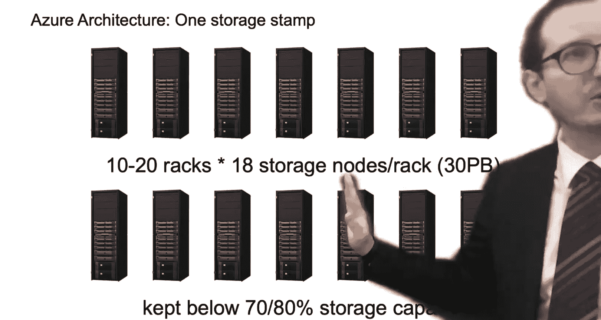

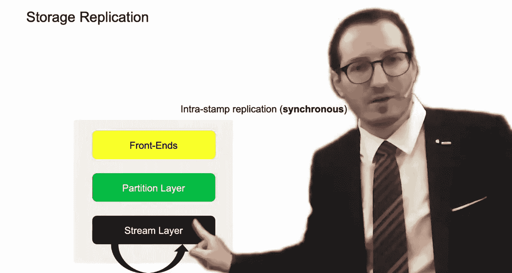

Why did I say synchronous， Why did I say synchronous here？It's because if you upload a new object。

The system will keep you waiting until it started twice or three times the same storage step。

 you have to wait， and it will only confirm after it has started multiple times。

 This is called synchronous。There is another kind of replication。😊。

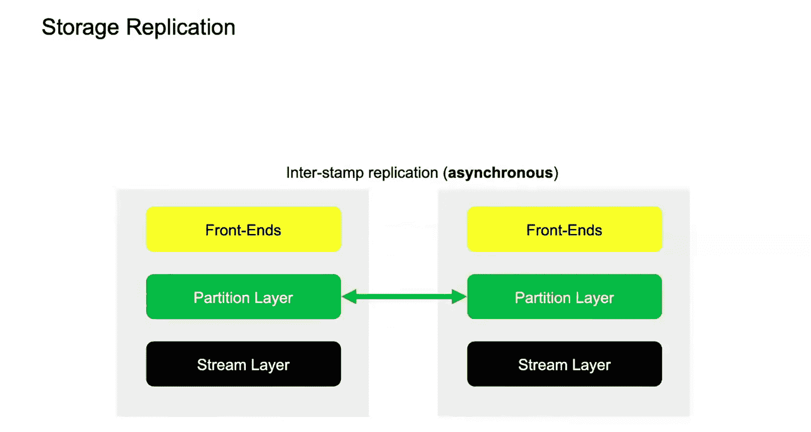

Across data centers， so for example， you might store a few copies in a room in Fkfur and then another copy in Zuric。

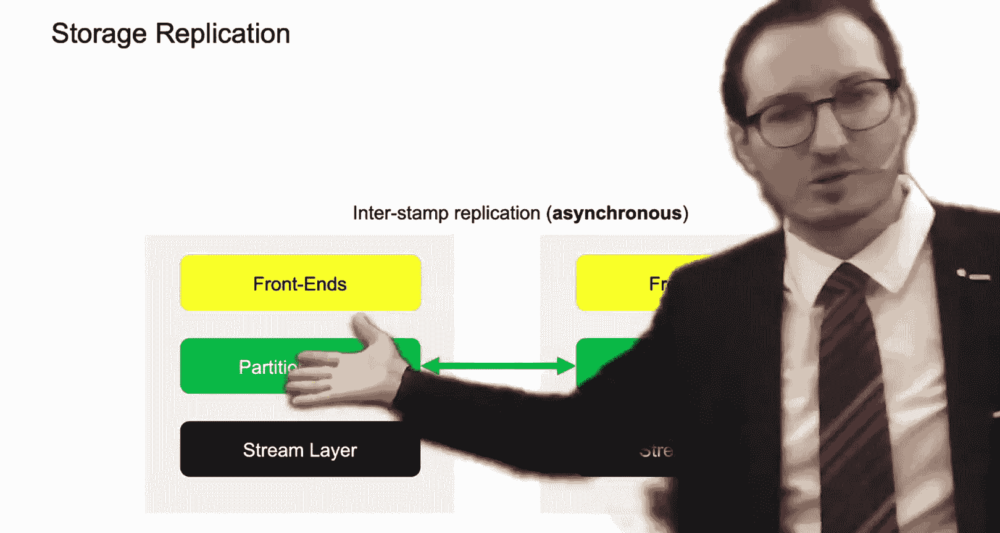

However， that replication then it happens on a different layer is asynchronous。

 what does that mean it means that while imagine you're in Zuric and it stop it in Zuric so it's keeping you waiting until it replicates multiple times in the same location。

😊，But then it confirms and the replication all the way to Hong Fu has an extra security。

Doesn't keep you waiting。 This is done later in the backgrounds， right。

 So you you're already doing something else at that moment。

 But still is going to also replicate a few more times to other locations just for to be safe， right。

 to have more copies。

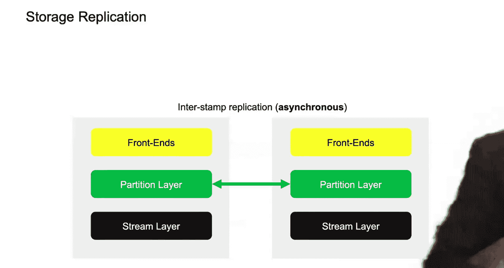

There are several reasons， in fact， for a replication across different locations。One of them。

Is the la C。Imagine that you're hosting in your system the static pages of a website。

 and you have customers all over the planets。Well， if you are in Zurich。

And the pages are stored in New York。When you access the web page， there will be a slight delay。

 plus because of the speed of light， even the lights traveling from Zurich to New York and back for your request will take some time。

😊，But， second。The Internet doesn't have the speed of light right This is there was work earlier by Professor On Ki Singla who discussed this the cables are not in a straight line between Zuric and New York。

 In fact， the internet protocol might even do a few runs over the planet before it arrives there So there is some latency for the customers that's not really good because if all your customers have this way this feeling that they connect to the page but it always takes a while in order for the page to load。

 that's not great。 So what you do is that you replicate at a few places across the planet if you have a copy inuric and a customer in Zuric connect。

 it will be almost instant because that's just a wrong trip to to the data center in the north of Zuric right。

The same goes， for example， somebody who is I don't know in Delhi。

 then you also have a copy of the data in Delhi and then it's also instant right so this is very good for the customer experience second natural catastrophes。

😊，Imagine that a data center burns down。 It even it happens a few years ago in the east of France。

 There is a data center that burned down。 They didn't make any backups。

 That was a catastrophe for all the businesses that had their data in there。

 You replicate to avoid that kind of things。For for that kind of thing to happen， right。

 So it's these two reasons you optimize that and see and your are resilience to natural catastrophes。

All right， so this is what I wanted to tell you about about Asiaure。

 I have no idea if S3 does it the same， but there is kind of the suspicion that it kind of does。

 that it's a bit similar。 But if you use S3， in fact。

 you can still organize your data to be in a specific region right east of the United States。

 west of the United States， Hongfur and so on and so on West Europe， Eastern Europe。All right。

 any questions so far on cloud storage？😊，All right。

Then let me tell you a few words on something we are not covering in that lecture。

 but I just want you to know that it exists。 This is something that I dive more into the master's lecture。

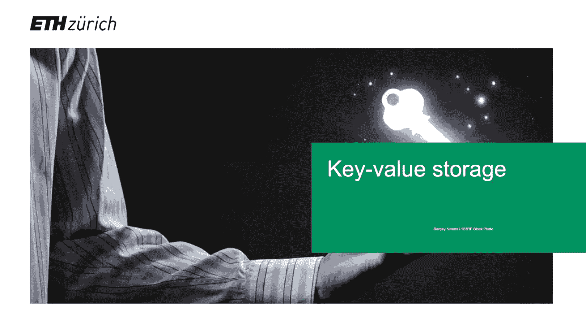

Is that there is another use case with a similar model with this idea that you have plenty of objects that are identified with IDs。

In a flat way， as I told you last time。And some people。3。

This would make sense to have a system like that that is， in fact， a database。

So then you might think， okay， why don't we just do this， what I showed you right here like this。

 we upload the data to S3 and there you go， you have your database， right？

But that doesn't quite work for for a database system that you want to be interactive or fast。

 because if you want to write to the system， you need typically the latency is  one to 9 milliseconds。

 It's in the single digits of the milliseconds。S 3 has a higher latency than that。

 It's more like a few hundred milliseconds。If you want an interactive database system。

 that's just not fast enough。So you cannot directly use S 3 as what we call a key value store。

 And so people invented K value stars。 The difference with between S 3 and a key value store is that a key value store doesn't have5 terab objects in a Ki value store。

 you're looking at objects that have a few hundred kilotoys。 It's much， much， much smaller。

 And these key value stores are extremely efficient at writing and reading data。 In fact。

 if you use social media like Twitter or LinkedIn。If you put posts or comments on LinkedIn and you edit and so on。

 this is typically stored in something that looks a bit like a Ki use store， right？Okay。

Or the I think the the Paramount use case would be when you shop online and you store the items you want to purchase in in some cars。

 shopping cart and TP that can go into a QV use store。Alright。

 but I just want you to know that they exist。 They are keyvalue stars and KVU stars are not the same thing as cloud storage services。

 the main difference being that QVU stars have much smaller objects and cloud storage services can have objects in the gigabyte and terabyte range and they are a bit slower too。

Okay。😊，And if you less well， this is then because I mentioned Amazon and Asia。 there's also Google。

 So there these are the big three， and there are a few others。

The mindset is a bit different in Amazon， what you notice is that there are probably hundreds of different services that you can use。

 and they are on the shelf and you can help yourself and use the services you want， right？

 And it's like assembling a puzzle。The Asia mindset is a bit different。 You might have a few less。

 a bit less services， but these services can do more things。 For example， one of them is cosmos Db。

 that is a database， It can do three tables， graphs， key videos and so on。 So this is a kind of good。

 I mean， for competition that you have different flavors， But in spite of these differences。

 they all offer virtual machines， cloud storage services。

 domain registration and so on and so on so on on the high level， they offer similar kind of things。

😊，All right， so what did we learn， we learned to simplify the model。

 flat key value model for objects object storage， we learned to buy cheap hardware。

 plenty of cheap hardware instead of trying to have very expensive machines with a lot of CPU and memory。

 so plenty of hardware， thousands of computers in the same room。

We removed the also the skiche mass in the sense that key value doesn't have any hierarchy anymore。

 and like a local file system on your， on your machine。 But I don't want to get too much in that。

 I I I say a you want words on that in the in the masters edition of the lecture。All right。😊。

I have no idea why I had that twice， probably a copy paste thing， but anyway。嗯。

Any questions to conclude。Drk storage services。All。

 so that is our first service that we can use to put data in there and then we' continue to build on top of this。

😊，So now I move on to the next part， then distributed device systems。

 we are still going to stock things。😊。

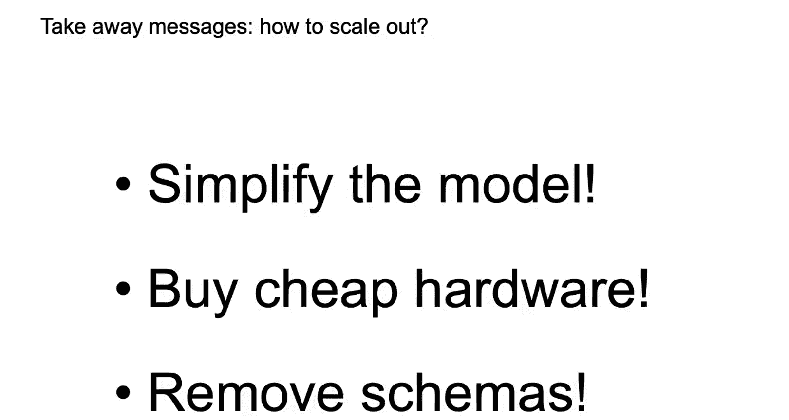

I'll be back in a few seconds。 Yes， is there a question in the chat。Oh， yes。

 about the key key key value star。 Yes， I don't。 Did we put it in the modelle。

 I might not have put it。 I said it last week， but I might not have put it the key value star。

 you can read it， of course， if you're curious， it's always good。

 but it's not part of the big data for engineers material the key value stars Dyna would B specifically。

 I said it last week， but we' also add it on the Mole to make it clear。 But of course。

 if you if you if you want to read if youre bored or if you think that this is going too slow。

 and you want to learn more things， then then you can go ahead and read it。

 It's just that we won't cover it in the exam。😊。

Anything else。

Okay， then I'm going to stop here。