# 苏黎世联邦理工《工程师的大数据｜Big Data for Engineers - ETH Zurich - 2024》中英字幕 p07 4 - Distributed file systems (1_3) - .zh_en -BV17FAmeFE9K_p7-

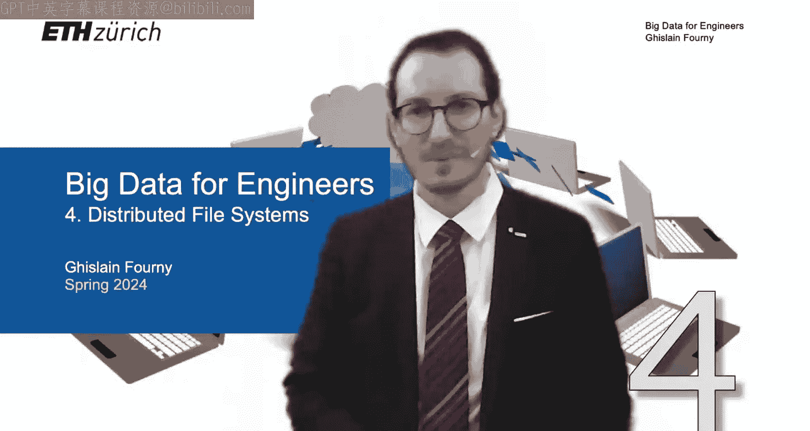

Welcome back，Now we're moving on to another kind of storage system。

 The goal is also to store data in there， but it's a bit different。 I will explain how。

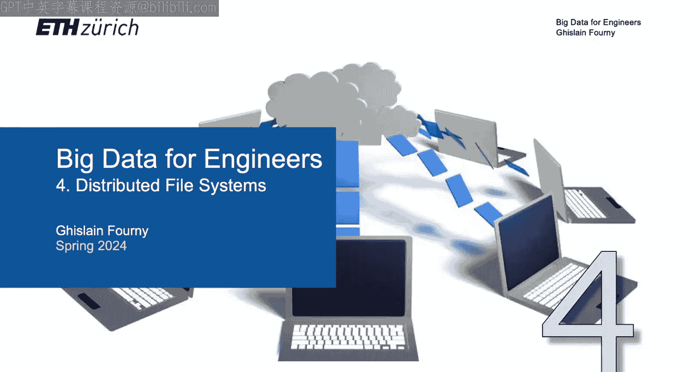

呃。So we've looked at relational databases right to store the data。

 we've looked into we did the brushup two weeks ago。

 we looked into scaling out the idea of having thousands of machines rather than one single big machine。

 we've seen that we can have cloud storage services in particular object stores that allow you to store objects that can be as loud as five terabytes associated with keys。

 the key being a burque ID plus an object ID。KV starts very briefly again。

 that's not part of the material， but they exist。 It's just that the objects are a bit smaller and the system is a bit faster。

嗯。And the typical use case for these storage services。

Is for in the case of datas for storing data sets。 Now。

 a good thing to know is that sometimes the data set you store is the raw data set。 For example。

 you you've collided a few protons at sound and you have a petabyte data set that you need to put somewhere。

Came from scientific experiments or sensors or imagine your meteostes and have your temperature and pressure measures that have there。

 This is raw data and you can put it in there as logs in the system。And then there is derived data。

 derived data means that you consumed the raw data with some data analytics system we will see a bit later with mapreuce Sp and so on and you have analyzed the data and then produce some output that is also data but that data is derived it's no longer the original data and typically what people do is that they also store that derived data that was spit out by by Spar or mapRuce。

 they store it right back to S3 or as we will see a distributed by system or Azure bb storage。

So this is our raw data and for derived data。What does it mean。

 it means that we will not only want to upload data and read it。

 we also want to be able to write back data to the system after we have created new insights from a system。

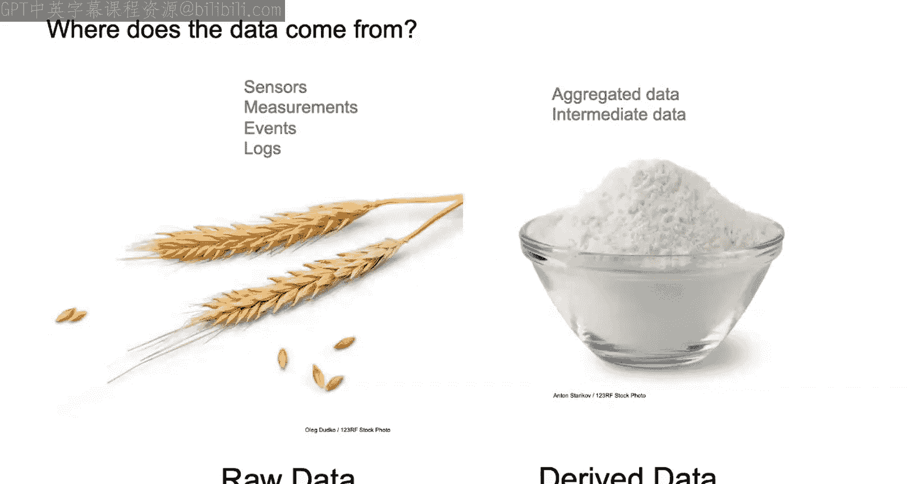

But here's the thing。 There's big data and big data。

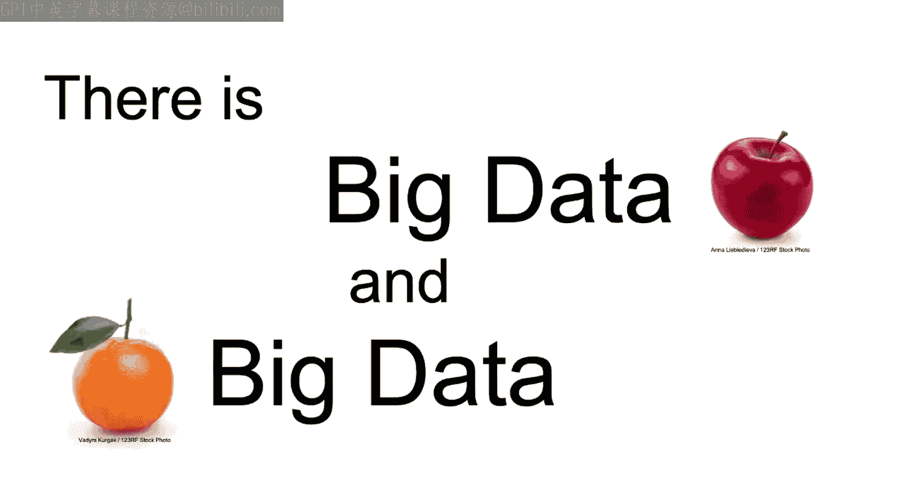

And a very high level way of saying what I want to say today and contrasting object storage with distributed file system。

Is that sometimes you can have a huge amount of large filess and sometimes you can have a large amount of huge filess。

That's the case of object storage。 You can have billions of terabyte fights。 a huge number。

 This is a worldwide service for for billions of people storing all of their their data P。

 videos in there。 that's object storage。Fite storage distributed by systems。

 as we will now look at them。Is about millions of petabyte sites very costly， right？

So you might have a bit less， it will not scale up to having as many files as you would have in object storage。

 so a bit less。😊，But the size of the filess。Is no longer unlimited by these 5  TB limits， right。

 You can go beyond 5  TB。 You can even have fights that are larger on what fits on a single machine。

 That's no problem at all。 how it works。 I will explain to you， al。

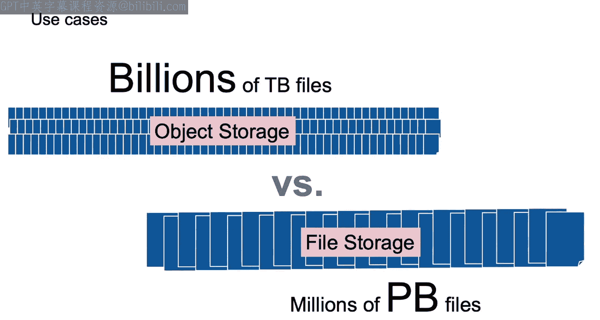

嗯。So this is the the contrast here， billions of terabytes fight versus millions of pettes fight。

 More exactly if you want to be even more exactly， I'm simplifying I I。

 I should even have said billions of fights up to a few terabytes and millions of fights up to a few petytes。

 right， It's the upper I'm talking about。So what is on the left， we have already done it。

 It's the key value model not to be confused with keyvalue store， the key value model。

 it's this idea of having keys that you associate with objects and object storage that we've done last time today we look at a different way with a side system and block storage instead of object storage So now we are going to be focusing on the right part of the slide today。

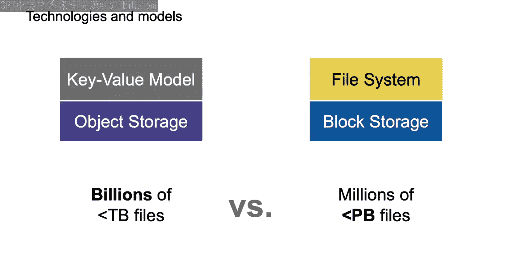

It all starts。It is when I feel old now。 It all started 20 years ago， almost 20 years ago。

When the the large companies started having such amounts of data that they needed a way to manage it。

 And so the Google F system， Google F was created。In order to fix this。And the idea。Of the。

 of the system back then。Is that？When you store your data on a single drive on your laptop。

 it could fail， most of the time it doesn't， but maybe once in a while you could have a failure on the hard drive and then that's why it's important to back up and you lose everything。

But the thing is， if you have a data center， it's not just that it might fail， is that it will fail。

 In fact， it fails all the time。 In fact， in data centers。

 there are people hired full time to run over the cluster and replace everything that fails。😊。

It's just the everyday life of a data center is that you keep having things that fail。

 you need to replace the hard drives， you need to replace the cell cells and so on。

So it means that the， the way to think about it， it completely changes the way you build the system。

 right， If you have to deal with perman and failure all the time。 you have things that fail in there。

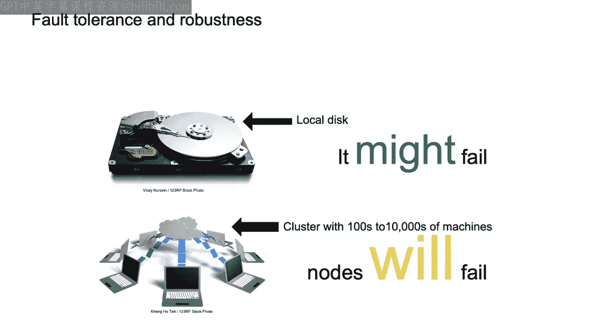

So it means that the way that this file system was built is that you need a way to monitor what's going on to detect error to automatically notice when the hard drive has crashed。

And then you can build a system in a way that it automatically recovers from these crashes that if a hard drive fails。

 that's totally okay， the system continues to work。 That's automatic recovery。

 And on the highest level， if you achieve that you have fault tolerance。

 fault tolerance is disability of a system to continue working normally。

 even if somethings crashing or fading inside of it right that's called fault tolerance。😊。

So you have to imagine if you want a visual。😊，A data center in which people are running around 20 Foxox 7 replacing crashing hard drives。

 but the customer amounts I would cite， they don't see any of these。

 they see a system that just works。Right， sounds like magic， right。

 but it's possible to actually build these things。

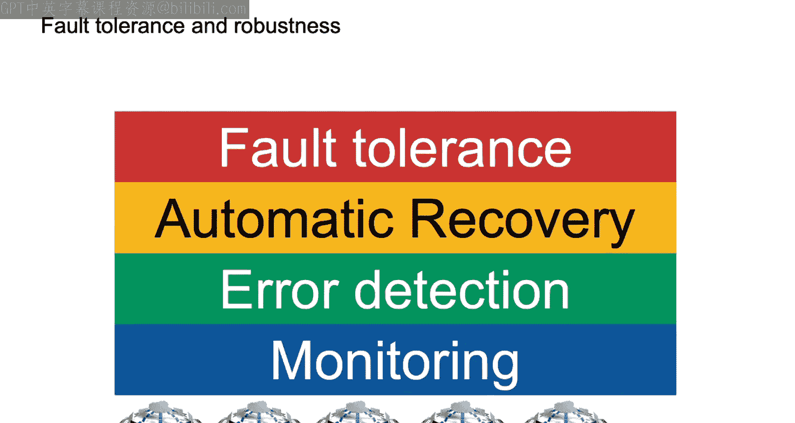

Okay。So there are a few assumptions whenever you build a system like this。

 So this is the requirements。 you make a few compromises， right， You cannot have everything。

On your hard drive， for example， if you use a spreadsheet software or a well processor。

 you can click on save at any time， right， and you can write and read to and from the hard drive permanently This is called random access disability that on your laptops and on your smartphone。

 you can always read and write anything that is in your memory or on your disk。

But we don't have that and we don't want to have that in these distributed device systems。

 we don't care about random access and efficiently accessing any few bits at any place instead what we are interested in is scanning the data。

You take a file and you go through it bit by bit and scan it。 This is， in fact。

 what we love to do in data analytics。 This is how we use mapre back and so on。

 It's all about scanning the data， reading the entirety of the data set scanning through the file bit by bit。

 as opposed to random access where you might have a terabyte file。

 but you only want to read the bit right here or you want to write。A few beats right there。

 That would be random access。 Who gets the difference。

All right， so the system that we are building now will be optimized for scanning。 we want to scan。😊。

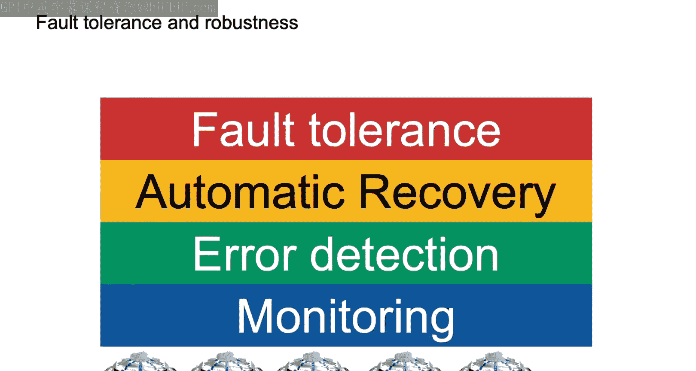

With the data for reading and writing， we just want to to have a scanning process。

 what we also want to support is a pending。 That's also fine。

 You already have a fine and you just want to expand it at the end， you want to to expand it。

 think of a log， for example， you keep logging new things always at the end。

 that's called the pending。In the original versions， these systems could not do it。 But now today。

 they， they， they are able to append at the end of the fight。

That's also very convenient when you create data or when you analyze data and keep creating new data。

 you want to be able to append it at the end。嘅。A pending is not only actually suitable for a new。

Data derived data。 It's also suitable for the raw data。 For example。

 imagine that you have your meteitetes and you have your temperature and pressure sensor all over the the country。

You want to keep right every seconds， the current and pressure at every location in Switzerland。

 you can do it by pending at the end envelope the。 You keep app the new measurements of temperature and pressure in there。

 right so that can be used for these can be used for a website。

Like I don't know if you' having mind the Apache server also creates that kind of logs and so on。

All right， so we scan and we append。Another requirement of our system is that unlike your hard drive。

 where you're the only person working on it or your home drive where maybe there's your families of maybe five。

 six， seven people that are accessing it。We want for hundreds of people to be able to access the system at the same time。

 So this is a stronger requirement。 We want it to scale in some way and we don't want any trouble if they we don't want to have concurrent access that would lead to inconsistent data right so if somebody is writing at some place we need to make sure that there's nobody else with writing at the same place So this is another requirement。

 and finally we have a requirement in performance。

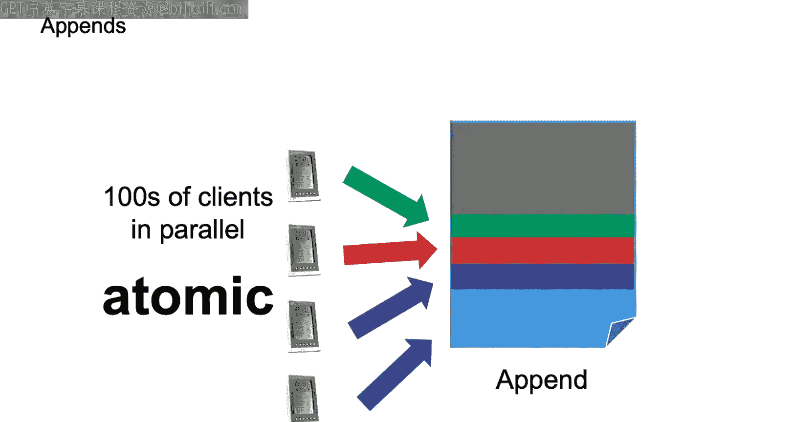

And that has to do with throughput and latency。We basically want to assist them。

Where data flows around， the bits are flowing around。

 so we want a system where the limitation is the throughputs right we we are limited by the throughputs and the amounts of bits that move around every second。

 We do not want to be limited by la C la C means that you spend most most of your time waiting。

And I explain to you what it means in terms of blocks。Why am I expressing it in that way， Like。

 this is a weird way of saying things， right we want to be limited， but right。

 we want to be limited by throughputs and we do not want to be limited by lat C。

 The reason why we put things that way， is， as we will see in a few weeks。

Whatever system you have a software on your computer website。

 it's always limited by something and moreover it's always limited by one thing that one thing could be the memory that is limiting it that one thing could be the data center of the network that is not fast enough the limitation could be the speed at which you read from the hard drive or the limitation could be that your CPU is not fast enough that's called the bottleneck every system has one bottleneck could be the CPU。

 the memory the network or the drive access In that case。

 the bottleneck that we want to be in in a normal functioning system。

 a normal functioning distributed by system is the throughput。

We want to be limitedted by the throughput， not by their laancy and again the casual way of foot it。

 we just want the bits to flow around， dense arounds being sent back and forth。

To give you a visual of what it would mean if we were bound by latency instead。

That would be a system in which nothing much happens， the bits are not really flowing around。

 we are just waiting， we are waiting， for example， for the drives to rotate and reach the the correct location below the reading head are we are waiting for the bits to happen in someplace but this would be awful that's not a way to analyze data if you want to analyze data you need the bits to flow right so it's a casual way of putting it buts for whom does that make sense。

All right， very good。 but you'll get a feeling for that once I have shown you the distributed by system。

 it will be it will be clear。 We have a question on the chat。😊。

So the streaming so this is a good question， there are two types of systems that you can look at basically when you start dealing with data here we just store the data。

There are two types of system， the batch processing systems and the streaming system， right。

 there's examples of both。 we are a bit more focused on the batch processing systems in this lecture。

However， one way to answer your question is that if you look at this scan file。

 this is compatible with streaming because you can have a stream of bits that gets written to a file just like this sequentially so this works with streaming。

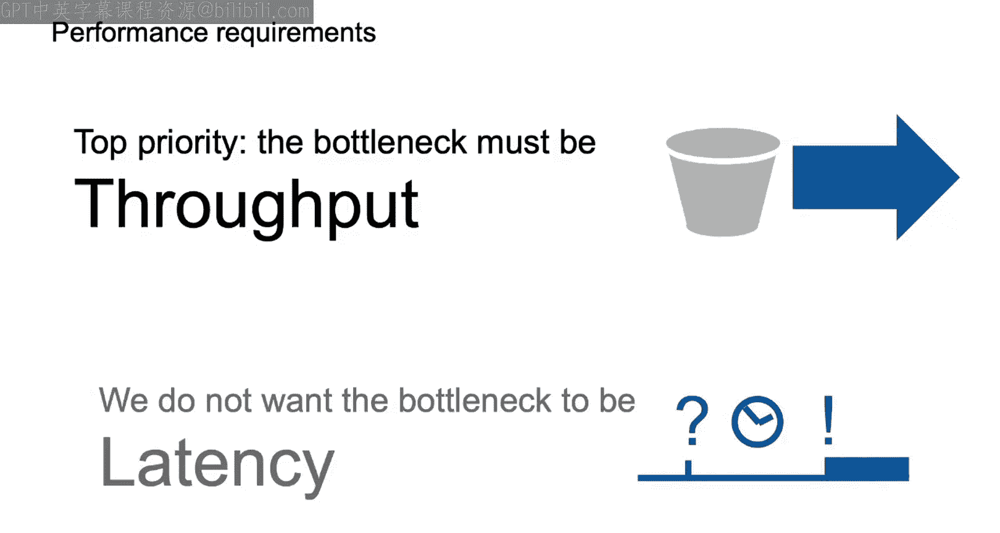

But it's not trivial。 And in two or three weeks， so when we look at big table。

 I will show you the magic of this。 how can we manage in a system that is bound by throughput。

 How do we still manage to also stream in some way and support updates。

 but this is a cliffhaner that I live as a mystery for in a few weeks that we'll get back to。😊。

Does it make sense。

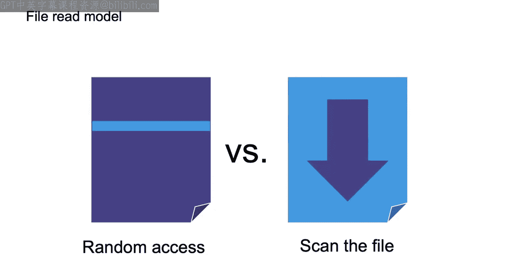

I assume yes。 Alright。 Yeah， alright。 Thank you。

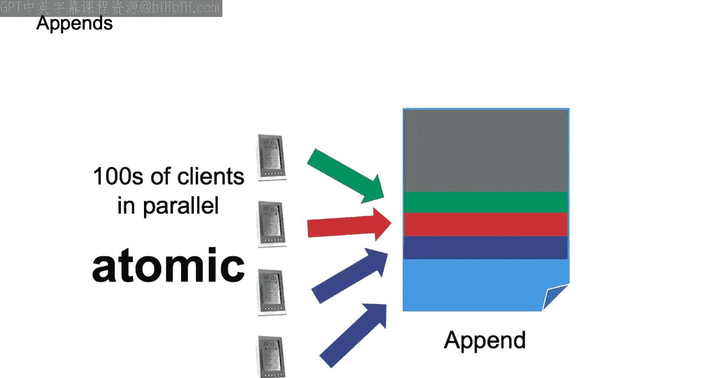

ok。😊，Now， this is to put in this context what I'm telling you about capacity through good latency。

 You might remember that。We saw that capacity increased enormously。

 but the speed at which we can read it didn't。 So we need to parallellyize， right， And typically。

 what limits us is the throughputs。 If we parallellyze more， we get more throughputs。

 but we this will be a limiting factor。The second limiting factor， Latin and C。

 the way it's solved is with batch processing， but this again I leave for in a few weeks。

 we will discuss this more in details with age base and big table， right？

So the focus today will be more on the on latency， on the sorry。

 on the throughput and the parallelization。Okay， now I told you about Google Fire system， Google FS。

 but this is proprietaryrieatory and what happens what happened is that a few years later some people created an open source version of the same and they called it Hadoop it's named after this little elephant yellow elephant teddy bear who was the that was the the teddy bear of the son of the dog cutting who created Hadoop so this is for the story and it dates back to 2006 so that's already 18 years ago。

😊，So Hadoop is made of three paths that correspond to the Google F system that's already 21 years ago。

 mapre 20 years ago， Big table 18 years ago， and Hadoop competes that over as the older three paths to HFS。

 the Hadoop distributed file system which we are covering today。

 mapre which we are covering in a few weeks and the Hbase which we are also covering in a few weeks。

 So all of that we look at in due time， this is called Hadoop together but we are focusing today on HFS al right。

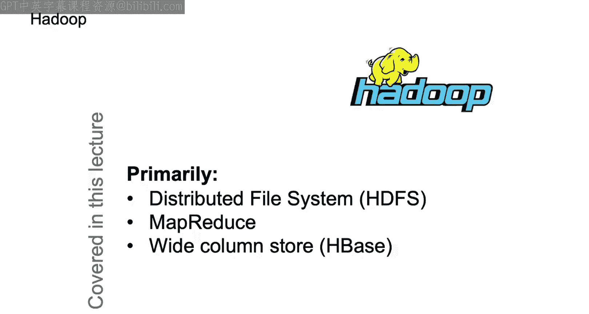

Just to show you how it evolved， most of the action actually happened between 2006 and 2016。

 This is where the whole thing kept scaling up and up and up and up and up。

 the location where this was done。 the whole Hadoop was that Yahoo with a search engine。

 so they needed that kind of technology to， for example。

 to index the web and and index older the data。 So you see that it went from almost 200 computers。

 This is the number of machines here that you had。 So you had a cluster of 200 computers in 2006。

And we suspect that in November 2016， that they reached something like 100，000 computers。

 which is the upper bound of a data center where you fit in a single data center that corresponds to 600 petabytes of data。

嗯。What happened after all that， I'd say a few， a few wells in a few weeks。

 But since we had the limit of the data center， we are kind of stuck now at at what we can do in a single data center。

 And then the only solution is to start building things across data centers， right， But for today。

 we are stopping at the limit of a single data center， right， So100000 machines maximum。

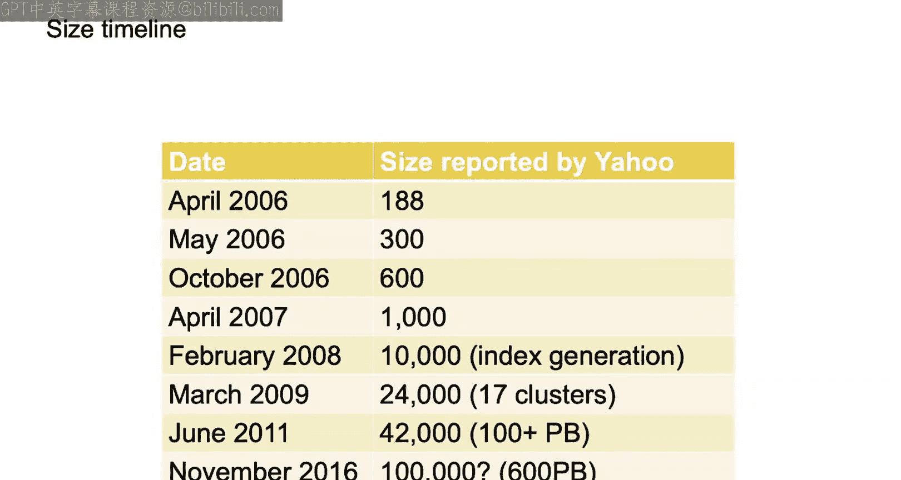

Now， what am I going to do Well， we are going to take a break right after the break。

 I will start with the model of the distributed file system。

 You remember what I told you almost every week I do things in exactly the same way I'll first tell you the logical model of things the easy path basically how it works on the high level and then I tell you about the implementation I did the same thing with S3 I told you the model of S3 which is bucket ID plus object ID gives you an object and that's it that's the flatkey value model Well Ill tell you about the model for the distributed file systems and in particular the Hadoop distributed file system right after break so I see you in 15 minutes。

Thank you。