# 工程师的大数据：4：分布式文件系统 (1/3)

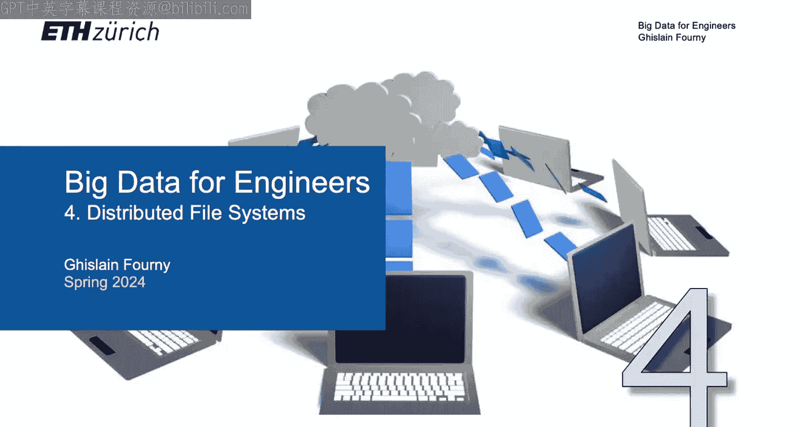

## 📚 概述

在本节课中，我们将要学习分布式文件系统。我们将了解它与之前讨论过的对象存储有何不同，它的设计目标是什么，以及它如何解决大规模数据存储中的关键问题，特别是容错性和高吞吐量。

---

## 🔄 从对象存储到分布式文件系统

上一节我们介绍了对象存储，它适用于存储海量（数十亿个）但单个文件大小有限（如5TB）的对象。本节中我们来看看另一种存储系统——分布式文件系统。

分布式文件系统的目标同样是存储数据，但方式有所不同。我将解释其区别。

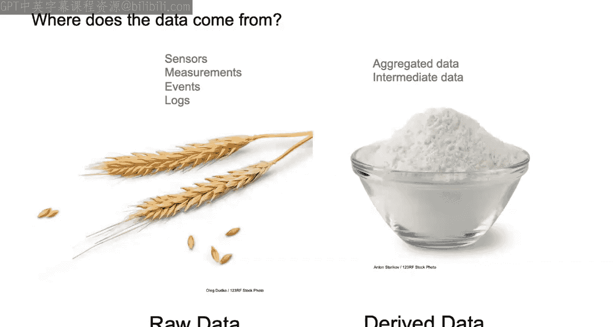

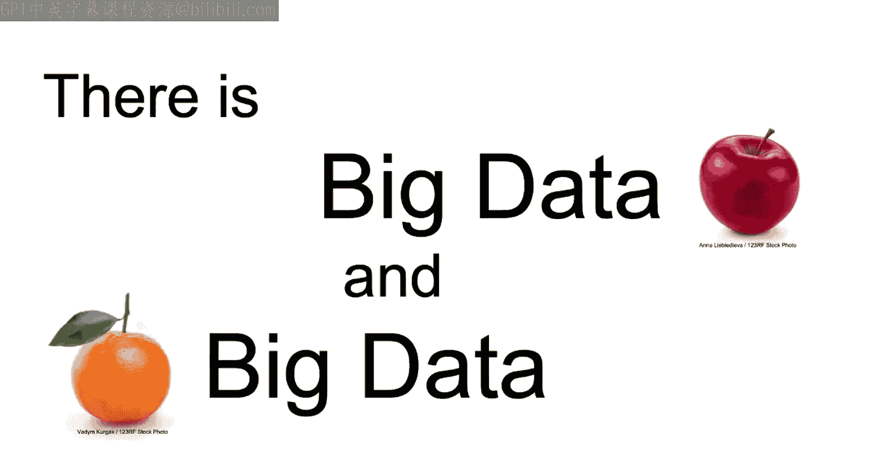

我们已经研究过用于存储数据的关系型数据库。我们也回顾了向外扩展的概念，即使用数千台机器而非单一大型机器。我们看到了云存储服务，特别是对象存储，它允许你存储与键关联的对象。对象存储的典型用例是存储数据集。

需要了解的是，有时你存储的数据集是原始数据集。例如，来自科学实验或传感器的数据。这是原始数据，你可以将其作为日志存入系统。此外还有衍生数据。衍生数据意味着你使用数据分析系统（如稍后将看到的MapReduce、Spark等）处理原始数据，进行分析后产生输出数据。这些输出数据也是数据，但它是衍生的，不再是原始数据。通常，人们也会将这些由Spark或MapReduce输出的衍生数据存回S3，或者如我们将要看到的，存回分布式文件系统。

这意味着我们不仅希望上传和读取数据，还希望在从系统获得新洞察后，能够将数据写回系统。

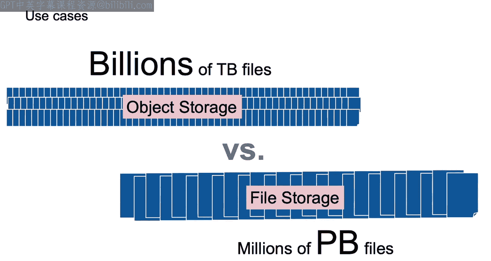

---

## ⚖️ 大数据的不同形态

但关键在于，大数据有不同的形态。

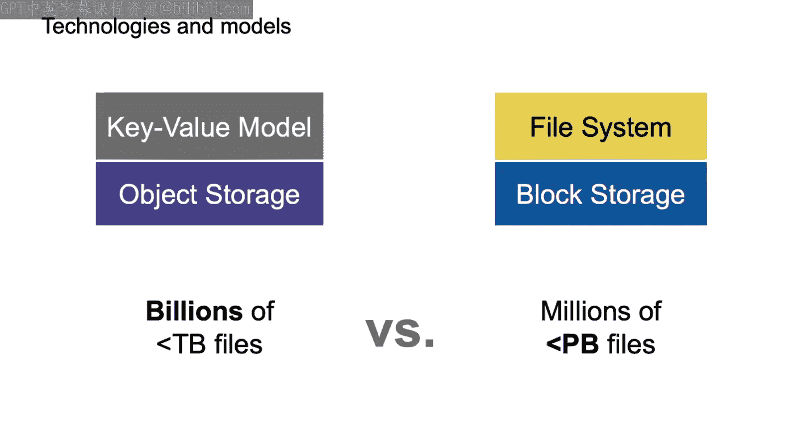

用一个高度概括的方式来对比对象存储和分布式文件系统：有时你可能拥有**海量的大文件**，有时你可能拥有**大量的超大文件**。

对象存储属于前者。你可以有数十亿个TB级别的文件，数量巨大。这是一个面向全球数十亿用户的服务，用于存储他们的所有照片、视频等。这就是对象存储。

而我们将要探讨的分布式文件系统，则关乎**数百万个PB级别的文件**。你可能拥有的文件数量会比对象存储少一些，它无法扩展到对象存储那样多的文件数量。但文件的**大小**不再受5TB这样的限制。你可以超过5TB，甚至可以拥有比单台机器容量还大的文件。这完全没问题。我将向你解释其工作原理。

这是两者之间的对比：数十亿个TB级文件 vs. 数百万个PB级文件。更准确地说，左边是对象存储（键值模型），我们已经学习过。它是将键与对象关联起来的想法。今天我们将关注幻灯片的右侧部分，即分布式文件系统和块存储。

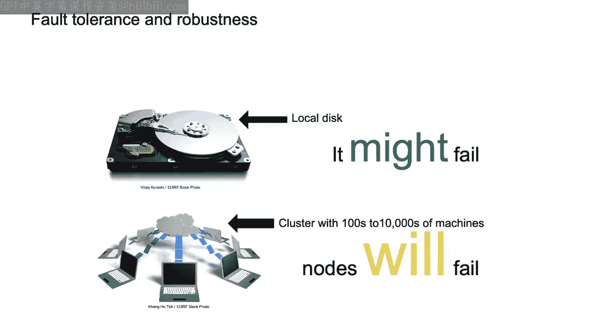

---

## 🏗️ 分布式文件系统的起源与核心理念

这一切始于大约20年前。当时大型公司开始拥有如此巨量的数据，以至于需要一种管理方式。因此，Google文件系统（GFS）被创建出来以解决这个问题。

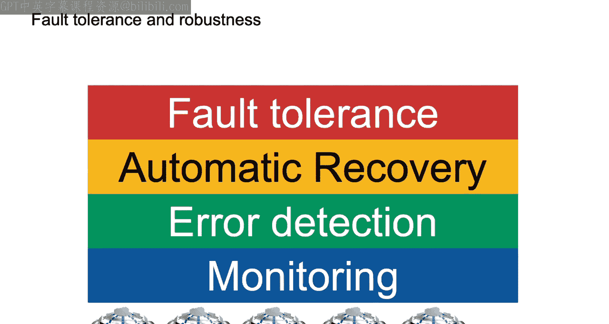

当时的核心理念是：当你在笔记本电脑的单个驱动器上存储数据时，它可能会故障。但在数据中心，故障不是“可能”发生，而是“必然”发生。事实上，故障时刻在发生。数据中心有专人全职负责在集群中奔波，更换所有故障部件。

这意味着，构建系统的方式必须彻底改变。如果你必须时刻处理永久性故障，就必须有一种方式来监控运行状态、检测错误、自动发现硬盘崩溃。然后，你可以构建一个系统，使其能从这些崩溃中自动恢复。如果一个硬盘故障，完全没问题，系统继续工作。这就是自动恢复。在最高层面上，如果你实现了这一点，就拥有了**容错性**。

容错性是指系统在内部某些组件崩溃或故障时，仍能继续正常工作的能力。想象一下这样的场景：数据中心里人们跑来跑去更换故障硬盘，但客户完全看不到这些，他们看到的只是一个持续工作的系统。这听起来像魔法，但实际上是可以构建出来的。

---

## 📋 系统设计假设与要求

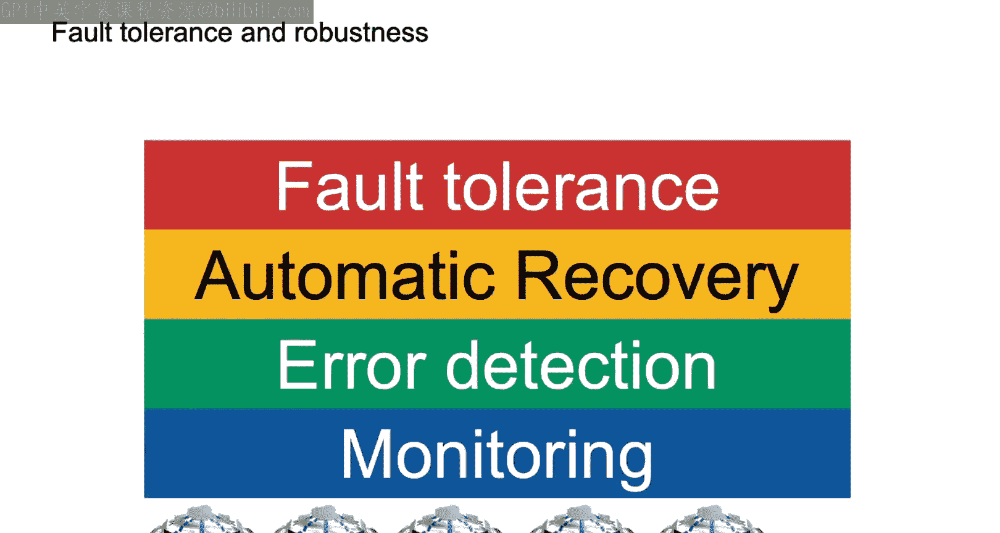

构建这样的系统时，需要做一些假设和妥协。你无法拥有一切。

例如，在你的硬盘上，如果你使用电子表格软件或文字处理器，你可以随时点击保存，可以永久性地从硬盘读取和写入。这被称为**随机访问**能力。在你的笔记本电脑和智能手机上，你总是可以读写内存或磁盘上的任何内容。

但我们**不**需要，也**不想要**分布式文件系统具备随机访问能力。我们不关心随机访问，也不关心高效访问任意位置的少量数据。相反，我们感兴趣的是**扫描数据**。

你取一个文件，逐位遍历并扫描它。事实上，这正是我们在数据分析中喜欢做的事情。我们使用MapReduce等方式，核心就是扫描数据，读取整个数据集，逐位扫描文件。这与随机访问形成对比，后者可能是在一个TB级文件中，你只想读取这里的某个比特，或者在那里写入几个比特。

因此，我们现在构建的系统将针对**扫描**进行优化。我们想要扫描数据以进行读写，我们只想要一个扫描过程。

我们还希望支持**追加**。这也很好。你已经有一个文件，你只想在末尾扩展它，这就是追加。例如日志，你总是在末尾记录新内容。在最初的版本中，这些系统可能无法做到这一点。但如今，它们已经能够在文件末尾追加数据。这在创建数据或分析数据并不断生成新数据时非常方便。

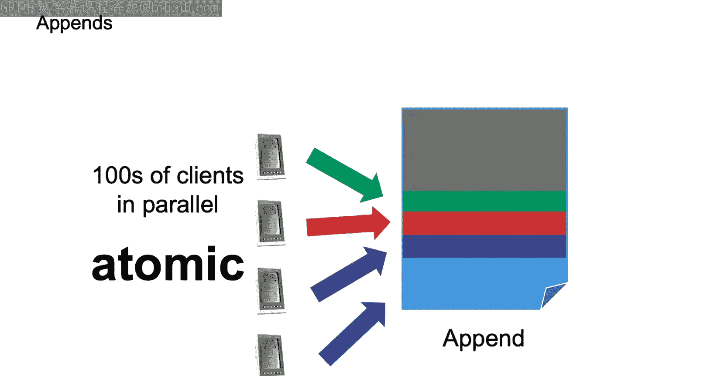

追加不仅适用于新的衍生数据，也适用于原始数据。例如，假设你有遍布全国的气象站和温压传感器，你想每秒记录瑞士每个位置的当前温压数据，就可以通过不断在文件末尾追加新测量值来实现。

此外，我们的系统还有一个要求：与你的硬盘（只有你一个人使用）或家庭驱动器（可能只有五六个人访问）不同，我们希望**数百人能够同时访问系统**。这是一个更强的要求。我们希望它以某种方式扩展，并且我们不希望并发访问导致数据不一致。所以，如果有人正在某个位置写入，我们需要确保没有其他人同时在同一位置写入。这是另一个要求。

最后，我们对性能有要求。

---

## ⚡ 性能要求：吞吐量与延迟

这与**吞吐量**和**延迟**有关。

我们基本上希望构建一个数据流动的系统，比特在其中流转。因此，我们希望系统的限制因素是吞吐量，即每秒移动的比特量。我们不希望受限于延迟。延迟意味着你花费大部分时间在等待。

我将在涉及数据块时解释其含义。为什么我要这样表述？这听起来有点奇怪，我们希望受限于吞吐量，而不希望受限于延迟。原因在于，正如我们将在几周后看到的，任何系统（无论是你电脑上的软件还是网站）总是受限于某些因素，而且通常主要受限于一个因素。这个因素可能是内存、网络速度、硬盘读取速度或CPU速度，这被称为瓶颈。

在正常情况下，一个正常运行的分布式文件系统，我们希望其瓶颈是**吞吐量**。我们希望受限于吞吐量，而不是延迟。用一种更直观的方式来说，我们只希望比特顺畅地流动，来回传输。

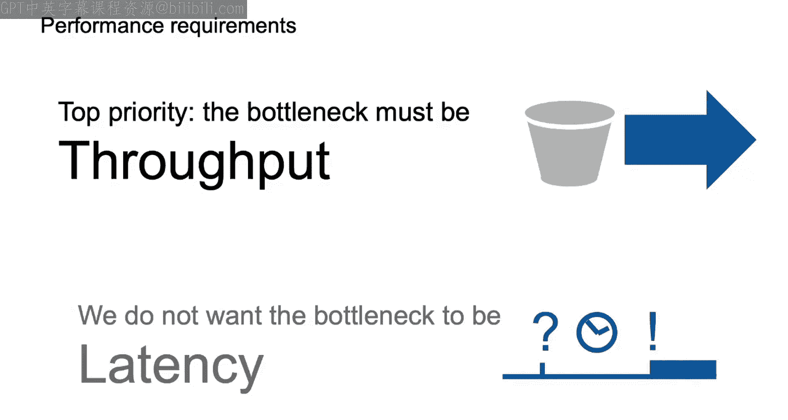

为了让你更直观地理解，如果系统受限于延迟会怎样？那将是一个没有太多事情发生的系统，比特没有真正流动，我们只是在等待。例如，等待磁盘旋转到读写头下的正确位置，或者等待比特在某个地方出现。这将非常糟糕，这不是分析数据的方式。如果你想分析数据，你需要比特流动起来。

关于聊天区的一个问题：这与流处理的关系。这是一个好问题。处理数据时，基本上有两种系统：批处理系统和流处理系统。本课程更侧重于批处理系统。然而，回答你问题的一种方式是：如果你看这种扫描文件的方式，它与流处理是兼容的，因为你可以有一个比特流被顺序写入文件。但这并非易事。在两三周后，当我们学习Bigtable时，我会展示其中的奥妙：在一个受吞吐量限制的系统中，我们如何仍然能以某种方式管理流并支持更新。这是一个悬念，我们几周后再来揭晓。

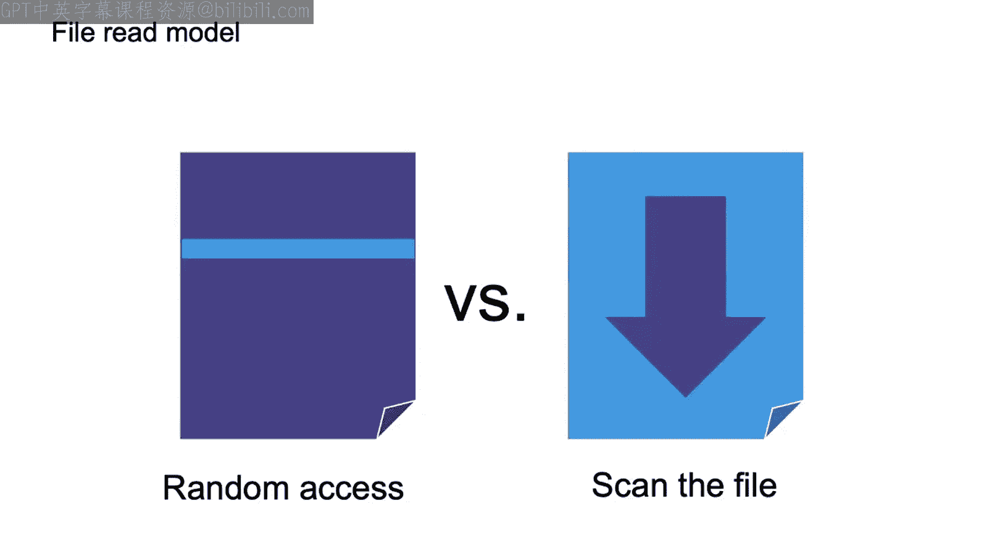

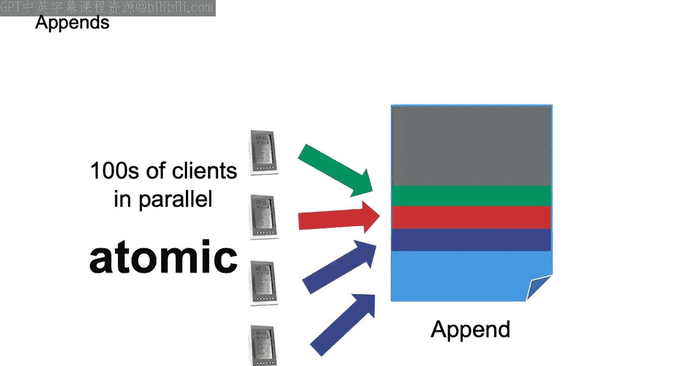

---

## 📈 技术演进与Hadoop

现在，将我所说的容量、吞吐量、延迟放在这个背景下。你可能记得，我们看到容量急剧增长，但读取速度却没有。因此，我们需要**并行化**。通常，限制我们的就是吞吐量。如果我们进行更多并行化，就能获得更高吞吐量，但这将成为限制因素。第二个限制因素——延迟，是通过批处理来解决的，这个我们同样留到几周后，在讨论HBase和Bigtable时再详细讨论。

今天我们的重点将更多地放在吞吐量和并行化上。

我之前提到了Google文件系统（GFS），但它是专有的。后来发生的是，几年后一些人创建了相同理念的开源版本，并称之为**Hadoop**。它得名于这只小黄象毛绒玩具，它是Hadoop创建者Doug Cutting儿子的玩具。这要追溯到2006年，已经是18年前了。

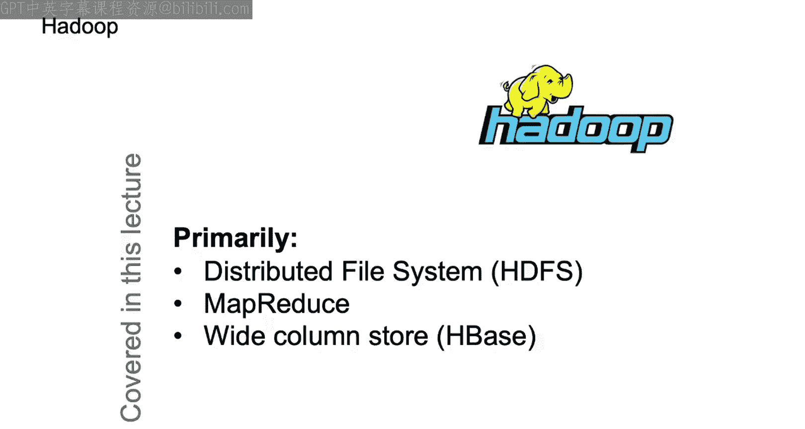

Hadoop由三个部分组成，分别对应Google的三篇论文：GFS（21年前）、MapReduce（20年前）、Bigtable（18年前）。Hadoop的对应部分是：HDFS（Hadoop分布式文件系统，我们今天要讲）、MapReduce（几周后讲）和HBase（也是几周后讲）。所有这些我们都会在适当的时候学习，它们统称为Hadoop。但今天我们专注于HDFS。

为了展示其演变，大部分发展实际上发生在2006年至2016年间。整个Hadoop生态规模不断增长。主要推动者是雅虎的搜索引擎，他们需要这类技术来索引网络和数据。你可以看到，机器数量从2006年的近200台，增长到我们推测在2016年11月达到了约10万台，这是一个数据中心能容纳的上限，对应着600PB的数据。

在那之后发生了什么？可以说遇到了一些瓶颈。由于数据中心的限制，我们在单个数据中心内能做的事情似乎达到了极限。唯一的解决方案是开始跨数据中心构建系统。但今天，我们止步于单个数据中心的极限，即最多10万台机器。

---

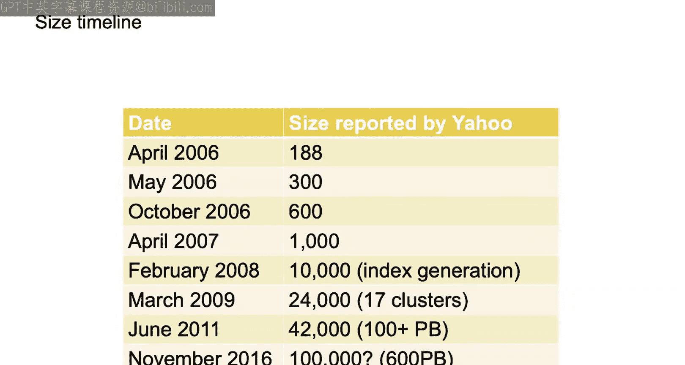

## 🎯 本节总结

本节课中，我们一起学习了分布式文件系统的引入和基本概念。我们对比了它与对象存储的区别，理解了它适用于存储数量相对较少但体积巨大的文件。我们探讨了其设计起源——解决数据中心内硬件必然故障的问题，从而引入了容错性的核心目标。我们还明确了这类系统的设计假设：优化于顺序扫描和追加写入，支持高并发访问，并且性能瓶颈应设计为受吞吐量限制而非延迟限制。最后，我们简要回顾了从Google GFS到开源Hadoop（特别是HDFS）的技术演进历程。

休息之后，我们将开始讲解分布式文件系统的具体模型。请记住，我几乎每周都以同样的方式进行：首先讲解逻辑模型（高层工作原理），然后再深入实现细节。对于S3，我讲解了其模型（桶ID+对象ID对应一个对象的扁平键值模型）。同样，休息后我将讲解分布式文件系统，特别是Hadoop分布式文件系统（HDFS）的模型。我们15分钟后见。