# 苏黎世联邦理工《工程师的大数据｜Big Data for Engineers - ETH Zurich - 2024》中英字幕 p08 4 - Distributed file systems (2_3) - .zh_en -BV17FAmeFE9K_p8-

Welcome back， so let's look at the model then。It's the easiest to contrast it with。

Cloge storage services。So the key venue model， that's what you see on the left。

 that's what we did last week。 the idea that you can identify every object with a key and that key is in the case of S3。

 the bucket I plus the object I to get out the other key， the case of Azure。

 that would be the account I， the container I and the object I。Okay。

But in the case of a distributed file system and usually this is what is implied with P system。

 we have a hierarchy of directories and files。 so that the hierarchies of directories and files。

 you should be familiar with it。 This is what you have on your laptops and desktop computers。

 right a direct it's。😊，Recursive， you can have directories， in directories， in directories。

 and then at the end you have the files and this is where it ends。

 the files are the leaves of the tree。All right， this is called the file hierarchy。😊。

Note the difference in terminology that on the left we use the word object or the key value model。

 we call it the values object。In the case of a fight hierarchy。

 we use the word file instead of object。 But it's really the same thing。 In the end。

 file object is the same thing。 This is， in the end what your data set is stored at。

 So here we say object。 And for this， this and this， we say file。Okay。So this is a file hierarchy。

 It's not flat anymore。 We do have a recursive structure of the of the directories or hold。

 depending there's， I think it it was across。Mac and Windows and over the years in some years。

 they call them directories in some other versions， they call them folders。

 but this is only a matter of terminology。O。😊，So that's difference number one。

 and then there's difference number two。Difference number two is that in the case of object storage。

 the object is a single big modthic chunk。 that's the object up to five terabytes。嗯。In the case。

 however， of a distributed file system。We do divide the files into blocks right， so in that case。

 we have eight blocks，1，2，3，4，5，6，8，7，8。And they are exposed to the user through the API of the file system。

 so you can actually see their blocks。 there is block one， there is block 2 and so on。

 They are exposed to you， right。

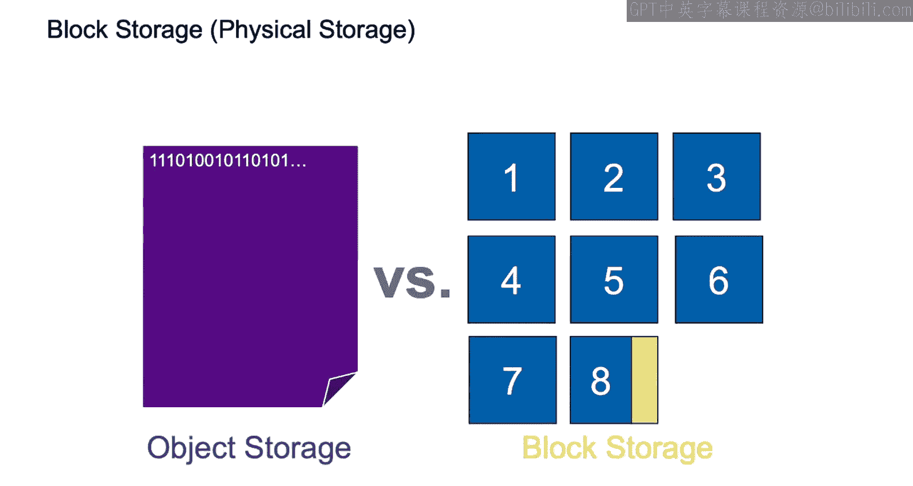

So this is called block。Storage。As opposed to object storage。

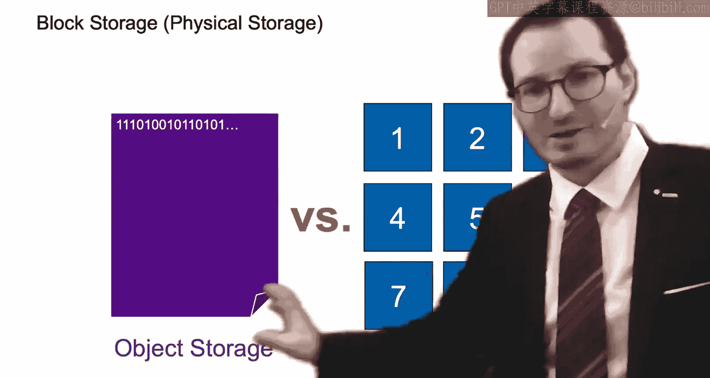

Now， you might tell me， okay， yes， but when you showed us at the beginning of this lecture today。

 Azure B storage， there was already the blocks in there。 Yes， that's true。 And in fact。

 Azure B storage is already kind of already doing distributed by systems in that sense。

 because they use blocks。 But in S3， there is no such thing as as as the blocks。

 and do not confuse the block and apart。 When I told you that in the API of S3。

 you have a way to upload it into several parts。 This has nothing to do with blocks。

 The parts are specific to the way you upload it， but once you're done uploading。 it disappears。

 There are no parts anymore。 just a single big big objects。

 but the blocks are really parted in the distributed by system of the API。 So again。

 difference number one， now we have a hierarchy of directories and five different number two。

 we expose blocks to the。

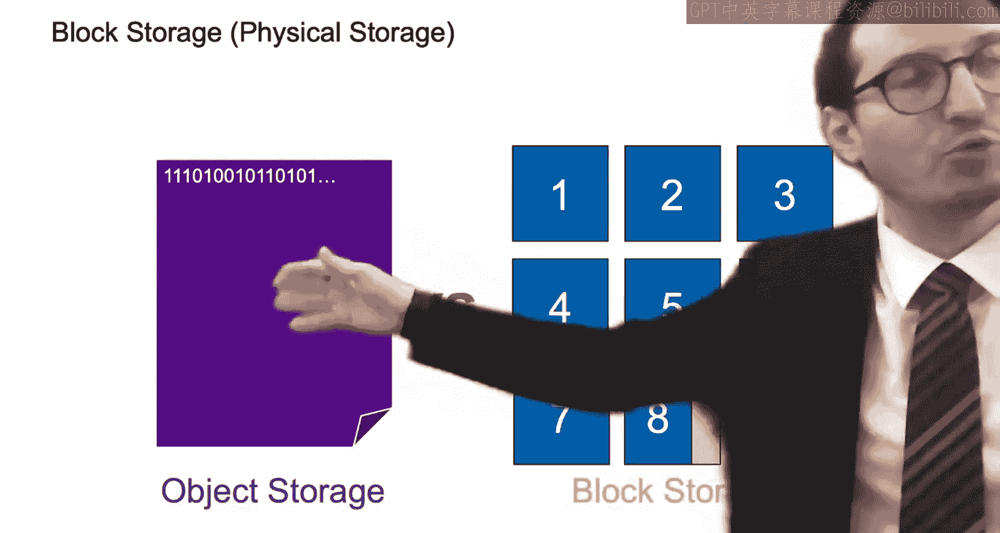

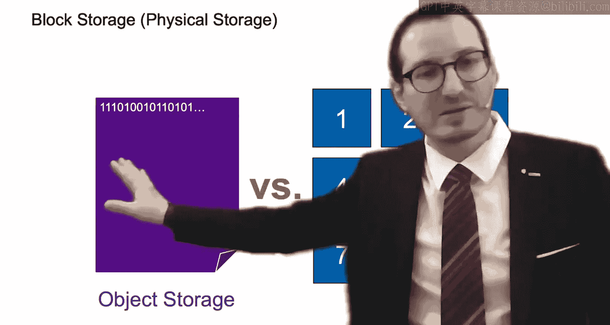

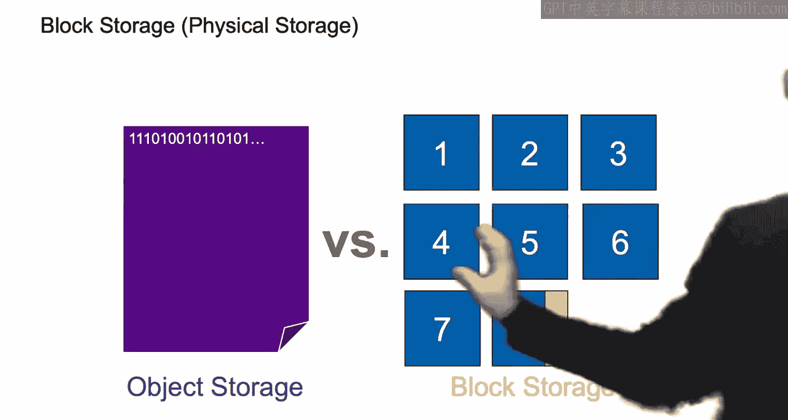

To the user of AFS， that's called block storage。Now， world of the， I wouldn't say warning。

 it's just real life。I said， block。If you look at the original Google find system paper， GFS。

 they don't call it a block。Deto chunknk。We will see when we talk about mapre that they will use the word split。

When I told you about storing data sets in in S3 and spitting your data into multiple objects。

 I use the word chart。呃。Mathematicians we call it a partition and so on and so on。 So there are many。

 many different world you can use to actually mean the same thing。

 right All you are doing is divided something large into several smaller things。

 and you can call these smaller things， a block a chunk or split or sh partition。

 It doesn't really matter。 right This is really the idea。 Now。

 if you manage to remember that in the context of a GFS， which say block， GfS。

 we say chunk might produce we say split and so on that's good。

 But I want you to focus on the idea of that。 the fact that we really divide something large into several smaller things that we call blocks。

😊，Okay。So now a summary in a single slide of the model of HGFS looks like this。

 We have this hierarchy of directories and files and every file。😊。

A correspondres to a list of blocks。At least because there's an order。

 the order of the blocks is important。Okay。Only the fight， by the way， the directories。

 they have no blocks。 The directories are only here in order to give the higher equal structure to the。

 to the， to the fight system。 But whom is that here。Right， this， this is the model already in there。

 This is the model G F。 that its。😊，嗯。Now， why blocks。There is a first obvious reason。

Is that if you have a file that is one petabyte large that surely won't fit over a single machine。

Today， in 2024， we do not know how to build a hard drive that has one petabyte of data。

 technologically we cannot do it。Maybe in 10 years or in 20 years， we can。 But today， we cannot。

 right， So if you want to store a file。That doesn't fit in a disk。

 you anyway have no other way than to split it into smaller chunks or blocks or shelvess or partitions。

So this is the first reason。The second reason is that it's actually a great level of abstraction to have these blocks。

😊，Because when we actually will start looking into mapreuce and Spar and into how to process all of these files。

This will allow us to do things in parallel。Right， if you have a single object like this。

It's not so obvious to do anything in parallelalon that there's only one object。

 But if you have blocks， that's easier because then you can compute。

 you can do things on the blocks in Paette， right， on different machines。

 So this is kind of the intuition why we actually like blocks。Right。嗯。Another reason， for blocks。

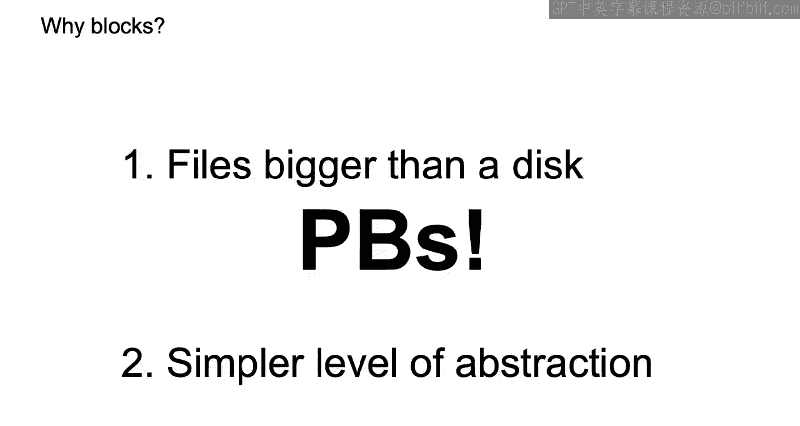

Is that it's kind of liquid， what do I mean with liquid？I mean， that。

If you consider on the logical level， all of the blocks of the entire HDFS5 system。

 maybe you have millions or billions of blocks that would be on the left。

You have to spread them over thousands of machines。So， if you have。I would say。A few billion blocks。

It's easy to spread them over 1000 different machines。 You just。

Imagine that you have this is a big bucket full of small blocks you could almost take it and pour one by one into the buckets just as you would do with water so this is the idea it's liquid in this way but that doesn't work that only work sorry if we find the right size folder blocks because imagine that you take enormous blocks a block imagine we take five terabyte blocks it's going to be different from taking1 kilobyte blocks。

 for example， the size of the blocks would change。

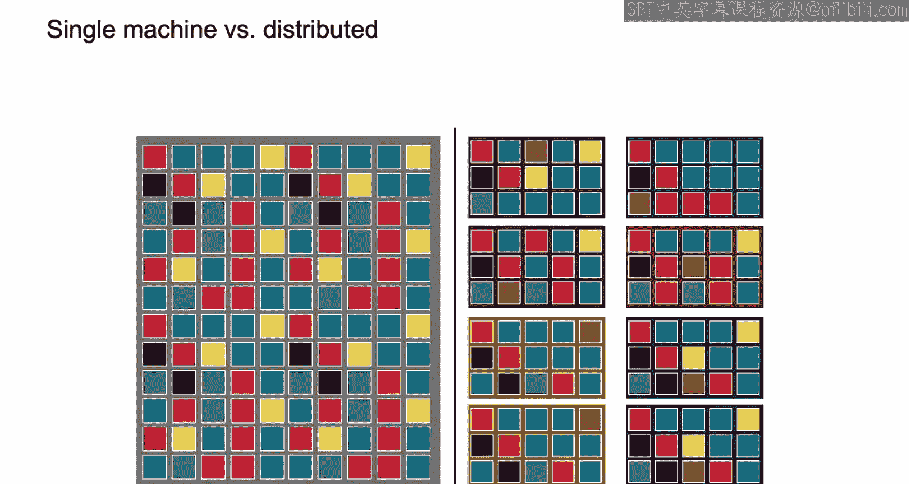

So this is why I have this question for you。😡，The blocks， they already exist on your laptops。

 You might not know it， but your laptops here also store your5 blocks。 These blocks on your machine。

 They are roughly 4 kiloB。That means that whenever your computer reads something from disk or writes something to disk。

 it's always doing that 4000 bytes at a time。Fuck you bits at the time。

The same goes for a relational database， even though in that case we might go all the way to 32 kilobytes。

 but this is the order of magnitude。So my question to you， I'll have a quicker question for that。

 how big do you think the blocks in the distributed file system should be？😊，Keeping in mind。

 the constraint I told you about， we want to be throughput bounded。

RightWe don't want to be Latin and C boundaries。 We want to be throughput boundaries。

 Now I'm going to ask you the question and see what you think， how large these blocks should be。

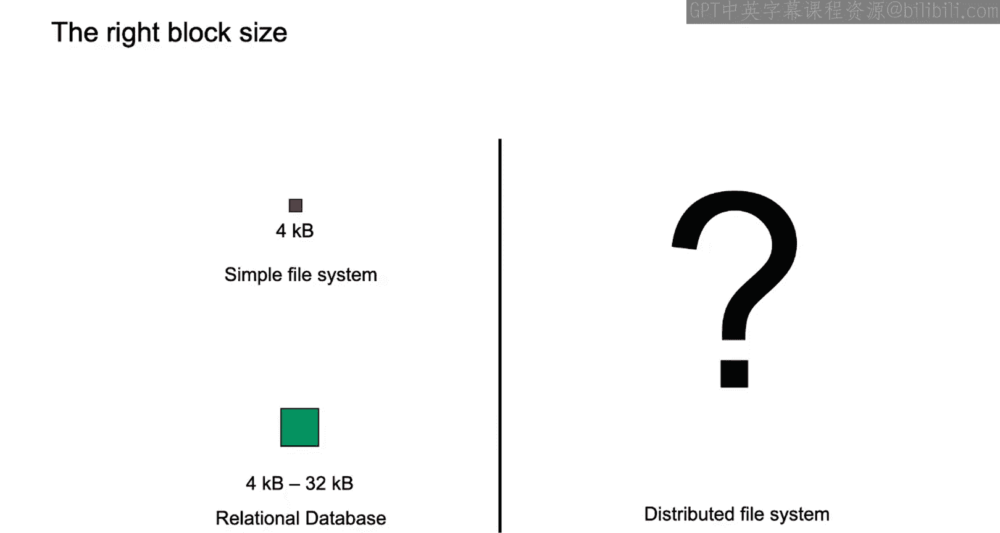

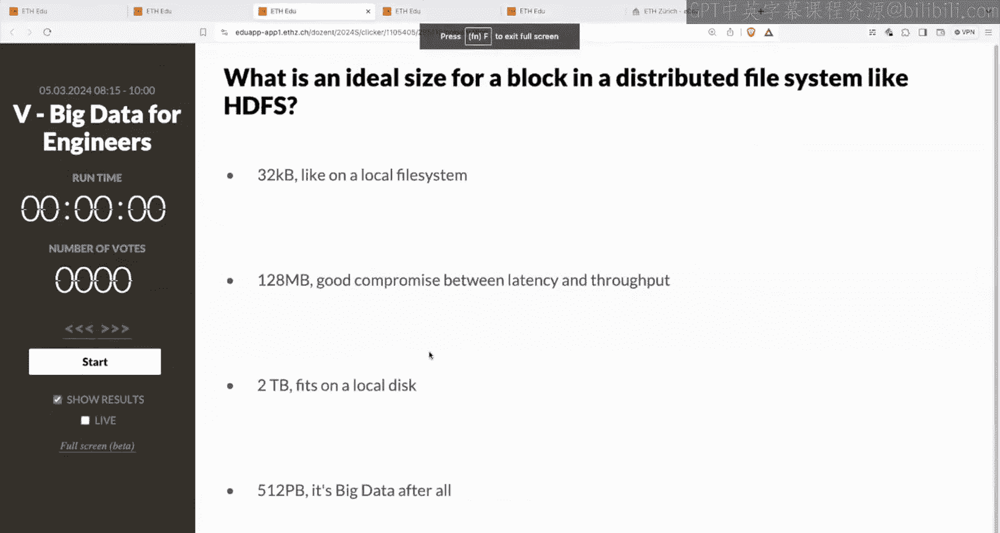

Yeah you go。Yes。

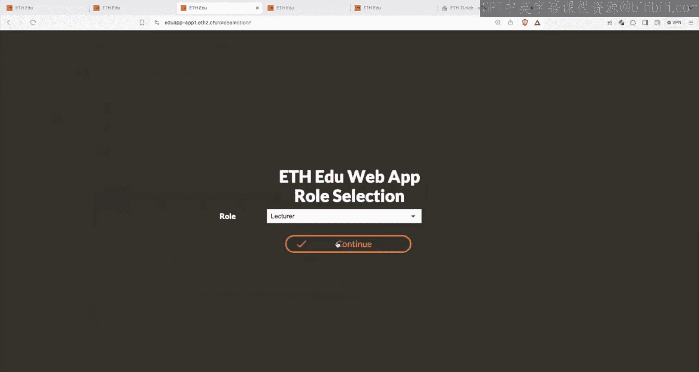

I have to pick the question again。When。Yes。So what is an ideal size for a block in a distributed file system like HDFS？

And I try to lure you into each answer with a good reason。So。First。

32 kB like on the local file system。 It's the order of magnitude that is important， right， Like。

 for example， in a relational database system like Po G fuelL or 128 MB。

 good compromise between la C and throughroputri， because I told you that this is what we hear about。

Or maybe 2 TB because that fits on a local disk。 And that's the optimal way of。

 of using a single machine， right， Or maybe 512 MB because that's big data。 So we need these。

 these huge blocks for the whole thing to work。 So what do you think。32 kilobtes， 128 megabytes。

2 terabytes。512 databases。All right。😊，So how I sense that we will have a majority。In here。

And that the majority is correct。 Congratulations， Indeed，128 MBby。I will explain。

Give you an intuition of that。诶。You share。And normally， if I prepared correctly。

 and this is where we get exactly where we were。

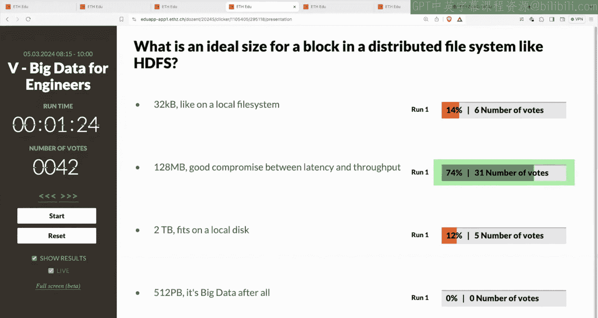

There you go。So the first thing is that you notice these blocks here，128 mebys。

 this is much larger than the blocks we have on on a local5 system， right。

 That's a huge order of magnitude。😊，So I'm going to reason by taking it to the exaggeration on both sides and try to make you imagine what would happen。

First。Imagine。That you have blocks of two terabytes。Imagine， so it means that on each machine。

 maybe you're going to have one， two， three or four blocks right then you have1 thousand machines。

Now imagine using that system， you have to upload files to that system。

 you have to actually process the files。First， imagine the the usability of uploading to a system where the blocks are2  TBabytes。

 This is what we discussed earlier today。 You're going to get network errors the whole time you're going to have to try several times whenever you try to upload anything in there。

 So first it's not going to be very practical these two  TBabytes。u。

The other aspect is that two  TBte is not very liquid when you want to spread the data over the cluster。

 it's kind of too large to to actually be liquid。 And this is an intuition that we will come back when we actually look at map reduce。

 We we understand why it is important that。On each machine， we don't have just one to three blocks。

 but we have thousands of blocks on each machine to have some liquidity。So five。

Two terabytes is way full out right that would definitely be throughput driven。

 but not very practical to use or whom does that make sense？Al right。

 so two terabytes too large who understands that 500 petabytes that definitely an no go。

RightThat doesn't even fit on a machine，500 database。 So this one is an nogo。

 But now I have to explain to you why we don't use these smaller blocks。 why， after all。

 don't we use4 kilobyte blocks。Then the model you should have if we had blocks that small。

Is that you wouldn't have a few thousand blocks on each machine， you would have millions of blocks。

 tens of millions of blocks on each machine， so imagine a cluster with thousand machines and on each machine there are tens of millions of blocks。

No。What I would like you to imagine。Is that system now？😮。

Functioning like you query data in there and you process blocks。

 knowing that every time you touch a block。There is some latency。

And now imagine that you have to analyze the data set。And that data set is a petabyte of data。

 but it's split into kilobyte blocks。 Now I'm going to try to get it right。

 How many blocks does it have if you have a petabyte data set and the blocks are in the kilobyte rangerench。

 So kiloomega giggaterpeta you are at。A trillion。 So you're looking at a trillion blocks for a petab byte data set。

 And imagine that each one of these trillion blocks。

Is going to have to be accessed with a waiting time every time。So， let's query that。

That's petabyte data set。Each block at a time in these threes， let's start with Block web。Block to。

B3。Block4， and I consider like that。 this is larger than the age of the universe。

So you can imagine that it's completely unusable。 This would be an example of a system in which you spend your whole time waiting。

This is what I meant earlier when I said we don't want it to be latancy bounds。 Well。

 if we have blocks that are kilobyte sized， we will be latancy bounds。

There will be not much happening except waiting every time for a new blog。

 or whom does that make sense？Right， so this is why the order of magnitude of of a few hundred mebytes。

128 mebyte is kind of a sweet spot between the two。 It's neither too small nor too large。

 exactly the perfect size。 It's smart enough that you can spread it across machines。

 but it's also large enough that you don't spend your whole time waiting for accessing every blocks right So this is this is kind of the intuition。

😊，The other thing that I want to say。Is that。You shouldn't be fixated on that exact number of 128 MBby。

 It's good to know by heart， but。It's the other magnitude that is important and in fact。

 this is why on the Google5 system it wasn't 108， it was 64 megabytes HDGFS it was doubles。嗯。

Asia already went all the way to4 gigabyte blocks If you think of it4 gigabyte。

 it's still almost the same order of magnitude， it's not even a factor of 10 right well it is sorry it is a factor of 10 but a factor of 10 is compared to a trillions is nothing。

U。The idea really here is that computers are evolving。😮，The hard drives are getting a bit larger。

 The speed at which we can read keeps increasing。 So over time。

 you would expect that the blocks are slowly going to be larger and larger， right。

 So this is why it's slowly evolving to maybe  one GB block，4 GB blocks。😊。

So this is the order of magnitude。 But if I tell you 100 gigabyte blocks or a terabyte blocks。

 then no now you have the intuition， no， this is an no， right。

 the right order of magnitude is somewhere around the gigabyte。10 times less，10 times more maybe。

 but this is the wrench， right？whom does that make sense？好。Do we have a question？On the jets。

And个 machine。として。好好。IWhat is the。That is a great question。

 There is a radiation with the defragmenting。嗯。So first。

 let me tell you about who already used the de fragmentmentation on your drive。Some of you。

 all right。Why do we do that， It's because these for kiloloyte blocks here means that as soon as you have a5 even in the megabyte or gigabbyte。

 it's going to be split into these blocks。The blocks on disk do not have to be contiguous， right。

 The address blocks， you can store them anywhere。 just like in that case。

 the blocks are also not even on the same machine， right， You can put the blocks whenever you want。

 It's only contiguous within a block within a block。 the bits are contiguous。

Now what happens is that when you have a disk on Windows or Mac or whatever you use that disk。

 you keep writing and reading from the disk and every time you delete files and write files again at some point the blocks are going to be all over the other place right you might delete a file that frees a few blocks and then at some point especially when the disk speak on full you need to write a large files it's no longer going to be possible to put the blocks together so you're going to put a few blocks here or a few blocks there。

And now what's going to happen has to do with latency because if you have a few blocks here and a few blocks there。

 then it means in order to read the entire file， you're going to have to wait。

 you're going to fetch a few blocks， then you have to wait to fetch some other blocks。

 why because they are somewhere else， and every time it's somewhere else。

 you need the disk to rotate all the way to reach the reading head that you're losing time whenever you do that。

No。The de fragmentation， what it does is that it reorganizes the blocks on the drive and moves them around so that for each file。

 the blocks are again contiguous。 This is what de fragmentation does。

 It's just moving the blocks around to then put them together if they are in the same fight。

What do we gain from that？We gain that for the specific case of scanning through a file。

 you want to read the bits of the file in a sequential way one after the other。

If your disk has been def fragmented。This is going to be very smooth。

 You might have la C initially for the first block。 But since after that。

 the blocks are now contiguous， you just read， read， read， read， read， read， read。

 and you don't even experience la C ever again。😊，That's if you de fragmentged your disk。

If you did not deragment your disk and the blocks are all over the place。

 every time you have a new block， you need to wait again。

So who understands that def fragmentmenting speeds up when you scan the data on your disk？Okay。

 very good。The notion of def fragmented。 de fragmentmenting is close to the notion of having a large block there。

 In fact， having a very large block could be seen as some sort of logical deramentation that that we have this large block。

 And we know that will never be split and distributed all over other place。

 So there is this link with the fragmentation。 Does that make sense。Did you answer your question？

Yeah， awesome， that was a very good question。It's the first year that somebody makes a link with their fragmentation。

 I think。Yes，😊，this problem solved by large cash you were。Oh， yes。

 it is possible that So this is why actually maybe now nowadays a lot of you don't even do the fragmentation anymore。

 but this is just for illustration purposes right in the case of what we are doing now。

 we are not working at the scale of one machine， but the scale of the entire cluster at the scale of one machine。

 it is true that now we have more modern ways of head this and the problem kind of went away。

 but not in a way that would work on the entire cluster。对。Would they move on。Yes， okay。Al right。

 so now that I've told you about the logical model and the blocks and so on and the size of the blocks。

 let's go to the architecture。 So what is there inside of it。😊。

So a f suspect is we have thousands of machines， how do we connect them？

So one way to connect machines， that's called the Pi2 Pe network， that would be， for example。

 the blockchain Bitcoin， every computer can talk with every other computer。

 this is called the Pi2 PR network。😊，Then there is another way of connecting the computers and in fact。

 we like to use this way in the framework of big data。It is the idea that one of the computers。

Coordates everything。And the other computers are doing all the work right so this is there's many names that you will find in practice I put a few examples there。

 but don don't be too much surprise if you see all these all these lists。

 I probably will mostly say coordinator worker and so on and so on。Alright。😊。

So this is the architecture we are going to have like this。 We just need to give them names。

 So every time we're gonna have an architecture， we give them names。

So the name we give to the coordinator node is name node in the context of HDGFS and the name that will give to the worker node is data node。

 name node， data node。Every week there will be new names because we'll have new technologies that will keep using that same architecture。

 but this week you have to learn by heart， name node and data node。

So we have one name node and we have plenty of data nodes and they are connected in this way。😊。

On the network。Now you probably notice that I put a few blocks on the data nodes。

 and indeed this is where the blocks are。 They are on the data node and not in the name node。Now。

 this is over simplified。 I put three blocks。 It's， in fact， thousands of blocks on every machine。

 right， but I wasn't going to put thousands of blocks on my site on every machine。

So this is how it looks like now。😊，So in the actual hole I need to make this。

Does the toolbar disappear appear at the bottom so let me see if I manage。

Normally maybe that's the trick， yes。I have no idea why I need to open and close the chat of Zoom to make this disappear。

 but it works。So we have a file。Potentially one database， and we want to store it on HDDFS。

What do we do Well first， we put it into blocks because this is what the model looks like。

 so we divide it into blocks or chunks or sh and so on。

 but blocks is the chunks would be for Google blocks would be for AGFS。128 MB， but again。

 d flexible could be 1 GB could be 4 GB， but in the case of AGFS， it's 128 MB。

What do we do with these chunks， we distribute them all over other places， however。

 we also replicate them。Ps that every one of these blocks。It's not just stored once。

 It's not just stored twice。 It's stored three types。

 Every one of these blocks will be stored on three machines。

 So I took the example of this orange block right there。I the orange block。There is a copy here。

 There is a copy here， and there is a copy here。 These are called replicas。

 This is a block that has one， two， three replicas。The replicas have no particular order。

 There is no such thing as one replica that is more important than the others。

 These are just three replicas of the same block。Where is that goodwill first？If， imagine。

These hard drive crashes。 That's okay。 We have one morecopi here， We morecopi there。 We are safe。

 This is a way of ensuring full tolerance to replicate second。

It means that we can access for querying the data from multiple places。

 which is also some very good feature， as we will see in that produce。 So this is why we replicate。

Does anybody know rate RAID？Okay， this is a way it it means redundant array of inexpensive disks。

 I think this is a way at whom you can buy， let's say four hard drives and then you connect them together in a way that you you have some extra replications in there that make it more reliable and you can store more well。

😊，You don't need rate if you use HD GFS。 So you you don't need to worry about having any rate system。

 The reason is that there's already replication in there。

 So having red on the server would be totally useless， right。

 So it's really completely orthogonal to that kind of system。

 But it's nevertheless interesting to see the the relationship between this and rate。Okay。😊，Now。

You can concurrently access this system。 So imagine a company or Google or any large company。

 you have your cluster in the data center。 and now all your employees can access。

 connect to the name node and to the data nodes and access the data， hundreds of people。

It's not implemented in Java right but you can of course since there is a rest API as soon as you have that is one。

 I don't know if I told you that once you have a rest API。

 it's very easy to make seat accessible through any programming language you want because all programming languages understand stand rest。

😊，So it's implemented in Java， the most straight thought ways is to access it programmatically with Java。

 but since there is a API， you could technically use any language to connect。😊，Alright。

 but now we need to look inside。 I need to show you where there is inside of these of these machines。

 So I'll start with the name node and then I'll go to the data node。 So first。

 this is where there is the name node。 I'll pause on that slide and take the time to explain what is in there。

I used to have an animation of there several slides， but some of you told me they prefer to have。

Less slides and not compress。 but then I just move on top of that and you'll understand， okay。

 so three things。

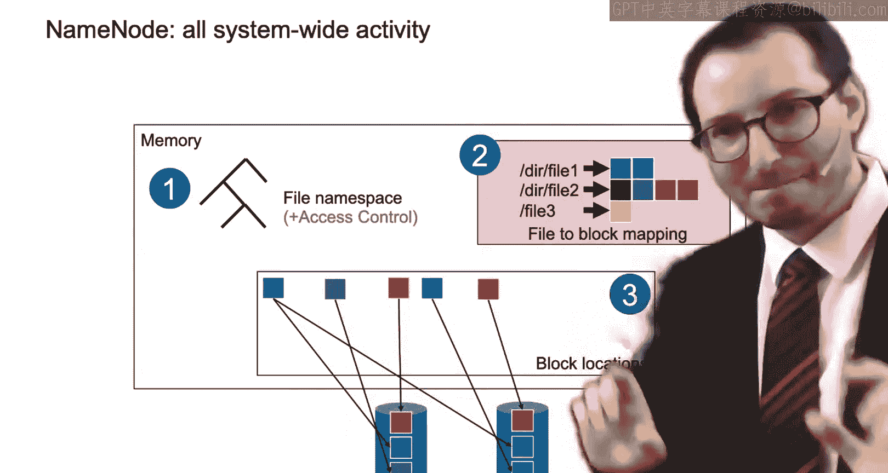

The first thing that you have on the name node is the file name space。 This here is a tree。

 Its the file hierarchy。 These are your directory names and what directories in what directory。

Wet file is in we directory。 So this is really your file hierarchy that is in there stored on the name node right。

 Its it's stored on a single machine， this whole hierarchy， right。😊。

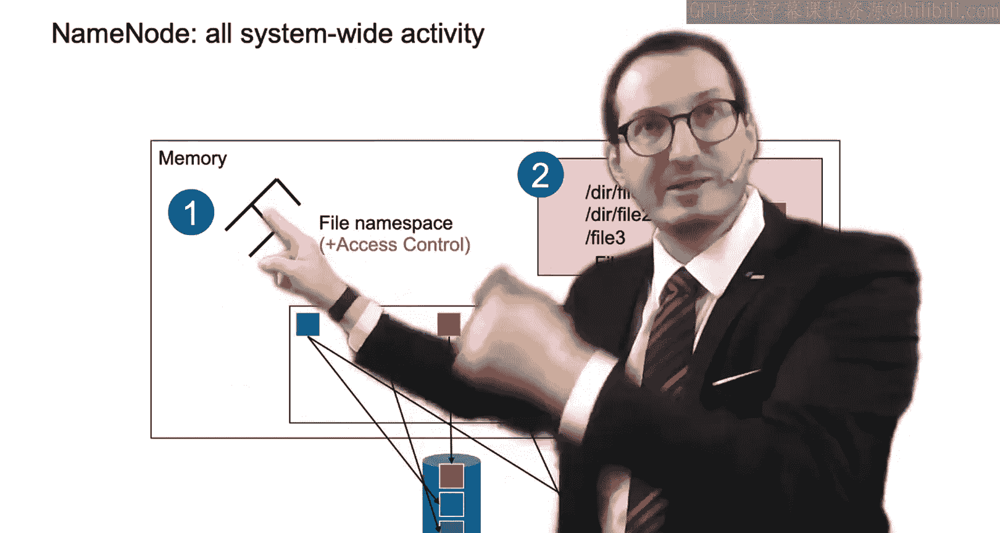

Access control。 What does it mean， You know that on your file system。

 you might have user and groups that are allowed to read or write the data。

 And that says who is allowed to read and write the data。 This is also the case here。

 You can also assign users and groups exactly as you do on the local file system。 In fact。

 its with see if you who know projectsss。

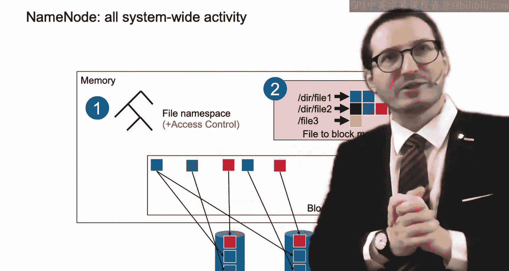

Pss is the standout for like what is used in Linux。

 Uniix and so on for the for the command line access to the to the file system， for example。

 and many other things。 but this is here compatible with Poss。

 a large part is is in fact inspired from Pos。

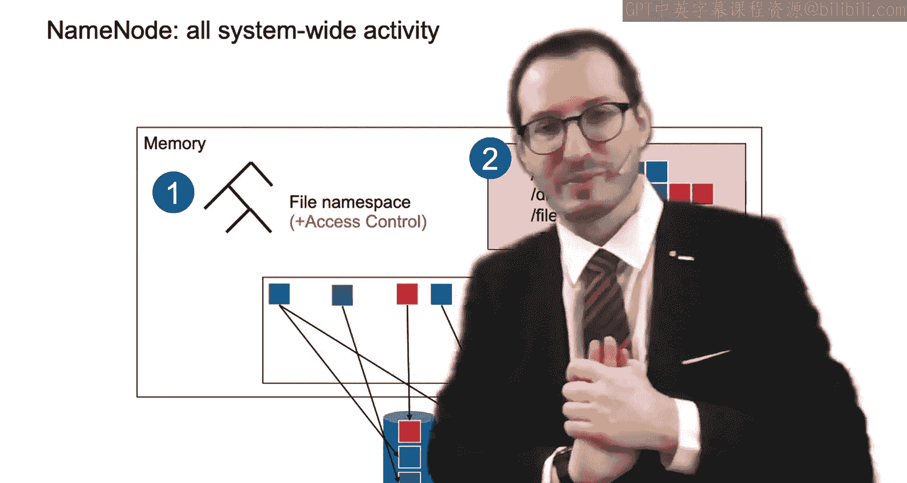

So we have excess control and not focus too much on that， but it is possible to say。

 who owns what data and who is the route to read and write that data within the company。

 So that's the first thing。 That's the information or the hiarch。 The second thing is。From the model。

 each find that you find here here here at the。Is mappped to a list of blocks for example。

 file one has the green block followed by the blue block right This is how it works and then the same continues。

 Each file has a list of blocks that's called the file to block mapping。Right。

 these are the logical blocks before the replication。 And finally。

 the third thing is the location of the blocks， for example。😊，The green block。

Its stored here and there。But what I want to say here is the name node knows that the name node is aware of where each block is stored。

 so it keeps track of the block locations。Now， who agrees that if I have the file hierarchy and I know which file is mapped to we blocks and I know。

Where each block is stored， that's enough information to rebuild the entire information。

We agrees with that。Right I have all I need all I need I look for a fight with a path that get to the find list of blocks and I don't know where to find the data right So this is everything we need and this is all stored in the name node。

😊，So let's go to the data node in there where this is， in fact。

 boring because what is there on the data node。But he's down on the data node。Yes， the data AK A。

The blocks， yes， that's it。 This is what we have on the data node， blocks， blocks， blocks， blocks。

 blocks。

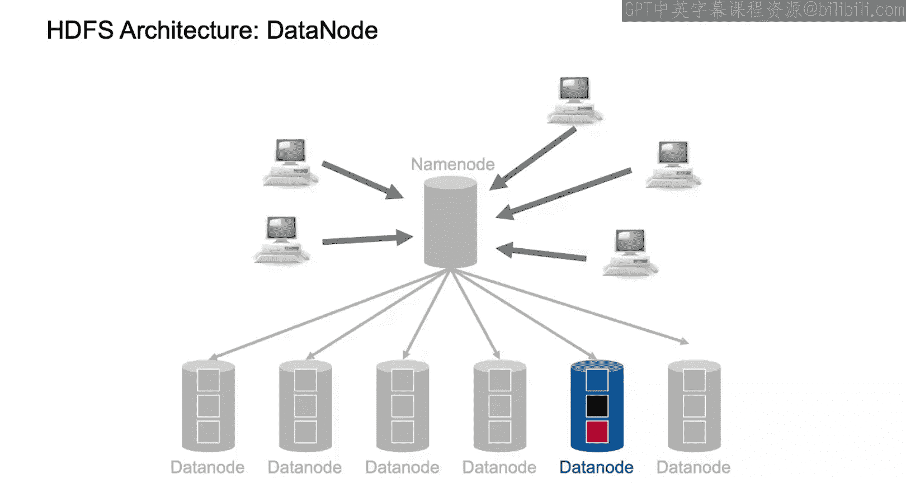

So they are stored on the local risk of us。😊，In information is physical， right。

 They need to be stopped somewhere。 and， in fact。The blocks of HFS。

Internally to the machine are actually fight。This here， this block of HFS is a local file。

 this block is another local file， this block is another local file。

 each one of them is in fact a file that is stored on the local list。😊。

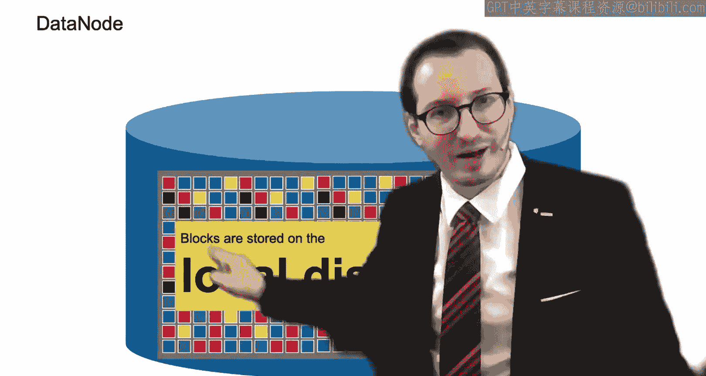

But you really need to， Its data independence。If you are logged into that machine and you can actually do it as an experiment when people like to do that。

 you basically use SSH is a common way of connecting to a machine。

 so imagine you SSH yourself to that machine and you look at the disk the local disk of the machine then you will see these files。

 you will see actually the files that are your blocks in AGFS but now if you leave that machine Now your' outside the user of AGFS you couldn't care less that these are local files you don't care All you care about is these are blocks。

😊，For your file system。 So you really need to distinguish between the local file system of every。

Data node where each HDGFS block is， in fact， a local file。

And the global file system of HGFS where you have the fine namespace of the An class or do not confuse the two right there is the HFS5 system and the hidden local file systems that the users don't actually see the users of HFS。

 is there question。

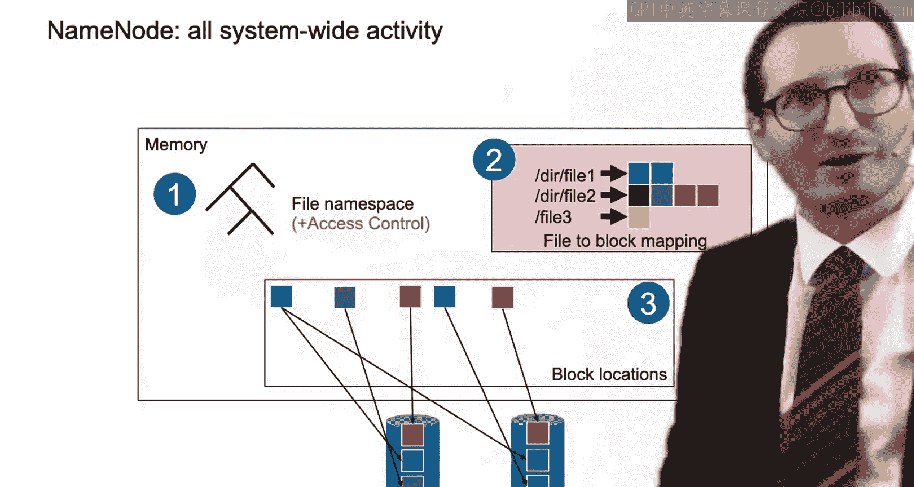

Yes， I'd say more about the protocols。 So the the name node knows which data nodes are available and node which blocks are stored on which data nodes and how much space is used。

Was he the question？对。Are you happy with the answer。Yep， all right。Okay。

So blocks are stored on the local disk on every machine， but seen from my outside。

 all we see is blocks。Okay， but at least it demy sifies， right， because there is no magic in the end。

 each one of the data nodes is itself a computer with its own disk。😊。

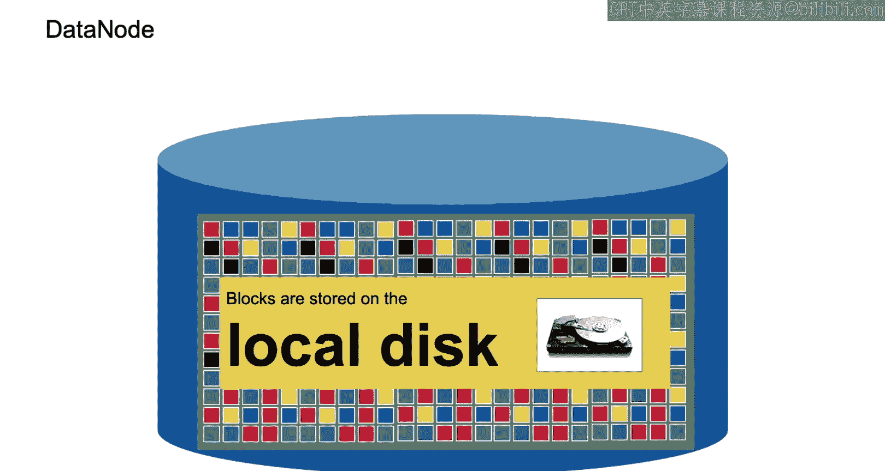

Now， the nice thing is that since you have thousands of machines that each have their disk。

 each one of these machines can actually monitor the disc。And if the disc fails， they will know。

And then the name node will know。 And then it will be able to recover from that because it's replicated anyway。

 So we already know we have all the information so we can detect the disk failure。

 And if a disc fails or maybe even。

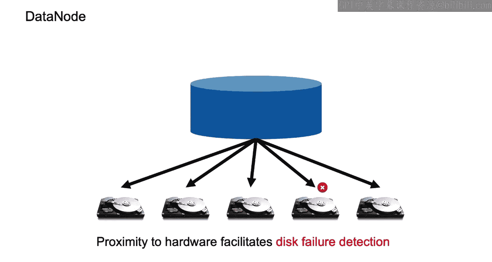

An entire computer phase or even an entire rack of computer phase， we can recover from that。

Now I used colors for the blocks， I said the grid block， the blue block and so on right。

 but in fact internally we don't use colors， we use numbers and more exactly we use integers。

But integers on 64 bits， it means that it's an integer between0。And16 Queenntphiian。

So you can see you can have a lot of blocks in there， right， So between 0 and 16 Quiedians。

So any integer basically gives you a block I D。 This is how you identify your block。

 and these are unique。

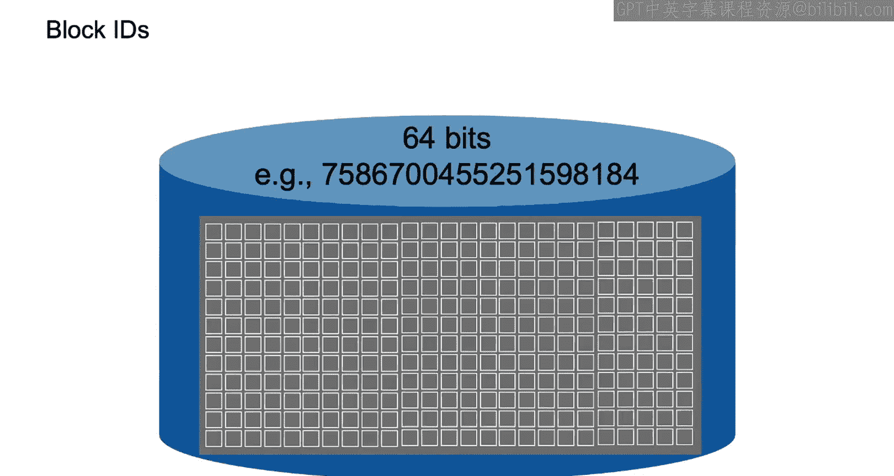

In your cluster。 Alright， So if you go back to the slide where I told you a list of the list of blocks。

 they are the final two block mappings。 In fact， these are a list of intes， a list of the。

 the block Is。

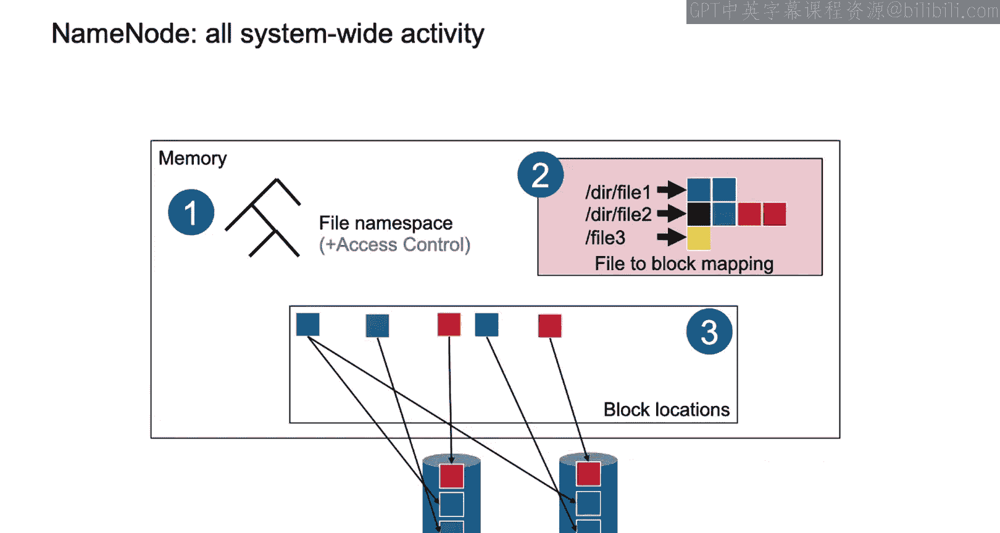

Okay。😊，All right。呃。Then another aspect that will be useful for mapre。

Is that normally we access the blocks in the entirety。

 So most of the time we are going to read a whole block。 But in some cases， as we will seen mapre。

 we might be interested in only reading a block partially and that might happen。

 but do not abuse it because if you think that this gives you random access because you can access any bits in any blocks。

 Think again， because you will run into lat C issues So you can it doesn't mean you can have random access。

 but technically， the API would allow you to to read a block partially right。It's an optimization。

 really， because you could also read the entire block and then throw away what you don't need。

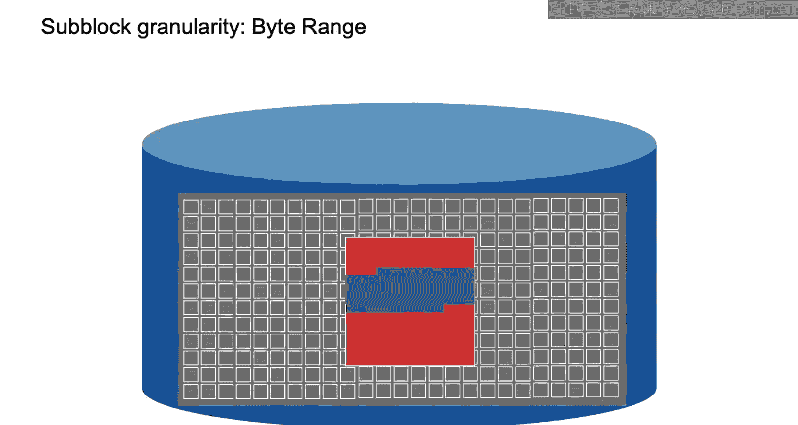

Okay。So now that I introduced the name node and that I have introduced the data node。

 I'm going to explain how they talk with each other right so this is called the network protocol。

 this is how this whole thing is orchestrated and works nicely think of a symphony orchestra and you have the violins and the brass and so on and so on and they just play together So how does this work。

I have oversimplified a few things here because in real life， there is a client。

 There is actually hundreds of clients connecting。 There is a single name node。

 and there are thousands of data nodes， right， but Im。

 I wasn't going to put 100 clients and100 data nodes in there。 So instead。

 Ive put one client and two data nodes。 But you have to imagine that there can be more。

But if I look at a single client and two data nodes， this is what it looks like。

 There is communication between the client and the name node between the name node and the data node between the data nodes also and between the client and the data node。

Everything that is in a black row。Is called control。 It means that there is no data in there。

 There is no data in here flowing。 It's only talking with each other。 The data。

 meaning the blocks flow over these channels here all over the data nodes。

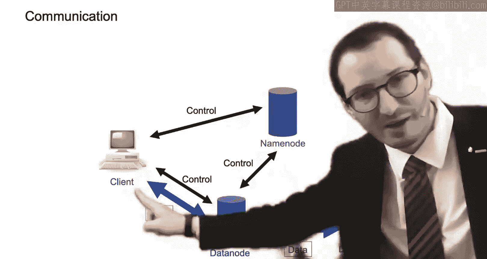

To the client。 So this is the same thing just with the name of the protocol。

 So this is called the client protocol。This is called the data node protocol。

 you'll see why I put a heart in there。 it's not only that I love HDDFS。

 there is a reason why I put a heart in there。 then there is the data transfer protocol that orchestrates the communication here and this is called the replication pipeline as we would shortly see。

 So let's start with the client protocol right there。😊。

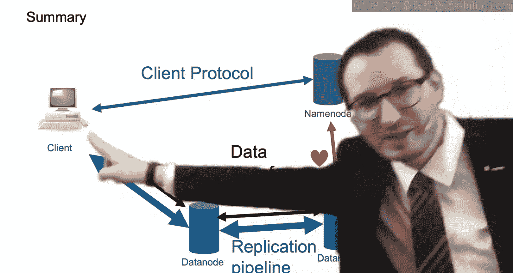

So the client protocol is when a client， or the client means whoever wants to use AGFS from I would say。

The first point of contact。Is the name not always。Right， it's like your。

 your customer representative when you speak with the company。 So this is the name notes。

And the client connects there for metada operation。 For example， you want to create a directory。

 you want to delete a directory。 you want to initiate the creation of the file。

 you want to start reading a file and so。 Always go to the name node。The name node will help you。

 it will give you the location of the data nodes you have to go to to fetch the data it will give you the block IDs that you need to get for a file and so on and so on。

This is all doable with the Java。A。Second， so that was the client protocol second。

 the communication between the name node and the thousands of data nodes。

 so there are several things that happen in there。😊，The first thing is the registration。

You can have data nodes joining and leaving the cluster at any time， right， a computer can crash。

 then you lose a data node or you can have installed a new computer to expandend。

 And now you have a new one so it can register to the name node。 It connects to the name node saying。

 hello I'm there。 I'm a new data node and now you can assign blocks to me。

 right I'll be happy to store them。 This is the registration。😊，Once then there is the heartbeat。

 The heartbeat means that every couple of seconds。The data node connects to the name node just to give a sign of life。

 like I'm here。I'm here。I'm here every couple of seconds。

 This is how the name node keeps track of which data nodes are still alive and which node。

 So this is called a heartbeat。😊，Then every couple of hours， there is a block report。

 the block report means it's a full report with here all the blocks I have and how much space I have available and so on right so a full report。

 every couple of hours。😊，And finally we see when we write files。

 it can also confirm that it received a block successfully。

The name node can give instructions to the data node。

 it can instruct a name node sorry it can instruct a data node to download and keep a copy of a new block。

 for example， it can give that kind of instructions。

Now what's very important is that the name node will never。

 ever connect to a data node to give instructions。😡。

It only gives instructions as an answer to a heartbeat。

So if if the name node wants anything from a data node。

 it just waits for a few seconds until there is a hardbeat and then as an answer to that hubbeat。

 it will say oh， by the way， I will need you to download that block from that other data node and keep a fresh copy of it right because another one lost the block and so you need a new copy。

😊，So this is what's important。 It's always the data node that connects to the name node and not the other way around。

 In fact， it's one of the fundamental principles of computers talking with each other。

 There is always one that connects to the other， the one that connects is called the client and the ones that answer is called the server。

Okay， everything clear。😊，The exact numbers，3 seconds，6 hour wells are also orders of magnitude。

 It changes。 It used to be 4 24 hour wells。 And I think they diminish it to 6 hour well。

 So if you read the papers， you will see that it's not 6 hour wells。

 It's the other of magnitudes that matters。 In fact， you can also change these numbers。

 if you are not happy with them。给。没事嗯哼。Okay。I'd talk about it。 I have sight。

For the name node failure， I anticipated that question， but it's good that you ask。

 I just answer as soon as I reach the size。So that's a good cliff anger for the for the。

Rest of the lecture， Okay， but if you ask these questions。

 it means you're understanding what I'm telling you。All right， so this is the data node protocol。

 Now we have this protocol between the data node。 now it's strange why would the data node talk to each other。

 but in fact they do。Because。When you create new files， you upload new blocks， right。

 You upload new data。Now， you could think， okay， if I replicate each block three times。

 why don't I just connect to the three machines。 And for each one of the machines。

 I can send the block， right， But that would be inefficient。

 So instead of the client connecting to the three machines。Independently。

 the client is only going to connect to one machine， the first one。

 so it's connecting to that machine。And then the machines are going to just organize the pipeline among themselves。

 So the first machine will forward the copy of the block to a second one。

Which with itself forwarded to the third web。Right， it's like， it's like， you know， preinter。

 these phone trees that we had in a village。 If you want to propagate news to everybody in the village。

 everybody calls somebody else and you let you let the news propagate， right。

 So this is how it works。 But it's linear。 It's not a treat It' so linear because it's so few of them。

So this is called a replication pipeline for writing data。

 this is how the blocks are actually transformed much more efficient than the client connecting separately to each data node。

Now， so I've covered now all the protocols， but a few more words on the metada what I call metadata functionality between the client and the name node。

 what can you do you can create a directory， you can delete a directory you can write a new file you can append to an existing file without creating a new one you can read a file you can delete a file and so on and so on for all of that you need to connect to the name node first then you might need to also connect to data。

I have an animation for you。That basically brings the whole thing into life of what I've been telling you。

So the first animation is about reading a file and then I'll have a second one about writing a file。

 so now I just sit back and watch what's going on。😊。

I simplified there are obviously thousands of data nodes at the bottom I only put three on the right you have the name node。

 but let's do it with three， and I have a single client。

 but again you can have hundreds of clients at the same time。So， the client。Connectex。

 we have a question on the chat。有。Of the of the second file is only done when the ra is finished。

Or when I single the when it's finished and I'll have it on the animation。On the second animation。

 Yeah， so when， when it's finished， But I come back to that， there is also a certainty。Okay。

 so I'm a client。 I want to read a fight。 What do I know I connect to the name node。

And I politely ask now you have LLM， so you need to be polite， right。

 so you politely ask for the file。And then呢。The name node is going to run so。 Yes， sure。

 that file exists。 And here are the block Is of that file。

 and here are the locations of these blocks。😊，And by the way。

 you have the choice between these three data nodes for data nodes for every block。

 and I even selecteded them by distance for you so that you can connect to the nearest one first。

 right？All right， so now the client has all this information。Imagine that。

We we are I'm not looking at mapre of Sp。 I just want to read the file sequentially。

 It's the simplest way you can use it。 So the client now is going to read sequentially that file。

So it's going to connect to the data nodes。And start streaming through the bits。

Now I want to explain a bit what's going on here because there are multiple levels of abstractions。

On a physical level。What the client should do is connect to a data node that has a copy of the first block。

For example， D one。And then， download。

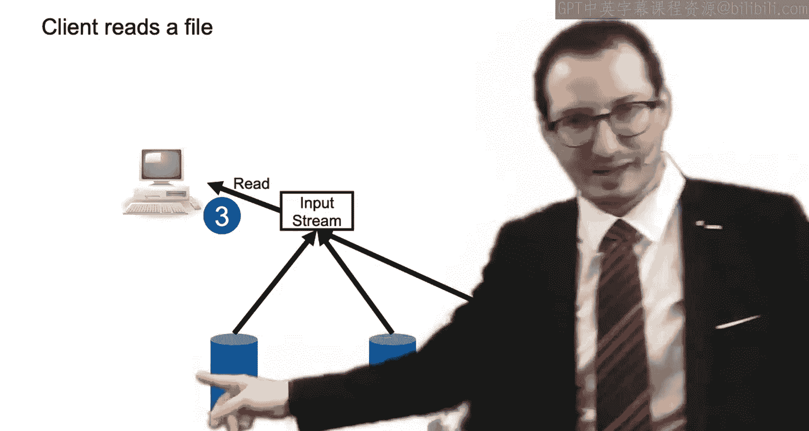

The block。Then it needs block two， so maybe this one has block  two。

 so it connects there and gets block2。

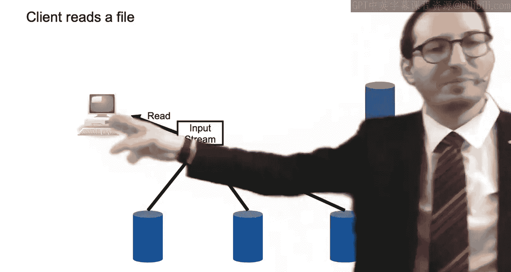

Then it needs block3 and maybe block3 is there， so it connects there and gets block3。

 So on the physical level you have to iterate connecting to the right data node and download the right block。

😊。

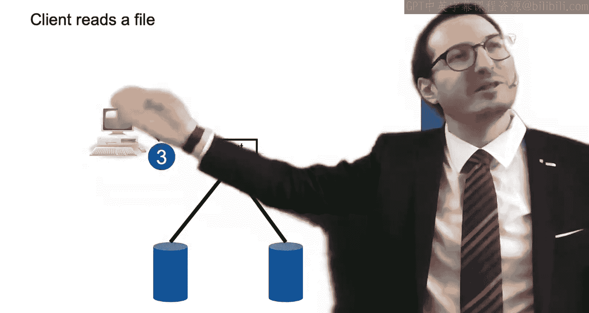

But for convenience， if you are using Java or the Java API of HDGFS。

 you don't need to worry about that because the programmers of HDGFS were kind enough to program all of that and they offer you what's called an input stream it's one of the functionality in Java that does it for you So basically what you get from the AgFS API is an input stream and you just read the bit bit by bit all the way gigabytes of them and the input stream will be intelligent enough to use the information provided by the name node and connect to the right places right so this is why in practice if you read in Java you will not even see the difference from a localified system because connecting to the data node is nicely en capulated encapsulated is the world encapsulated in the input stream whom does that make sense。

But technically， you're connecting to data nodes after data nodes to request block after a block。

Presequential rate。Okay， now let's write a file and I've come to the acknowledgements。😊，Oh。😮，It's1。

 so I'll explain how to write a file。Next week， I'll finish that animation and then we'll wrap up on distributed Pi systems。

😊，So thank you very much for attending。 You have a quiz that is going to be released today tomorrow。

😊，Today at 2 a quiz on the cloud storage， enjoy the exercises and I'll see you next week at 8am。

 thank you very much。😊。

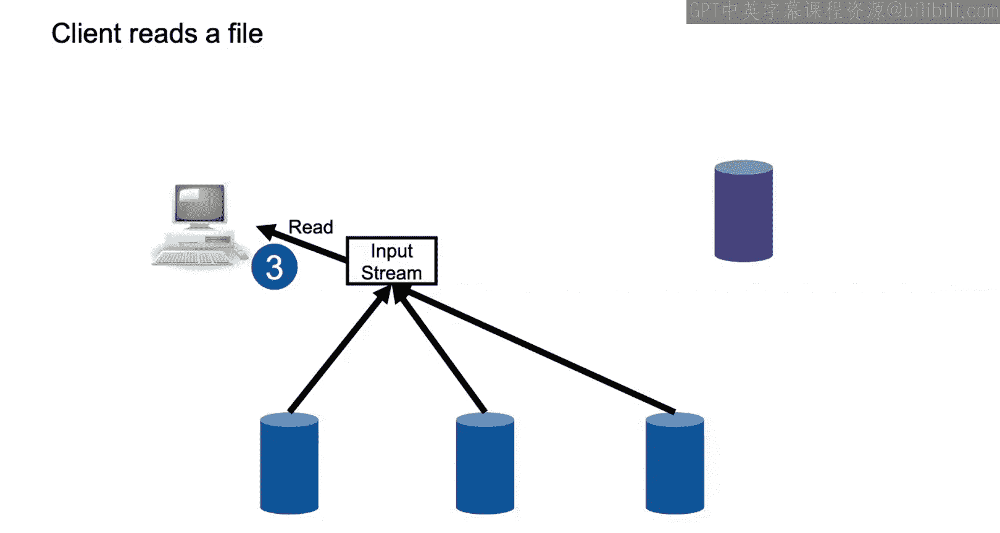