# 工程师的大数据：4：分布式文件系统 (2/3)

在本节课中，我们将要学习分布式文件系统（HDFS）的核心模型、架构和工作原理。我们将对比对象存储与分布式文件系统的区别，深入探讨块存储的概念，并了解HDFS中名称节点与数据节点如何协同工作。

## 模型对比：对象存储 vs. 分布式文件系统

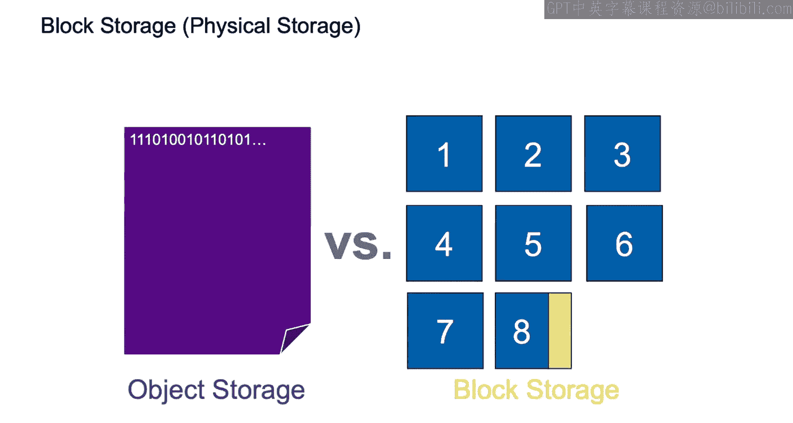

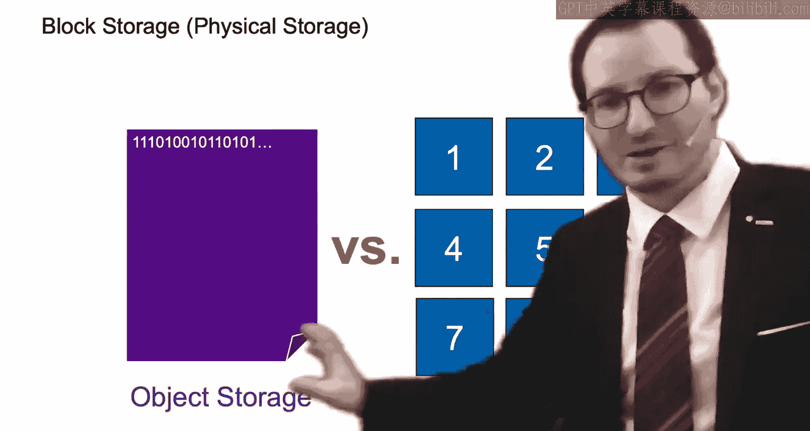

上一节我们介绍了对象存储服务。本节中我们来看看分布式文件系统的模型，并与对象存储进行对比。

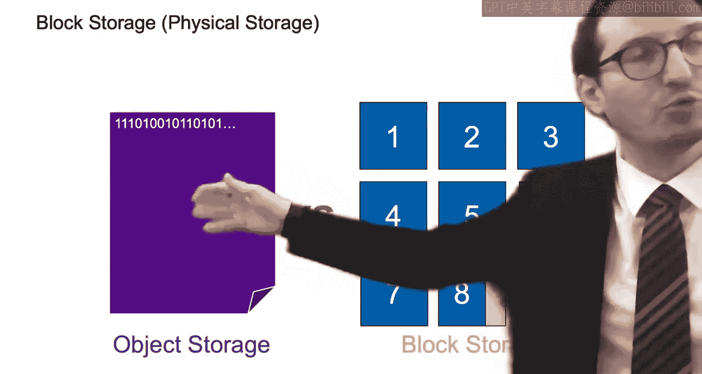

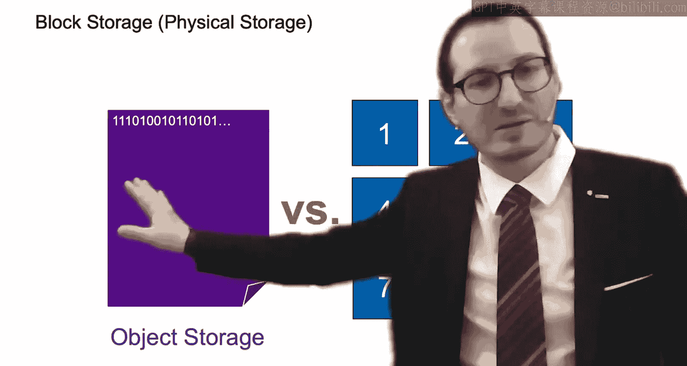

对象存储（键值模型）如左图所示，这是我们上周学习的内容。其核心思想是可以用一个键来标识每个对象。在S3中，这个键是 `桶名 + 对象名`；在Azure中，则是 `账户名 + 容器名 + 对象名`。

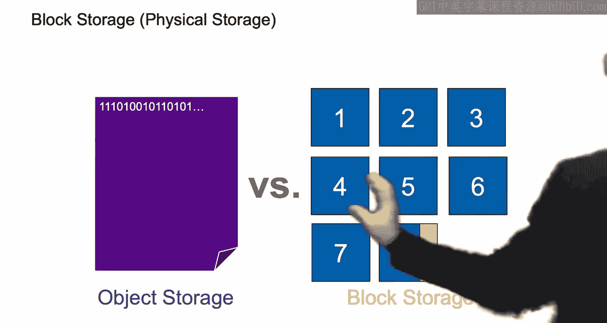

然而，在分布式文件系统（通常指HDFS）中，我们拥有一个目录和文件的层级结构。这种层级结构大家应该很熟悉，它类似于个人电脑上的文件系统：目录可以递归地包含子目录，最终在树的末端是文件。这被称为**文件层级结构**。

请注意术语上的区别：在键值模型中，我们称存储的值为“对象”；在文件层级结构中，我们使用“文件”一词。但本质上，它们都是最终存储数据集的东西。

这是第一个区别：从扁平结构变为层级结构。

第二个区别在于数据的组织方式。在对象存储中，对象是一个单一、庞大的整体块，最大可达5TB。然而，在分布式文件系统中，文件被划分为**块**。例如，一个文件可能被分成8个块（1, 2, 3, 4, 5, 6, 7, 8）。这些块通过文件系统的API暴露给用户，你可以看到块1、块2等。这被称为**块存储**，与对象存储相对。

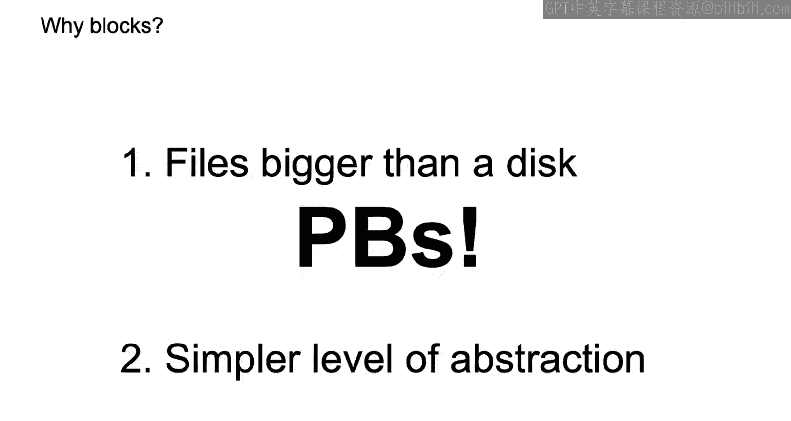

你可能会问，Azure Blob存储在一开始就提到了块，这是否意味着它已经是分布式文件系统？确实，Azure Blob存储在这方面已经具备了分布式文件系统的某些特性，因为它使用了块。但S3中没有“块”的概念。不要混淆S3 API中用于分块上传的“部分”和这里的“块”。上传时的“部分”是特定于上传方式的，一旦上传完成就会消失，最终只有一个大对象。而分布式文件系统中的“块”是API层面持久存在的部分。

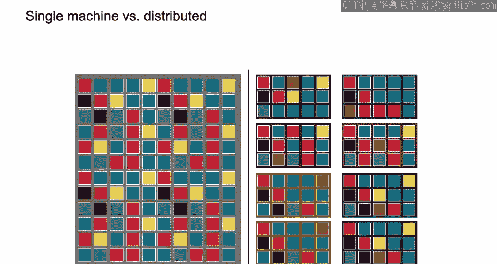

所以，再次强调区别一：我们有了目录和文件的层级结构。区别二：我们将块暴露给HDFS的用户，这称为块存储。

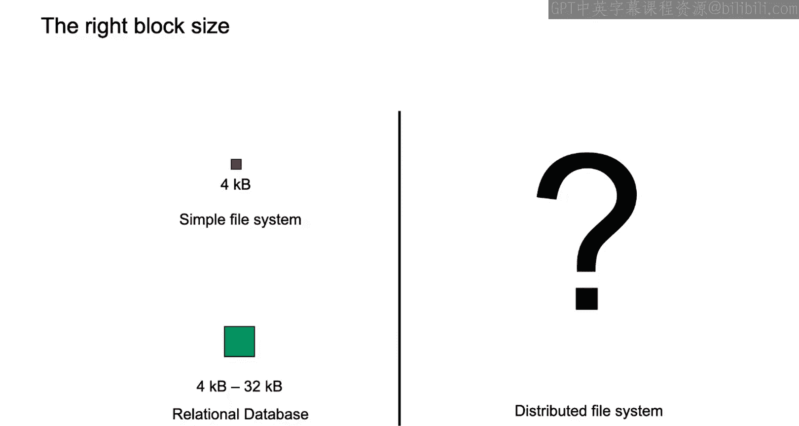

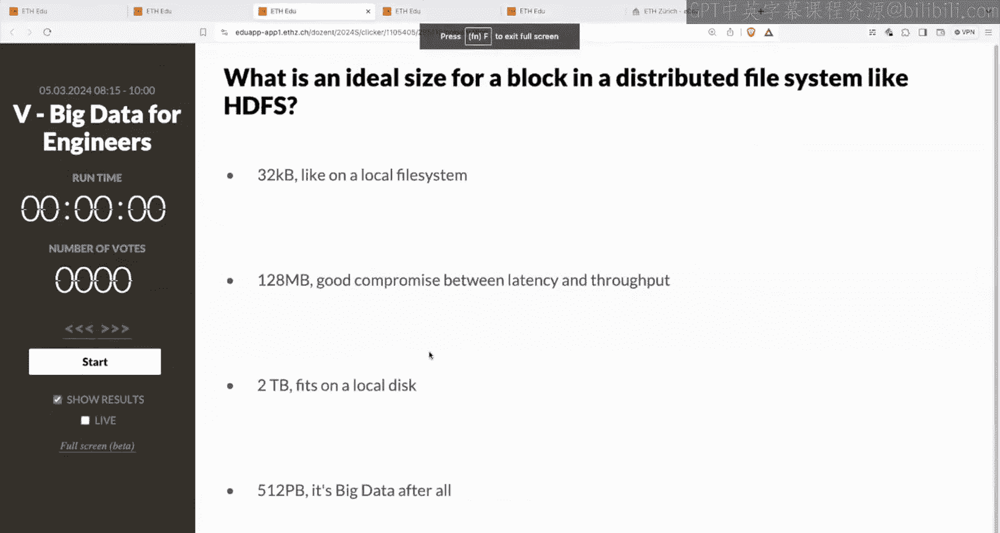

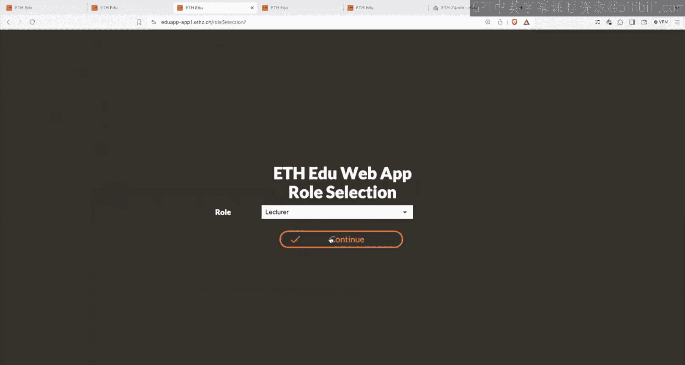

现在，关于“块”这个词的一个现实情况是：在原始的Google文件系统论文中，他们称之为“块”。在MapReduce的上下文中，会使用“分片”一词。在S3中讨论将数据集分割成多个对象时，我用了“分片”这个词。数学家们称之为“分区”。因此，有很多不同的词可以用来表示同一件事：将一个大东西分成几个更小的部分。你可以称这些更小的部分为块、块、分片或分区，这并不重要。关键在于理解这个思想。如果你能记住在GFS的上下文中我们说“块”，在MapReduce中说“分片”，那很好。但我希望你们关注的是这个思想本身：将大的东西分割成我们称之为“块”的较小部分。

## HDFS模型总结

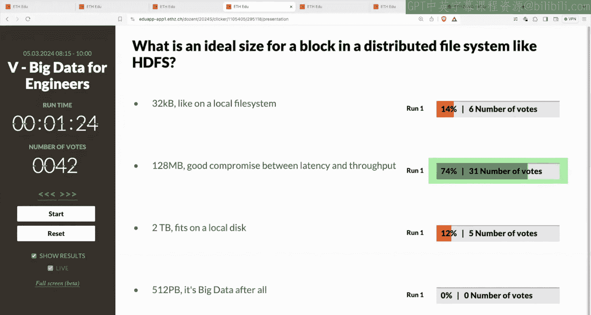

以下是HDFS模型的单页总结：

我们拥有目录和文件的层级结构，每个文件对应一个**块列表**。块的顺序很重要。只有文件有块，目录没有块。目录的存在只是为了给文件系统提供层级结构。这就是HDFS的模型。

## 为什么需要块？

使用块有以下几个主要原因：

1.  **物理限制**：如果一个文件有1PB大，它显然无法存放在单台机器上。在2024年的今天，我们还无法制造出容量为1PB的硬盘。因此，要存储一个无法放入单块磁盘的文件，除了将其分割成更小的块（或分片、分区）之外，别无他法。
2.  **并行处理的抽象层**：当我们开始研究MapReduce和Spark如何处理这些文件时，块为我们提供了一个极好的抽象层，使得并行处理成为可能。如果只有一个大对象，并行处理并不明显。但有了块，我们就可以在不同的机器上并行处理这些块。
3.  **数据分布的“流动性”**：从逻辑层面看，整个HDFS系统可能有数百万或数十亿个块。我们需要将这些块分布到数千台机器上。如果你有几十亿个小块，就很容易将它们均匀地分布到1000台不同的机器上，就像把水倒入不同的桶里一样。但前提是块的大小要合适。如果块太大（例如5TB），或者太小（例如1KB），这种“流动性”就会变差。块的大小会改变数据分布的灵活性。

## 块的大小应该是多少？

块在你的笔记本电脑上已经存在。你可能不知道，但你的笔记本电脑也是以块的形式存储文件的。这些块的大小大约是4KB。这意味着你的电脑从磁盘读写数据时，总是以大约4000字节为单位进行的。关系型数据库也是如此，虽然它们的块可能大到32KB，但数量级是相近的。

那么，考虑到我们之前提到的约束——我们希望系统是**吞吐量受限**而非**延迟受限**——你认为分布式文件系统中的块应该多大？

以下是几个选项及其可能的原因：
*   **32 KB**：像本地文件系统一样。
*   **128 MB**：在延迟和吞吐量之间一个良好的折衷。
*   **2 TB**：因为可以放在本地磁盘上，是单机使用的最佳方式。
*   **512 MB**：因为这是大数据，我们需要巨大的块来让整个系统工作。

正确答案是 **128 MB**。我来解释一下直觉。

首先，128 MB比本地文件系统的块大得多。我们可以通过考虑两个极端情况来推理：

*   **假设块大小为2 TB**：
    *   上传文件到这样的系统会非常不实用，网络错误会频繁发生。
    *   在集群中分布数据时缺乏“流动性”，因为块太大了。
    *   每台机器上可能只有一两个块，这在后续的MapReduce中不利于并行化。
    *   因此，2TB虽然能保证高吞吐，但实用性差。

*   **假设块大小为KB级别（如4KB）**：
    *   每台机器上会有数百万甚至数千万个块。
    *   当你查询或处理一个PB级的数据集时，这个数据集会被分成数万亿个块。
    *   每次访问一个块都会引入延迟。如果顺序访问这些块，所需时间将超过宇宙的年龄。
    *   这样的系统将完全是**延迟受限**的，大部分时间都在等待，无法有效工作。

因此，128 MB是一个在两者之间的“甜点”。它既足够小，可以在机器间灵活分布（具有“流动性”），又足够大，使得访问每个块时的等待时间不会成为主要瓶颈。

需要强调的是，你不必拘泥于128 MB这个精确数字。重要的是数量级。事实上，在Google文件系统中，块大小是64 MB。HDFS将其翻倍。而像Alluxio这样的系统，块大小已经达到了4 GB。随着计算机硬件的发展，硬盘容量变大，读取速度提升，块的大小也会逐渐增大。但正确的数量级大约在GB级别（十倍以内）。如果是100 GB或TB级别的块，那就不合适了。

## 关于碎片整理的问题

有同学提到了碎片整理。在本地文件系统中，随着文件的不断写入和删除，一个文件的块可能会分散在磁盘的不同位置。读取这样的文件时，磁头需要频繁移动，导致延迟增加。**碎片整理**就是重新组织磁盘上的块，使属于同一文件的块在物理上连续排列，从而提升顺序读取的性能。

在HDFS中，拥有大块可以被看作是一种逻辑上的“防碎片”机制。我们确保一个块本身在物理上是连续的（在单个数据节点的本地磁盘上），并且块作为一个整体不会被分割和分散到各处。这与碎片整理的概念有联系。当然，在现代系统中，由于缓存等技术，本地碎片问题已不那么突出，但这个原理有助于理解为什么大块在集群层面是有益的。

## HDFS架构

现在我们已经了解了逻辑模型和块的大小，接下来看看HDFS的架构。我们如何连接成千上万的机器？

一种连接方式是**点对点网络**，例如区块链，每台计算机都可以直接与其他计算机通信。

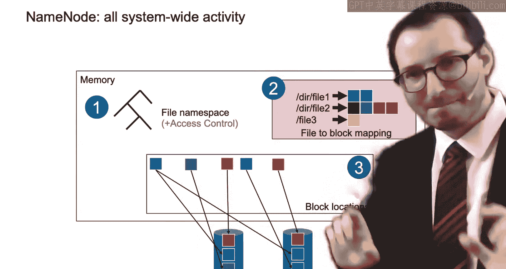

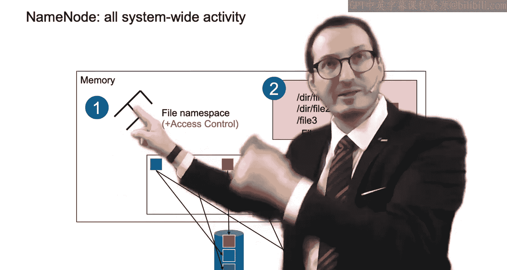

但在大数据框架中，我们更喜欢另一种架构：一台计算机**协调**一切，而其他计算机执行所有工作。这种架构有很多名称（主/从、主/工作者、协调器/工作者等）。我们主要称之为协调器节点和工作器节点。

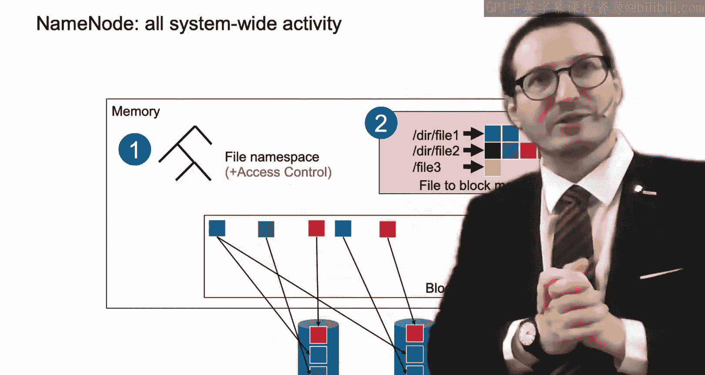

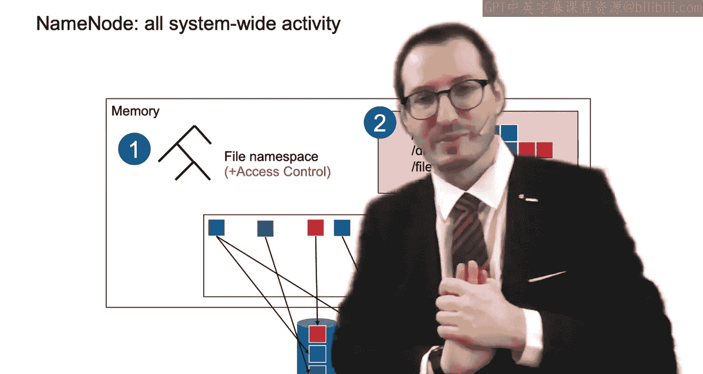

在HDFS的上下文中，我们给协调器节点起名为 **名称节点**，给工作器节点起名为 **数据节点**。

因此，我们有一个名称节点和许多数据节点，它们以这种方式连接在网络中。块存储在哪里？它们存储在数据节点上，而不是名称节点上。这是一个简化示意图，实际上每台机器上存储着数千个块。

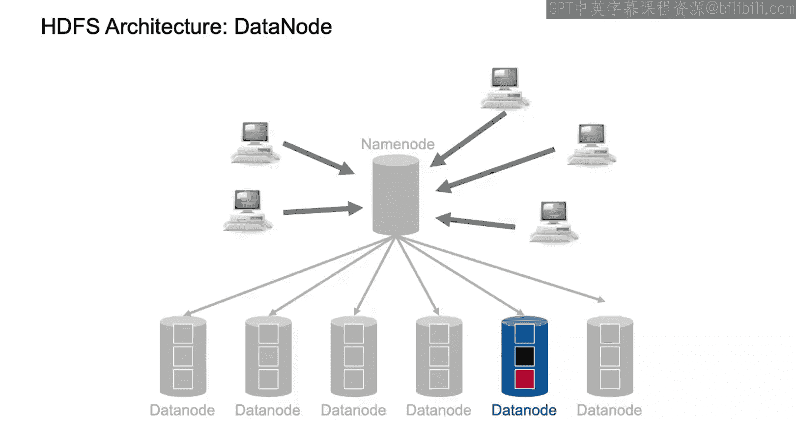

## 数据写入与复制

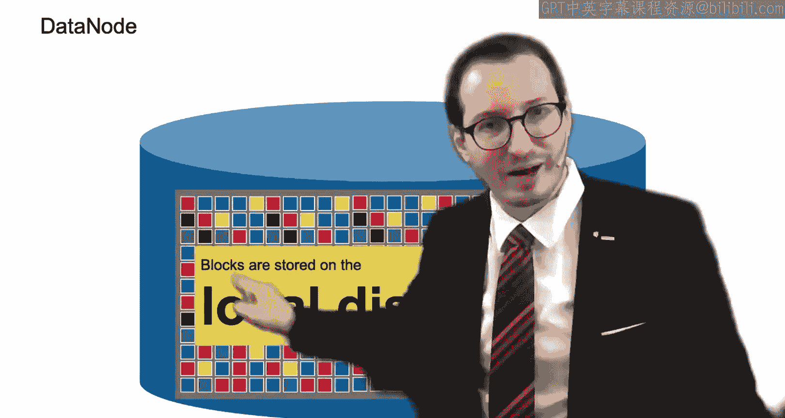

当我们有一个文件（例如1DB大小）要存入HDFS时，首先会将其分割成块（例如128 MB的块）。然后，我们不仅将这些块分布到各处，还会对它们进行**复制**。默认情况下，每个块会被复制三份，存储在三台不同的机器上。这些副本称为**副本**。它们没有主次之分，只是同一块的三个相同拷贝。

复制的好处：
1.  **容错**：如果一块硬盘甚至整台机器故障，数据仍然可以从其他副本访问。
2.  **并行查询**：可以从多个位置访问数据，这在MapReduce等处理中非常有用。

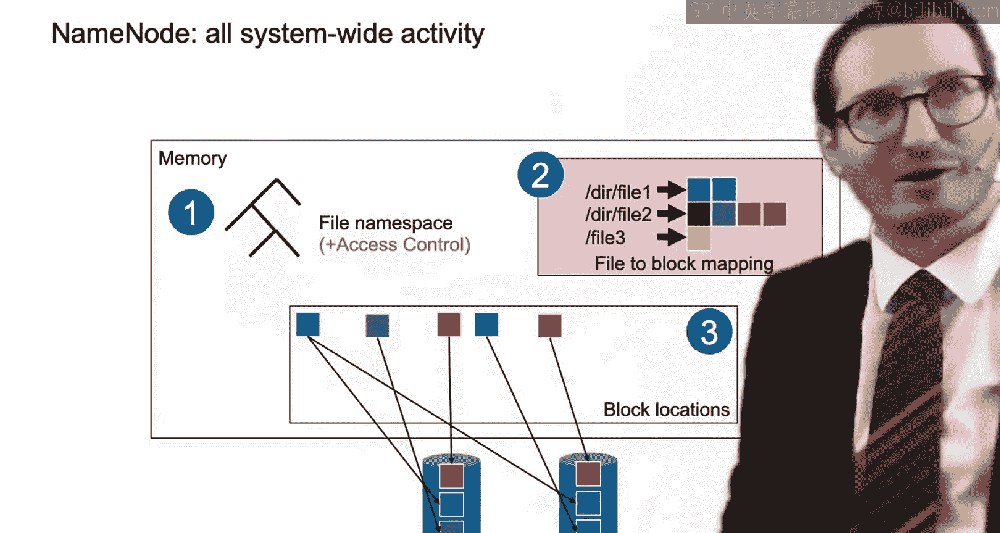

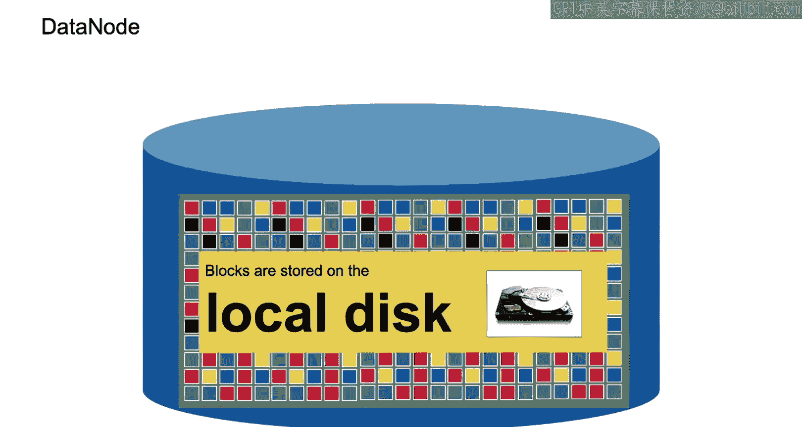

这与RAID（独立磁盘冗余阵列）有些类似，但请注意，如果你使用HDFS，就不需要再配置RAID了，因为复制功能已经内置。

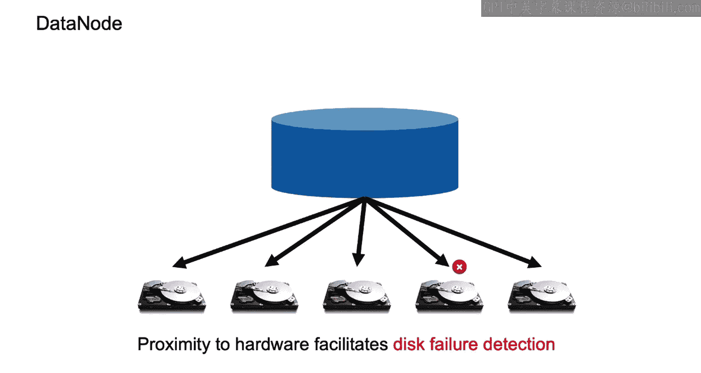

## 名称节点内部

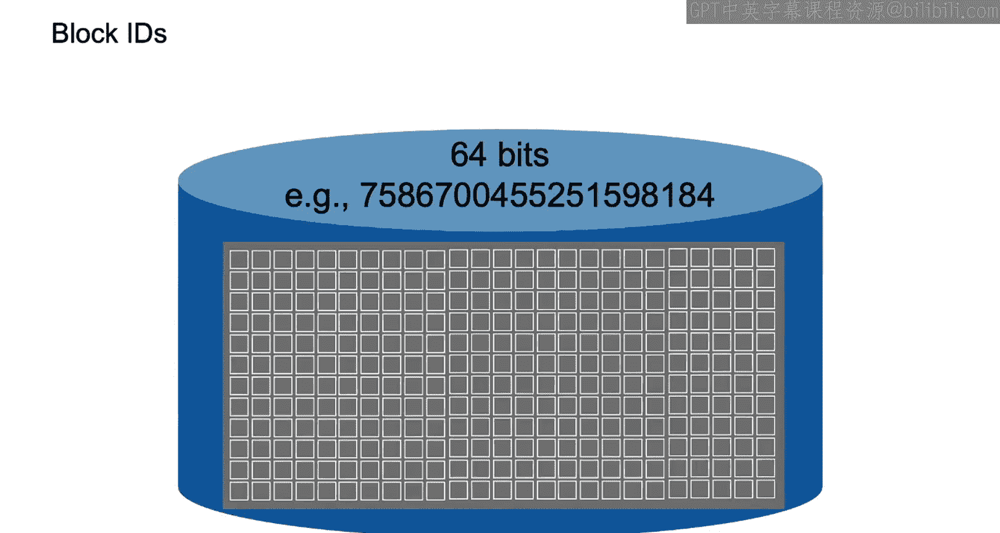

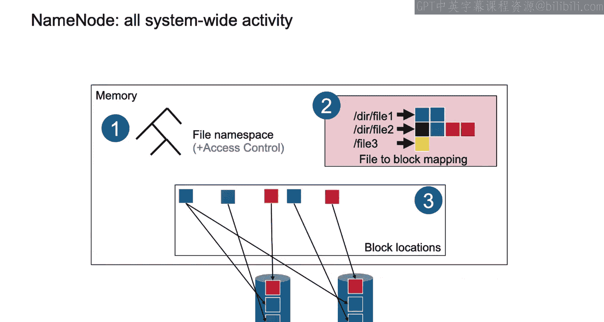

让我们深入看看名称节点内部有什么。主要有三样东西：

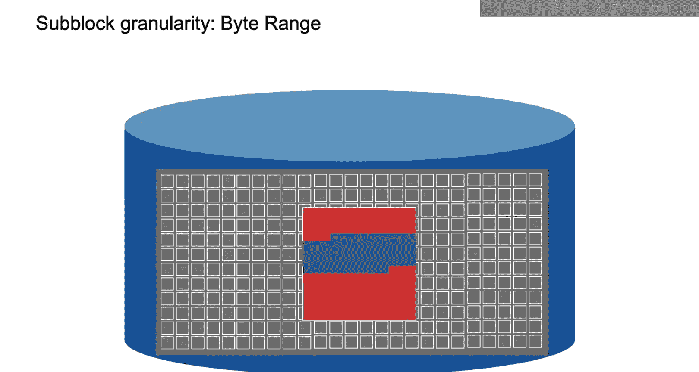

1.  **文件命名空间**：这是一个树形结构，即文件的层级结构。它记录了目录和文件的组织关系。
2.  **访问控制**：类似于Linux的POSIX权限，它定义了哪些用户和组可以读写数据。
3.  **文件到块的映射以及块的位置**：
    *   **文件到块映射**：记录每个文件由哪些块组成（按顺序，用块ID列表表示）。
    *   **块位置信息**：记录每个块存储在哪些数据节点上。

有了文件层级结构、文件到块的映射以及块的位置信息，我们就拥有了重建整个文件系统所需的所有信息。所有这些信息都存储在名称节点中。

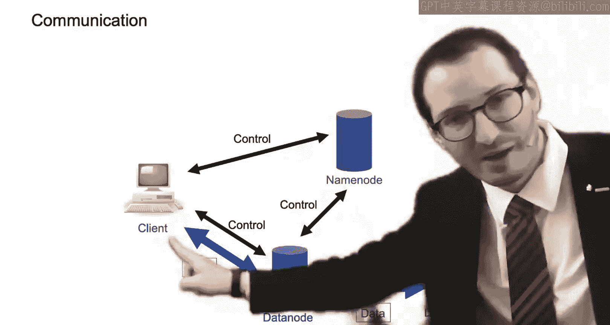

## 数据节点内部

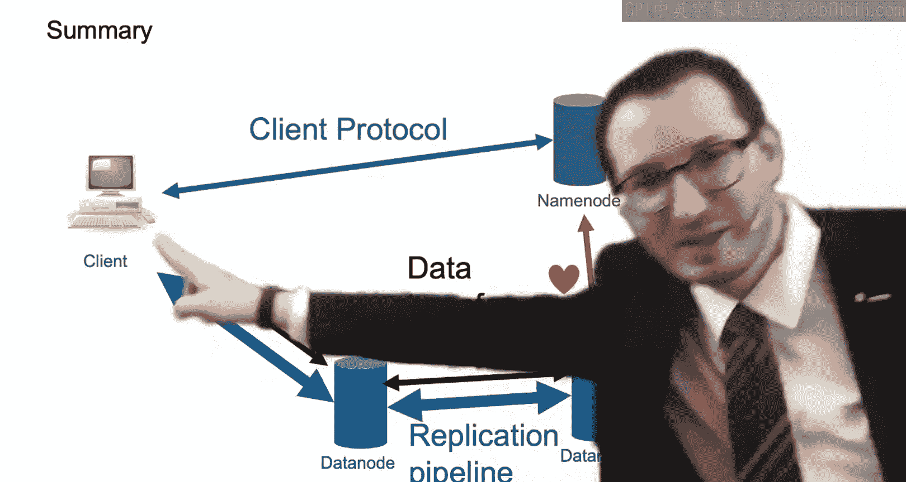

数据节点内部相对简单：存储着**块**。这些块物理上存储在数据节点的本地磁盘上。实际上，每个HDFS块在数据节点的本地文件系统中就是一个独立的文件。但作为HDFS的用户，你无需关心这一点，你看到的只是逻辑上的“块”。重要的是区分全局的HDFS文件系统和每个数据节点上隐藏的本地文件系统。

块通过64位整数ID唯一标识，范围从0到2^64-1，足以标识海量的块。

## 网络协议与交互

现在介绍名称节点、数据节点和客户端之间如何通信。这是一个简化的视图（实际有数百个客户端和数千个数据节点）。

通信可以分为两类：
*   **控制流**（图中黑色箭头）：只传递元数据和指令，不传输实际数据块。
*   **数据流**（图中其他箭头）：传输实际的数据块。

具体协议包括：
1.  **客户端协议**：客户端与名称节点之间的通信，用于所有元数据操作（创建目录、删除文件、获取文件块信息等）。
2.  **数据节点协议**：名称节点与数据节点之间的通信，包括：
    *   **注册**：新数据节点加入集群时向名称节点报到。
    *   **心跳**：数据节点定期（如每3秒）向名称节点发送信号，表明自己存活。
    *   **块报告**：数据节点定期（如每6小时）向名称节点完整报告自己存储了哪些块以及剩余空间。
    *   **指令响应**：名称节点通过响应心跳的方式，向数据节点下达指令（如下载某个块的新副本）。**关键点**：名称节点永远不会主动连接数据节点，总是数据节点作为客户端连接名称节点服务器。
3.  **数据传递协议与复制管道**：数据节点之间以及客户端与数据节点之间的通信，用于数据传输。在写入文件时，为了高效复制，客户端只将数据块发送到第一个数据节点，然后由数据节点之间自动形成一个**复制管道**，将块依次转发给第二、第三个副本节点，这比客户端分别连接三个节点更高效。

## 文件读取过程

让我们通过一个动画来理解读取文件的完整过程：

1.  客户端连接名称节点，请求读取某个文件。
2.  名称节点检查元数据，确认文件存在，并返回该文件包含的**块ID列表**以及每个块的**副本位置**（通常会按网络距离排序，建议客户端优先访问最近的数据节点）。
3.  客户端获得这些信息后，开始顺序读取文件。在物理层面，客户端需要：
    *   连接到存有第一个块副本的某个数据节点（例如D1），下载整个块。
    *   然后连接到存有第二个块副本的某个数据节点（例如D2），下载第二个块。
    *   依此类推。
4.  在实际编程中（如使用Java API），HDFS提供了一个**输入流**抽象。开发者只需像读取本地文件一样从这个流中读取数据，底层的复杂性（连接正确的数据节点、请求正确的块）都被封装了起来，对用户透明。

## 文件写入过程

写入文件的过程涉及我们提到的复制管道，这将在下一节课的动画中详细展示。其核心思想是客户端只与管道中的第一个数据节点交互，由数据节点负责将数据沿管道复制到其他副本节点，并在完成后进行确认。

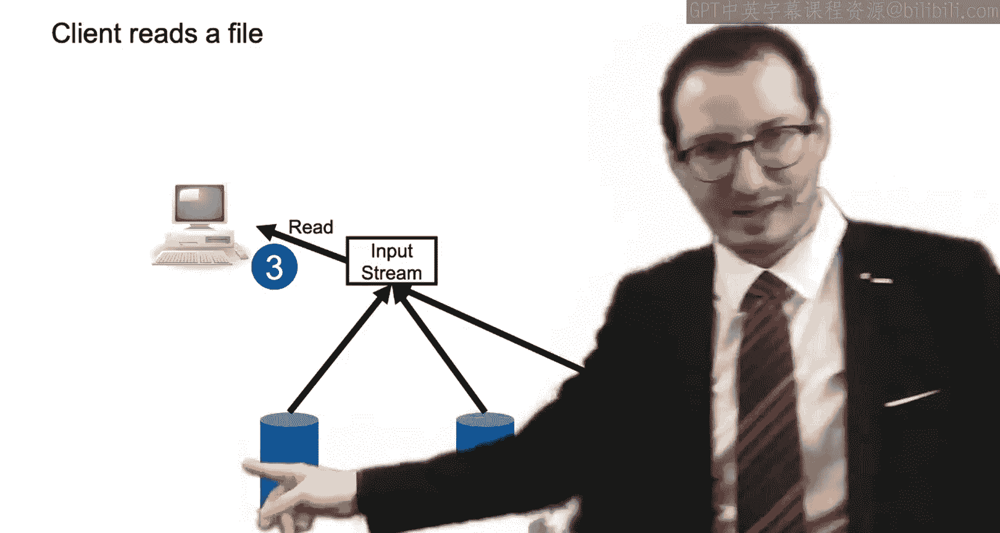

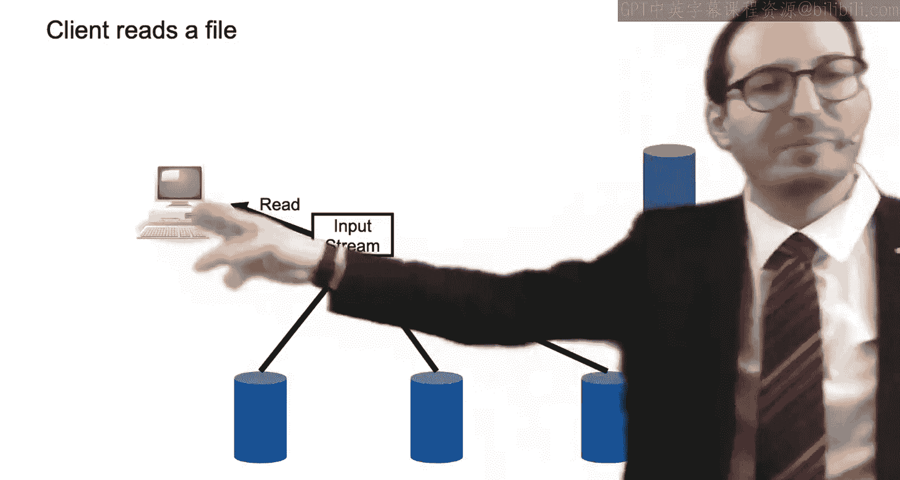

## 关于名称节点故障

这是一个非常重要的问题，它为我们下一讲留下了悬念。名称节点作为存储所有关键元数据的单一节点，其故障确实是一个需要解决的挑战。我们将在后续课程中探讨HDFS如何应对名称节点故障（例如通过备用名称节点或高可用机制）。

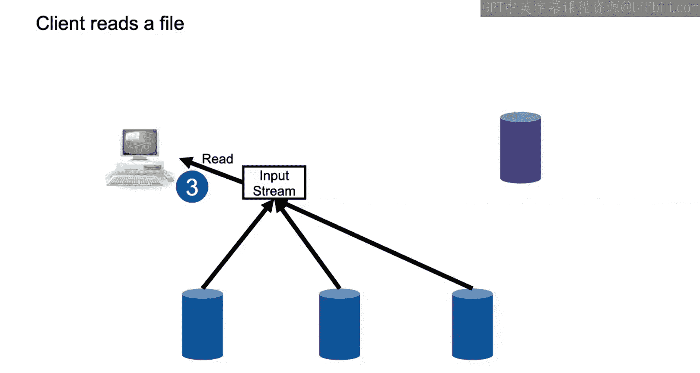

本节课中我们一起学习了分布式文件系统HDFS的核心概念。我们对比了它与对象存储的区别，理解了块存储的必要性和块大小的设计考量。我们深入探讨了HDFS的架构，包括名称节点（存储元数据）和数据节点（存储数据块）的角色，以及它们之间通过客户端协议、数据节点协议和复制管道进行协作的方式。我们还概述了文件读取的基本流程。这些知识是理解后续大数据处理框架（如MapReduce和Spark）如何建立在分布式存储之上的基础。