# 苏黎世联邦理工《工程师的大数据｜Big Data for Engineers - ETH Zurich - 2024》中英字幕 p09 4 - Distributed file systems (3_3) - .zh_en -BV17FAmeFE9K_p9-

Welcome everybody in the lecture hall， welcomee everybody on Zoom。

 welcomel everybody from the future。 So today we are going to finish this topic right here。

 distributed file systems Before we start， I have one question for you then we'll continue and then we move on to syninax。

 XML， Jason and so on。😊。

So let's start with the question to wake you up say 8am。

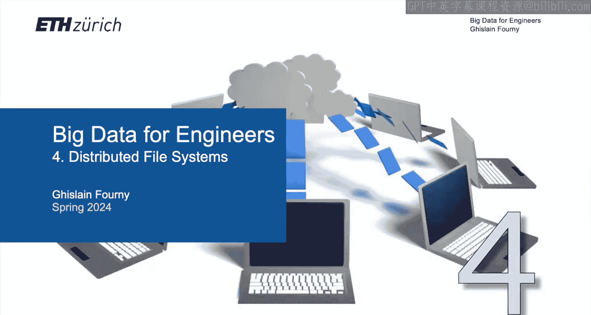

给 it is。With which servers must the client communicate？

To create a director or to get the blocks for a fight。

 talking about AGFS the Hadoop distributed file system。With the data node only。

 with the data nodes for creating the directory with the name node to get the blocks。

 with the name node for creating the directory， with the data node to get the blocks。

 Sorry for the typo， with the name node only。What goes to the name node and what goes to the data nodes？

Stayker get your answers。Ha the majority。So yes， this is the name node for creating the directory and the data node to get the blocks。

 What you get from the name nodes is the block IDs， right。

 just the integer that identifies the block， but the actual blocks。

 the actual contents of the blocks， this is from the data nodes。😊，Right。Okay。

 so let me now switch back to the slides。

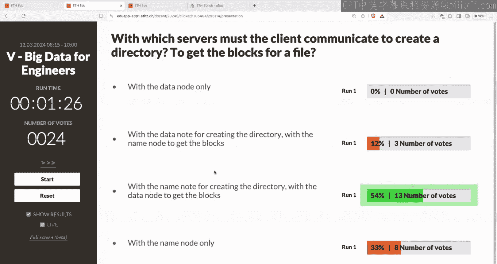

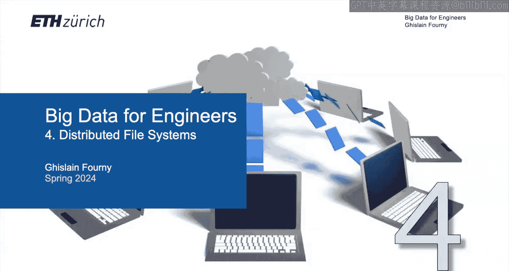

Okay。So as a quick reminder。This is the data model of HDGFS。😊。

It's difficult to do more simple than that。Well， maybe simpler than that would be object storage with S3 where it's just flat and you have key your best。

But here you see we have this hierarchy of filess organized directories， just like on your hub。

 called the fight system。And the files， the content of the file is organized in blocks。

 The blocks all have the same size of 1 28 MB。 You can change the default size if you want。

 Google uses 64 me， but it's the order of magnitude that is important。

 What's very important is that all the blocks have the same size except the last one because the last one might be smaller And there is no waste of space。

 If the last block is smaller than the others， and it also takes less space on disk， right？

 Remember that an HfS block， which is a logical thing。1 28 MB worths of zeros and ones。😊。

If you log yourself into one of the computers， that is a data node。

 you log yourself there and then you peek into the local file system。

 you will see that these blocks are actually local files on that computer and the size of those local files will always be 128 mebytes except for the dust blocks that can be this。

All right， who is clear with this？😊，W means use peer？Alright， so that's the data model。

 So last time I stopped with how to read a file。 you ask the name node for the block Is and locations。

 and then you connect to the data nodes block after a block。 That's one way of reading， right。

 block after our block， you get the contents。😊，And in Java， for example。

 you have a library that does it for you。 So you don't even need to bother connecting to the to the data nodes yourself。

 The library is going to do it for you and just deliver the zeros and ones that are inside the file。

But what I would like to show you next is how to write a fight。Or you create one。

 So who do you connect to files， the name No other the data nodes。

The name node exactly always the name node。 So you basically connect to the name node and signal your intent to create a new file。

😊，And then the name node we don't sell to you。With an okay saying， okay， yes， that's fine。

 This site didn't exist。 You can create it。😊，And here's the first block Id。

 So now you can send over the data for the first block。And I'm not only giving you the block ID。

 I'm also giving you three locations， three of the data node， so there IP addresses。

 you know on the internet and IP address identified the machine so could be IP addresses of the of three data notes for the first first block right they will ill get each get one replica of that first block。

😊，Then。😊，The clients。Connects to the first of these data nodes， not all three of them。

 just the first one。And what happens is that it informs the first data node of the other two data node。

 But then what the first data node does is that it creates a pipeline。 So the connect。

 the client does not connect directly to these three data nodes。 Instead。

 it only connects to the first one。Here， and then you establish this pipeline。

 There is no direct connection here to the other2。 and then the block will be sent over。All right。😊。

So， this is。This is the pipeline。 Now we'll come back to that。

 but the reason there is a first data node is that when the name node sends the the addresses of the three data nodes that will get a copy。

It also stops them by distance。 It also says this is the nearest to you。 This is the second nearest。

 and this is the farthest， right， So this is where you can actually efficiently organize a pipeline like that that respects the distance。

And then you send the data over and by data， I mean the first block。

 so you basically need to send 128 mebytes worth of zeros and ones or less if that's the only block。

诶。😊，And then when you're done sending the data over。

 you will get some acknowledgement from the pipeline that goes back to you and says yes， that's fine。

 we have received all of the 128 mebytes of data， everything you send now don't be scared by that usually show that to computer scientists。

 but if you really want to know what works under the scene。

 you might think okay I ship over 128 metes of data in weight for the a it's not quite that there's actually what happens on the wire。

 so this is literally over this of the network wire what you actually do is send very small packets of 64 kilobys over the network。

😊，And as many as needed to be in total，128 MB， right， So it's roughly 200s， right， if I。

 if I'm right， that's 2000 of these。 But these are called network packets。

And what happens is that you send them， you know， a bit like。

You I don't know you're a tennis trainer and you send plenty of bulls to send back and you don't wait for the boards to come back。

 you just continue sending them right so you do the same year。

 you keep sending packets and then you start receiving the aknowments of the packets on the way。

This here is very low level。's it's really happening on the network wire level。

 right that we do it like that。 But in total， we will have 128 megabytes received。😊，Okay。😊。

And then what happens。 So that's the first block。 And then you basically。

Rerate with the second block。The third block， the fourth block， the fifth block。

 the sixth block and as many items as necessary， every time you come back to the name node。

 say that you want to send yet another block， it replies with a block I end with three data nodes。

 it will not always be the same three， Of course， it's different for every block。

 then you organize the pipeline。 you receive the agments of network right in these small packets。呃。

And at that point， you're done， right， you're done。 You send all your blocks。

 How do you know it's because you're the client， right。

 So you obviously know what you want to send to the， the to the to HDFS。 And at some point。

 you're done， you're out of beats to cents So you connect to the name node one last time。

 and you say now I'm done。 Please close and release the log。 Why does it mean to release the log。

 It means that for as long as you're not done。Normally， nobody else can see what you did。

RightAnd once you release the lock， it means now other people are eed to see what you've done。

In reality， it's a bit more flexible like that。 Technically。

 some people might be able to start reading， even though you're not completely done。

 But it's at their own risk， right， But this is basically releasing your look。But what is guaranteed。

Is that as long as you don't release the lock， nobody else can write to the same file。

 you're the only one from the moment you start writing the file。

 you are guaranteed to be the only one to write to that file when you release the lock and other people might append to the file。

 for example。Okay， then you close。😊，And what happens？Is that。

Once you have signaled your intention to close and that you're done。

The name node is going to wait for the heartbeats。 Remember the heartbeat every couple of seconds from the data node。

 and the name node is going to be informed in a heartbeats that the blocks have been received。

And so the name node waits for what's called minimal replication right so the replication we want these three the minimal replication by default is one。

 it means that the name node will wait until at least one replica has been confirmed for each block of the file so every block of the file must have at least one confirmed replica。

😊，Once that's the case， that there is at least one confirmed replica。

It will acknowledge to the client and say now I'm here with releasing the lock。 This is it。

 your file is stored on HDfS and in the background。

 it will wait until the replication of three is rich but that happens in the background you let the clients go its own way and and wait until now it's been asynchronously replicate it right So now in many cases you will directly get a confirmation of three in there right but you never know maybe there are issues on the network and for some reason exactly at that moment one of the data nodes fades and so on but then again if it fails。

 it's just going to reorganize some hopefully somewhere else right but this the client doesn't even need to know about this is in the backgrounds right so the name node job is to ensure that at all times there are three replicas of each block。

If it's under replicated， it's going to instruct some data notes to make a copy。

 If it's over replicated， it's going to instruct to delete it and so on and so on。Right。

 any questions about this？😮，Okay， that's the writing protocol。 Now。

 let me tell you more about the replicas。 So I told you we store multiple copies of the same block。

 These are called replicas。 There is no particular order for the replicas。 I mean。

 there is an order when you write， but that's only based on distance， but the replicas themselves。

 It's fully symmetric。 So there are three replicas。😊，Yes。😊，Yes。

 so these are what you have here is the acknowledgegments block by of the packets， right。

 the network packets that you had here， right， So these are the acgments you get。And then at the end。

 there also is the need for the name node to be to， to know that everything is okay， right。

 Otherwise， at that point， only the client knows， right， but the name node also needs to know。

It's really a matter of keeping everybody informed of everything。

 So this is why it needs to know that the replicas have been received in order to confirm to their clients Does it answer the question。

Yep， awesome。 okay。Alright， so we have three copies。 It's just like copies of a book， right。

 There is no particular copy of a book that is more important than the other。

 except maybe those signed by the author。 But apart from that， it's all symmetric。

 So we have three replicas part default part5， you can change it if you。

 if you really want to be absolutely sure not to lose any data， you can make it 5。

 you can make it 10， it's just going to use more space， but you can do that right， if you don't care。

 you can diminish it， reduce it to2 or even one。 But that's at your own risk， right。

 if you if you diminish it to one。 then the data could be lost。All right。

 now I told you that the name node decides on which three locations you should put the replica on。

 the client should put the replica on， how is that these？Well， technically。

 that's how because don't forget you are in a data center。

The data nodes are actually processes that run on machines。These machines are these nodes。

 These are these flat rectangular computers that are piled up on top of each other in the racks。

 right， So， of course， here， it's a visual that I I denotes the nodes like this。 But in fact。

 these are the rectangular piled up cell like this on the rack。 So we have the nodes。

 They belong to the same rack。 There might be another rack in the same room。 And again。

 the the nodes that belong to it。 And then there is the entire cluster that is made of racks。

 So here I only have two racks and three nodes per rack。 But in fact， it's more than that in reality。

😊。

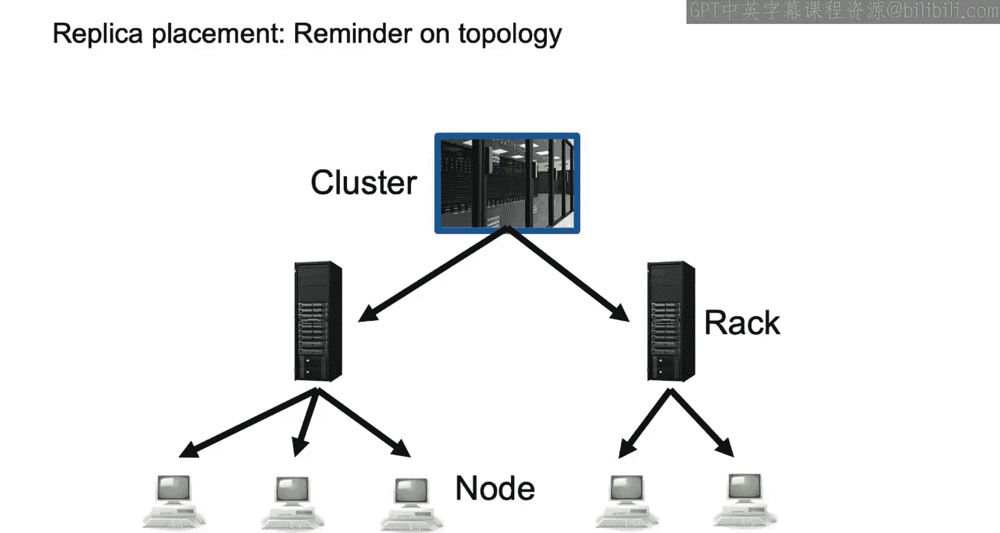

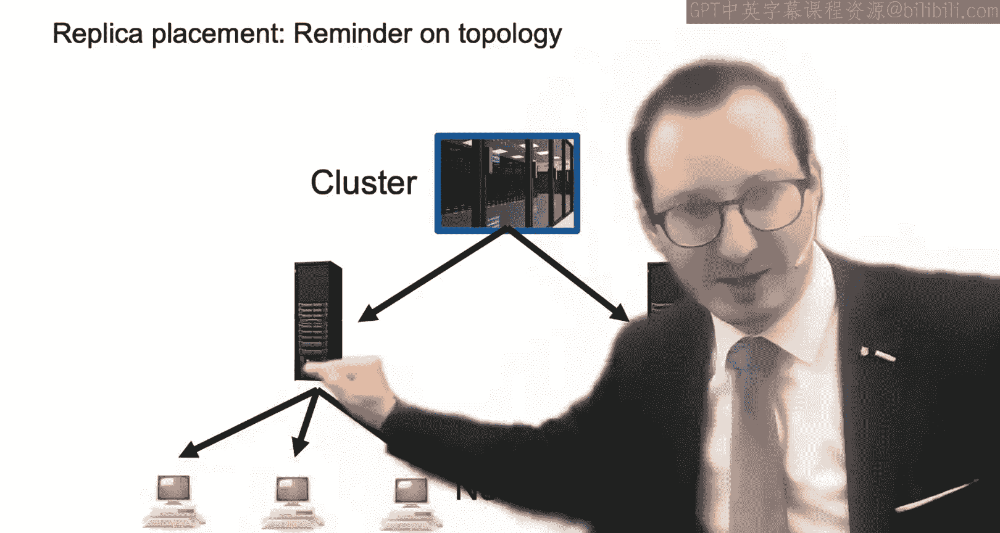

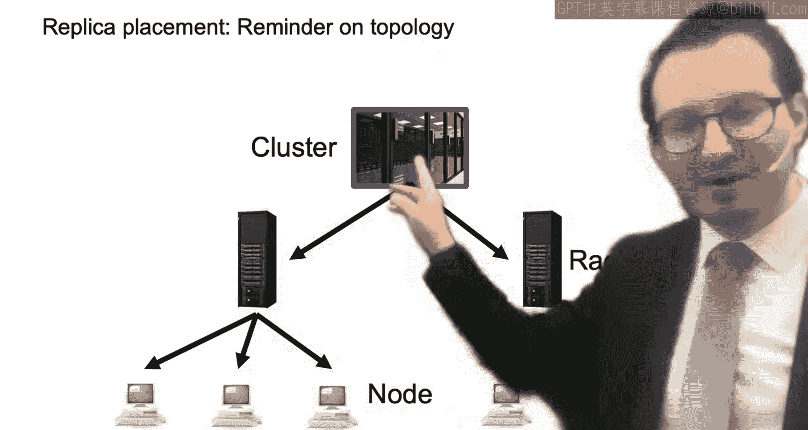

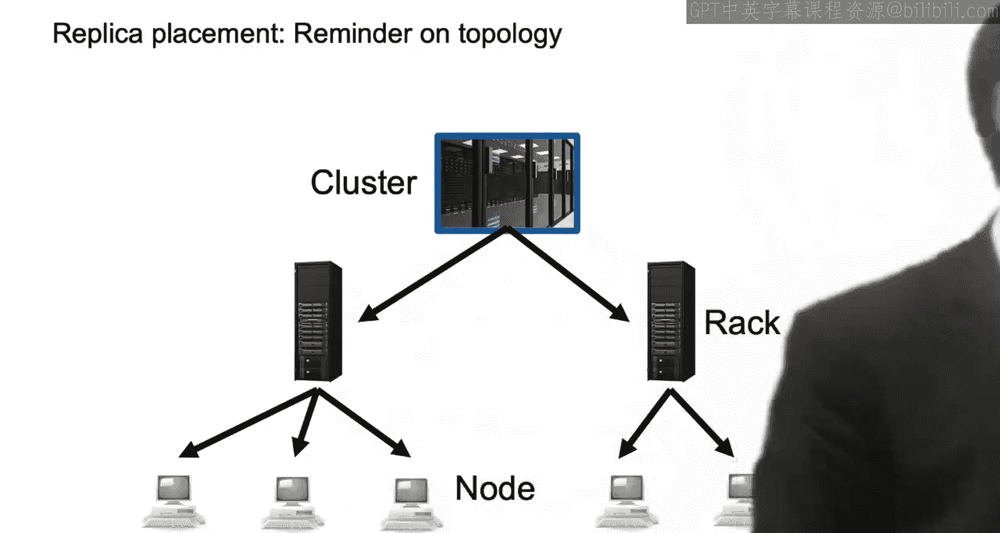

Now you can see that the notes could be close or farther to each other。 for example。

 the notes A and B that you see here。Have a distance of two between each other。

 It's basically the shortest path that you can take ignoring the direction of the arrow， right here。

1，2 okay。

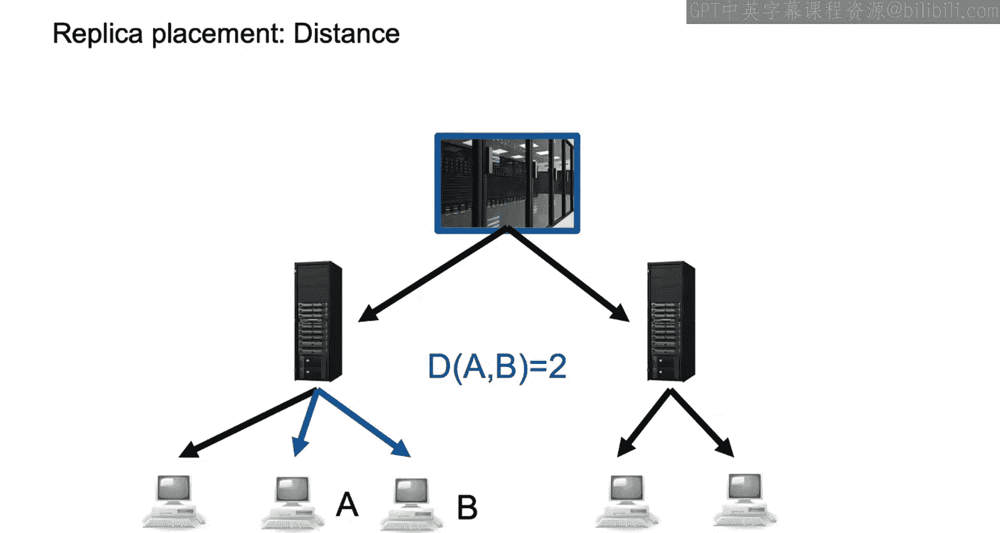

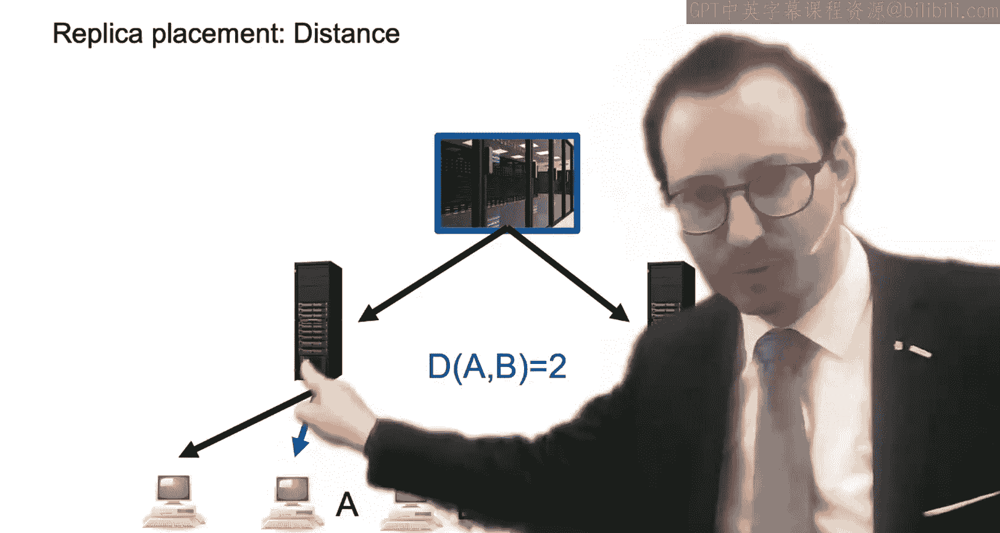

1，2。 So the distance between A and B is2。 Now， if you consider A and B， the distance is now 1，2，3，4。

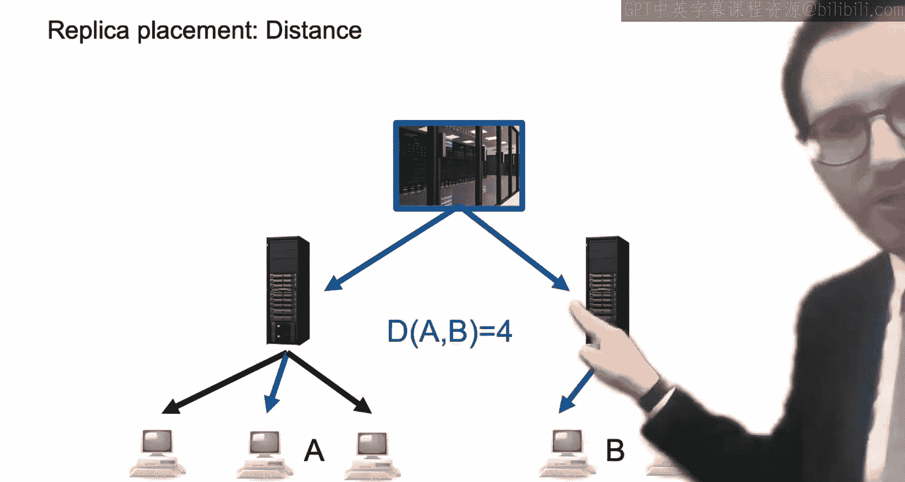

So you can see that these are closer to each other。

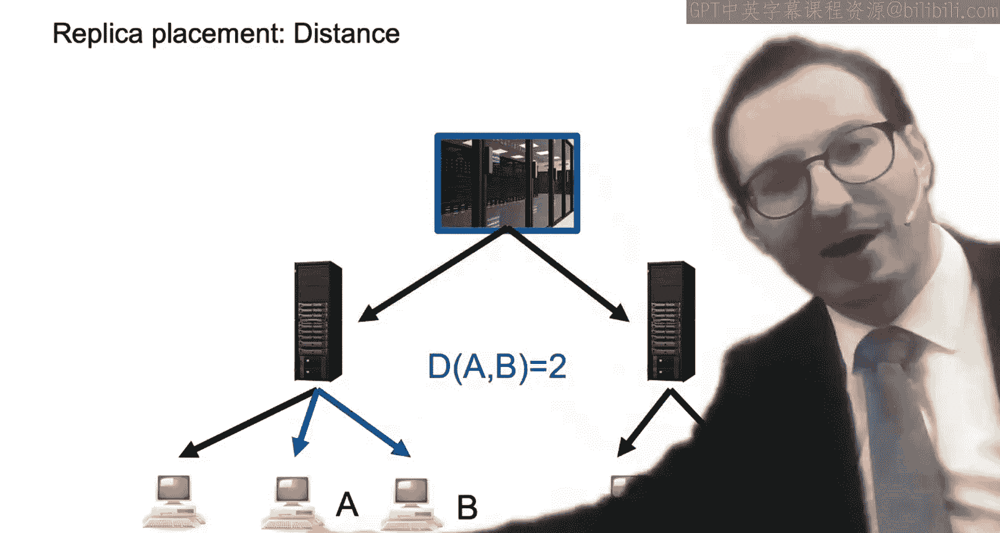

Than these two， who agree。Right， and the reason they are more distance really has to do with the length of the cable that you have to traverse。

 right， Because if you have to go all the way here。

 this has to go to some network switch then some network cable across the rack。 than again。

 a network cable from the switch to the node。 So there is more distance with the with the network。

 This is why it's farther away。 And who says more distance。

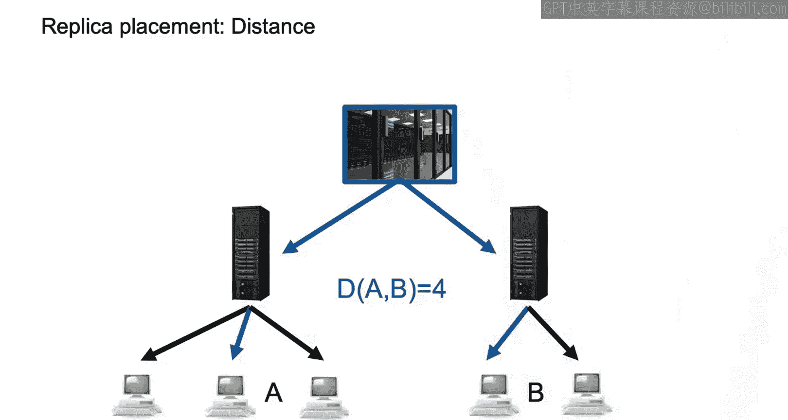

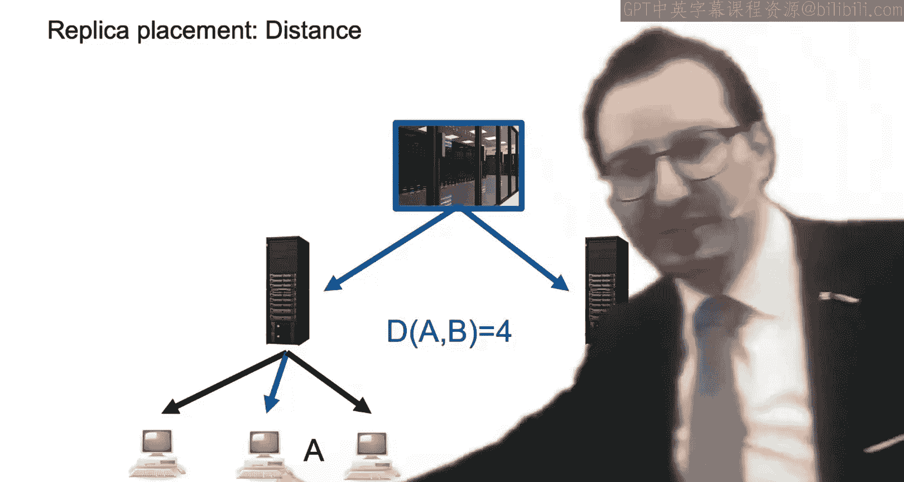

Says more latency right， needs more time to start arriving on the other side， right？So what do we do。

 There is a strategy that we have in order to decide where the replicas go。The first riptica。

By default goes to the same node as the client。Right， the clients。Stalls。A repeatup。Now must be like。

 wait， wait， wait， wait， wait， what's going on here？If you come back here。

 the client is not a data node， Right？ So what， why am I saying that we store the replica exactly where the。

 where the the client is the client is not a data node， when， in fact， we will see later。

That the client is often also one of the data node。

So let me just open the parentthesesis for you to understand what's going on。The data notes。

We usually say the name to call the machine themselves。 In fact， it's a process running on a machine。

 right， just like on your laptop。 you can have several processes。 Maybe you have a browser open。

 Maybe you have， I don't know a Whatsapp or whatever open on your laptop。

 These are several processes likewise on the server of the data center。

 you have a data node process that runs on many of them。 And then a name node process on one of them。

 But there might be other things running。 And we will see in the coming weeks。

 what other things we also run on these machines。 And in particular。

 you could absolutely be running a client of HDFs on the same machine that is also one that is running of the data node processes。

 So it means that。😊。

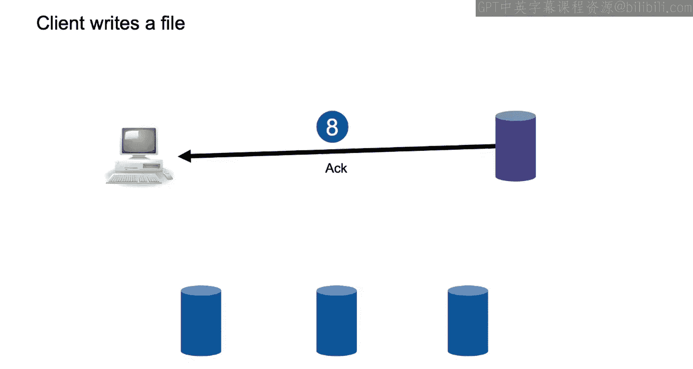

The client。That you see here might actually be this machine right here。

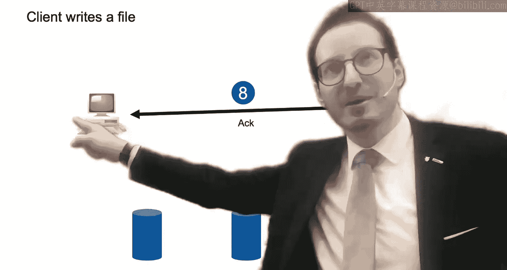

Right， and in the case of not produce， for example， in fact， this would actually happen。

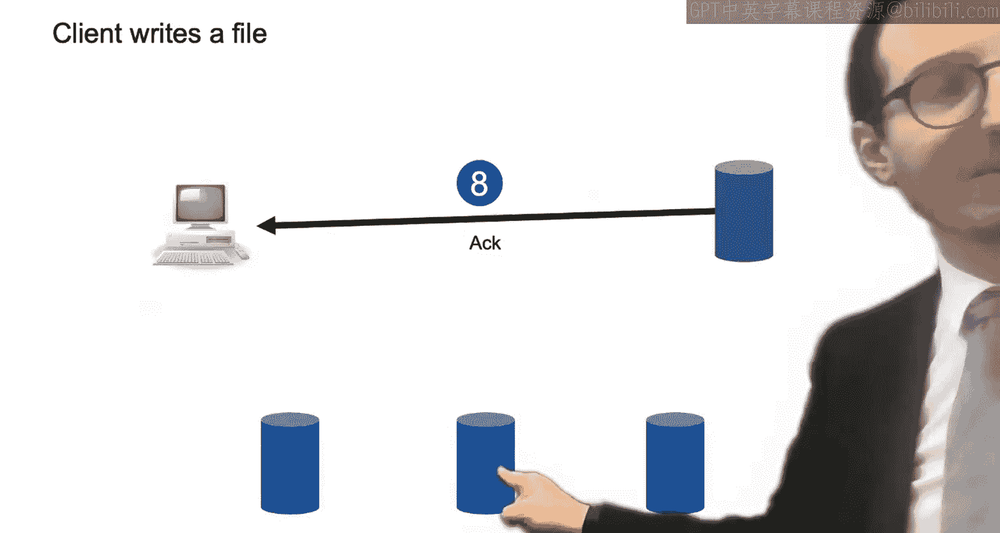

So if it is the case that this is the client that is actually uploading some data。

 the first replica goes exactly on the same machine because it also has a data node process on it。

 so it also it will start the first replica here。😊，That is as efficient as it gets it。

 It's the same machine。 You don't even need to ship it over the network。 It's。

 it's just written to the local drive。 But whom is that here。

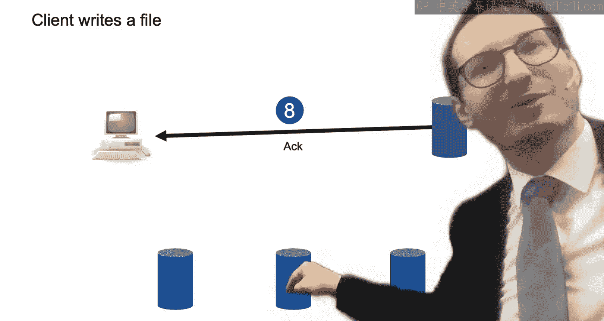

O。

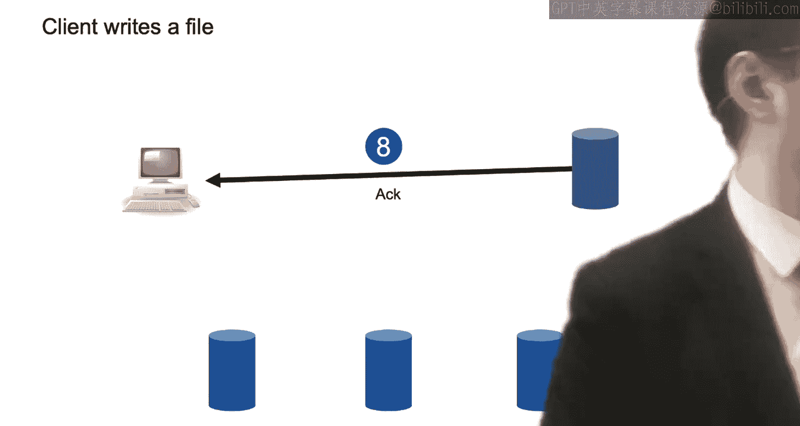

ま你的多子的。Oh who are you。Okay。So。The first rep。😊，Is written。To the same machine as weather client is。

Now， it could also be that the client is not one of the name nodes， right， That could also be。

 then you just pick a random data notes， not name node data notes。

 It would be that the client is not located on one of the data node。

 Then you pick a random data node or your first repa， any one of them。Okay。

 and let's call the rack on which the client is。 Let's call it rack a。

Relica2 will be stored anywhere really in the data center。😮，Just not on the same rack。

We just pick another rack and any node on that rack， and we store a second replica of the same block。

The felt repa。Is going to be stored in another node。 But in the same rack as the second one。

 So that not the client's rack， another rack。 So it means you store a first re on the machine where the client is。

And the other two replicas in the same order rack on two different nodes in that rack。Okay。😊。

And then repa 4， if you have， of course， a replication factor of more than3 because the default is3。

 then you just kind of do it randomly， but you do want to make sure that you don't have more than one repa on every node。

 right， Because otherwise it's a concentration of risk， right。

 group andri So you have at least one repa at most one repup or node and at most two per racks。

 if you already have two replicas on the same rack， then。That's that that's enough。 You don't。

 You shouldn't have more than to。Now， let me give you an intuition of why we use that strategy。

So that's an example。Going to be moved。Jus。We bar indirect hole so that you see。

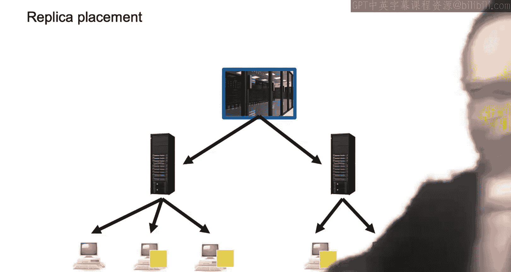

The know very exciting。

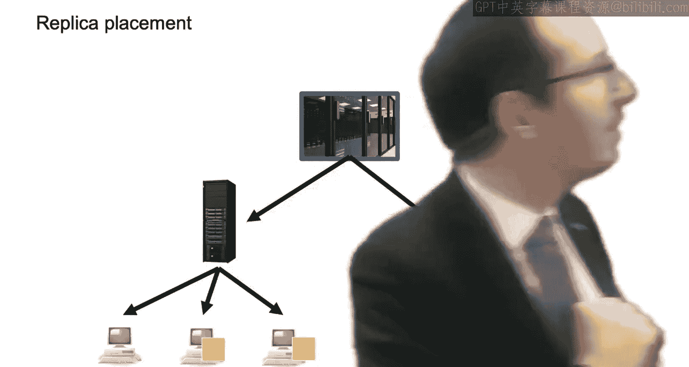

第 you거推。The client is here。And on the same machine there have the data node process。

 we start the first replica here。And replicas2 and three on another rack， the same rack。

2D friend nodes。 So this is first replica and second and third replicas。 right， This is hows do。😊。

And then we do it again with more and more and more blocks as they come。

 So every time the first replica is going to be stored here and the other replica is on some different rack。

 But it might not be this one every time can be another rack for the second block and so on。

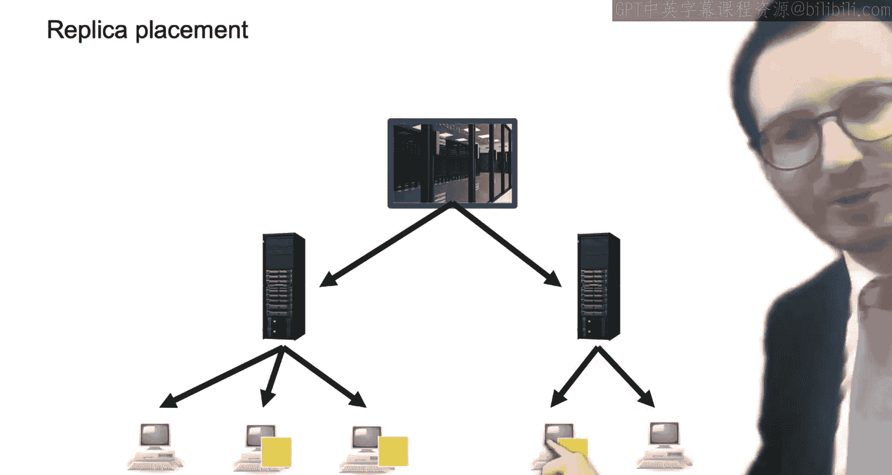

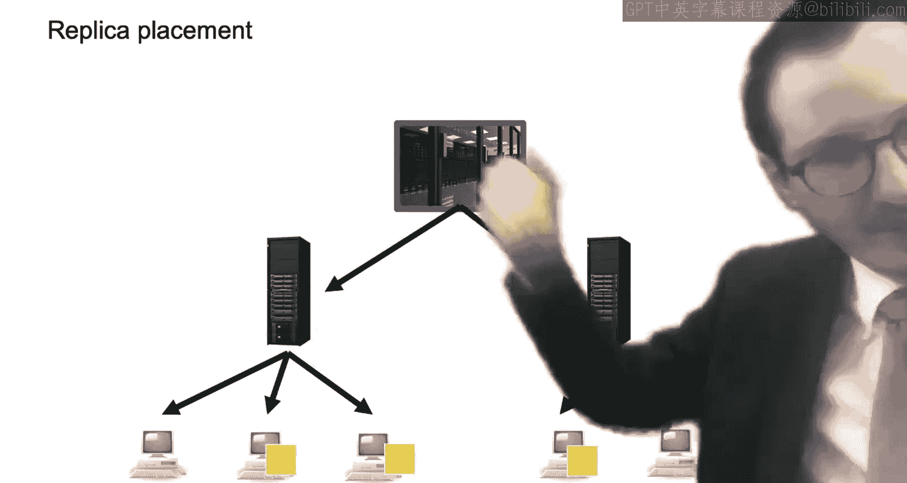

Now。That's going to happen。 We have the two blocks。 Yeah， the yellow and the green blocks。

 So the first replica of each is stored on the same machine as the client。

 Then we have a rack that stores two copies of the yellow block。 and another rack C。

 maybe that stores two copy of the green blocks。 So you see that it kind of gets spread over the cluster。

 right， the different blocks are stored at different locations， right。

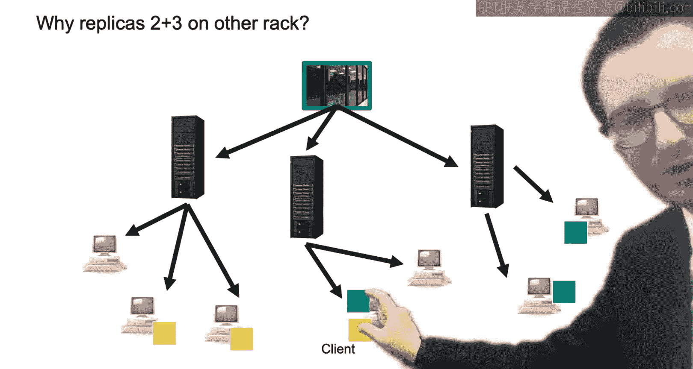

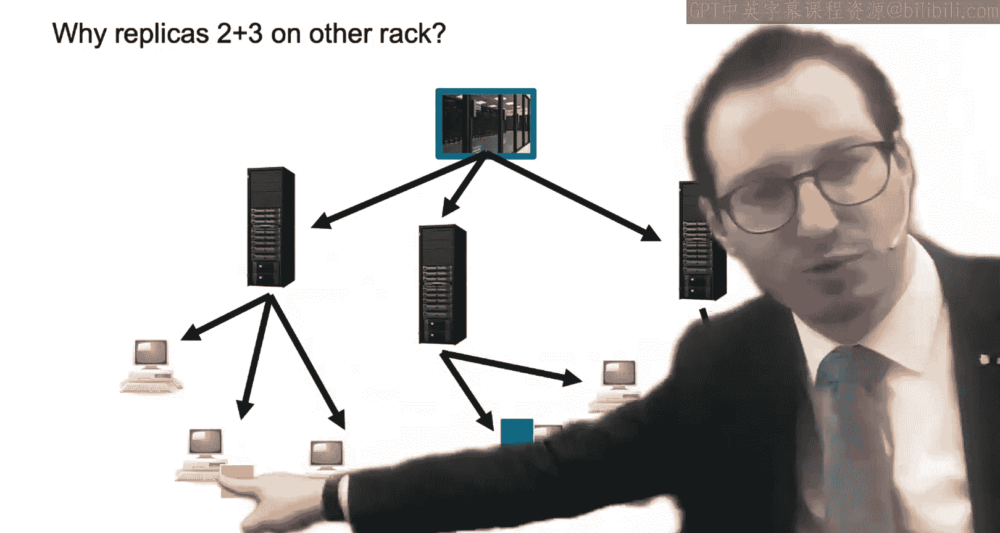

Now， of course， if the fight is very loud that will not all fit on the same machine。

 then at some point you might not be able to do that right， but if the fight is small enough。

 then it makes sense to store it on the same machine。Okay。Now， you might think。

 why do we store replicas two and three another on the same rack， but another our right， why。

 for example， we could have considered another strategy。

 why don't we say we store the second replicaa the same rack as their clients。

We start the first repa on the client and the second repa same rack as the client。

 then the third replica in another rack。😊，But you see the problem here。 If we do that。

 then we are going to start concentrating the blocks in the same rack。

And you know that when things fail in a data center。

 they tend to fail at the same place right So for example。

 you might have in the racks some electricity shots circuit key or network switch that goes down。

 then the entire rack is down So you don't want to concentrate all of your risks in the same rack。

 So this is why we are not doing that。 We prefer to do this Okay， it's a bit safer。😊。

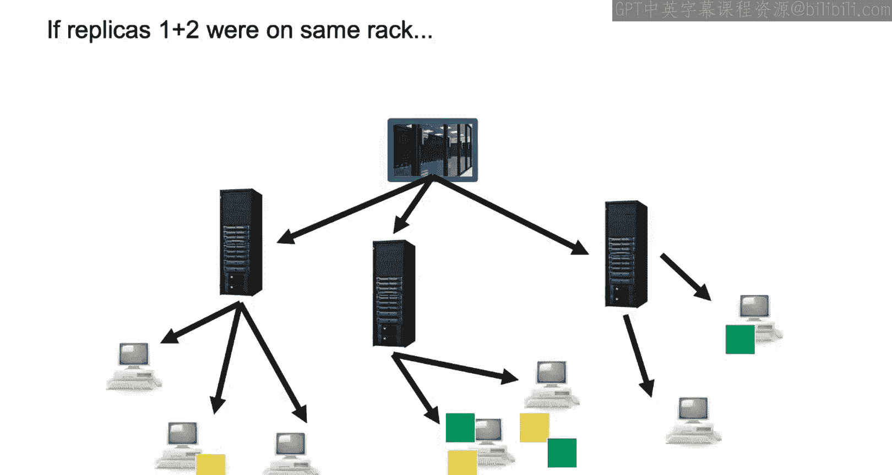

Everybody with me， who' is following？Okay， very on Zoom 2， you're following on Zoom。No。

Everything is fine， okay， very good。So no。There is a problem with that system。嗯。

The problem is that for the data node it's fine right everything is distributed all other clusters。

 so if we have node that crash， we're going to be all right because we have more copies somewhere else。

😊，But we have a problem with the name node because what happens if the name node fails？

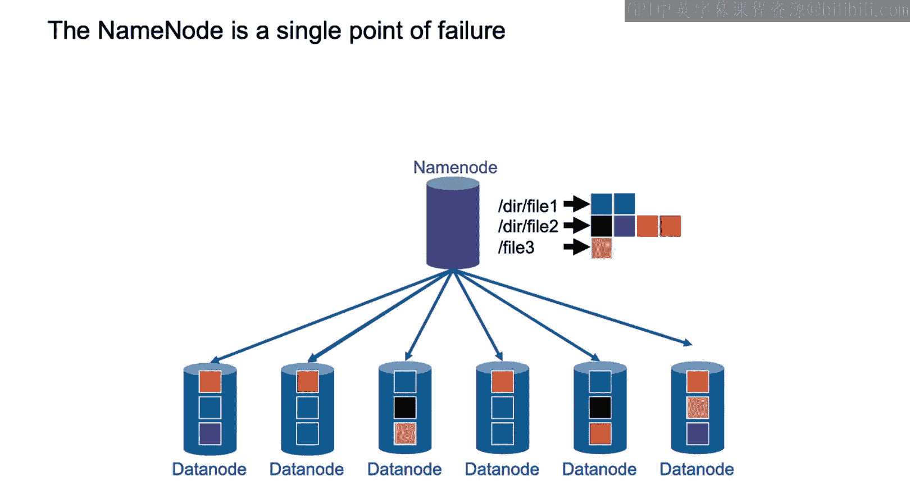

So we need to understand。What's going on。In it right。

 so I need to show you what's stored on the name node， what do we lose if the name node fails。😡。

So the name node。We saw last time it does three things。

RightIt has the hierarchy with the directories and files， the names of the directories and files。

 then it has a mapping from each file to the block IDs right that I use colors for but it's block IDs here and then for every block ID you know the IP addresses or the locations of the data nodes that store copy right so if the name node phase and there's only one of them this goes away all of that is wiped out。

😊。

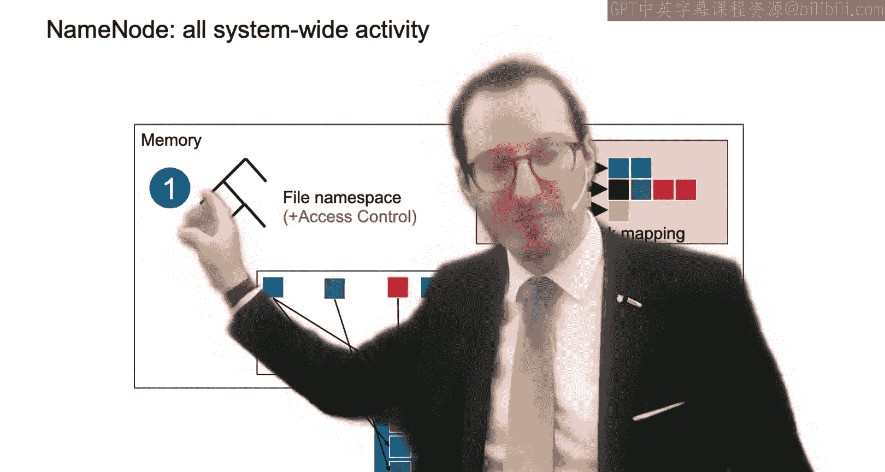

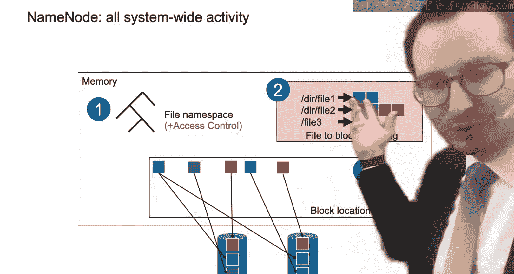

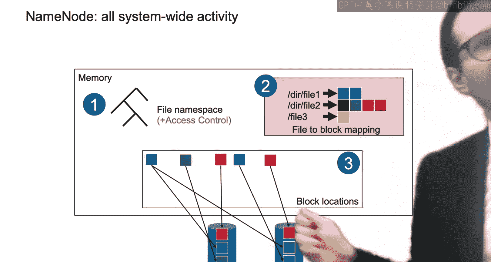

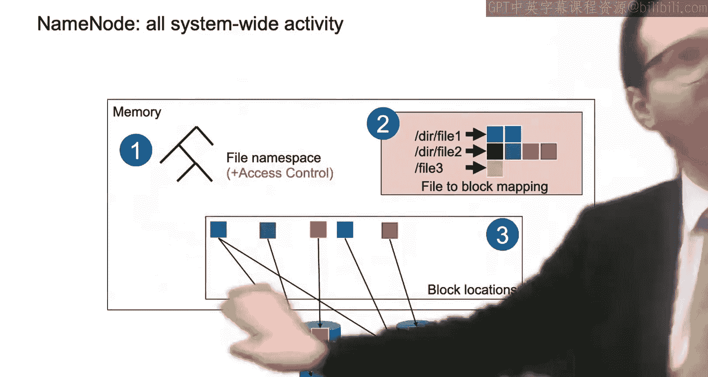

Now， do you understand that if this is wiped out and we lose that information。

 we basically can not read the data anymore。Because we might still have the blocks。

 but it's like a giant puzzle。

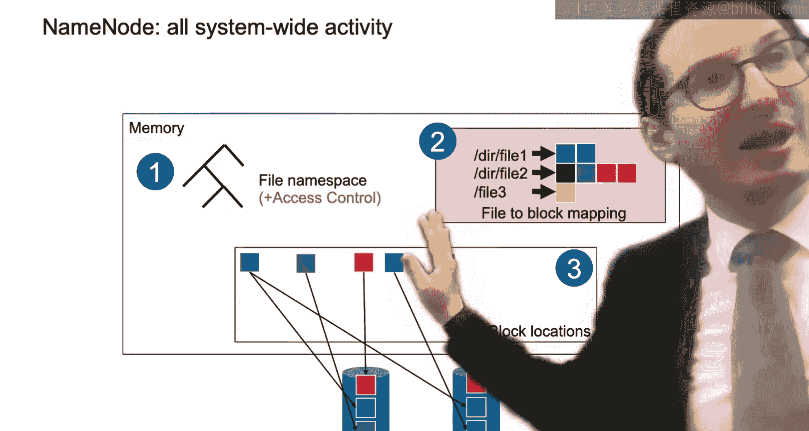

Right， you don't know how to reassemble the blocks together。Who sees that？

We need that information in order to recover the data。

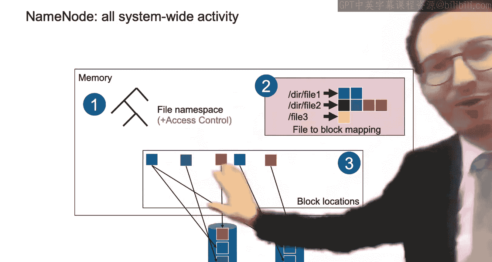

So what does it mean if we can lose data and we' are afraid of losing data。

 we do a backup right just like you do for your laptop， so we do a backup， we take this。

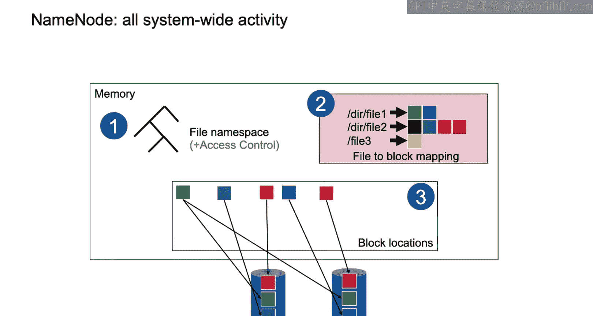

And we back up to some storage。 it's typically a network attached drives or there's technology in the cloud。

 but it's not going to be HGFS， of course， because otherwise you're basically sewing the branch on which you're sitting right so it cannot be HGFS。

 but it will be some sort of network attached drive and we store the contents what is in the name node memory to a file that's called a namespace file。

 we take a picture like a snapshot of what it looks like and store it as a file on that storage on that drive。

Now we don't store everything We in fact only store the first two。

 so the file name space and the mapping from the file names to the block IDs。

 but we do not need to save the location of the node sorry of the block IDs on the data node。

 Why do we not need to save that。

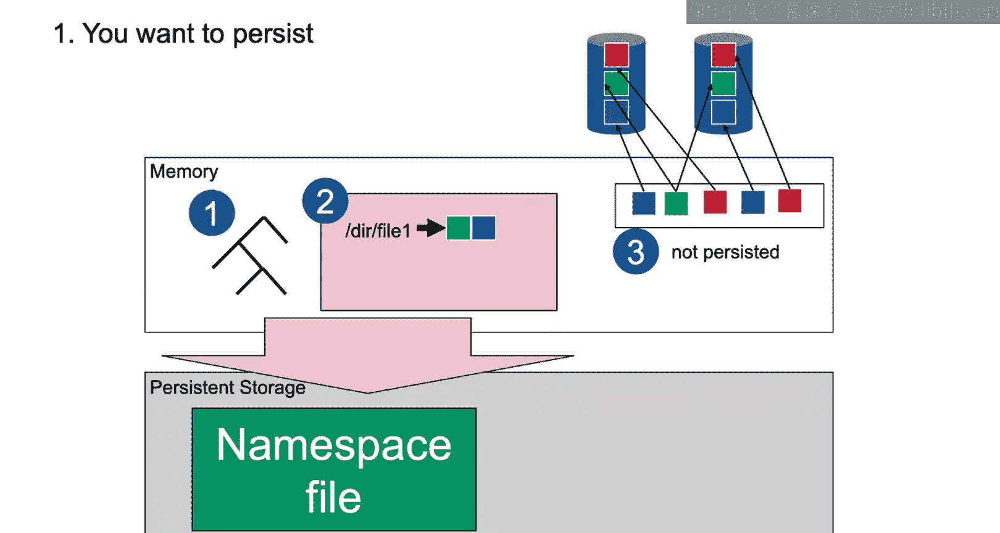

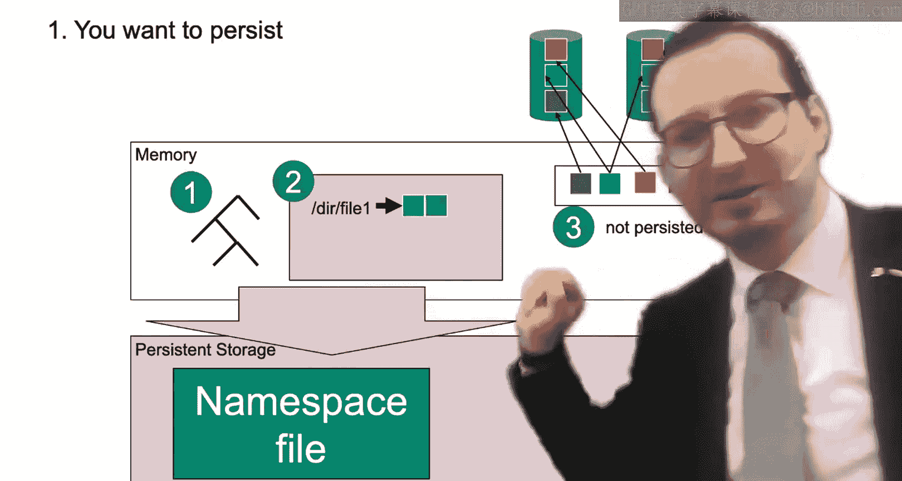

Yes。😊，Exactly， you can recover it from the hardbes。 So if you lose that， that's okay。

 You just wait for the hardbes and you will know at some point。Where it was sitting。

 So you can save your send from space。 You can just not save that。 You don't back up that。

 But these you back up in the name suicide。 So this is at a certain point in time。

 you take a snapshot and you start the namespace file。😊。

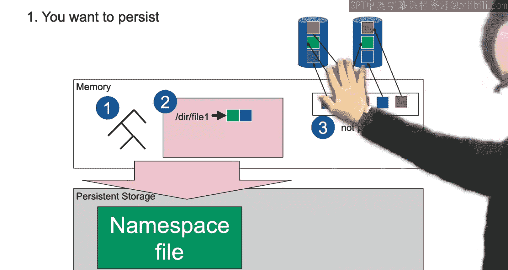

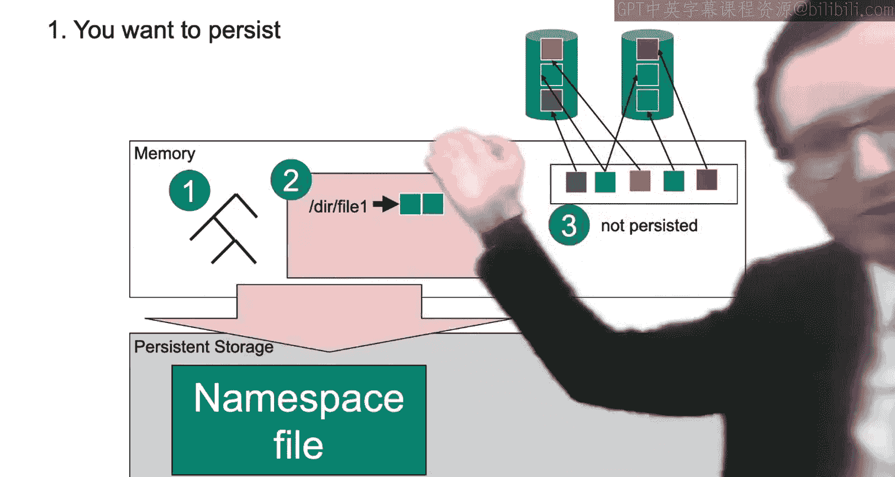

But now after you've taken the snapshot， people will create directories。

 people will create more files， people will delete it files。 So the whole thing has a life。

 right of its own。 So then the namespace file that you've saved an hour ago will no longer be a two date。

 It's going to be stayed， right It's as if you're the last backup of your laptop was one month ago。

 Everything you've done in the past month would be lost， right。😊，So what do you do？一。

You keep a log just like on the captain on the ship， right。

 You keep a log of everything that's going on。 So once you have taken the snapshot， namespace fine。

You log and write down every update in the order in which it's done every update one after the other in some edit log so you keep app or pending a pending like at that time on that day this happened at that time on that day this happened and the edit log is going to grow。

 grow grow bigger or bigger or bigger right as more things happen。No。All of that。

 if you want to be even more extra careful， you are going to extra back it up to even more places right so that was on a network attach drive now you might make a copy even on S3。

 you know on some tapes in a warehouse or to be extra sure you don't lose the data typically it's going to be cheap to do this Okay we just make copies copies copies all we can of these things。

 Now we can answer the question what if the name node face， So imagine you need face。😊。

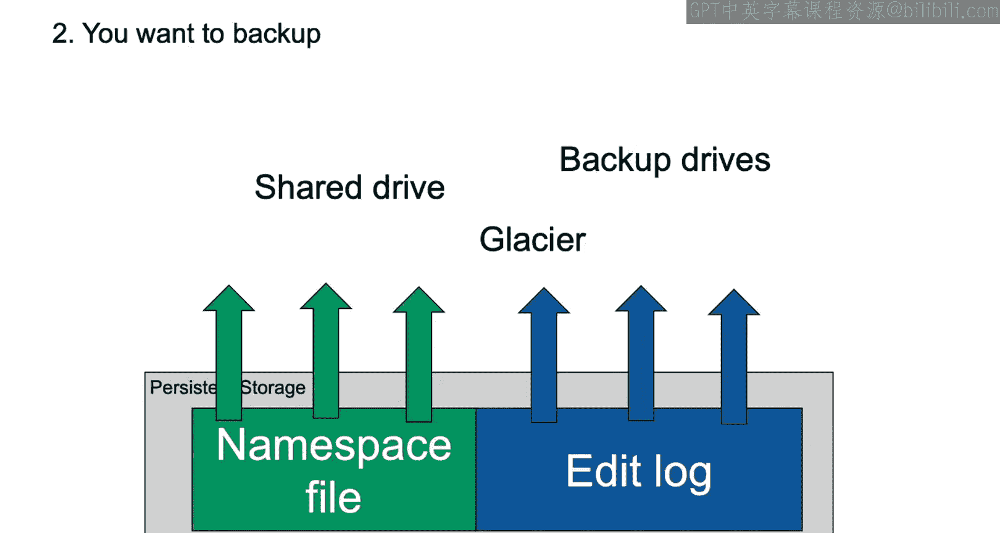

So obviously， we need to start it up。 So let's be optimistic and assume it's not a hardware failure。

 and we can just restart it。 Otherwise， we replace the， the， the， the。

 the server with another serverr。 But then we start it again。

How much time do you think it's going to take？In now in in， let's say， in a standard system。

 Who thinks1 minute。To get AGFS backup and running。F minutes。2 minutes。1en minutes， sorry。50 minutes。

What that word？

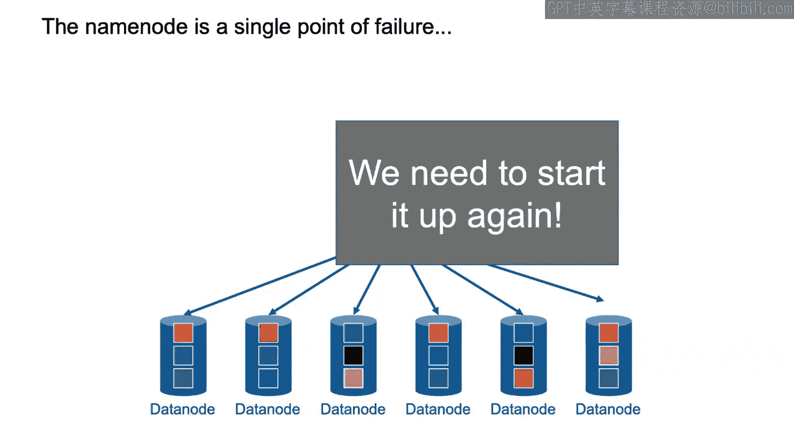

Okay， are you close to the truth。 So typically it's going to take 30 minutes， right。

 as as a rule of thumb。 It's， again， the order of magnitudes。

So what happens is that you take the namespace file。 It was a snapshot。

 So you just make a copy again in memory of that snapshot， right。

 So you have this this the file Ha here and the file system。

 But that's the old as it was at the snapshot time。 and then you need to play the edit log。

 So you go through the edits and apply them one by one。😊，Just like who does music？

Who knows about mediaD sequencers？It is exactly the same as when you have music that is regarded as events like you press that that note or button that long and you just go through the edit log like a sequencer and just play the the edits and apply them there And when you are done through the entire edit log。

 then you have recovered。The whole whole the whole thing， right。

 so the entire side name space plus the mapping to the block Is。

And then for the mapping to the to the data notes， as you said earlier。

 you just wait until the hardbes arrive and then you will know at some point。 Now we have done that。

 And again， that whole thing can easily take 30 minutes。

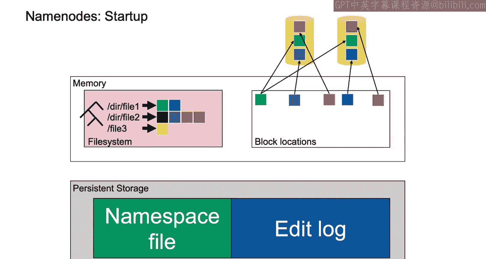

Can you tell all of the employees in your company that now they have to wait for 30 minutes every time something like this happened。

 probably not right because that would be imagine you have 1000 employees and everybody needs to wait for 30 minutes。

It's too costly， you cannot do that， so we need some solutions and there are solutions to this。

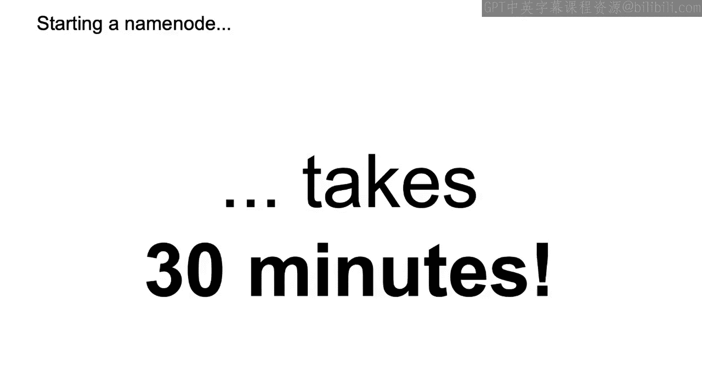

So can we do better？ Yes， one way to do it better is to not let the edit log grow to。

Large because if you wait， wait， wait， wait， wait at some point。

 the edit log is going to be gigantic， right， as you apply changes。 So once in a while。

 you just merge the edit log into a new snapshot。Right， and then you have a larger namespace file。

 But now the E log is empty again， right， And so if it fails。

 you load back the namespace file in memory and then apply maybe a smaller E log， right。

 So what's important is that if perioderically at regular intervals。😊。

You merge back the edit log into the old namespace file to create a new more up date namespace file。

 then you can keep the size of the edit log under control。Because again， the larger the log。

 the more time it's going to take to play it， okay so you want to period dec it's called the checkpoint。

 period dec save it。😊。

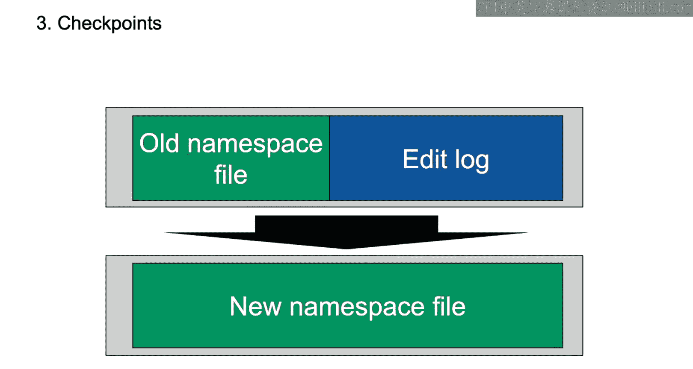

Now， what we also do， and there's a whole history over other years of how this evolved。

 what we do is that we also have what's called a stand by。name note。

A standby name node is a little bit like the vice president of the United States。

 So if if the president can no longer act， then the vice president takes over。

 it's exactly the same thing here。 The standby name node is really to take over as the name node if that happens right So what it does。

 the standby name node is that it is in the backgrounds。

 it receives exactly the same input as the name node。 So in knows everything that's going on。

 it keeps in its memory exactly the same structures， the file name space。

 the mappings and even the mappings from the locations to the block ID to their locations。

It's just working in the shadow ready to jump in。 And if the name node fail。

 the active name node fails， then the standby name node immediately takes over。

 You don't need to wait for 30 minutes。 It already has everything it needs to function。

 Who sees that。😊，All right， awesome。Now if you try to Google things a little bit。

 you will see a lot of other names like standby name node is one of them。

 you will see secondary name node， backup name node， checkpoint name node and so on and so on。😊。

View it as a archaeology。 It's just that over time， there were multiple versions of this whole thing。

 And every year， they came up with an improvement and they give it a new name， right。

 So now one of the most step to date is the notion of standby name node that is the load to take over from the name node。

 The previous versions could not take over。 They were more like fall backing up。

 But this one can can take over。😊，Al right， and you see the net namespace file and 80 plug。

 they are in some drive network attached， so both of them can access that drive， right。😊，Okay。Now。

 even more recently， there is yet another one that we call Obs our name node that is yet another version of that。

 So I'm only going to tell you about the standby name node and the Ob name node。

 the other ones you don't need to know about。So what does the observal name node do that the standby name node cannot do。

 what's new about this？Would you observe our name notes。In fact。

 it's not just standing in the shadow doing nothing that replicating the data。

It is also allowed to deliver on read requests， meaning that the client connecting to HDFS。

 if there's a lot of them suddenly that connect and the name node。

 the active name node is overloaded。Then it's fine to also connect that the clients can also connect to the observerserv our name node to read things only to read things。

 not to write or anything for writing， it's only the active name node， but to read things。

 you can connect to the observerserv our name node。

 so the idea is to take off the shoulders of the active name node。

 some of the workload for reading data。😊，じゃあ言っです。The one stand by because the name node。

 it says the name node until it plus or when the original name node is back online。

 it gets That's a good question。 So you could imagine the two strategies， right。

 So if if if at some point， the name node。Crshes and then you we。You could have two strategies right。

 you could say okay， then the standby name node gives back control to to the former active name node so you could do this。

 but on the other hand， why would you right you can just continue since the standby name node already took over as the active name node you can just let it continue right and then the active name node the former only active name node that recovers then would act as the standby name node right So there is more efficiency in not swapping again you just keep the role swaps。

This is where the analogy with president and vice president stops， right， okay？So。😊。

Right there's yet another thing that the you're welcome。

 there's yet another thing that the engineers of AGFS again every year they work on new features。😊。

They come up with， they came up with this federated distributed by system。😊。

We already installed Linuxux on their machines。Okay。

 have you also gone through the partition process of allocating to your driver partitions？

Do you remember that here you have the slash that is the root of the drive。

 and then you have slash home， you have slash user and so on and so on。

 And you can allocate them to different partitions， right， For example。

 the home directory or the routes directory could be someplace else。 here。

 It's exactly the same thing。 You could， in fact， have。A fedederation of name nodes。

 just like the United Federation of Plans right So you have all of these name node。

 but every name node is responsible for a very specific directory。

 just like slash home slash root and so on call lineup。 So you assign。

 So if you have slash who access and you connect to the name node in child on the left。

 If you want to access data in the slash bar directory， you connect to the one on the right。

 This is called fedderated distributed system。 And again。

 similar to partitions when you install Linuxux。😊，对。Okay， so I have now， if you find yes， go ahead。😊。

So that I'm not knowledgeable enough to give details on that。

 but I would imagine that there is some federated DFS protocol that makes sure that they don't step on each other's feet right in terms so they know where there is where there is available space and so on。

 right？Does it answer your question， okay？Alright， so now I'm going to finish on a few very practical consideration。

 like how do you use AGFS， because So far I just told you how it works， but how do you use it。

And the answer is it works pretty much like connecting to using your hard drive on your computer。

 who have you already used the command line？Okay， so you're familiar with that。

 So you know that in the command line， you can type command。

 So if online Linuxux or Mac L S to list the content of a directory。

 CAT T cats to display the content of a file M KD to create a directory and so on and so on on Windows。

 it might be slightly different like you might have。I can't remember exactly。 but dear。

 I think to list the contents of of the directory instead of L S。 But the I D is the same。

 You type things。 Well， that's the same。 actually， for AGF S。

 You also type things on the command line。 And， in fact， what you type。

Going to give you the standardout version what you type is always Hadoop F like F system followed by the arguments and the arguments will be similar to these Ls cat Mkd and so on in there Now there is also a command called Agf but not a lot of people use that the idea is that Hadoop is more powerful Hadoop can write on Agf it can also be used to write to your local system it can be used yes to write on S3 you can also do it with this command line utility So technicality is the reason why not many people use that one because this one can do more it can connect to many more places So Hadoop F and here are a few example Hadoop Ls does the same as the Ls command on Mac Hadoop dashca it displays on your screen the content of the file and that's the same as the CA command that works on your laptop Rm is remove directory again you have it for your localified system if you say Hadoop R D file that's going to remove。

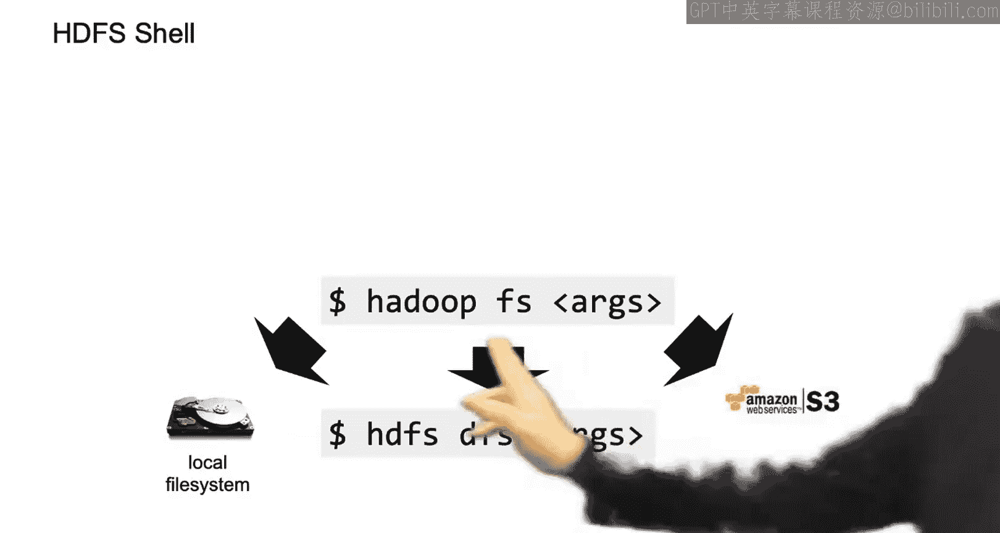

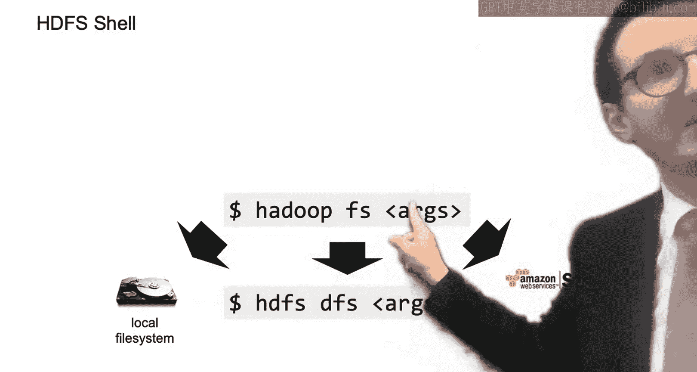

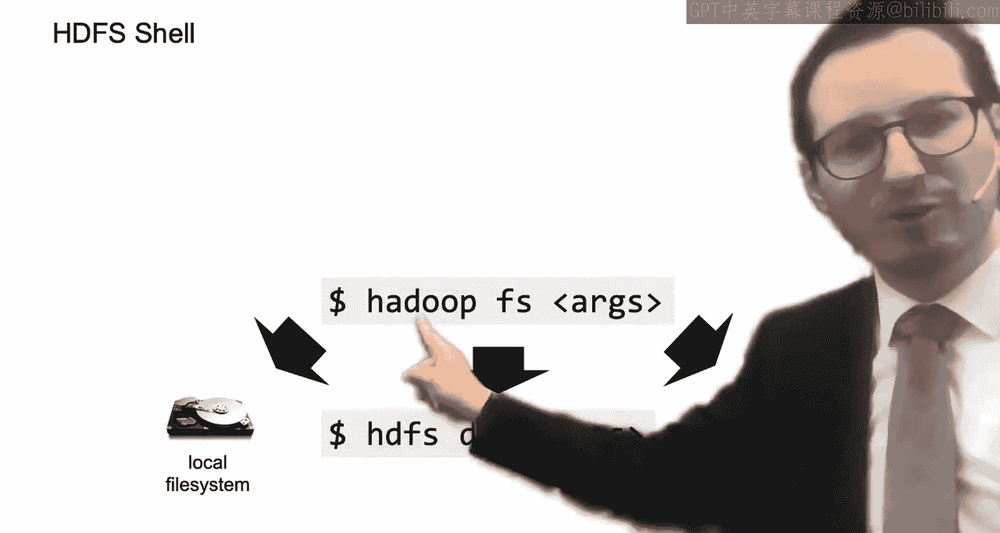

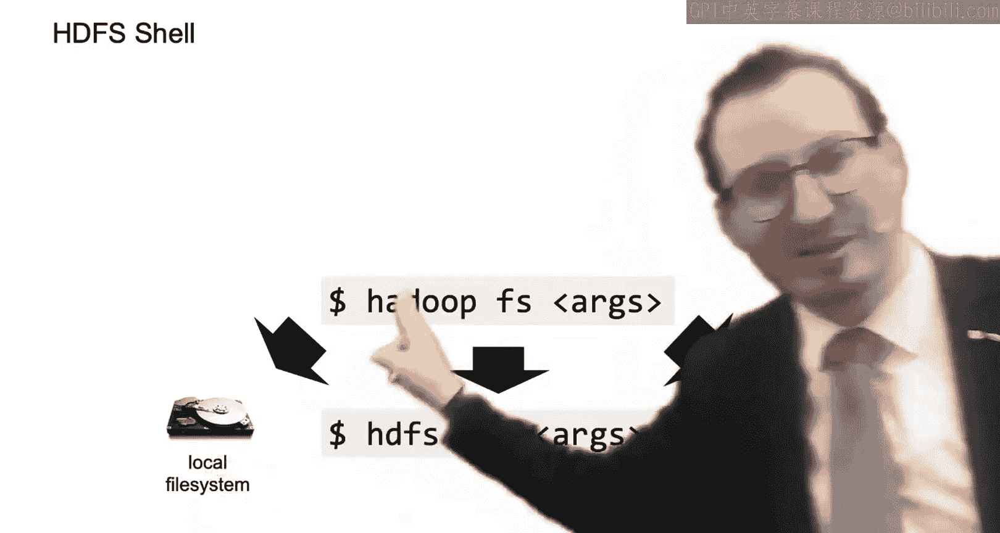

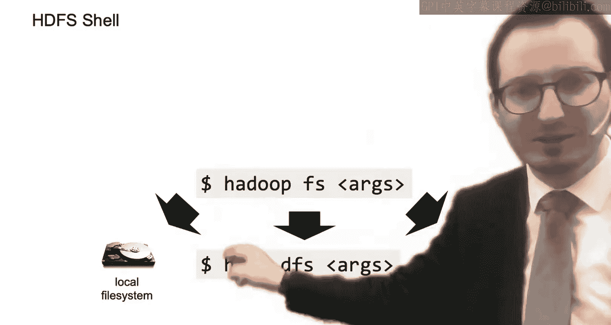

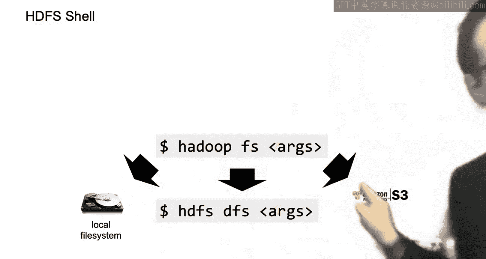

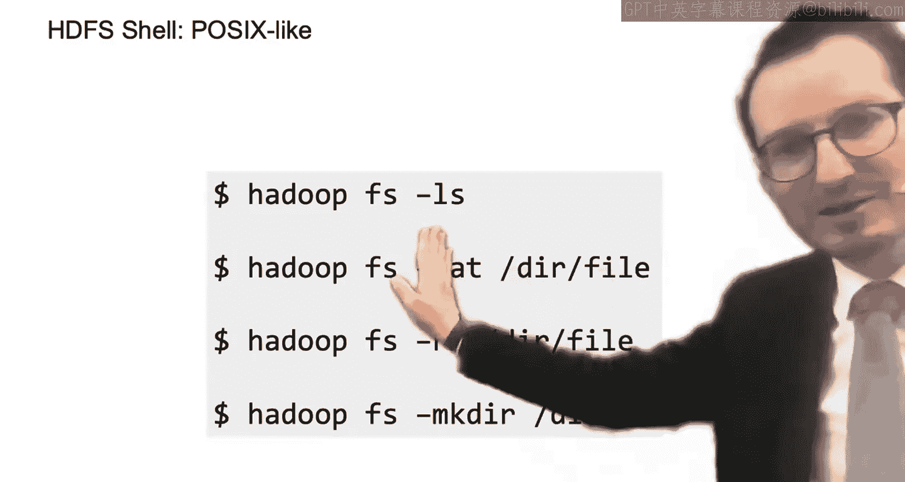

The the this directory Mk here to create and on。 So you see。

 this all follows the stand that everybody knows that's called physicss。

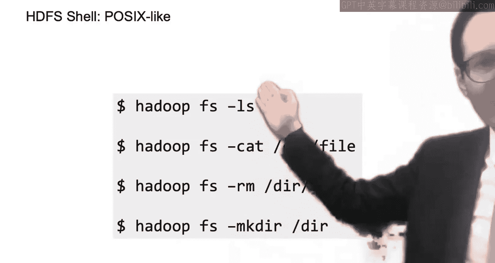

So it's not exactly， but it's more like Poss like right it's very。

 very close to Poss So basically if you're familiar with the command line or Linuxux on Linuxux or MacOS。

 you will have no problem using AGFS because it just is exactly the same command just with a dash and with Hado P in front。

😊。

But there would be one difference。There will be one difference because if you try to type these command on your laptop on your local drive。

 you press enter is going to be instant peaceful if it's a small file here， it's going to be instant。

 you press return and you see the results， not so on A GFS。

If you actually do this and you are connected to HGFS and the slash is really bound to some HGFS。

Salver。This will take more like one or two seconds， so you're going to press LS。

 then will it will be hanging for one or two seconds and then this the content you say cat again one or two seconds and it displays the results RM again one or two seconds。

 so you will notice that it's actually slower。And that slower is actually latency it's because it needs to connect to the name node。

 connect via the network and wait for an answer and maybe connect to data node and get the blocks and get an answer。

 So it's because of the laency that this is slower than a local file system。

 but the command themselves they are very similar。So now there are also comments to upload and download because if you have a fight system remotely on AGFS。

 you obviously will want to upload some files in there and maybe to download some files in there。

 Of course， that only works for small files right if the file sits on your laptop。

 it means it's small enough to be on your laptop， then you can upload it to AGFS if you have a fight on AGFS and it's small enough。

 then you can download it to your laptop。 It's obvious that you cannot download a that would be 100 terabytes right because you can have files that are 100 terabytes on AGFS but then it's obvious you cannot download it。

 It would not fit on your machine。But if it fits and you know you can download it。

 then you can use this copy from local and copy to local so copy from local is to upload so you upload local file1 and into user Hadoop Hadoop dear something on H GSS and the other one is downloading right Hadoop F copy to local it's downloading that file to a local file again assuming that it fits on your hard drive Do we have a question。

😊，呃 to copy。You mean as opposed to copy on the SCP or CP on the online ads？Yes。😊。

That's a good question。 I assume it has to do with physical implementation that splititting into two different comments made the architecture easier in terms of what he does。

 at least this is what I would assume because otherwise if you have copy。

 the copy from H GFS to HDFS or local to local would be would be different。

 So I assume it's more optimized like this， that would be my guess。

But you could have imagined write that you have a single comment。

That is CP and that takes care of it。 So I assume that it's more optimal。对。呃。

That I'm not sure I should show you because that's actually scary。

 It's just internal configuration stuff。 So you don't need to understand that will be actually XM index。

 just telling you。 But basically， it is a configuration files that most people will not ever see in the entire life。

 but maybe the C means who configure the cluster will know about this。

 It just allows you to control a few things， for example。

 here when you connect when you have just the slash it tellss you the default server。

 the name node that the slash should be interpreted as right So it tells you your AGFS server is And then you have you can have the replication factor that you can set whatever you want。

For some reason， somebody set it to one in here。 but anyway， by default it's three。

 And then you have the location of the directories of the data node and name node。

 So this is the localified system of each name node and data node。

 if you would connect to it manually and you would go in there。

 then you would see the actual blocks right again， you could probably forget that。

 if that confuse you then forget these two slides。 This is just seeaddmin stuff。

Then we have a few UTDTs that people use。😊，To in conjunction with AGFS one is Apache F that is meant to aggregate log data log for example。

 your website log who connects to your website who accesses web and so on so Apache's F is good into into collecting logs into AGFS right。

Anotherer one is good at importing from a relational database。

 we have a relational database and it's just going to copy it over and move it over to HDFS in some format that makes sense could imagine CSV or others。

 but basically it copies over Apache scoop from a relational database into HDFS why do we want that because we're going to want to analyze it that's why right but that we'd see a bit later。

😊，Okay。😊，And final worlds。You follow the break。I told you about terminology。

 I want you that there's a lot of world that kind of mean the same thing。

 I gave you the example of block chunk split partition， Sha and so on and so on。

 they all mean the same thing but in different context we might use different worlds So you see block in a GFS is called the chunk in GFS。

 a name node is called the master in GFS。 the Google system。

 a data node is called the chunk server on the on GfS a namespace image is called the checkpoint image in GFS。

 a edit log is called an operation log in GfS and so on。

 but you know it doesn't really matter what you call it right Well it matters So we communicate with each other because we need to speak the same language but in the end the technology is very similar right so again。

 the Googleified system is the original one back in 2004 and GFS is the open source version of GFS。

Something else is the block size that can change。 It depends on the distribution。

 just like there are Linux distributions。 We also have a GFS distribution。

 Clouder is one distribution， Apache， A GFS is another distribution， So there are several of them。

 And of course， when they when you install it， it comes in different flavors in the way that it is configured。

 right。So some will use 64 megabytes， some others， 12428 megabytes。

And as I told you in the case of Asia， they even went， they were bull。

 they went all the way to4 gigabytes for the blocks， which is actually quite large。

 they even made a huge announcement about that a while ago。

Okay。And I'm leaving you with a few links if you are interested in the documentation that's actually quite interesting。

 So of course the textbook that I wrote， but if you're interested you can also look at that the GFS paper and the HGFS paper can also be available it's an optional reading right the GFS paper we put the GFS paper on the website I see it's only if you're interested if if you want to read about it but for sure there is the HGFS paper and then the Java APIs for the people who want to connect with H GFS with Java would be interesting but again。

 many people will just use the command lines or they will use mapre of Sp to actually use HGFS。😊。

Okay， so this is HDGFS。😊，So now we have S3 to store objects， flat list of cableU pairs。

 We have HgFS that is a higharch of files that are organized in large blocks right there is a big difference between the two is that S3 or A B storage or Google Cloud storage。

 These are services right you pay maybe something and then you access the service HgFS is something you need to install right you need to provide the servers。

 you need to install it and so on。 Of course you can also have one click installed that you connect to Amazon and it creates one for you but it's still going to be servers that belong to you So this is a major difference between a worldwide service on on the one hand and a local service。

 a local installation to your company and there are many different HgFS clusters in the world one company typically。

Okay。So this brings us to the break because I'll see that it is 9 am and even it's one pass so I'll give you the extra minute and we'll start at 16 past 12 and we'll talk about syntax we'll start storing things on HGFS and S3 thank you very much。

😊。

