# 苏黎世联邦理工《工程师的大数据｜Big Data for Engineers - ETH Zurich - 2024》中英字幕 p11 5 - Syntax (2_2) - .zh_en -BV17FAmeFE9K_p11-

Welcome everybody in the lecture hall， welcome everybody on Zoom， welcome everybody from the future。

Today we will finish this task， namely starting with the Xm index because we'll really cover Jason and then we'll continue with white cotton source that are a very powerful way of storing large quantities of data including Jason and XML。

 but in a more structured way than L storage or HDFS before we start I'd like to ask you a question on the Clicker app to make sure that you're all with me。

Here it comes。What is not stored on the name node？This is， of course。

The Hadoop distributed advice system， A K， H GFS。So what is not stored on the name nodes。

 Three of these are stored on the name node。And one of these is nuts。

It's if we get 100% of correct on sales on that one。So keep stabilizing， we look at your answers。感谢。

So I noticed that the number of answers is less than the people in the in the in Zoom and in the lecture hall。

 So if you don't know， look at the address here， Ed you up dash dashupw or T Tg dot CH。

 this is where you can go or you can install the Eddu up on your mobile phone。All right。

 so we are close to 100%， 94%。This is indeed the correct answer。

 Where are the replicas of the block stored， everybody at the same time on the。Data nodes exactly。

 you understood do everything。 And the rest， the other three are stored on the name node。

 this is metadata information。 So if we only have the repas of the blocks。

 all we have is zeros and ones， but we don't know how to reconstitute the puzzle right So the other three。

 the file name space， the mapping from the file path to the block Is and the mapping from the block Is to the list of data nodes。

 This is to reconstruct the puzzle and get all the data。😊，Okay， so now let me switch back。The sites。

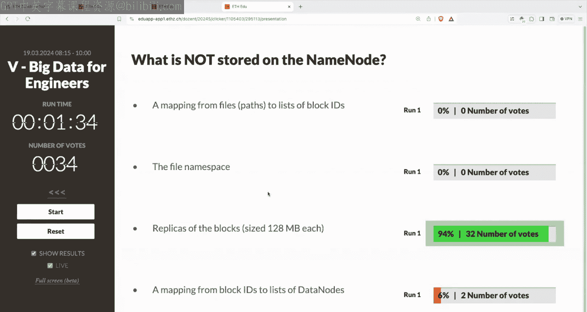

And we'll continue where we left。So to put again the context we've studied how to store data on cloud storage like S3 Ajab storage。

 AFS and so on。 but at that point weatherfi are objects it's just zeros and ones and now we want to use these to store data sets right and the data sets they can be in binary format or in a textual format and we are starting with the textual format we saw less time how to map text so characters to zeros and ones with encodecodings so now only we need to worry about are text documents but not any text documents。

 these are text documents that must satisfy a few rules we call that wellform nest and the wellform rules correspond correspond to a language of choice it could be XML it could be Jason there are others of course but this is the idea right Jason I already showed to you there are the six building blocks。

Objects。Stringngs， bullions， nerve。Numbers and the sixth one。Arayise， yes， exactly。

 So six building blocks。 Thank you。 So and you can combine them in any way you want。

 meaning that if you have arrays or objects， then inside the arrays or objects。

 you can put any other values， right， The only things you cannot use to nest are the string boan null and number because。

 of course， these are atomics。 So you cannot put anything below them， right。😊，Okay。

 so let's look at the other one。😊，Which is XML， and then I'd show you also。

 well I showed you a bit less time about how that maps to tables in particular cases。The。

 the slides do not seem to work。 That's normal。 That's the the cover slides。

 And I was just summarizing the what we did last time。 Yeah， no， no， no， nothing to be sorry about。

Maybe I was confusing。All right， so let's continue now with the elements。 So just like for Jason。

 there are building blocks。Now， X M L is more complex than Jason。

 And I'm going to shield you from that complexity。 I'm only going to show you the most important aspects of X M L。

 just what you need in order to store data。 The first building block is called an element。

Elements are basically you can see them as zones just like you enter a C and you leave a C So you basically enter an element and you leave an element right so the opening tag means that you enter the element and the closing tag means that you leave the elements it's just like parenthees or curly braces right you have the start in the end。

😊，And inside between the tags， you can have anything that's the nesting right then you can have other elements。

 you can have text， you can have plenty of things in between。

 but you have the opening and the closing tag of the element。

 just like you have an opening and a closing curly brace for objects。

 an opening and a closing square brackets， for the Json array right。😊。

So opening and closing tag and the empty tag at the bottom that's only because we are lazy。

 we are so lazy that if there's nothing in between and we don't want to bother opening and closing then we just have these shortcuts where we put the sash at the end。

 we don't have to it's also fine to use the opening and closing with nothing in between but if you're a bit lazy and want to save subspace and you can use the shortcut version。

 the empty tag。😊，All right， so that's the first one。😊，The second one。😊，Isqu and attributes。

And that attributes is basically a KVU pair。A key in that case at and then a value which is in double or single quotes right so the attributes can only go to specific places namely either in opening elements tags or in the empty tag。

Meaning that you can have you see in that case， this is an empty the is at the end。

 So that's an empty element。 and I put a key and a value in there with an equal design。

 So I put it in there basically， but you can also put them in here in the opening tab that's fine to not here。

 That's not okay doest make any sense right because you want to associate the attributes with an element。

 So either here or here This is one attribute， but you can have as many as you want。

 It's basically a key value model。 Yes， again， a key value model， just like cloud storage。

 but of course now the values are super smaller。 So a key and a value and you can have as many as you want。

 it's not allowed to repeat the keys right so you cannot have duplicate keys per element it must all be unique but different elements then of course you can have reuse the keys。

😊。

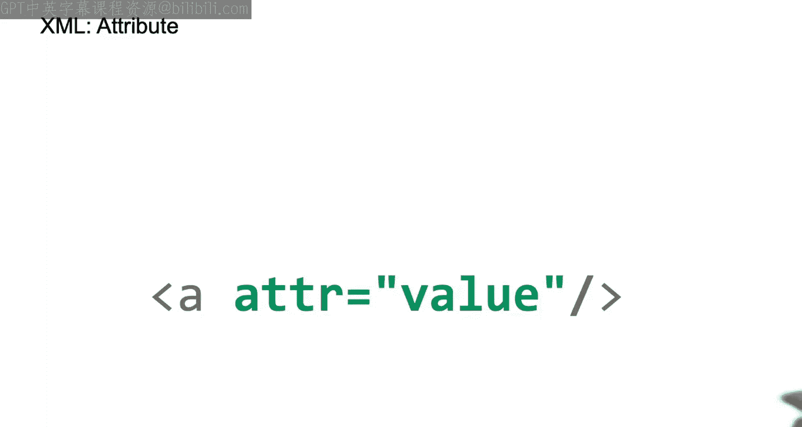

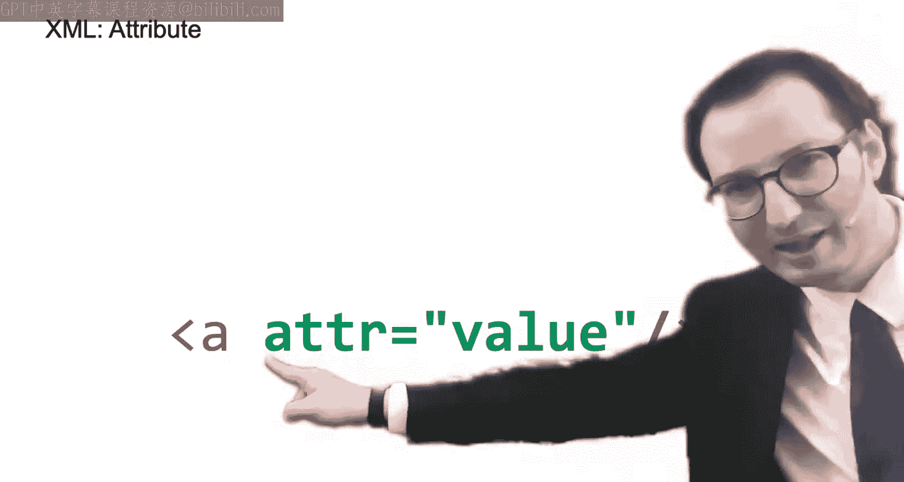

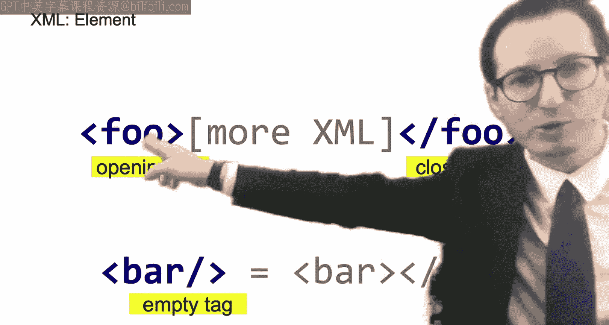

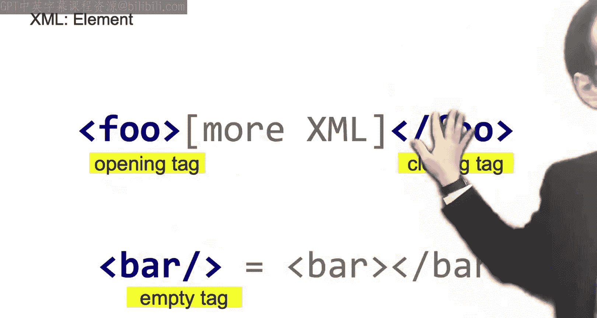

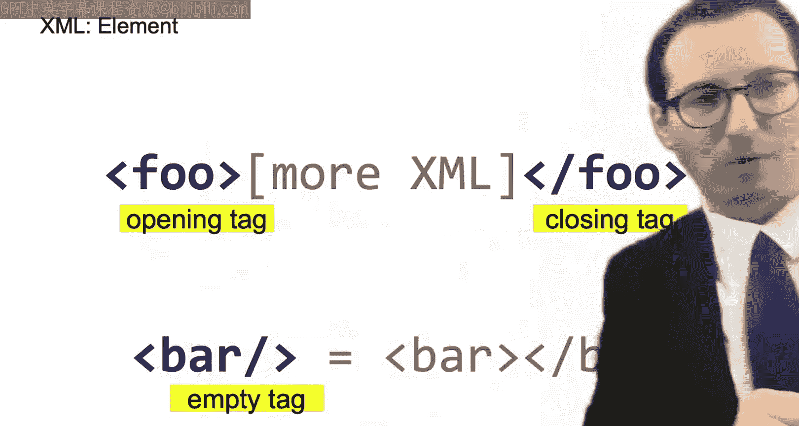

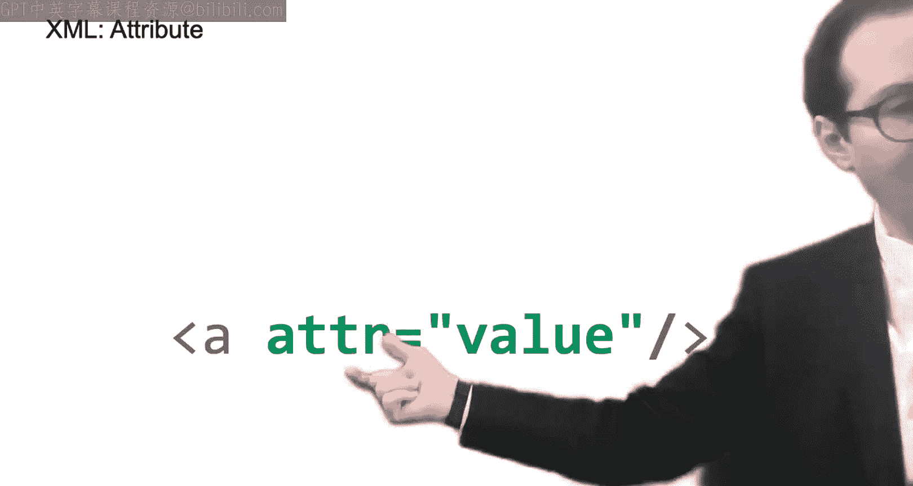

Okay， so that's NMS attributes。The third building block is text。

There is a difference with Jason in Jason， the atomic paths。

 we have these four basic types right we have strings numbers， booleans and  nerves。

In XML at the syntactic level we only have text that's it it's a sequence of characters and that' text all the thing with recognizing types because of course you could have text that contains number and so on。

 but that is done later at the data modeling level and we look in two weeks well after the Easter vacation at how we do that otherwise it's just text when you read the XM okay and the text goes in between texts you can even mix and match text within the text。

😊，Who already knows Hm。😮，Many of you， right， This is kind of H TM L。 That's stricter。

 H TM L allows you to kind of sometimes not get things quite right。

 and it's not going to complain too much。 X M L is extremely strict。 Just an example。In HTML。

 the attribute values don't have to be quotes。In XML they do if you don't quote them then the processor will complain right so you can see it as HTML but stricter but also more general because HTML is just for web pages but Xm is for any kind of data you want right so the tag the tag names can be absolutely anything so elements attributes text。

And comments， Jason doesn't have that， actually。But we can have comments。Now。Comments look a bit。

You're going to say strange compared to other languages， you know， for example。

 in C++ it's a double slash or you can have this slash star and then star slash at the end also in Java then in some languages you have comments with a sharp sign in other languages with person。

 You know it's basically just human language I you can write in there that's not technically part of the data and you can write anything you want comments are typically meant in the more general case to communicate between humans right you prepare the data set and you write a few comments in there。

 This is for whoever for whichever other human being is looking at this and and and wants to understand what you did。

But this is only half of the truth because in fact we also started to abuse comments for communicating with machines。

 for example you might have heard of Javadoc or this way of putting documentation in the comments。

 and then it's actually computers that are going to extract that in order to create beautiful and fancy- looking documentation pages。

Right。😊，U。

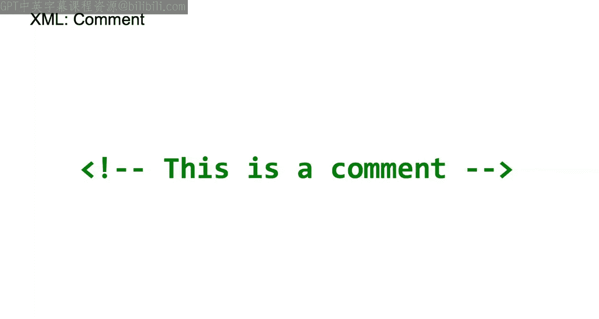

But there is a difference between XML command and the comments you have in Python or C++ or Java is that in C++ Java and soon typically when you pass to compile。

 you lose the comments they go away， but in XML， an XML passworder can actually show you the comments so you can actually see them when when you consume XML。

Now， why this。Smaller than exclamation mark dash， dash and then dash dash large or。

 like ways that's so complicated it's just historical reasons technically XmL is a simplification of an earlier much more complicated language that was called SGML。

SGML was basically used by the publishing industry to store data like books and so on。

 but it was extremely complex and at some point there was a working group who took a subset of that。

 much smaller subsets， and they created XML out of that。

And sometimes when you have these weird sequences of characters。

 these are just remains of SGML that they kept for backward compatibility but this is how it is。

 so don't be too much surprised by why we arrived at that， this is just how it is。Right。😊，Okay。

So these are the four bitbin blocks that you can find inside and the fifth is technically what you see at the very beginning of an XMl document that's called the text declaration。

 that's just what you could have on the first line that basically tells you hey。

 that's an XM documents and by the way it's encoding with UTF8 now you know what that is this is how you map the text to the to the to the zeros and onces。

😊，And it tells you version 1。0， you don't need to worry too much about that。 There are two versions。

 there's 1。0 and 1。1， but the differences are so minor that many people don't really mind between the two the the differences really have to do with some internationalization aspects but the 1。

0 is already quite international so you don't have to worry too much about the version Al right。

 so this is what you might have at the beginning of the document。

Now what is the smallest documents you could imagine？In in XML， it would look like this。

 you would have the text declaration， and then you would have an element that in that case is empty。

 Now， you could make it even smaller than that。 You could have an element that has only one letter in its name then it's even shorter。

 And since the declaration is optional。 you can even remove it right， So technically。

 the smallest XML document would be smaller than a slash greater than That's the smallest you can ever have。

😊，Alright， now I put this green mark on the right to say， yes， this is well from the XML。

 right It means that whatever text you see on the screen can successfully be passed as XML。😊，Okay。

And usually when it can， then you start that in colors， that's called syntax highlighting。

 which many editors allow you to do。Allright now this is a counter example。

 this is not wellform XML and the reason is we have two elements at the top level， two of them。

 there is who and then there is bar because see they are empty both of them this is not a allowed in a wellformed XML documents you must have exactly one top level element。

 exactly one， not zero， not two exactly one inside you can have other things but the top level one must be only one。

😊，This is fine in that case， there is the top level elements。

 which is the name of the top level elements。😊，Ohoh， right， the outermost elements。

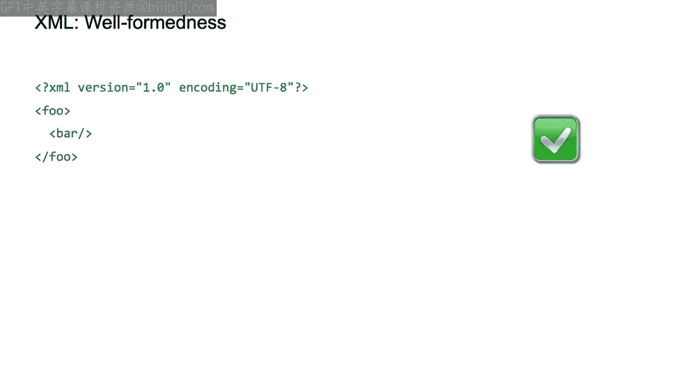

You see。😊，This is the outermost element。 It starts here。 it ends here， and this is nested。

 This is inside in between the opening and the closing tag。 We have another element。

 So here it's fine because there's only one at the top level， which is full。😊。

This is not okay because here we have text that is in the wild outside of the top level element。😊。

That's also forbidden， the text can only be inside elements in between text。

In between an opening and a closing deck。So this is not okay。

This is okay here you have text it's inside an element so that's fine and as I said you can even mix text with elements right so in that case you have food that is the top level elements and inside who you have a bit of text then you have an empty element and then you have again a bit of text that's totally that fine right。

😊，That you cannot do why because you cannot have an element inside the opening tag。

 you can have elements in between the tags nested inside。

 but you cannot have an element inside the tag itself right so that you cannot do okay has to be here but not here。

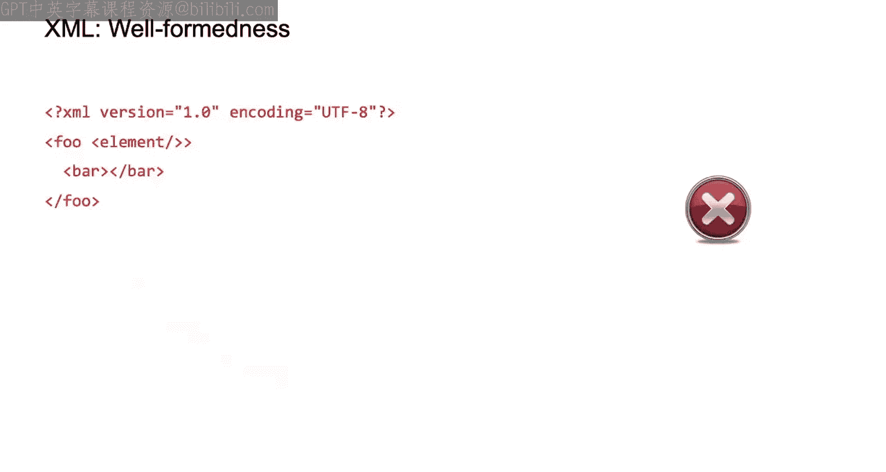

嗯。So these is fight。This is also not fine。 You cannot put the elements inside the attribute values。

 That's not okay。 We have to escape them。 I' explain to you， but you cannot have elements in there。

 The elements can only be between the opening and closing tag， right in here。

This is fine here I just removed the this is not longer element， I removed the smaller than slide。

Whos following？O。Now you might see sometimes especially if you saw HTML you probably saw this do type HTML thing。

 this is not really important， it's basically a line that tells you something you already know basically doc type document tells you this is an X document and the top level element is called document well you know anyway right you look at document you see it but still it's redundant but it confirms that this is this is a document a top level element called document。

Okay， so this is why you have these doc type H L on web pages because you have these HL top top level elements as well。

 already saw these doc type H L somewhere。Some of you right， just go to a website。

 any website and go to view source you will。

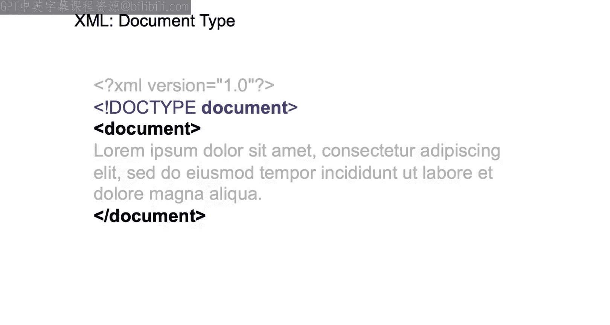

That's that's a good exercise。The browser allows you to view the source of any website。Okay。

 so what can appear where this is what I already told you just summarized elements can appear exactly once at the top level between other element tags as many times as you want。

 it can nest but not inside an opening element tag。😊。

The attributes can only appear inside an opening an M tag or an empty tag。Right。

And the text can only appear between element text， neither at the top level nor inside an opening element deck。

 because that's only attributes in there。

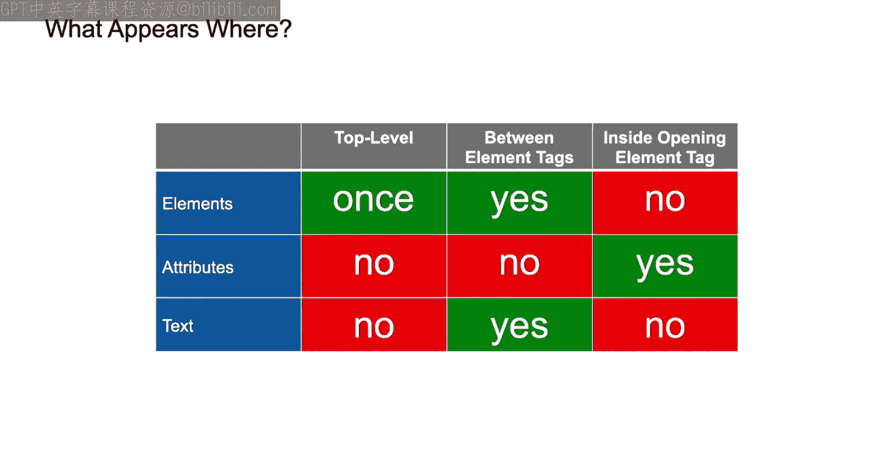

Okay。Here I'm also saying something I already said within the same element you cannot have twice the same key right so here I have two attributes that are called food that's not okay that wouldn't be well phone you have to have different attribute names different key so who and bar here is totally fine fo and bar but this is not okay this is not a right。

😊。

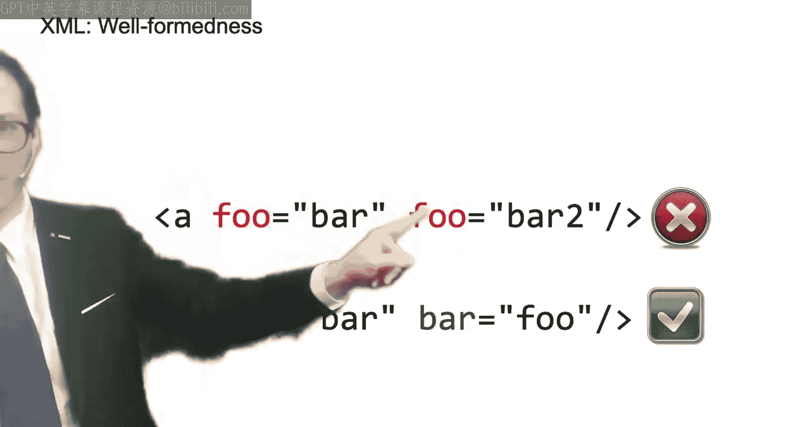

Not in the same image。This is also not fine， it's just like you know when you write a complex arithmetic expression with addition multiplication and parentheses you need to pay attention to where you put the parentheses right when you open a parentheses you must close it somewhere else and then you must be careful in the way you open and close your parentheses right it's the same thing here if you have a and you close it here then you have a problem because in between you just open B but you don't close it right this is not okay you can you have to close in in the reverse order right so if you open a then you open B then you you first must close B and then close a right。

😊。

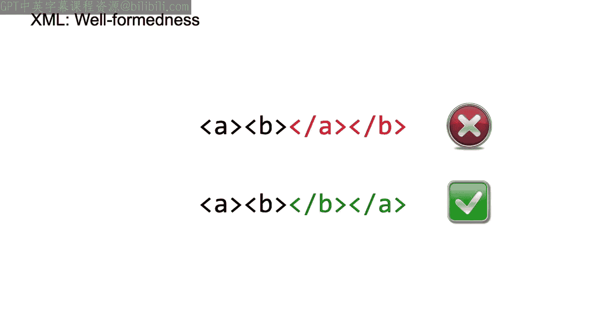

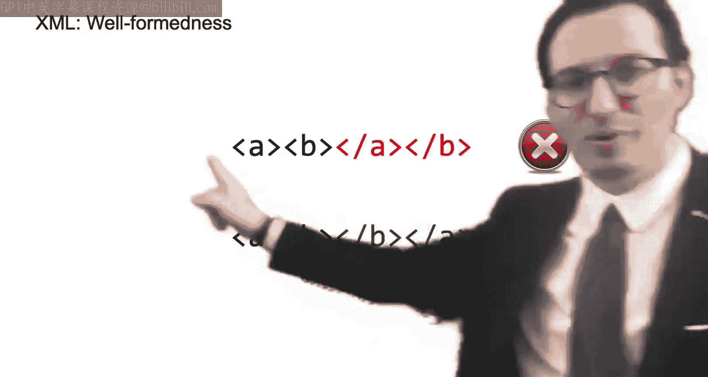

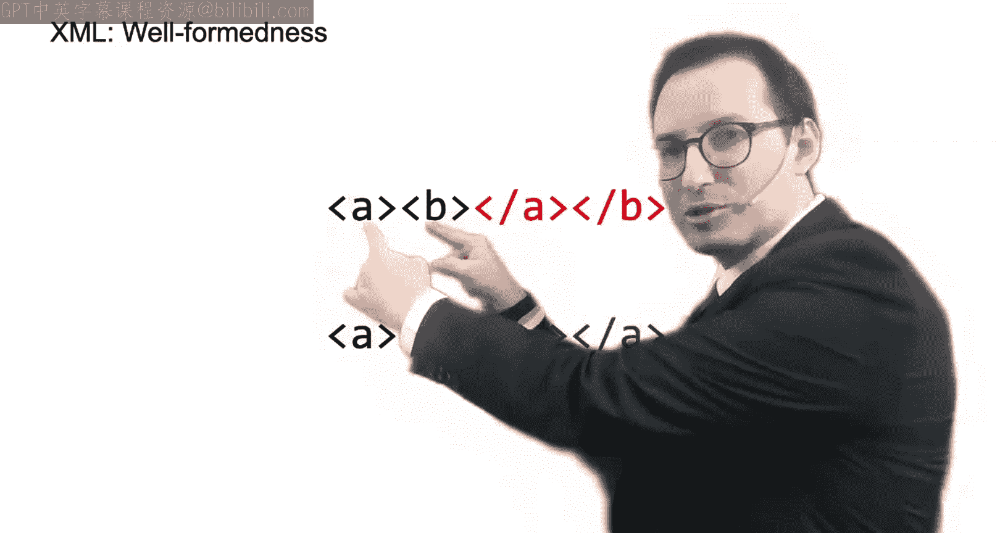

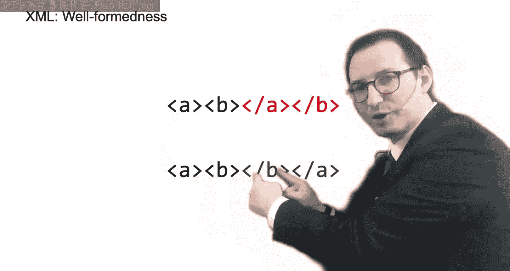

Okay。诶。Next。What about spatial characters because in the text you might have a special characters like smaller or。

 so this in fact you can have on websites because you might have JavaScript code that executes and then you might have a smaller or sign。

😊，But here， smaller than really means smaller than you really want to compare two things。

 But the problem of the smaller than character， the angle bracket is that you can confuse it with a tag。

 And， in fact， it's very confusing for a processor that's trying to open the X。 So it's forbidden。

 You cannot have this smaller than character inside the the text in X。 This is not okay。😊。

But you can escape it。 Escaping means you replace it with something slightly more complex。

 but that means the same。 So this means lower than L T。 You just need an m% and a semicolon。

 That's Hml legacy。 as I already told you。 So this is how you escape。

You already know escaping probably because you probably already saw in Java C++ many languages you need to escape the quotes with a backslash for example。

 probably already saw that or the command line so this is how you do and every time you have a common way of escaping in Jason it's actually your backslash to escape special characters all right。

There are only five characters that you can escape and that are predefined， only fine， only five。

This is LT for lower than GT for greater than a post for a postropphy。

 you guessed it quote for quote and M for m percent。😊，Right， so these are the the five。

 there's nothing else。 Now， if you know H T M L， that might surprise you， because in H T M L。

 there's many， many， many different escape sequences。 The most famous one is N BSP。

 which is a space that you can't see。But in XML， there's only these five。

 so that makes it easy right， you just need to learn these five and and you' done。All right。

A bit of history on the Emper sense， does anybody know where that comes from？

So the English alphabet now today has only 26 letters， but it used to have more。😊，And in particular。

 some of them are still in， for example， in Icelandic， you still have this character and so on。

 so it used to be in the English alphabet， but then it was replaced by TH so they are examples like that。

😊，So the appeared with the time， but there is one of them that actually survived for a bit longer than the others。

 and this is this character there this empty sense。😊，And it was used。

 it's actually if you're French it's actually an A， which is a translation of and ET。

 but ET written in some stylish way kind of gave you that symbol and what happens is that it was used for end in German I think you use a p in order to mean an and it's very common in company names and then it was put at the end of the alphabet。

 and so when you teach that in private school in a primary schools you recite the alphabet。

 so A blah， blah， blah X Y Z and right because it's after all Z but then it's weird you say X Y Z and that doesn't sound very good so what's the teachers decided with time is to make it a bit nicer for the children so they say since its by its own at the end。

They started saying， okay， W X， Y， Z and per se and right and by itself and and per se and。

 And then you when you recite the alphabet， you start reciting it faster and faster and faster。

 And then when you recite this faster， it's like W X， Y Z and per end。😊，And EmpersN became MPpers。

 That's why it's called Empers。 It is a true story。 In fact。

 if you look for textbooks in the 19th century， you will see the Mpers at the end of the alphabets。

Right， so now you have a way of remembering the world Empers。 if you didn't know it。

 it's the contraction of end peric and。Okay， so that was closing my parenthesesis of history。😊。

So now that we have these five characters that we can escape， as you might imagine。

 if I have an attribute with the double quotes then I cannot have double quotes inside because otherwise I wouldn't be able to decipher it so what do I do I escape it how do I escape quotes when I use it's one of the five right you see on percent quote semicolon so I just put this m percent quote semicolon and that's that's escapes it。

😊，So of course， once I have passed my XmL and I process it in my memory。

 then I'm going to actually see a qua site right the escaping is replaced。

 but in the syntax in the file you will see this am curity semiron。😊。

So now how do we escape these elements if I really want this sign？Then I use the LT escaping， right。

 So instead of this smaller than in front of element， I put Empers LT semicolon。

That takes care of it。The greaterban in the s you don't need to worry about。 This is fine。

 What you cannot have is the smaller than because that confuses the pass。

 The greaterban will not confuse it。Okay， but many people also escaped a greater than just for cosmetic reasons。

Because it looks nicer。So this is the summary of what you need to escape where in text。

 you must absolutely escape the smaller than in the anar sun， right， you have to escape them。

In double Qd attribute value， you must escape smaller than the double quote and the M percent。

 And in single Qd attribute value， you must escape the smaller than the apostrophe and the M percent。

 And I put a few examples in there。 You see at the top of the screen。

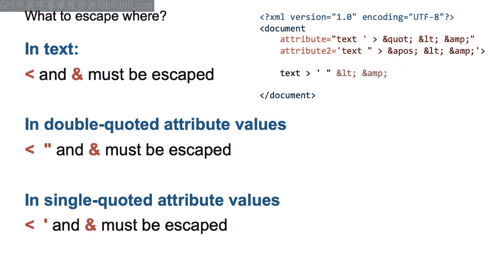

So this is this is fine， this is fine， this is fine here。

 that's an escape smaller than that's an escaped m percent here in that attribute which is double quoted。

 this is fine， this is fine， this is an escaped double quote。

 this is an escaped model than an escaped m percent。😊。

And here that's a single quoted attribute which is totally fine to。

 then it's fine to have a double quote and a greater than inside but you must escape the apostrophe escape smaller than an escape the a these documents totally fine that's a wellfed XmL document and once you have passed it in memory and consume it。

 then the escape sequences will be replaced with the actual characters that they stand for。😊。

Whos with me？All right， so now you can decipher these XML documents。

 it's easy because there's only five escaping sequences， so that makes it easy， okay。Now。

 if you write about the names， the elements can have a lot of different names。

 but there are a few rules and this is kind of common sense and if you know a bit how to program this shouldn't surprise you。

 for example，An element name cannot start with a digit。

It's the same in Python or in many programming languages， right， when you have a variable。

 it cannot start with a digit has to start with a letter with the underscore score。

 but not with the digits。Then you cannot use the smaller than sign in an element name。

 you can also not escape it because that's a name so you can only escape text or attribute values right so here you cannot even escape it with anything you just are not allowed to have this in an element name。

😊，嗯。And the two at the bottom， who 1，2，3，4， and underscore score about。 that's totally， right。

 so you can have you can have special symbols。The dash is also a load， the point is also a load。

And sword。Now， why did I put this Xtl on the side of the diesel load things here？

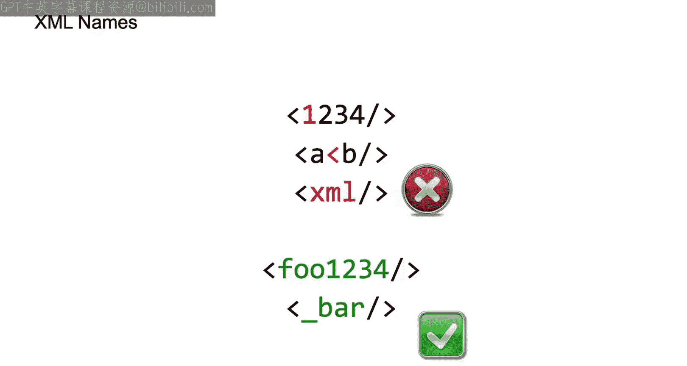

Right， because XM is three letters， Right So why can you not call your element XM。

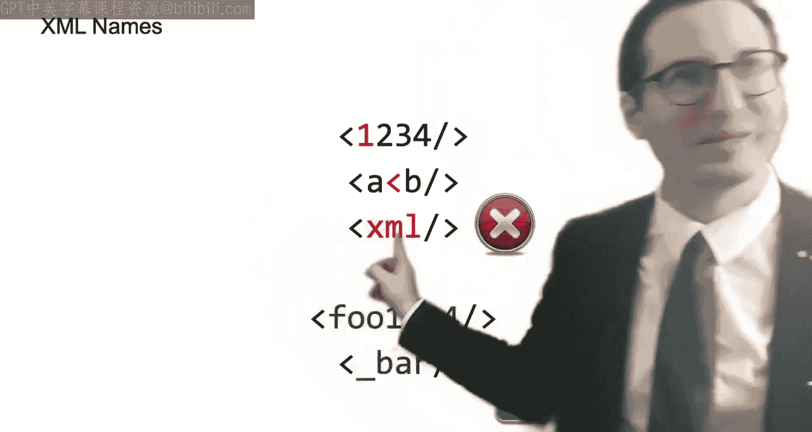

Well it's technically not that it's forbidden。It's not that it's forbidden to you。

The only people on the planet who are allowed to create element names that start with XML are the people who work in the W3C consumption who defines the standards for the web and so on so this is resolvedd to themselves so it doesn't matter if it's uppercase lowercase a combination thereof you are not allowed to create elements tags that start with XM。

But a confusion that arises every year is that some of you try it in oxygen。

 So the software will show you how to download it。 So they put that in oxygen。

 but then oxygen doesn't complain that you created an element that's called Xm。

 Well the thing is that oxygen has to be future proof。 It might be that in 10 years。

 the W3C defines elements that start with Xml。 but they must be they must work with with oxygen。

 So this is why it would not complain。 So this is just something you need to know that you cannot sun。

 So I need to do something about the sun。

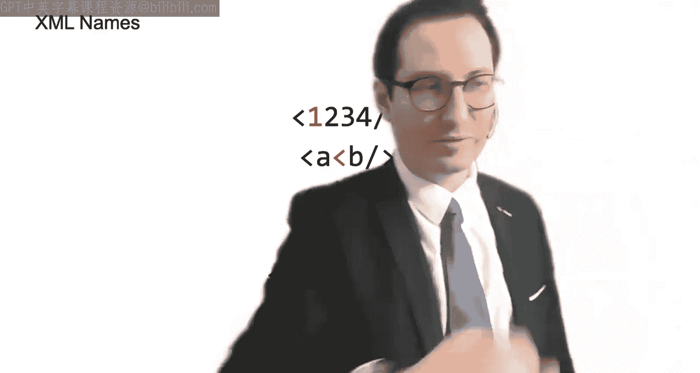

How do I close， I think it's the one。It's stuck with this one。😮，Should be care of it， I think that's。

To be sufficient， yes。So we just have the son who is paying us a visit in the lecture also need to make sure that we can see this see。

Scr。Okay。Allright， so this is at the bottom。 this is a road at the top。 This is not a road。

 and this is a summary of what is a road and not。 So all the letters of the alphabet lower case of our case。

 this is all fine。😊。

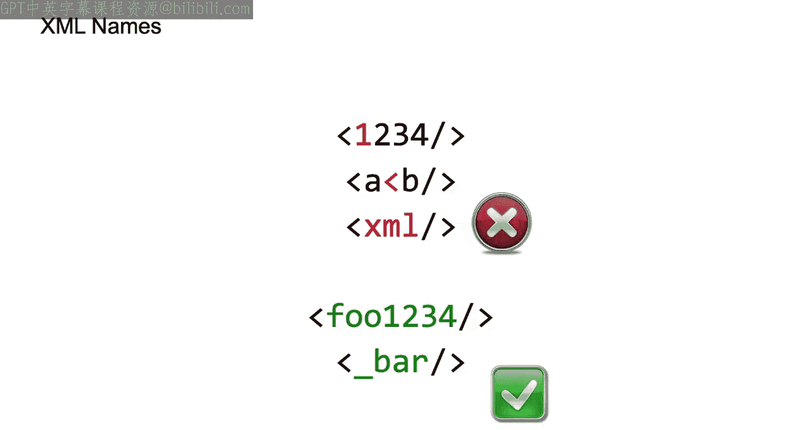

The underscore， this is all fine。The digits。Yes， but not at first。 not you cannot start with a digit。

The color and the dash and the points are also fine， but also not at the beginning， right。

 that has to be later。 Okay， and the rest is just forbiddding all the other characters， okay。

Everybodybody with me？

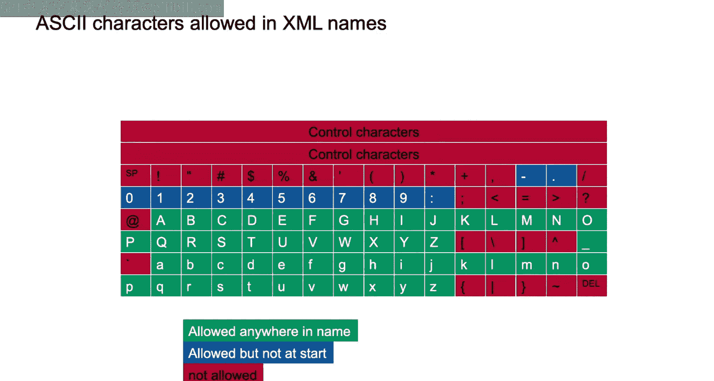

O。Now what about namespace Because in the examples that I gave to you it was spread over multiple lines in fact I also did the same with Jason when the answer is that it doesn't really matter so you can actually nicely display that's called Pre printing in computer science language that's called Pre printing it's more like a convenience for human beings to see the structure right so here it's nicely print with the I open on a line and I close on another line and here I nicely indent like this to show the structure it's optional but human beings like that where typically happened and you can do it in the oxygen software is that if you copy paste some XM in there that is not nicely format it like that you can press I think upper shift P or something but you can take in the menu and the software is automatically going to nicely Pre printed like this so it's very very convenient to。

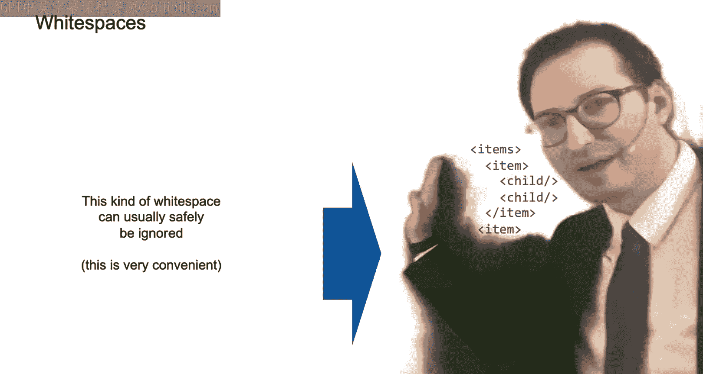

To immediately see the structure。And this is actually who already sees some sort of tree structuring there on the right。

Some of you， in two weeks， I'll come back to that。 there is actually a tree structure。

 That's the whole point of X7 and Jasonson。All right， so that's X like Jason。

 you can nicely indent like that。😊。

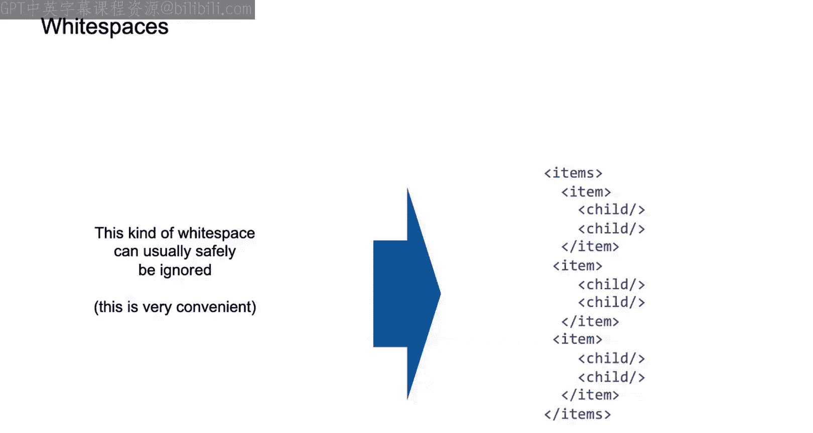

Okay， then there is a path that I'm going to quickly ski over because I removed a lot of slides I didn't want to bother you too much with that it's called namespaces so I only have a few slides left the idea of namespaces is just that sometimes you might have people who use XL for different purposes and then they are going to use the same names for the tags even though they don't need the same。

😊，For example， the wealth clients could need something in the context of networks when you connect to a network like an AGFS client。

But a client could also mean something in customer relationship management。

The problem here is that it collides， right， How do we distinguish these two。

And this is why we have namespaces and in fact namespaces are a little bit like family names。

 It's just like if there are several people who are called Peter or Mary or John and so on。

 then you don't know who this is right there are probably thousands or millions of people called with these names on the planet how do you disambiguate well with family names and perhaps even with middle names right So this is the same here with disambiguate with namespaces so I' directly show you how this is done So this is an Xml document that doesn't use any namespaces now this is how we add the family names the family name is technically this httpw3。

 org 1998 mathmaml this is the family name for everything that does math the mathematics language Maml。

😊。

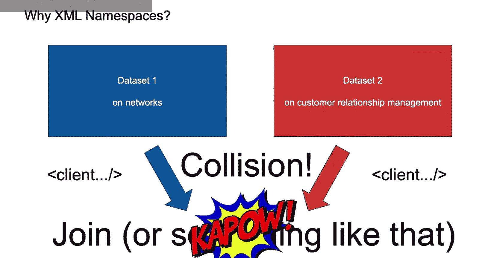

And what we do is we are not going to repeat the family names or another place。 I mean。

 when you are in your family， you don't call each other with your family names， right。

All the time right you use your first names only so here what we do is that we take a shortcut M for the family name and then we just use M and we have this M column that's like the family name in front of the first name like this and this Xml it starts with XMl So this is one of these result cases that I told you about Xml and S means Xml namespace It just says we're going to use the shortcut M the prefix M as a shortcut for the mathml namespace。

You can also do it without with any shortcut if you just want to implicitly say that if you don't have any family name they implicitly mathematic you can do it as well right so these are the same document in fact because it doesn't matter okay so what happens is that you map this M to the namespace to the family name and whenever you see M math then you know that M actually means the namespace。

Okay， the prefix doesn't matter， all of these are exactly the same thing。

Because the prefix is only a shortcut for convenience， what really matters is the space。

And now it's beautiful because people all over other planets can define their namespaces。😊。

Why this HTTP thing because you cannot just type that in your browser。

 it's just because everybody has the possibility to buy domain names and so basically if you buy a domain。

 then you can buy convention， use that domain for your namespaces right Nobody enes this but kind of a hidden convention。

All right， and so in a document you can have multiple namespaces in that case example。

com/bar and examplele。com/fu， you can bind them to different prefixes and then you can use the prefixes whenever you want the document and then it means that every element now has a family name。

😊。

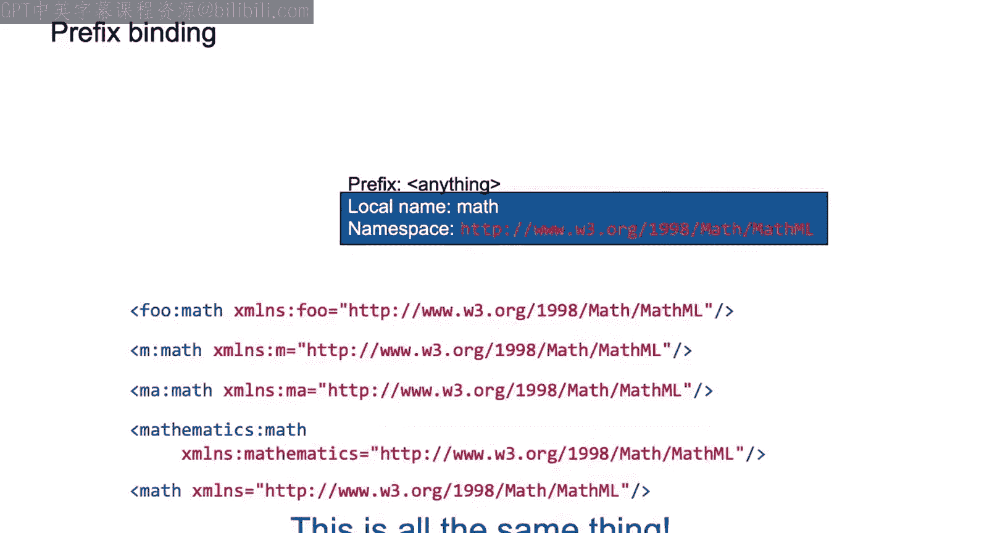

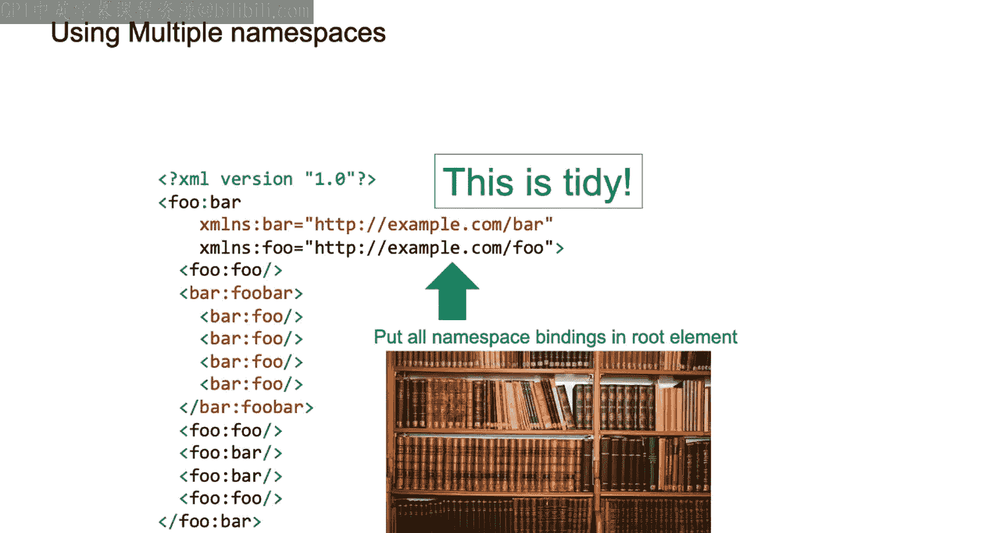

Right。And typically these are four examples on the top left。

 you don't have any namespaces because there's not XMMNS anywhere， this is what I showed you first。😊。

On the top right， you have one default namespace just with this XmLNS attribute it automatically puts everything in that namespace。

Then on the bottom left， you have an example with one prefixed namespace that's equivalent to the one default name space。

 by the way， it doesn't matter if it's the default name space or if it's prefixed。

 but it's a different syntax。😊，And on the bottom right。

 you have four namespaces and they are bound to for prefies。

 and we use them through the the documents。Right。And people can also do that sort of thing。

 but I say no no no don't do that this is too messy。

 this is impossible to decipher so let's do it the Swiss way if you use namespaces you nicely put them at the beginning of the document Albetically order art is even better and that's it and then you have your whole list of namespaces all tidy。

😊，Okay。😊，But that's what I'm saying about namespaces。

 because I don't want to confuse you too much in the exercises in the models。

 we will not have namespaces。And also， when we validate the data， we will not use name speciess。

 just know that they exist and they are very convenient in order to nicely classify the elements that people invent。

You can do that as an offline graph size， this is basically a text documents that has a lot of issues。

And you can try to spot them if you want， it's a good exercise， but the best way to spot them。

Is technically。 So these are actually the， the mistakes is to go to this cycle good now， actually。

 if you have your laptops right now， go to I T shop。E TH dot C go to that page right there。

 log in with your ETH credentials and go to I don't know where it's like service catalog maybe and and look for a software product and type Ogen XML editor 26 Probably it was really for you as well It's free of charge because you're a student。

 So E TH paid for it they were very nice to us it's very convenient。

 You can use that editor in order to pass Xml and Jason documents to validate XmL and Jason documents。

 you can even navigate them it's super useful for the project that you might have also for your semester or masterta or anything right and it can be useful for you to study because then you can write text in there and it automatically shows you if that's wellform XML or Jason so I encourage you to download it right because if we don't use it they are going to stop providing us with the license。

All right。So this is very， very useful for the exercises and what happens if you fix so this is an example where it fixed don't worry about the NtT thing that's just advanced and you don't need to do that that's for declaring your own escape sequences but that's basically the same fixed and because it's fixed now I have all the colors and by the way the colors off here whereas oxygens work as soon as it passes oxygen with use all of these colors to display it nicely to you。

😊，All right。So， a wrap up。Where are we doing all of that well XML and J are a syntax that allow us a syntaxes that allow us to exchange and store denormalized data you remember that denormalized data means it can be nested。

 you can have missinging attributes， you can have additional attributes and so on。

But in the particular case of a flat homogeneous table， you can use XMM Jason as well， right。

 It's just a special case。 So this is a table。 And this is now what the XM L looks like。

 But now that you know， the XM syntax that should be easy to you right。

 you have sale that is one row， the one marked in red and you have four attributes。

 product price customer quantity。 Now， if you do it for every line。

 you can have a sales it's very common to use the approval form and singular。

 So you have sales that contains the whole table and sales in the singular that repeats for every line。

 Yes， you can repeat elements to teleifying in XM。 And then inside every sale。

 you have the four the four columns product price customer quantity。

 I was careful not to say attributes to not confuse you with XML attributes。😊，Okay。

 for Hu does is it natural to map the table to this？Should become natural with time， right？

Then this is another example where it's pretty printed because here it's not pretty printed but here it's pretty printed right now even with the doc type sales that tells us something we already know they need top level element sales and so on right so take some time to understand that right ofline that this is just an exizema equivalentvalence of the that table just like there is a JSON equivalentvalence。

😊。

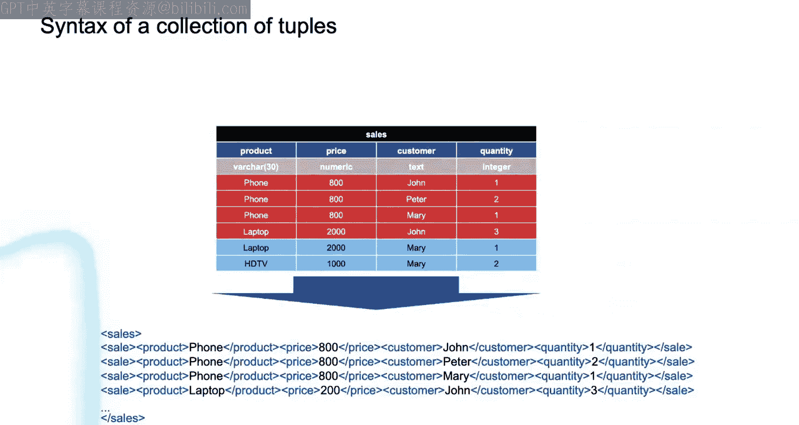

But now， the really interesting path is that now we can nest stas and that we cannot do with the CV syntax。

😊，I have a table in a table in XM， it's easy because you can have an element in an element in an element in an element。

 So you see how I managed to nest that table with orders nested in says。😊。

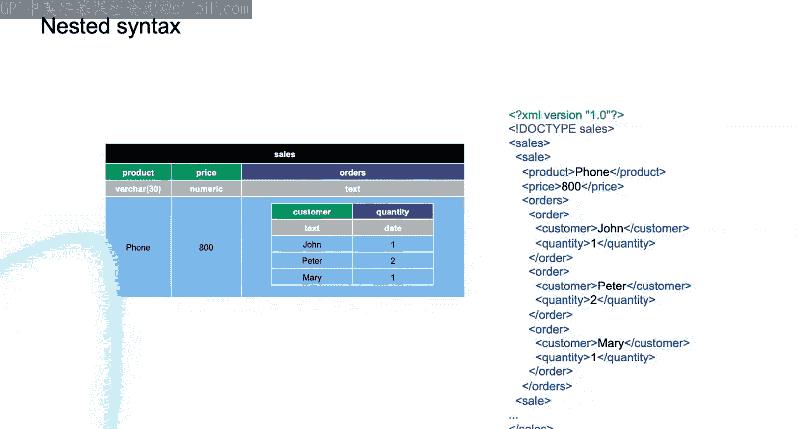

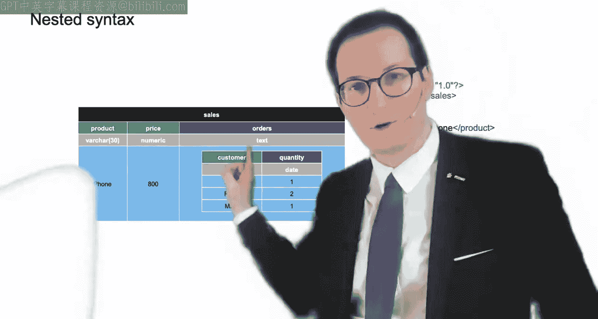

Well look at this， are this is one table order， we order in the approval form right and then when order。

 one order， when order， when order when order， when order is three， So this here is my table orders。

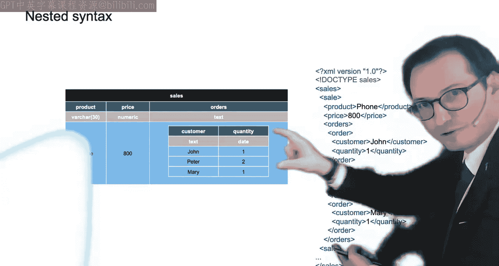

Nested inside a sale element。 So that's that room itself nested in the sales element for the whole table。

 So you see this idea in X Ml that you model a table with a single。😊。

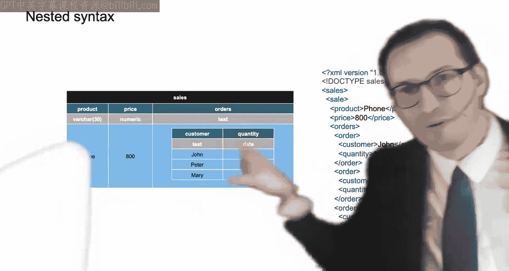

Elements that has a approval form for the whole table。

 and then a list of elements with the singular form said， say， say。

 say or order order order I'm not in the British Parliament， but anyway。

 this is what you get al right， you can。You can model nest data。Then Xll J。

 it's really just a matter of taste， the best way to start to trial in an internet forum。

Is to go there and ask if XM or Jason is better and then you will see the avalone short messages telling XM is better。

 no Jason is better and then the people who are actually I think the the more right ones who will tell you it depends and the right answer is really it depends that depends on the use case。

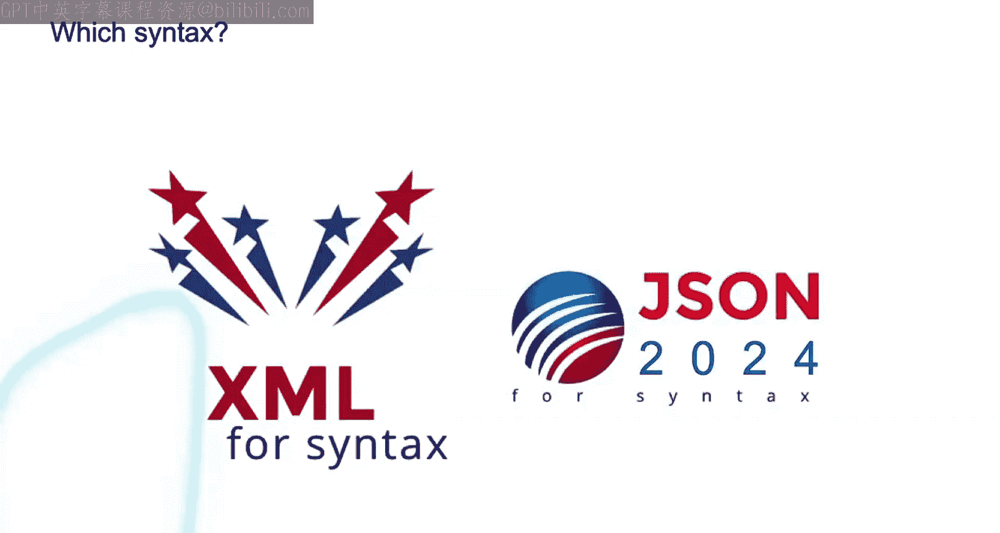

Okay。There are others in Texas。Yammer is one of them。

 it's one of these things that start with with a YA right yet another。

 it means yet another macroer language， I think the sun is starting to within in even better the green screen now。

Right。there you go。Okay。So this is Yemen。😊，But I don't need to say much about it because you probably already are able to pass it right you see there are stim to objects in Jason there is the idea of key values use right called CH name Sw lens。

You even have the idea of an array， you see these bullet points here。Right。

 this is kind of an array here， So you have objects， you have arrays。

 you have nested nests and so on。Suddi is Yamer and you have many。

 many other languages that might get invented。Yammer is actually gaining in popularity。

Especially for people who deal with clusters and Kubernetes and these these sort of software， right。

 So they they love Yael， why， because it's even simpler than X adjacent for humans。

 because you don't even have curly braces， anger brackets。 you can have them， but you don't have to。

Okay， so this is。や门了。Okay。Yes。😊，Yes。Here。So we will see that in after the start vacation。

 so basically the the types of the domains the next seminar are handled with the schema validation so you can basically define a schema and in that schema you can say that birth date for example。

 is has the domain date or that。😊，For example， is physicist has the domain， Yes， yes。

 no bullolean and so on。 right， But this is something that is done later。 You basically have first。

 you pass XM L， and then you validate it。This is something as we see thats specific to big data because if you look at relational databases of the 70s。

 what happens is that you cannot put any data in your table if you have not first said what the domains are right so from the 70s this is how it worked in big data we are more flexible with that it is possible to first drop your data as it is in your data lake so in S3 in B storage in EGFS and you can worry about the domains data right so this is kind of the different way that this can be done and one of the reasons is simply that data data can be very messy at very large scale so first you get the data that you have you need to clean it up and the process is that once you have cleaned up your data then you can say okay now this is this domain this is this domain and then you can validate it。

 does it make sense。诶。😊，I think you deserve the break。

So we are going to take a 15 minute break I'm done actually with a CDts now you know XmL J and so on。

 you should use oxygen to get familiar with this， I'd come back to XMM Jason for the purpose of validation and drawing trees after the Easter vacation and then I'd show you that in fact whohel data frames。

😊，ポンだし。Pyon very it does well。 Well， we'll arrive to data frames If we start with Jason and we add validation。

 we actually get data frames。 It's magic。 So this is。

 but then you'll have a theoretical understanding of data frames。 Okay。

 so I'll see you in 15 minutes and we'll start with white column starss。 Thank you。😊。

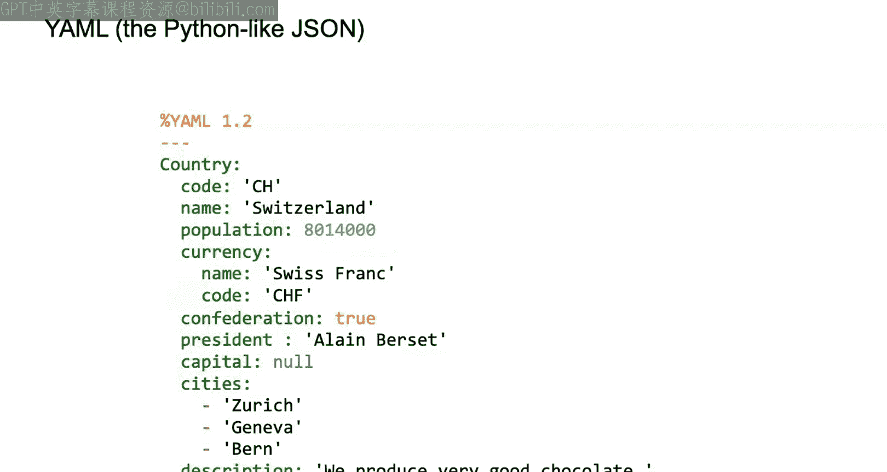