# 苏黎世联邦理工《工程师的大数据｜Big Data for Engineers - ETH Zurich - 2024》中英字幕 p12 6. Wide column stores (1_3) - .zh_en -BV17FAmeFE9K_p12-

Welcome back， everybody， so let's continue on our journey towards rebuilding the big data stack。

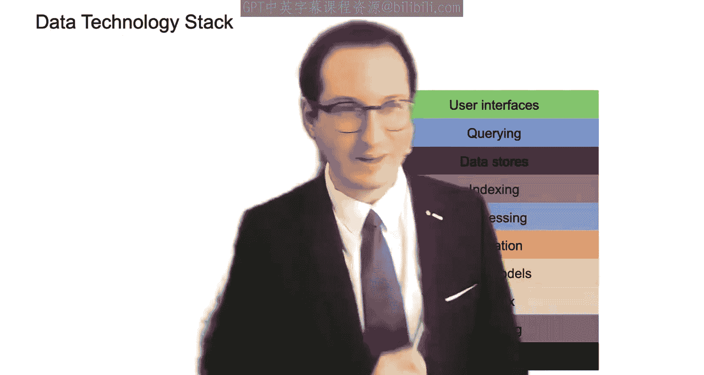

So we've already covered some grounds here， for example。

 we've covered storage because we looked at S3 Aure Blob storage， AGFS。

 so that's already several ways of storing the data。

We looked at how to quickly how to encode text into zeros and ones that can be stored as50 objects on cloud storage or HDFS。

 We looked at syntax， which is a way to storeoring the normalizedmalized data like Xml J even CV as50 objects on S3 or Rob storage or HDFS right So now we are making progress。

 So now what you can already do do is go to websites like I don't know the federal Office of statistics website and download the JO or XML or CSV data sets usually gives you the choice。

 and you can just put it on upload it to HDGFS or S3， which is already a start。

 So now you are in a position to get the data download it and put it on the storage layer。嗯。So today。

 we are going to start looking at data modeling， but still kind of a。

In a way that it has to do with storage still and then after the install vacation we'll come back to Excel and Jason in terms of data loading。

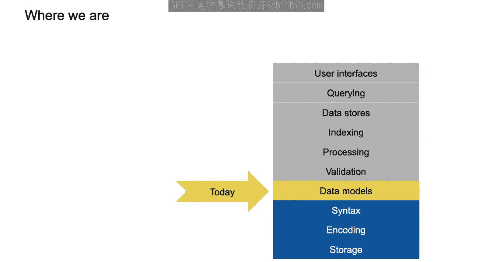

So technically， what we are going to do today。Is an even better way to store。Documents like X。

 Jasonson and so on， or even HTMLM L pages。 But in a way that is a bit more structured than cloud storage or HDFS。

 namely， we are going to organize it in what looks like a table。

 So it's a kind of enormous relational database in the look and feel that you will see。

 I will explain along the way。So you could consider and in fact。

 in newer versions of PostresQL is kind of database you can store。

J Jsonn or even XMM in many of these of these database。 In fact， the， the the， the big products。

 they implement X path， which is a way to navigate XMM and so on。 But the other problem。

 And that's the problem I mentioned at the beginning is that it's small scale。 It's a single machine。

And you cannot make it scale to petabytes of data。 So what if you have billions of JO documents or XL documents right which is a common case so you cannot just drop that in Postsgresq anymore more then。

So。We saw that technically you could try to scale up if you buy a bigger machine。

 but then you see that it's not linear at some point you just will not find anywhere in the world。

 a machine that has a petabyte of memory that just doesn't exist。

So scaleup has its limits we can scale out right we can buy more and more and more and more machines。

 In fact this is exactly what people tried to do 20 years ago they try to buy thousands of machines and then they install a relational database system on each machine and then they try manually to make it work right so they kind of store the data here and there and so on with a lot of glue and a lot of efforts but it's very expensive they kind of managed but then they quickly realize that this cannot be this is too complex we need to actually create a product that actually does it in a way that is simple for the user right。

😊，So。It was very expensive， you basically needed to train and pay engineers to take care of all of that。

So what then came out of this？Is something called white column stores。

 which is the idea that you have something that kinds of look like a big relational database。

 except that the values can be very large， can be actually 10 megabytes， as we'd see in size。😊。

And all the aspect of running it on top of a cluster machines and so on。

 it's taken care of just like HFS takes care of that， right。 So it's， it's this is the idea。嗯。

And on top of that， these systems are designed to run on top of something like HDDFS。

 It means that just like you knowpo GQL， the data is in fact stored stored on your hard disk， right。

 you just don't see， but it's stored on your hard disk in a system like that white current store。

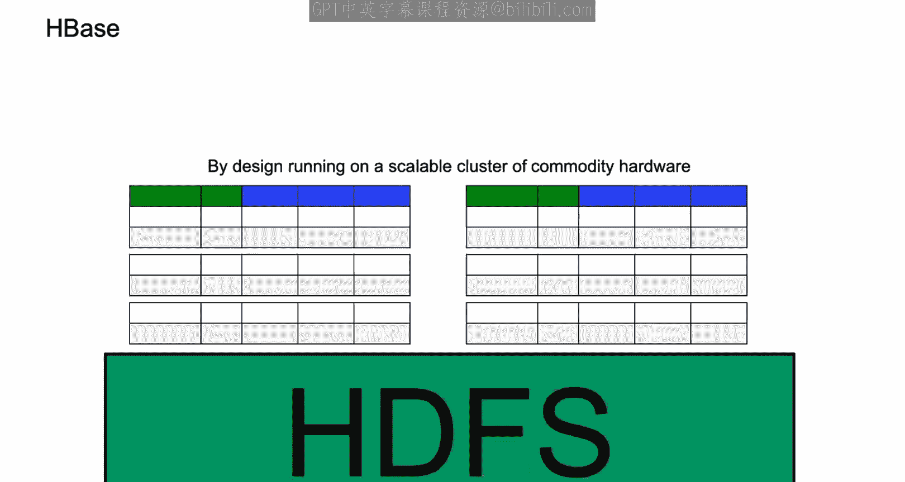

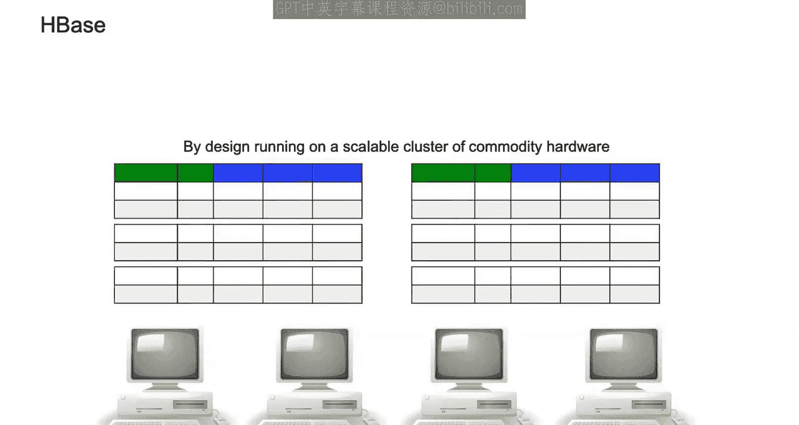

It's， in fact， stored on a GFS， as we will see。So the one we study is called HBase。

 the H is also for Hadoop， just like EGFSDH is for Hadoop it's part of the same family。

 and Id explain you how we spend the time to look at the details of that it's beautiful。

Just so you know， I might have slides on that， but。

The way it was originally done because that's only an open source implementation that came later。

 you know that the ancestor of AGFS is GFS， what was used by Google back then。

 the Googleified system。😊，And the system that ran on top of it was called big table for obvious reasons。

 right I just told you it's a relational system that has this very large table。

 so they called it big table and big T was running on top of GFS and on the open source it's H base that runs on top of HGFS。

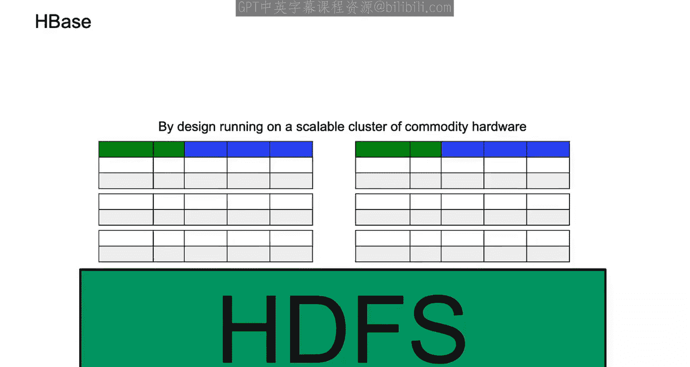

Now if you want to put it in perspective because whenever you invent something new and that was actually something new。

 you need to question why do we need something new， do we really need something new。

 can we not use something that already exists so you need to kind of do some brainstorming and compare things for example。

 object stars that would be S3 like cloud storage and so on RTBMS that's a relational database management system that's postgsQl for example。

 HGFs that's a distributed by the system right or GFS and KVU stars we did not study them in this course。

 but I just briefly mentioned them this is the kind of similar to object stars but with smaller values。

And if you look at all the features that you get， high throughputs。😊。

Low laancy so high throughput means data is flowing around very large quantities。

 low la C means that you don't wait too much before you start receiving your data。

Updates mean can you update the data if you want to change it？

Larger values mean can you put very large values in there， larger collections。

 can it scale with very large collections？Random access means。

 can you access any value anywhere in a reasonable amount of time， Can you not do it。

 And then I put plus and minuss pluses and minus Cs there in order to kind of do a comparison。

 So you can see， for example， that if you want high throughput， then S 3 or HFS is kind of works。

But RDBMS not really it's a single machine keyvalue stars well it supports a lot of users。

 but the values are small， so you cannot really say hi throughput low latency then relational database management systems are fast and also keyV stars in the sense of milliseconds right I told you objects already small like hundreds of milliseconds AgFS is also not such a low latency updates we can do updates in keyvalue stars and in relational database management system in S3 or HDgFS we just need to reappload the whole thing we can just modify an existing documents except for app pending。

Yes。😊，So we can append at the end or we can re uploadload the whole file。

 but it's not possible to modify partss of a file that's what I mean with updates you cannot say please replace in that inside that file please modify these text to this that doesn't work you need to reupload the entire file or append at the end does it make sense。

Yes， awesome， thank you。Larger values， So keyvalue stars， obviously not。

 but you can put larger values in S3 up to5 terabytes， HGFS， even petytes， RDBMS larger， right。

 I didn't say huge I said larger in PostsQl， you can also put large strings or large objects。

 I'm not saying it's going to be efficient， but you can do it larger collections means billions or even trillions of objects。

 So yes， you can do it in object stores。 HGFS that would be larger collections， but within a file。

 maybe RDBMS no it's a single machine random access。

 you cannot do with HGFS or object stores you have to download the whole thing。

Or if you want to not download the whole thing at least it's going to take a lot of time。

 but in a relational database management system or TVV store yes， that's that works。 So you see。

If you look at the columns， neither of them really has everything。

 And this is why we have the white column stalls。 It's kind of the holy grail of of of all of that。

 You have high throughput low latency updates， large videos， large collections。

 random access sounds like magic， right， So how can we actually build something like this。

 that is so， so wonderful that he checks all the boxes。😊。

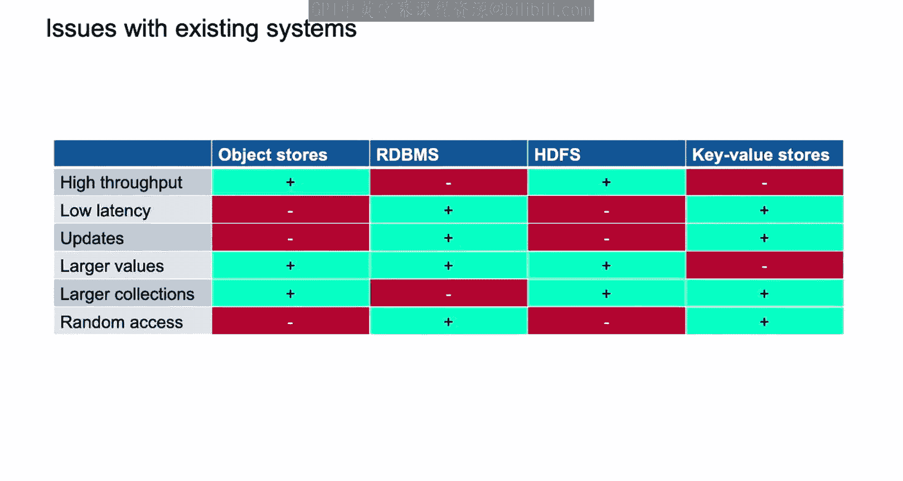

So this is now what we are going to focus on， you see that we can actually get all of that。

 it's not trivial， it was years of engineering to actually achieve that。

 but I try to explain it to you。

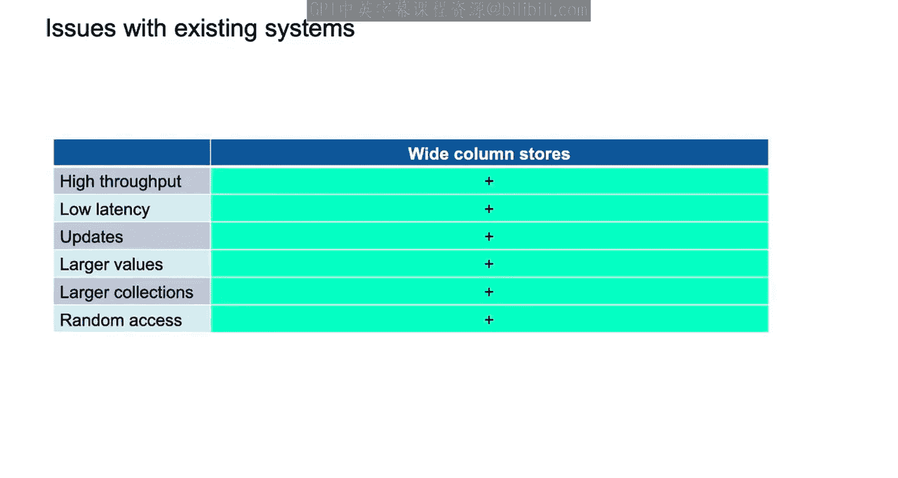

Okay。Now。I have to warn you that this is one of the most complex lectures of the semester so if you feel like you're overwhelmed or you know it's a lot then don't worry that's normal I know that this is the more complex one I'm going to try to take the time to explain drive you through it if you have questions of course online offline we will we will answer but I think that the reason I want to go into these details is that there's。

An incredible lot that we can learn out of these details。

 because a lot of the techniques that are used in Hb or in white color stars are actually very common big data techniques。

 And so if you know them， then you will basically have understood a lot of things of the big data universe。

 and we will see that a lot of the techniques that we will learn in Hbase。

 We will see them again in mapreuce and in many other places， right。

 So this is the reason why it's really worth looking at this。😊，All right。

So what am I going to start with well I already kind of gave you the habits every week of starting with the logical model right on the high level how what's the look and feel and only after that we looked at the physical architecture so I'm going to be doing the same thing here I'm going to start telling you about what the user sees。

😊，When they use H base or white cotton store， and only after all that。

 I will explain the physical architecture， maybe I start today if I cannot start today then we'll do it next week。

So first， the logical aspects。Again， it was Google's big table， the original one。

 it's 20 years old now， maybe a bit less than 20 years old， but almost 20 years old。

And the idea of these big tables， well you might have made a link with deormalization right big table that's the opposite of what we teach with normal forms with normal forms we don't say one big table no no we say plenty of small tables right one table for everything and big tables seems to crush this by saying no instead we're going to have just one single big table and that's it so that doesn't sound like a normal form kind of things and in fact this is the idea the idea is that if we are in highn form we are going to have many tables and of course these tables are going to have to be joints right you have。

 for example， a table of students a table of coursees and a table of attendance of coursees by students you need to join them to put together the students which attend wet lecture right so I give a very simple example with digits and you see the a rows here is basically what is boundd to we right every record on the left is bounced one record on the right and this is wes a join。

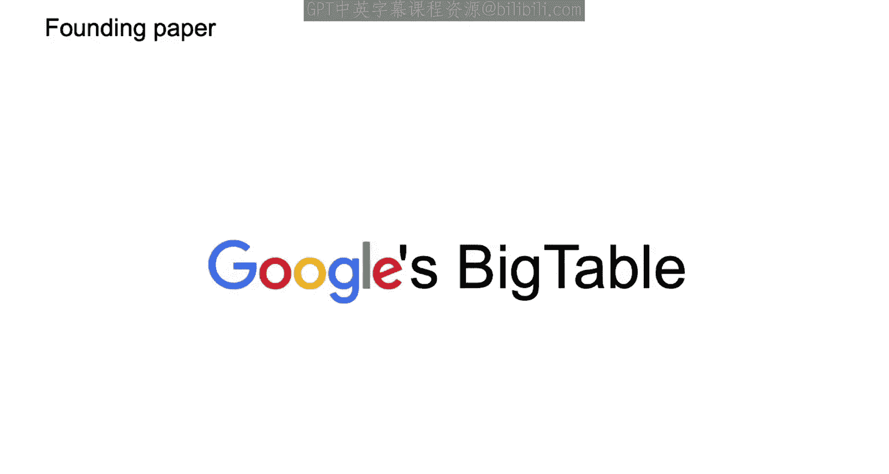

The problem is that joints there are ways to optimize them， but they are still expensive。

 we will see， in fact， when we study Sp in a few weeks that the reason they are expensive expensive is we need to move a lot of data around in the cluster。

 that's the main reason why it's expensive。

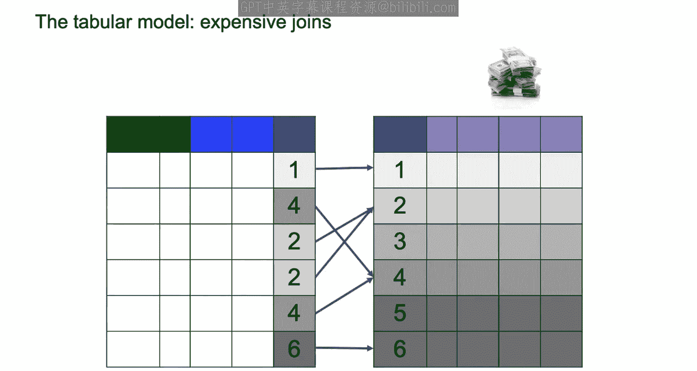

So basically， the idea of data denormalization。😊，Is that we want to save ourselves a bit of time and efforts by avoiding the join we try to do less choice how do you make sure that you don't have to do a join when you just merge the tables together you deormalized right and instead of having these several tables instead of having two separate tables you just merge them into a single table right instead of this you have these。

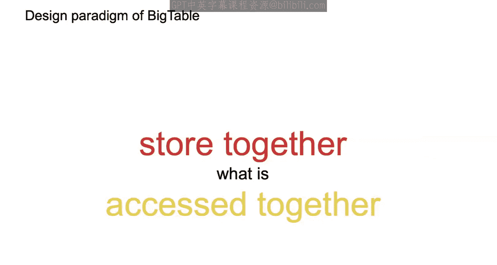

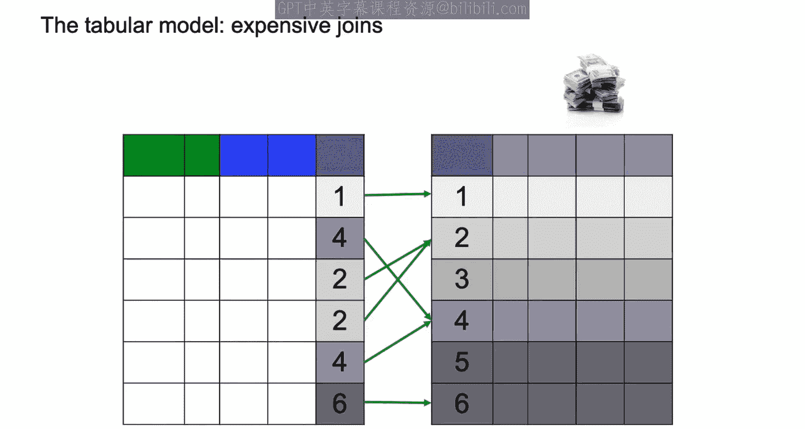

And again， I repeats that when you learn databases you are usually told do not do that。

 it's better to have several tables than just one and now we are doing the opposite of that we want to avoid the join so we are putting everything in a big table so instead of this we are going to have this right this is several tables this is one big table and that's why it's called big table。

😊。

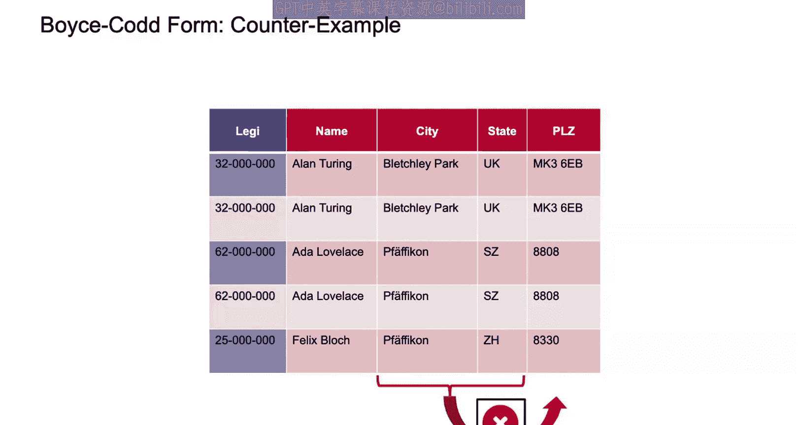

Okay， so we did normal。😊，Of course。Keep in mind that deormalization is two things。

 it's merging tables into a larger one， but it can also be nesting right in the case of X J I use deormalization in the sense of nesting because we even drop the first normal form here I mean deormalization first in terms of merging tables together into a larger table。

Okay， so this is the idea， in fact in each basin in white column sauce instead of having many tables。

 we tend to have just one or few very large tables and we don't need to join anymore because it's already it's already prejoins kind of but the price to pay for that is that it's very redundant we might have for example you see the two and the four that appear twice here because we've joined these two tables。

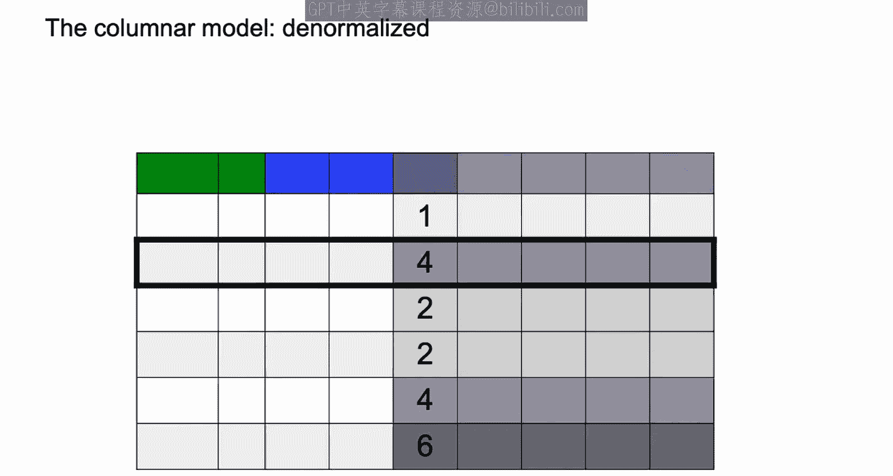

Right，It was coming from here。2 was just once and just once that it's referenced twice here and4 as well is referenced twice。

 So what happens when we do this deormalization is that now we have the duplicates here。

 This is the same thing here and here， and this is the same thing here and here。

 We basically introduce the application。 That's the price we pay for that。

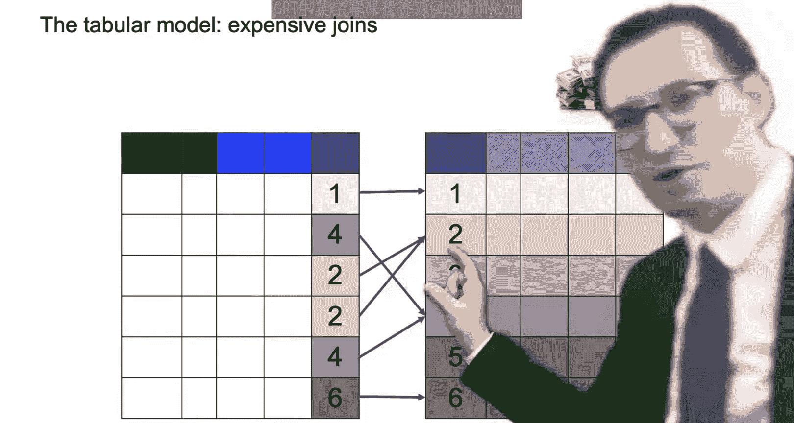

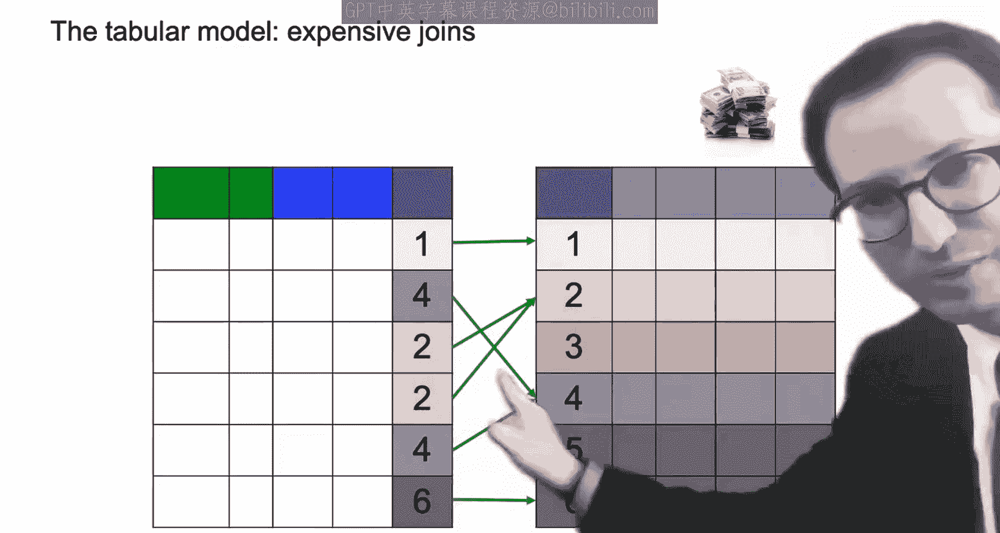

But on the bright side， we no longer have to join anything because it's already done。Okay。

Who's with me？

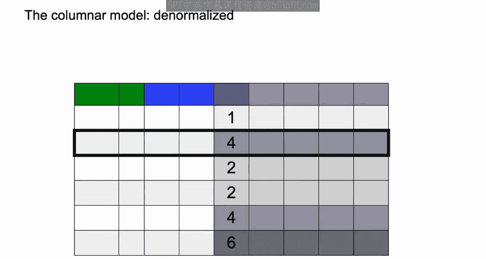

Okay， so that's the big table， that's how you remember big T。So now if we look at the model。

It's a table obviously so we have rows and columns right so that shouldn't surprise you Now the rows。

 you know the notion of private key right， for example， if you have a table of people。

 the Social Security number， a have a numa is going to to be the key when in the case of H base there is one particular column that's called the row ID that has some identifier you can view it as a have a number but for data not for people and it's just a bunch of can be text but in fact it's going to be more like numbers like number in day 16 So this is an identifier for the row。

 if I give you that number， then I can quickly get the row。Okay so this is a raw ID。

 so it's a key value model basically right the key is the raw ID and the value is all the other values in the other currents。

The next thing that is part of the murder is that the colons are actually grouped in families。

That doesn't exist in Prosgra Hu or in relational database management systems。 We just have columns。

 and that's it。 But here we have columns that are grouped in families。

 So I'm using colors for the families。 There's the purple family， the yellow family， the red family。

 and so on。And。Typically these colon families are going to originate from the denormalization in that case we might have had three tables that we join。

 we might have had a purple table， a yellow table and a red table。

 but when we merge them into a single big table we kind of retains the grouping but now we call them colon families。

So this is where it comes from。Now we still have column names right and in that case just to insist on the families I'm using the Roman alphabet。

 the Latin alphabet for the purple family， I'm using the indoor Arabic numbers for the yellow family and I'm using the the Roman numerals for the red family right so basically how do you identify your colon。

The family name。And then the column name within that family。

 It's exactly the same thing as namespace。 In fact， all right。

 you have the last name and the first name， and that gives you a color。

 So the family is the last name， and the actual name is the the first name。Okay。No。

There's something that is incredible， it's that。In PostgrelsQL。

 you might remember that you define the schema in advance。😊，And then you put the data in there。

It is technically possible to add a column later in PostgresQl。

 but the problem is that it's very expensive if you want to do it。

 you basically need to add that column to every single record So if you ask PostgresQl to do it it might take a while until it does it it's not very efficient right so we can add and delete columns not efficient。

Not so。In age base in H base， you can just add and make up column names on the fly just like that without worrying it's not even going to to be slower or anything so you can just create your column names directly that works。

And when you do basically it implicitly is done for all rows， in fact you just need it for one row。

 you basically insert a new row and that row has a column that didn't exist before。

 implicitly all the other rows will have that column as well but it's going to be empty that's the idea So because you have this flexibility and you can add all of the columns you want。

😊，It means that your table， your big table is going to be very sparse。

 a lot of these cells are in fact going to be empty。So this is， this is the idea。

But the benefit you get is you can make up column names all the fly。 There is no schema for that。

 You don't need to worry about that and that's pretty budget。Okay。😊，By the way。

 since I talked about schema and you asked about domains earlier。In H base or in big table。

 there are no domains。 Nobody tells you this column must be a string。 This column must be an integer。

 like in Postresql。 That doesn't exist。 In fact， for H base or big table。

Everything is just bits in every in every set it's just bits so it's up to you if you put in that text or JO or XmL of CSV or an integer or whatever it doesn't care everything is a bit so that's very similar to objects and finds in HDDFS or in in S3 right so this is why here you don't see any domains for the code。

Okay。嗯。Colarne families can also be created， but this is a bit a heavier thing to do than adding columns right so adding colon families is slightly less efficient。

 so it it's more often that you would create colons than you would create colon families。Okay。

So that's what I've just said。 I insist on that Everything is just binary and zeros and whats。

 And that's it。 The rural Is are binary numbers， the colon names are even binary numbers。

 The colon family names are binary numbers。 The content of the cell are are binary numbers。

 There are no domains and no types。Whatsoever。It doesn't mean that the user doesn't see type because what actually happens is that the software that was written on top of H base to access H base。

Might simulate types， so it might be that for your convenience。

 the library is simulating that you have types to make it easier。

 but the underlying database system doesn't have any types whatsoever。😡，Who's with me？ok。

So you see that what we are looking at it' kind of strange because it's something hybrid。

On the one hand， it looks a bit like a relational database because it's a table with row colorss。😊。

But on the other hand， it feels like HFS or S3 because we just store bits right So you kind of see this hybrid form between the two aspects right so it's kind of a storage system。

😊，That stores objects， but instead of being one dimensional， it's two dimensional。

 So you can see that as some some sort of bi dimensional storage system if you want。

So that's the intuition that I want to give to you。

And now think that what you're going to put in the cells。

Can be anything you can have a string just the name of somebody or birthday or something。

 but you can also put as much as 10 mebyte you can put an Xm document a J document In fact people use that for blogs right you can host a blog and store the data in agebase in fact they are even search engines that use Hbase to index the web so what you are going to have in some cells are actually web pages Hm in one of the colon families you're going to store HTML pages right so it's very efficient for that so imagine that you have XmL Hml CSsv adjacent documents all over other place in that table。

The 10 megabytes that I'm giving to you is just an order of magnitudes of when it's a good idea。

 you could also put cells that are larger than that it would work but that would be less efficient at some point the system might start slowing down or not working properly anymore so as a ballpark just imagine that you can you can have just a few bytes。

All the way to 10 MB plus set。All right。😊，Okay。Should they move on？

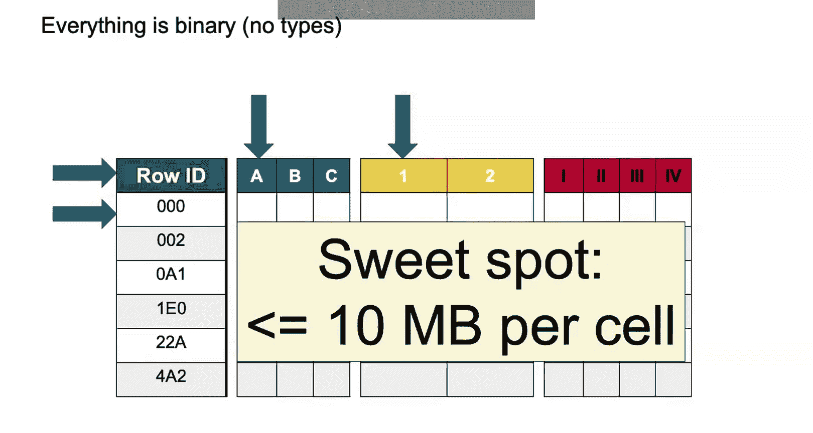

Good so now so this is the model， this is what you store so you have these rows that have a raw ID and they have Col families themselves separated in Cols。

 you can create Cols all over the on the fly。😊，And the values are binary。 Now。

 what can we do with that。

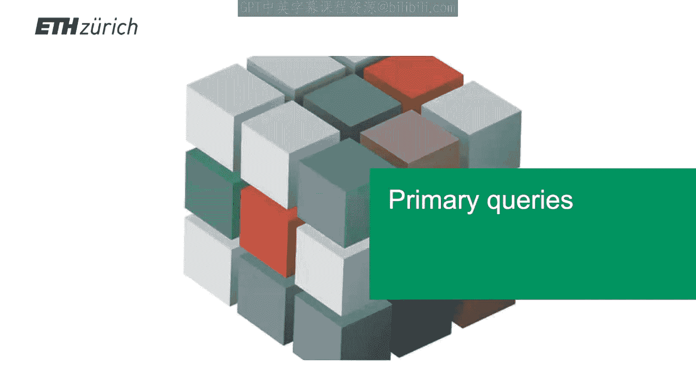

So let's look at the querying。There are four things that you can do on the primary level with with H basease or by the way。

 I might say sometimes H base， sometimes bigT is just because H base is the open source version of bigT right but in the course technically it's going to be H base that we use because that's the open source version。

All right， so four things。Get put delete Sc。 Go to go through there。 So get。

Is the idea that I have a raw ID for example，0 a1， that's a ID and I want to obtain the whole values for that rule marked in red right there that's a gate right。

Technically the get is not very different from getting an object from S3 or getting a block from a GFS or reading a file right so this is basically it but it's very efficient if you if you try to get the videos for a row you're going to have a result quite quickly so this is kind of random access right because you can really easily get any any row and there can be billions of rows in there right。

😊，Okay， so that's it。W is the opposite of that。You wants to either。Create a new rule or update。

So you can say put。And in that case， I created a new row with the R ID 204， I have to say。

 of course the R ID when I do that and then I say the values that I want right？😊，Now。

Several things can happen， Maybe I do a put and I I put videos for the purple yellow and red families or maybe I do a put only for the purple family and I don't put anything yet in the yellow and red family or maybe there was already something in the purple family and I'm adding something into the yellow family right so this is all the things you can do。

嗯。😊，By the way， when you do a get， you don't have to get everything。

 maybe I only want to do a get for the purple family and that's fine it's even more efficient so I can selectively get only some of the families right and I can selectively put into some of the families okay。

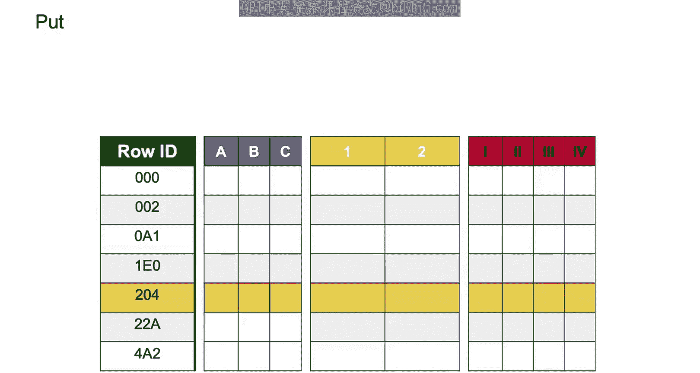

So this is get input then there is。Scan。Scan is when you want to go through the data this is we'll see a lot with the map Red and spark later。

Sometimes you just want to go through the data and build some aggregation or analyses or something。

 so in that case you specify， for example an interval so could be the whole table or it could be an interval of raw ID you say。

 okay I want to scan through the table from that position to that position。

And then what's going to happen is that you iterate so you can do it on the shell and so on。

 but basically it's going to iterate and then you can do whatever you want you well you scan。

 you can read， you can consume you can， for example， if you compute Max。

 you can just keep track of the max value so far and so on。 So this is a scan。The scan can be done。

 of course， selectively on a specific family that's totally defined two or even selectively on some row double right so you can just scan that specific zone。

 for example， between 1 is0 and 22 a and only for the yellow family right So this is called a scan。

And finally， did it。Delete means here's a raw ID， please delete the data associated with that row and it goes away。

 you could also selectively delete for a specific family and still keep the others and so on。

And that's it， so you see。

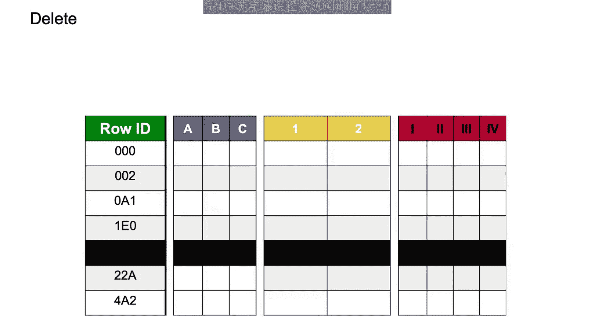

Get。

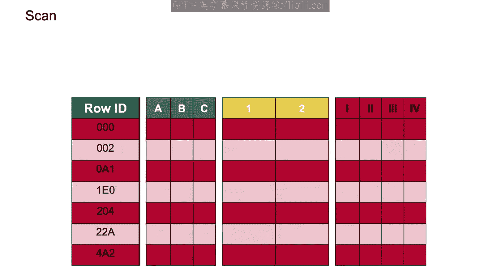

Doesn't want to go back anymore Yes， so you have get。

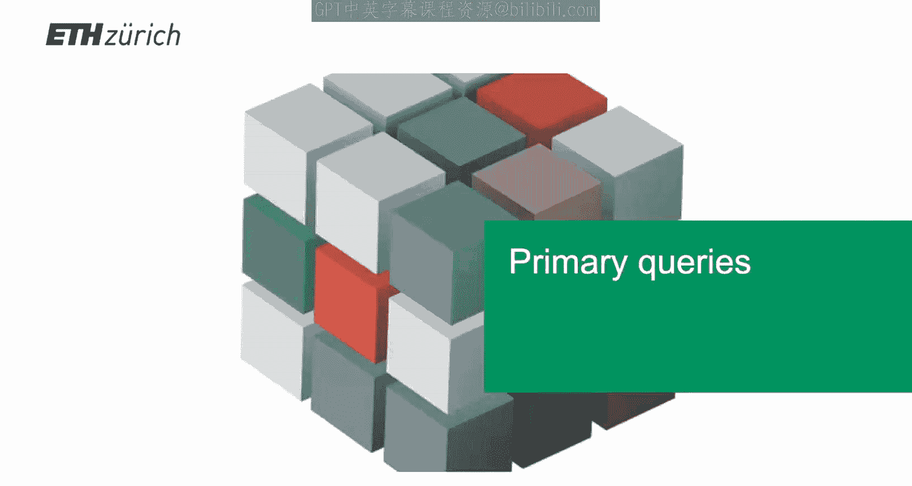

You have put。You have scan。😮，You have delete it， these are the four primary operations。

Getput deleteit should not really be new to you because that we already had seen for S3 for HDDSS for the RE API scan is kind of new right scan is the new thing that we are adding right here。

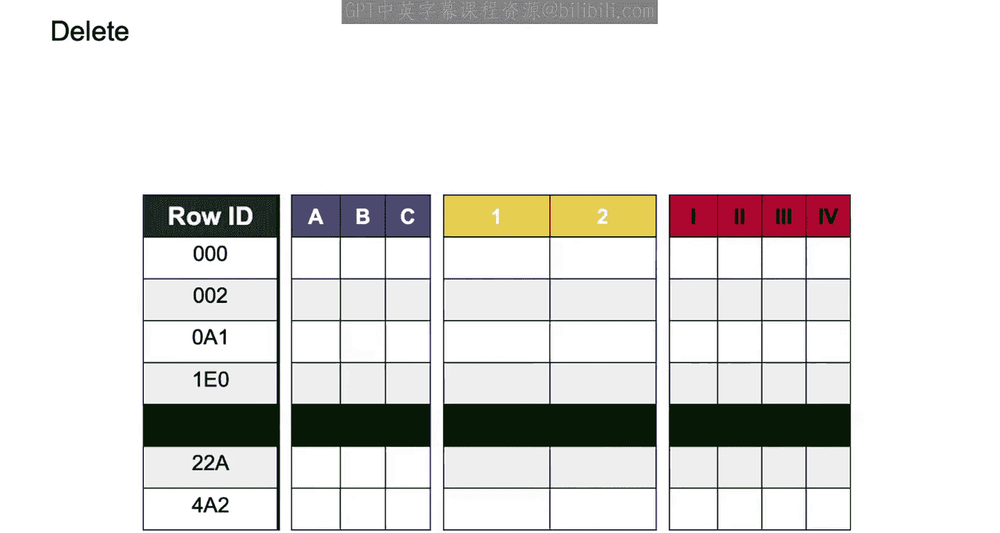

Alright， now a bit of terminlogy just to make sure。Key value model。

 I used plenty of times I told you that S3 is a key value model right where the key is some bur ID plus object ID and the value is an object。

HDFS kind of also has a key value model in the sense that you have the sites that are mapped to block lists of block Is。

We also saw the key value model in XML， where I told you that inside every element。

 then the attributes are technically key values。 So key values are， in fact。

 all over the other place。In fact， it's central to computer science。

 The computer scientist called that a map or an associative array。

 There are plenty of names for that。 So you should not be surprised that the key users of other place。

 Even adjacent object is also a keyU model right so after a while。

 you just develop an intuition for that。 But K models are very generic and not tied to anything in particular。

 Okay。Now you might have heard of colon storage or colon stores。

This is something different from the white column salt that we are looking at at that moment。

 Col star is really just a physical implementation。

 normally when you traditionally implement a relational database system。

 the way you store the data is row by row， record by record。So if you look at the hub drive。

 you're going to have a record and then a record and then a record and then a record， right？

And then at some point some people realize that we don't have to store the data in that way。

 we could also store it column by column and then instead on the hard drive you have all of column one and then all of column2 and then all of column three。

 it's the same data it's just stored differently。And this is called colon stars and in fact colon stars can be very efficient in the particular case that people want to query only specific columns of the data then it's much faster than storing record by record so this is called colon stores or colon storage。

😊，It's a physical optimization。But white colon stars are something of a different。

 it's really this idea of colon families， the reason they are called white is that you can have millions and I do not exaggerate。

 you can have millions of colons without any difficulty。😊，But because it's sparse。

 because as you can imagine， if you have billions of rows and millions of columns。

 it has to be sparse。 Otherwise， that would be just an insane amount of data。

 So a lot of the cells are empty。 So this is why it's called white。 You can have millions of columns。

 as opposed to more like 255 for traditional relational databases historically。Okay。

 so white color installs。I already mentioned Big T that is the original age base。

 that is the open source Russian that came a bit later as part of Hadoop Cassandra。

 who heard of Cassandra。So that was， if I correctly remember， developed that Facebook now Meta。

 So this is very similar to to this。 There are a few differences。 and'm not going to expand on them。

But it's the same the same idea， right， to to store the data。Okay， and we are going to focus on。

H base。So now we are getting at the physical levels。

 this is the path that that will be a bit trickier。

 so we're going to take the time to go through this。We have 15 minutes。 So， of course。

 I'm I'm not going to accelerate or go too fast。 I'm just going to take it step by step。

 Who is ready for that。😊，So we are now going to look at the insides of age base as what's happening in order to make it work。

Not you law， you know the logical models。So let's start with the logical model so we have these rows that identified with raw ID。

 we have these colon families and inside of colon families we have columns Now what did we do when we wanted to store physically data in HDFS well。

😊，The files can be petabytes long， right， You can have petabyte files。

But that doesn't fit on the machine。 So what did we do in order to make it fit？Anybody。

We split it into blocks。 right， That's what we did。 We took the entire file。

 and then we cut it into blocks，128 MB。 Then we spread the blocks over the cluster。😊。

It's just like when when you go I don't know you go to the bakery by bike and you have bread。

 but the bread is too long。 So you just cut it into smaller pieces and then that fits in the backpack right it's exactly the same idea that you are doing here。

 we just cut it into smaller pieces That's exactly what we are going to do So in order to define these smaller pieces first I'm going to have the notion of a raw id interval。

 So I'm going to specify what's called the region with a minimum and the maximum raw id and everything in between is part of my region。

 Now for convenience， the way we do that is that the minimum is inclusive。

 meaning if I say the minimum of two， then it's included two and the maximum is exclusive。

 meaning that if I say the maximum is 10， then 10 is not included it stops at 9 right Why do we do that。

 it's because the maximum exclusive， we be the same as the minimum inclusive of the next region that's the reason it's actually very convenient。

 So instead of saying。From4 to 9 and then from 10 to 15 and then from 60 to 20。

 you say because there's a lot of values to remember， 4，9， 10， 15， 1620 and so on。

 instead you say from 4 included to 10 excluded from 10 included to 16 excluded and from 16 excluded to 21 included to 21 excluded and now you have less numbers to remember。

Okay， for whom does that make sense。It's just a convention，RD to RD mean to max， we have a region。

And then that's one way we can cut that and the other way is to cut in colon families so it's a little bit like a wedding cake right and you cut it horizontally and vertically so we cut it horizontally and vertically horizontally in region and vertically in colon families now when you take the intersection of a region and a colon family。

 you have what we call a store。😊，It stopped together。So it means that。

For that specific region here and for that specific colon family here。

 we get this this is one piece of the cake， this is one chunk， one block， one split。

 one shirt call it whatever you want， we call it a store actually。

 but this is the ID it's a partition。

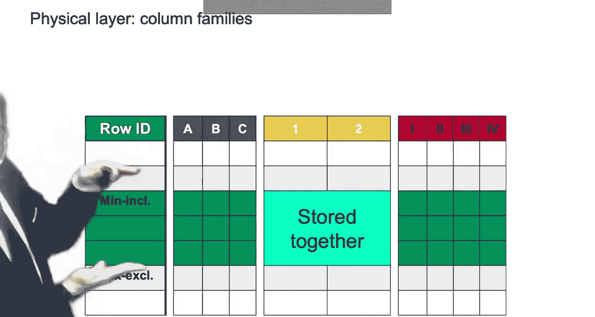

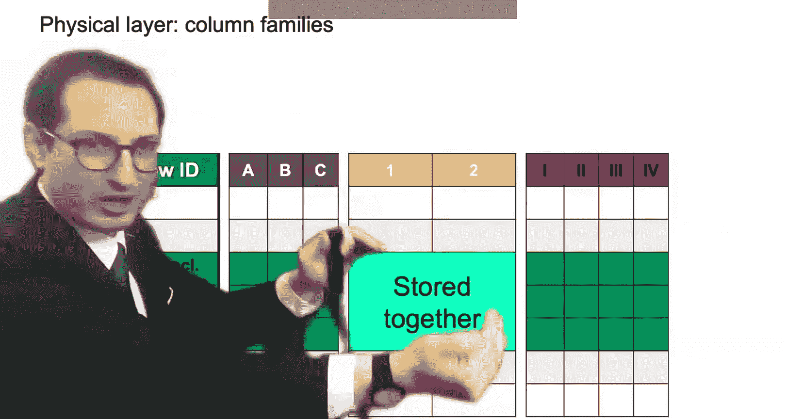

But who is that you？All right， so just like we cut the sides of AGFS into blocks。

 we are going to cut this big table into stores。

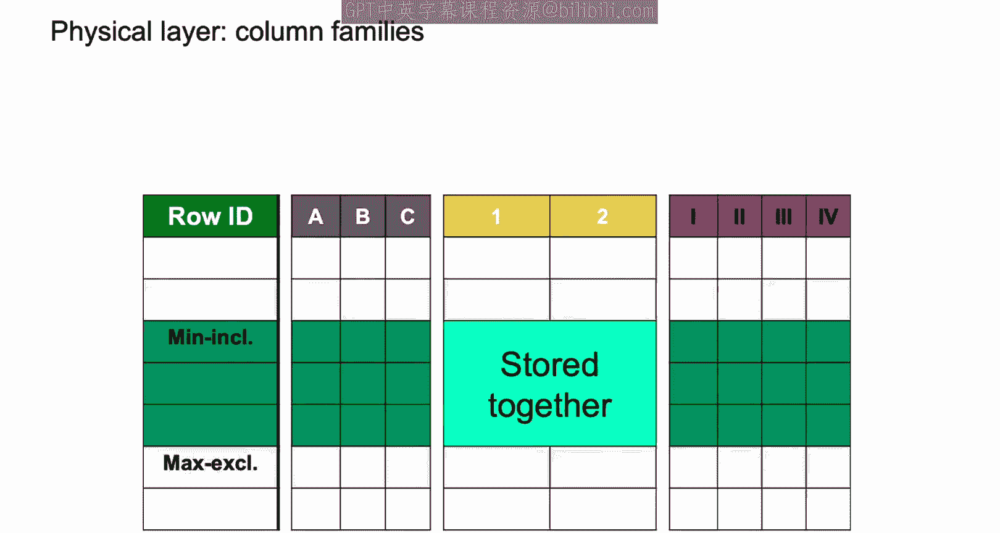

All right。And now the architecture is basically for those who know dinner for one。

 the end of every year。😊，Just like in HGFS， we have the name node and the data nodes in there。

 we have also the same architecture centralized。It's just different names。

 so every time it's going to be often this architecture you just need to learn the new names so for the coordinator on node that's called an H master and for the work on nodes。

 this is called the region server， right？Now， what's important to understand？

Is that these are the same machines？exactlyact the same machines。

 What happens is that what we call name node and data node and Hmaster and region server。

 these are in fact， processes running on the machine。

 It's the same on your laptop right on your laptop you might have your browser open you might have I don't know some spreadsheet software open you might have I don't know maybe some of you are playing a game right now I don't know so you can have plenty of things open on your laptop right it's the same here so on the purple node you have a name node running press an Hmaster running on the same machine and then on all of the all of the secondary nodes you have the data nodes and the region server processing running right on every one of these machines and the fact that it's on the same machines is very important because we kind of use HDGFS for storing stuff an Hbase to communicate with it and expose the big table to the user。

All right。So far so good， so let's start with the H masterster what's going on in there。😊，嗯。😊，Well。

 what's going to happen shouldn't surprise you because you remember that the name node in HDFS does all the meta level things。

 creating directory， writing directories， deleting directories。

 sorry requests to read or write data and so on。 So he's the first。

Point of contact of the whole thing， right？So these are the so called DDL operation data definition language。

 you can create a table， you can delete a table and so on， so that is done with the H master。😊。

The H masterster has other tasks than just that， she also assigns regions to region server。

 so it means that we have these horizontal partitioning with the entire words of raw IDs that we call regions。

And what's going to happen is that the H master for every row IDD assigns one of the region sels。

 one of the other machines， so it means for example that in the example that I have four of these machines。

 each one has a data node plus a region selva running。😊。

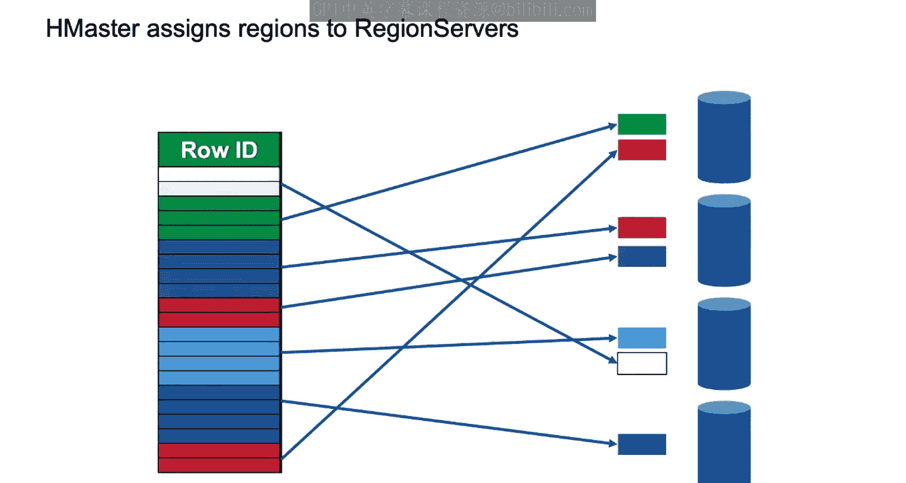

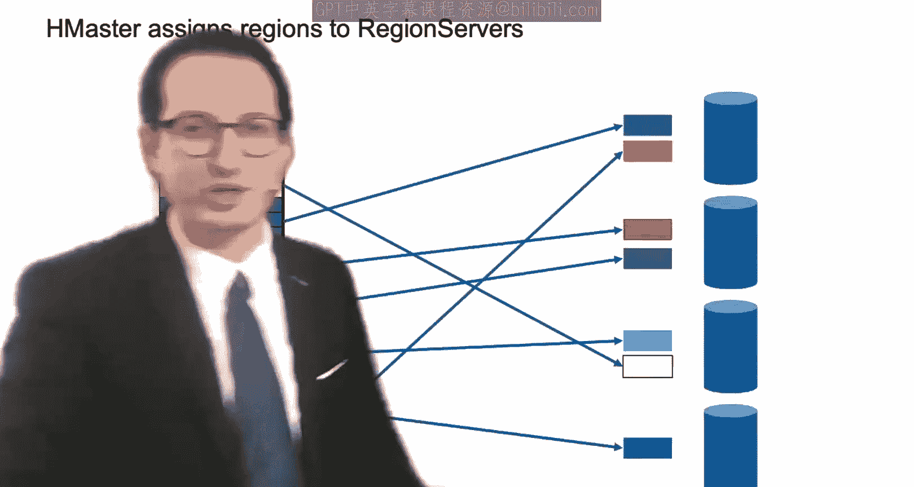

The green region here is assigned to that one。

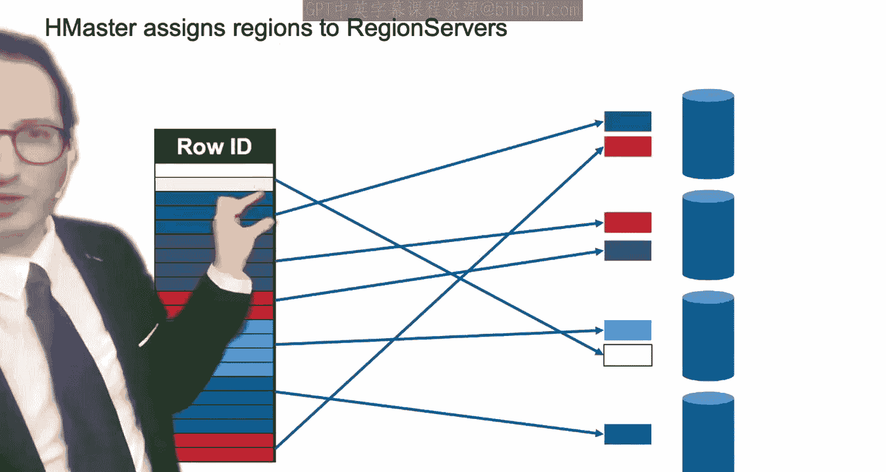

The blue region， the sorry， the purple region to that one， the red region to that one and so on。

 So you see you assign the regions to the region server。

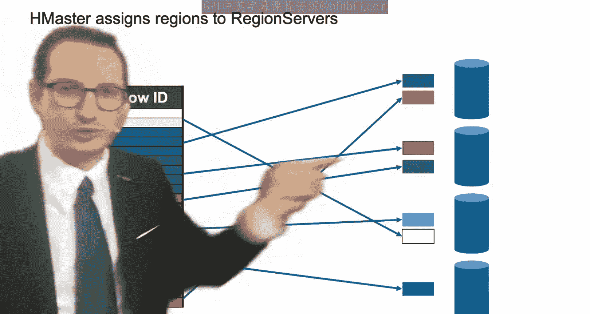

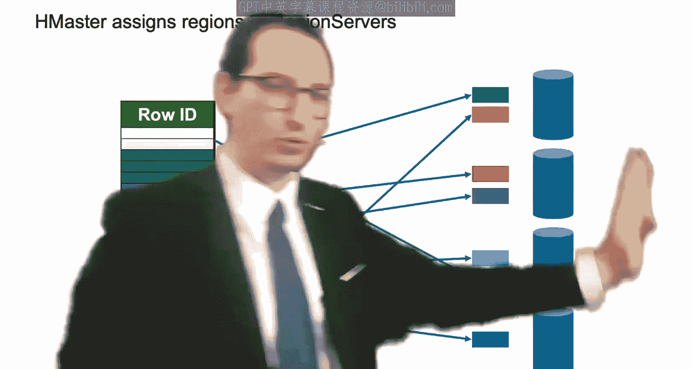

Now there is a difference with A GFS because in the case of a GFS。

 when the blocks are assigned to the data nodes， you might have replicas of the blocks and the same block can be stored on multiple data nodes。

 remember。😊，But that doesn't happen here in that case。

 a region is really assigned to only one region cell。

 so at first it might be a surprise because what happens if it crashes right but remember that the storage of the data is in fact done on HDDFS not by each base。

So what's the worst that can happen if one of these crashes。

 the responsibility is just handed over to somebody else。But the data is not lost because again。

 the data is in a GFS anyway right so this is the reason why there is no replication here right when region goes to one region cell。

Then what happens is that at some point。😊，One of the regions might start growing。

 that's called the hotspot。 it's when everybody starts adding data to the same location to the same interval。

 So when a region becomes too large， what's going to happen is that the region is going to be split。

Right so instead of one region is becoming two regions。

 So at first the two new regions would still be handled by the same node that was handling the region before the before the split。

But then it's going to be redistributed。 There is also some sort of load balancing。

 just like HGFS spreads the block of other cluster。

 If at some point you notice that one of the region servers have too much work and another one。

 not enough work， you just reassign the responsibilities。

 There is no need to move any data right The data is on HGFS。

 you just swap the responsibilities from now on， the thought region server is responsible for the region and no longer other felt。

但是 idea睛。And in the case so that I repeat if the second one crashes， we lose that machine。

 that's not a problem， all you need to do is reassign the responsibility to some other regions cell and again the data is not lost because you might have on that machine it's a data node so you might have some of the data in there but remember that the data is replicated in HGFS so it's not big deal we lose the machine that's not a problem we have replicas at some other places and then HDGFS is just going to copy them reach again the number of replications。

So far so good， who's with me？ok。😊，Okay， so that's called。

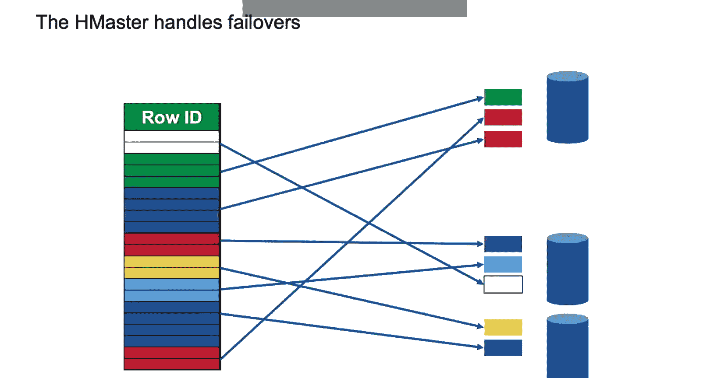

AF over exactly when that happens。Now let's go to the region servers。

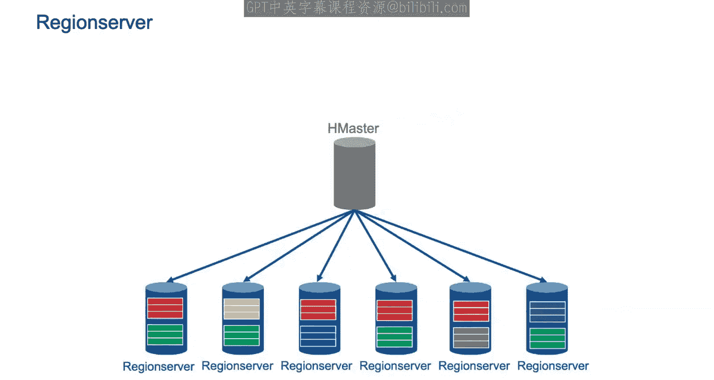

So。This is the wedding cake cut horizontally and vertically like this and the chunks or blocks or splits or shelves or partitions。

 we call them stalls in that case。So in that case， we have two regions and three colon families。

 which gives us six stalls。

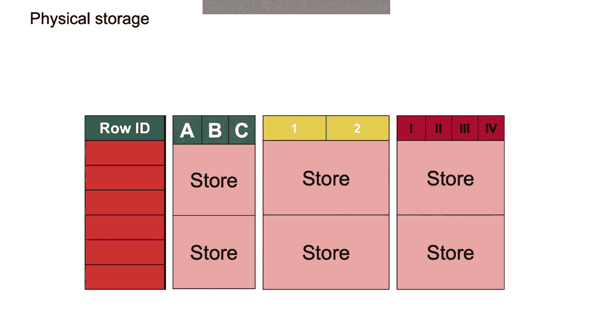

So let's look at one store， just one of them， so it means we have an interval of raw I contiguous on the on the for rows and we have one single colon family in the columns Now if you take a specific raw ID。

And a specific column and you take the intersection of that， what you get is a cell。Right。

 just like you have a cell in a spreadsheets software and a relational database。 So this is a cell。

 this is a single value that goes in there。😊。

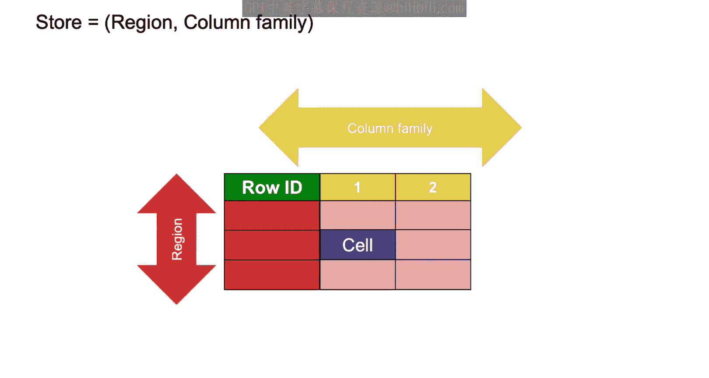

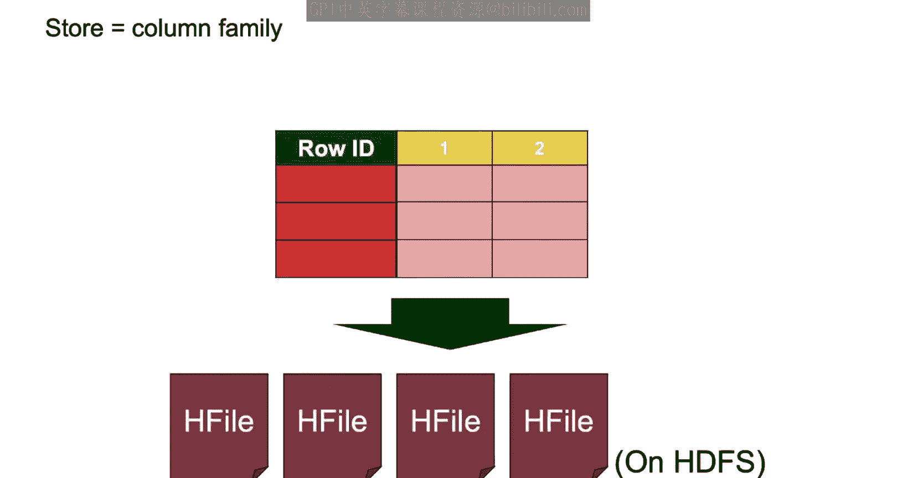

What happens is that this cells， the logical cells， right， this is what the user interacts with。

 but as you might imagine。😊。

All of these cells， they will be stored on HDFS。Now start on HGFS means that this will have to be files。

 right because HGFS only understands files， so it means we are going to store it in files on HGFS。

We are going to call these files H files， it's a specific file structure we call it an H file and this store right there is going to be persisted persisted means saved to this for the long term so it's persisted to HDGFS as one two or several H files like this okay so far I didn't say what's in the H files but that's the idea。

And then if we read back DH5s， we can reconstruct this specific。I was about to say table。

 but it's more like the stall， like just a sub table for that region in that current family。Okay。

Now let's zoom in for what we have in the H5s。

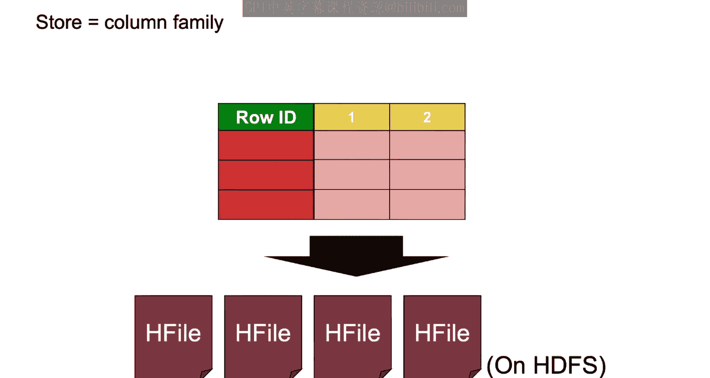

The way that this is done is that the logical table has these cells right in that case there are three rows and two columns so thats six cells。

 so I have six values to store。😊，And what I'm going to do is just like you play battleship， right。

 a1。Sunk and so on。 so you play battleship， you have these rows and columns identifier。 So a one。

 for example， that's the one。 and you just store them like in what order， yes， this this， this， this。

 this this So this then this then this then this then this then this and this is stored as a list of cells right you go from left to right and then top to bottom So physically the h file contains a list。

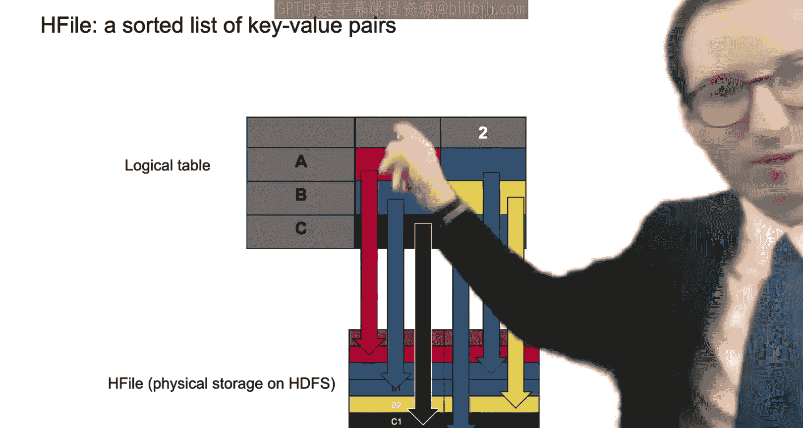

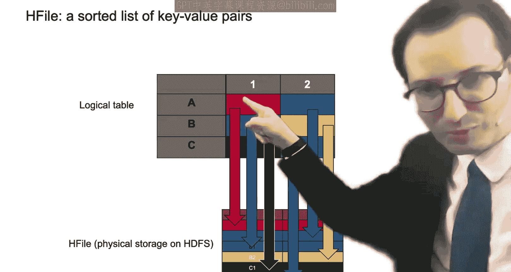

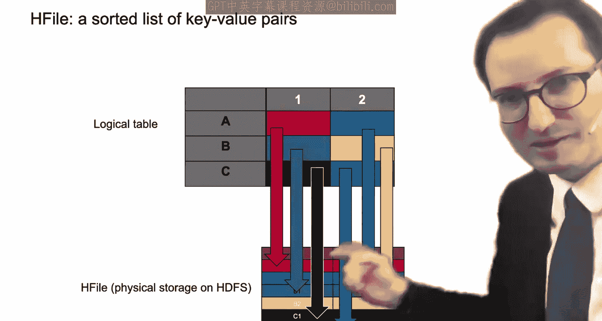

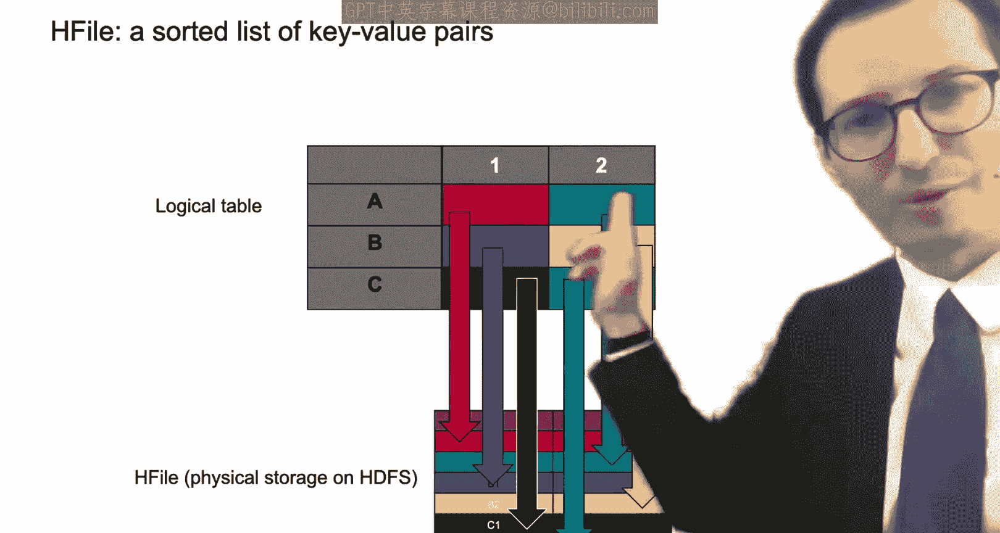

O search。诶。

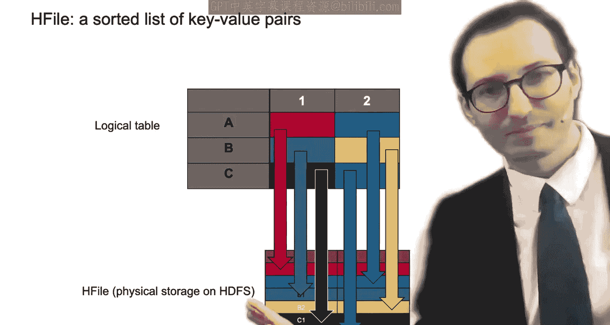

But there is one more thing before I let you go。Is that？Hbase supports versioning。

It means that if you modify a value， it's not going to get rid of the old one。

 it's going to remember the old one， so what it's doing is that there's version one。

 then you add a new version， there's a version two， then there's a version three， there's a version4。

So what's going to happen is that you create new versions， but you keep the old ones。

 so it means that in fact， if you look at D5s， it's not just that there is one value for every cell。

 you might have multiple values for the same cell。😊。

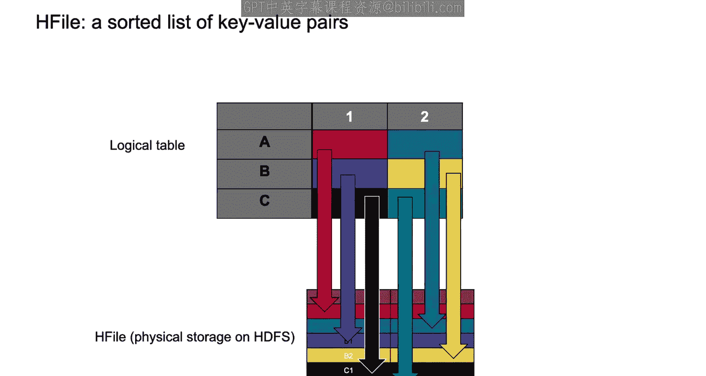

One of which is the latest1。

So what happens is that you have all the versions of the red cell， a1。

 then all the versions of the blue cell， A2， then all the versions of the purple cell B1。

 then all the versions of B2， all the versions of C1 all the versions of C2 and so on。

 and moreover the versions are reversed。

We start with the latest one and grow just like a resume right where you have your latest position first。

 and then you will go down。Okay。I'm going to stop here for today。 And then next week。

 we'll continue diving into the physical level。 But now， you know。

 we cut the big table like a wedding cage。 We have this。

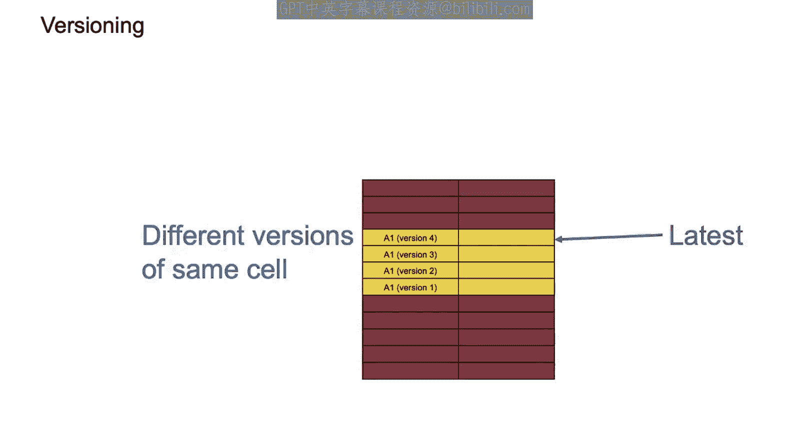

Sttors that we then store as lists of values。

So just to check。Oh， not that one that you've been following， I just want to make sure。

You still have。I mean。So while you write this path is complex。 You can ask questions on the mooder。

 you can write emails。 We will happily explain。 there's also the textbook that explains all of these things。

 And again， do not be worried。 I know that this and next week there's probably going to be more people in the 50 to 79% To normal do not worry about that right I just take。

The needed speed to go through all of that。Okay， so thank you very much， everybody。

 enjoyed the rest of your day， Enjoy the exercises and the weekly quizzes and I see you next Tuesday at 8 a。

 thank you very much。😊。

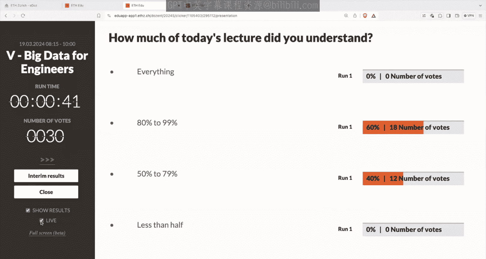