# 苏黎世联邦理工《工程师的大数据｜Big Data for Engineers - ETH Zurich - 2024》中英字幕 p13 6. Wide column stores (2_3) - .zh_en -BV17FAmeFE9K_p13-

Al right， welcome everybody in the lecture hall。 welcomecome everybody on Zoom。

 So today we are going to continue what we started last time with the white column star。

 namely H base， the open source version of the big table。😊，So this is where we left as a reminder。

 we have well a big table with a lot of rows can be billions of rows。

A lot of columns， it can be millions of columns。But it's sparse。

 There's a lot of sets that are actually empty， and the colons are grouped in colon families and the colon families are stored together。

 So as I said last time， it's like a wedding cake。 So we we cut in partitions horizontally and vertically horizontally。

 It's the the intervals of the rows that are called regions， right。

 These are contiguous sets of row with a mean inclusive and a max inclusive。

 And then that together with a colon family gives us what we call a store for the purpose of the of the physical layer。

 right， So we have plenty of these stars， it's really like a two dimensionmensal grid。

 as many stars as the combinations of the regions and colon families。 Then we saw that physically。😊。

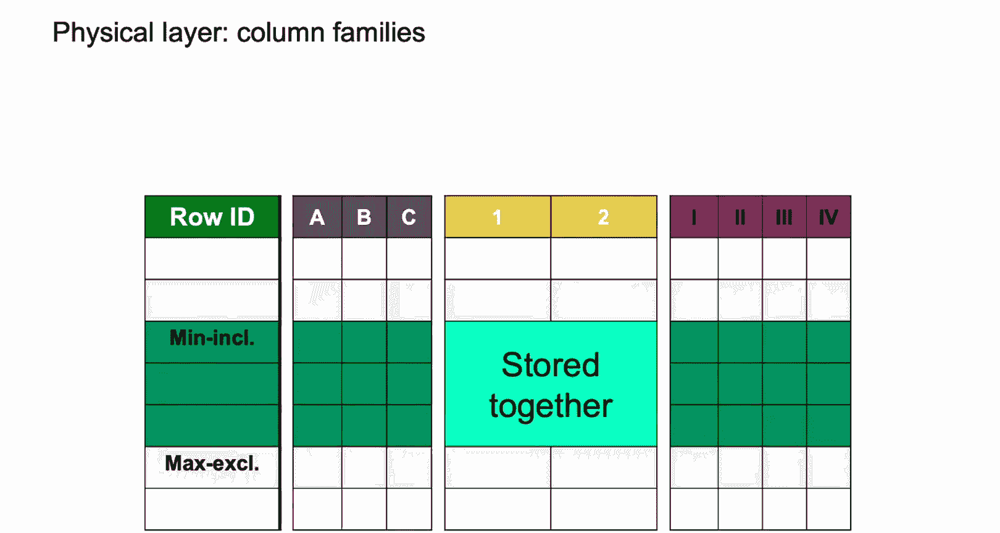

The way that the stores are stored on HDGFS。Is that we list the cells。 It's like the battleship game。

 So a 1， A 2， B，1， B 2， and so on。 And every time we have。

 we have on every row when technically on the physical layer。

 the way I put it on the slide is our row。 So every row has one cell， A1， A 2， B，1， B2， C1。

 C2 and so on。 right， So left to right and then top to bottom。😊，Moreover。

 we can have several versions of the same cell。 So here there's only one version right。

 but in general， we might have several versions of the same cell。

 So basically it means you have all the versions of cell A1 in descending order。

 the latest version first， then all the versions of cell A2。

 then all the versions of cell B1 then all the versions of cell B2 and so on。

 right So it means we first sort by rh I， then we sort by color name。

 the column family is the same within the store。 and then we sort in decreasing order of the versions right and then we just get a list of these values。

😊。

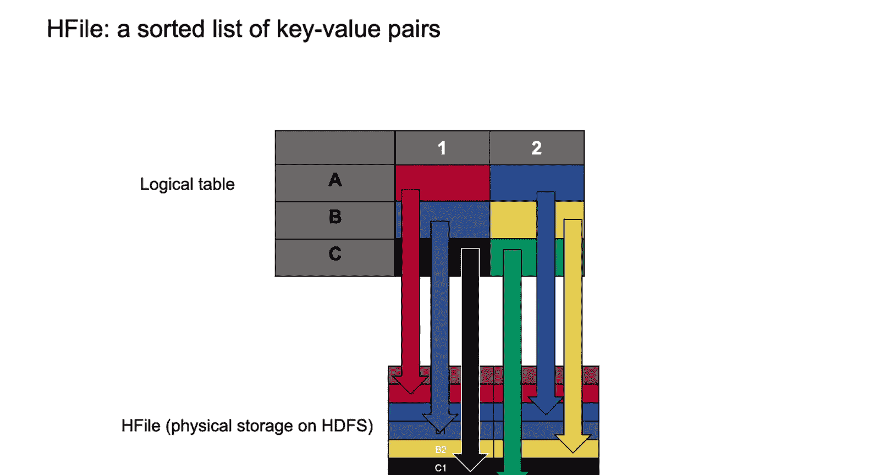

Something else that there's only one slide to quickly talk about that whenever you access the database system。

 there is the concept of atomicity， it means when multiple people are accessing the server。

 the database server， what happens， can they do things at the same time。😊。

Well in classical databases， like in the 1970s， we could make sure that two users do not access the database at the same time。

 right it's one after the other more exactly we can make it look like they are not accessing the database at the same time。

 there's ways to cheat about that， but basically it means that if at least connects to the database system and wants to modify something。

Then whoever else like Bob needs to wait until she's done until she can make make her changes。

 that's called a look。In big data systems， we are a bit more flexible than that。

 meaning that if a user tries to modify some data， this is not going to block the whole database。

 it's only going to block the row in which you are doing something。

 So if Alice is making an update to a specific row of the big table。

 then Bob would be able to make updates to another row of the same table。

 but just not at the same time the same right So we say that there is a lock and we say AC remember right the paradigm of radiational database systems atity consistency isolation durability we do that at the level of a row and not at the level of the whole table。

 it makes sense right because there are billions of rows。

 millions of columns that would be just impractical to block the entire table。Okay。嗯。

And this is where the versions come from， by the way。

 the fact that we have a linear list of versions， version one， version two。

 version three is before we make the user cu in this way that they wait for each other is like at the post office when there's only one shelter that is open so there is a specific sequence that wouldn't be true in general if we didn't have the look。

😊，All right， parente is close， this is just to say that they cannot update the same rule at the same time。

😊，So now one more step， when I listed these cells and all the versions of every cell， in fact。

 what I have listed on the physical level are called key values， yes， again， key values。

 just like the key value model。😊，So it's just in the end， when you store a store physically。

 it's a list of key values， what are the keys？Well。

 the keys are basically the raw ID and the column family and the column name and the version that together identifies the value and then the value is whatever you have in the cell right So in the end when you store the table。

 then you just list all of the values associated with the key that tells you where in the big table it's located。

But who is that clear。Butho is that here？Okay， awesome， so now I'm zooming in and don't be scared。

 These are more physical details。😊，If you actually look at the details of that key values。

 remember that on disk it will have to be zeros and onces。

 it always has to be zeros and ones in the end when you start on the disk I told you everything is binary in in this system so all even the raw IDs and the color names this is all sequences of bits and the same goes for the value。

😊，So， now。When we zoom in， we notice oh that's interesting。

 So we don't start just the key and the value， we also store the key length and the value length。

 What's that Well， the key length is just the number of bits that the key is made of and the value length is the number of bits that the value is made of right because that's variable right it could be any size the color name or the value could be maybe just the number it could be a huge Xml document right so the length here can vary。

Just imagine that this is the this is elastic， right， This can be larger or smaller here。

So the length of the key and the length of the value give us information so that we know exactly how many bits we are supposed to read to get the key and how many bits we are supposed to read to get the value。

 right？😊，In practice the key length and value length are given even in number of bytes not on bits so the bits are the zeros and ones and the bytes are groups of8 bits right so typically if you have an integer between 0 and 4 billion。

 then that takes 32 bits to start2 to the power of 32 is 4 billion。Roughly。

 and the number of B would be 32 divided by 8。 So 4 B。4 B is 32 B， okay。So we saw the length。 Now。

 here's a bit of why we need the length。 Because if I just give you the key with the value。

 you already know how many bits， right， But in practice。

We need to understand where the prefix code is。Now I will have to do a bit of history because now we have mobile phones。

 so the look and feel of making phone codes is different。

Who has ever made a phone call with a fixed online phone？Who never did a call with long line phones？

Some of you， okay， but if you do， if you try to call somebody with an online phone。

 you will notice something so first you you pick up。

 then there is this stone that it wasn't there at first in the history of phones。

 but then the ID to make clear that the line is working。It's an A。

 and then you start pressing the the keys， and this is actually sending a mix of two frequencies in in in this phone。

 So it's a mix one frequency for the row and one frequency for the column of your of your keypa。

But then as soon as you press a key， the tone stops because it knows you're starting to dial like0 and then44。

6，3，2，1，1，1，1 if you're coding EthH。😊，And then as long as you press the F9 keys， nothing happens。

Right。And when you press the 10th one， the one。Then， suddenly it dialing。How does it know。

 Because k does often have 10 digits， right？ but there are also the the emergency numbers that have only three and so on and so on。

 So how can the phone know that this is where it stops the the the dialing and that it can now dial the number。

This is because of a perfect code。And this is the magic。

 so here it's an example I'm not getting into the detail。

 but this is an example of prefix code that allows you to encode a sequence of integers。

 it's called the gamma code。😊，And it's done in such a way that if I just give you the sequence of zeros and ones right now。

 I have no idea where it starts and where it stops。

 right but somehow I have this magic code that you don't know to you don't need to know the details of that is's just to show you that just looking at that。

 I know that I that I need to read one more bit because there's one one before the zero then here looking at the number of ones I have。

😊，8 one。 So I need to read8 more bits。That gives me again。2 one。 So I need to read two more bits。

3 one。 So I need to read three more bits， So you see。

There are magical ways of cheating and telling you how many bits you will have to read。 In that case。

 the cheating is by putting plenty of ones followed by zero and the number of ones tells you how many more bits you need to read。

 So this is a trick。😊，Right。And in fact， this is called a prefix code when you can do that。

 and then it means that you can put these numbers one after the other withoutee separation and you are able to separate them back。

And， in fact， you can do it as an exercise size。Take a list of phone numbers。Random phone numbers。

 concatenate them without any spaces， just concatenation of phone numbers。

Even if you forget where the boundaries where， you can actually reconstruct the boundaries because the phone numbers are struck up in such a way that you are able to know where it stops。

 right？Because for example， emergency Nobel starts with a one。

 when it starts with zero and then another zero， you know it's international， if it's zero for4。

 you know it's Xuric and there's a few more and so on。So this is the ID。 Now。

 if I come back here of this。Key length， value length。 It's a cheat sheet that tells me， okay。

 that's how many bytes I need to read for the key。 And that's how many bytes I need to read for the video。

 okay。And again， that's because the key values are concatenated with each other。

 just like the example I give with phone numbers， and so that way you can read and pass back the key values to keys and two videos。

😊，Okay， so that's the trick。 Okay， that's the I D。And then if you zoom in so this is now inside the key。

 I zoomed inside the key and what do I see when I see not surprisingly。

 I told you what the key is made of right， there is the raw I， there is the colon family。

 there is the column name and there is the version right So it's not surprising that you see them here right There is the rh I right here。

 the colon family right here it would be the same photo the store the column name or quaifier right here and here that's the version with the timetamp it's all here right。

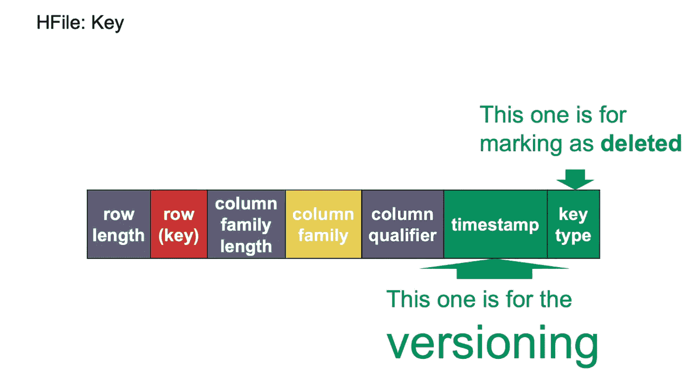

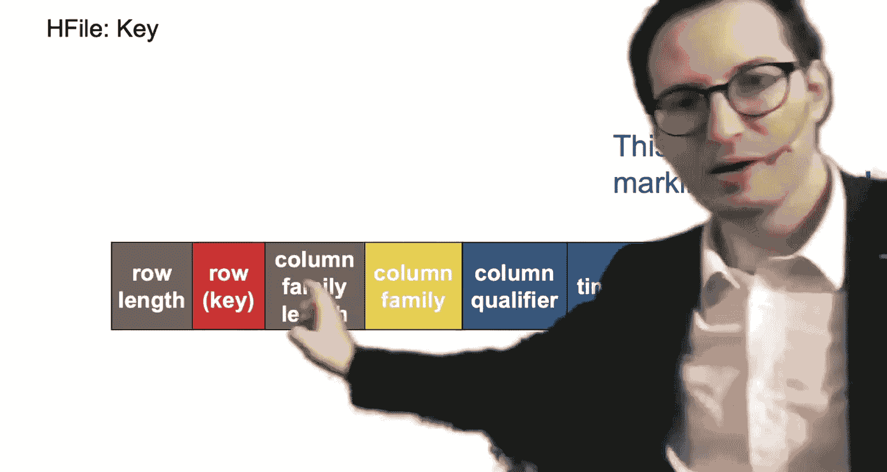

This here is an extra bit。 This is for marking deletions。

 If you delete a value in a versioning system， you don't actually delete it。

 You just mark it as delete it。It's like the the dustbin of of an operating system， right。

 You just just mark it as DDT。So righty， Col family， colon name， version。

 the four together give you the key。And now we need again， because the the size can varys elastic。

 so we need the length of the raw I that tells you how long this is。

 So now we know where to stop reading， then we have the length of the current family。

 then we know how many bytes to read here and we know where we stop。😊。

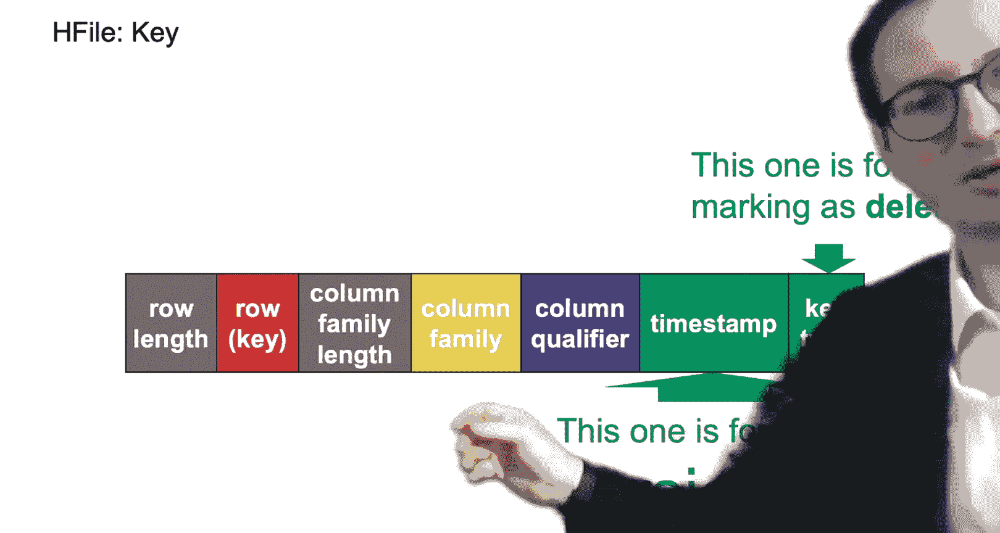

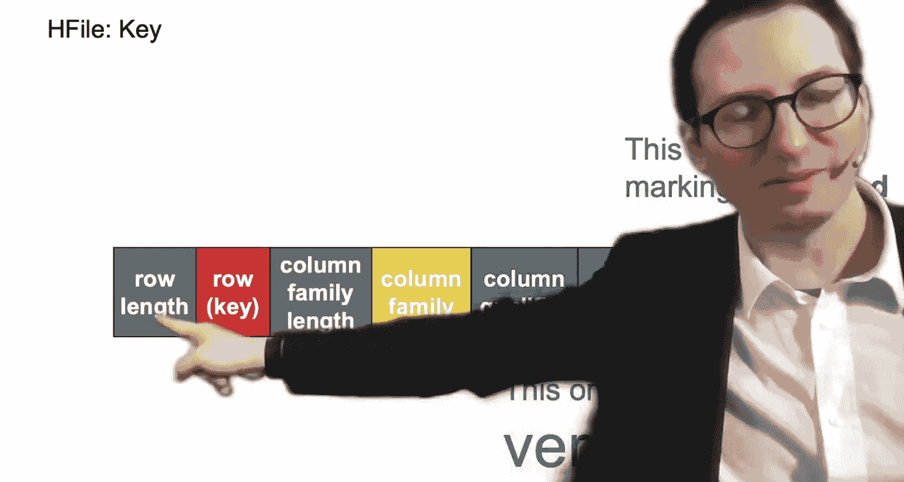

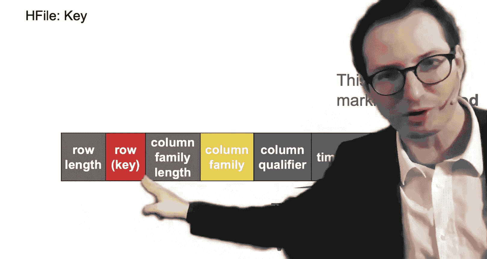

And then the time stamp， is's always 32 Bs that we know it's a fixed number of bits。

 This is exactly one bit or a fixed number of bits。 So we know as well， that is variable。

 How do I know how many bads they are in there。 How do I know where to stop here。

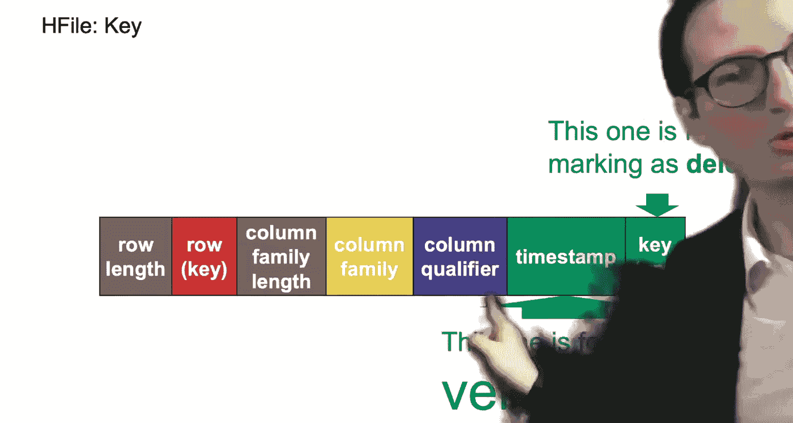

Because I don't have the column name length， right， I only have the Y D length。

 the current M D length， but I don't have the column name length。

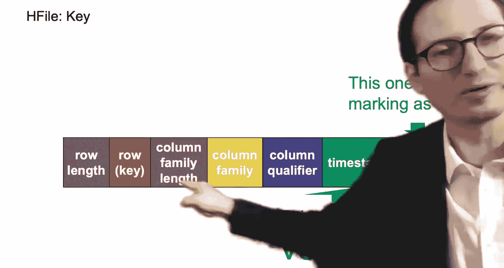

How can it be， How do we still know it， can we。Can we compute it in some way or can we infer it in some way。

How do I know how many bytes they are in the proper zone here， the current quaifier？So。

 the row length。Is always an integralteger on 32 B。 Do I read 32 B。 I have the rule， yes。Yes。

 a correct answer on the Zoom chat。いやあ、そうだ。玩 nursing events。嗯。Yep。Go ahead。And the key cabinets。Yes。

 so basically， this is the idea here。Remember that we also know。 I just need to rewind a bit。

 We also know the key length from outside， right， What you saw on the other side is just a zooming into the red zone。

 the key zone， right， But we know the key length。

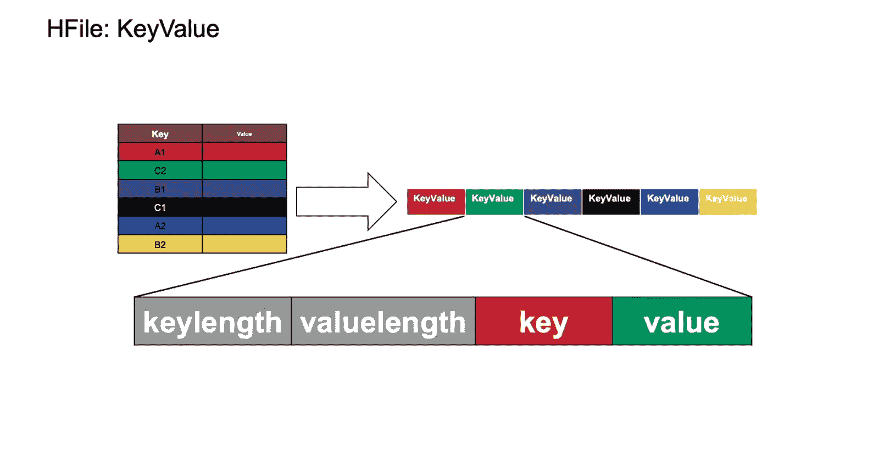

So what is the key length？That's the total size of all of that。 This is the key length。

 So because I read the key length before， I know how long this is in total。

 So I know how long this is。

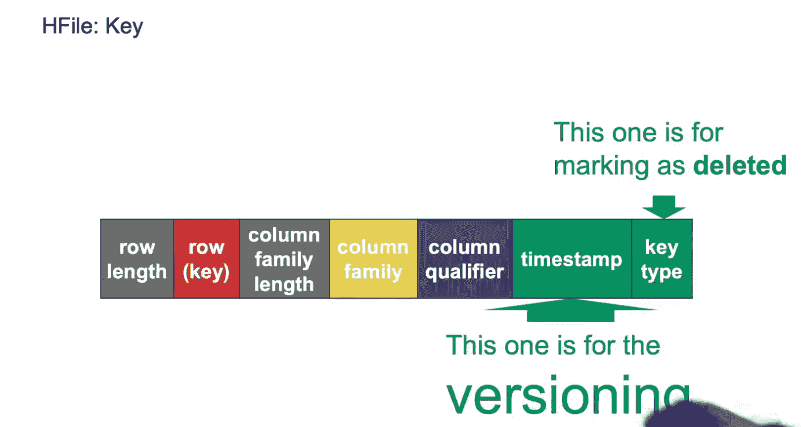

This is fixed， this I know from here， this is fixed， this I know from here， this is fixed。

 this is fixed， so it's just a subtraction。😡。

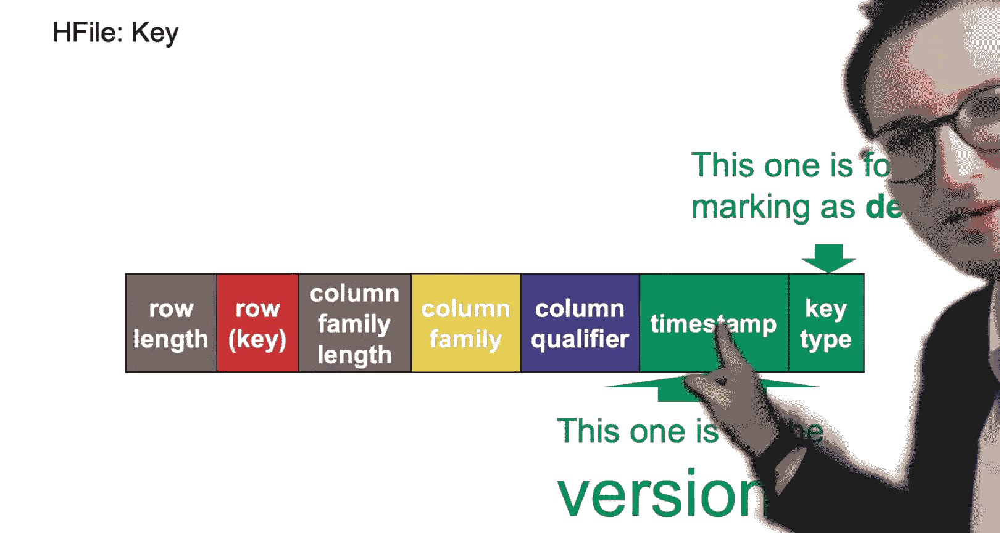

The key length， minus this， minus this， minus this， minus this， minus this。

 minus this length gives you what's right remained。 So you can save the column quaifier or length。

 You don't need to， to store because of that。 But Who is that here。😊。

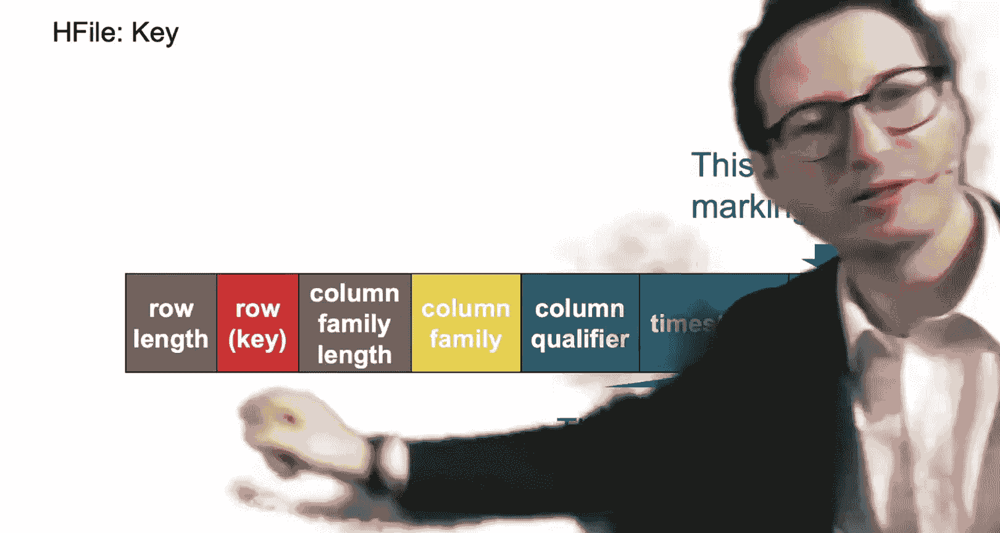

It's just a subtraction。Okay， so it's low level。 we are really talking about bits here。

 but this is kind of how it works right and in the end we just we just saw the key user one after the other like this and thanks to the magic of storing the length in there we know exactly when they start。

 we know exactly when they stop we know exactly when the already start and stop we know exactly when the colon families start and stop we know exactly when the colon qualifier start and stop thanks to the subtractions okay。

😊。

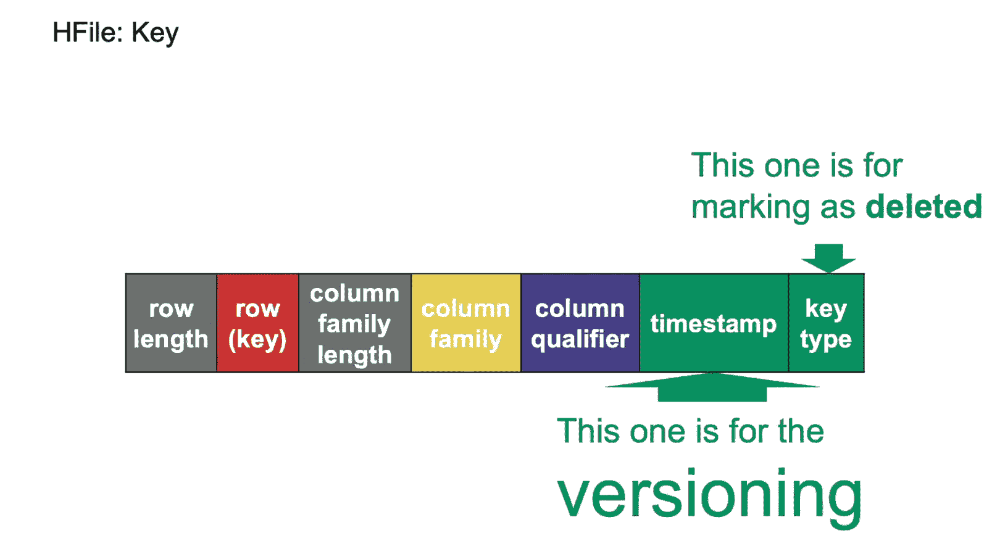

No， so。Physically。In a file， we will call them H files， right。

 So the all of these keyVus will go into the file on HGFS on H file。

It's just a huge list of key values really maybe I don't know1000， 100000。

 a medium key values like just a lot of key values concateated one after each other and and they are in an H file now if this is all you do and you store an H file as a sequence of key values and that's it imagine that they have a lot of them1000 and you need to locate one in the middle。

That's not going to be very convenient， right， because you have to go through them。

 Maybe you can save yourself some efforts with binary researchers like looking up in a dictionary。

 if the keys are ordered。But it still takes a while。 Plus it's on HGFS。 So any HGFS is even slow。

So we need to optimize a little bit and accelerate things。 and we are going to cheat again。

 We are going to use an index。So what we do？Is that these key values that are in the H file？

We are going to group them。In two blocks。However， I'm not going to say block。

 I'm going to be to say H block。 The reason is I don't want to to confuse them with H EFS blocks。

 When I say block， it's3 on H GFS block，1 and 28 MB。

But here we are talking about the different kind of blocks。

 This is blocks that are specific to h5his and to h base right And these blocks have a size of 64 kilobyte。

 This is the size of my blocks right， So again， it's not the same size because for HGFS it was 128 MBby here it's 64 kiloBte。

😊，Now there is a bit of a difference in HGFS the 128 mebyte is exact。

 you cut it exactly at 128 mebytes bam this is how you separate in HGFS right only the last block might be a bit shorter。

 but otherwise it's absolutely exact。😊，In an H file。

You don't cut exactly at 64 kilobys if the 64 kilobyte would cut a key value in then you you don't let that happen。

 you let the key value finish and then you finish the age block right so in practice the blocks。

 the H blocks are going to be larger than 64 kilobytes just because you wait for the last key value to stop right。

In fact， if one of the key values， the value contain an XM document of 10 megabytes。

 then your age block will be 10 megabytes， right if that actually happens。😊。

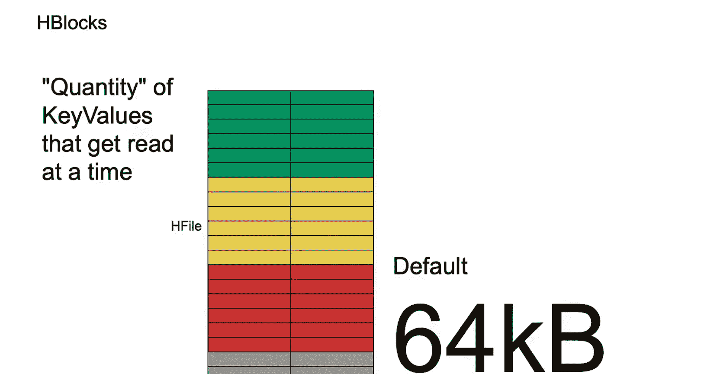

Okay， so this is just in order to organize things。 And what happens is that we have these cheat sheets on the left。

 it's an index that accelerates the lookup。😊，So。If I did not have anything。

The file would just be a list of key values and that's it。

 And then you would have to search like in a dictionary right because the key values are sort by key。

 So you would just go in the middle。 I it larger or smaller。

 and then you go here just like in a dictionary But this takes time Now what I'm doing is that I add some structure on the site that tells me this here is the first key of this H block。

 this here is the first key of that H block this is the first key of that H block。

 this is the first key of that H block Now you understand that this accelerates things because now if I'm looking for a specific key I can load that into memory。

 this is still on disk but that I can load into memory and now if I'm looking for example for key14。

 I don't need to look at that just yet， let me just look at this index here where is 14 when that's a much smaller on it's between 11 and 17 right So now I know that key14 is going to be in that zone right here So that accelerates the looker because now I can directly jump to that H block right there。

 So this。

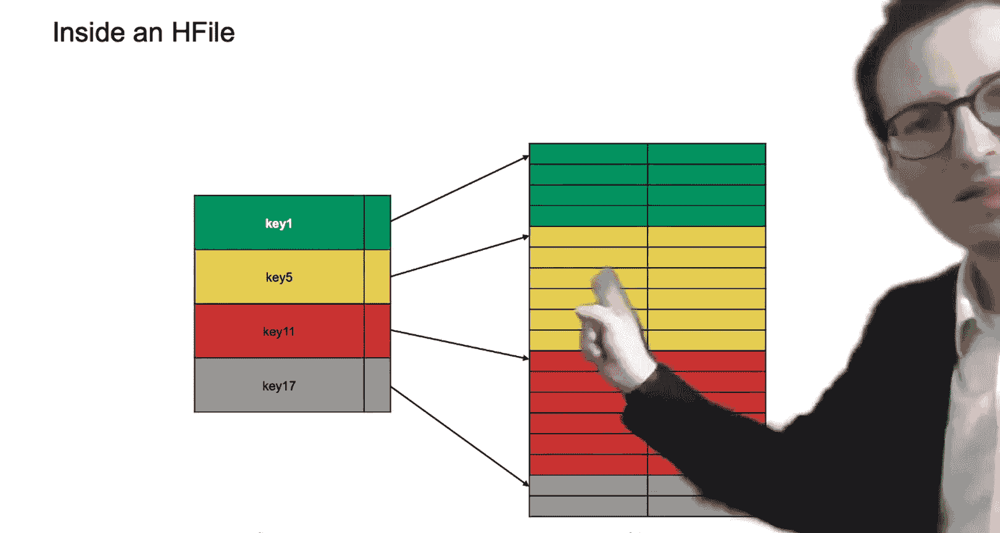

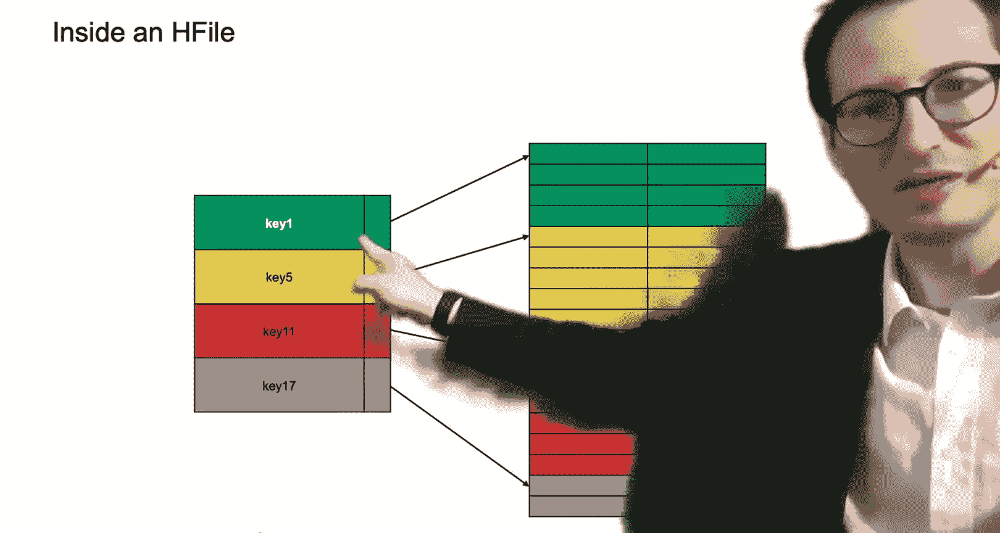

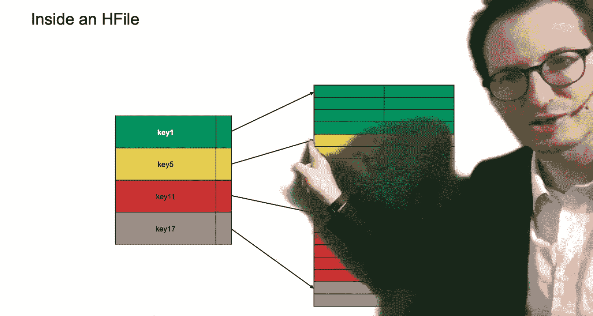

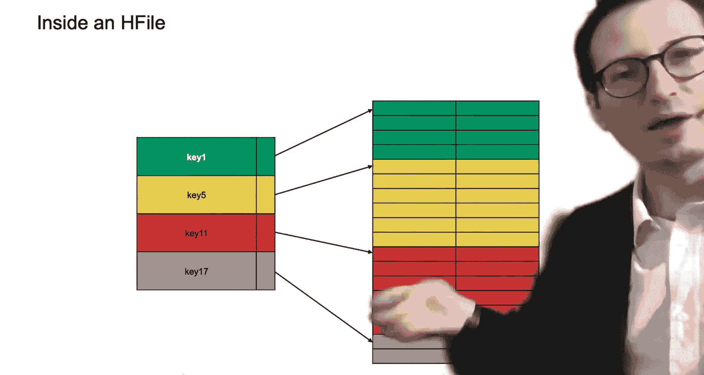

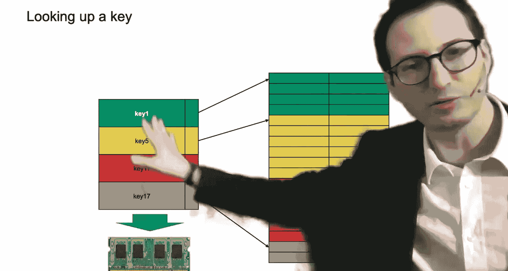

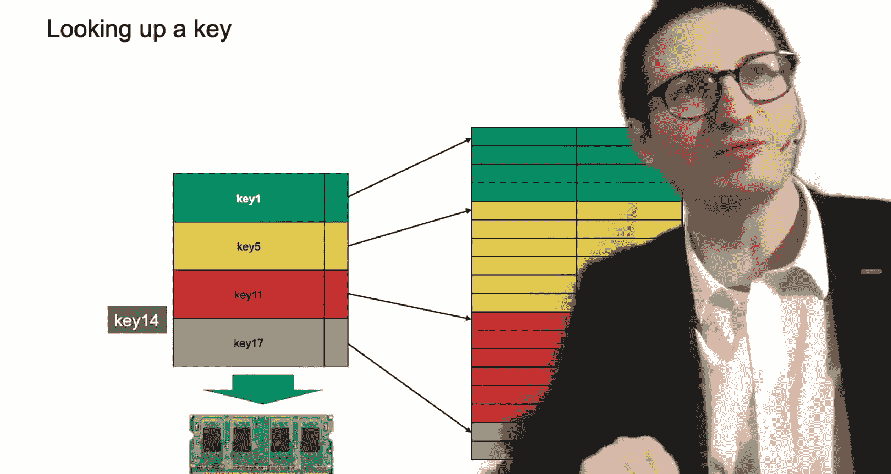

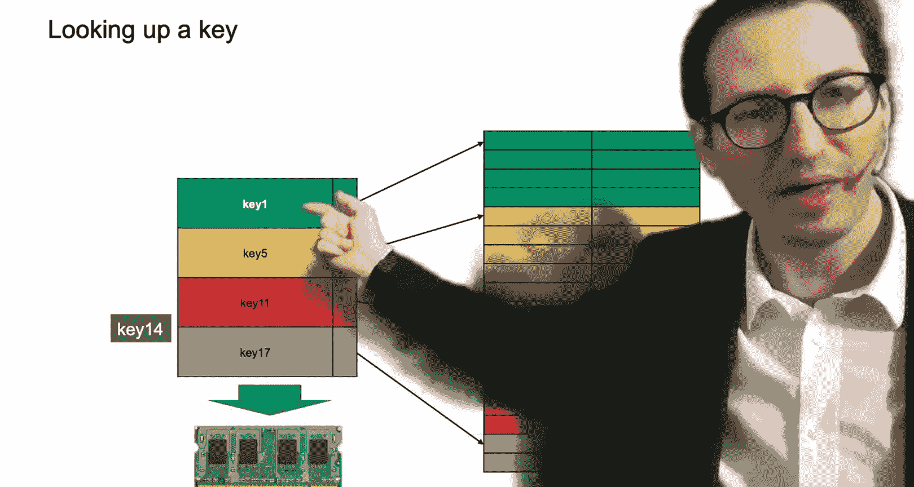

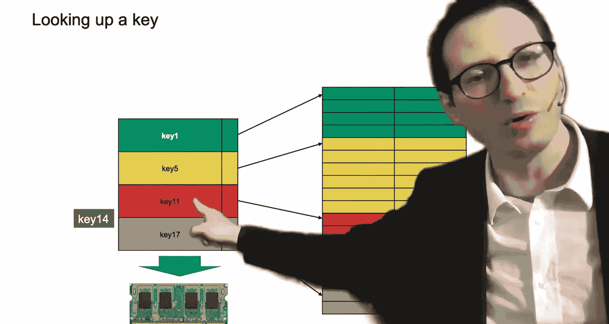

Allows me to specifically read what I'm interested in。

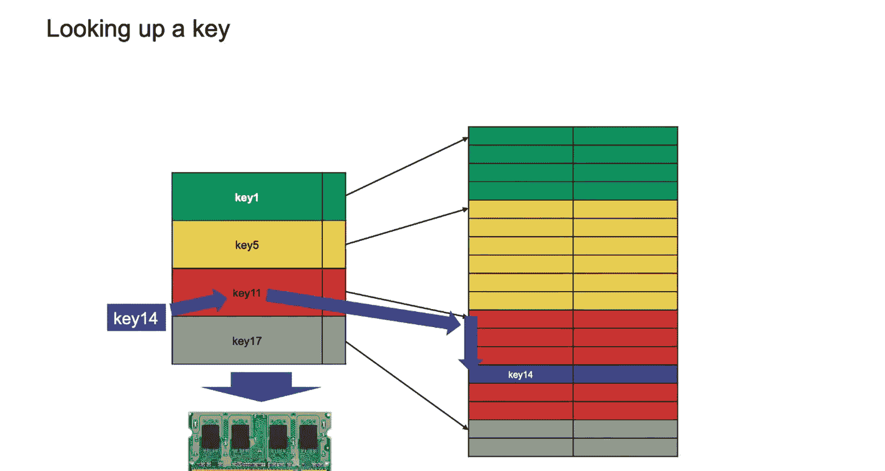

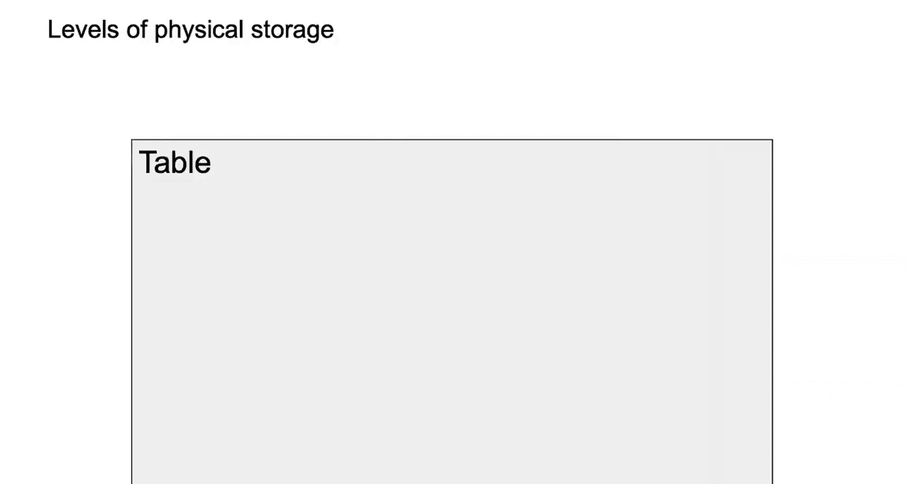

So， in summary。Just to make sure that you don't lose the big picture。

A big table is made of billions of rows and millions of columns。

The rows are partitioned horizontally in regions with the mean inclusive and max exclusive value。

And the currents are parted very quickly into current families and the intersection of one region of Rose and one Ko family gives you what we call a store。

And a store will be。Tisted to HSS as one or more H files。An H file。Is a sequence of key values。

 an order sequence of key values。 So it's ordered by key。Where the key is made of the raw ID。

 the column qualifier， the column name and the version， and that uniquely identifies the video。

And we saw that we smartly star the length just to know where the keyVU start and stop in order to read them back。

嗯。So down more to accelerate the lookup of a specific key value in that softed list of key values。

 we cheat and add an extra structure on the left that that accelerates the lookup by directly telling you where you need to look Okay。

 so this is in a sense， what happened， who is with me。

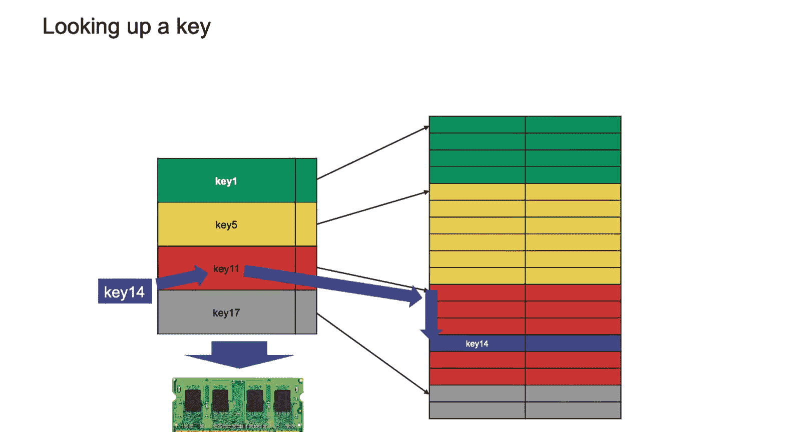

ok。Now。Let's look at the levels of physical storage。 Again。

 now this is a wrap up of all the levels that we have to consolidate that knowledge。

 So the highest possible level。Apart from the entire database， of course， is's that of a table。

 iss enormous table。 then the tables。Is partition horizontally in regions。

Then the regions are ped vertically again in stores。Right。

 so a table can have several regions as a region can have several stores， the stores。Ped to one。

 two or more H5s on H GFS。The H files consist of one or more H blocks， right。

 64 kilobytes or more because the H blocks elastically adapt to the last key value。

 they don't stop abroad click。AnH block is made of one or more。Yes， I hear it。 that were。

When I use exactly。 Thank you。 Yeah， exactly。 So these are older the levels。

 you see table region store H file， H block Ki， These are the physical equal level。 Of course。

 the user doesn't see that from outside。 you don't know。 This is really the the internals。

 the tricks physically how we store all of that okay。😊。

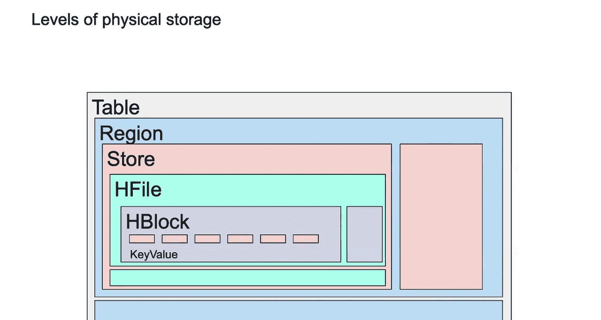

Soof。Now， let me bring you to the next engineering trip because these are really smart people。

 the team who design all of that。I'm going to give you a problem to think about。😡，Because。This here。

 this H file is a sorted list of key values sorted。

 so key1 key2 it's all sorted alphabettically or lehiographically first sorted by R ID。

 then sorted by current family， then sorted by current graifier then sorted decreasingly by version。

Now。This can be a problem because when we have a site like that's where the key videos are sorted。

Remember that it's best seen on H GFS， right？ So an HGFS。

The only thing I can do is write on new file。Or happened at the end of the file。

 What I cannot do is randomly modified the file。 I cannot just in the middle of the file other key imagine that I have to add well。

 okay， these are interiors。 So let me， let me say we have to add key 7。5 right， that's later。

 but key 7。5。 You would have to insert it between 7 and 8。But that you cannot do in H F S。

This is impossible。So what do we do because。Big table or H base。 they allow you to insert values。

 You can insert。 I showed you right getput delete scan。 So in H base。

 you can absolutely add new key values。😊，But does it mean that whenever you add a key value。

 you need to wait forever until the entire H5 gets rewritten to HF S， That would be super slow。

 right， So so this is kind of a mystery。 So how do we， how do we solve that。

 How can we insert new values into our table。In a way that we don't need to rewrite the entire RH file every single time we have to insert a KVU that would be highly inefficient。

 Who understands the problem。Right， okay。

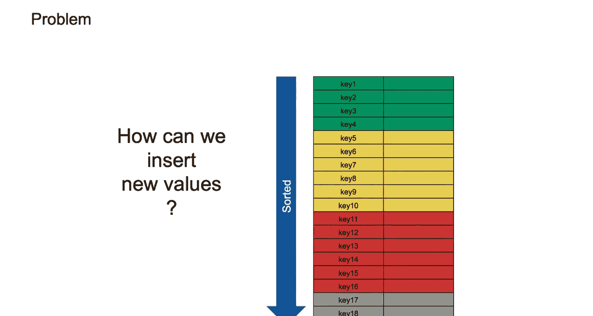

So it looks like complicated， but in fact， you will see it's beautiful。

 There is there is a trick that that's the engineering team thought of。

So this is what I've just shown you physically。😊，Now， just another review on this。

 what do we have on HFS。 Now you connect to HFS。 And you look， you will see that there are folders。

 of course， But inside there are these H files and inside the H files。

 you have the H blocks and the file。 but there are several H files for the same store， right。

Now the trick is this， that's the first part of the trick。The trick is。

The TV user are not all on the disk。More exactly。The fresh key video that I've just created very recently。

 let's say in the past hour。 In fact， they are not just yet under this。 They are in the memory。

 we call that the me store。😊，So these are all the fresh one on the top and what you see at the bottom is the older ones。

 the ones that are old enough that we actually persisted them to disk So in other words when somebody modifies a key value。

 I don't actually write anything to disk， I just accumulate the key values in the memory of my machine so the memory that's efficient right that I can I can put very quickly and access very quickly the key values。

Right， so now if I have a small animation for what is the what's happening， I have my main store。

 So let's say now the main store is empty， and I only have4y videos that are persisted on H DFS。

A user issues a put query and adds key values into the system or updates a key value。

 What we do is we put it in memory in the me store。

 So that's a new key value that was just freshly created。 He's another one。 Here's another one。 Oh。

 but now the memory is full。 So many people have been adding key values that now we cannot add anything more in memory。

What do we do。Well this is called plusing we flush all of the key values to disk what does it mean I need to sort them because here they are just in memory so let's sort them and once we sorted them we write them in the order in increasing order of keys so increasing raw ID increasing colon family increasing colon name and decreasing version。

😮，And that's it nicely organized in H blockss， right。

 But you see that from the point of view of HGFS， I just wrote one file in a single right and that I can do with HGFS。

 right I didn't try to modify with random access。😊。

So the trick is really that you sort and directly flush an entire H file in one single right on HGFS。

😊，Now， to be even more exact about the sorting。We could， of course。

 randomly accumulate the key values in memory without any specific order and then soft at the end。

But in fact， what the system does is that it keeps them ordered in memory。

 So we know in computer science， we have data structures。

 typically trees that can be used in order to preserve the order in real time in theme store。

 So technically we keep them ordered in the main store and when we flush them。

 we just it takes a linear time。 we go through them in the order in which they are and flush them to HFS。

 which you with me。It's very complex， I wonder it's probably the most complex lecture of the entire semester。

 so I really want to make sure that I drive you through this without losing you。

Now here's another problem。The other problem is。Since we do not store all of the keyV on disk。

 but only the older ones and the fresh ones we have them in the memory。

What happens if the computer crashes？Because if your computer crashes， the memory goes away。

 this is wiped out so you lose everything， so it means that if the computer crashes。

 we come to the question on the zoom chat， if the computer crashes。

 we would lose everything right there is a question on the Zoom chat。😊。

So let me answer this question here， so what happens？If服。😊，耳 key。Value， well the key already exists。

 there was already a value in a specific cell of the table and I want to update that value。

 I want to change it it was when and now I want it to be2。Well。

 remember that because I have a versioning system in place。

Updating what does it mean to really update the value。 What it really means is to add a new version。

 So maybe there was version three of the value that was set to one。

I'm going to create a version4 that is set to2 What does it mean my version three with the value of one stays there。

 it's still in there， maybe it's stored on HgFS， but what I will add into my ma store is a new version version4 that has the value2 right so this is the trick you don't delete anything ever you just keep adding new versions。

😊，RightWell， not ever you still delete them at some point and come back to that。

 but when you do add it， you just add a new version。In the strange world of versioning。

 updating a value really means you create a new version。

And deleting a value really means you create a new version that says it's deleted， right。

 So you you never ever modify or delete anything。 You just keep adding new versions。

 That's the trick。 Does it answer your question。But how do they keep the order？Oh。

 so the other of the physical files。Remember that when you flush it， it is adult。

And then we don't modify it ever again。😡，Right so within a file， once you've written it。

 you don't touch it， it's there， so it is ordered， so it means that within that H file is all it's ordered within that H file on the left it's also ordered within the name store。

 it's also ordered within each one of these units， it's ordered。

What happens is if you want to look up key you just look everywhere right So here there's no particular order。

 So here you have three places to look at the 2 h5s and domain store。

 but within each one of them it's all。But there is no order across them。

So you would need kind of to merge them if you wants to were。To have a global order， which we don't。

Does he don't answer your question。Yeah。Just to give you an example concretely。

 imagine that these are integrals。

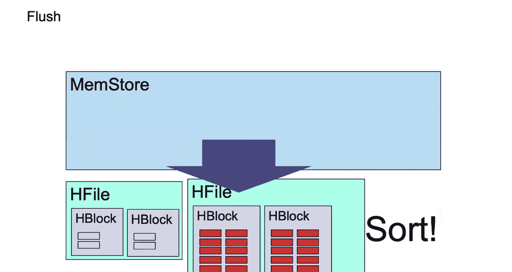

Imagine that here I could have。

One， four and7。Here I could have two， three。

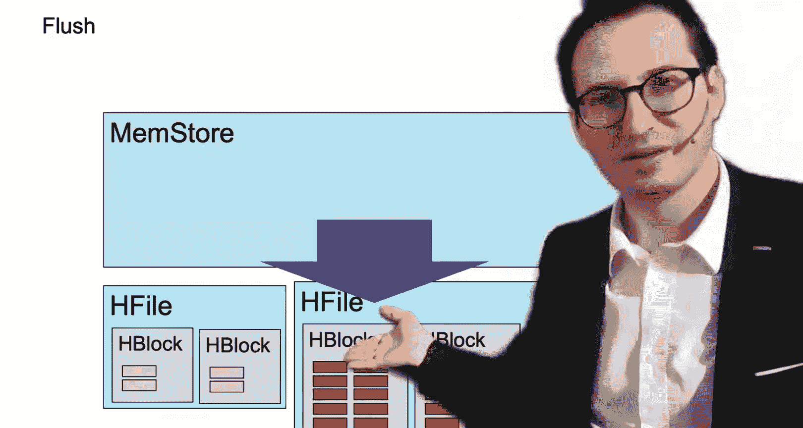

And 5。 And here I could have 6 and 8。Right，So it's all out within here。 it's all out within here。

 It's all out within here。 But here there is no specific order。 It's already intertwined， right。

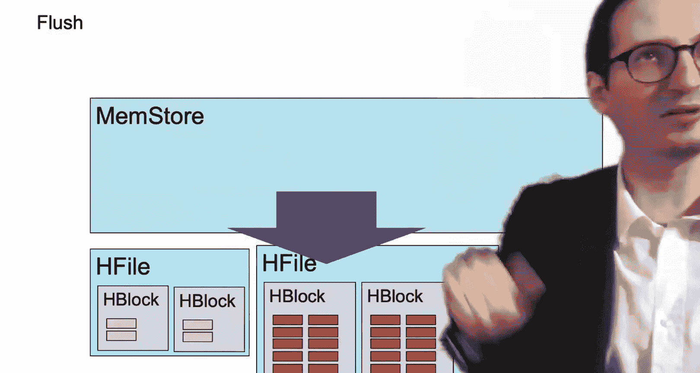

That谢 you。Okay。Now what about this electricity problem， I lose the electricity or there is a crash。

 the machine crashes， do we really have to lose all of the fresh key values the users would not be very happy right？

😊，So there is a trick that we have that's called a writer head log。

The writer head log is the journal just like when you're in a sheep and the captain keeps a journal。

 so you keep a log of all the incoming updates， so whenever the user adds a new key value。

The first thing you do before even putting it in the mem store is you log it in the journalgle。

In the order of arrival， right， So it means that we have an HFS a file called an H log。

That keeps track of all the keyv news you add。But in the order of arrival。

 they are not sorted by key in the log， they are sorted in order of arrival。And。The reason it works。

😮，Is that in HFS。I can modify a file， but I can append at the end of a file。

So if I can append at the end of the file， it means that I can keep app the new TVVUs that arrive since。

😊，It's the order of arrival。 So the new ones always come at the end so that I can do in A GFS。

 I can keep app to the H log。😊，Since the H log is persisted on HGFS that I would not lose if there is an electricity shortage。

 right， So once I have appended the Q value U to the H log， then I can put it in the in the M store。

 So there is one on HGFS1 power region server， even across multiple stores。😊。

And then I add it to the me store， right。Now， if we run out of electricity or there is a crash， yes。

 we lose what there is in the main store， but we still have it in the H log。

 so what I do in that is I just take the H log。I restocked them by key and then put them back in the main store。

 so I didn't lose anything。So again， I insist in the main store and ETH in the H strides。

 the key values are sorted by key。In the H log， the key values are sorted by the order of arrival。

 the time of arrival。Okay， which is why we can defend？Allright， and then。Once we have that。

 the idea is that。We need to figure out when to flashing。

 remember is when we copy over the entire content of the store to a new H file。So we can say。

 for example， when there is a maximum size。😊，In the me stuff， for example。

 I can say on the scale of the cluster。 if I have more than。

I don't know one terabytes worth of heavy in my main store across the entire cluster， then I flash。

 that can be one design decision。Or I can do it at the size of one machine， if on one machine I have。

 let's say more than a gigabyte worth of key videos in my name store， then I flash。

Or I could also do it based on the writer head log so the writer head log is the H log here。

 I could also say okay my log now is now too big so that could also trigger a flush right？

And once I have flushed， I can delete the H log， I don't care anymore， right because it's in theH。

Okay， so this is when to decide when to flush。Okay。

So now I have an animation on what happens if we want to read。

 so imagine I'm in the middle of the usage of the cluster， I have already persisted2H files to disk。

And I have more fresh key values in the me store。 I didn't put the H log。

 but it's somewhere there at some other place。 Now， if I want to read key values。

Because I have a query in cominging and let's say the user is looking for a specific interval of keys。

 right a specific interval of raw IDs for a specific current family， we need to find them。😊。

Where do we look？The user wants to query to look up a specific key or a specific raw ID， let's say。

Where do we need to look。Onzm。Well the answer is everywhere because we don't know could be in the H file could be in the main store could be anywhere。

 so we just need to look everywhere。 So we look， maybe there are some in the H file on the left。

 maybe there are some in the H on the right using these inds that I told you about maybe there are some in the me store but since it's in the memory and I told you it's preD easy to find and then I gather all of these key values that I found that all of these places and now I can give back to the user or whom does that make sense。

Who understand that we need to look everywhere。could be anywhere， we have no idea， could be fresh。

 could be old if you query a， you have no idea how old it is， right。😊，So we look very well。Now。

 the problem of looking everywhere is that if you let your system evolve for days， for weeks。

 per month。😡，What if you end up with， imagine you flush， I don't know every two hours you flush。

Then after one day you have 12 H5s after a month， you have three。got360 H5his and so on and so on。

 right， So that that's a run of h fileshis。 So you just keep accumulating new H filess。

 So imagine that at some point， you have 10000 H phis。

 And now there is an incoming inquiry you need to look at the name store。

 and at each one of the 10000 H filess that cannot be that's too slow。 That is inracical。

 So we need to find another trick to basically avoid that the number of H5his grows too much。Yes。

Also， the it。No， we don't need that because the H log has exactly the same content as the M store。

 right， The H log is the same as the M store。 It's just that it's basically on a GFS in order of arrival。

 So this is why we don't need to look at the at the the H log when we look up。It's a application。给。

Yeah， you'll wake up。So imagine we have flushed a lot of H files and we have too many of them。

 what can we do， we can do what's called the compaction。

 a compaction means let's say we want to compact these three H files。

 we can in fact merge them to a new bigger H file。RightRemember that within each one of these。

 the key user sort is， but across these， there could be it to index this， right？So。

We can just merge them in a larger soed list of key values and then write back as a new H files to A GFS。

 So I had three H files。I write a compacted version that is a larger merged H file。

 and I can delete the other three。 right， This is called compaction。

How long do you think that takes the compaction？So。Who is familiar with algorithmic complexity。

So who is not at all familiar with algorithmic complexity？Okay， I'm going to quickly explain。😊。

The algorithmic complexity is the vocabulary read that the computer scientists have。😊。

And the idea is that when you have an algorithm， which is a ECP for solving a problem。

And you increase the size of the problem。For example， the problem could be a puzzle。

 imagine that you have a puzzle with 100 pieces。You know how to solve read then you have another puzzle with 1000 pieces。

 maybe you have another puzzle with 5000 pieces， how much more time does it take actually to actually reassemble the puzzle？

😊，Well了。One of the ways could be what we call linear， it means that if the puzzle is twice as large。

 then it takes me twice as much time right This is called linear right So if I take an hour to assemble a puzzle of 100 pieces。

 then I'm going to need 10 hours to assemble a puzzle of 1000 pieces right This is called linear。

Then there is the complexity that is constant。Imagine that I'm a magician。

 I just snapped my fingers to assemble the puzzle。The puzzle has 100 pieces。 I snap my fingers。

 It's assembled。 The puzzle has 100 pieces。 I snap my fingers， It's assembled same amount of time。

 This is called constant time， or also known as O of when， O of n for linearR， O of1 or constants。😊。

嗯。Then there is another kind of complexity that's called exponential。We are very scared of that one。

 computer science。Exponential basically means that every time you add a piece。Its let's say。

 doubles the whole time。Imagine I have 100 pieces。 It takes me one hour。

101 pieces takes me two hours，1032。Now I already does100 pieces take me one hour and how add 1 pieces。

2 hours，102 pieces takes me four hours，103 pieces take me8 hours。 every time I add a PC it doubles。

 This is very scary。 we dislike that in computer science and yet there are problems that work like that。

 for example， when you have to to decompose an integer into prime factors。

 This is very hard and it doesn't scale in that way。

 it's exponential in the in the the number of bits。😊，So this is what cryptography is， in fact。

 based on， because it's as soon as you make the problem size bigger， it doubles every time。

 So it's impractical。 This is called exponential。And there is a f when。 there's many of them。

 but just the basic， there is a f one that's called logariththmic。

Loarith think is the opposite of that。 It means that every time you double the size of the problem。

 it adds a constant amount of time。 So in terms of my preserve。

 it would basically means that you have a preserve of 100 pieces that you solve in one hour。

200 pieces， you can solve it in one hour and 30 minutes， 400 PC， you can solve it in two hours。

 800 PC， you can solve it in two hours and 30 minutes， 1600 pieces。

 you can solve it in three hours and so on and so on every time you double the puzzle。

 it adds a constant amount of time。This is called logarithmic。So all of one， all of log N， all of N。

 O of。Exponential of end So this is。Basically， how computer scientists measure the efficiency of an implementation。

No。The thing is， when you want to sort。Soing in the meme store。Is a bit worse than linear。

 It means that sorting if you have a problem size of n。😡，Technically。

 sorting the key values if you have N key values takes n log N。

 we already knew that the N log n for sorting。Maybe some of you are already familiar。 So basically。

 it's more than linear。 It's a bit more than linear。But the thing is。

When we want to merge these H filess， you might think， okay。

 the worst case that would be N log n because we need to sort。But。

The H files here are already presented within H file， so in fact。

 the time it takes to merge these H files is linear。So if I have n key values in all of these files。

 the time it takes me to compact them to a larger one is in fact proportional to n as well。

So this is considered quite good for a computer scientist right and in fact。

 you cannot do better than that because even just writing the H file would any way be theyR because you need to write one by one the key so you can anyway not do better than that so this is highly efficient Okay so that was a small prime on algorithmic complexity when or when of algorithmic complexity。

Okay。

Now， the way that。Computer scientists think about these things is that they have structures that they call B plus trees and LSM trees。

 B plus trees will see them in a couple of weeks when we look into inds for MongoDb for example。

 so I leave them assign B for very popular in the database systems of a small scale right when you have the data on a single machine。

 you store the data in trees like that。But in big data systems， we use a technique called LSM trees。

 it means log structure me trees sounds very complex， but in fact。

 I already explained it kind of the components to you because I tell you what flush is about and what compact is about and in fact an LSM tree is just a protocol that says when you flush and when you compact that's pretty much what it is So after all a break because now we should take a break because it's nine。

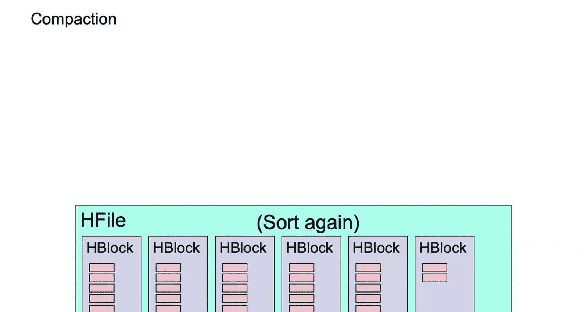

I will go into this idea of the LSM and again to make it simple。

 this is just about when do we flush and when do we compact in order to keep the performance of age base optimal。

 okay。😊，So thank you very much for your attention， I'd see you in a quarter of an hour right after the break to continue。

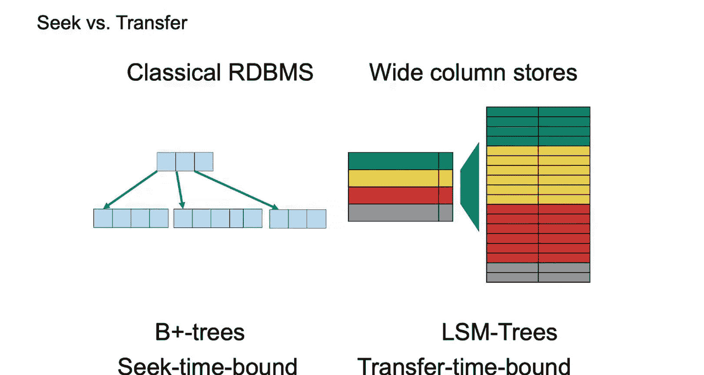