# 苏黎世联邦理工《工程师的大数据｜Big Data for Engineers - ETH Zurich - 2024》中英字幕 p14 6. Wide column stores (3_3) - .zh_en -BV17FAmeFE9K_p14-

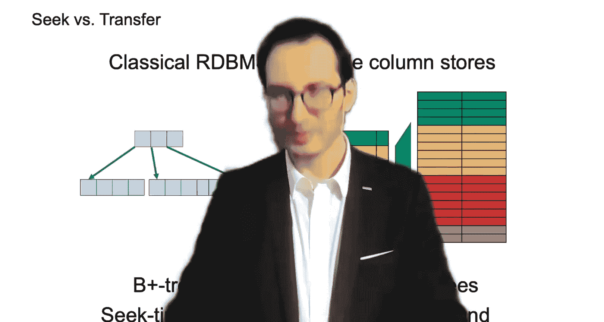

Welcome back everybody， so let's continue， let me tell you how we flush and compact because there is a specific order in which you can do that it's not arbitrary and this is the beauty of the design right？

😊。

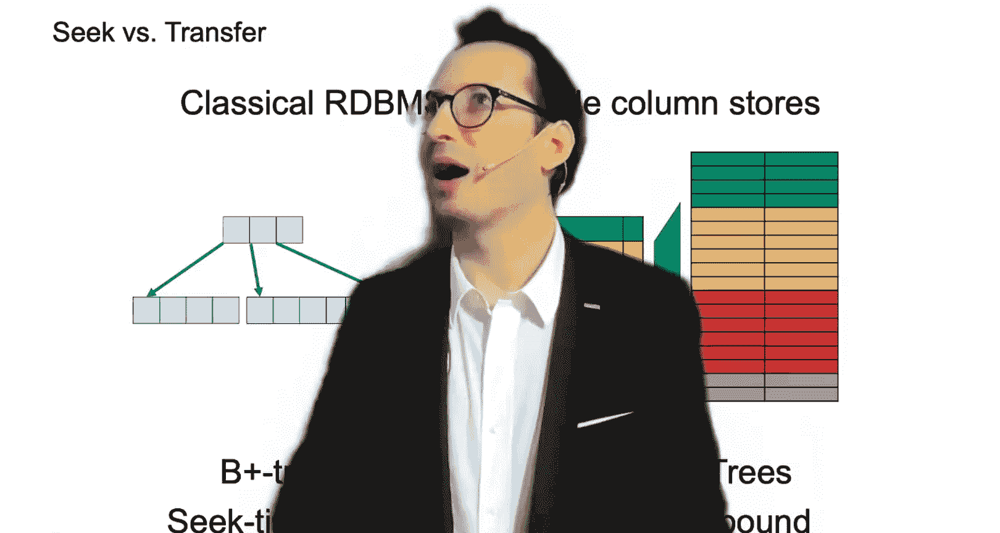

So。Just to also clarify what I mean with Si time bounds and frommp start time bounds。

Do you remember at the beginning of the lecture， I told you about capacity throughput and latency。

 right， said that capacity improved by an absolutely gigantic factor。

And then trans time improved also， but by less， and then Latin C improved in the sense that it decreased by even less。

So basically， when you have a system。I'll come back to it in a few weeks。

 It usually has a bottleneck somewhere， something that keeps it low or or slows it down。

And in these kind of systems， where you have to access data。

You have two possibilities when it comes to reading from this， it could be。

Lats hebound or transfer bound。Seek time is just the same as Latin。

Latency bound means that you basically spend most of your time waiting。

 It's like being in a military， right， So you just spend your time waiting。

 you ask for something and then you need to wait until it comes and then you ask for something else。

 and then you need to wait again。Transfer time bound is that you spend your time downloading things。

 The bits are dancing around and flowing around。 And this is what happens most of the time。

 Then it's limited by the speed at which you can transfer。And basically。

 when you have a B plus tree in a traditional class classical database related database management system。

 the B plus trees are optimized for an environment in which you spend most of your time waiting。

 and the log structures mail trees are optimized for an environment in which you spend most of your time transport transporting bits around。

 which typically， in the case of big data is what happens。 You， you do want to optimize。😊。

By making the bits dense instead of constantly waiting for them right， That's the high level idea。

 All right， Apprenicees closed。 the idea is that in each base， we don't want to be bound by Latin C。

 but we really want to to move data around。

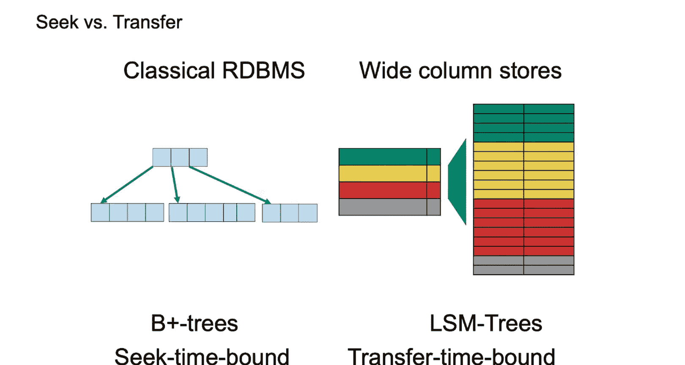

So。What happens in the case of a lock structure shell nuies， notry？Is that you have multiple levels。

Of data storage。

She's going to make the toolbar go away the lecture hole。

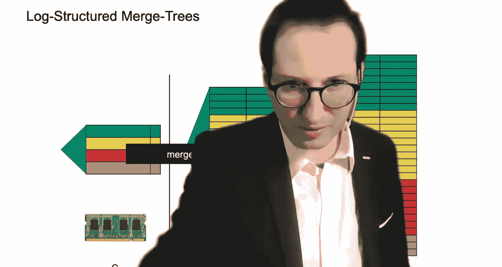

There you go。So C，0， C，1， C，2。The first level is the memory。

 this is the fresh preciouss key values that you can ever think of。

 they've just been created and they are in your memory， then you have level C1。😊。

Level C1 is what has been flushed to disk。Right it's been long enough。

 the memory was full and you flashed it to disk。Level 2 is what was compacted。 It was。

 it has been flushed， but after other flash， you even merge several eight filess into a larger one。

 This is level C2。 And in fact， it continues。 You have C 3， C 4。

 You just keep compacting and compacting and compacting in fewer larger H by。😊，Now。

 do you understand the intuition why I'm saying all of that？😮。

Is transfer time bounce because what do we spend our time doing。

 we spend our time flushing and compacting and this is something that where the beats are transferred。

 you're not waiting for it to happen you're waiting for a very small amount of time and then once you flush and once you come back。

 it's basically driven by the number of beats that you need to transfer。Right。😊。

So this is the idea of a large structure of mesh trees。

 but I need to make you understand why log in such a way。

So I prepared an animation because I think it's the best way to actually understand what's going on and I'm just going to show you the life cycle of an age based store where the key videos are added in memory constantly and then at some point we flush and at some point we compact and at some point we flush and at some point we compact。

 but just how this is all orchestrated。I don't include the H log， but again。

 it's em like whenever something reaches the domain store， it's also put in the H log。All right。

 so imagine that I directly have these seven key values they were freshly created。😊。

And add it to the mem store。 There's nothing on this yet。

 This is a brand new table that I have just created。

 And now there are  seven values that are in the in the in the table。Now it's full， so what do I do？

What do I do by it when the main story is full。Flulash yes exactly we flush， so we flush to1 H file。

Again， this is linear time because it was already presented in memory in some tree structure。

 so I just linearly go keyV by key value traversing in the order of key and flashing that into anH file。

 creating theH blocks and so on and so on but I don't put theH blocks in there on my slide。

Note that when I do that， I also get rid of the H log。

 I don't need the H log anymore because now it's safely persisted to HDFS in the H5。

 so I don't have the risk anymore of losing them。 So the H log goes away。Okay。

 but the users keep using the system and now have even more key values that come in there。

 It could be new values in new Is。 It could be new values in an existing row I。

 It could be that I delete some values。 it could be that I update some value。 but as I said earlier。

 every time you just create new versions。 So we keep accumulating new key values in the main store。

 And again， it's very important。 the H file does not change。

 It's constant it's not even modified or touched。 We read from it maybe to self queries。

 but we don't touch it。So now， the main store。Is full So we。That has to be automatic。 Yes， we flush。

 The main story is full。 So we flush。 So I create a second H file。 So now for my example。

 I'm going to take two as the as the as the trigger。 right， you don't have doesn't have to be2。

 but let's take two。 So let's decide that two H file is too much。😊。

So what do I do if I consider that having 2H5 is too much？😊，哎。I think I hear it， yes。Compact exactly。

 I compact them into exactly merge。 That's what compacting is about。 I merge it。

 I compact it into one larger h5。 Now， roughly this is just in terms of intuition。

 These two h files will be roughly the same size because that's the size of the full memory basically。

 And now I have one h5 that I created by compacting by emerging。

 that is roughly twice as large as my original ones， right， it's like one plus one gives you to。

 right， So I merge them into one larger h5。 I have fewer larger H files。😊，So。Now。

 the user continues to use my system。 So what do I do when the memory is full？Fluush。

 now it's automatic。 very good。 So I flush。 now have a new H find。 But again。

 that's the size of corresponding to a full memory。

 So that's half of the one that I already had in here。😊。

And this is fine because they are not of the same generation， right？On the left。

 this is level C 1 and on the right， this is level C 2。So I'm fine with that。

 and I accept at most when I H file per level。The memory is， again， full。 so I。Thank you。 I flash。

And then I get a second H file。So what do I do because I have two of them？😊，Come back。

 and now I have two h5s。 that's too much， so I。Come back again。 And now I'm at C 3。 I'm at level 3。

 Now I have an H5 that is even twice as loud。 So now it's four times as loud as a full memory。

 See the idea。 Now I have this loud H5。 So we here we are level C 3。😊，Now the memory is full。

 so I flush。The Mariners who against why flash。 We have two H fights。 That's too much。 So we。Nels。

 we come back to we melt， yeah。The memory is full。 so I。

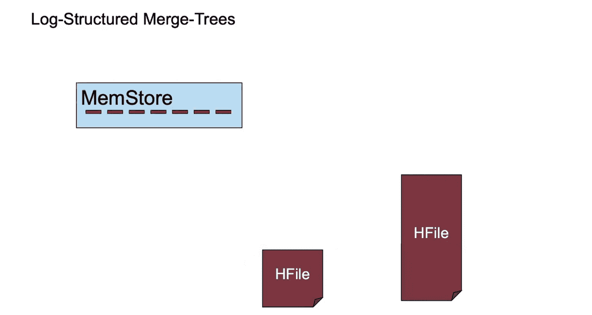

Flulash。The memory is full， so I flash， now it's too much。 and so you get the idea， right。

 I just keep flashing whenever the memory is full and whenever the number of each file on a specific level is too high。

 I merge them just for the purpose of my slides， I consider that two was too high。

 but in practice you could also consider that a higher number is too high。😊。

Now I would like you to see something in there that I'm not sure if you actually noticed。

Who knows how to contain these， too。Okay， who knows how to count in base 10？Okay， so。

Base 2 is the same。 you just like0，1，1，0，1，1，1，0，0，1，0，1，1，1，0，1，1，1，1，0，0，0。

 and so on it's just like base 10， except that you have only two digits instead of10。

Who noticed that we've just counted in days2， we saw it。

Some of you yeah indeed you might have noticed you just have to mirror the whole thing because when you write the numbers we write from left to right so the hundreds and then the tens and then the units here you just need to mirror thing so let me show it to you then you will hopefully have these aha moments。

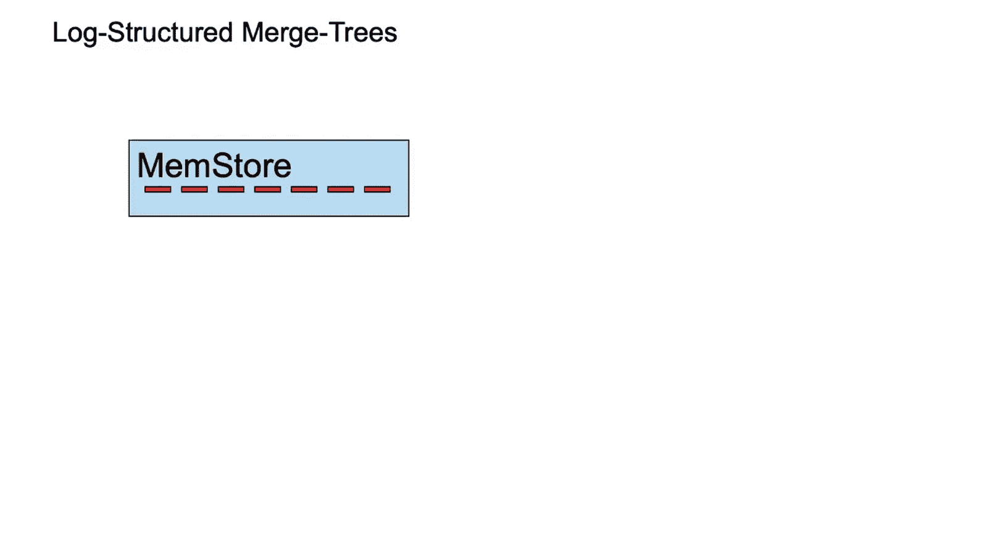

So this is 0， right，0，0，0， This is1，0，0，1。 So this is one。

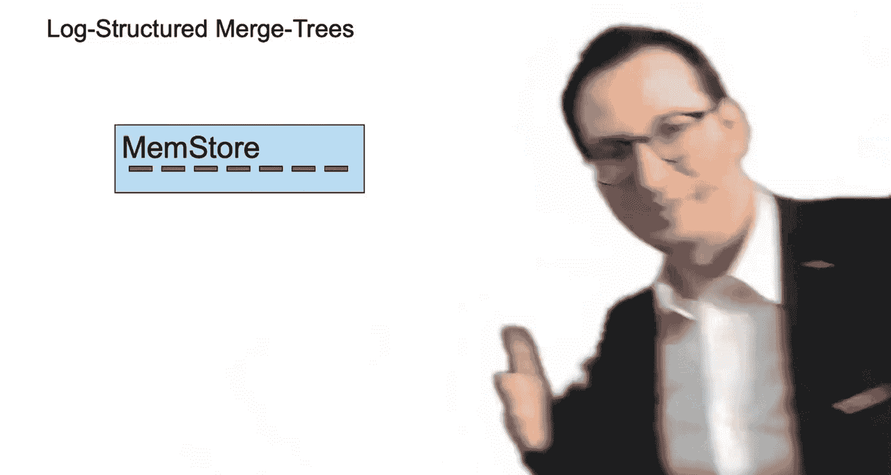

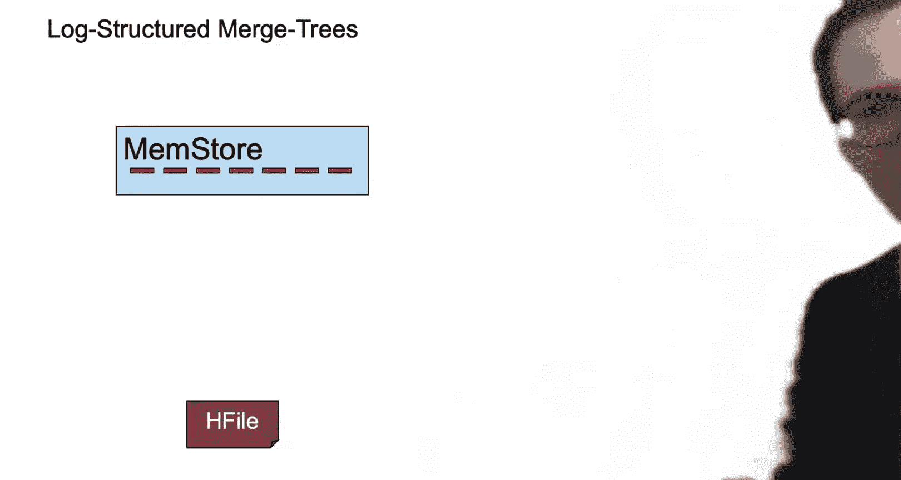

This is1，0 corresponds to 2， right， So1，0。

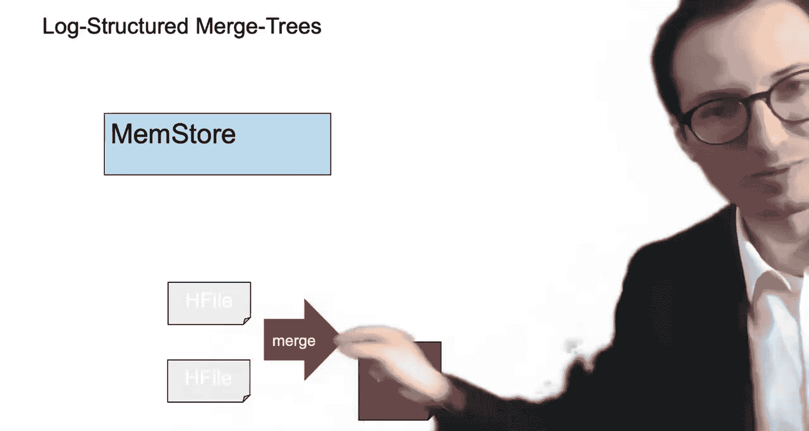

This is when， when。Correspons to3 in baseline1。

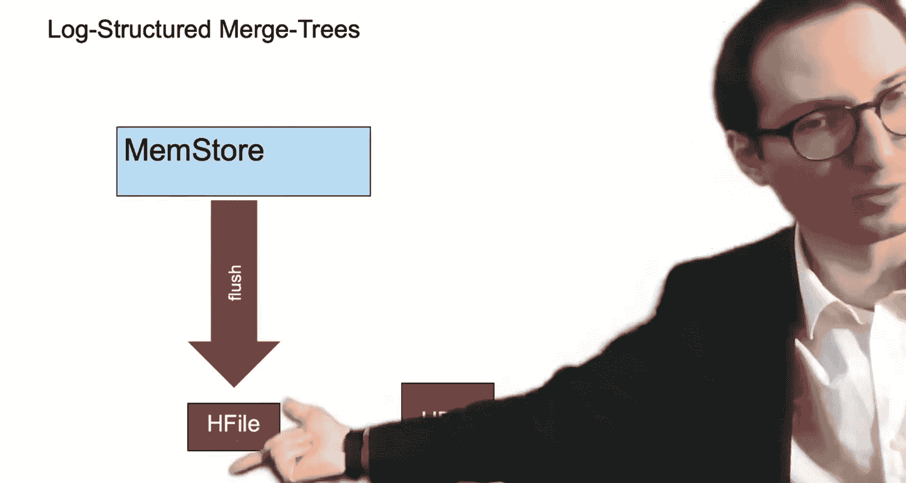

This is 10，0 corresponds to4。

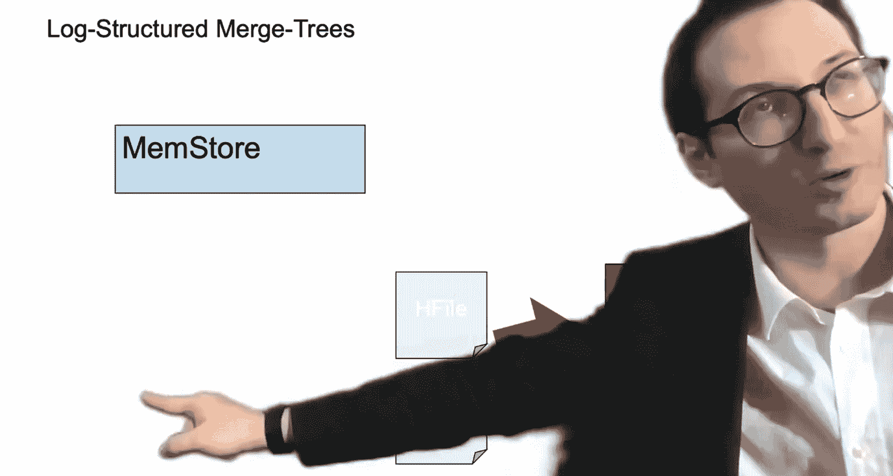

This is 1，0，1 corresponds to5。This is 1，1，0 corresponds to6， and this is 1，1，1 corresponds to 7。

 and so on and so on。 So in fact， this whole cycle corresponds to count in base 2。Yes， we have。

 Maybe we can。We have the microphone。Just for the people on Zoom tour who hear you over there。

I just had a question in real life， how many of these H filess are there actually before compacting I this always two as well or so two is from my slides。

 it's just an exemption from my side in practice it it can be a higher number。

 It also doesn't have to be exact right， You can have different rules or different heuristics。

But what happens is always this idea of having these levels from left to right that becomes fewer and larger right on the left you have the most recent H5s that have smaller and that may be a lot of them and then you push them to the next level that will become loud and then push again larger and larger。

😊，I did it in base2。 You could do it in base 3 in base 4 in any basis you want。

 You could also do it not in a specific basis， but based on other rules。

 like the total size in by over a lever or something like that right But I want to communicate here is this idea that we have these lever that we push to the the data as it gets older。

 Does it make sense。行。Okay。Now， the way to think about it is really。That。

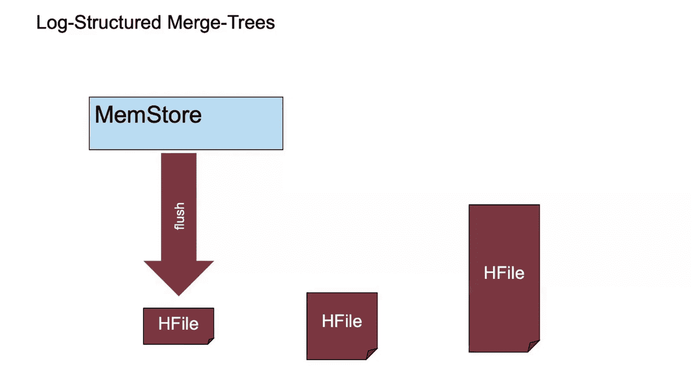

like the super fresh data that've just arrived， this is the more recent data， this is a bit older。

 this is a bit older and so on， and I like to joke about that the more you go there you might even find dinosaurs that actually are millions of years old since there were so many compactions right so this is the idea。

😊。

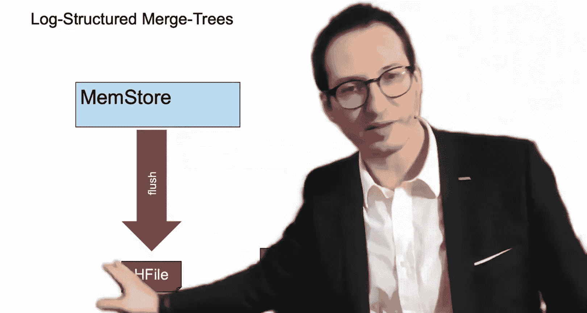

And now you should go back。What I showed you here， in fact this is this here is what we had right I have the me store in C0。

 I have the smaller h5s on C1， the the twice as large h5 is on C2 and then twice as large on C3 and so on who's with me。

😊。

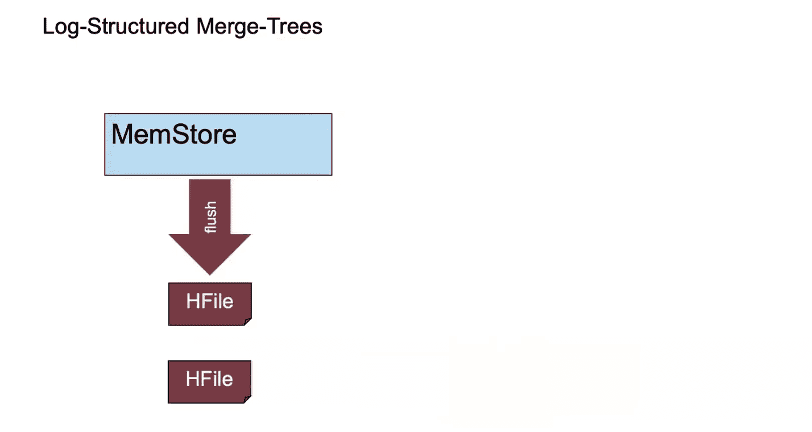

Right。

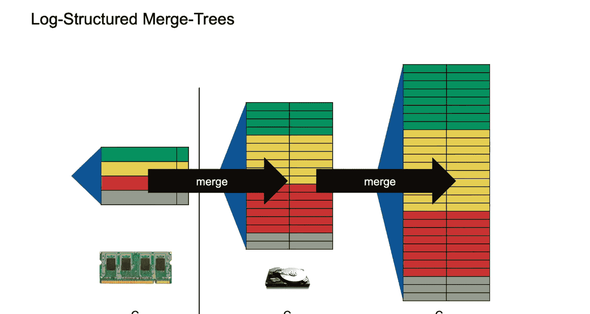

Now， not this idea of flushing and compacting in this way is really， really， really efficient。

 It's much more efficient than to just flush and then at some point have a million H vis。

Because the fact that you double every time basically keeps it logarithmic。

This is the reason it's called log structured nurse trees。 It's log for logariththmics。RightThey。

Okay。All right。So that was my animation。

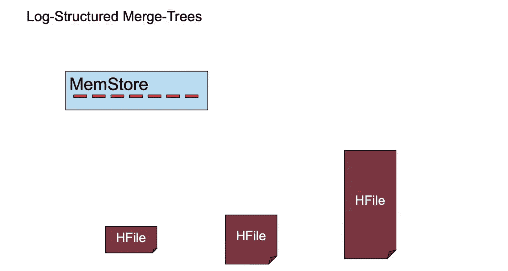

嗯。

You would be able to do it in base three if you wanted to do it in base three。So of you， it's。

 you flush， you flush， then you compact， you flush， you flush， then you compact， you flush。

 you flush， then you compact， then you compact again， you flush， you flush， you compact， you flush。

 you flush， you compact， you flush， you flush， you compact and you compact again and so on and so on。

 right， just go to you compact when there are three on the same level rather than two。

ok。Now there's a few other tricks and optimizations that I'm just going to go quickly over this in the main store。

😊，I only have the fresh key values that are very recent， and these are not persisted in any H device。

 This is why we have them in the H log， just in case。But in memory， I could also。

Have what I call a cash。A cacheache is basically some other place in memory where I also have key values but these key values are in fact copies of the key values that are on disk some of them。

 it could be those that I accessed recently， it could be those that I access often so that I don't need to read them from disk and so on so this is called the cache again underfended difference the me store are those that are very fresh and not in Hfi the cache is only a copy and a applicationplication of some of those that are in H filess just to avoid reading them from disk right the least recently used or the most often used and so on。

😊。

Okay， there are cases where the cache is totally useless。😊，For example。

 if you have a user that scans through the entire table and is going to read all the key videos one by one。

 it's totally useless to keep a cache of key values because you're gonna read every single one of them just once anyway the cache is only useful if you are going to read several times the same key value then it's useful because in memory it's much faster and there is this idea that if it was recently used。

 maybe it's more likely that you would access it again or you can keep track of how often you use them。

 So what we call batch processing is really this idea we have what we will see after Easter break with mapre and spark we might aggregate across the entire table then the cache is totally useless。

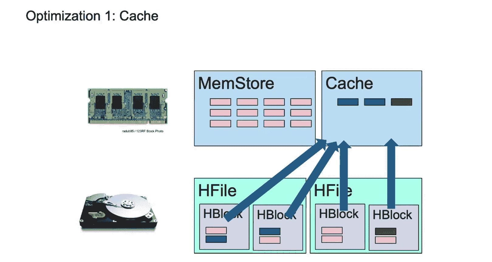

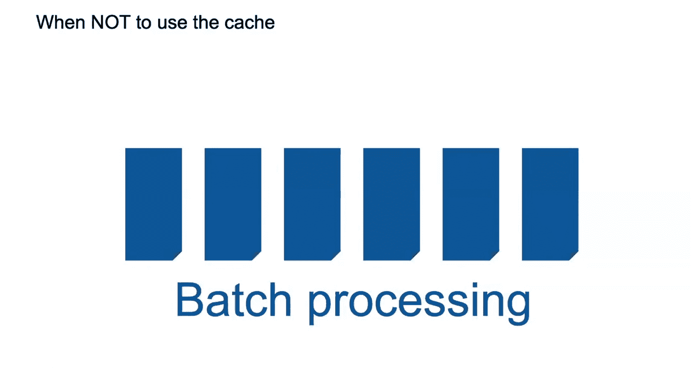

Another case where the cache is totally useless less is if you access the data completely randomly and unpredictably。

Then the casual doesn't bring you anything because then you cannot predict。

I'll know in advance what what values you're going to access， okay。

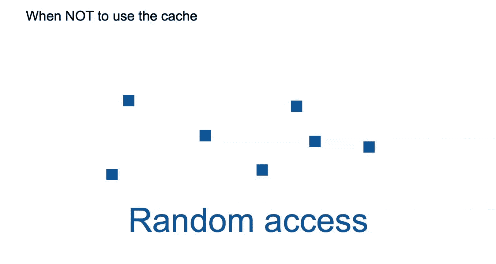

All right。There is another optimization。 This actually is a beautiful optimization。

 I don't know if the T is plan to put it in the exercise。

 Maybe we usually do it also in the master's version for computer scientist。

 but maybe it could be interesting for you as well to look into it。 It's called the Blo filter。😊，嗯。

The idea is this。Once I have used my system a lot and flushed and compacted my H files a lot。

 at some point I'm going to have a lot of H files。A lot。

 reasonably a lot because of the LSM tree is going to be logarithmic， but can still be a lot。Now。

You remember that when the user looks up。Specific row I or data for a specific row I and column。

Where do we need to look？Everywhere， right， everywhere。 So if I have 1000 H files。

 then I have to look into 1000 H files。This trick here， the room filter。

Is a way to not have to look into every one of the data files。

Because imagine that I have some insider information。That tells me for this age file。

 I know that I will not find anything in there， then I don't need to even bother reading it。

And the difference with insider trading is that that kind of insider information in big data we love to use is is totally useful because you save yourself the time。

😊，So imagine that you're looking for a specific key。

And you have the information from some magical algorithm that tells you the grade H5hi here。

 the grade I H5his， the three of them。😊，You know that you will not find these key values in there。

 then you can read all the other ones， but you can skip these three。

s a trick that actually makes it fast。Is that you can only be sure in one direction but not the other。

 What do I mean with that。If I tell you。Oh sure。The key is not to be found anywhere in this file or D file or D file。

 This is 1000 certain。 right if I tell you it's not there， then it's not there。

But it's not true the other way around， the other way around， the other files。

It may or may not be there。 I cannot guarantee you it will。

 I just cannot tell you it will not right So the idea is that either for the great ones。

 I tell you it's certainly not there or for the other ones。 I tell you it could be there。

 Maybe maybe not。 I don't know but you need to look right So it's only half half the direction。

 And this is called。ABlo filter。 for sure you can say okay。

 A key is not contained in a file so you can skip it。 and maybe it is contained in a file。

 Then you need to look at it。 Maybe you're gonna be lurky and find a key。

 Maybe you're not going to be lurky。 Then you just read the H file phone， nothing thing， right。

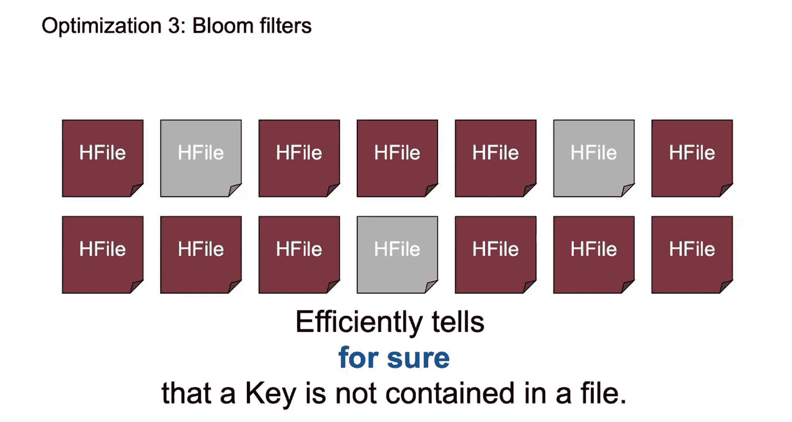

Okay。Another slide， and again these I keep very， very high level and quick。How do we know？Which。

Regions are where on what server and how the table is actually partitioned in regions That needs to be stopped somewhere。

 right， We need to have it somewhere。And that somewhere is what we call the meta table。

 We have a special table that's called the meta table。

 That table is just a list of older the regions and with information about， for example。

 this region is for that table from that row ID to that row ID and it is storedd on machine number 10 for example and so this is called the meta table and thanks to the meta table you know where to look so for example。

 for creating editing updating tables you need to connect to the H master it's the same I as connecting to the name node for HgfS when you want to create a delete directories and if you want to read a specific region or a specific key。

😊，Then you don't know which region have to ask right because right now today we looked at a single store or so we knew the region。

 but in general there could be 1000 regions， So what does the client do it connects to the one machine that is known to be hosting the meta information。

 the meta table and it's going to to ask that machine okay I'm looking for that key what region is it in and what machine has the region and then the machine on so okay it's located on machine number 10 which is responsible to that region and then you can connect to the machine。

And again， remember that the region sell us。They have the responsibility of one or more regions。

 and this means the clients connect to them for that specific region。

 right it's a responsibility key thing。Okay。😊，In terms of APIs。It's always the same for many systems。

 You can access it in many ways。Programming programmatically。

 you can write some computer code that connects via an API an application programming interface。😊。

That can be Java， Python， C plus+ and so on right So in that case。

 Hbase is written in Java just like HDFS case， so you can actually access with Java。 by the way。

 you know that API at some point became a buzz world in the business world just like blockchain or AI or machine learning at some point I remember in some meetings with business people。

 it's API API API like API is really a big thing now but anyway。

 so these are APIs to connect to So Java， the programming language。Rest， I told you about it。

 Rest is a way to access a system via H T TP。 It's like going to a website。

 But instead of being a human talking to a machine， it's a machine talking to a machine。

So it goes over HTTP the nice thing about rest is that once you have a rest API in place you can very easily implement API in any language you want。

 you just build it on top of the rest API and wrap it into Python wrap it into R into any language you want so rest is kind of the universal interface to any programming language if you want。

😊，Okay。Then you also have a shell， you can also open a shell and directly type in there your queries。

 I think in the exercises were even encouraged to do this。呃，有。Okay， so this is how to use it。

Now I have a few words to make you think really， because we've seen that HDGFS is how we store the files and the blocks and the H files are actually HDGFS files。

 the H log is an HDGFS file。And I told you about the H blocks that are these groups of key values of P 64 kilobyte。

 I told you carefully it's not the same thing as HDGFS blocks。

 So what about HGFS blocks let's think now about the HDGFS blocks and data locality。😊。

Remember that the idea when I say the name node， the data node， the H master， the region serverr。

When you talk a bit casual about the system， you kind of identify the machine with this world。

 when you say the data node， you mean the machine that has the data node when you say the region serverr。

 you mean the machine that has the region serverr， but this is a bit imprecise What really happens is that it's a process so you have one machine here that runs a region server process and a data node process then you have 10 of these machines。

 every machine runs a region server process and a data node process。

It's exactly like having a browser as well as well as a spreadsheet software open on your laptop。

 These are two processes。But the fact that they run on the same machine makes it very interesting。

Because the region server from the perspective of HGFS is a client of HGFS， why。

 because when the region server flushes or compact H files。It is， in fact。

Creating files on HGFS and reading F from EGFS。 So， in fact。

 flushing and compacting is on HGFS interaction。😊，So now。Since the region sell。

Is a client of HGFS when it connects in order to let's say flush into an H file？

Do you remember where the first replica？😮，Of every block of that H5 is stopped。Do you remember that？

What do we guess。So the H log that would be where we start the the key values that are in in the me store。

 So you're absolutely right that you store them in the H log and the H log is going to be on HgFS。

 Let's take the H log So you agree that the H log is made of blocks in HGFS right because it's an AGFS file。

 So let's say I start the H log。On what machine。Will the first replica on every block of that H log be seated？

Yes。😊，呃。Almost， that's replica number two and three。Almost there。 Yeah， but this is， this is true。

 So repa number 2 is on a different rack， and rep and number 3 is on the same different rack in a different node。

 right， So you are correct。 And what about the first one， the first repa。😊，You remember。

 Does anybody remember。When a client connects to a GFS to write a find， where is the first repa stop？

indy。😊，In the closest one， what is the closest。The same one exactly the closest is the same one。

 So now this is now where we come to actually use that information because this is a machine。😊。

It has a data node process running。It has a region server process running and the。

Regenion Salr is writing on H log to HDDFS or H5 to HDDFS。

The first replica of every block of that H log or of this H file is going to be written on the same machine as the client。

But my client is the region Sa process， it is on a machine where there is also a data node process。

 so it means that the blocks， the first replica of the blocks of my H file that just got flushed or my edge log to which we appended something is on the same machine。

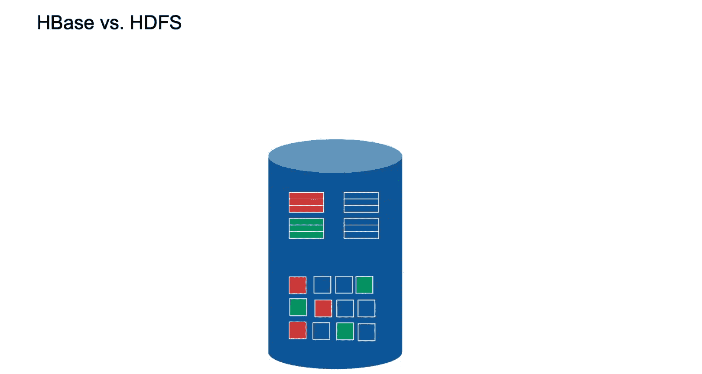

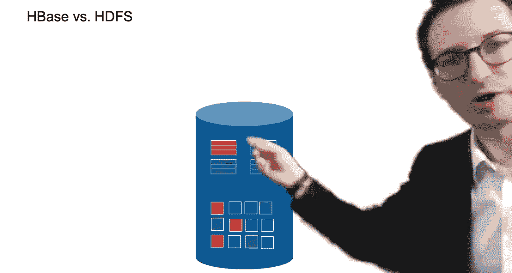

So do you see that this first block。

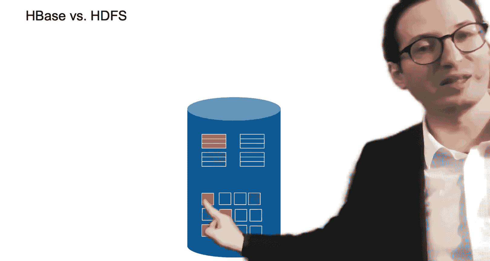

Is directly written on the local list of the same machine as efficient as it gets。

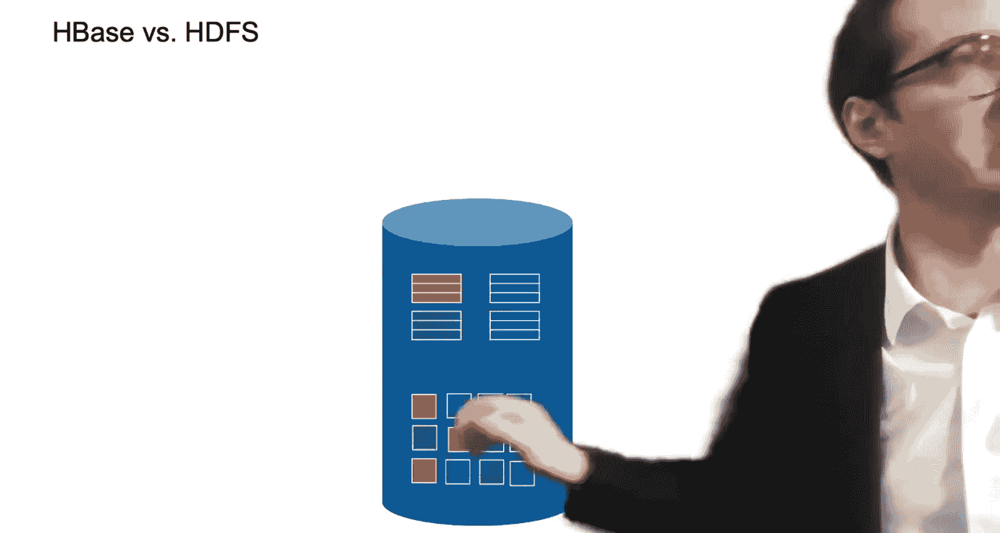

And then you still have replica 2 and three that are on some different machine center the network。

 but the first replica of every block is on that machine。

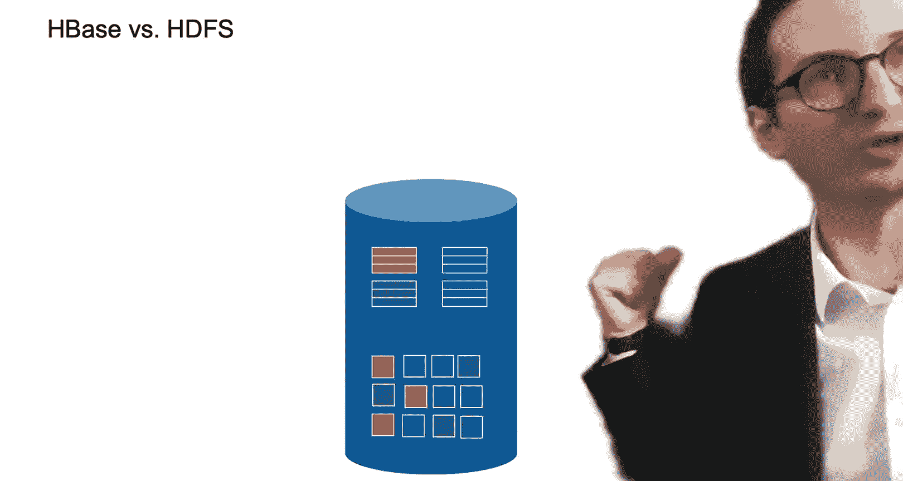

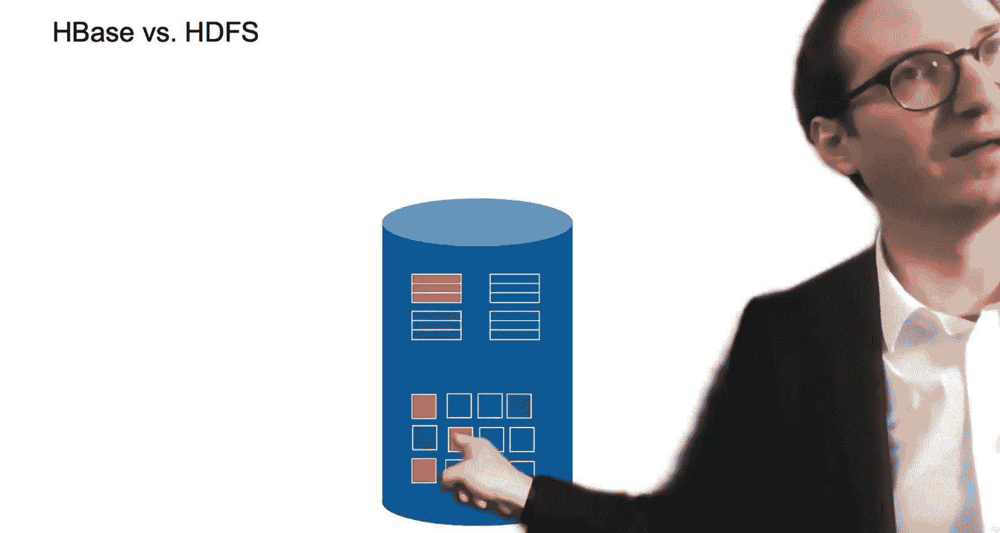

What does it mean when you read it back， when you want to read some user queries age base？

Connects to the region server。And wants to query for some raw ID and you need to read theH file。

 where is the data？

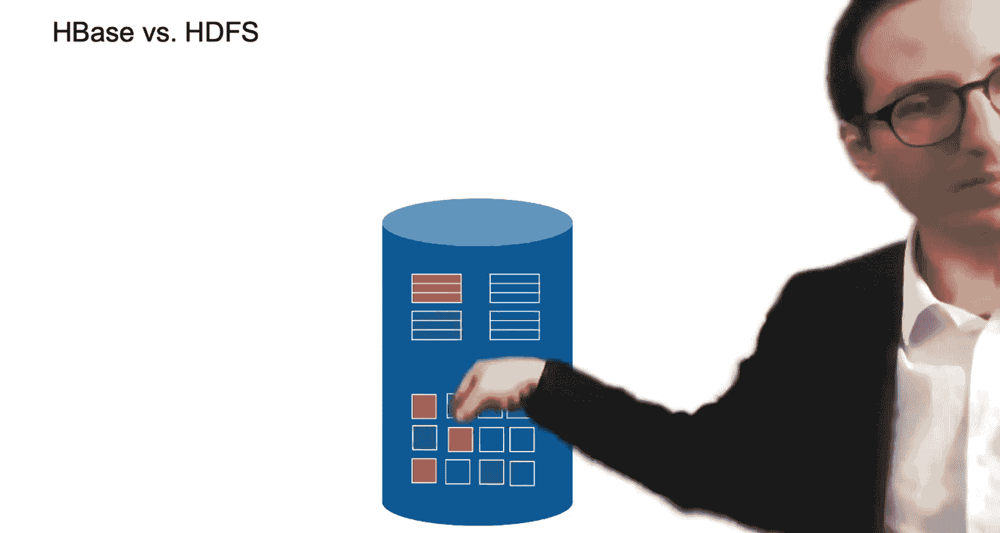

On the same machine。Because it was written on the same machine， so it means that。

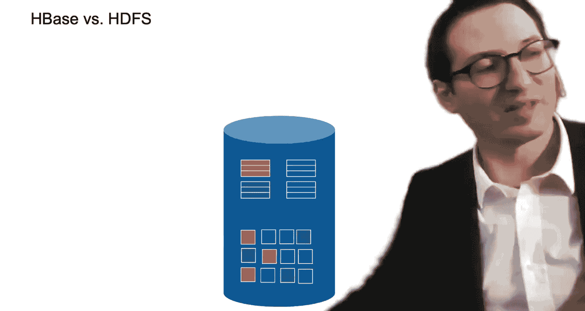

Citttings on in on the same machine， it can even be faster than normally with HDGFS。

 because normally with HDGFS， you need to connect to the name node and you need to transport over the network。

 the blocks that you're reading to download them。But sit's in it's on the same machine。

 we can do something that's called shot circuit kiting， we can shot circuit HDFS。

 It means that the region server。Knows that it's sitting on the same machine as a data node。

 it knows that the replicas， there is a replica， which one of the blog that it's trying to read on the same machine。

 it will directly read them from the local list。Where the replicas are stopped， or who is deaf here？

It's the same machine you directly read them from disk。All right， the problem is that。After I went。

When you stopped letting the system evolve and let a couple of hours or a couple of days  eapse。

 you know that HGFS has a bit of a life and then the name node might move around the blocks or you know to balance them a bit of other cluster or it might it might be that a data node is too full。

 and then you have to offload some of the blocks。 The HGFS blocks。

So if you wait a little bit at some point， you will no longer have the first re of every block on the same machine。

 and some of them might be on other machines。If you love quantum physics。

 it's a little bit like the wave function that spreads with the Schrodinger equation， right。

 So if you wait too much， then at some point， the blocks start spreading all over the cluster。

So it means that after a while， it stops being the case that you can read everything from the local disk and then it becomes a bit slower。

Because you have to connect over the network to the other data nodes to get replicas of the blocks you want or the HY you want to read。

 for example。But now there's something beautiful。Because。

Now we let the H base cluster has its own life， the HGFS cluster have its own life with the block spreading。

 but what is something else that happens when HGFS when H basease leaves its life。

 the main star becomes full at some point you flush and then at some point the edge file。

There might be two of them。 and what do you do you？Compact them。What does it mean to compact。

 it means that you are going to read all of these blocks。For one of several age files。

And you will create a new H file。That is larger， that is the merged h value。But this a file。

 technically， it's a new file。😊，That you create only GF S， right。

When you create that new fight on AGFS， where does the first replica of every one of the blocks go？2。

 the same machine。That's the magic because you keep flushing and compacting。After a while。

 the blocks maybe start spreading all over and no longer be on the same machine。

 but every time you flush， every time you compact you bring it back to the the same machine。

 it's like again， if you're quantum physicsy， it's like a measurement， and then you know where it is。

 right。😊，So this is the magic of the what we call local E in in HGFS。

 is that because of the way that it is architecture。😊。

The data stays local to every machine and it's very likely。That you will have a local copy of the。

 of the。Blocks of your H file or H log on on your machine， right， So it' it's beautiful。

It's not perfect， occasionally it might not be true when you read over a network。

 but very often you just shop yourkiHGFS and directly read the blogs from the local machine。😊。

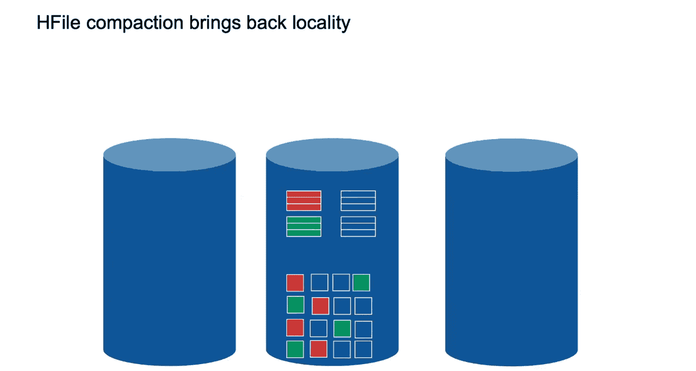

Who's with me？Who understands that concept of locality？

The fact that because the H region server is on the same machine as the data node。

 it can directly access the data via the local drive which is a way of cheating right but that's extremely efficient and we'll see with mapre and Sp with the same thing will happen again this is how you actually make clusters of machines so efficient。

Okay。Now， this is kind of an optional section。 It's very short， actually。

But I want to show you some later evolutions， so that was maybe 15 years ago， let's say age base。

 so what happened after that？Well， Google developed the GFS。

 which is the proptor rev of AGFS and Big table， which is the appropriate rev of H base。

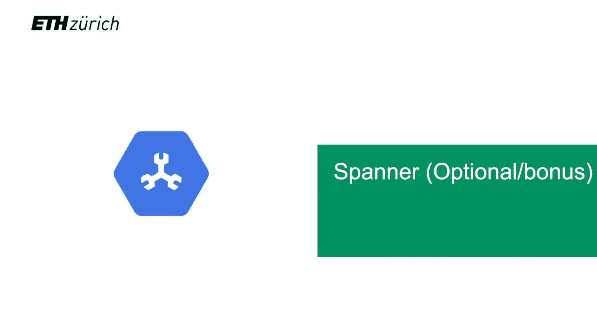

Then they continued and technically， a successor of GFS， I think it's Colosus was the name？

And Colosus was just an even larger version of GFS that that spans multiple data centers。

 I don't even know if now they might have something even newer than that。

 But this is what what the sort of things that happened later。And in paralleln to Korous。

 which is kind of the new HD DFS， the new GFS， they also developed a newer big table。

 which is also a newer age base。😊，嗯。Which is even more general。 And the I it's called Spanner。

 So Spanner is just an even larger version of the age base。

They still have this notion of groups of rows， so the regions。

 except that now they call them tablets。And the difference is that it doesn't need to be a continuous a continuoustiguous region with an interval。

 You could have several intervals that belong to the same tablets。

 This is one of the things they changed。The second thing that changed is probably you notice that now I don't just have a raw ID。

😊，That is a single column as was the case in age base。

 Now I can have a raw I that has multiple columns。 I can have a primary keys or multiple columns that looks a bit more like a radiational database system actually。

 and I can have the timest that is also stored as a column in the table。

 which was not the case in age base。 The timest was stored physically but not in the not as a column。

😊，Okay。Now where do we get with that， I told you that you can have billions of rows in each base。😊。

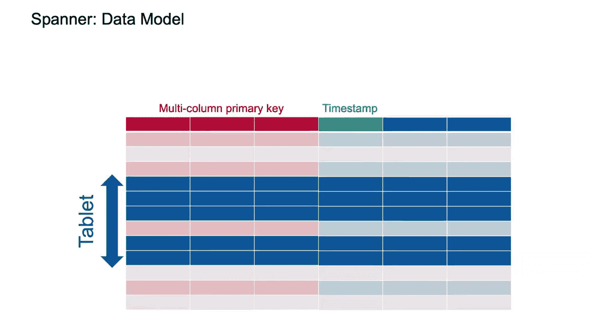

In Spanner， you can have trillions of rows and maybe even quadris。

So it's a whole order of magnitude larger than what you would have with H base right so the scale is absolutely gigantic。

 but you know what's even cooler than that。It's the fact that。Since you don't have billions。

 but trillions of rows， a data center is no longer enough。 right。

 So what do you do when you just start collecting data centers。 So now you just。

 you don't have just have 1000。Computers in the data center。

 you have1000 data centers with thousands of computers in each data center。 right。

 And so they needed to come up with a cool name for the， for the node responsible for all of that。

 And they call it a universeverse master。 Sounds very much like some sort of sense fictions by movie。

 But yeah， that's kind of the idea D。 So this is how you start trills or quadris。😊，Of the。

 of these of these rows， you just span it over multiple data centers。

 So now you're talking about the whole planet， technically， where you start these things。

 So you see this is the next generation of， of the， of white current stars。

 But you see that the ideas are still the same， right。

 It's just that this is generalized to an even larger scales now with millions of machines instead of thousands of machines。

 right。Now this is where you start to understand that in terms of research。

 the kind of research we can run in academia or in universities is of no match to the kind of cluster sizes that a company can have right so now we have hundreds where thousands is even possible of data center technically it might be thousands today hundreds was the case back then。

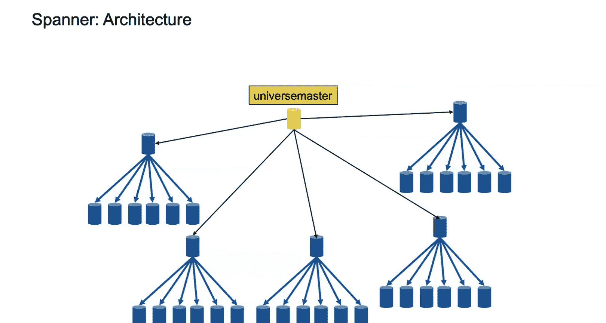

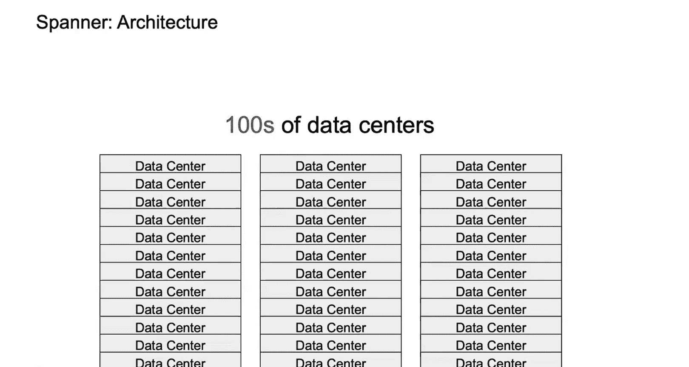

And millions of machines。Right。This is where you， you know。

 there's these school seekers that some people have when you， when you go to companies like Google。

 Microsoft， Apple and so on。 there's a popular sticker that they have that says my computer is a data center。

 like this is your computer。 Just connect there and have millions of machines that that。

That execute your queries。All right， that was the last slide of H base。

 who follows this whole thing about age base。😊，Who is very scared of so much content and so complex？

Some of you well read the textbook in the textbook it's also explained。

 you can ask plenty of questions also in the in the in the forum and in the chat。

Who understood what I told you this weekend the last week？Okay， most of you， very good。So， now。

Have a couple of more minutes。I quit stop。With the data models。

 who wants me to start a bit with the data models。To give you an appetizer for wet photos after the install break。

Who prefers to go and eat？We do have a majority to continue on the data models。

 we continue on the data models。

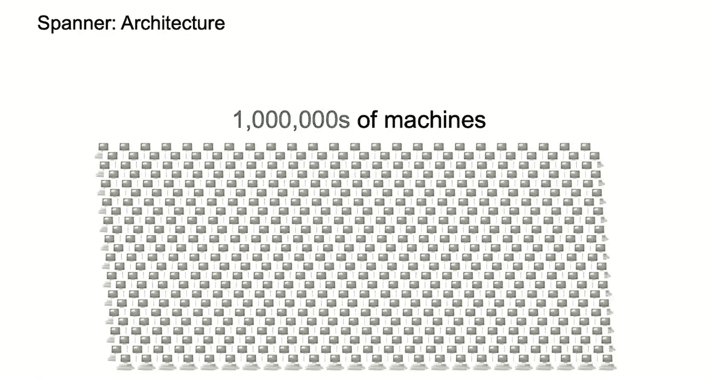

The slides are not on the on the server I will put them right away but again。

 it's only the appetizer and the intro。 so so you don't have to to worry about。

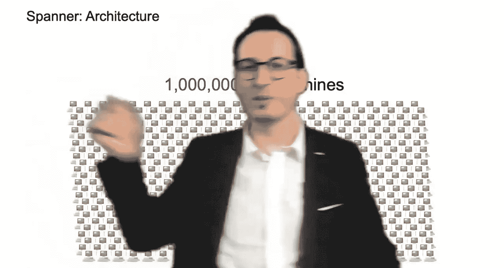

No teacher just yet。Oh， I need to first stop the recording。

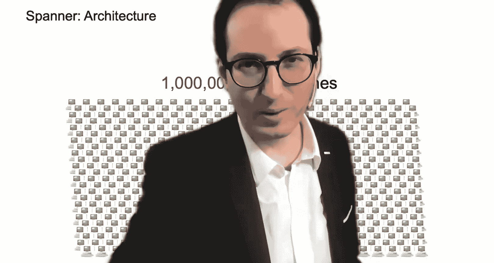

ちょっとも。