# 苏黎世联邦理工《工程师的大数据｜Big Data for Engineers - ETH Zurich - 2024》中英字幕 p15 7. Data  models (1_4) - .zh_en -BV17FAmeFE9K_p15-

So going back， you see now the next section。😊。

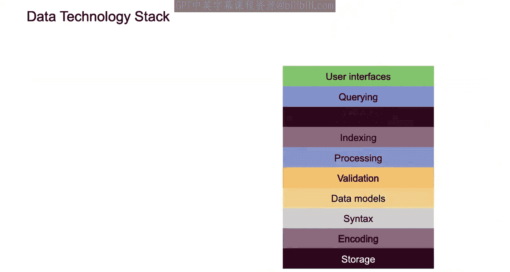

So let's look at where we are now on the big data stack after all we've done。

 so we've looked into storage and coding syntax。😊。

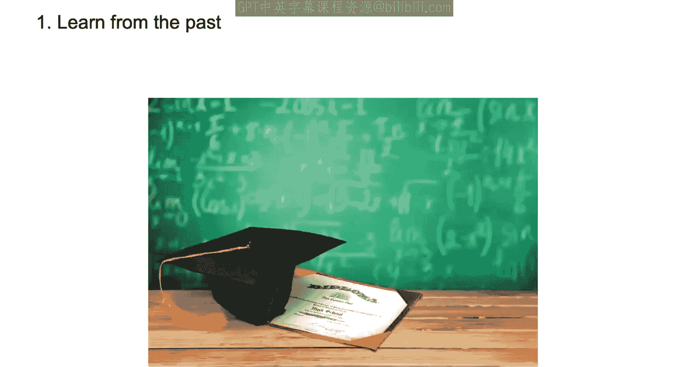

Data models a bit with the white collar stars， but now it's going to get serious and validation is also going to get serious。

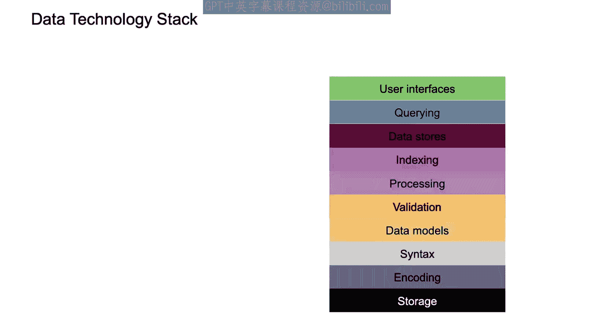

Let actually， the timing is perfect to go through them。Let's go through。10。

 the top 10 of what we've learned so far in big data。

 the general big ideas that shape the whole universe of big data。

Number one is learning from the best。It means that when we rebuild this whole big data stack。

We did it， having in mind。The relational database monitoring systems of the 70s。

It means that we are not throwing everything away。 We keep the idea of data independence。

We keep the idea of having a query language to the system。 We keep the idea。

Of separating the logical from a physical layer。It's very important also。

When you do research or engineering to double check if you're not reinventing the wheel。

 always look at what your ancestors have done because they might have made mistakes。

You wouldn't imagine all the money you're saving and the resources you're saving by looking at the mistakes that your ancestors made in order not to repeat them They are very valuable lessons。

 So this is true in the database world。

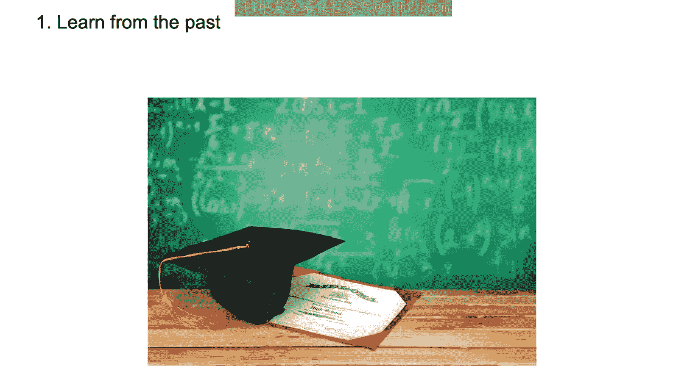

嗯。Number two， keep the design simple。 This is how you scale at massive scales。 And in fact。

 if you consider cloud storage like S3， it's extremely simple K you based。

 you have a key bucket I plus an object I and a value which is a sequence of bits up to fiveterytes It's as simple as it gets right HDFS is also quite simple right you have a hierarchy of directories and files and then a finding the sequence of blocks and that's it So keeping the design simple is important in the data relational database it's the same you have tables that have rows and columns and that's it right So simplicity is really your friend here。

😊。

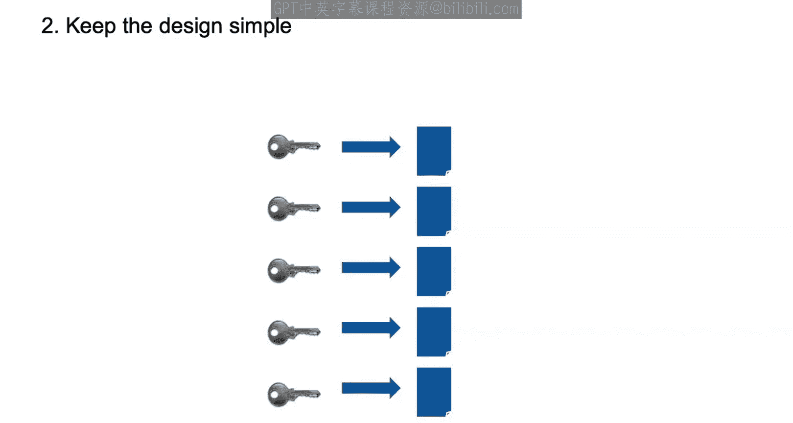

Next， motorizing the architecture。That's extremely important for a computer scientist。

 extremely important because otherwise you get overwhelmed if you try to do a monolithic design。

 it doesn't work。 That's the same idea of when you build a house。

 you have somebody who comes do the foundations， then you have the masonry。

 then you have the probleming， then you have the electricity and so on。 it's all modular。

 a modular architecture， this is exactly what happens here。

We have a whole system for storing files and blocks， HDGFS。

 we have a whole system for white color installed and so on and so on。

 so it's a modular thing that simplifies our life because every layer is designed with an abstraction of the layers that are below and providing a service to the layers that are above。

😊，Number four is homogene80 out if you zoom out。Then everything is homogeneous， for example。

 you might have billions of rows in a big table， you can have billions of objects in S3。

 you can have trillions of blocks and so on and so on right so in the large it's very homogeneous in the architecture。

 a huge number of the objects。That nevertheless are actually very heterogeneous and diverse as soon as you zoom in right if you look at the individual components。

 then they might be different and in fact this is quite too big data。

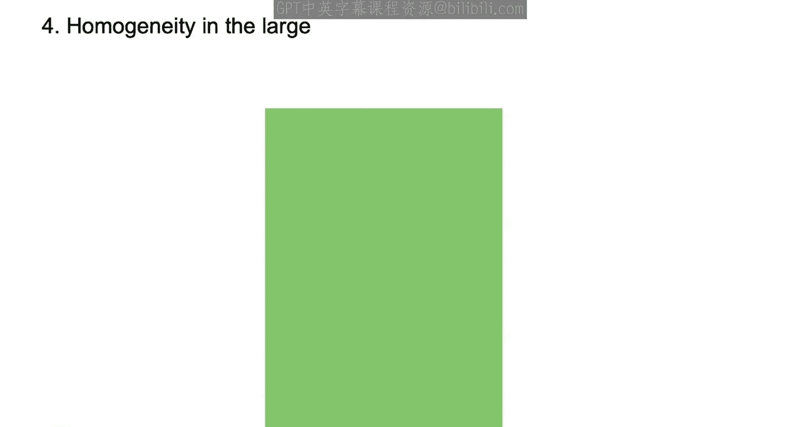

Because we see that we will no longer have a schema or not always have a schema。

 So unlike a relational table in which all the ruless have to be the same。

 Sa the schema in a document store， we will see that nobody cares anymore。

 you can have completely different looking documents in the same collection。 and that's totally fine。

 Even in each base， that's the case。 you can store whatever you want in the in the cells。

 right Nobody is going to to ask anything if you don't put exactly the same types in the same color。

Right， so heterogeneous in this mode。 And that's specific to big data。

So it's exactly this idea of a huge homogeneous collection of heterogeneous objects。

Then the abstraction of the logical model from the physical implementation。

 I did it every single weeks since the start of the semester every time I introduced you a system I started with the logical model plain and simple and only after that did I show you the physical implementation to use the system you don't need to know the physical implementation so only that it's interesting to know but the logical view is enough and that is paras in the world of database systems。

😊。

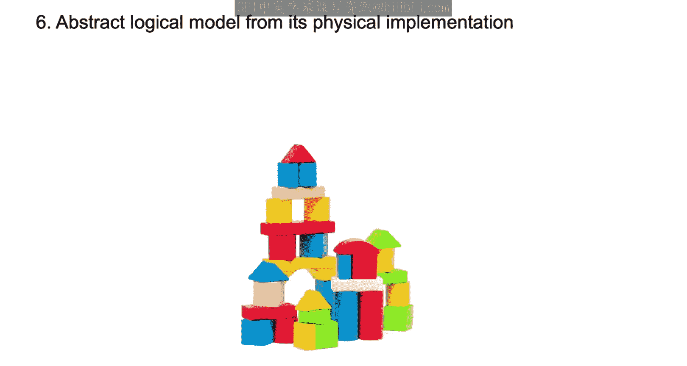

Then we did two things。First， we shut the data。 that's the benefit of having a very homogeneous collection at a very large scale when you have billions of trillions of quadrillions of blocks or objects。

 then you just sh。Shout， partition， splits， block， chunk， whatever you call them。

 you just have this partitioning of the data。

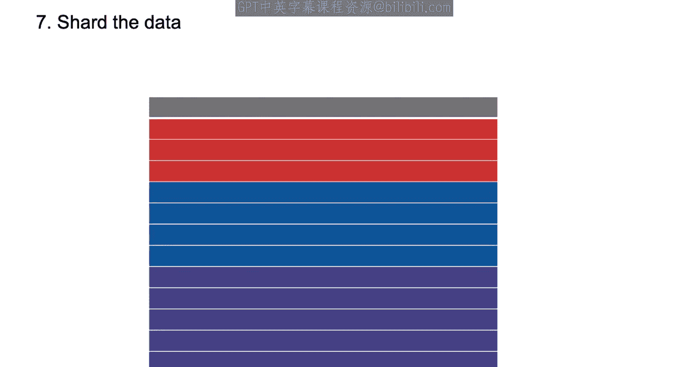

And that goes hand in hand with replication， every one of your charts or blocks or splits or partitions objectss。

Gets duplicated and stored multiple times， three times four times， five times。 So we replicate。

 This always goes hand in hand。 We part and re replicate the two at the same time。

 Then we spread all of our machines。😊。

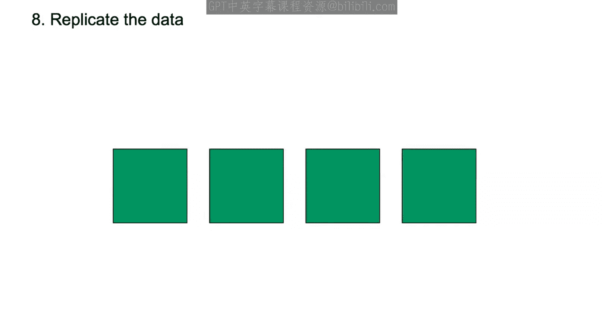

Relic it。Then we know that all of that runs in top of machines in a data center that is， in fact。

 plenty of cheap hardware， lot of machines。Rather than few larger machines， right。

 it's much cheaper to have a lot of small machines like that。 And finally， number 10。

 and that's actually new to this week， the notion of batch processing。

 how do we manage to have a system that seems to take many updates in real time。

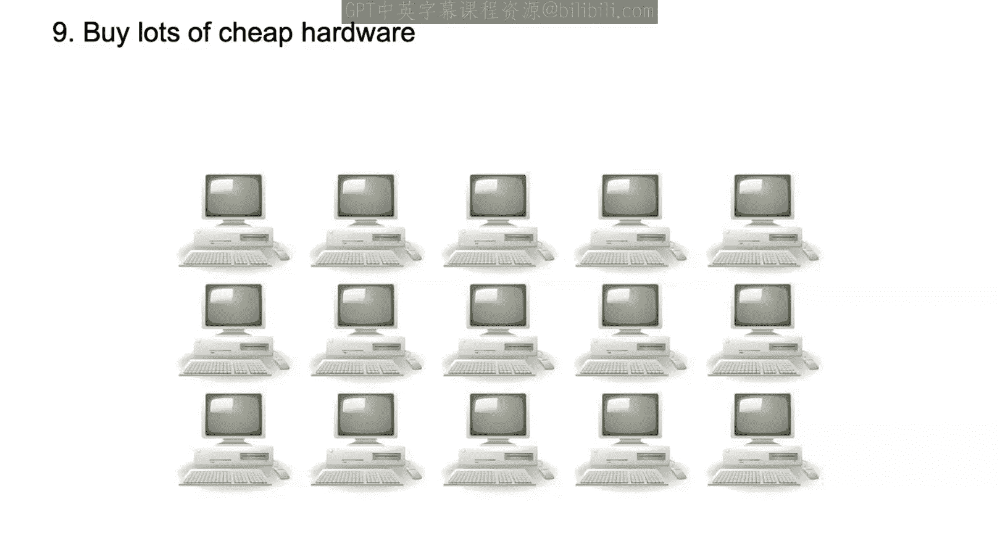

But without。The the the slow speed is with these LM trees here where we batch the writing。

 It means that instead of writing every single key value to HDGFS。

 we accumulate them in memory and only when the memory is full， we write in a single batch。

A single H5 to， this is the idea of batch processing。

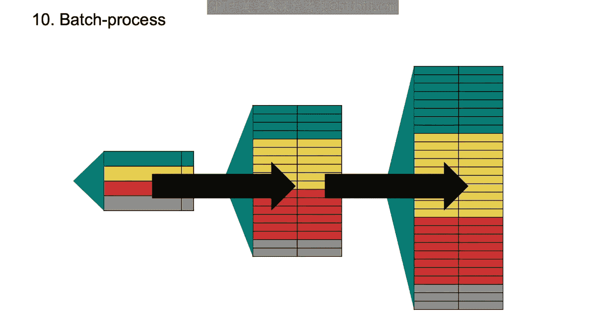

So in the past weeks， we've done that。 And today， well， more exactly in。

Two weeks after the install break， we are going to continue on data models。

 and then we'll we'll build on top of X ML， Json and so on。

 And I'll bring you into the beautiful world of data frames。 Yes， the same as Pmda's data frames。

 And we will see that data frames are， in fact。😊。

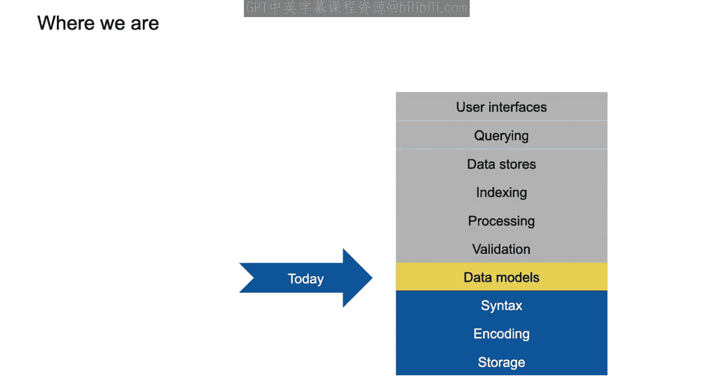

I that it collections of Jason objects but that I keep as a cliffhan So thank you very much everybody。

 you know that next week is the Star break， So there will mean there will be nobody here I'm taking vacations you should also take vacations by the way to rest a little bit and I see you again then in in two weeks from now for the continuation of this right there。

 Thank you very much enjoy the exercises and see you。😊。

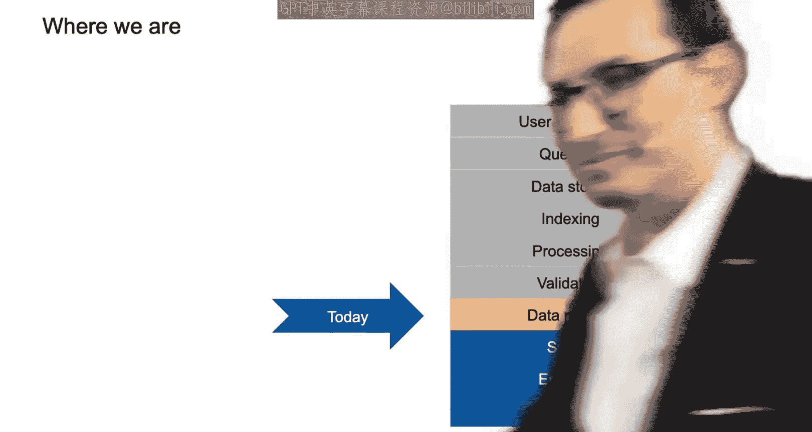

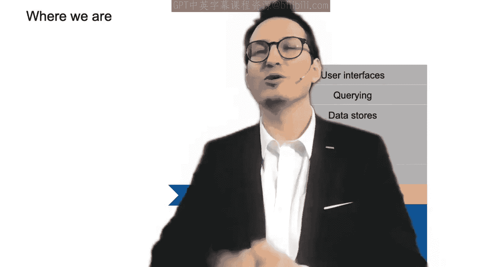

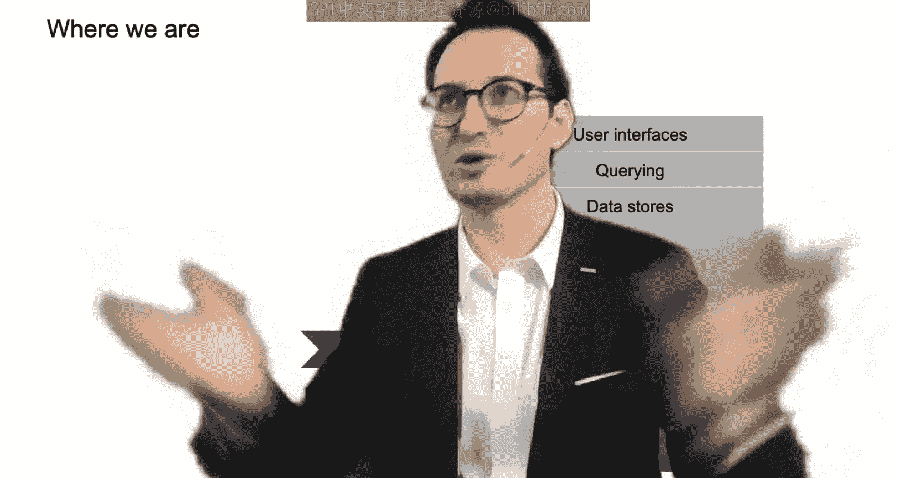

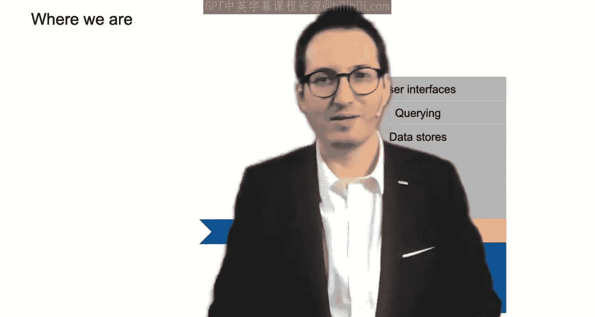

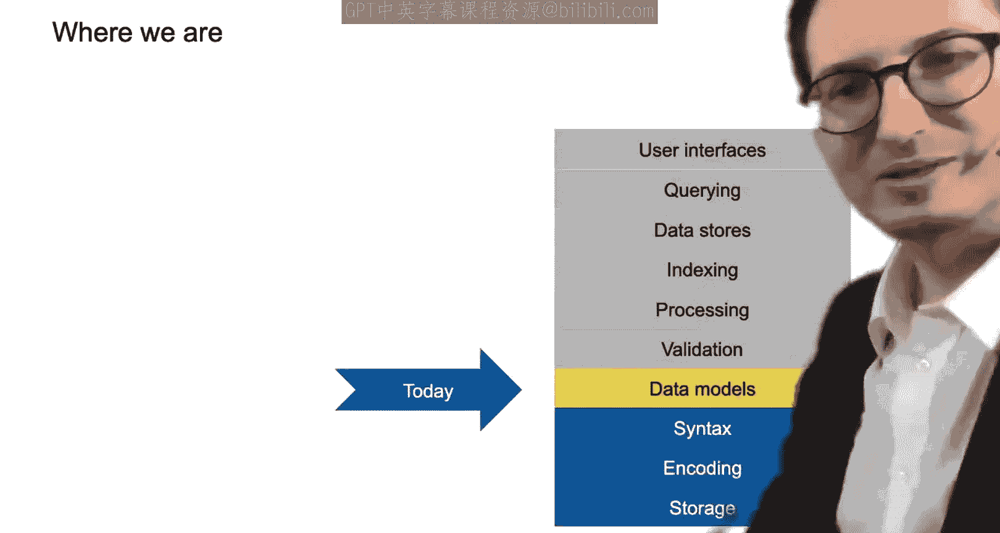

In two weeks。

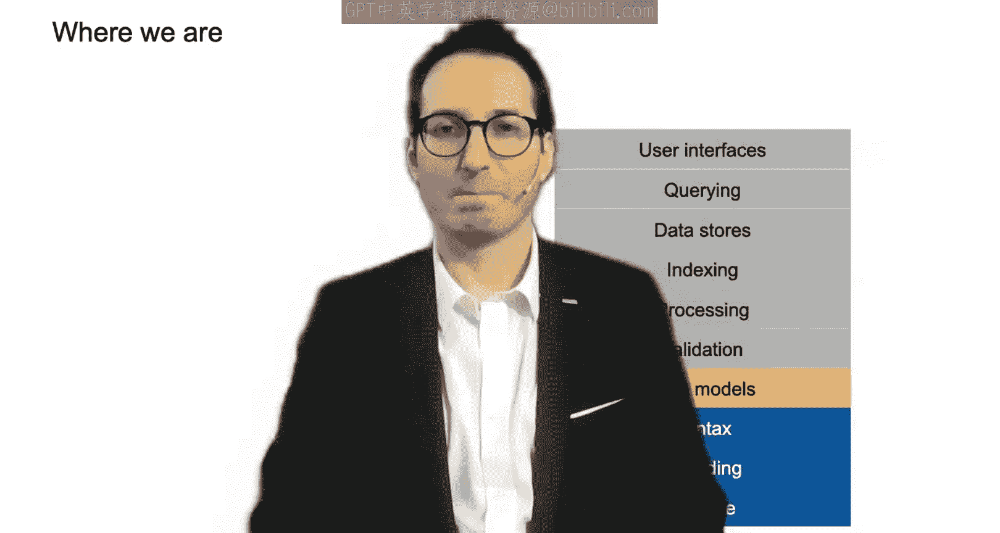