# 工程师的大数据：7：数据模型 (1/4) 📊

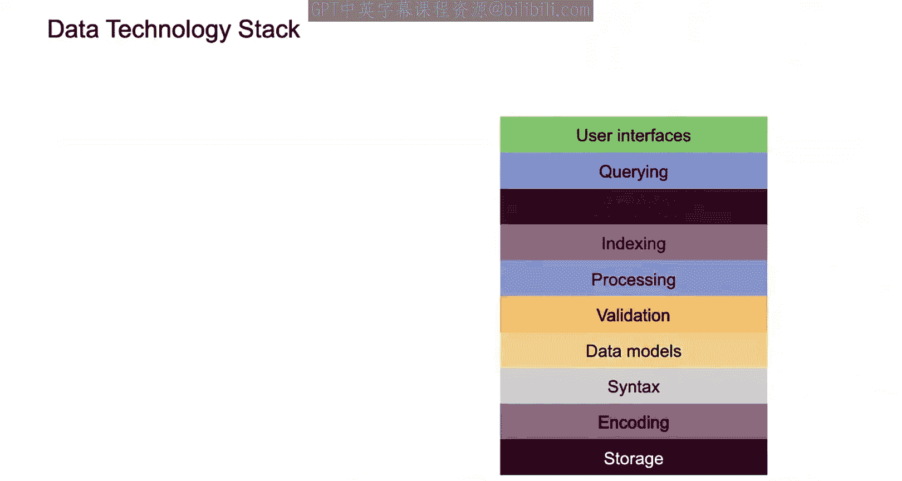

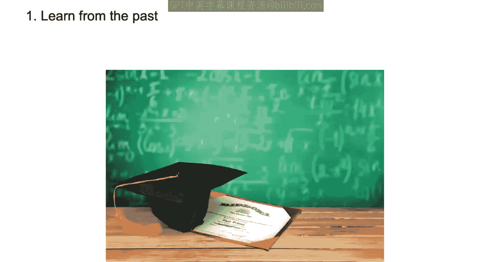

在本节课中，我们将回顾大数据技术栈的核心思想，并总结迄今为止学到的十大关键概念。这些概念构成了大数据领域的基础，理解它们对于后续学习数据模型至关重要。

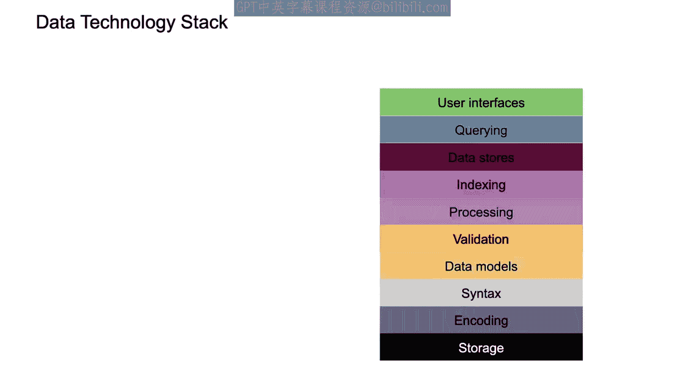

---

## 回顾大数据技术栈

上一节我们介绍了存储和编码语法。现在，让我们看看在当前大数据技术栈中所处的位置。

我们已经初步探讨了数据模型，接下来将深入展开，验证环节也将变得更为重要。

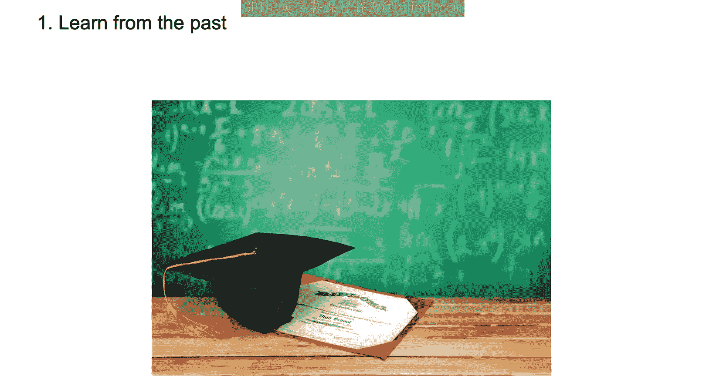

---

## 大数据十大核心思想 💡

以下是塑造整个大数据领域格局的十大通用核心理念。

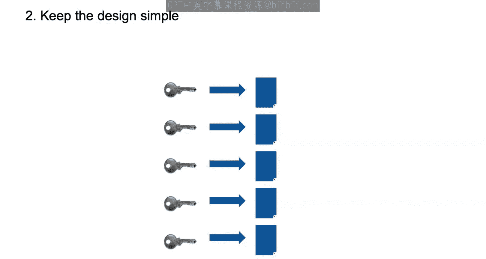

### 1. 向最佳实践学习

当我们重建整个大数据技术栈时，心中始终铭记着20世纪70年代的关系型数据库管理系统。这意味着我们并非抛弃一切，而是保留了数据独立性、使用查询语言以及将逻辑层与物理层分离等核心思想。在从事研究或工程时，复查自己是否在重复造轮子至关重要。借鉴前人的经验，尤其是他们犯过的错误，可以节省难以想象的资金和资源，这是非常宝贵的经验。

### 2. 保持设计简洁

简洁的设计是实现大规模扩展的关键。例如，像S3这样的云存储极其简单，它基于键值对：`(bucket, key) -> value`，其中值可以是高达5TB的比特序列。HDFS的设计也很简洁：一个包含目录和文件的层次结构，以及对应的数据块序列。关系型数据库同样如此，只有包含行和列的表。因此，简洁性是我们的朋友。

### 3. 架构模块化

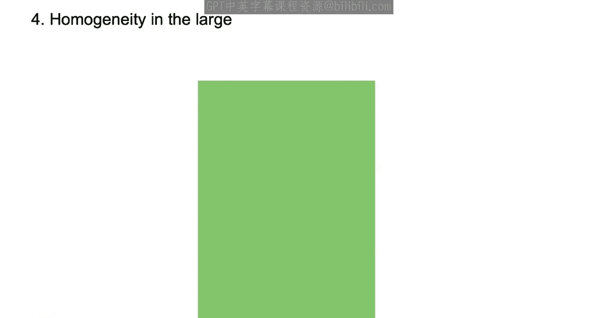

模块化架构对计算机科学家至关重要。否则，尝试进行整体式设计会让人不堪重负。这就像建造房屋：有人负责地基，有人负责砌砖，有人负责管道，有人负责电气等，所有环节都是模块化的。在大数据栈中，我们有专门存储文件和块的系统（如HDFS），有专门处理写入的系统等。每一层都基于下层的抽象进行设计，并为上层提供服务，这种模块化简化了我们的工作。

### 4. 宏观同质，微观异质

从宏观视角看，一切是同质的。例如，一个大表中可以有数十亿行，S3中可以有数十亿个对象，系统中可以有数万亿个数据块。在架构层面，存在大量同质的对象。然而，一旦深入微观视角，这些组件实际上是异质且多样的。这正是大数据的特点：我们可能不再总是拥有固定的模式。与关系表中所有行必须遵循相同模式不同，在文档存储中，同一集合中可以存在结构完全不同的文档，这完全没有问题。甚至在键值存储中也是如此，你可以在单元格中存储任何内容。

### 5. 逻辑模型与物理实现分离

从学期开始，每次介绍一个系统时，我都首先展示其简单明了的逻辑模型，然后才揭示其物理实现。要使用一个系统，你无需了解其物理实现，尽管了解它很有趣。逻辑视图就足够了，这在数据库系统世界中是标准做法。

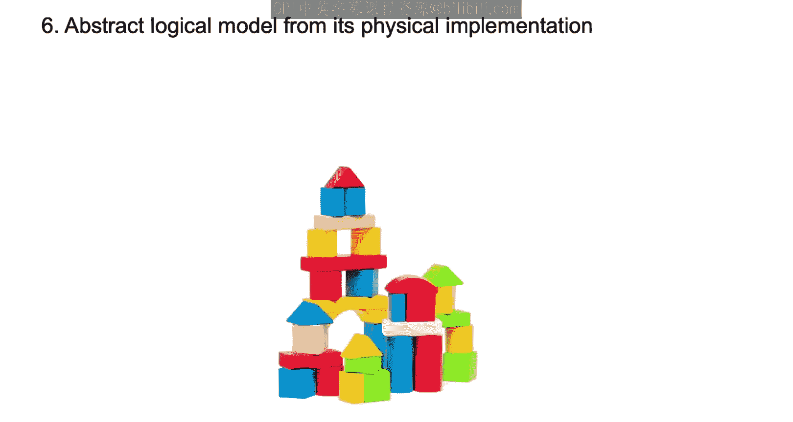

### 6. 数据分片

得益于在超大规模下拥有非常同质的数据集合（数十亿、数万亿的数据块或对象），我们可以对数据进行分片。分片、分区、拆分、数据块——无论叫什么，本质都是对数据进行划分。

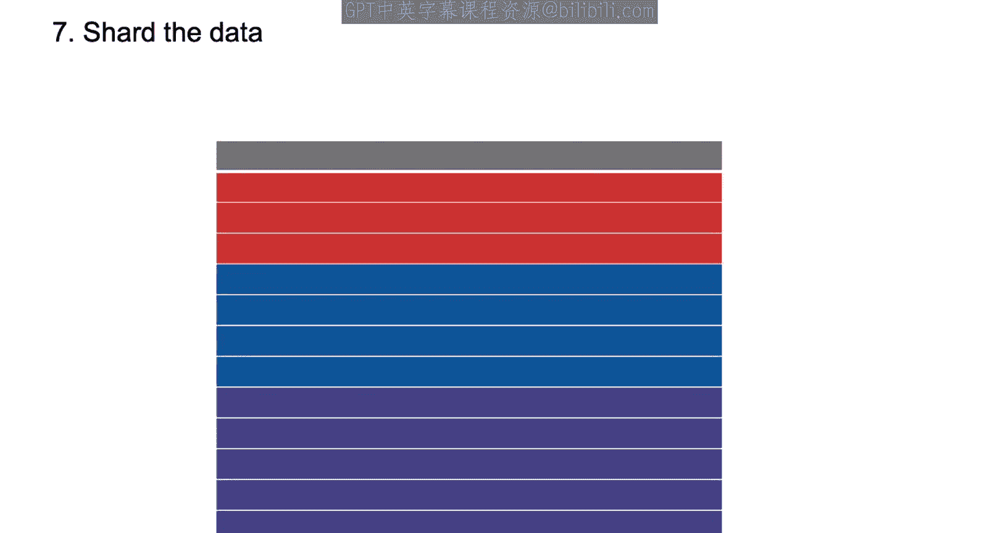

### 7. 数据复制

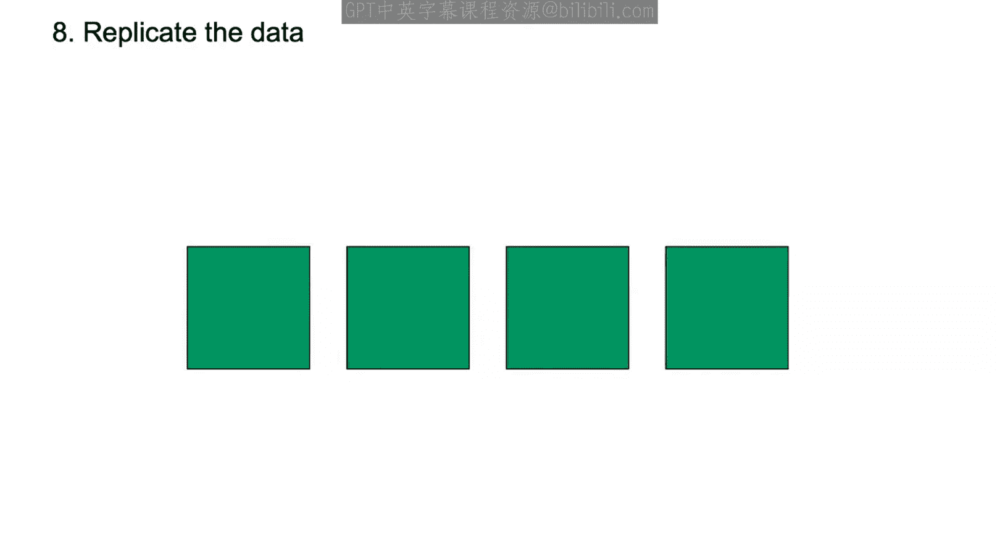

分片总是与复制携手并进。你的每一个分片、数据块、分区或对象都会被复制并存储多次（例如三次、四次、五次）。我们同时进行分片和复制。

### 8. 在众多机器上分布

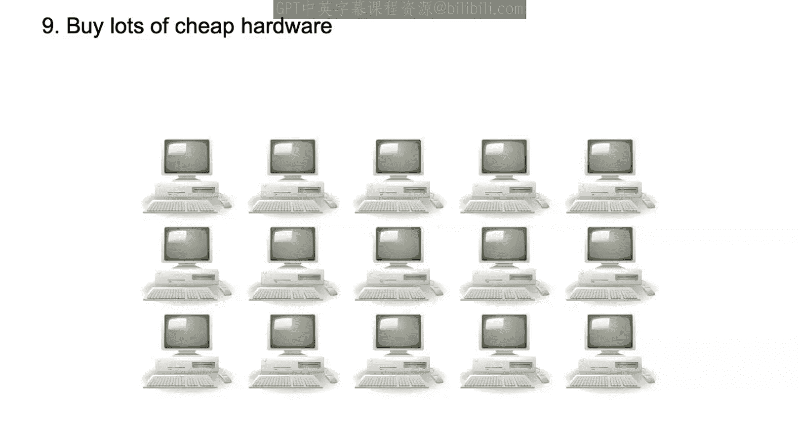

复制之后，我们将所有数据分布到数据中心的众多机器上。这实际上是大量廉价硬件的集合，使用许多小型机器比使用少数大型机器成本更低。

### 9. 批量处理

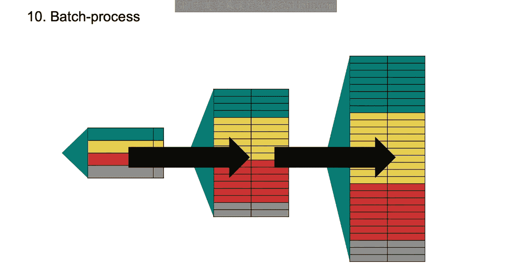

这是本周新引入的概念。我们如何构建一个系统，使其看似能实时处理大量更新，同时又不会因写入速度慢而受影响？答案在于使用LSM树等技术进行批量写入。这意味着我们不是将每一个键值对都立即写入HDFS，而是先将它们累积在内存中，只有当内存写满时，才一次性批量写入。这就是批量处理的思想。

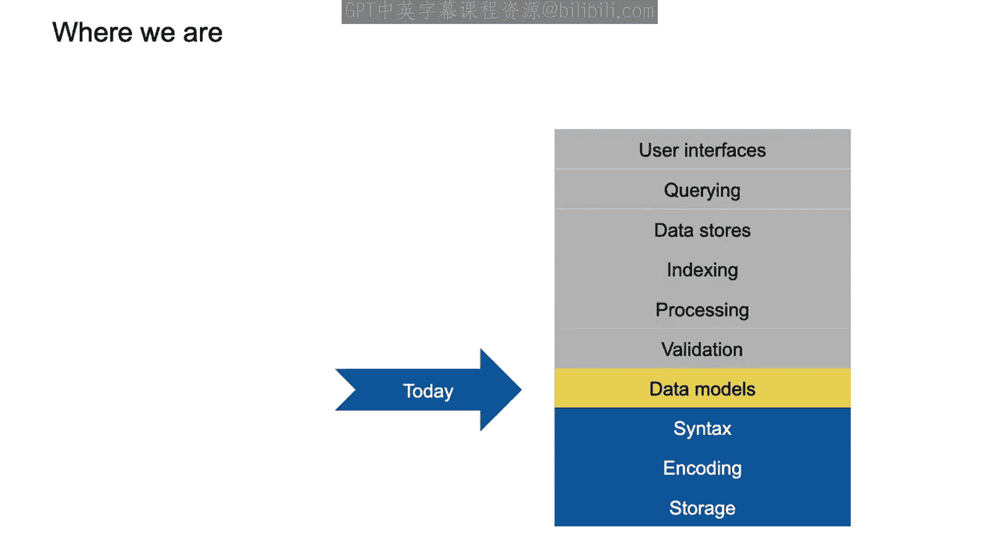

---

## 课程总结与展望

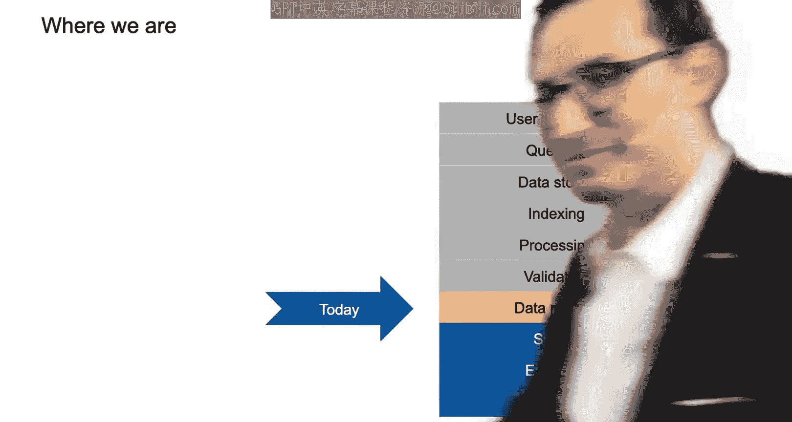

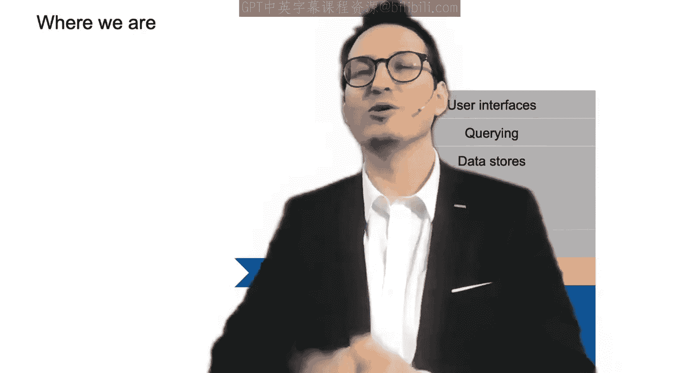

在过去的几周里，我们学习了上述内容。今天，更准确地说，是在期中假期后的两周，我们将继续学习数据模型。我们将基于XML、JSON等构建知识，并将大家带入数据框的精彩世界。是的，就是类似于Pandas的数据框。我们将会看到，数据框本质上是JSON对象的集合，但这里我先卖个关子。

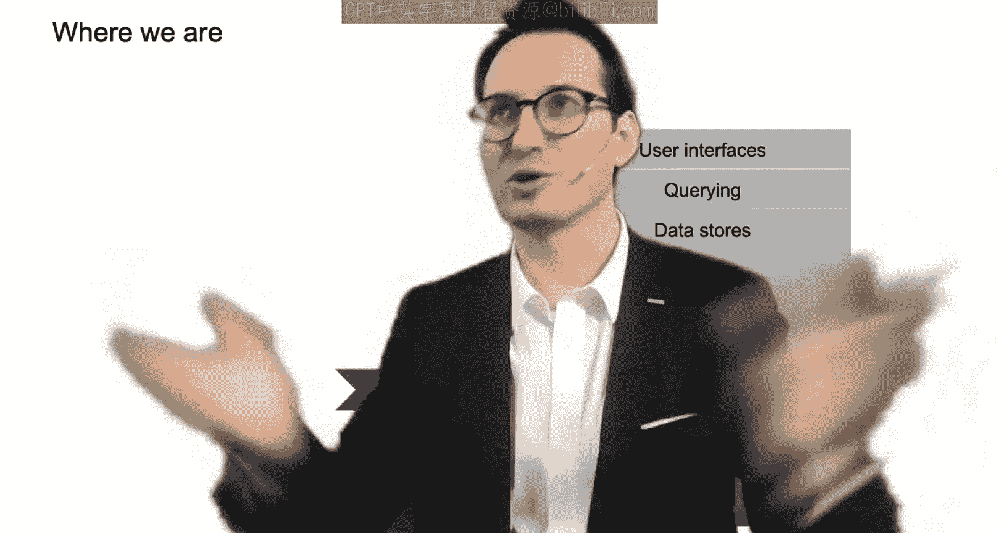

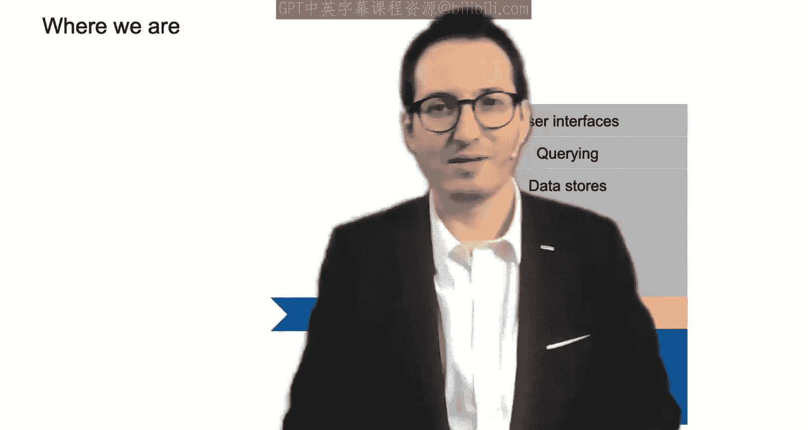

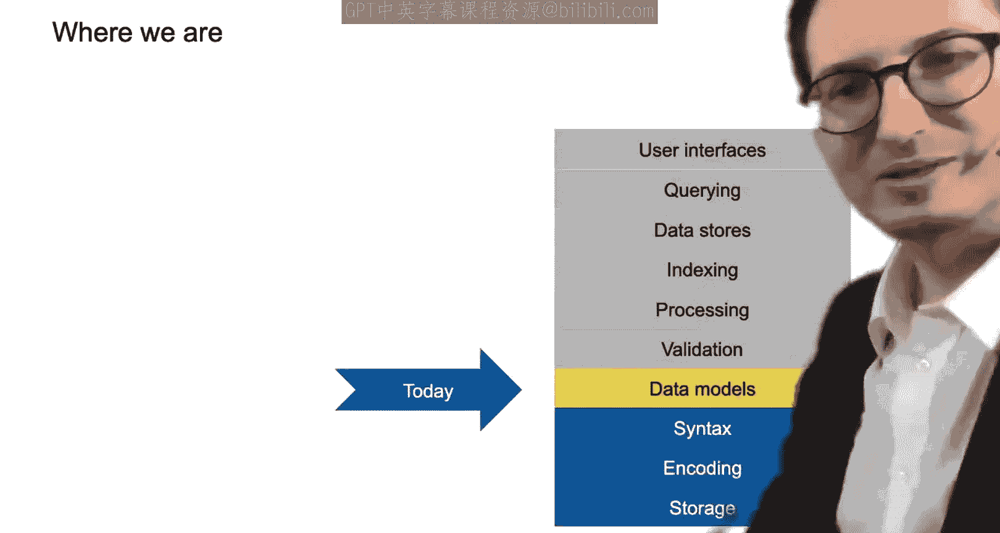

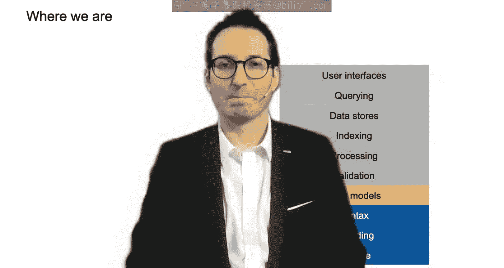

非常感谢大家。请注意下周是期中假期，这里不会有人，我也在休假，你们也应该休息一下。我们两周后再见，继续后续的课程。祝大家练习愉快，再见。