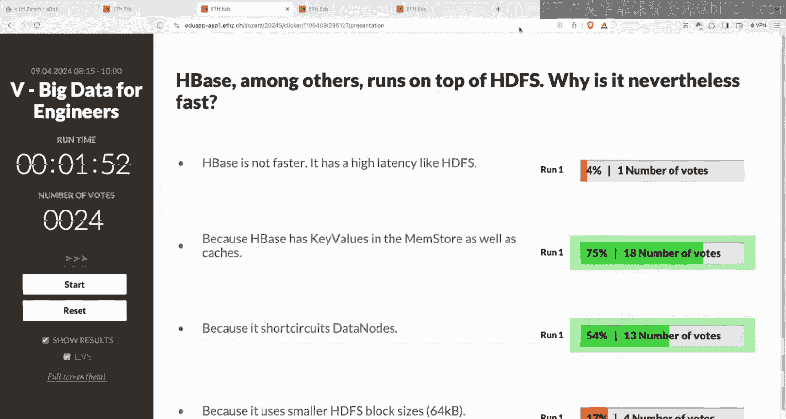
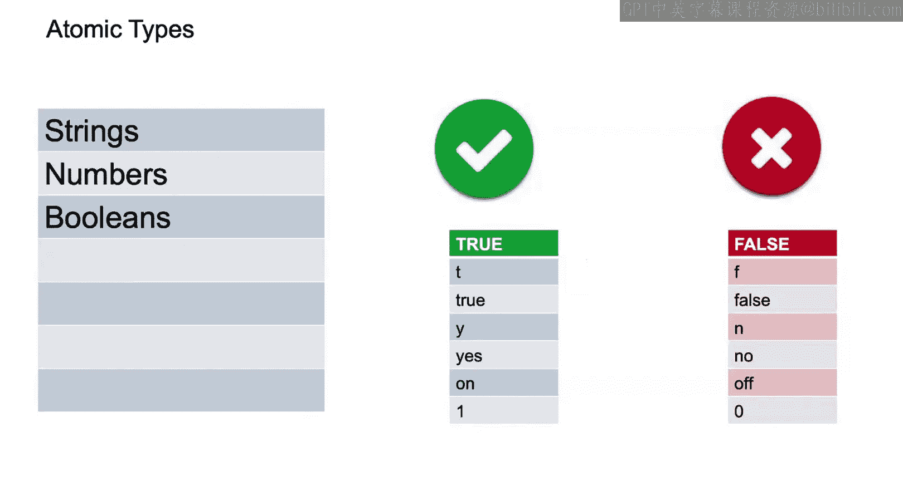

# 苏黎世联邦理工《工程师的大数据｜Big Data for Engineers - ETH Zurich - 2024》中英字幕 p16 7. Data  models (2_4) - .zh_en -BV17FAmeFE9K_p16-

Welcome， everybody， the lecture hall， welcome everybody on Zoom。 Wee everybody from the future。

 I hope you had the goods and。😊，Restful Easterbreak。Now's the time to continue。

 we have eight more weeks into the semester， or more exactly7。

 because the last one would just be a quiz and a wrap up。So we were。

 if you remember in the middle of data modeling。And I gave you as the wrap up。

 So this is the stack we've been going through。 and I gave you these 10 these top 10 ideas from big data or record from the last time learned from the past。

 keep the design simple modularized homogeneity in the large heterogeneity in the small an abstract logical model separated from the physical implementation。

 That's the idea of data independence。 and we shared and we replicates the data we've been doing that a lot with HDFS。

 for example， we buy a lot of chip hardware。 This is what we have in the data center。 and finally。

We batch process and you already had a taste of that with H basease because in the way that we create DH files we don't touch them every time there is an update。

 we accumulate update and once we have enough update then we write a file this is called the batch and this is called batch processing with log structured notch trees。

So before we continue。We are right here。 We are going to continue right there。

 I'm going to ask you two questions to check that you've been following。She's right here。

So， my first。Question。Is some paradox。Because。I told you that Hbase runs on top of HGFS right so HBase is the white column store。

 this is where you can store values in a two dimensional grid like a table and these includes small values but also XM documents。

 JON documents。And it's fast， you know， you can update in real time randomly anywhere in the table you can get and put data in there very fast。

But we saw that it' stop on top of HGFS。 So AGFS has a high latency， right。

 whenever you want to do something on HGFS in the command line， it takes one or two seconds。

 So how can it be that we build something fast。😊，On top of something slow。

 What is the magic that's happening right here， How can it be。😊，So first， maybe that's not true。

 Hbase is not faster， it has high latency just like HGFS or maybe it's because Hbase has key values in the M store as well as caches or is it because it shocks your kids the data notes to read the data or is it because it uses smaller HGFS block sizes of 64 kilobytes than 128。

Megabytes， Bra G。嗯。It seems like the number of on cells has stabilized。

 even though there's less on sales than people actually present in the roommate on Zoom。

 But's let me show you。Yes， these two are correct。 We shot yourki data nodes。 We don't even bother。

 I told you about locality， right， very often the data of the AGFS blocks is going to be on exactly the same machine that both runs the region server and the data node。

 So in many cases， we just shot your kit read from the data node， right。😊。

And the other reason is that Hbase doesn't store everything in HFS。 it also has a lot in memory。

 right when you update something you actually update it in the memory of the machines， not on disk。

 This is this batch processing thing that I told you we accumulate updates in the memory and only when we have enough of them do we flush them to the system。

😊，seems like the screen is having fun today。😊，Alright， so this is the， these are the two correct on。

 The first one is not correct。 The fourth one， when the statement is correct， but it's not a cause。

 that's not the reason why why it's fast off。Okay。Now let's see。

If something gets better with the screen， because this is kind of annoying。Let me see if I manage to。

I this maybe with another cable in the lecture hall， we basically have something weird happen on the。

 on the screen。 It's kind of。Showing it in a different way。We have。

Some different cables that I could try with HDMI。 You never know， maybe that。

That could make a difference。So， let's see。嗯。You need to press here again。😔，Lets see what happens。

Seems like the multimedia took a Easter break as well today。That looks better。 Okay， yeah。

 it the trick。Okay， so now I'm going to project the slides again。

And。Now， we can continue。Okay。送。We are back to trees， but I already told you about trees。

 Maybe I didn't use the world a lot。 but when we studied Xml and Jason。

 we actually talked about trees。But in fact， the way I introduced you to XML and Jason was in terms of syntax。

 I showed you text documents， text， and then I asked you。

 is that text document well formed J wellform XML， can we pass it into JON or XML？嗯。

Now what actually happens next， once you have passed a wellformed XML or JS document is that you are going to put it into your memory because you want to query it。

 but in the memory you are not going to have the text， the original text。

 in fact what you will have in memory is a tree representation of XMM and J。This is the idea here。

 This is what I'm going to to show to you。The same thing with CSV would be that in CSV。

 you have the syntax comma separated like this is just text below。

But if you consider it on the logical level， what you actually have is the table。

 the table is the logical view over it。 We have a data model with rows and columns。

 And on the physical level， we have the actual texts that contains it。And the idea is that。we巴。

The CSV document， the world is past。 We pass the CSV document into a table representation in memory。

And do you know the wealth for the opposite direction when we have the logical representation in memory and we write it as a text file。

 Does anybody know。Start with an S。It's called to serialize。 So we pass and we serialize。 yes。

 somebody had it on the on the Zoom chat， congratulations。 So pass serialize。

 So what's very important is that in the memory， we don't have the text。

 we have an optimized version， And in order to define that optimized version。

 we need to work with a data model。 need we need a paradigm for the data shape。 We need a data model。

 then we have what's called an instance of the data model， which is this particular table in memory。

😊，All right， so now I need to give you。An idea of the JSO data model and the XML data model so that you understand what's actually going on。

嗯。Already today， when I give you a document or an X document， who sees a tree already。😊。

Are there those who do。Some of you on Zoom， do some people see a tree already。

 and you raise your hand in X adjacent documents。 If I show you the text。

Some of you who does not see a tree yet。More race sense。 Okay， so at the end of this lecture today。

 I want you to see the tree。 This is the girl。Okay。So。Remin reminder in Jason。

 we have six building blocks， strings， numbers， boy and nerves， These are the atomic values。

 and then objects and arrays which are structured values， right。

 The objects have these curly braces with key value pairs and the arrays have these square brackets。

And now， if we want to sound fancy in a computer science party。

 we are going to say that the objects are actually maps from strings to values from the keys to the values。

 and the arrays are lists of values。 Now， by using the world map and the word list。

 we are already on a higher level of abstraction。 using these data structure that we teach to computer science students right。

 set map list， these are these are known as abstract data types。

 a list is just an another sequence of values and a map is just a partial function， right。

 a map is associating every key or some of the keys to two values， and this is recursive。

 you can have objects in as in arraysing objects in array in object and so on。

 This is where the tree actually comes from。 The atomic values will be the leaves of the tree and the objects and arrays will be the intermediate node。

😊，So here's an example。Who see the tree here？Okay， so let me draw the tree for those who do not。

First， at the root of the tree， we have an object because this whole thing。

 if you look at it completely， is an object， how do I know it's the curly braces？Right。

 you see at the beginning at the end。You have these curly braces。 So this is an object。

 It's a map that maps two strings。 Fo and bar。 F is mapped to true。 Bar is mapped to an array。

 So now I can say who is mapped to true and bar is mapped to an array。 So you see。

 I have thats my root of the tree。 Then I have a node。 Then I have a node。

 And this is just a a label on the on the edge。 This is an edge that is linking this to this object to true。

 We say that true is a child of object。 and who here that we put on the edge on thearrow here is just the name of the key。

 meaning that the object maps who to true and bar to array。 Who to true and bar to the array。

 Who is with me。😊，Okay， we are just drawing a tree representation。 Now， true is already an atomic。

 So there's nothing below true。 That's it。 That's atomic。

 That array can be further divided and decomposed into other things。 It has two members。

 The first number is an object。 You see the curlib braces。 The second number is no。

 So I can put it in there。 There are no labels on thearrow rows because theres no keys for an array。

 So I can directly put it there。 Some people could put integers in there。

They could put a one for the object and a two for the nu。 But if you consider that it's all the else。

 then you don't need the numbers， right。Al right， then neural is already anatomic。

 but the object can be further divided。 It's a map of a single key fubar to。😊，This here。Is a tree。

 Now you need maybe a bit of imagination because if you study biology then you don't have the same vision of a tree。

 So the trees， typically in computer science， are upside down。

 We actually have the root and the trunk on the top。 And then the the leaves at the bottom。

 But this is how we abstract data structures。 right， So you see。

 I have an object in an array in an object。 And this is where we have the regressioncur。

 And the atomic values never have any children。 Theyre always the leaves of the tree。 who's with me。

Who would be able to draw a tree like that for any J document I give you？

Becauseuse it's always the same idea。 in many of you， youll have exercises on that。

's a very good exercise。 But ideally， you should immediately see the tree you when you get into the habit of that。

 just looking at the document， you should have the tree in your mind。😊。

The reason it's important is that once we pass this document in memory。

 we are going to have the tree。 So what you have in the memory of the machine is the tree on the right。

 You no longer have the text anymore。Al right， and the rows are actually points in the memory of the machine。

 and the pointels are very efficient in the machine to traverse the pointers。 it's almost immediate。

😊，Who have one for if you remember the with me complexity of last time？Okay， so this is the idea。

 Now， just like CSV abstracted tables from text。 now we have a tree abstraction in a data model abstracted away from the syntax。

😊，It's a different example。 It's not the same document， but this is the same idea， right。

 You have an object。 and inside the object， you map through to an array， you map bar to an object。

 and the object itself maps a to1 and bar 2，2。Who also agrees that this is the correct tree for the documents？

Who does not agree。Okay， everybody agrees。With a few abstentions。Okay。

 now it turns out we can do exactly the same thing with XM。😊。

And that maybe should not surprise you because in XMl。

 I told you that we can have elements inside elements， inside elements。

 inside elements right the only thing you need to pay attention to is that when you put an element inside an element。

 it's between the opening and the closing tag right and you need to pay attention for this to work that if you put an element inside another one you have to close the inside element。

 you need to close it before you close the outside element right it needs to be very carefully done。

 but you see here for example， we have a then we have D which is empty。

 the slash at theN means B is empty， then we have C inside C， we have B。

 and we close B before we close C you see so this all works and now you have on the top memory representation。

 the tree， where you have a the children of A or D and C the children。

 the child of D is the attribute E associated with the value F which I draw with this two squares here C has three children。

Good。3， because if you look carefully at what's going on inside the C element。

 there's a lot of action there。😊，Theres text。 Then there is the B element， and then there is a dot。

 right， text， B element a dot。 and then inside the B element， there is mock text， right。

 So this is how we represent it。In the memory。So now you start seeing probably that there's not so much difference between Jason and X M L。

 It's just trees Indian the end。 there is。If you look a bit more fine grain。

 there is a bit of a difference in the sense that XML supports more use cases because it also supports use cases of documents with Markup。

 which Jason doesn't support natively， but apart from that we just have trees。All right。

So this is it they are slightly different because they are really adjacent data model and an XMM data model。

 actually there's even several XM data models， one of the differences that you noticed is that in J the labels for the keys in the objects。

 they are on the edges， they are on the arrows， right？😊，And XMl。

The names of the elements are on the nodes。RightSo fu bar， fu bar， what does it mean concretely。

 it means that an XML element knows how it's called。You can ask。 it's called an accessor。

 You can ask the element。 What is your name and the element can answer okay， fu bar or bar。

 But in Jason， they can't。 if you ask， for example。The stop object here。

 Imagine there's chat GT inside。 So you ask that object， what's your name。 It cannot tell you。

It cannot tell you because this is anarrow row that goes in this way， not that way， right。

 So this object does not know that it's actually called fu bar。 That's the difference。

 So this is why we have the labels on the。On the on the edges， right？Okay。

 so this is one of the important differences。😊，Okay。

Now I told you that XML has data models with an S rule form。😊，F Jason。

It's not really that Jason has a data model， it's more like Jason is so simple that you almost see the data model directly in the J specification。

 you don't have much choice， so the J data model is very implicit but XML is not implicit there is actually a separate specification issued by the W3C as well and that specification is called the XML information set。

😊，What is the XM information set， It's just an instruction manuals to tell you how you can draw the trees that correspond to XM documents。

 That's what it is。That's what a data model is。So what there is in there is just building blocks for a tree。

 So the X information set， some people call it the info sets。😊，So to， to shorten it， Right。

 So the info set。 So this is an example where you have an XM M document， right。

 That's what we saw last time with a few elements and attributes and a bit of texts。

 And then these optional things at the beginning with the version declaration and the dog type。

And then what you have in the info set。Is the nodes that you can have in your tree。

 It's explicitly telling you that for Jason， it's simplicity it。

 we just pick the six building blocks， and each one of them can be a node in the tree。 And that's it。

 But in X M L， they explicitly say a node in an X ML tree can be one of these 11 possibilities。😊。

But I'm not going to annoy you with the 11 possibilities。

 I'm only going to focus on these four that you see in there。The documents， the elements。

 the attribute and text， the characters， The other ones， just forget about them。 This is advanced。

 They are also not used as as often as the others。But look at if you look at this。

 it shouldn't surprise you， right， an element， you kind of already know what that is an attribute。

 you already know text。 you already know。 So it's just a formalization of the of the fact that these are nodes in the tree。

 So now if you see each node is called an information items。 So we have element information items。

 document information items， attribute information items and so on and so on。😊。

So the document information item is kind of some abstract thing that doesn't really exist in the text。

 it's just the document itself right so it's it's just a representation of the entire documents。

 I put it here as a purple a purple node I wrote to Doc， but it doesn't really matter。

 so it's a document information item。And you see the tree because there's children in a tree， right。

 you have children， children like a geneologylogy tree。

 So the document information item has children。In that case， it has one side， it's an element。

 right an element information item called metadata， it's the root element of the documents。😊。

Now we saw that this children list can only have at most one element。 In fact。

 it should have exactly one element， cannot have0， cannot have two， because we saw in an X document。

 you have to have exactly one top level element， not zero， not two exactly one。

 but you could have some additional comments and so on， but I didn't bother you with that。

 So one root element metadata and version 1。0 is you see the these children version and so on。

 These are properties of the node right， So some some information about the node。

 Okay so this is the document， information item。No。If we go。2。The next one， if my。If it accepts， yes。

 So now let's go to the element information item， metadata， this one I put in blue， right。

 blue metadata， it also has properties。😊，These are just a few there's actually many。

 many properties I didn't know you with all of them I just put four of them there's the local name it's called metadata。

 there's no prefix on namespace in there to keep it simple so the local name is metadata what are the children of metadata well you can see there are title and publisher right inside metadata you have two elements。

😊，To that's that。So you see you have title and publisher， so these are two children。Inside metadata。

 then you have attributes。 none of them， it's there's no attributes in metadata here， nothing。

And the parents in XMM， you can go back to the parent So the parent is is the document itself right so the parent of metadata is the document just like the child of the document is metadata with both ways。

 Okay， let's go now to another element title title is also an information item is local ladies title children。

 What is there in there between the text there are just text right systems group So it's just text in black attribute information item。

 there's two of them language and year。 you see they are inside of the title So here and here and an element information item。

 metadata No that's the parent。 that's the parent of title is metadata。Then we have publisher。

 that's another element right here。 the Ro name is publisher。 The children is just text。

 you see there's only text in there。 there is no no nest elements attributes there are none。

 you see it's empty， there are no attributes in the opening tag and the parent of publisher is also metadata it's not title right because title is already closed in here So publisher is not inside title it's it's a sibling of title it's after title right。

😊，Then we have an attribute。 So let's take the attribute year，2022。 That's a mistaken there。

 It has the local name here。 That's the name of the attributes。 The normalized value is 2022。

 That should be 2022 in here，2022。 Why normalized， normalized just means that。

It might be that there's extra spaces at the beginning and at the end of the attribute value。

 when we typically remove them。 This is what it means to be normalized。 But in that case。

 there are no speciess。 So it's just exactly the same thing。

And the owner element is not our name for parent right。

 but for attribute is called the owner element is called title Why because year here is inside the title opening tag right so this is it then we have the language local name language normalized video EN and the honor element of language is title。

😊，Then we have the text information item。 So here we have systems group。

 It's basically S Y S T EMS S。 It's really just the character in there with a space in the middle。

 and the honor element of systems group here of that bunch of text here is title。Then for ETH Zic。

 it's ETH Space Z URIACH， and the owner is publisher， right， ETH Zri publisher。

What do we get when we do all that when we get a tree？

Now if I assemble all of these pieces that they have one by one constructed。

 they all have their properties。Based on the parents。Children and owner elements properties。

 I can draw a tree like that。 So this is what I meant when I say。

 what is the exhibit information set， It's just an instruction manual that tells you how to draw a tree。

From an Xm document that you pass this text。 And again， the idea is that on the half drive。😊。

What you download it from the Internet will be the text that you see at the bottom right。

 This is what you actually get from the internet。 the moment you pass it， you open it。

 the moment you pass it what you have in the memory of the computer is the tree it's no longer the text right but it only works if the document is well formed if it's not wellform then you cannot pass anything out of it if it's well formed then you can draw a tree。

😊，W is able to draw trees like that for other excellent documents who feels capable of that。😊。

OkayYou'll have exercises， so the TA team prepared a few exercises for you and you can train So again。

 what I want you to see is that when you see a JSN or an XMl document。

 you should automatically visualize the tree in your mind。

 you should see it as a tree and when you do that you basically are on the logical level of X7 and JN and when you want to query the data。

 you have to work on the logical level， you can no longer work at the level of the text itself。

And by the way， XML is very valuable， but again， once you have it in memory。

 it's no longer valuable because in memory it is more it is stored in a more optimal way。

 for example， you repeat the end and beginning text title title is taught twice in the text。

 but not in memory。😊，Right， in the memory， it's just a title and that sits。

 But you know what's inside because of the children that it has。O。So this is the XML information set。

There could be others， in fact they are other data models for XmL。Which are also trees， right。

 but it's just that you don't draw the trees in the same way，嗯。If you， by the way。

 if you want to play， you can actually Google that。

 you can search for X information set and you will land on some specification page of the W3 C。

 That's very complex， very complicated。 But if you're curious， then you。

 you can actually go see that。So。This is what happens when you open an Xl or J document， you pass it。

And in the memory， you get a tree。This is step 1。After that， something else can happen， step two。

That step two is called validation and I insist that validation is not the same thing as wellformness these are two different things in fact they happen they happen one after the other when you have some documents you check for wellform nest then you know it's an X or adjacent document you actually at that point have the tree in your memory and once you have the tree in your memory you can ask a second question is it valid I need to tell you what that actually means。

So again， it's a first question， is it well formed yes or no， if it's not well formed。

 then that's pretty much it， you have to give up。 You cannot do much。 But if it is well formed。

 then you can ask if it's valid or not valid。In oxygengen， who downloaded oxygen？Okay。

 you should do it EH paid for a license for us it's very。

 very useful to train for wellness validity and so on， it's very useful。😊，嗯。

Typically diverse every version is different so now I think it's not displayed in the same way。

 but typically wellformness is a blue button。And validation is a red button。

 It's like in the matrix movie， right， you have to choose red or blue。

 So this is exactly the same thing here， blue for wellformness and red for validityity。😊。

And he does it for you automatically。But in order to use it， you know。

 you need to know what that means。嗯。So， validation。意思。😊，A yes， no question。

You basically have a set of requirements or expectations on your document。

 on your XmL or JSO document， you expect it to have this in that structure。

And the answer is then yes or no， yes， it has that structure or no， it doesn't have that structure。

But typically when you ask if it has the structure or know something else is going to happen that's called annotation and now I'm going to come back to a question that one of you asked last time because in Jason。

 you know that there's strings， there's numbers， there's bulloles。

 theres no so in Jason you kind of have a few types right numbers。

 strings and so on is there a question and so well from implied validity in traditional relation。Oh。

 so in traditional relational databases。😊，The concept of wellformness doesn't exist。

Because there is no syntax， right， you have some database where you can import data with a create table and then insert in in SQL。

 you can have an insert statement。But you don't have any file I don't know people who actually import a CSV file into a relational database。

 right， you can download a CSV file from the internet， you can process it in Python and so on。

 Maybe you can have scripts that would pass the CSV file and put it in a radiational database。

 but this is outside of the database。 it's going to properly convert it into SQL insert statements。

 So the notion of Wellformness is not really fundamental to a relational database。However。

 the concept of validation and the concept of schema。

 which are together exists in relational databases， in fact， in relational databases。

 not only does validation exist， it's mandatory。😊，In a relational database。

 the system will not even let you put data that's not valid。

 It foxes you from the very beginning how you have this schema create table， blah， blah， blah。

 where you say this is my column A， column B， column C， column As。Is a string， sorry。

 column B is an integer and so on。And the relational database system will force you to put the data with these types。

 if you try to put anything else you will get an error， so validation is mandatory。

In the context of Xml and J， validation is optional， you don't have to。

 if you don't want to validate， you don't have to， nobody will force you。

 you can but you don't have to。And this notion of wellness is because you just download in the next similar adjacent document。

 so you need to pass it if it's wellformed and then you can after that come with a schema and ask the question with that schema is my document value do not。

 but again， you don't have to。😊，That's the difference。 Does it help， Does it answer a question。Yes。

 al right。ok。😊，No。I said something about types in in the relational table， right。

 there's the notion of types integer string and so on。In J2， you have the basic types。 But in Xml。

 there's only text。The only thing you you can have is text。

 So how do you distinguish if your text has to be a year or your text has to be a date or something like this。

 right？ How do you distinguish between a string or something else。

 So X itself on the data modeling level， or at least on the information set level doesn't know the first thing about types。

But one of the purposes of validating an XML document。

Is that you can ask for this specific element or for that specific attribute。

 you can say I want this to be an integer。 What does it mean intactcticically。

 it must be a sequence of digits right If it's a decimor， it's a sequence of digit， maybe a dots。

 and then a sequence of digits。 and then you can pass it in the memory as a number。

 This is what happens when you validate right The first time you open it。

 it's just text And when you validate and you say you expect an integer in the memory what's going to happen is you remove the digits and you replace it with an actual integer。

An actual integralte representation。 So this is called annotation。The same goes with the dates。

 right if you pass the date， you might have2，0，2，4 dash0，4， dash0。9clock today， April 9th， I think。

But that's what you get after the wellform nest。 But if you say I want this to be a date。

 then after that， you no longer need to start 20，24，0，40。

9 anymore because you can compress that in a more efficient format， for example。

 what people commonly do for a date or a time it's the number of milliseconds since January 1 1970 is a common way of storing that you could also imagine storing the number of days since the1 of January 1970 that takes less space。

 but this is because we know it's a date， This is the notion of annotation when you annotate。

 you drop the text and you replace it with an actual more precise representation of the type of data that you want。

😊，OT see that notation。😊，And the idea on an intuitive level is that if you have a schema。

 imagine you have a collection with plenty of JO documents or a collection with plenty of XMM documents。

 Let's say a million。😊，Now， if you come with a schema， you can say。

Is it true that every document in my collection is valid against that schemo？If the answer is true。

Then your collection of documents。Looks more like this。Right， you have a schema。

 Every single document in the schema is valid against it。 This is what happens in a relational table。

 right， Every row， every record in a relational table looks the same because they all follow the same schema。

 They have the same columns。 They have the same type。

 That's what we call relational integrity and domain integrity。 So it looks like this。😊。

That's in the beautiful world of X and Jason。Validation is optional。

 so you can also have collections like that。 In that case， you don't have any schema。

 You don't have any validation。 You just have a heterogeneous collection of trees。

 They don't have to look the same。 And that's totally， right。

 So this is no sQl or X and Json with schema without schema in relational databases。

 We only have that in X M and Json。 We choose between the two。 We can do whatever we want。

 A very common use case。😊，Is that when you download a dataset set from the Internet。

 it might not be very clean。 It might have a lot of mistakes。 It looks like this。 And typically。

 you can modify to clean it up and normalize it and so on。 And then at the end。

 you come with a schema and validate it。 And after cleaning it up， then you get something like that。

 But the fact that we explicitly allow for that is what allows us to clean it up， right。

 Because then we can still open it and do something with it。😊，Even if it hasn't been cleaned up yet。

 And this is very important for people， for example。

 who do machine learning and who need some structure。Inputs to their machine learning algorithm。O。😊。

Now， this is an example without schema。 Well， you could technically do a schema。

 but that schema would be very very lax。 I think lax is the world using Xl in Xml validation。

 How do I know that here it's a bit tricky to come up with a schema， why。

 because look at the array associated with B It has a string。 It has abuan。 It has a nerve。

 It has an object。 There is no order in there， right， There is no logic。

 There's pretty much everything in there in E， you have an array。 There's two integers。

 There's an array of integers。 So that could be a data sets that hasn't been cleaned up yet。

 you don't edit its， and it looks like this right。So technically。

 you you could still do a skichema saying D is an array of anything， right。

 but we'll see that you cannot get data frames then later。 Now here's another example。

 This here is a document。That is very easy to validate against a schema。

 It's very easy to create a schema and to validate it。 How do I know look at the C array。

 the array associated with C。The object here。Have a key4 associated with a string。

 a key bar associated with an array of integers。 here。

 there's a lot of structure so you can come up with a schema that says A is an integer。

 B is a Boolean， C is an array of objects which have a key4 associated with a string and a key bar associated with an array of integers bar being optional and that's an example of schema。

And then you can come up with plenty more documents that have exactly the same structure。

 The data is going to be different。 Maybe there's going to be 6 or seven objects in the array instead of three。

 Maybe there's going to be one with 1000 integers with bar and so on and so on。

 But the idea is that here there is structure。 And we can create a schema。 And in fact， out of that。

 we can start making data frames。 and come back to data frames later。 It's the Pondas library。😊。

So here， the intuition is it's very heterogeneous。 So at that point。

 it's difficult to come up with a schema here， it's more homogeneous。

 So it's easier to validate that against a schema。 Who sees the difference。Right， awesome， perfect。

 I have plenty more examples for you。But before。I show you how to do schemas and how to validate。

 Now， I just give you the intuition。I need to introduce you to the beautiful world of data types。

Data types is when you say I want this to be an integer， I want this to be a date and so on。嗯。

The thing with types is that there are as many type systems as there are technology。

 There is a type system for Xm schema， There is a type system for adjacent schema。

 There is a type system for all Java。 There is a type system for Python is so everybody comes up with their own type system and it can quickly become complicated to understand because they're all different they are really different In fact no they are not really that much different Well it should be compared to the dialects of Swiss German right It's like a type system is going to be like Ut a tooch and another one like3 too another one like very Sooo and so on。

😊，So this is the idea and because of that。😊，I'm going to give you a general coverage。

 a general theory of types that kind of applies to everything。

 It's as if I would teach you some kind of general Swiss German thing that doesn't really correspond to any village。

 but then you can go and talk with the people in every village， even valley。

So let's do that and then you would understand that there's really general principles in there。

 then it doesn't matter if you use Python， if you use SQL， if you use Java。

 if you use data frames in pans and so on， you will basically be able to understand the type system。

 so I have a few minutes left。诶。So。Here's a first general statement it applies to almost every type system that I'm aware of。

The types typically distinguish between atomic types and structured types that shouldn't be new to you I kind of already hinted that way all Jasonson right we have string numbers Boolean neural that are atomics objects and array that are structure well this is general even in Python a di or a list is a structure type a float or an int is an atomic type you see it works almost in every language you can make this distinction between the two kinds of types。

😊，So let's start with the atomic types。 I'm going to give you a restaurant menu。

So almost every type system has the notion of a string， a string is just text。

 it's a sequence of characters， right？So either B Zelster now， it's I LS， E， B， El and so， right。

 So this is a string。 So I'm not going to say much。 it's just a sequence of characters。😊。

I know that for computer scientists， it's very intuitive for noncomp scientists。

 it might require some getting used to， but again， sequence of characters。Then we have numbers。

What is the number？It can start with the intes， zero， one， two， three， four， and so on and so on。Now。

 you know that。You can represent an individual text as a sequence of digits like 42 is a4 followed by the two。

 but in fact that's not how you store it in the machine when you store 42 in a computer you actually are going to express 42 in base2。

 meaning that with ones and zeros， it's much more compact。And in fact， this is what we do in Java。

 for example， Java byte is 8 B。 It stalls all of the integraltes between 0 and 255。 For example。

2 to the power of 8。 There's  two to the power of 8 is 256 possibilities。 So with 8 zeros and ones。

 you can already store the number between 0 and 255。😊。

Short is 16 bits here you can go all the way to 65000 something。32 Bs brings you all the way to。

 I think，4 billion， then correct， around 4 billion and 64 Bs all the way to 16quintillions。

RightIt's important because in YouTube， actually a while ago。

 you know that you can come the views in YouTube， the number of views in a video is an integer。😊。

And in the first version of YouTube， they actually used a  in 32 beat representation for the views。

And then came a video， Have you heard of Gongnam style？Everybody watched it。

 It actually broke the counter。 So what happened is that 32 Bs were no longer enough because it was more than than 2 billion and since it it's allowinging the negative numbers。

 it's between- 2 billion and 2 billion。 So at some point somebody viewed the video and it went back as a negative number because we ran out of space in the bits and it's because of that song that YouTube had to upgrade their system to 64 Bs for the number of views And now it might take a while to arrive to 16 quiillllion views in a video so probably this one is a bit more sustainable。

😊，Okay。So these are the bits for integers， but you see it takes very little space to actually store them。

😊，Is there a question？So why。Youち。That's actually a very good question。

 I also ask myself that question because it cannot be negative right and if you use an unsigned int。

 you can go all the way to4 billion because you don't waste the negative numbers。😊。

I think it's more like out of habits or maybe they thought， you know。

 32 Bs is such a high number of bits。 we don't need to bother with an unsigned version of that who is going to produce a video that gets 2 billion hits right So I think it's just that they didn't think about it more than that。

RightBut it's a good question because in the design， you could ask yourself。

 you know if if it cannot be negative， then why don't you go ahead and make an unsigned version of it。

 unsigned means it cannot be minus。 It's always a positive number， right。Okay。

 but this is a good question and I had also been wondering the same。😊，呃。Then we have decimmers。

 if you allow for the dots。 and here's the notion of scale and precision。

 Why do we care about a schema， Because when you do a schema。

 you can say I want only two digits after the number after the decimbel point。 For example。

 in accounting amounts of money， you want to go the way to the happen。

 but it doesn't make sense to go further than that。 So you could say my scale has to be2。😊。

The precision is the total number of digits， and you can also say in a schema。

 this is how many I want in SQL， you can do it actually in SQL in PostgresqL。

 you can say the scale and precision you want。😊，Right so these are fixed point decimmerals and integergels。

 actually， if you don't have the scale of zero would be the integers。😊，And in fact。

 you can have arbitrary large numbers in here right it depends basically on the limitation of your systems。

 but you're not limited in any way。嗯。Then we have， I'm not going to say much about that。

 this is floating point decims， in fact when you have a float in Python。

 it's technically a double precision floating point decimal。😊。

Think of it as a very compact version of decimal or real numbers， approximated real numbers。

 And the idea is that。In just 32 bits of 64 bits， we're able to squeeze some decimal numbers with a precision of 7 digits if you have 32 bits or 15 digits。

 if you have 64 bits。The trick is to use the scientific notation。

 You know that every decimal number can be expressed as a power of 10， right。

 multiplied by something between。Between one and and one included and 10 excluded right it's called the scientific notation And what this does is actually that it puts it's called the Montetia。

 the path between1 and 10 that it puts in the blue parts that's the Montea and in the orange part you have the power of 10 that it corresponds to This is a super powerful way of squeezing these real numbers。

 approximated real numbers into 32 or 64 bits and in fact every I don't know a single computer that doesn't support that。

 in fact， even the processor is able to add and multiply these in that format。😊，呃。It's called I。e 7。

5，4。 I have no idea why I know that by heart， But I。e 7，5。

4 is the is the number of the of the spec that that does that。 But again。

 you don't need to care about that when you use Python， you just use float and that's it。

 And it's going to be using this 64 B representation of the of the number。I think I owe you a break。

 right， it's already 9 and well get some coffee。 So I'll finish that after the break。

 I'll drive you through the types and maybe start with the the validation。 So see you in 15 minutes。

 Thank you。😊。

