# 苏黎世联邦理工《工程师的大数据｜Big Data for Engineers - ETH Zurich - 2024》中英字幕 p17 7. Data  models (3_4) - .zh_en -BV17FAmeFE9K_p17-

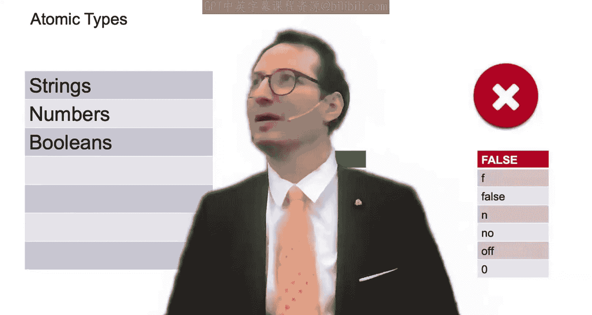

But come back， everybody。Let's start again， So where do we leave I'm going through the types。😊。

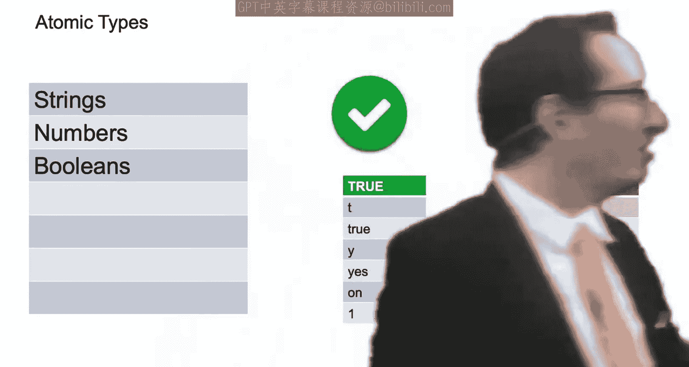

The next。Type we're going to look at is Booles。Just like the Jason Boanance， it's true or it's false。

 There are only two values。 Now， depending on the specific dialect or language that you're using。

 they might take different。Literal shapes in the sense， literal is what you write on your keyboard。

 true force， but also why n， yes， no on of1，0 and so on。

 So there's many different ways you can represent them。 But technically。

 it's always the Bo and algebra with true and false。 This is what it's really about。

 So this is also there。 Then you have date and times look simple， very complicated。 In fact。

 it's often underestimated what the effort is to support them。 And in fact。

 when there are new languages and new technologies， they are always forgotten。

So people have to add them afterwards and extend the system。

 but in the enterprise world dates and times are extremely important when as soon as you run a business and then you need to start them so they have many different calendars commonly we use the the Gregorarian calendar with with a year that can be a positive or negative a month and a day but there are many many different other calendars that that can be used and some systems might even support multiple calendars all right solar lunar there are plenty of versions of them I could actually speak for two hourss on the history of calendars but I'm not going to do that so year month day。

Then， we have。The times， so the times。Is hours minute seconds。

 So that's what we call the if you want to shine in a party it's the hexag Jor system。

 it means base 60 when you have the minutes and the seconds， 60 minutes in an hour。

60 secondsd in a minute this is how it's done and then we use a dots for a milliseconds and all the way typically to microseconds。

 I don't know many systems that go below that step maybe at so or in specific applications。

 but typically we go to the microseconds right there have been attempts to redesign the whole thing in base 10 as a decimor system of times。

 but that that never succeeded So at least it never got popular。

 So hours minute10 secondsd and then you can have that together。As a whole date and time and so on。

What gets complex in there is the time zones because you need to also specify if there is a time zone。

 if there is a time zone， then which time zone is that like UTC plus two now for summertime right here。

 CEST。So it's very complex， but the nice thing is that if you have a date and a time。😊。

And you don't care what time zone it is。 You just want to identify a moment in time。

 then paradoxically， this is the easiest because that's called the timestamp。 And in that case。

 the convention is to just give the number of milliseconds since the 1 of January 1970。

 which is extremely compact in memory to represents。 All right。

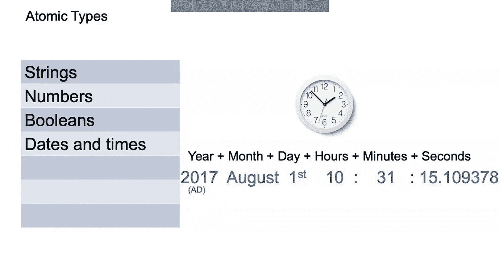

Then we have interval votets， interval votes can also quickly turn into a nightmare。

An interval can be， for example， two years and four months or three hours and 14 minutes and so on。

 The problem with interval is the scary wall between the months and the days as soon as you start mixing and going past that wall like for example three months and today what is three months and today we don't really know because does the month have 30 days。

 31 day 2928 So this is what you do should be careful about it's some system allow it but you should be careful not to cross that wall to avoid any ambiguity right so these are all the possible kinds of interval worlds that you can have right。

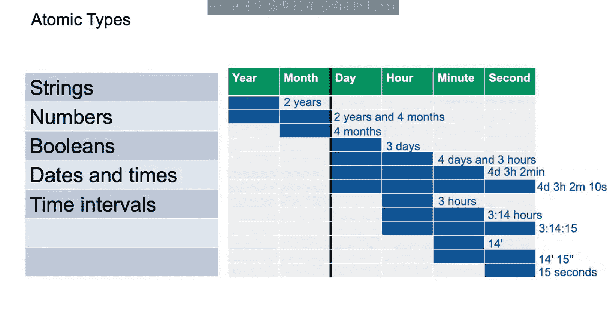

Then we have binary data。Binary data is what happens when you try to store an image or a video or anything as a value in a database can be even in a relational database in X7 in J。

 so you store binaryary data。There are ways to store it more efficiently than zeros and ones。

 for example you might have already seen base 16 way of storing binary data it's when you have all the digits from 0 to9 and then from a to F this is base 16 and every alpha alpha numeric character is actually representing four bits right from0 to 15 so this is one way there is also a base 64 base 64 that basically is even more compact than base 16 but I'm not going to go into that it's a mock tricky way with all the lowercase and uppercase letters plus the digits then you add 62 and then you add two more characters and then you add 64 and then it's a way of compacting the representation even more but anyway just think of binary as a picture or a video that you can store in H base or in a PogresQL or even in an XML or J。

Documents。And then we have null。😊，N is the。Hi， May Greenings will say。嗯。

There are so many conventions， and every system is different。

 There are systems that sayner is the same thing as the absence of values。

 There are systems that say no，ner is a special value and so on and so on and so on。

 So just be prepared for that。 And in some systems。

ner is even a type that contains only one single value。 N， and that's pretty much， right。

 But it's there。 You probably saw it in Python in Java。 I mean。

 there's plenty of object or anti programming languages that also have Ns。 Jasonson has Ns。

 You saw it in JsonN and so on。 Allright。😊，So what all of these have in common， all of these types。

Is that there is the concept of a value space and the concept of a lexical space。

 The lexal space is the text representation of a value that you see in X or Jason or that you type on your command line or。

In SQL when you want to represent it。 For example，4 here can be represented as4 the digit4 or a plus4 e0。

 which means four times 10 to the power of0 in scientific notation， but that's also perfectly fine10。

0 B means that it's 10，0 in base2 right， that's also4。

 So you see there are many ways of representing that。

 These are called liter roles or literal values or x sql values right。

 So this is a text representation。 And then on the left you have the mathematical or abstraction of that。

The mathematical abstraction of the number four as four oranges and so on right so you need to basically be aware of that right to distinguish especially since JO X Xml is a syntax so be aware of the difference between the lexical space and the value space the moment you have past and validated your JO or XMl document you leave the lexical space and you are in the value space and then you you should think in the value space when you query your data it doesn't matter what the lexical representation used to be in the original document here it's the number four。

Okay， here's another example with the value space， which is the rexl space for a date is four digits for the year。

 dash two digits for the month， dash two digits for the days， I think this one is called。😊，呃。

I forgot oh no no， I know the IO 8601 specification and again I don't know why I know that by H。

 but there is a specification that tells you that you should really follow these because there are so many ways of expressing dates。

 try to follow the standout Io 8601 if you can because otherwise it creates a lot of nightmares for the users if they have to pass dates in a different way。

😊，But again， if you write 20170801 in this way and you declare in your schema that this is a date。

 once you have passed it， you are in the value space and you know that this is August 1st， 2017。

 right？😊，Okay。And this is also the same standard that Io 8601 with a t in the middle and then you can have the hour。

 the minute the second and z is for the time zone the UTC time zone right so this is this is it okay and then again you abstract it to the value space on the left。

😊，Okay， yet another one， this is the lexical space for durations if you have P it's always speed and one year two months P three hours P is's always to separate the days from the hours and P basically said it's a duration but again if you declare it as a duration in the schema and you had this lexical value in J the moment you back it then you are in the value space and you know this means one year two month three hours okay。

😊，Then in many systems you have the concept of subtypes， for example。

 an integer integer is a subtype of decimal because every integer is a decimal but not every decimal is an integer right so you can have this notion of inclusion of value spaces typically a subtype is a restriction of the value space and the supertype is a larger value space。

😊。

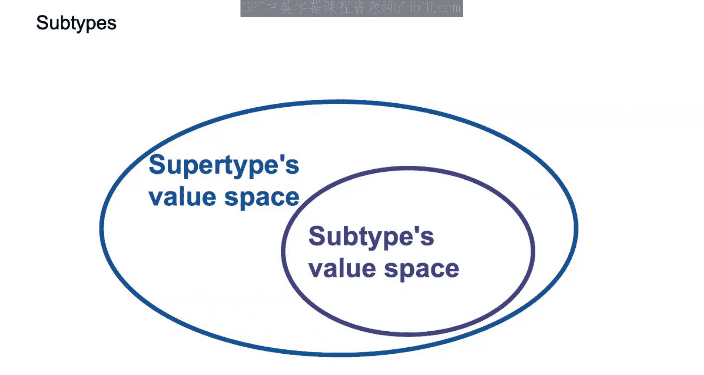

そリダーでアトミイクタイプ。Again， it's a menu， not all the systems have all of the types。

 they will have some of them， not all of them， some systems will have more of them。

 some systems will have less of them， the correspondence is not always perfect。

But this is pretty much the idea of what you will find。Now let's down to structure types。

 structure types， typically in many systems， you have maps and you have list。

The maps is what we call the J objects， but you could also consider that a set of XML attributes in the same element could also be seen as the map from attribute name to attribute value。

Strs in data frames will see data frames later， butstructs are also maps。

And then this is like adjacent array， is a list。An XML element can be seen as a list as well。

 You can have nest elements and text and so on。 It's ordered。 So this is why it's a list。

 and a data frame array would also be a list。 So map and list， these are the mathematical terms。

 or let's call it the theoretical computer science terms map list。

 right And then on the right there can be called many， many different names。

 but it's all the same in fact。😊，Who is that here？Maax list。So I might use that interchangeably。

 sometimes I would say maps， sometimes I would say objectsstruct maybe more rarely。

 sometimes I would say least， sometimes I would say array， you know， depends on the context。

 but basically these are all a bit interchangeable。Right。

 so map and least would technically be used in maybe in more theoretical lectures about algorithm than data structuress。

 object and array would be used a lot in database lectures basically。

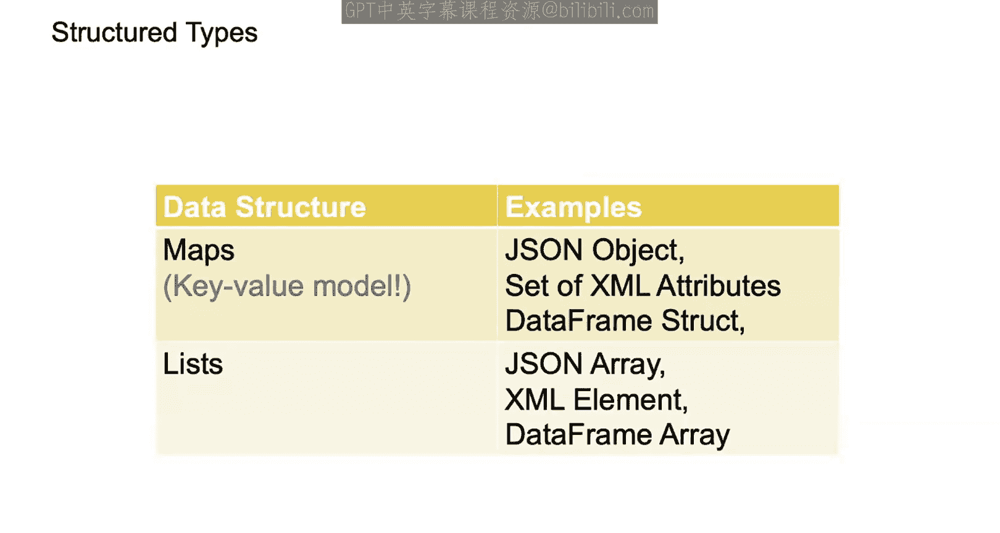

ok。Yet another thing that many systems have in common， not all of them though。

 but many systems have the notion of guardinity。Why do we care about cardity Well in many languages we actually don't because if you consider a language like Python or Java。

 you only ever have a single video at the same time right you have a in Java you have a pointer to an object。

 but you always return every function， return a single value。😊，But there are systems like SQL。

 for example。That can return sequences of so they can have they can return a million values out of a function like a whole table。

 a million records in that case， the type system typically also allows you to states how long this output is going to be。

And there are typical characters that are used for that， for example。

 one is very often if you read on a single video zero or more means arbitrary length。

 a common sign for that is the asterisk that actually means any numbers， zero1 or more。😊。

0 or1 means either you have it or you don't。 A question mark is typically used for that。 It's 0。

 It's1。 It cannot be 2， though it it has to be 0 or1， and one or more mean it cannot be 0。

 but it's at least one。 that's a plus， right， So the asterisk is question mark plus If there's nothing。

 typically it means exactly one。In some systems， you don't use the asterisksters。

 the question mark and the plus， instead you use adjectives。For example。

 you could use requied in order to say exactly web。

 you could use repeated in order to say01 or more or you could say optional in order to say0 or1 right so it really depends on your system。

 but in many systems there is this idea of these four categories，1，0 or more01，1 or more。

Is anybody familiar with regular expressions by any chance， some of you。

 so that might be easy to learn because these are actually the same symbols that you are familiar with in regular expressions as the risk question mark n plus okay。

So this is garden editingity。 We'll come back to that when we study query languages for for Jason in a。

 in a few weeks。 we'll use them again。

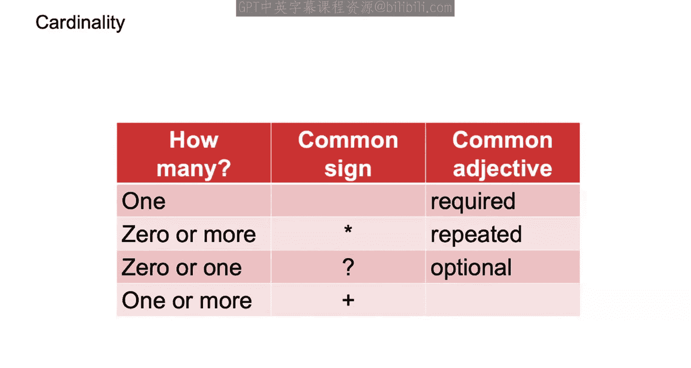

Okay。😊，No。Look at that as if I give you a huge dictionary with the 20000 words。

 and then there is the Su duty in the first column Badu in the second one， Aerdu in the third one。

 Bad in the fourth one and so on and so on， except that now I do eat four types。

So this is an attempt， actually， it was by popular request。

 some people in the former class a few years ago asked me for that。

It's an attempt to have a comparison of different type systems so here Jason Iq we will study and Jason that's a validation language we study it in that course Jason schema is also quite popular xMl schema is used for XML Sp SQL will cor it in a few weeks also have a type system data frames in fact Postgsql also have types Python also has types so these are plenty of them there are even more than that right there's probably thousands of them but what I did here is I tried to show you how it corresponds to each other right for example。

So if you remember what I told you about atomic types you will find a lot of what I told you right Desyorinteger by Choinong I told you here these are the IE 754 double float for approximated real numbers。

 strings bulloleans， these are the binary representations base 16 base 64 dates。

 dates times objects arrays and so on and so on right so this is all I showed you but here you basically notice several things。

😊，The first thing you notice is that it's almost whole。

 It means that there is kind of a correspondence between the two， For example。

 a double in Jsononic is called the number in Json schema， a double in Xml double type in spa sQl。

 It's called double precision in sQl。 It's called floats， right。

 You need to be careful sometimes this is called a float in Python。 even though it's called doubles。

 But basically， very often you have a correspondence。 The other thing you notice。😊。

Is that sometimes you don't， for example， there is no float in Json schema that doesn't exist。

 Ba 64 doesn't exist in year doesn't exist in there and so on。 So it's not perfect。

And the other thing that you notice is that it's not always one on one， for example。

 by short in long。😊，There's no distinction really in Jasons schema in Posgcuate。

 there is nothing for this one。In Python， they don't even exist。

 You just have int and that leads right int for actually any integer and you don't have any distinctions。

😊，So again， treat it like dialects have a general understanding of the type system now basically I can throw at you any technology。

 any schema validation technology， any programming language I'm pretty sure you're going to learn it very quickly because you already have these general understanding all you need to do is open the documentation and see okay oh that type here exists or that type doesn't and oh that corresponds to this and so on so you can try to fill that table with any new technology to see how it works right and you see here the D corresponds to an object the list corresponds to an array in Postgreql you have the array notation with the Sc bracketsstruct types in PqQl correspond to Ds in Python and so on and so on right。

😊，It's not complete， there's probably more types that I forgot， but just to give you an ID。

who feels this general type system thing， right， the intuition of that。Many of you， that's。

 that's my ego。And again， there's no way you can learn everything by heart right。

 but basically you understand on the high level how these things actually work。K。

Then let me move on to validation then so specific JSound is a schema validation language that was actually designed for teaching it's a good way to introduce validation with that and then once you know it you can very quickly learn any other this is the first column in there by the way JSound these are all the names in there by the way I can already mention it now if you look at the XMM schema column this is the same thing there's this excess prefix but these are exactly the same types in XMNN in JS sound。

Okay， so J cells。So I'm just going to show you examples and then you will see the intuition。

So what does it mean that we validate。A document。 first， it means that it's well formed。 Otherwise。

 we cannot validate it。 So let's take a well found document。

 I'm going to put my well found document on the top of the screen。

 Last Einstein is my well formed document。It's also called an instance。

 the document that I would like。To validate it。When I want to validate a document， I need a schema。

 The schema will be at the bottom last string。 that's a schema。

The schema gives me the constraints that I want to check and then yes or no。

 does my document  fulfill these constraints？But you might notice the first least interesting probability here is that the schema is also adjacent documents。

It didn't have to be right， my schema could be anything else， in fact。

 there are technologies where the schema looks totally different。😊。

But this is very common in X and schema validation。😊。

A schema validation language for J will typically done with adjacent objects。

Typically be done with a object。 And a schema validation in XML will typically don be done with an XML document。

 It's very common because it's intuitive。So what does my schema say in here？It says。I want to check。

So last string， that's my schema。 I want to check if the document that I'm looking at first that its an object。

Second。😊，That if it has a key called last， then that has to be associating with a string。

 not an array， not an number， it has to be a string。So this is what I'm checking， further out more。

 I do not want any extra keys。If there are mores than just last， that's not valid。

Who believes the document on top is valid against that schema？All right sent。Yes。

 it is valid right I have a key called blast it's associated with Einstein that is a string。

 so this is perfect。 So indeed what I can say is that my instance documents that I stored in the file file dot JsonN on my hard drive。

😊，Is valid against the schema that I start as adjacent document in schema。Json。Here it's valid。

Here's another example。In my schema， I say if the key is less than it has to be a string。

 if the key is 2， then it has to be a string。And I have an instance that is valid against that schema because last Einstein that's a string。

 First Albert， that's a string。 So that's fine， right， So my document is valid against my schema。

 My instance document is valid against my schema。😊，Gep。Next， this also works， in that case。

 I want less than first to be strings。😮，But again， I said if they exist， because in that schema。

 I'm fine if it doesn't exist。 for example， here， my instance document does not have any first doesn't have the key first。

 but if it's fine， it's optional。 So it's also the case here that my instanceense documents。😊。

Is valid against my schema。Okay。😊，Now， what if I don't want it to be optional。

 What if I want to say in my schema， it has to be there。 Last has to be there first has to be there。

 when in the compact form of the syntax， just adding an exclamation mark does the trick right So if I say exclamation mark less。

 it means it's required it has to be there。 and first has to be there。

 So now my instance documents have to have these two keys and it has to be strings right So again。

 my instance document on the top is valid against my schema at the bottom。

Here's another one where I have lasts that should be a string h that should be an integer。

 I remove the exclamation mark so now the option not again and now it's valid right H142 that's fine that's an integer and last is Einstein that's fine its quotes。

😊，Notes that in the context of J sounds。We don't care if there's double quotes or no double quotes when we pass that meaning that even if there had been quotes around 142。

 it would still have successfully passed as an integer because we are only interested in thelexical representation right we are only interested in the lexical representation。

Okay。Here it's a boolean， Physicists must be a boolean， yes， it's true， so this is a boolean again。

 it would also have worked with the quotes because ERUE is the lexical representation that is in the Boolean lexxiical space。

No。That's fit。 Location is N， So that's fine。 It works as well。 Location must be nu。

And that's it right， who understands the intuition here？😊，Right。

 the idea and the way it was designed is that the schema actually looks very similar to the document that we are trying to validate。

 That's on purpose。 It's meant to be intuitive in this way。

Now I already showed you a lot of the types there， but this is basically the menu that is specific to J sound。

 but also to XMM schema that's all standardized but by the W3C this is a list of types that you can use there's a lot of them even the unsign positive negative。

 you have everything in there。😊。

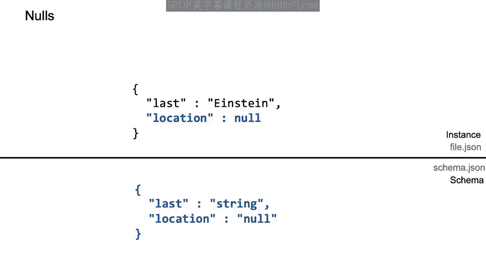

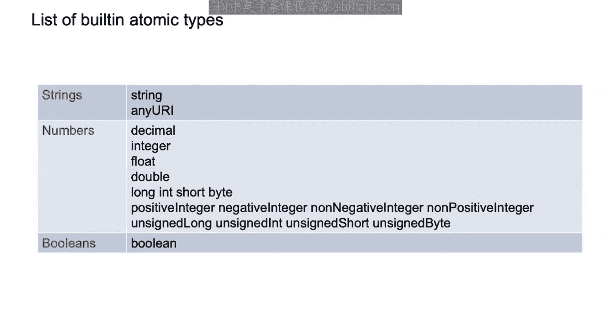

dateate time time date， year month， if you want to say， for example， April 2024。

 that's a year month and so on and so on duration year month duration heggs binary that's the basic16 representation yes maybe we can throw the。

😊。

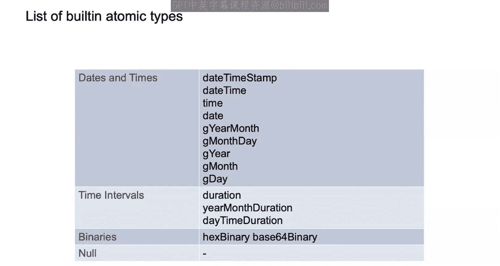

They want to keep one系。啊。好。Oh unions you mean right。

 so it is possible to specify union types where you can say this has to be an integer or a boolean。

 So yes， many schema languages allow you to do this as well。Mmhm。😊，That's a very good point。

 I just didn't put it on the slide to not complex complexify too much。

 but it is possible to define union types as well。

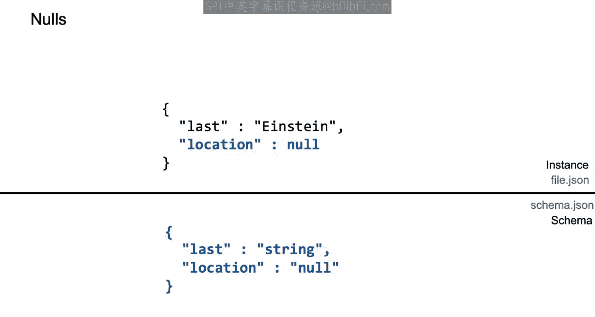

Okay。

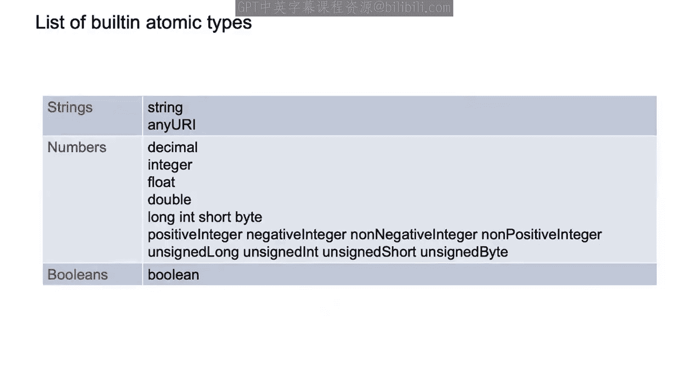

So you see it's a huge menu here。 It's a huge menu。

 It's all standardized by theW3C and they are all available and the list depends on the schema technology you're going to use。

 right Jason Schema has a much shorter list， for example。😊。

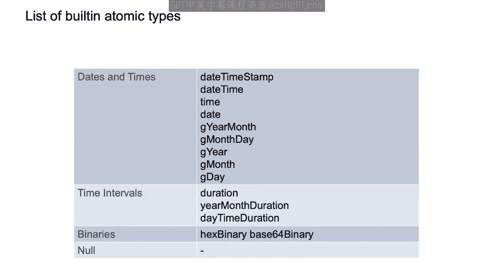

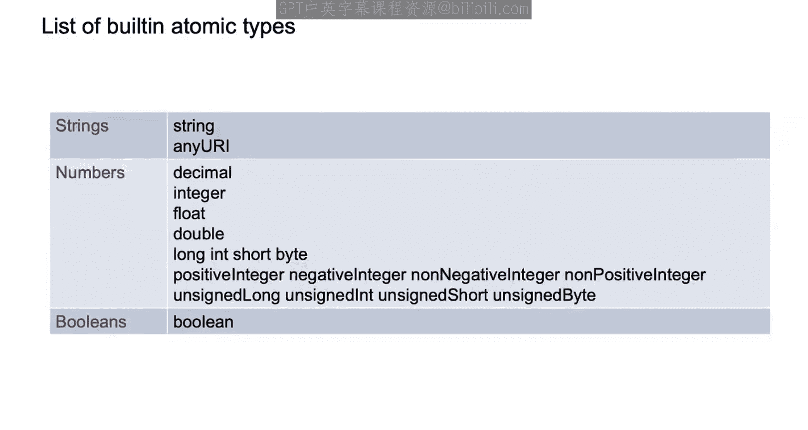

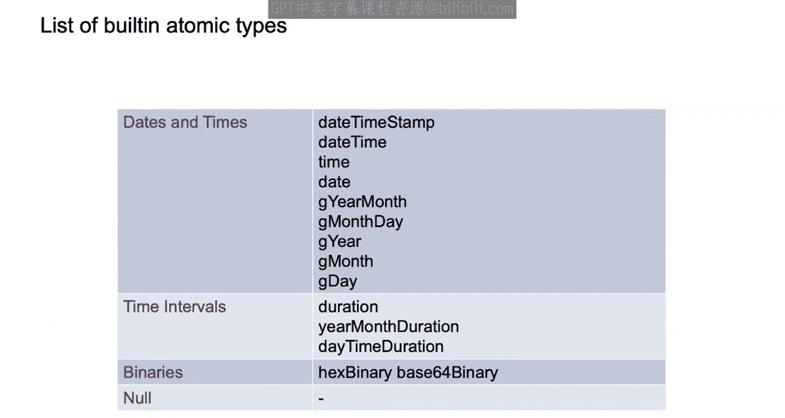

Okay。😊，Now， how do we allow for any value we can just use item item is the type that can be anything。

 can be an object or array a number or date， absolutely anything。So if you say location item。

 then you accept anything and an array is anything right so in that case it accepts Switzerland and US。

😊，You can also specify an array as an array of anything and you use again it's very similar to how it looks in the instanceense document here the square bracket item means it has to be an array with zero one or more items and the items can be anything so in that case we do capture a document like this that has a heterogeneous array we just declare it as an array of items right。

😊，If you want to be specific， you can also say I want an array of integers。

 right now this is an array of integers，1，2，3，4 in my instance document。

 and in the schema it's very compact， just use the square brackets with integer。

 That's how you specify your schema。😊，Right， for whom is that intuitive。Okay， very good。

 So we see array of items， array of integers and so on。

You can also have array of objects that look the same in that case I have an array of objects that have an optional key fo。

 but it must be a boolean。😊，And nothing else alone right it could also have an empty object that would be fine too because food is not required。

So体系。Very useful。 If you want to nest a table in a table in a table。

 then now you can have an array of objects， and you can even have an array of objects inside an array of objects。

 yes。😊，不对。发好。Yeah it。对的对。嗯。So the meaning， let me explain the meaning and then you will tell me if that answers your question。

When I put in my array， the square bracket means that it's an array of objects here。

And this means that every one of the objects that is in there。

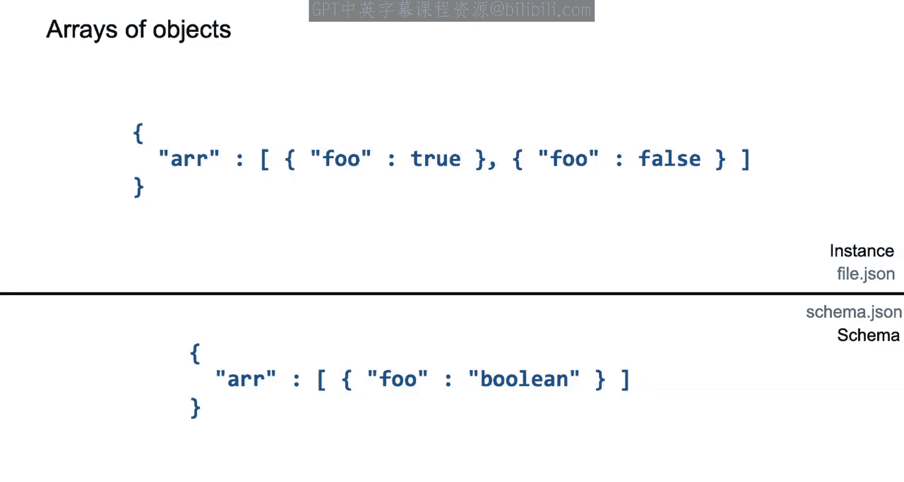

Must have either。ワ key。Oh no katator。

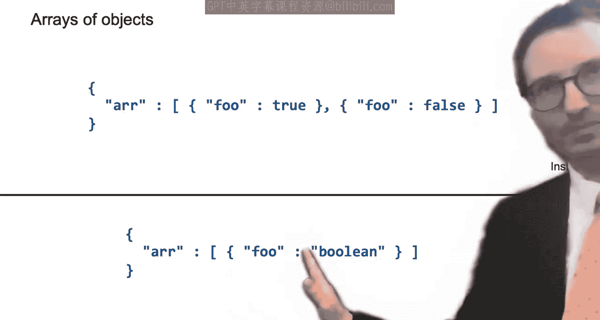

But not more than that。That's the first condition， so if you had bar or anything else that would be invalid anywhere。

 the second condition is that if it exists， the key who must be associated with the Boolean has to be true offers。

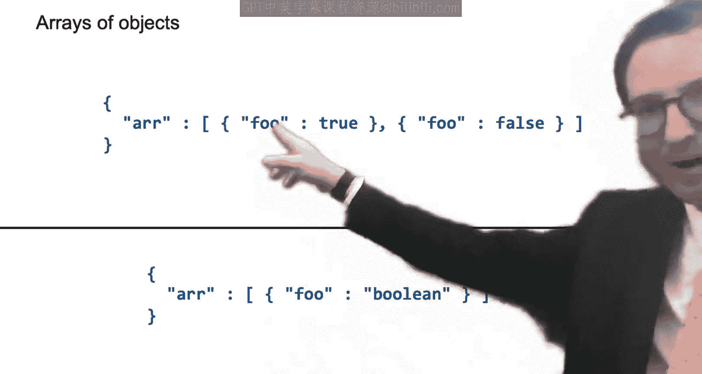

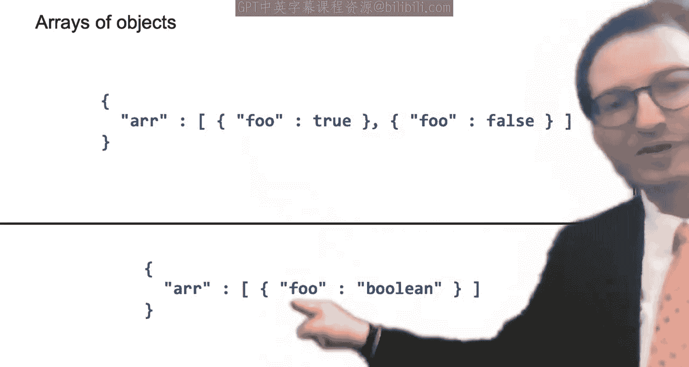

So I could have an empty object that would be fine， but apart from empty objects。

 I have to have food associated with a Boolean。😊。

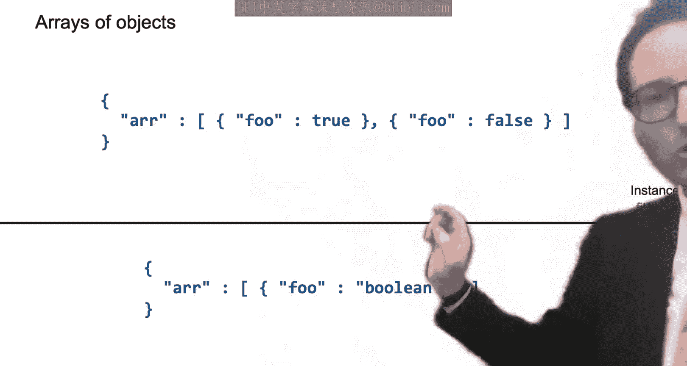

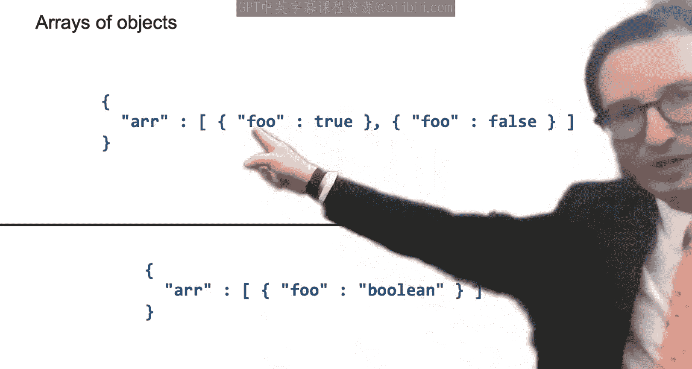

Even if I have a thousand objects in there， they all must follow exactly that pattern。

Did I answer your question or is it still open？Now that would not work so basically oh now I understand your question this really says this is an array of object if you have anything else than an object that's an error。

 it's not valid right so if here you had an integer and a string or a boolean outside an object that would be refused that would be rejected right so this really it is very specific it requires it to be an array of objects just like when you sit here an array of integers and if you have something else than an integer it's not accepted right。

😊。

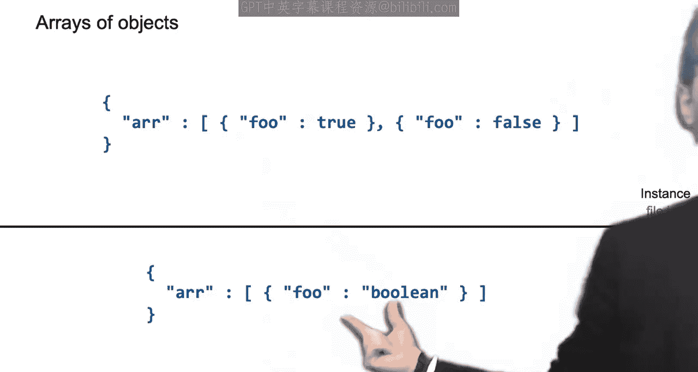

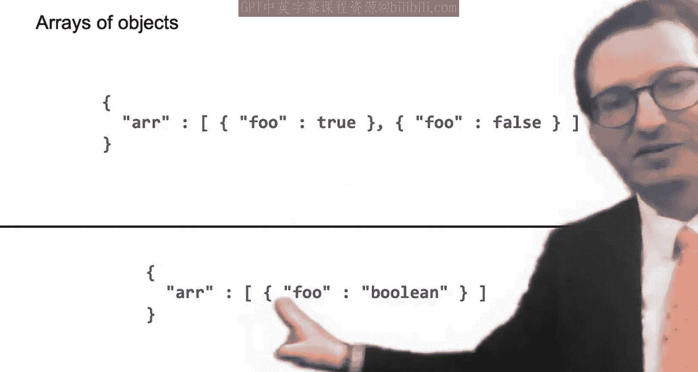

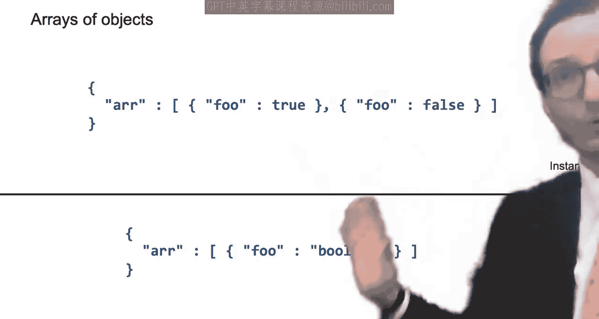

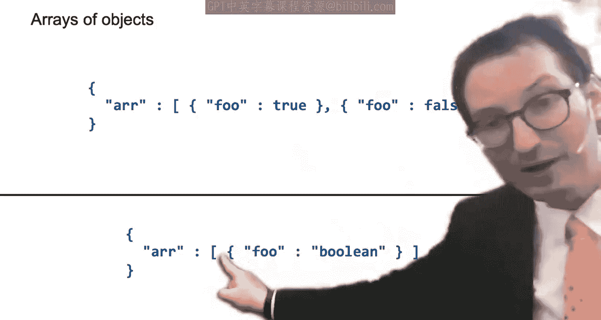

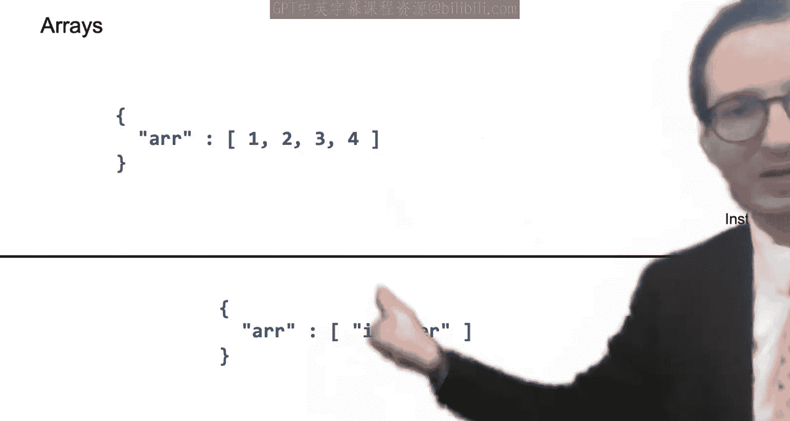

And we will see that this is very， very good for data frames。 In fact。

 this is creating a data frame when you do that。😊，ok。😊，呃。Now， extra fields are forbidden by default。

 meaning you cannot have anything extra。In that case， you have last first， but if you had meled。

 then that wouldn't be a lot。嗯。Now， you know that there is another syntax to JS that is a bit more available。

But it allows you to do mock things most of the time you don't need it。

I'm only showing it to you as an example because I don't require you to learn it。

 just know that it exists and if you use it， it can do even more things than the compact syntax。

But basically， the idea is that instead， instead of looking like the document it。More elbows。 Yeah。

 I basically explicitly say the kind of document I want to validate is an object。

 The base type is an object。 The content of it is made of a key called last of type string and a key called first of type string and so on。

 It's the same thing， right， It's just that this is more elbows。😊。

But the nice thing about the ver is that you can do many more things， in particular。

 you can add closed falses。😊，And when you do that closed false。

 you basically allow for extra keys that you didn't anticipate in the schema in that case。

 I have year 1905。That's the great year for Albert Einstein。 It's fine， right。

 year is not in my schema， I don't have any name here in the content， but since I said closed false。

 then I allow for any other key。😊，My only constraints are if there is a key last of first。

 they must be strings， but any other key is fine and that other key can be anything it wants to be。😊。

Or whom does that make sense？Okay。But this， you can also only do with the ver syntax in in the compact syntax。

 you don't have any way of saying that it's not close， that it's open， right。

 So if you use the compact syntax， it will never allow for extra roities， okay。And again。

 don't be scared by the variable syntax， I'm just telling you there is one， but it's okay。

So what did we learn with that schema language， the bes and whistles of a schema language。

 What can we do with the schema language？Well， the first thing that we can do。

Is that we can be very restrictive about the values that we all allow， for example。

 I can say in my array， everything must be an integer。

 or I can say the value associated with that key must be a date and so on。😊。

So I can restrict the types， meaning that I restrict the literal that I can have the lexical representation。

😊，嗯。I can also cast， meaning that if I have an integer in quotes， but I pass it as an integer。

 then it drops the quote。 It's kind of passinging it as an integer in memory， right。😊。

Note that inte for Integer the quotes are optional for dates， you will need the quotes。

 you cannot put a date just like that without quotes in Jason so a date will always be in inside quotes。

 but in memory you will cast it to a date cast means that you change the internal representation and make it something of type date of type integer and so that's called the cast。

So in that case it's a cast because we had the string 2134。

 we cast it to the integer 2134 this is done implicitly when you validate against an integer it's going to Fox the cast。

 this is what I called annotation earlier basically。😊，The third thing we can do is require a value。

 I can say who is required or I can say who is optional， that's the third feature of a schema。

A thought feature is whether or not I allow for extra key that I don't have in my schema that's also something you can choose to do or not to do right you can for example。

 either say bar which is not in my schema will be accepted or rejected it's your choice depends how you build your schema but you can control that。

Whats？So that I didn't show you how to do。 But there's the concept of default value。

 What is the default value。 It's the ability to say that if the document is missing a key。

 then you're automatically adding something for it。 For example， I don't know。

Imagine you have a list of students。 and there is a universe。

An optional key called university and you can say that the default value of university is ETH Zuric what it means is that if the instance documents does not have any university key then it's automatically going to add the key university associated with ETH Zuric then we say that ETH ZurI is a default value for university that's also part of the annotation process and after the validation then you will have ETH Zuric added to the tree in memory。

😊，Something else that I didn't show you is the concept of primary keys and this is particularly important when you start having denormalized data with tables in tables in tables in tables you can for example have an array of objects that is meant to be a nested table and maybe that nested table has a primary key。

 for example fo here could be a primary key what it means is that you don't allow allow repetition here you have Fu2 and Futu that's not a lot you could reject it by saying that who is a primary key within each array。

Right， this is also possible。 I just didn't show you how to do that。

 but this is also something you can do。诶。Now here another example still J sounds this is a real world thing。

 So on the top you have an instance of what's called the great language game data set it was yes。

 there is a question about that do we have the microphone actually so。😊，I can repeat then y。Yes。

 you can， but with the ver syntax with the compact syntax you can't。

 you can just say what the type is with the ver syntax when you define an array type， you can say。

 for example， at least four。Atmost then that you can do， absolutely。嗯。All right。

 so this is a real world example， there was a game a few years ago I don't know you if you actually saw it。

 it was a game where it would play a sound， somebody speaking and it asks you what language is that and you get folk possibilities for example in that case it would play some Norwegian sound Norwegian words and then it asks you is that Maoi is that Mandarin is that Norwegian or is that tongan。

😊，And then you need to answer and basically what you have here is that somebody played from Australia。

 they were in Australia and they said it's Norwegian and they were correct so the guess was Norwegian and the target which is the correct solution was also Norwegian so in that case they were and that was actually played on the 19th of August 2013。

😊，And there is a data set like that， this was a real game there was really a website where people could play and actually we played it in the Pomenza back then it was very fun。

😊，And they collected database on that every single play。 they stored in a database。

 And I think they have 16 million place。 So there is a collection of 16 million JO objects。

 This is one of the 16 million you can download it。 It's out there on the Internet。 We also use that。

 but basically this is an example of data sets that has a structure because all of these 16 million objects。

 They all look like that。😊，And the nice thing is that because of that。

 we can actually design a schema against which this is valid。

 And the way you do that is that all of them are required。 They always exist。 This is a string。

 This is a string。 This is a string。 This is an array of strings。 This is hex binary。

 You see this is a base 16 binary representation。😊。

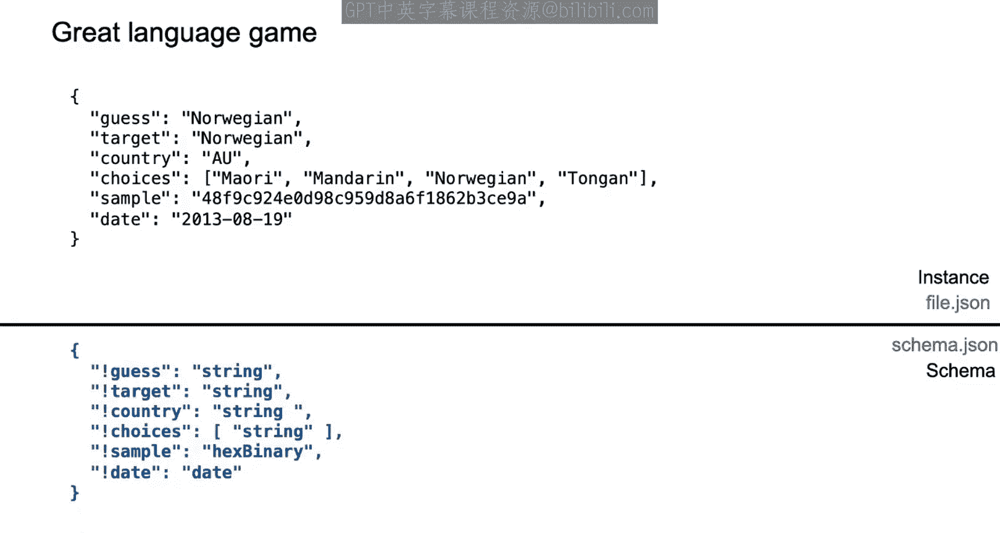

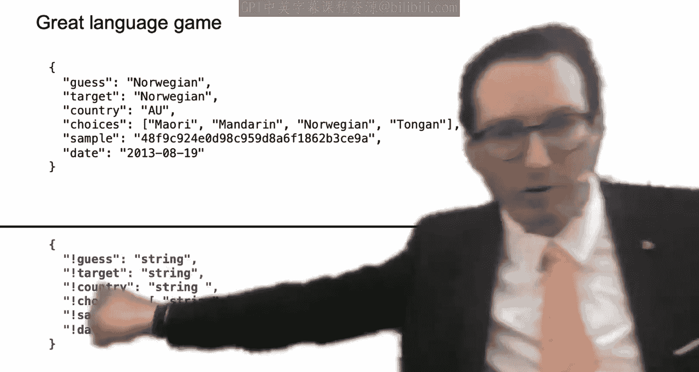

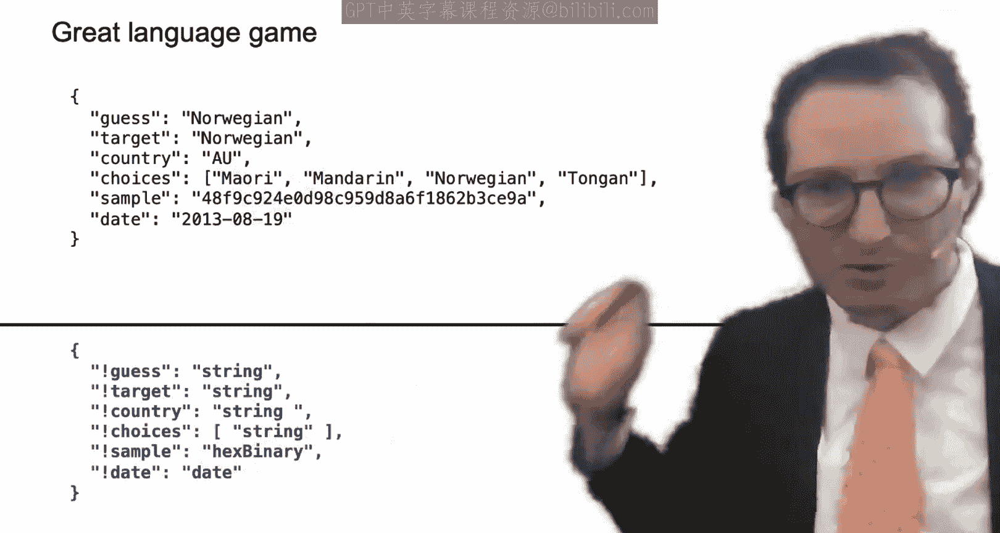

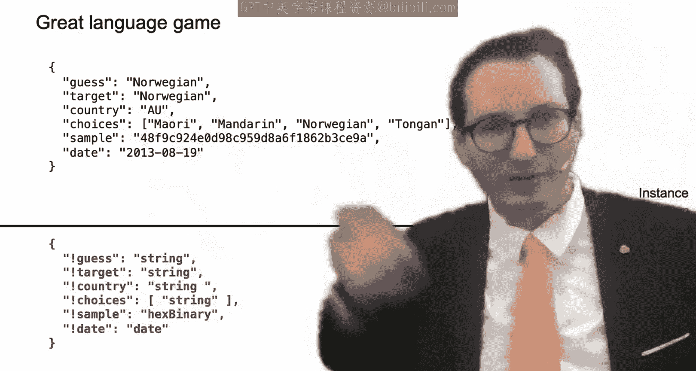

And then this is the dates right here with the Io 8601 representation there with the dashs and you see this is the schema against which all the documents are added。

 who has an intuition。

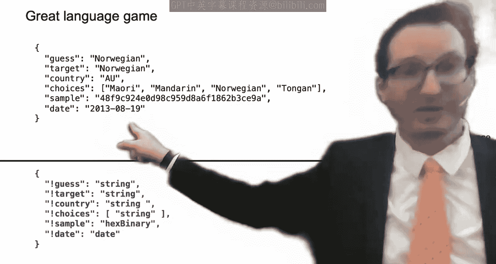

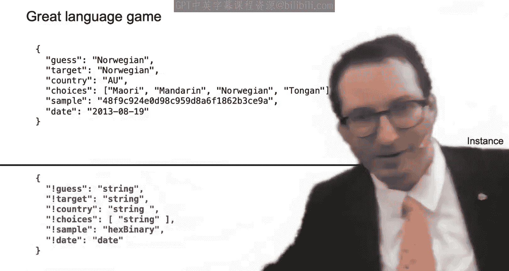

All that。

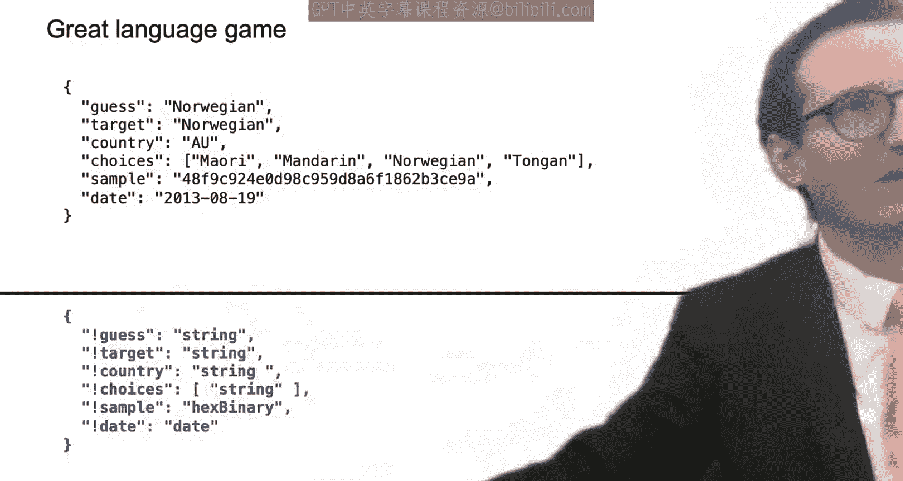

Are very supposed to be in awesome。Okay。So， this is。

JaSo now if you remember that document I showed you earlier。

 I claimed that that document is easy to build a schema against which it's valid。

Who has it in their mind， who could in their minds come up with a JSOund schema against which D is valid？

Take a few seconds， raise your hand when you have it。I see some race hands。Now， tell me。

 is this what you have in mind？Who had that in mind。Or close to that。ok。

So you see what happened here first I made them all required except bar bar is the only one that doesn't have an exclamation back because this one has to be optional ABC who theyre all required A is an integer right B is a boan。

😊，ho so sees an array of objects and inside the array of objects who must be a string and bar must be an array of longs why long I just wanted to have fun I could have put in。

 I could have put integer whenever I want but anyway this is the idea this is one possible schema against which this is valid and the idea is that this is an example document but once you have a schema like that then you can build a collection with a billion documents and you can require that each one of these documents is valid against that schema。

😊，RightThis is the idea。But the cool thing is that it's optional。

 you don't have to do it and you don't even have to do it at the beginning， you can do it later。

 you can first put your documents in there and maybe a week later come up with a schema and then validate。

 but it's fine to do it later。😊，In Postgresql， you cannot do it later。

 you have to do it now in Pogresql， it will not even let you not do it， you have to do it。

Now this you can go to it and address， you can type it right now in your browser if you want publicqualyvy do org 1990Jsonvalidta do HTML。

 you can put some Jason， you can put some some JsonN and some J sound and you can play with it。

 press a button and you get green or red depending if it's valid donut。This runs in the clouds。

 there is an instanceense of RumbleDB running in the Amazon cloud。

 it's restarted every day if it goes down just just wait a little bit it's supposed to restart automatically and it should scale by putting more machines if more people connect at the same time。

 but just be aware that the machine running that only has a gigabyte of memory and just a single core。

Yes。呃，猪。Lets me see。

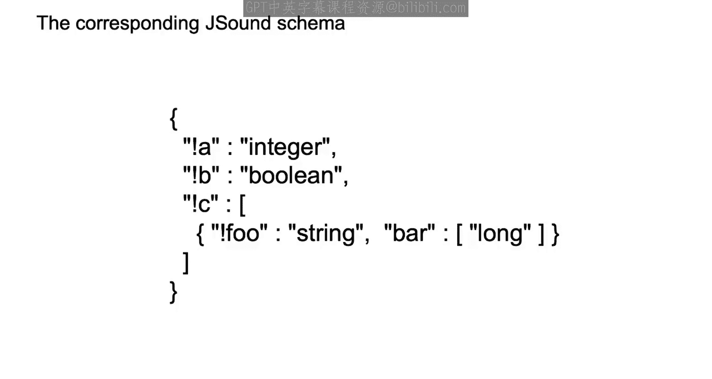

Oh， yes。So you could indeed have said that C is an item。😮。

You could also have sets that is an array of items。Did is都 fine。But in practice。

You basically want to be as restrictive as possible。But not too much。

You have to be restrictive in the sense that if you put C， that is an item。

Then what might happen is that if you have C associated with something else。

 then that will be accepted。 So the question is， do you want to accept it or do you not want to accept it。

 This is the question you need to ask yourself。However。

 what you need to keep in mind and I come back later is that。😊，This here， for example。

Can be used with a data frame This is basically what I call data frame friendly So data frame friendly schema you can put that in Pos。

 It will work well not with that syntax， but you can create a pondas data frame in this way。However。

 if you design your schema and you put item instead of C， that is no longer a data frame。

Because in a data frame you have to be specific in a data frame you have to say what's the type of every column in most of the technologies。

 there are data frames that have something called variants。

 maybe you heard of the variance types in databases variants would be the idea of item of anything but it's hard to optimize so this is why in practice you should try to avoid using item if you can try to avoid it。

 try to be specific。😊，几。😊，Did he don't answer your question？Yep， all right。哦， okay。So yes。

 go to that page， play with it， you can use it all you want。

 it's also integrated in so theres a JSOonic tutorial but there is also a JSSound inside JSOonic there there will be an example in the exercises。

 but this is the ID so now you can play with it all you want and make it work。😊，给。😊。

You see there's always this part of 1990 publicrombled。

org that's the one that is running on Amazon for read just for everybody in the world to use if you use the Jupiter notebook inside the Docker。

 who did the weekly tutorials of Jsonic， who tried them。😊，Some of you right。

 then you will see that then it's not public Rumble Db， it probably says Ruble 1990。

 this is because it's inside Docker。😊，If you see local host。

 then it means your outside Docker but on your machine。

 local host normally you should not use right if it's local host and something's probably wrong。

 but within the Docker that we use in that lecture it should just be rumble 1990。😊，All right。

That's the same books。Any questions on Jsms？Okay。So now。Ja soundund is easy for teaching。

 I'm going to introduce you to Jason Schema， which is the very popular one。

And I use see the comparison。 It basically does the same thing more or less with a few differences。

 But this is the idea。First， you notice that it's a bit more complex。

 It's closer to the variable syntax of of J sound than to the compact syntax。

 So it's a bit more involved。 But basically， the idea is that here you say the type must be an object and the properties of that object must be last。

 the type of which is straight， right。This is what it looks like Basically that's it。

 You just have to accept it the way it is。 This is what the JO schema looks like and then on the top that that document validate against that schema again。

 that's no longer J sound now it's JO schema that's a different technology。

But you notice it still looks like a Jason document， the schema is still in Jason。😊。

Here's another one where you say last must have the type string and first must have the type string so it's valid again here you also have this same idea that it's optional by default but if you want to require it you just put required in there after other type and you have a list of the keys that are required so you see it's the equivalent of that exclamation mark in JO but instead of an exclamation mark you just have to list the keys that are required in that case we say last and first are required okay。

😊，Then extra fields。 So this is unlike JSO extra fields in JSON schema are load by default。

 but you can say additional properties false that's kind of like closed true in JSO that basically says you don't allow any additional properties So you say in that case only the last11 hour load not anything else but if you don't have it by default it will allow them So you see every technology might have different conventions but they can still do the same thing right they have the same power。

😊，Now you can have H， the type of which is number just be aware here that the list of available types is much more restrictive in JON schema than it is in JSO in JON you have this whole menu of types that is standardized by the Do3C in JON schema。

 you can just say number and you have patterns， you can control the patterns but you just have to say number。

There's also brs you have null also that you can say you can also so here you have no idea why it's designed that way but if you put true it lose anything true would be the equivalent of item in JSO I have no idea why false means you disallow it so here false means location is not a lose right so it might be less intuitive but this is just the convention under which it's designed。

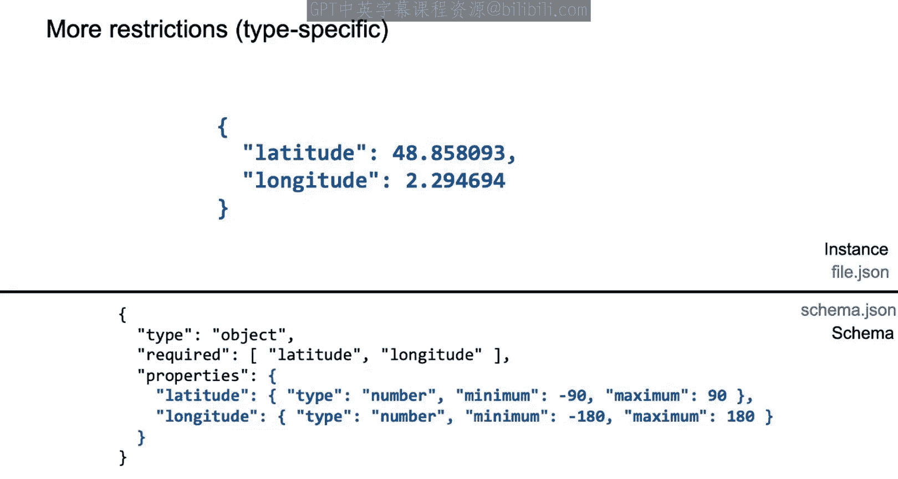

Here you have an example of pattern。 they are also a load in the variabless Json syndax。

 but here you say these must be numbers between minus 90 and 90 this is the latitude on the earth right sorry north south minus 90 is the Northpo sorry90 is the Northpo。

 this is the South Po and here this is the one crossing Alaska write 180180 minus-180 the longitude so you can restrict in that way with the pattern。

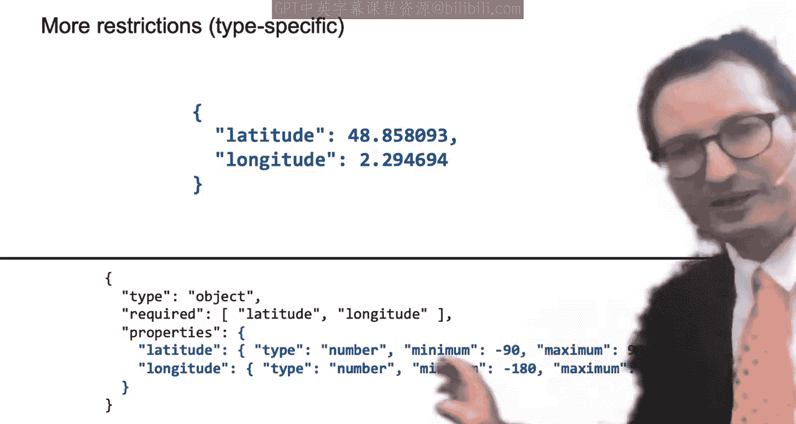

You can also say that you want an array。 then you just use the array string， right。

 The type must be an array or an array of anything。

 You can also specifically say that you want an array and each item must have the type integer。

 Then you write item type integer。 Again， it's a bit more involved。 It's a bit more ver， right。

 you just have to。Learn it or read the documentation， but basically it can do the same thing。

 It's able to say that you have an array of individuals， right？

But you see how quickly I went on JSON schema， why， because it has the same features as JSO。

 so I took the time with JSON with the intuitive syntax， JSON schema。

 just go over the sides again offline， you will quickly notice it does exactly the same thing just with a difference syntax。

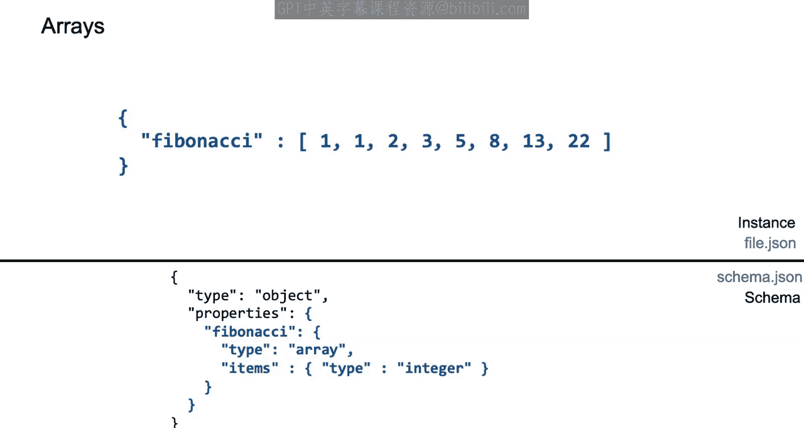

That I keep for next week for XM schema， but again， now that you know how JasonON schema works。

 I'm pretty sure XM schema would also be just as easy for you to learn。Alright。

 so the reminder we'll do next week and next week will probably start with map reduce with a bit of luck。

 We'll have time to start with map Red。 So thank you very much。

 everybody for attending presenter on Zoom Android the exercises that that are prepared to the T A team。

 I think there was a bug in one of the exercises with the age base。 but the deadline got to extended。

 don't hesitate to write if there's any issue， right， and we basically listen to support you。😊。

Have a great day and see you next week at ATM or the next lecture。

