# 苏黎世联邦理工《工程师的大数据｜Big Data for Engineers - ETH Zurich - 2024》中英字幕 p19 8. MapReduce (1_3) - .zh_en -BV17FAmeFE9K_p19-

Welcome back， everybody， we are going to continue。Before we continue。

 I will summarize again what we've done last week and in the first world today in order to give meaning so that you know why we are doing all of that again。

The point of data modeling and data frames and schema validation。

Is that when you have a data set download these from the internet in textual formats？

If you are able to create a schema。Vと that隙間。That allows you to turn the whole data set into a data frame and as soon as you have a data frame。

 you can save it in a binary format and it means that you just downloaded1 terabytes of JSON data and now you have it all in 10 gigabytes of packeter this is how powerful this is so this is it's theoretical of course。

 but this is of very practical use to data scientists because it makes a huge difference if you are able to compress the size to 100 times less in terms of in terms of performance。

Because that really means that you can。Analyze the data in 6 minutes instead of an hour。

 And that does make a difference to the。To the user。Okay， so now because I said we query the data。

 So let's query the data， right， because we've spent already 7 weeks not querying any data。

 We've just looked at data so far。 So now we can start querying it and massively Pali will query that data。

😊，呃苏。This is where we are， we already go out a lot right we are halfway through and hopefully you also understand why we go out all of that。

 but now we are moving on to processing the data。😊。

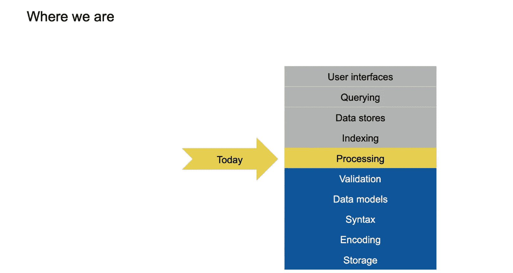

So I know it's the morning。 It's 8 AM。 so we all need to wake up。 so let's do it in a fun way。

 Last weekend， I went for a Pokemon hunt and I collected a lot of Pokemons。😊，But the thing is。

 I want to count them， I would like to know how many pikachuos I caught and so on。嗯。

I could of course do manually， right and just account them one by one， keep track and so on。

 but the problem is that when I do that， it actually actually takes me two hours。

And so I thought we actually did it in the fall now in the interest of time we cannot do it in the lecture。

 but with the master of students we did it inside the lecture。😊。

I would like to know how many of each I have and the way。😊。

That we typically do it in the lecture holding is that I。

 I had these huge bags of Pokemons that I brought。 And then I asked for a few volunteers。

 students in the room。 they each got one bag of Pokemons。Distributed to the volunteers。

 And the idea is that every one of these volunteers is going to take the Pokemons from their bag and they are going to countun them and write it on a sheet of paper that。

In that case， two pia choose， I I have a huge difficulty with the names of the Pokemon。

 So I'll just stick to two piach shoes and so on。 And yes， so that's basically the output of the。

 of these first round of of volunteers。😊，We write it down on a piece of paper。

And then we need a second round of volunteers， So other students。

They are going to to do something different。 These students will be responsible for a few Pokemons。

 So for example， here we have Alice who's responsible for Pikachu。

And what happens is that the students from the first round who wrote down the intermediate results like this on a sheet of paper。

 they cut the you notice that these are keyvalue pairs right。

 these are key value pairs where the key is a prokemon and the video is an integer。

 so they cut them with scisor like this。Like key value by key value and the idea is that all of the key values that correspondment to Piach shoot that came from several different students from the first round。

 they go to allies， right？😊，So。I must say when we do that。

 it's a bit of a mess because you really have to understand that there were plenty of students running around trying to carry over the right Pokemons to the right person and so on。

But the fact that that it's a messy part of the whole thing， right。

 it's it's basically that what we call a quadratic complexity because every volunteer from the first round has to meet every volunteer from the second round。

 right， So this is something that takes a bit of time。😊，But in the end， basically。

 Alice will receive all of the key value pairs where the key is Pikachu。What does she do， she？😮。

Adds them， right， takes all the numbers， computes the sum and writes back the her output here to to8。

 Now we have 8s。 And now if every。😊，Everybody else from the second round does the same。At the end。

I will get my final。Results。Who agrees that this is a correct way of computing the number of Pokemons？

喂。Now what's nice is that this takes 20 minutes or something that would have taken me two hours to do so it means that there is an improvement where did we get this improvement is because many people helped me out and I was not alone alone so the whole thing is the parallelism it's the fact that all of that here。

 this phase happened in parallelette several students at the same time。

This is not really is kind of the huge mess， right？ But then this happens in Pato get the the。

The count。What you see here， what I have just described has a name it's called map Reduse。

Not because this is technically。A mapping from the bag of Pokemons to these Pokemon integer key value pair。

 this is a mapping map。And this is called reduceuse because you take all of these intermediate Pokemon value pairs and then you output a single Pokemon value pair。

 right？So， this is reduce。The path in the middle， you know how it's called。It's called shuffle。

 So this is the shuffling of the Pokemon video pair between the students， right， So technically。

 I think a better name would be map shuffle reduce to really do justice to the to this intermediate messy period in the middle。

But we just could it my pre。Who had already heard of mapreuce before？Some of you， okay。

Cause that was a be， it was a buzz world back then。 I mean， now。

 it's probably year almost 20 years old， but it was like the artificial intelligence and machine learning and blockchain of the time。

 Right， This is like map pre map pre。 Everybody wants to invest in map pre。😊，So this was a big thing。

嗯。During the I actually did it last year for the first time to show the sort because of course here it's human beings who did it。

 but in reality we are going to use computers。And what happens is that it looks like this。

 You basically have the statues during the map phase。 So this is map map， map， map map。

 It's a completion bar。 Then at some point， the shuffling will start。😊。

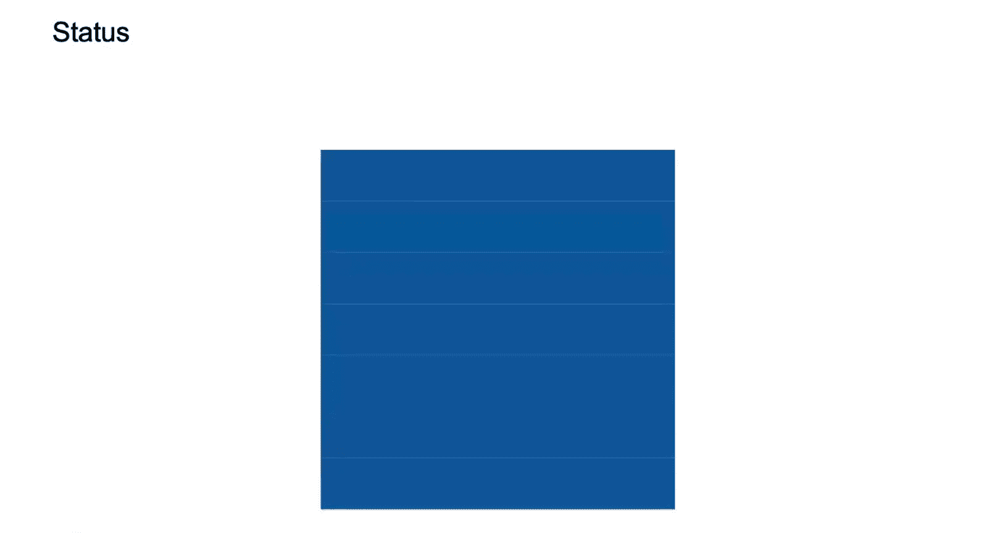

And then the reducing and now we are complete right so this is how it works。

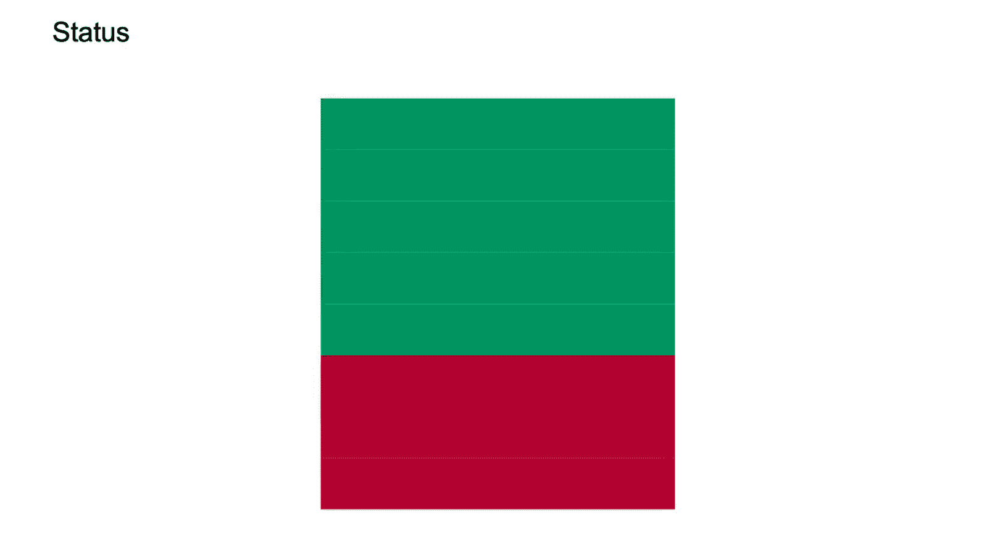

嗯。😊，I said that it has to work in Pahael。 so you probably already guessed that instead of happening on your laptop。

 this is going to happen in a data center， I's come back to the laptop because you wouldn't imagine but we can also do things in Pahalel on your laptop。

 but let me start with the data center。嗯。We already introduced HGFS， right。

 the Hadoop distributed file system。 It allows you to spread data over 100 machines。 In fact。

 that is a great basis for map produce because the data is already distributed so we can just read it in parallelel already where it is so we can use a file system like this。

😊，So before we move on， let's look at that fight system。 Imagine we have HDGFS and England somewhere。

 what kind of data do we have on HGFS？Well， now you know what kind of data we have because we spent 7 weeks on that。

 right， So now I can tell you what kind of data we have。 Maybe the kind of data we have。

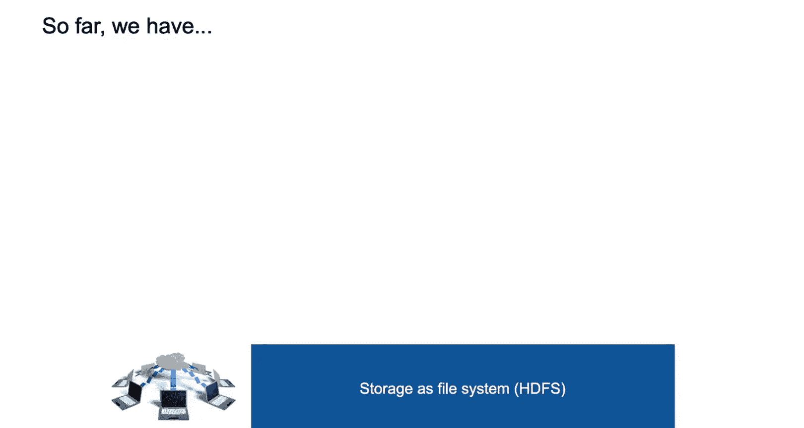

一思。That sorry， speakinging too fast。Went back， click again， it's going to come too back。

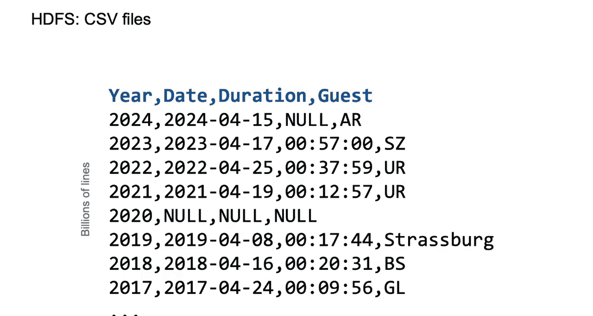

You see came to back Okay so maybe we have huge quantities of text right now it's actually quite fashionable with chat GT and training on huge quantities of text。

 So yes， you could absolutely have this in HFS。 This in that case is shallow termss if I'm correct now it's public domain So you can you don't even have any licensing issues。

 Of course you heard with chat GT the licensing issues it's quite tough and there are even disputes for example。

 with the New York Times and so on。😊，I didn't take that risk。

 I just took something that is probably domain here so that is in there。

 So you have to imagine billion billions of lines stored in HGFS and billions is quite reasonable for HDFS right we have so many machines that fits。

😊。

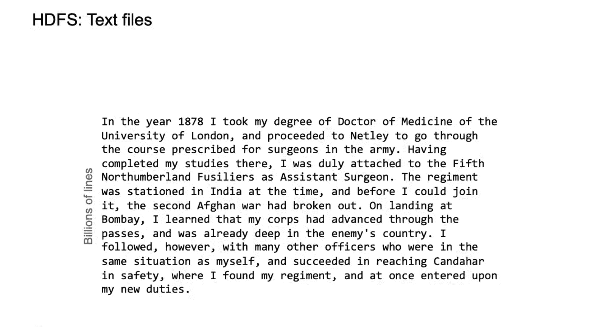

Or we could have CSV files。 Maybe I could have billion of billions of lines like this in my CSV file that it's a bit more structured。

 right， there are there are cos who sees a table here。You should all see a table。

 Everybody should see a table here， right it's CSV， So you have a table with the year。

 the first column and the date as the second column and duration as the third column and and guess as as the last column。

 You know what this is right， this data。😊，It's those absolute measures。 So obviously。

 we've been doing that for as many years as the universe。 So you have billions of lines。い데요。

It could be also， you know， in that case， it's CSV， but it does need to be CSV， right。

 it could be also some more raw formats that it's not any particular syntax。

This kind of syntax is actually quite popular in meteorology， climate， weather and so on。

 so meteor3s， like these kind of institutions when they accumulate sensor data。

 it's very often that it's in that format rather than CSV。

 why because you you save some space with the commerceas and so on。

 you know exactly the reason why it's not that way。

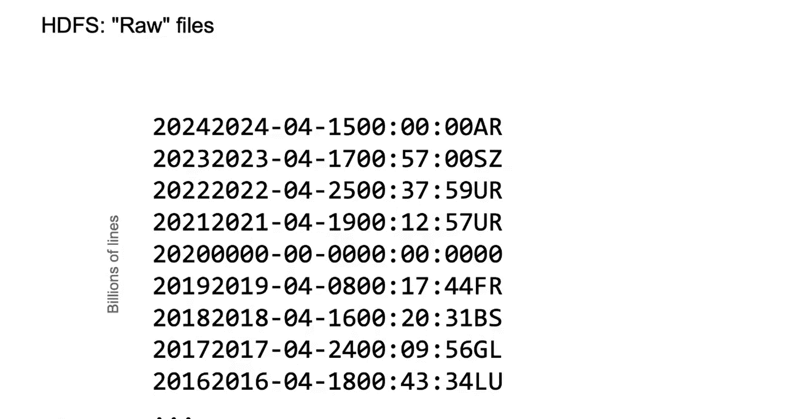

Is that？You know that the year is exactly the first for characters。

 You know that the date has exactly a fixed number of characters。

 So if you know exactly where to cut， then you don't need the commands anymore。

 So this is also a technique to to save a bit of space。

 It's not going to save as much space as a binary format， but everything you can。

 you can get as as space is worth it。 So this is another kind of format。 It's still text， right。😊。

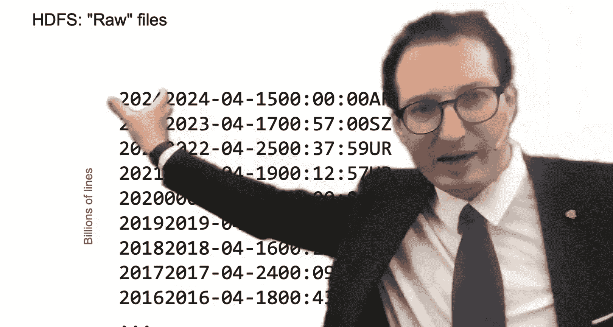

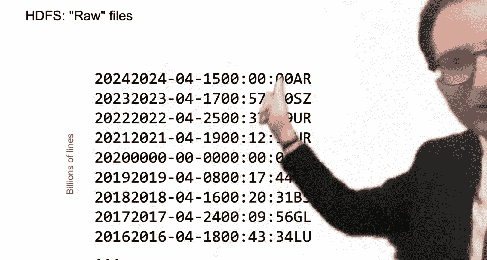

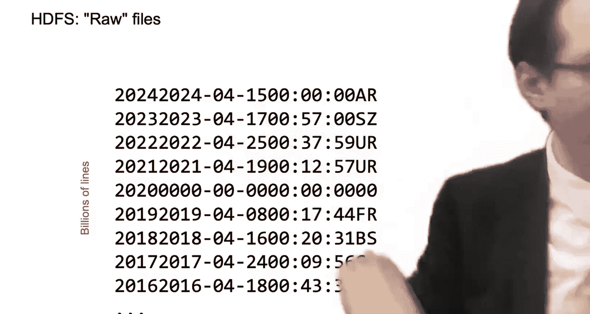

You also have some convention。That you can have a key value format in the text。

 but it's really just a convention。😊。

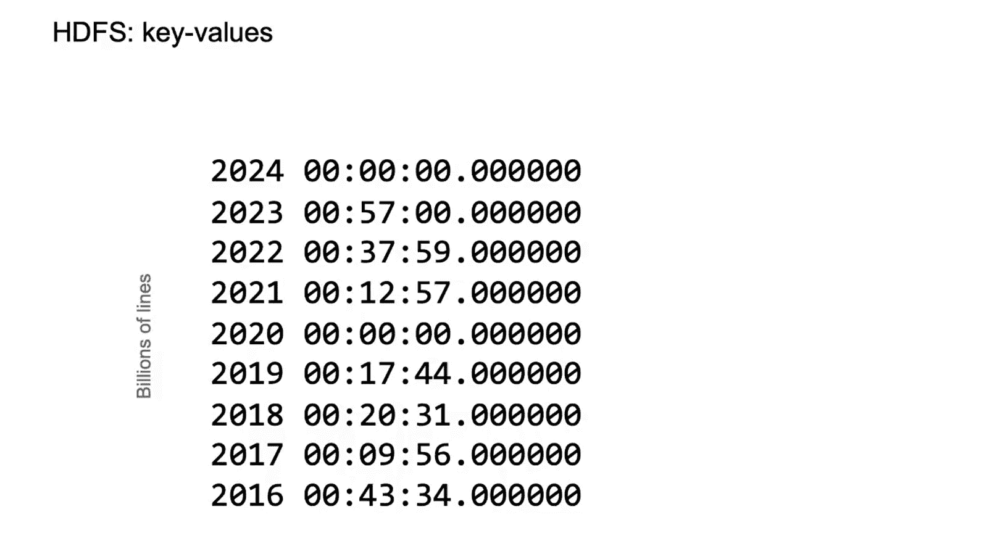

The idea is that you just use some character that you agree on in that case it's a space。

 whatever is in the left is on the left is a key and whatever is on the right is a value right so it's a key value format。

 it's pretty rudimentary right pretty simple， but again the ideas is you have keys and you have values okay。

😊。

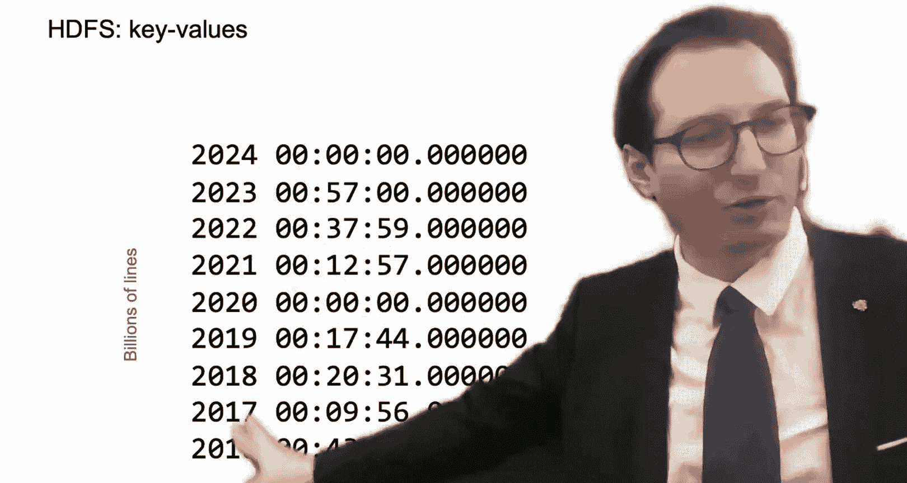

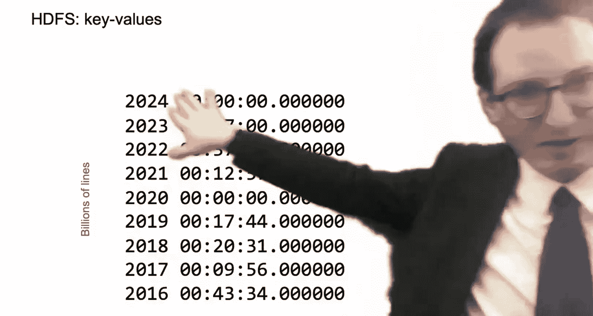

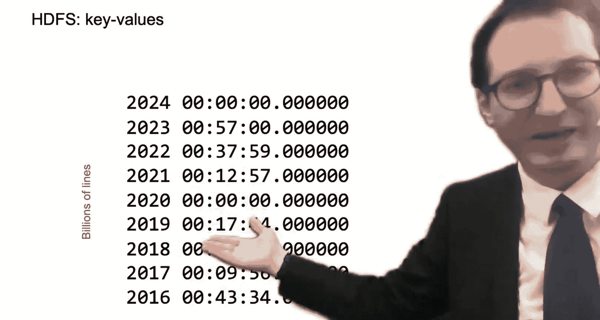

But this is still text right at that point we just look at text。😊，Now， technically。

 this is still text also， this is also text， but that text is not any text。 It's well formed， Jason。

Right。It's a very common way to actually start Jason every line of text here has one Jason object。

 This is called Jason lines， the standout for that Jason lines every line is a well formed Jason object。

Okay， this is also something you can and will have on HGSS， right？😊。

So billions of lines of well formed Jason。You see the format as well here， right。

 you could come up with a J soundund schema here， year integer。Date， date。

Duration here you would need some union between some specific some time， for example， time and an。

 and the content would be string， for example， right？

And the date is optional and content is optional right so you could come up with a schema that takes care of that。

 but basically as it is， this is just J data。It could be binary， we could have， in fact。

 petabytes of binary data when I say binary， what do I mean well it could be images and videos。

 maybe you have a larger model that train on pictures and videos， right。

 but that could also be packet。That binary format here might in fact be the same data as this。

 except that somebody went through the effort of validating these objects， creating the data frame。

 saving it as a packet file。And then it takes much less space， but this also goes to H GFS。

 you can have J， you have done， you can have text， you can have back。

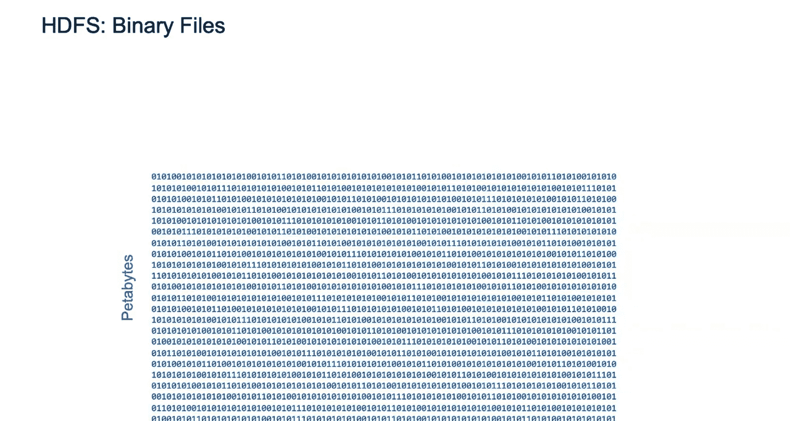

You can have anything you want。

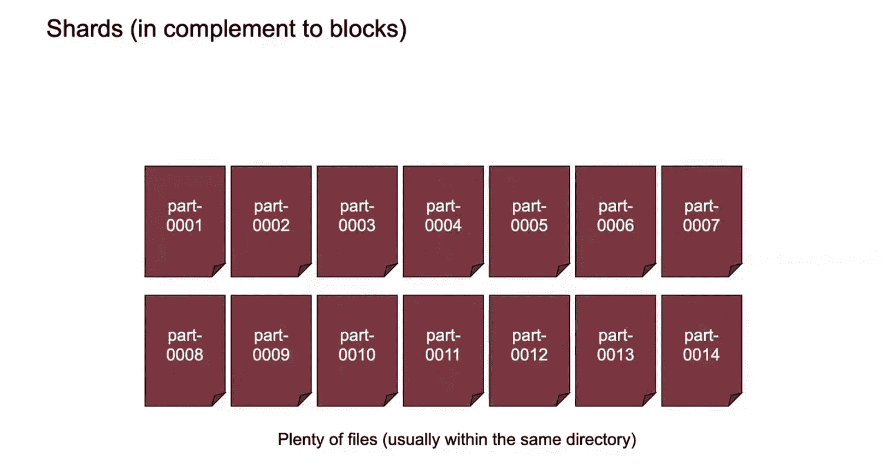

So these are a few examples of the sort of things you can have right so you see everything you've learned so far that gives you already so many possibilities of what you can store on HDDFS and by the way I say HGFS but it could also be S3 it could also be Az Bb St you know any of these just will do right even the Google Cloud St works as well。

😊。

Okay。No。Here's a trick that I've already talked to you about technically。

 when you have petabytes of data or when you have filed a data set with billions of lines。

If you wanted to save it as a single file， you could right HDGFS allowsose you to do that。

 you can have a petabyte sized file， and that's totally fine。

But in practice this is not what people do and the reasons are very practical reasons is that first it's extremely difficult to upload very large files to GFS because of network issues。

 it's going to cut in the middle and you have to start all over again and so on so there are many different practical reasons why people do not actually directly upload very large files to GFS。

 where people usually do， in fact。😊，Is that the story of on multiple files。

 So instead if you have a billion lines of J， for example。

 instead of having a single file with a big billion lines。

 you might have a thousand files and each file is going to have a million lines。

This is called shing technically in that context， it's shing。And typically。

 the names of the fights have these increasing numbers。You have basically your directory。😊。

And then there is a file called Part one and another called path two and another called path three。

 you also pad with zeros in order to make it look nice and have the same character size for every file name。

 but this is the idea here there's only 14 but it can be 100， it can be 1000， it can be 10。

000 so technically if you look at HGFS a very typical setup is going to have in the same directory plenty of shelvess of the same data set and again every one of these is a file。

Again I told you all these synonyms right here it's called part， Sha， chunk， block， split， partition。

 there are so many different synonyms。They are used a bit interchangeably but that depends on the context right again in that context we would call it a sh。

 the names of the files they usually use the word part block would be in the context of HDFS chunk in the context of the Google F system。

 I mean it really depends on the context but they really mean the same thing really means that you divide something that is big into many smaller parts。

Okay， so this is the shing the way we sh the data sets as it's commonly done。

This is true for the inputs data， and it is also true for the outputs data and the intermediate data that you might generate it will also be typically organized in this way as shells。

Okay， so this is one way of putting it in a GFS。😊，You could also use Agebase because we why did we learn age basease if not to use it so you could also use Age basease in order to execute queries on top that's absolutely fine too and then you also have the notion of parallellyism because you have all of these regions in age base right so you could also work on the regions in parallelel right so it's perfectly fine as well and the regions are even distributed all over other cluster right on the regions server so age basease would also be a perfect match as to read the data from or map pre。

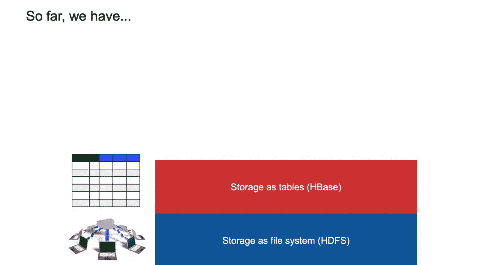

So since we are at this， age base， that would be more like a two dimensional format or a tabular format。

😊，It works as well， we could have billions of rows。

 and we could also want to execute some queries on top of that， right？In that case。

 that could even be a relational database， it's even possible to do it with a relational database。

 these kind of things。😊，But since we use H basease and a white column store。

 we might even have XML inside right so typically we could have I told you right in H basease。

 you can store typically up to 10 mebytes of data in the same cell。

 So we could we could use the H basease cell of the table to put XML an XML documents So you see what I did here。

 It's really an application of what we've learned。 I have an Xml schema that you see here occurrence year date duration count it's the same z data。

 that's an Xml schema And in every cell in every row of my of my table in H base I have an Xml document that is valid against that schema That is one way that you could use H basease could absolutely store XMl in that way。

😊。

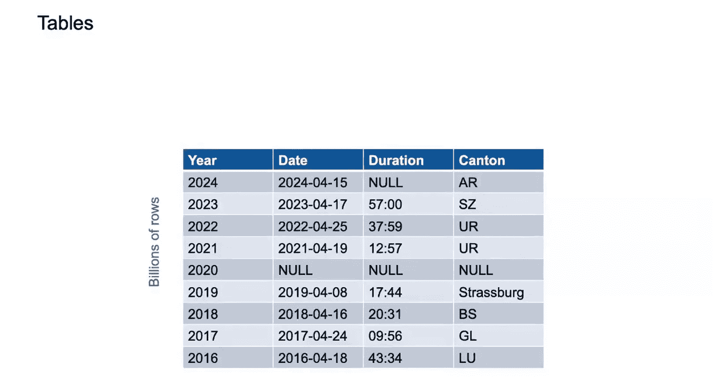

You could also think of just like Jason lines some sort of XML lines format。

 but this is not what people do that doesn't really agree。

 you could if you wanted to have one XML document down。

 but this is really not something people do instead。

 you would rather use something like H basease and put the XMM inside inside cells。Okay。😊。

And once we have that， we can query the data and in order to query the data。

 we are going to do it in parallelette， so we are going again to use shelvess。

 be shelvess on the files in a directory， shelves as regions， in a table and so on。

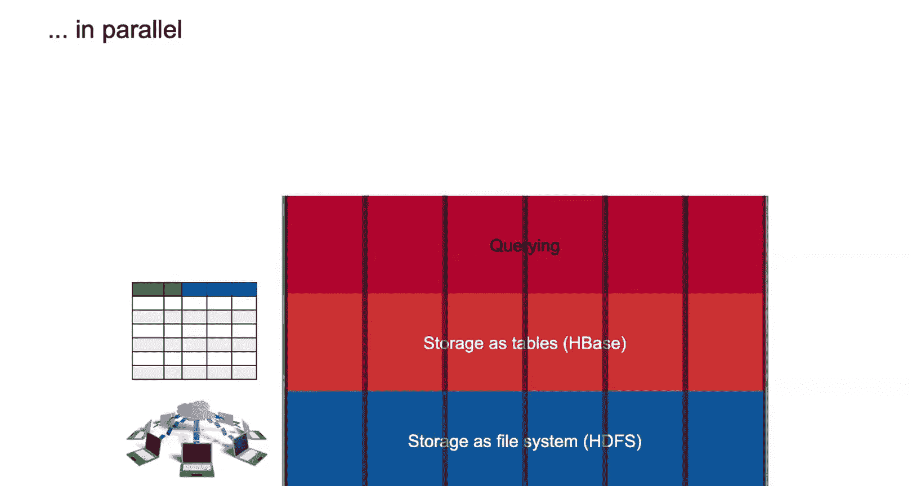

And that's pretty much the idea right， so data is in the shelves as we could say。

Which brings us to the paradigm that we are going to look at， which is not produced。

 So if you look it if you look at it on a very， very， very high level， it's quite simple right。

 you have some input data， you want to execute a query and you're going to get some output data right So this is what we want。

Now。The idea is that if we sh the data， I did these dash liness here， right， we sh the data。

So the question is， do we get any advantage by shdding the data？Now in the 90 old world。😮。

If I could have a Christmas wish list， I would wish for my query to actually。Look like this。

 right if I actually can formulate my query in this way。

This is wonderful why is that wonderful because it means that every one of the shafts can be processed in parallel and you don't even need to communicate across the shelves。

😊，So the intuition here is really that if indeed it were the case that my query could be expressed in this way equivalently。

 then on one machine I take that child， execute the query and gets this output shell on another machine in parallelel I take that child query output that on a third machine I take that child execute the query or that and if I have eight machines here I can just process it in parallelette how much faster is it going to be compared to using a single machine eight times faster right because I just do it now on eight different eight different machines。

😊。

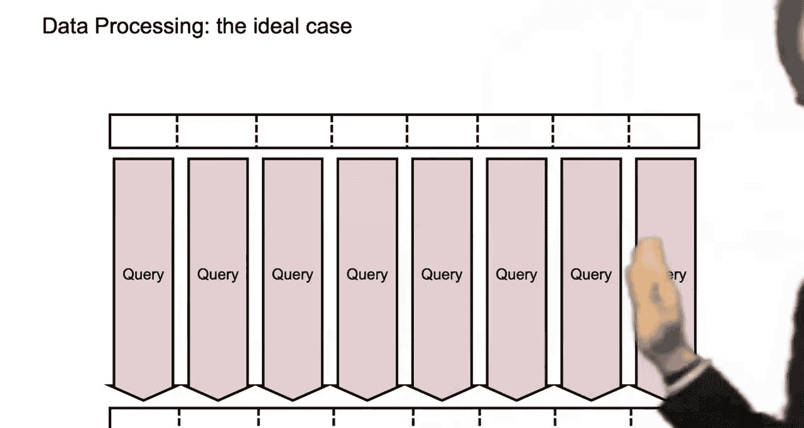

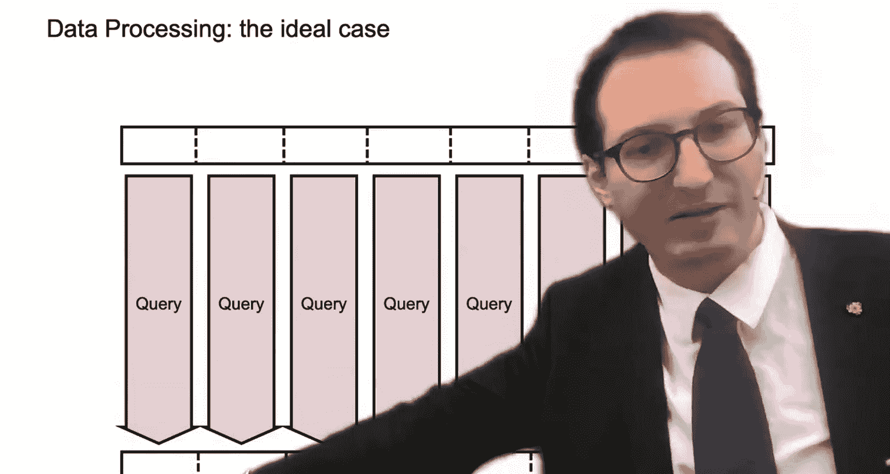

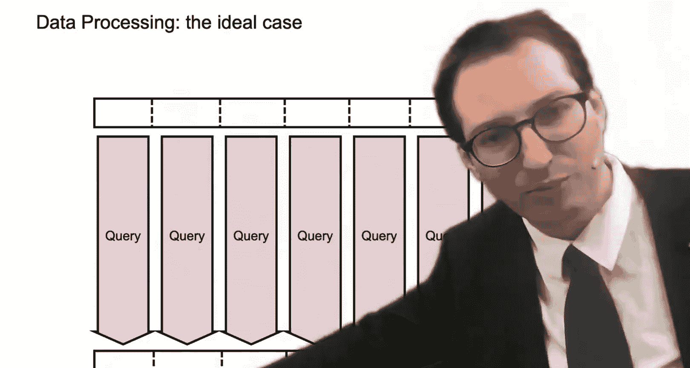

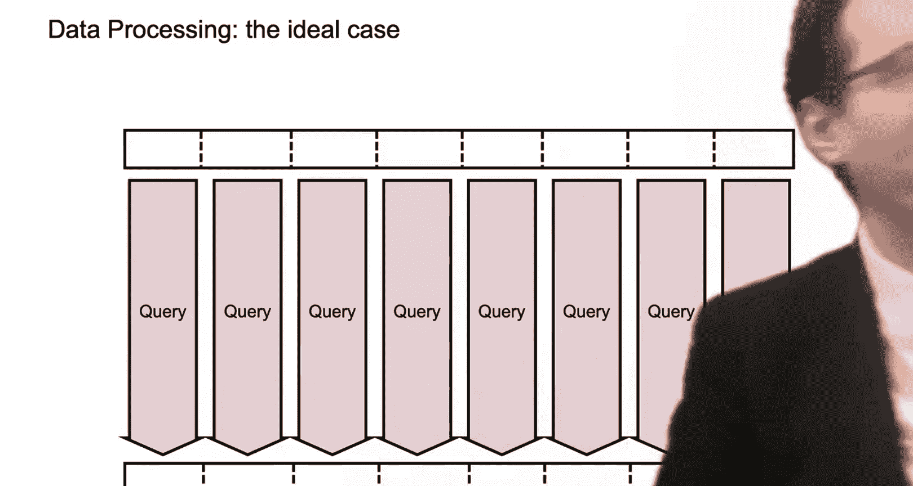

8ight times faster。 we'll see it's not that simple。 but for the moment， I'm just。

 I'm just simplifying a little bit， right， so we can be eight times faster by doing that in Pali。

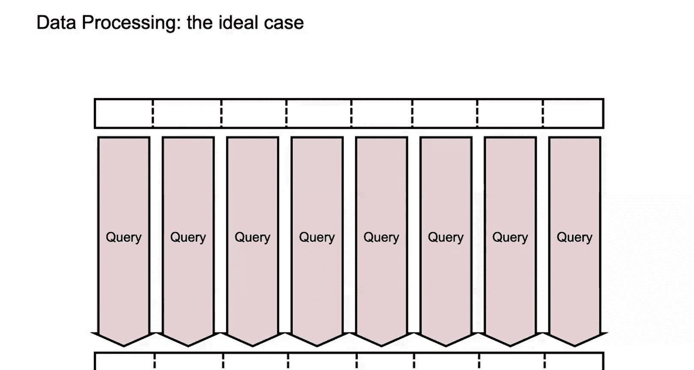

Now this is what I would wish for， and this is reality。😊，In reality， the problem you have。😮，Is that。

When you want to compute， for example， that part of the outputs。😮。

You might need to not only read that data， but you might also need data from here。

 it might be that there is a dependency from here to everything in there。

So it means that in the general case。😊，You have a huge spaghetti and you cannot paralyize it so easily。

 right， It's， it's， it's it's very， very complex。 If it's on the same machine， that's easy， right。

 it's all on the same machine。 So you just write a computer of programs that does all of that。

 It might take a while， but。It's going to work。 So the question is。

 how do we execute a spaghetti like that？In parallel on several machines， rights that's a very。

 very complex problem。And， in fact。第ear。Insight that that the people had we design map produce is that reality might not be that ideal。

 but it's also not that bad right In fact， reality is more like this。 It's kind of in the middle。

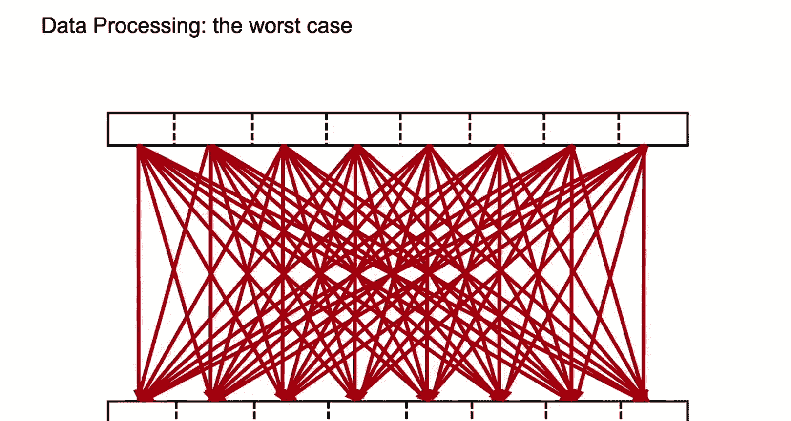

So it means that if you look at queries， everyday queries。

 there are parts of the queries that you are going to be able to parallellyize that kind of naturally translate into some parallelism and some other parts if you zoom out so if you zoom in somewhere else is going to be spaghetti right so there's the parallelizable parts of the spaghetti parts of the query。

😊，Once you have understood that there are the parallel parts and the spaghetti path。

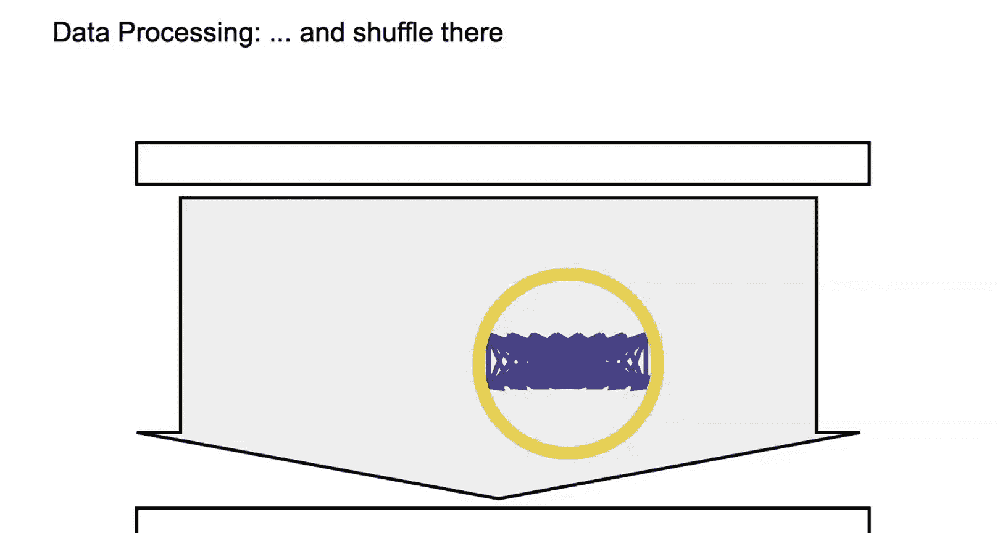

Then you get mapre because the whole idea of map Red is to just say we first do some parallelleli bath。

 Then we do the spaghetti in bath。 and then we do again a parale bath。

And if we need some spaghetti again， then you just do it again and again and again and again。

 right so this is one single mapre job that you could have done a second one and a third one。

 1000 jobs one after the other， but in a single job you have exactly one parallel part。

 one spaghetti part and one parallel part again， the first parallel part is called matting。😊。

The second parallel part is called Reddius and in the middle you have the shuffling。

But since we've done it with Pokemons， that should be clear to you， right。

 what's going on because we've already done it in real life。This is in fact mapRuce。

 it's really that simple， but what is remarkable with mapreduce is that it's not only simple。

 it's also generic and powerful enough that many real life problems and real life queries can actually be done in that way。

😊，This is incredible。 This is something that it's really now it's been 20 years that we know that before that。

 that's not really something we were aware of。😊，But this is extremely powerful。There is a question。

We have a question online。 How do I know beforehand what I can do， Para and what not。

So I will give two answers to this question。The first answer is。10 years ago。

 maybe even more than 10 years ago， let's say 15 years ago。

 I would have answered your question by saying that it's your problem。

It means that if you want to use map Red， the burden is on you to figure out how to formulate your problem as a map in a reduce。

 the burden is on the user。And in the early days of map Red， this is what happened。

 so the users of map Red， they would have to sit in front sit on a table or stand in front of a whiteboard。

 and they would have to think how can I formulate my problem in a way that is a map in aleial reduce。

😊，Surprisingly， you can often do that， but the burden was on you。

 it required a human being that actually did that。However。

 now we have a newer generation of database technologies and in fact Apache Sp is one of them。

 we are going to look at it next week or the week after that。

And that kind of now solved that problem， it means that if you use the technology like Apache Sp。

 you no longer really have to deal with these things right so I'm still showing it to you because this is interesting to see what's happening behind the scenes。

But now in 2024 we have the luxury that we don't need to do it ourselves anymore now we have query languages like SQL like Jsononic that you're studying as well and in fact when you have SQL or Jsononic you can't forget about that don't you don't need to figure it out anymore the computer will do it for you' that's really magic and the progress we've made in 20 years is absolutely amazing。

😊，In from that perspective， right， did I answer your question。Yep， awesome。Okay。

So we have the input data and the output data， but let me also have this here the intermediate data。

 remember the intermediate data it was the Pokemon value pair that were output by the first volunteers and shuffled around to the second volunteers。

😊，Now， what does this input data and intermediate data and output data have in common。

 there are all key value pairs， or Pokemon value pairs in the case of the Pokemons， right？

So they are all key U。And map Reduce in fact， requires that in map Reduce。

 everything in your input must be a KVU pairs， Everything you write down as output must be a K valueU pairs。

 and everything in between must also be a KVU pair。Right。

It can lead to a situation where when you have a hammer you tend to see everything as a nail right so we kind of now how to feed everything into KiVU pairs it's actually not that difficult but again this was 15 years ago and now with Apache Sp and query languages this is all hidden right but technically。

Maapreuce does require you to think in terms of KV U pair。If you haven't kid you pair。

Then you must specify what is the type of the key。And the type of the value now you have some flexibility here。

Because the types for the input data do not need to be the same as the types for the intermediate data and do not need to be the same as the type for the output data。

 however。All of the input data must have the same key type and value type。

 All of the intermediate data must have the same key type and value type。

 and all of the output data must have the same key type and value type。

An example of key type is Pokemon， an example of value type is integer right now in the case of Pokemons。

 the intermediate key values and output key values all had the same type。 In fact。

 it was a Pokemon and and an integer。😊，For the input。😮，What was the input， It was baged of Pokemons。

 right， So these were not K U pairs。 So we would have to convert them to Ki U pairs。

 but that I come back later right。Okay。And in fact。

 what we had in the case of the Pokemon radio pairs that the intermediate types were the same as the output types is in fact the case 80% of the time。

 it's not always the case， but 80% of the time it is the case that you have。

 in fact the same types for the intermediate data and the output data。😊。

The reason for that is that the reduce function very often is just an a of all the values that have the same key。

 that's the reason， so a sum， for example， as is done on the Pokemon Integer pairs。

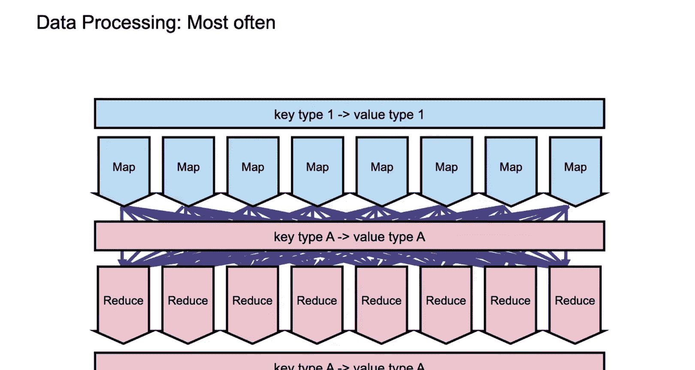

Okay。So we've been once through it。With the Pokemons， let's do it again。 But now formally， right。

 we we， we forget about the Pokemons and just look at it。From an abstract perspective。So my input。

 again， everything must be a key value， so my input is billions of key values。

How we transform any input to billions of key values that I will get back later。

 but let's assume we have as an input billions of key values of any type。

The first thing that happens in mapreduce is that we split this input right if it's an HGFS you could use the blocks of HGFS as your splits right so you basically just split it the goal of the split is to be able to parallellyize right in Hb that could be the regions that give you the splits but you basically need to splits that data over multiple splits split it the mapreduce name for a shared block chunk partition part and so on we could either split in mapreduce。

Okay， so we split the data。Then the second thing that happens。

Is that every one of these key values from the input？Will be mapped to 0。

1 or more intermediate key values in that case，2。 But again， it can be 0。 it can be one。

 It can be more。 So we have a map function。 that's a mathematical function that takes one key value of the input and outputs。

0，1 or more intermediate key values。 That is the mapping。But。

of course this the map function specifies it for one key value。

 but in fact we call that function on many， many key values right so in parallelhalL every one of these key values the on the left will be mapped to0 one or more key value key values on the right Okay so this is then the mapping phase in parallelhalL。

😊，And once we have produced all these intermediate key videos in Pahalel。

 we put it all together logically， right， So you imagine you have the same top that you put everything in there。

 right， you have billions or trillions of intermediate key values。And what you do。

Is thatm I'm on the logical level， right， on the logical level。

 Imagine that you take these trillion key values and sorts them。

Lxiographically by key and then by value。 So you have all the key ones together。

 all the key twos together， all the key threes together。 Once you have done that sorting。

 you can separate them again in groups and every group has the same key So you have a group with key1 so that the all the piach shoes are there you have a group with key two。

 a group with key3 and so on。😊，Once you have these groups。

 you're going to call on every one of these group the reduceuse function。😡。

The reduce function takes one group of key value pairs that have the same key。

 and it must be all the intermediate key value pairs that have the same key。

 all of them that have key1， and that reduce function outputs。0， one or more。

I would put KV pair final KV in that case is one， it's very often that it's actually one。

 but technically it could be zero or it could be more。Okay so we have that reduce function。

 Of course this is one group， but there are several groups so we do within parallel very often。

 as I said， the key types will be the same and what the reduceius function does is just a sum or a max or a mean on the values right and it keeps the same key So 80% of the case will look like this。

 but generally it will be more like this。😊，And again， it can be more， it can be zero。

 I mean is this is fully general， it's just that it's less often that you would。😊。

That you would see this。And again， this is done in parallelel， just like the mapping phase。

 I told you， both the map phase and the reduce phase are in parallelel。 So we have this。

 this mapping。 And on the right， you have all these output key values。 and that's it。

 So if I draw now everything， you have the。😊。

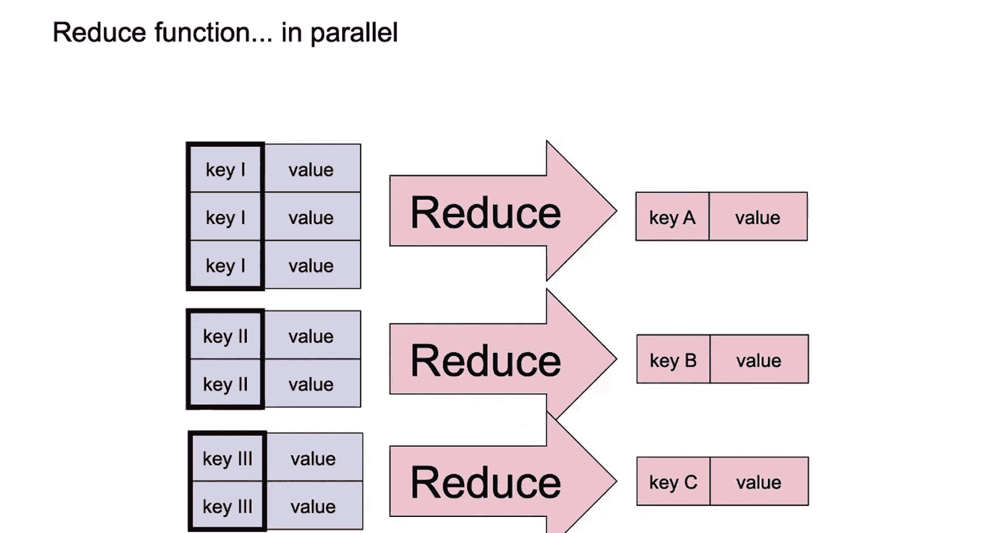

Input parts。

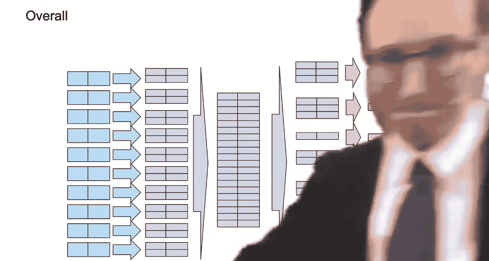

To remove this on the lecture hall because that prevents from seeing。You have the input part。

 you map to intermediate keyVs， you soft and partition so that the keys that are the same are in the same group。

 then you call the reduce function on every group and then you get zero and or more output keyV for every group That's your final output and you write it back to HGFs or to H base or。

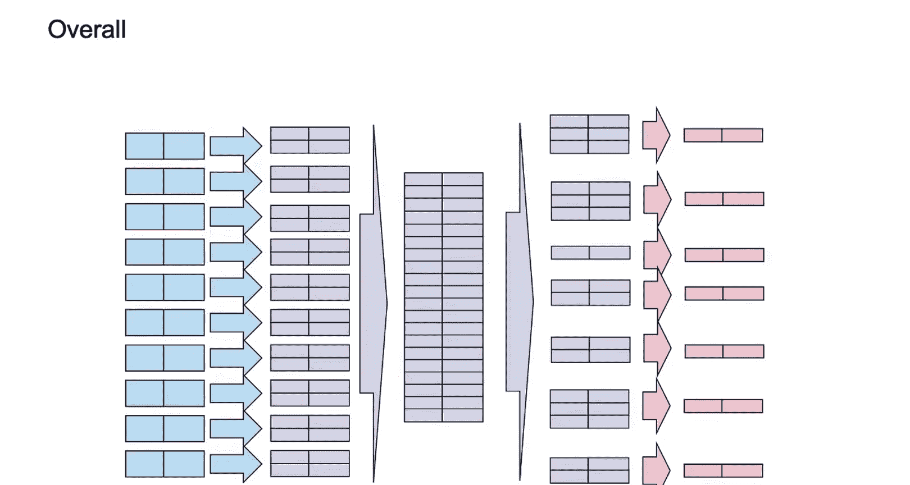

Wherever you want。Okay， so this is the logical part， who is with me on that？😊，Okay。

 think of the Pokemons if you're ever lost or you know map that used， just think of the Pokemon。

 is the way this is the way to go。No。What's really nice is that the architecture is flexible because you can execute mapre on top of HDGFS。

 but you can also do it on top of S3。 you can also do it on top of Google Cloud storage， A storage。

 In fact， you can even do it on your local file system on your machine。😊。

And you can even parallelize on your machine。 How can it be。

 Remember that you have multiple cores on your machine Today， we have two core， four core，8 core。

 so you can also parallelize on your machine that I'll come back to you on that because it turns out that big data also applies to your laptop。

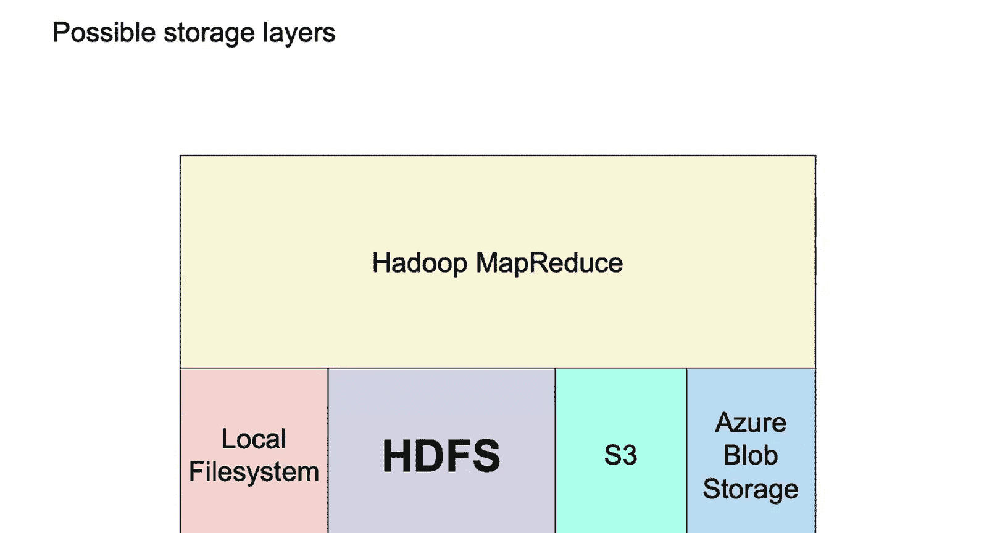

So typically， you can have thousands of machines in your data center。

 you can have terabytes or even petabytes of data with with any problem。

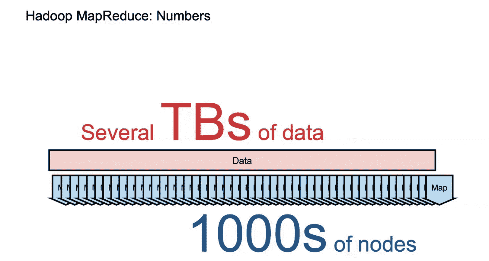

And the architecture looks like this。This should be a bit like a feeling of Deja view right we've already seen that with HDGFS name node。

 data node， we've already seen that with Age basease， Hma and Reg server。

 well guess what it's the same with my produce we have job trackers and task trackers。

These are the same machines， by the way， nameme node Hmaster and job tracker。

 this is a process just like Word or a notpa or your browser。

 These are processes on the same machine you have a name node a Hmaster in a job tracker process and on each one of the other machines。

 you have a data node process originally have our process and a task tracker process。

 What's important is that these are the same machines and that it is centralized because you have a coordinator or node that is kind of the brain and then you have all the worker nodes that that do the work And again。

 to make even clear that is the same machine， you really have the name node and the job tracker on the same machine and the task tracker and the data node on the same machine。

And the idea is that we bring the query to the data because where is the data。

 it's all over the place， it's on HGFS， so these are these other blocks in HGFs。

 they're all over other place。😊，So the goal is to try to not move the data too much。

 We just execute the queries where the data is。 What it means concretely is that we evaluate the map function on the same machines that the data is。

 Where is the data on the data node。 So we evaluate the。The map function also on the data nodes。

 and this is what the test tracker is doing。 And that way you don't ship it over the network。

 it's just like the shots circuiting that we saw in eachbase。 You directly look look at it。

 read it from the same machine that you are sitting on。

 So this is called bring the query to the data， which is which was kind of a buzzword Also 15 years ago。

 still true today。

Some people still argue that now you should bring the data to the query。

 but this is an open debate in some cases。

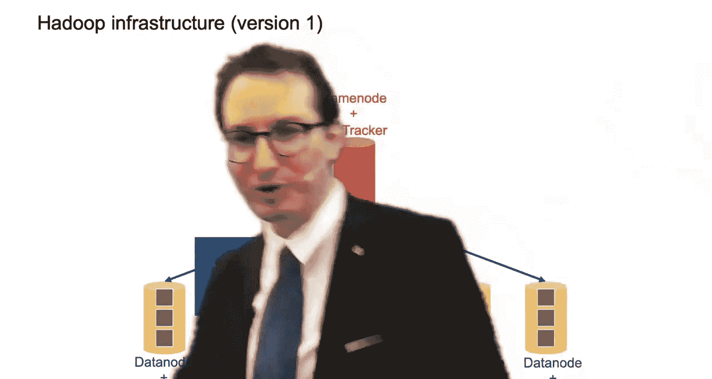

嗯。We are done， so。I just want to see。

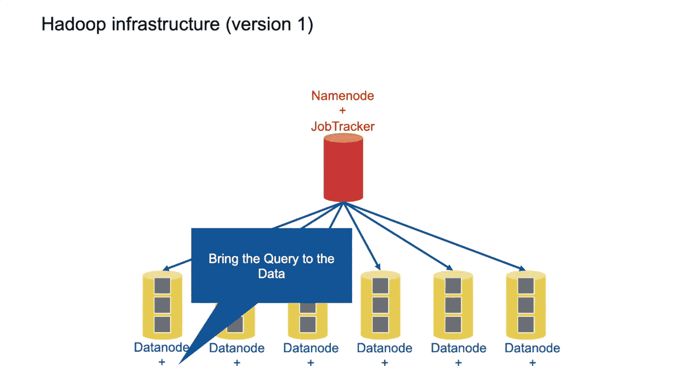

If maybe。Is checking the speed。You can tell me。That tells me if I should accelerate， slow down。

In the future， normally， I think in terms of timing， we are more or less。

 more or less on the on time。Okay， so the majority is still between 180 and 99 you should really read the textbook right the textbook explains it in written everything that I told you。

 I think for the textbook I used cats instead of Pokemon but it's just as fun as as with Pokemons。😊。

Oh and we have people want us to everything we think， that is wonderful。

So don't hesitate to interact those who want us do everything you can explain to those who want us to less than 50%。

 you can ask questions in the chat， you can ask questions in the forum that we will answer the Ts are also here for you。

 I'm here for you you should solve the exercises we are trying to get because there was this upper issue Apple silicon issue with age base the TA team is currently setting up five2 quiz B just for those of you who had these issues that you sit have a chance to get the bonus points right Otherwise it would be unfair that don't get the points just because of a technical issue。

Okay， so thank you very much， everybody， have a nice week and I'll see you next week at 8 AM。

 Thank you。😊。

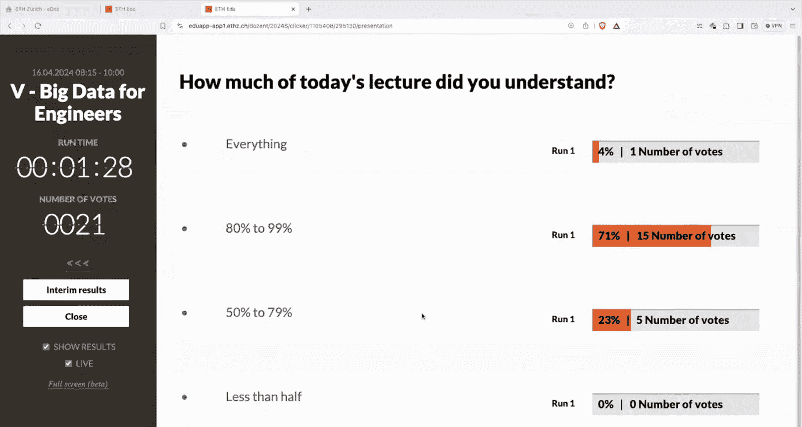