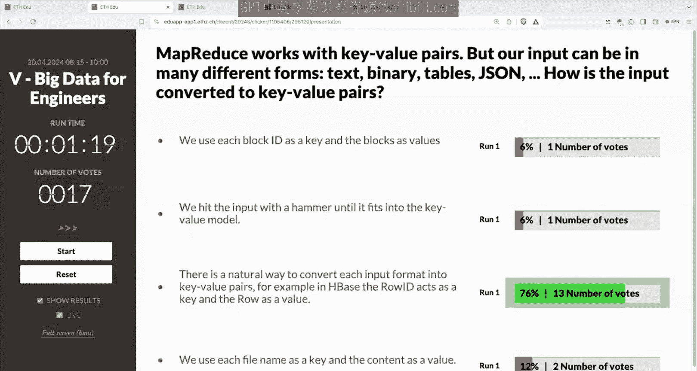
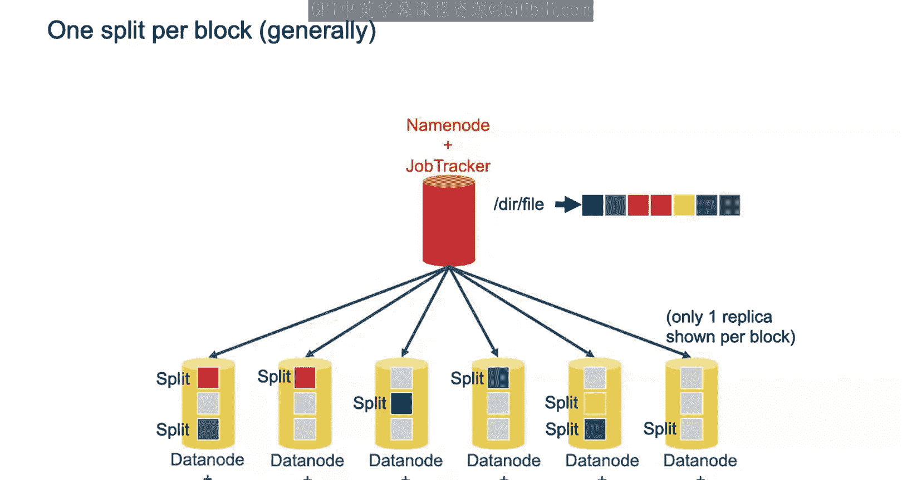
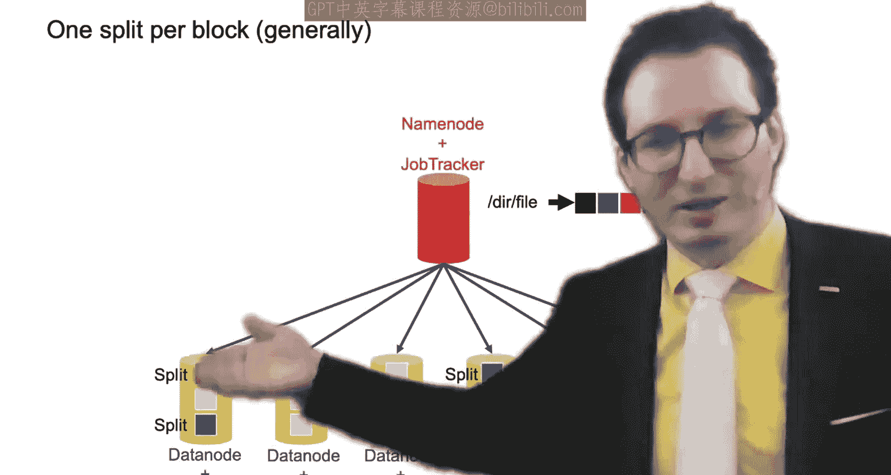
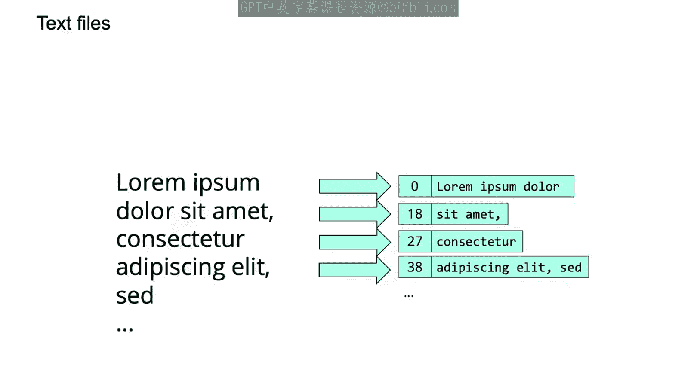
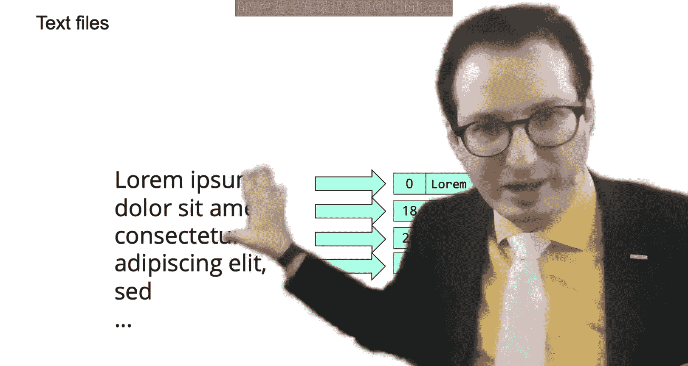
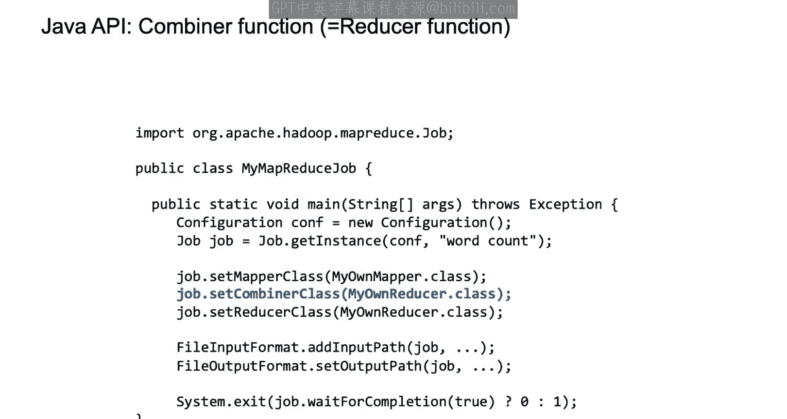
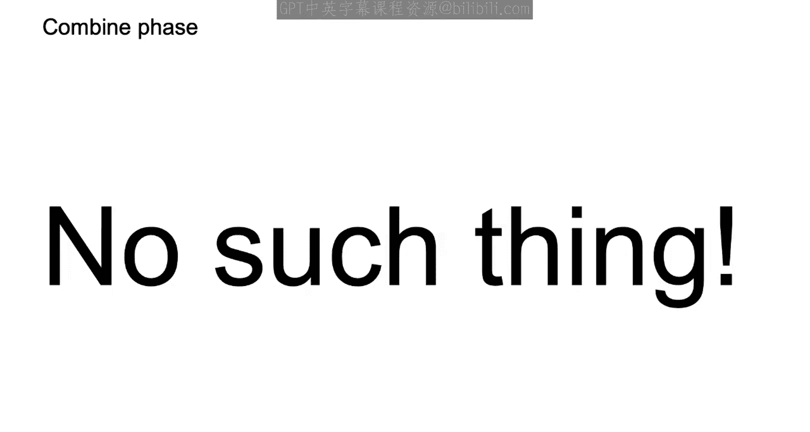

# 苏黎世联邦理工《工程师的大数据｜Big Data for Engineers - ETH Zurich - 2024》中英字幕 p20 8. MapReduce (2_3) - .zh_en -BV17FAmeFE9K_p20-

Welcome everybody in the lecture Hall， welcome everybody on Zoom， welcome everybody from the future。

What better day to start a date than with a clicker question at 8 AM。So let's start with this。

There you go。So you have just submitted a typical map produced jobt。To a large cluster。

 so a typical job for  a thousand node that would justify having a thousand nodes。

What do you do do you。So it's done before you ask， so instant it immediately returns the results or you go for a cup of coffee。

 you have enough time and it will be ready when you're back from your coffee break。

 but not now because the coffee machine needs time to start sad so have that when at nine。

 you switch to something else and we'll check again in a few hours or tomorrow or you hide from the CFO。

😊，And I need to start for。Let's take a first look at your ownelve。We have a tie。

 we also have three people with industry experience。😊，诶。In fact， this is the correct answer。

 at least the correct intuition。Basically what matters here is that I talk about a cluster with a thousand nodes when you have a cluster with 100 nodes。

 you need to understand that this takes time to set up something like mypreduce right of course it's not always true right when you when you use a search engine like Google it also is running on a cluster of millions of machines in its instant but here we are doing massive parallel processing and when you do massive parallel processing you have a certain latency just to set up the job to set up the tasks as we will see so it takes some time。

And you also don't have you also have plenty of time to drink probably1000 coffees in the meantime because CP we're talking about several hours or even coming back on the next day right so it's a sort of longrun tasks that can take hours。

 there are even tasks that might take weeks or even months， I mean， for example。

 if you train machine learning models and these can take even months。

So this is the intuition I wanted to give to you， so do not assume for massive parallel processing。

 we are reading terabytes pets of data。It's absolutely not in and it takes a while until it's done。

 but again it takes a few hours as opposed to several years or several decades if you had tried to done it to do it on a single machine right so this is the intuition。

And the fourth answer， that's what I meant with the industry experience。

Is basically a reminder that you should not forget to delete your machines if you create machines in the cloud。

 do not forget to delete them so deleting your machines on the strand right but when you are in the cloud you can provision machines just with a few clicks and then you can give them back if you forget to switch off the machines then that can trigger a high bill right so be very careful with that you might have a TTH to work with the cloud。

Now there are a few safe gaps， so it kind of automatically detects that it's unused and shuts down。

 but still it's a good idea to have this in mind。So we had this in the， in some lectures。

 We used the Amazon cloud， the Azure Cloud and so on。 So， of course， in a university。

 it's not so much like a big deal because we can go to them， tell them， you know， we are learning。

 It's a university and so on。 And they don't beat it。 But still。

 it's a good thing to to be aware of this。😊，Okay。😊，So this wass the first question。😊。

And the second one。I。😊，Then I told you that mapre works with key value pairs。

 The input is are key value pairs。 The intermediate values are key value pairs。

 and the output is made of key value pairs。 Everything is a collection of key value pairs。

But data is not always a key value pair， right， You might have a collection of Jason documents。

 You might have text。 You might have relational tables。 These are not key value pairs， right。

 So how can it be that map Red manage is to work with them。Do we use block Is if it start on HFS。

 the block I is the key and the block is the value or do we hit the input with a hammer until it fits into a key value model or is there a natural way to convert each input format into key value biass。

 for example， in each base， the row ID is the key and the row is the value the other the column values or we use each file name as a key and the content as a value。

But we have a majority。And the majority is correct。Indeed， I will show you a little bit。

 but technically there is a natural way that you can map tables because technically everything is a collection of records or a collection of stuff and you just need to map every stuff to a key value pair。

The block IDs， that's not how we do it because 128 mebytes is too much for a single record。

 so that's the ID right so the records that we have the key value pairs。

 they are much smaller than an HGFS block right in practice。Heating the input with a hammer。

 well heating data with a hammer， a lot of people are doing that。

 but hopefully studying data models now you can make decisions about what to use for which shape of data。

😊，There is a natural way to convert each input format。 That's the that's the correct answer。

 And the final one， I didn't put it as correct。 I could have accepted it as correct also， because。

You could also do this。 I mean， some people in practice when they have plenty of filess that are rather small。

 one way to parallellysis is indeed to， to just work at the gra gl granularity of of files， right。

 So this could have been the thought one could have been correct on some。Okay。

And I will come back to it， I will have slides on the natural way。So。To come back。To the slides。

At are right here。

And we'll continue from here。So I left you with the physical architecture。 So as a reminder。

 what is my produceuce。It's a simple。Framework， rather simple。And Geneica at the same time。

A simple and generic framework that allows you to massively process。

Huge quantities of data in palette。 right， That's kind of the the picture here。

 Like just these bottles are the billions of of key value pairs that flow in the cluster。

 So it's simple and generic。And the simplicity comes from the fact that you have a parallel path where you just do stuff in parallel and all the thousand machines of the cluster。

 then you have a shlink path where the data just flows around happily across the cluster and then you again have a parallel path that's called reduce and then you writes back the data to to whichever backend you want to HDGFS to S3 and so on。

It's generic because a lot of problems in real life can be expressed in that way with map reduce like map shuffle reduce。

 And if it's not enough， you can just repeat the map shuffle reduce， right。

 You can have one one map reduce job that writes some data to a GFS。

 then a second map reduce job that reads the output of the first one and so on。

 So you can actually chain the map reduce job， right。😊。

So now it's time that I tell you a little bit about the physical architecture of mapR。

 the way it's implemented because this idea of map shuffle reduce was the logical aspect of it。😊。

So the architecture is a centralized architecture， just like the one withve。

The ones we've seen with HGFS and H base， right， So we have a coordinator node at the top that runs both the name node process of HGFS and the job tracker of mappre。

 And then we have all of the worker nodes。That each runner data node process。 Remember。

 these are the ones that store the blocks of A GFS and the tax task tracker that is responsible for executing the map tasks and the reduce tasks as as we will see very shortly。

 So the idea is bring the query to the data。 So bring the query to the data is almost a buzz world in the sense that。

The blocks， the actual data stored in HFS is stored on the local hard drives of all of these machines here at the bottom。

 And the task tracker that takes execute the map and reduce functions is also at the same location。

 So you basically bring the query to the data。 You you query the data where it is， right。

 You don't transfer it to you first。 So that's the idea。

So roughly the way that we parallelize things in a mapre framework。

Is that we parallellyize at the level of the blocks。

 it means that every block will be a chunk or a split。

 as we call it of the collection that we process together， right？So。Instead of calling them blocks。

 mappreduce calls them splits， right the reason is that it doesn't have to be the same as the block。

 right it's very often the case， but it doesn't have to be。

 So here imagine that we want to query this data set in parallelette。

 it's a single file made of plenty of blocks。 All of these blocks here become splits。

 Now you see how we can query that in Pael right on that machine maybe we read this on this machine will read this on this machine will read this。

 So you see since it's already stored in parallelette across the cluster。

 we just directly query the data where it already is。

 It's important that it's already there because HgfS is already storing the data over the entire cluster。

Who is with me？Okay。😊，So the idea is that then we are going to use the CPU So the processor course in order to execute map and reduce tasks。

 So this is M and R M is for map R is for reduced use。 We' see that we'll call them slots， right？

 So the the the actual resources that take。 And the idea is that。

Very often the the mapping is done locally on the machine On occasion。

 it might be that it's not the case。 So you might occasionally have to read some data over the network。

 for example， if if this map slot right here。Would like to process these splits。

 Then it will have to read from the network。 but this is rather rare。

 It's not it's not the general rule as a rule。 Most of the reads will be local。 Okay。

 and as you know， we can short your kit things when we read from the same machine。

 which is much more efficient than reading from the network， just like for edgebase， In fact。

 I told you so we can short your kit。Okay。嗯。And so。We use。

 So now I color the Ms in order to basically signify that the map tasks are being executed。

 So we map the data in Bahalette and pro produce the intermediate cable U pair using the memory of the machines。

 These are memory bars。😊，And what happens is that when I produce the intermediate key pairs。

 at some point， I might feel the memory。😊，Right， so I produce so many intermediate key repairs that my memory becomes full。

😊，That's kind of a data。 I right。 We've already seen cases where the memory becomes full。

 We've seen them in the white Col Stars lecture in age base。

 And what do we do when there is so much data produced that it fills the entire memory we。😊。

Fluush it exactly。 We flush it to disk。 So in that produce， we call it spill。

 but it's the same thing。 We flush it to disk。 We flush all the intermediate key value pairs to the local disks of the of the machine。

 not HDGfs， right， the local disks of the machine。 So we spill that to disk。😊。

And we might even do some some compaction if we keep speeding and speeding and speeding， so flushing。

 flashing， flushing， we can use exactly the same technique that we've covered in age base in order to compact to fewer or larger files。

😊，It doesn't happen all the time that's really if you produce a lot of intermediate data that you might need to do that。

 but that we've already covered in white color stars it's these log structures merge trees with flush compact。

 flush compact， flush compact compact and so on， right。😊，Okay。😊，So once we have done that。

 we are done with the map face。Either it do fits on memory or we spill some of it to disk and then comes the shuffling。

 The shuffling means that all of that data that you produce needs to be moved around in the cluster。

 It means it needs to be shipped without the network and moved to another machine， why。

Because we want to make sure that all the key values that have the same key after the shuffle they are together。

 they have to be together before the shuffle they will not be together right because you might produce key values with the same keys on any machine right but after the shuffle you need to make sure that they are all together all the key values with the same key together so this is why we have all these spaghetti that some of you I heard experience in the exercise session and this is quite relatively complex so this is really something that is very costly right we'll see later we need to try to keep it to the minimum but it's needed right。

😊，And the idea， the idea is that in the shuffling phase。

Is the reduced site So whichever reduced slot it knows what keys it's responsible for So every reduced slot is going to connect to every machine and it goes to every machine and asks for all the key videos with the pairs that it's responsible of it's just like one of you was responsible for in the last semester for Pikachu right so there was a reducer for Pikachu and the student responsible for pikachu had to go to every single student who mapped Pokemons and get all the pikachs right so this is exactly the idea here it happens over HCttP right it's a rest it's a rest protocol right so this is how it goes and then this is how it's a shuffle So here it's a single reduced slot just one but again in general it's so many reduced slots that it's more like spaghetti like this so that's the shuffling。

Once we are done with the shuffling， then the key values are no longer randomly distributed。

 they are all nicely grouped by key so you have on the first node a certain number of keys and we have all the key values with that key and so on and so on so now that it's all groups we can proceed with the reduce phase and the reduce phase consists including the reduce function for every group of key values with the same key we call the reduce function and produce TPT1 output keyvalue pair and be less can be more but that's the idea and since all the keyvalue pairs with the same key are on the same machine then this is possible to do it locally and in Bali。

😊，Okay， so this is the reduce phase and at the end of the reduce phase every reduced slot is going to write outputs back to HDGFS or to S3 or to any storage you would like and the way this is done is that we are going to have separate files so every time there is a reduced task it will be output to a different file so in the end what you end up with at the end of a mapre job is that you have some directory in HGFS and maybe you'll find thousands of files in there。

😊，Each one of these files was produced as the output of a reduced task， right？

And you really need to consider that the data set is the entire directory just not one file one file alone doesn't make sense it's the entire directory。

 that's what we call sharding right we have Shas and every file here is a sh who with me。😊。

Right so I hope that now the puzzle is assembling because right now we are connecting to many aspects of what we've seen before right so it's all connected right we' are making connections all over other place。

 Okay， so this is one physical view of what the map produce job looks like I'm going to execute more and more of them to make it even clearer。

 but let's open parenthees to come back to the question that I asked you at the beginning。

 how do we map things to key value pairs， How do we map map input data to key value pairs。😊，Well。

 the good news is that when you actually run a map produced job and you program it in Python or you program it in Java。

You don't start from from scratch in fact you have libraries that help you and that make it kind of convenient so there are a few library classes or functions that allow you to create QVU pairs out of tables can be relational or edge base and from fight。

Theion is simple， every row of your relational table gives you a key value。

The key is typically going to be the primary key。 you remember that in a relational table。

 you might have a few attributes that constitute a primary key and these attributes together。

Give you the key format produce right's it's also called the key。

 So that's a perfect match right So the key we take the primary key and all the other attributes give you the value right And now we have key values right as many key values as records or rows in the table Okay。

 the same for age base right， we just take the row I for age base The raw I will be the key and the rest will be your your value。

😊，So this is for tables。 What about files。 Well， there can be a lot of files。

 We've spent weeks studying files。 You can have text files。 You can have binary files。

 You can have text files that contain Jason， CSV， Xm L， and so on。

 So there are so many ways that you can store your data。 So let's take a look at that。 First。

 a text file。 How do we map。😊，A text file to key value tells。Well， very often。

 when you have text files。You will have new lines， it will be organized in lines if you download。

 for example， the complete works of Shakespeare or shallow curtains and so on。

 typically it's not going to be on a single line， typically you're going to have lines that maybe are I don't know。

80 or 100 characters per line， then you have a new line， a carrier retail。

 a new line and then you stuffed over。Just like the good old times when we had thesetyping machines。

 right。And the idea is that we turn every line into a key U pair。

RightThe value of the key value pair is the text itself as you can see here and we need a value。

 so here is kind of arbitrary but typically as the key sorry we need a key。

 So it's arbitrary and typically we take the offsets What I mean with that is it's the number of it's the position of the line since the beginning So the first line is that position zero So this is why we start with a0 and here it's 18 because there's 18 characters in here then there's 27 in total before this one then there's 38 in total before this one So this is like a position like an address right a zip code within the text file So this is the key and the value is the text itself right。

😊。

And now it's great because now that we have key videos and mappreuce can actually process these this in the。

 in the mappre model。 Okay， so this is for a text file。 But there's other ways， for example。

 another way to split key values or to， to， to find key videos in a text file。😊。

Is to have a special character。😊，That separates the key and the value right so imagine I'm using this black disk here。

 but it can be anything really so if if I have the convention that the key values are delim emitted by this black disk then I have what's on the left is the key what's on the right is thevalue right and if there's nothing on the right then the value is just is just empty。

Okay， so this is another way。No。This special character that separates the key and the value。

 it doesn't come from nowhere， right， It's basically typically comes for whoever generated the data set。

 Sometimes they will generate the data set in this way with a special character。

 It could be a space character。 It could be a semicol。 It could be a star。

 It could be it could really be a lot of character， right。

 But this is really something you have to do depending on the data set， and you can choose。

 you can tell by produce this is my separating character， and then you。😊。

Pass the text that Ki use in this way， right？嗯。So here's an example of how we use mapre。

 Imagine that I have the complete works of Shakespeare and I would like to count how many times every world appears in there right Well。

 I can do it first I interpret the text file as keyvalue pairs right as I told you So now that we have the keyvalue pairs。

 I can use the mapping function that is going to map every it's tokenizing basically the values it's ignoring the offset。

 So this we completely ignore this path and here I just tokenize I simplify I use spaces right so let me let me say I separate spaces for every word space separated。

 I generate a key value with the world here and then one to say this is one occurrence of low end。

 this is one occurrence of Ipsson， this is one occurrence and so on and so on。

 So I generate key values with when。😊，These are actually the four ones。Right。

 every world is a Pokemon here。 It's really the same thing。

 So I just generate like this for every world， an intermediate key value with the world and one。

 So this is my mapping function。😊，Then it's going to be shuffled the round of course and then we'll make sure that all of the key videos for the same world go to the same machine and once I have them on the same machine。

 I can call my reduce function and compute the sum。All accounts in that case， because it's only once。

 and I find 7。 So if I have7 occurrences of R M， I'm going to end up with one key value pair lower M 7。

 And this， I write back to HD DFS is lower M 7。Okay， who's with me？We've just implemented account。😮。

In Mappreduce， right， this is how it works。 And you see it's very simple。

Another example is filtering lines， how do I take the complete works of Shakespeare？😊。

And I want to output all of the lines that contain hamlets， for example， how do I do this？

Well I can again I pass my document aski repairs like this and in my map function。

 what I'm going to do now is that I'm going to take eachkiV repair from the input and I'm either going to let in or not let it in if it has the world I'm looking for hamlets then I'm going to output it again exactly as it is I'm not even modifying it。

😊，And if it doesn't contain the world I'm looking for， then it's not letting it through， right？

So it's basically a very simple map function that just outputs a subset of the of the input key values right do we have physicists？

😊，Okay， for any physicists， it's basically a Maxwell woman of information retrieval。Okay。

So now that I have my subset， what reduce function do I use well here it's trivial I just use the identity function my reduce function will just output exactly the same thing that it receives right so the actual filtering happened in the map phase and the reduce phase is actually completely completely trivial In fact it's so trivial that you can even tell map reduce that there's not even a reduced phase there's a way to let it know that it's a pure mapping and no reduce then it will not bother shuffling。

Okay。😊，So， this is a filter。Now， this probably。Reminds you of the where clothes of SQL from where。

 right， technically， we've just done a selection。 It's just that we do it on text， not on a table。

 but it probably smells like a selection to you like the wear clothes， right。

 But I come back to this because this is not a coincidence who sees the link with a selection。Okay。

It's pretty much the same thing。呃。Alright。😊，Well since we talked about selection。

 what about projection So projection we actually need columns right so let's say I have columns how could I have columns in text where I can use Jason right so imagine my text is Jason and I have Jason objects here you see the three columns right IDA country it's valid Jason you could put it in the data frame so it has columns。

😊，Of course， mapreuce doesn't know that。 The only thing that mapreuce see is key value pairs， right。

 So this is just text that we put in K value pairs。 but we know it's actually a table。

 It's actually tabularular data。Okay， so what does it mean to project。

 we just do it in the map phase。😊，Now， how do I project here。

 I'm basically projecting to ID and country。I did it as the user of mappreuce。

 It's my job as the user of mypreuce to write down that function that does this。

 That's not part of mypreuce。 I have to do it。 So I am going to write whatever function in Python is going to take that text。

 pass it as Jason。😊，Project to ID and country serialize it back as text， the world is serialized。

 remember， I serialize it back as text， and then I again have a key value that has some integer as a key and text as a value。

Again， I insist that map Red doesn't know and doesn't care that it's actually adjacent to map Reduce。

 this is just a black box， it's just some text， some strip， right？So if I project， I do it like this。

 What is the reduce function， if I just want to project， what reduce function do I use？None。

 it's basically the same I， right， So my reduce function is trivial。 I just keep it the same。

 Everything actually happened in the mapping phase。😊，Right， it's just like for the selection。

 I select during the mapping phase。 I project during the mapping phase。Why。

 because selecting and projecting can be done in parallel。

 it's fully parallelizable actually in projection。 So that's why we don't even need the reduced phase And again。

 in that case， we wouldn't even bother we would just tell mapre there's no reduced function。

 There's no reduced phase。 you don't even need to shuffle that is purely mathematically。

 it doesn't even happen。 The only thing mapre will do is map in that case。😊，Okay。😊。

So now we've learned that selection and projection is so much parailizable that it only needs a map face and that's pretty much it。

😊，So that's it's that's the idea。 And of course， there are many。

 many other ways to map the inputs to to key values。 you could also map， for example， I don't know。

packet， for example， you open a packet file， and then it's a data frame。 so a data frame has records。

 right You could also read Paque in Pa。 You could imagine a directory with 1000 packet files and then you map every records in your data frame。

 You know that in Pa it's actually a data frame that we store every one of your records is going to be a key value right It works as well with Pa。

 It works with CSV。 It works with with with pretty much anything even with with there is a specific formats that we call。

😊，Sequ file， we probably have it somewhere here。Sequence file here。

It's actually very similar to the H files that we saw in H base。

 except that they don't need to be sorted。But basically， it's a binary format for key value pairs。

 but I'm not going into it。 I'm just saying it takes this basically。

 So this is also something that comes with map produce。 you can。

 if you want sp key value pairs as a in a binary format back to the disk。Okay。😊，Whos with me？

Yeah it's 8 a right so I know in the morning it's a bit lower so we've seen how to map any input to key value pairs。

 if it's text， if it's tables， if it's data frames， packet， J， CSV XML and so on。

 we've seen how we can select and project just with the mapping phase。

 then we don't even need any F and any reduce。Now we are going to optimize a bit。Because I told you。

 if you correctly remember when we did this， I told you it's like the Pokemons。😊。

Is it really like the Pokemons for the Pokemons， We kind of did it slightly differently here， right？

 for the Pokemons， we didn't map every Pokemon to one。Do you see a way to optimize this。

 imagine that all of that goes over the network and gets shuffled to group and I want less shuffling I would like to reduce the quantity of data that goes over the network during the shuffling phase in other world I would like less give new pairs to go over the network and be shuffled。

😊，Does anybody here a neat trick that does exactly that in that very case， for that very example。

How can I reduce the size of the TVV user ship of the network when I show？

We have a very good idea on the Zoom chat。Yes， so he said reduce locally first。 exactly。

 That's exactly the right idea。 What it means is that。

If you are a mapper and you have three pica shoes。Instead of outputting Pikachu one， Pikachu one。

 Pikachu one， you directly output Pikachu three。It's like a mini reduce， but you do did it locally。

 This is basically with the way the intuition that you express。

 So it means that already during the mapping phase， already when I produce this key values。

 if I spot several of them that have the same key with the one。

 I'm going to replace them with just one with the total sum， I replace。😊。

Three Pikachu ones with one Pikachu 3。That is called combining。And this is an optimization。

 Who understands that there will be less K pairs in the shuffling phase。

 because I grouped them I basically compacted them。😊，So this is exactly what we do。

So I have my mapping phase and my reducing phase。 How do we reduce the amount of data shuffle ros like this。

 We just have an intermediate。😊，I will not call it face because that would be misleading。

 but something intermediate that happens in the middle that we combine some of the intermediate key value pairs into less key value pairs。

 that's called combining。When do we combine， Well， here it's not deterministic at all。

's it's it's basically。😡，Let's say at the discretion of map produce， it does whatever it wants。 Now。

 if you think of it and if you know the internals， you know that we plus to disk the the intermediate key values that we compact the intermediate key values。

What better moments to do that than when you flush and when you compact， right？

 So you accumulate the QV U in memory。And when you want to flush， you wait， oh wait wait， wait wait。

 don't flush just yet。 let me trust combine， you know。

 to have le keys and then I'm going to flush already after combining。

 So it means that not only do I save some of the size of the data that gets shipped over the network in the shuffling。

 I will also save some disk space。😊，So by by by combining before I flush。

 I'm going to feed more on my local drive。 right， So this is the idea。 And when I compact。😊。

Several files into one， I can also combine again if I spot that there's the same key in different files。

 I'm again going to combine them into a single key for the new larger file that I created。

 or whom does that make sense。😊，So I combine the flushing and compacting。Now， how do we combine well。

 there is a trick and that very often you can just reuse the same function as the reduce function。😊。

But there are a few assumptions， and it's not very mathematical because formatly it would be complicated to express。

 but basically， there's two。Intuitionions， the first thing。 So this is， this one is rigorous。

 It means the the the key value types。Must be the same for the intermediate radio， and for the。

Output values， the intermediate key values， the output key values。

 the types must be the same of the keys and of the values。😊。

The second assumption is that my reduced function is not any function。

It is commutative and associative。Now， again， I insist this is not very rigorous because if you actually look at the radio function formally。

 you cannot call it commutative and associative， it's only an intuition。What I mean with that。

 imagine that the reduce function is doing a sum of all the videos。

 It keeps the key and it does a sum of all the radio。Additional is commutative and associative。

 right， Multiplication is that true， or I don't know taking the max。

 Ta the mean is associative and commutative。😊，Why do we want it to be associative and commutative when it's the idea of the Pokemons。

 if you want to sum the Pokemon and your reduce function is about suming the number of occurrences。

Then since you don't know when you are going to combine。

 it needs to be such that whatever the moment you do the combining， if you do it， if you don't do it。

 if you do it 10 times if you do it five times， that should not change the results。

 it should not change the output， in other ways mathematically。😡。

It should be based on the commutative and associative function， So again like the sum。

 the mean the max， these are all commutative and associative。

 not the average if you try if you reduce function takes an average and the combined function takes the average can think about it that actually does not work because the average is not comm is not associative it's commutative but it's not associative。

Okay。😊，So this is the intuition。Or the combined function。 And then it T， you just reuse it， right。

Okay。So if you count well， it means that you combine function， it's commutative and associative。

 we just do a sub so here I could already do that during the mapping phase。

 so it means that if I have my intermediate key values I can combine them already during the mapping phase and then I will reduce less but hopefully you see that since it's associative and commutative then my combined function makes sense and that doesn't change the results right the output will be the same。

😊，Whether or not I combine。So this is why we call it an optimization you don't have to combine。

 you don't have to specify a combined function， but if you do it makes things faster， however。

 if you specify your combined function， it's on you to make sure that you pick it wisely right because if you pick a combined function that doesn't make sense that's going to completely mess up the results of your mappre job so the responsibility is on you to make sure that the combined function makes sense okay。

So now we have an API， you can use Java， you can use Python just very rapidly。

The way you implement a mapre job is that you implement a map function in Java or in Python。

 takes a key， takes a value， and then you write back key key value pairs to the underlying system。

 right So context right is emitting some intermediate key value pairs。

 So that's the map function and you can put whatever code you want in there。 It's up to you。

 You can program whatever you want in the mapping function。 The same goes for the reduce function。

 you can write whatever you want in the reduce function。

 you basically take as an input a key and all the values that go with that key。

 So it's all the key values with the same key。 and then you can write 01 or more output key values。

 Again， you can put whatever code you want in there。And finally， when you set up your job。

 you basically say okay， this is my map function， this is my reduce function。

 so in Java you would say this is my Ma class， this is my reducer class。😊。

Then you specify your input path。 That's where the data is that you want to read。

 You specify your output path。 This is where you want to write the data that you're generating。

 and then you wait for the job to complete right， You don't need to understand too much the details of that。

 This is just for you to see what it looks like， right， So again， mapped reduce。

 you write whatever you want， then you set up the job like this。 Okay， if you want a combiner。

 you can also specify it in that case， I'm reusing the reducer as a combiner。

Okay。And now that I've said combiner and I shouldn't have said combineer。

 I'm going to say to explain to you why you should never， ever say Maper combiner， reducer。

 and so on。Except for the names of the Java classeses， that's the only exception。So， this is。

Its very very important if you understand that， you understand that produce basically。

So。I'm telling you that because if you try to Google your way around to understand what's going on。

The Internet is full of people who say Maper reducer combiner， all of other places。

 even the textbooks are full of people who say Ma reducer combiner。If you do that。

 you're confusing everything because。If you say basically as I will tell you， map slot， map task。

 map function， map face， you will have clarity of mind on what's actually going on Maper reducer combiner is blurry。

 it's kind of confusing everything together so。In order to take the analogy before we take our break。

Imagine this is how it actually works in the map produceuce in even more details。

Imagine you went on vacation。And with a few friends。

 and now you want to send the postcards to 50 friends。And you know map Red， so you say， okay。

 we're going to use map Red to do that as humans。😊。

So the idea is that you already purchase your postcards from the from the from the the shop and you already put them in piles of 10。

 So we have the first split， the second split。 So every split has 10 post scouts。

 They're in front of you on the table。 These splits， right， It's really heaps or piles of postcards。

10 in each。 These are the splits。Then what is a task the task is the assignment so you have to distinguish between the actual 10 postcals that you split and the assignment of writing nice wordss on the 10 postcals in order to ship them with an address This is a task right the split is the postcals themselves the task is what you do with it it's an assignment so we have these five tasks they are just the assignment of writing on a specific split of postcals and it's not decided who does that at that point right we just have these tasks What happens is that imagine we have three adults in the middle we have some help so we have three adults these are actually what we would call slots right it's the CPU course if you want the slots and they take three task because there's only three of them so they have to delay the other two task right but they just each take up the task and they are going to take the associated splits of course。

And then they writes down on the postscal and so on。

 then in the middle because there was some help in there。😊，They' already done。

 So what they do is that they proceed with another task。

Before the o are done right the audience are not done yet。

 but in the middle they're already taking care of the second of the fourth task。

 then on the on the right Bob just finished and takes up task5 Alice they finished in the middle as well they have some help and then on the left Alice finished as well but there's no task left So now she becomes id right and in the middle the idle they do nothing anymore there's no task task left and Bob finishes and now we are done This is how it actually happens What you notice here is that every slot。

Took care of several tasks。 And this was all dynamic。

 It's the idea that as soon as you are done with a task， you take another task。

 So it means that in the end， they will not have processed the same number of tasks。

Right in the middle and on the right， they will have two tasks on the left。

 they will have one task and that's okay。 it just distributes dynamically as tasks get completed。

So the idea。Now， if we want to distinguish is that what I call the math function is a mathematical function。

 even though you can implement it in Python or Java， It's a mathematical function that takes。😊。

One key value。And outputs mathematically0 when or more keyvalue。

 So it's a mathematical function that assigns。😊，A certain number of key values to one key value。

 that's a function。The reduce function is also a mathematical function that takes a list of key values with the same key and that outputs。

😊，01 or more key values it's also a mathematical function。

 the combined function that's also the same it takes key values with the same key and outputs zero P1 but you would say01 or more key values right these are functions right these are purely mathematical right。

😊，Now， what is a task， a task？Is the assignment that consists in repeatedly calling the map function on all the key value pairs that you have。

 So I have a certain number of key value pairs。 My task is to use the map function。

 and I'm going to repeatedly call it on every single key value pair。 sequentially。

 there's nothing Pahalette in there。 I take my first key value pair， Call the map function。

 Take my second key value pair， Call the map function。 This is a map task。

The reduced task is the same I process my groups of key value pairs。1 by one。

 and I call repeatedly the reduce function on them and I output them sequential noahhalalism combined task that doesn't exist。

 there is no such thing。 The combined function is only an optimization that is used when we flush and when we come back。

 there is no such thing as a combined task doesn't exist。😊。

We can just use it at the end of the map task in order to combine like this okay。

Now what is the map slot， now the map slots， that's the hardware， that's the CPU and the memory。

 this is a resource in a machine， you have one CPU core。😊，And on that slot， what you can do is。

Take care of map tasks so you have a task then you're done task two then you're done task three。

 then you're done it's like the postcard， the tasks of the audio what is very important is that on one slot it's again sequential there is absolutely no paraization it means that in the first task I sequentially and repeatedly call the map function then I take again another task and again another task and again another task repeatedly repeatedly and sequentially there is no Palaism we are talking about one CPU core in there the same for reduced slot all sequentially and repeatedly taking care of tasks and there is no combined slot that doesn't exist right only the combined function and finally the map phase consists in Pala executing the task overall multiple slots。

So you have， if I have three CPU calls， I have slot  one slot， two slot 3。

 This is basically the the three people who were taking care of the postcals earlier。

 right And this is in parallel， because these are separate slot。 It's separate CPU calls。

 maybe even separate machines so that we can do in parallel。

 What's very important is that within a slots。 This is all repeated and sequential。😊，Okay。

 so this is， in fact how it works， the same goes for the reduced slots on the other side。

 and there is no such thing as a combined phase right a map phase reduce phase and that's it。Okay。😊。

I think you deserve of the break， but hopefully this year gives you clarity of mind because now you know how it works with functions。

😊，Tasks， slots and faces。So I see you in 15 minutes at at 18 past 9。

We'll quickly finish that and then move over to to Sp， thank you。

