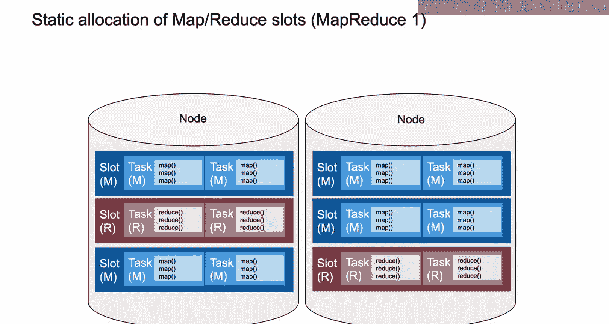
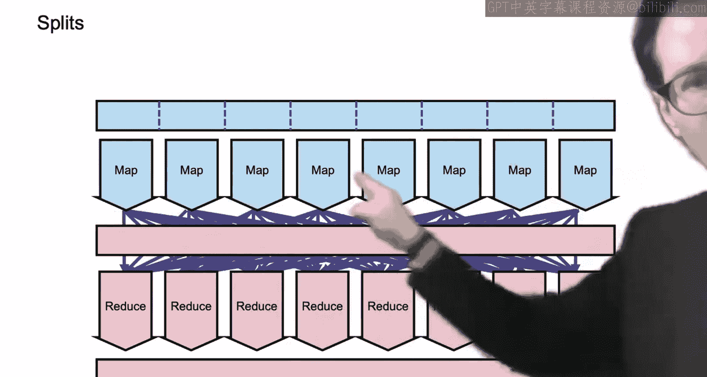
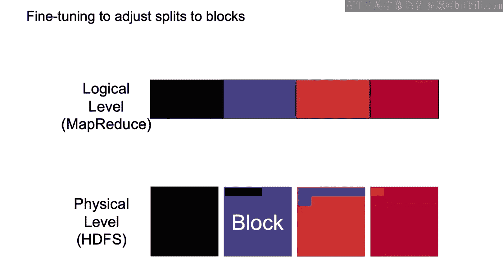

# 苏黎世联邦理工《工程师的大数据｜Big Data for Engineers - ETH Zurich - 2024》中英字幕 p21 8. MapReduce (3_3) - .zh_en -BV17FAmeFE9K_p21-

So when I come back， let's continue。 So again， I summarize because that's very important。😊。

Do not use the world's Maper combiner reducer。 It's misleading。

 It prevents you from understanding what's going on。 You will see it over the Internet。

 When you see it， always ask yourself cellular question。 do they mean。Function。

 do they mean mean task， Do they mean slots， Do they mean face， Always ask yourself。

 and then it will give you clarity online。Right so the postcal for example should clarify the difference between a split and a task and the way that the tasks are assigneded to to the slots。

 it's really important to understand that within the same slots。 So for every one of these persons。

 It's sequential。 Every person can only write one postcard at the same time I don't know you。

 Maybe you can write two with your two hands， but I can't right So this is really sequential for every person and the tasks are also executed sequentially they go to the next pile。

 but you don't know in advance what tasks will go well because thats dynamic right it's really at runtime that whoever finishes first picks up the next task Okay so the functions are mathematical。

 This is just a Java function， a python function right then the task is a sequential。

And repeat function call of map and reduce。The combine is special then a slot repeatedly and sequentially processes tasks and as soon as it's done。

 it just takes another task and takes another task when there's no tasks left that its just waiting until everybody else is finished it's still sequential。

 The only parallelism that happens is across slots because every slot will correspond to one CPU core or virtual core and it's actually threads as we will see later。

 right for those of you know what a thread is。😊，And there is parallelism across slots。

 but within a slots， everything is sequential one by one the function goes for whom is that clear？😊。

Who has now better clarity of mind of what's going on？Very good。 This is all hidden， right。

 This is a physical layer as a user， you don't even see that it's good if you know that this is what's going on。

 But this is all hidden from the user。 The only thing you need to take care of as a user is。😊。

Implement the map function， the reduce function。 Decide where you read from， where you write to。

 and possibly a combined function。 That's your responsibility。

 All the rest is done automatically by map produce。

So now I have yet another summarizing chart here where you see the nodes these are the machines right we have multiple slots per machine why because you know that now we have multiple calls even your laptops here maybe they have eight core。

16 core right so these are slots So we have multiple slots every slot can execute multiple tasks one by one and within the task is just function core so this is how it works and technically every slot and task is either on map or reduced and typically they are stamped like just like matrix。

 the red and the blue ones So I put in blue the map slots and in red the reduced slots okay。😊。

So this is done statically， what is mapping and reducing that's decided before you run the job in advance。

Okay。Then let me finish with a tricky points。I sometimes some years， some of you notice， actually。

 I think I can't remember if this year one of you already noticed it might actually be。

Because I told you that the splits are the blocks， I told you every HDFS block gives you a mapre split。

In general。But there is something that you need to understand here because it's not that easy， right。

 So we have the map tasks and the reduce task， right。

 and we split the data and every split of the data gives you map1 map task。 Now。

 you know these little rows here。At the beginning， I didn't call them that way。

But now we know that these are tasks， all of these are tasks， right these are tasks。

 so every task has one split。

Right like this， every task corresponds to one split。And every split corresponds to an AGFS block。

 Does anybody see the problem。A split equals the block。

So someone said the block could be bigger than 128 M。It's the right direction。

 Let's make it even more precise， but thisive the right direction， you have the right intuition。嗯。😊。

Let's discuss one at a time。 Let's completely forget about my produce for a moment。 Just stage GFS。

 Oh， yes， go ahead。 Maybe the。Let's hear you as well。

Thecope is split across Let me increase the oh did we plug it， Yes， we plugged it。

 Let me increase the volume。Go ahead， value could is split across multiple blocks。

Like the unit of text that we want to look at could be split across multiple blocks。

I can'm so sorry I can I can the value that we want to look at could be split across multiple blocks Yes exactly the value you want to look at might be split across multiple blocks yeah that's exactly it that's exactly the intuition worry about the quality of of the microphone。

But you have the right intuition。So let's get back to HDFS blocks， forget about my produce。HTFS。

Has the blocks to part the files into 128 meby。Chunks。In H GF S， this 128 MB。Is exact。

It's at the bits level。 you count128 MBby。Then you you cut it exactly at 128 MB。These are just bits。

 HDFS， just Cs bits， it doesn't know about records and KVU it just sees zeros and ones。

 so you count 128 meby baum， you cut a block and start a new block。It could be less， right。

 It could be less if it's the last block and it has less than 128 MBbytes and， of course。

 it's smaller， but it will actually not be bigger than 128 megabys。😊，But the splits of mapre can be。

 And this is probably what you meant also on， on Zoom， the splits。In mapre。

They are not based on bits。They are based on key values， right。

 you have a collection of key values and every split is a subset of the key values。😊，So。

 a split must end。When a key venue ends。And now this is exactly what you were saying is that you have in this block。

 maybe you have a few thousand key values in the block。😊。

And if you now look at the very last key value of that block。😊。

It's very likely that it's going to start in that block， but then it will finish in another block。

Because you might have the key value exactly on the boundary between two blocks。 In fact。

 almost all the time it will happen。 the， the probability that it's exactly coinciding with the end of the block is very infinite。

So we have here a mismat between the splits that work in terms of records。

 you partition the collection of records， and HGFS that partitions beats collections of bits， right？

Who sees that now。Okay。😊，And so this is what happens。 Tyically。

 you have a record that's typically within exactly one split。 But on the HGFS physical level， H GFS。

 it's kind of in between。 So what happens is that it's a bit tricky physically。You basically。

Kind of sort of。Assign a split to a block。 you say this is kind of soed of my split。

 except that there is a few more bits in here in the next block to finish my lastqui U pair。

So it means that this block， there is a replica of that block on the same machine as you are reading in that so local read。

😊，But the last few bits。You might have to go over the network and request them from another machine if that block is in a different machine。

 but you can just make it so that you only ask。For the first bits and don't read the entire right。

 so you don't need the whole 128 mebytes， just the first few bits。For whom does that make sense？

But the good news is as a user of mappreduce you don't care， this is just taken care of by mappreuce。

 the engineers of Hadoop and of Google took care of it for you。

 you just have to know that there is this slight impedance mismatch between the blocks and the splits。

Okay。So this is the reality， actually， that every split slightly finishes on on a different block every time。

Which finishes the map produce。Lectction。Do you have any questions？On mappreuce。

 anything that is not clear that you want me to reex to repeat。On zoom， anybody。

This is your opportunity to help me repeat things。Or you can repeat on YouTube right。

 you can repeat the video and come back and accelerate it 125 and so on。Okay。嗯。

Well if there's no questions， I will just proceed with Apache s。

So let me move on to the other sites。

