# 苏黎世联邦理工《工程师的大数据｜Big Data for Engineers - ETH Zurich - 2024》中英字幕 p22 9. Spark (1_5) - .zh_en -BV17FAmeFE9K_p22-

Welcome back， let's go now to the next exciting part。Which is Apache Sp right here。嗯。

Notice that this is kind of called the same massiveive parallel processing， just part 2。It's。

 in fact， the next generation of map Red。 It's like Star Trek the original series and Star Trek the next generation。

 the same idea map Reduce is 20 years old was invented at at that time。

 having in mind downloading and indexing the internet right one of the primary use of map Reduce was to index the web and build an index and a search engine。

嗯。But since then， things have evolved。And what happened is that a lot of people。

Realize that their problems were a bit more complex than a single mapre job。

 And they started using mapreuce in a chained way， meaning that it's a chain of mapre jobs。

 But the problem is that people had to do it themselves。

 because mapreuce on the works at whatever of a job。

 So there was a lot of manual additional work in order to to execute a chain of mapre jobs。

 An example of that is matrix multiplication that you can do a top of mapreduce， in fact。

 with machine learning， this is what we do and we have to iterate。😊，And at some point。

 it became so inconvenience that some engineers said we need to reenger the whole thing and come up with a more abstract and even more generic system that takes care of it so that people no longer need to do it。

This is Apache Spock， there are many others now that do the same。

 but again if you know Apache Sp you will have no problem understanding the others。So， let's the。

Get tweets it。First， where are we， this is the stack？😊，That's what we've already done， right。

 we've already got half of it now we are in the middle of processing and there's a few more things that will be left at the end。

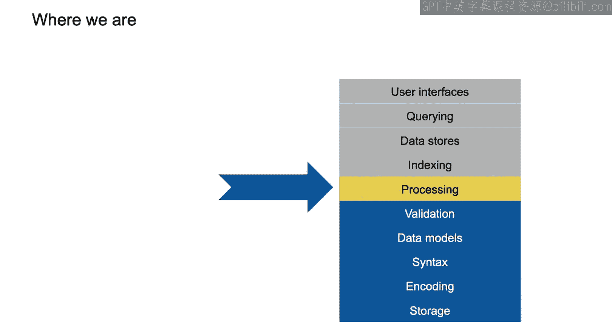

Last week well more precisely the last recording we've looked into map Red and a map Red job is really map shuffle Red finished right that is one map Red job。

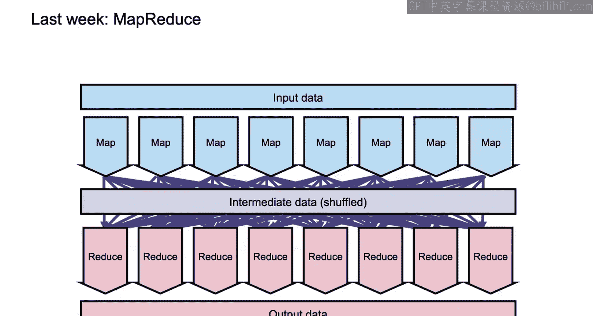

We've looked at the infrastructure， we've seen it's exactly the same architecture with a coordinator node and worker nodes。

 the name node also runs the job tracker and the NA nodes also run the task trackers。

 which you cannot see in the lecture hole。

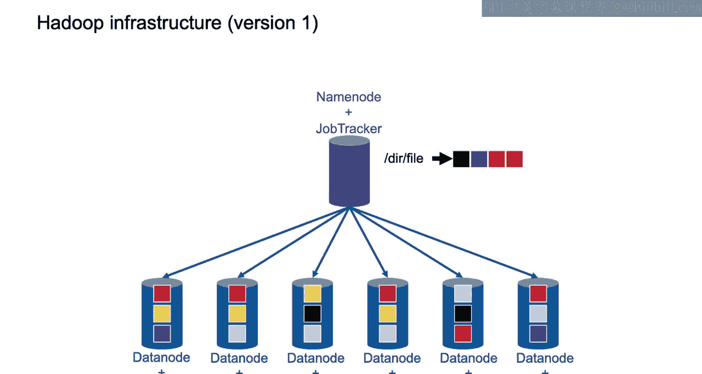

Because of the toolbar that is hiding it。

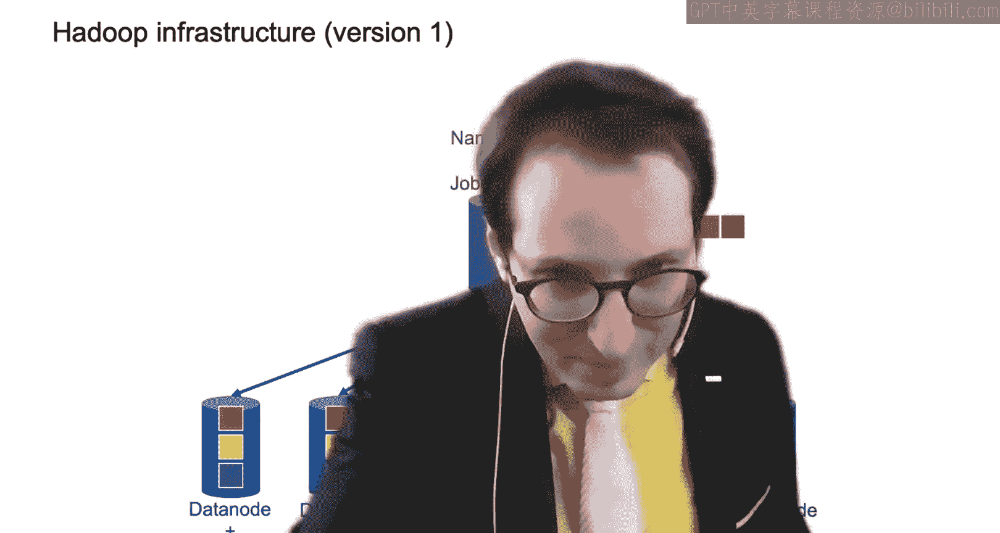

There you go。So the test tracker， which are responsible for hosting the slots that run the map and reduce tasks。

 now you know what they do。嗯。But now if you look at this a architecture。

 this was actually called version1 of Mapreduce， that's the initial architecture of Mareduce。

There's a few problems with that architecture。嗯。If you look at the job tracker。

 this is the brain over there in the coordinated node。It has to deal with resource management。

 It has to know what CPU calls and memory is available with scheduling the tasks over the。

The slots about monitoring。 if something fails， you need to restart it and so on， the job life cycle。

Full To rans， again。Imagine that during the map phase， one of the map slots crashes。

 then you just ask another CPU core to run the same task again。

 right So this is called full tolerance。 So this kind of works automatically。

 The problem is that this job tracker has too much on its plate。

 right As we say jackov all Trades master of none。 So it has too much responsibility the problem is that it's a single machine that has too much responsibility。

 So this is the first problem that the engineers tried to solve。It's associated with consequences。

 actually。😊，One of them is that when they tried to use this version of mapre。

 they managed to make it run to on clusters of up to 4000 nodes。

 but then it started not working anymore and again 40000 tasks。

 it means roughly 10 tasks for every node right but it didn't scale beyond that so that was causing a bit of issues。

The second issue is again that the bottleneck because all of these responsibilities are on the same machine。

 So if at some point it starts to be overloaded then that slows down the whole cluster right so this is a bottleneck and'll come back to bottlenecks in a few weeks and it both schedules and monitors it's bro responsible for saying which task gets executed where to assigning them and also of monitoring for crashes of seeing if a task is done and so on。

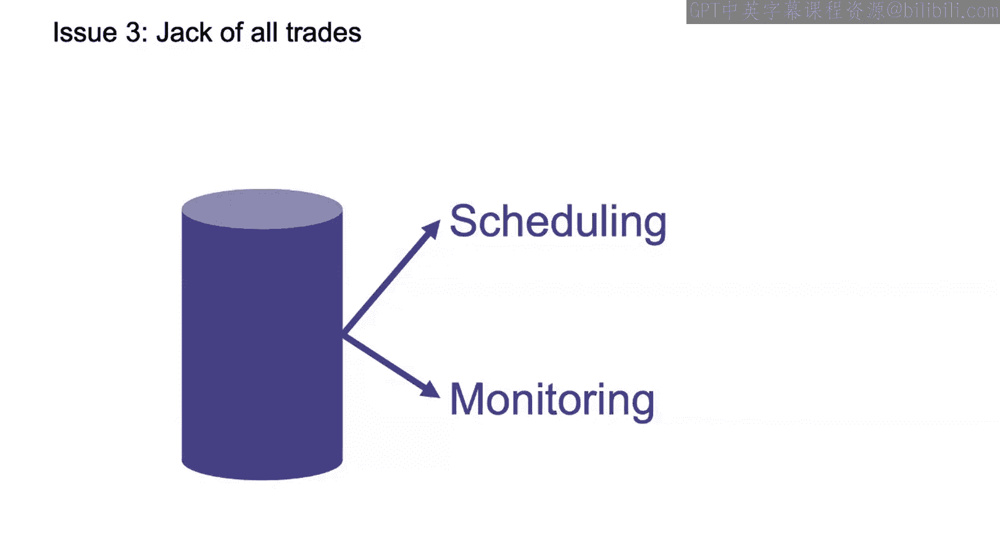

So it has too much。嗯。😊，You remember this node slot task function that I told you about。

The problem here， there's also a problem here is that we have to know before we start the job。

 what slot is for reducing and what slot is for mapping， But do you see the problem first。

 it's a fixed size。 You have a fixed number of slots for mapping。

 a fixed number of slots for reducing。But the other problem is that during the map phase。

 only the map slots are actually doing something。 The reduced slots are just doing nothing。

 They just have to wait。 And that's it。 So you're basically wasting a whole part of your cluster doing nothing。

 And then the opposite in the reduced phase in the reduced phase is the reduced slots that do the work and the map slots will have nothing to do anymore。

 So you see it it's kind of not not optimal because we we would say in technical terms。

 the nonfgibility of the map and reduce slots， right are they are fixed。

We have a question in the Zoom chat。

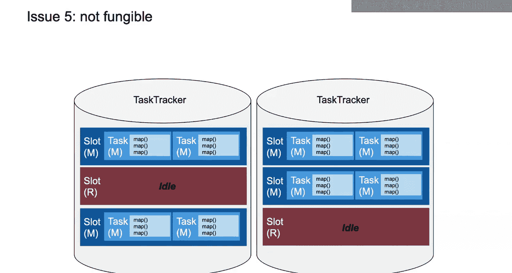

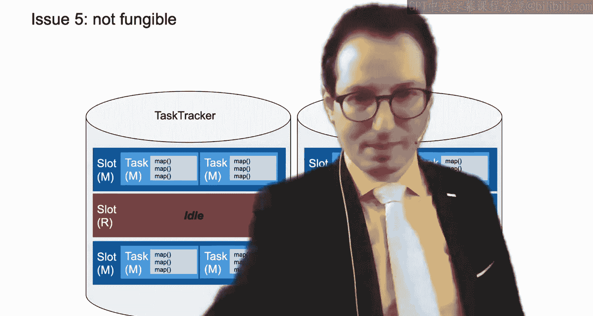

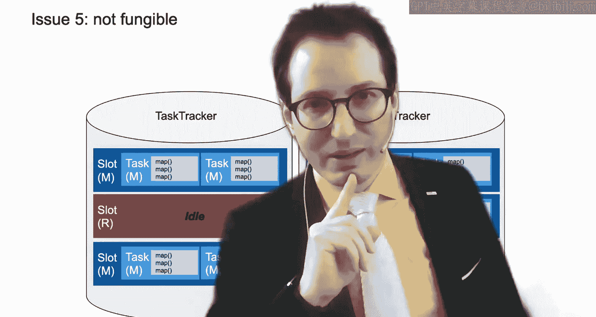

In practice yes， but that's what I'm coming to because we are going to solve that problem and and this is exactly what's going to happen。

 we are going to use the other types of slots Basically what I'm describing here is version1 that had this issue and this issue was solved exactly in the way that you just said it's that we are going to no longer have this problem of eitherness and we will use all of the available resources right so the intuition is correct again that's just version one that I'm talking about here。

😊。

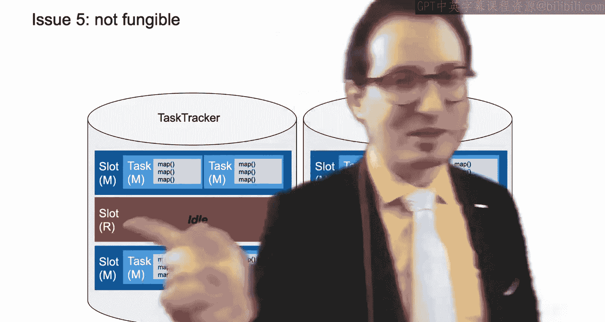

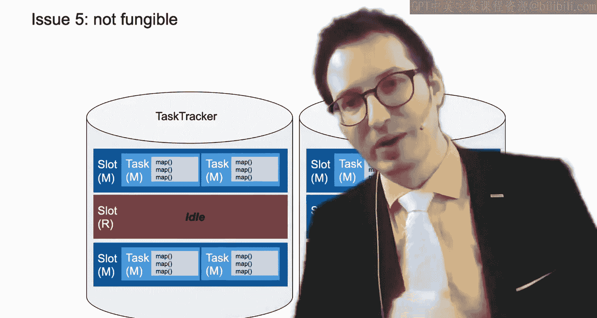

Okay。

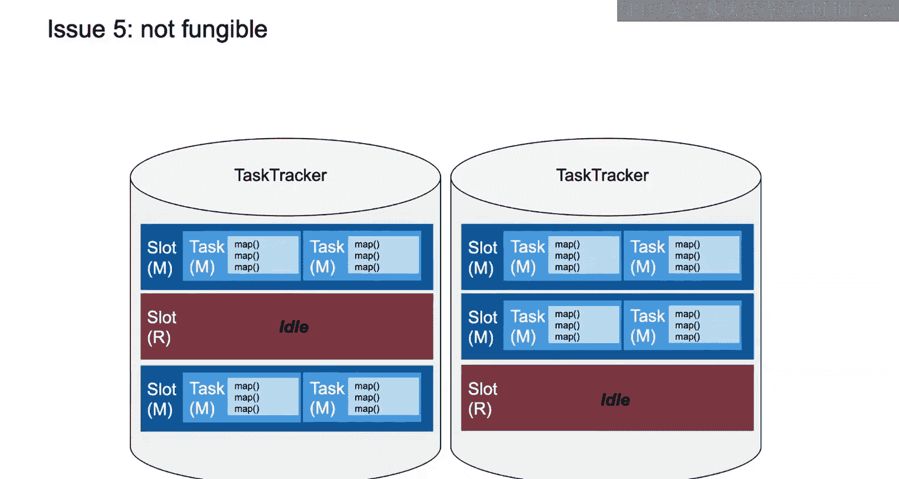

呃。And thus， we have a solution to this problem called young。

Yam means yet another resource negotiator as soon as you have a technology that startss with YA it's probably yet another followed by something right so yet another resource negotiator just like yet another Macer language Yal that you already saw。

Yet another resource negotiator fixes all of these issues。What is the architecture of Yrn。

 you guessed it， It's again the same centralized architecture with the coordinator node and worker node。

 We just need to find new names for them。So for the coordination node is called the resource manager。

And the other machines are called node managers， right？

So what we have in Ym is the notion of container a container is a little bit like a virtual machine kind of sort of right so a container is a bunch of resources on a machine with so and so many cars and so and so much memory。

 for example， four calls and 16 gigabytes of gram but you might have multiple containers on the same machine。

 for example， if you have 16 calls you could have four container of four calls each and so on and so on so this container thing is a way to manage the resources if you know of the borg or Kubernetes and so on it's kind of of a similar idea but on a very very low level of resources。

So this is the abstraction of Y， we have a node manager on every worker or node and we have a resource manager and we obstruct away the resources in CPU and in memory as containers and the idea is that when a client connects to the cluster and wants to execute a job。

 for example， a mapre job that it could also bepar or any other technology。

 what happens is that the resource manager。With the。

More clever than the job tracker is going to accept the job and immediately delegates to somebody else right it's like if some of you become managers in the future。

 you delegate right So the resource manager say yes。

 yes says I accept that job that somebody else is going to take care of that。

 So what the resource manager does is that it requests the container here promotes the container to an application master and is the application master that's actually going to take care of the job right So you see how now we split the responsibilities。

 Now the resource manager doesn't need to care about the monitoring of the job and so on。

 it only needs to care about the containers right。And so now what happens is that the application master。

Kindly accepts the responsibility of the job。 And it says， yes， but I cannot do it alone。

 I need help from other containers。 So it immediately connects back to the resource manager。

 requests help from more containers gets them allocated。

 and then you have everything nicely executing on the on these machine。

 And you see that in the execution of the job。 the resource manager is not no longer here。

 It's purely the application master in containers。 right。For whom does that make sense， yes。

I'm not sure if it's going to work because if yeah， go ahead。

Order in which the second the red containers are chosen by the resource。So they are。

 so you're asking about the order in which they are allocate。

 It's not part of the material of the lecture， but I can briefly say a few words on that。 In fact。

 I am going to explain a little bit。 The idea is that。Dis cluster serve。

Is not only used by the clients。It's imagine that it belongs to a company。

And let's say there are hundreds of users of the cluster。

It means that you are running these jobs concurrently with other people。 So Y has this way。

 it's based on game theory and so on。It has this way of smartlylocating the resources。

 maybe you are entitled to a certain share of the cluster and then it will prioritize you on these shares of the cluster So it's basically dynamicallylocating the containers but if there are too many people at the same time it might tell you wait wait wait you are now fully utilizing your share。

 some other people need it are you going to say， oh。

 many other people are not even here so I'm going to give you some of their some of their share so it's something dynamic。

😊，The details of that are very complex I used to have them in the lecture especially in the masters lecture。

 but in the end we dropped it because it's really more a physical level and I didn't want to distract away from from the big data part but it's a very good question and that's really something that happens dynamically when I said game theory it's because the system is designed for people not to cheats meaning that when you request your containers。

 you have an incentive to really request what you want and what you need and not over request or overuse the cluster right did it answer your question。

They exposed each other。对たす。MaybeIt is part of it indeed so I'm repeating because people don't hear you on Zoom on zoom there is the notion of proximity and distance between the containers and you also try to well it in such a way like to respect the distance and let's say be location aware of the distance between the containers right it's just not part of the material basically but it's interesting to know these things right。

😊，Yes， there is another question over there。 We can try with the box。 otherwise。

 I can also repeat what you what you let's try and I give a bit of volume。嗯。

How do we know if the node manager is working if the resource manager is no longer taking care of the monitoring？

How do we know if the resource manager is the node manager is still working。

 so like if it wants to keep scheduling jobs and stuff like that。

 how does it know if it's alive if it no longer takes care of the monitoring？Oh， so yes， indeed。

 So the resource manager knows if they are alive with heartbeats。

 It's exactly the same principle as in AGSS。 So basically， all of the node managers。

 they are going to send half beats to the， to the resource manager。

 and the resource manager is aware of of losing nodes or crashing nodes and so on。😊。

It's just that the responsibility of rerunning， for example。

 a map tasks somewhere else that's going to be the application master now that takes care of that。

 The resource manager still wants to know which nodes have a problem so that it does not allocate the containers there。

 And， and yes， you're absolutely correct that there is a hardbes and a way of communicating that。

 right， Thank you。 Thank you。Okay。So what are the resources we are talking about。

 memory and CPU mainly there is working progress to also consider the disk usageage and the network。

 but today it's more like memory and CPU are the tool we really do at。

What's important is that at the same time， you might have plenty of jobs running on the same cluster。

 Think a company wide cluster with hundreds of users。

 maybe there are 20 mapre jobs executed at the same time and 30 stock jobs and so on and so on。

 And so we have as many application masters as jobs okay。But only one resource manager now。

 and this is the question you ask。 we indeed have communication between the node managers on the right and the resource manager on the left where the node managers communicates their resources。

 They say have that and that many CPUs that have that and that much memory and I'm alive right every couple of of seconds you send a sign of life and then the node the node the resource manager keeps a list of the nodes that are valid that are working and those that are not working And this you cannot use to allocate resources。

 The resource manager does not monitor tasks。 That's that's the job of the application methods right it's not going to restart map task or restart the job upon failure right that's not going to happen。

嗯。The application master is also application specific。 There is something for mapre。

 There is something for Spark and so on。 So yaan is fully agnostic of the technology you're using。

 It doesn't care if it's mapre or Spar or anything else， right？ It's fully general。😊。

It's the job of the application master， the Cr here to monitor for a failed task， for example。

 a task that failed and relaun sheet with some other container， right？😊。

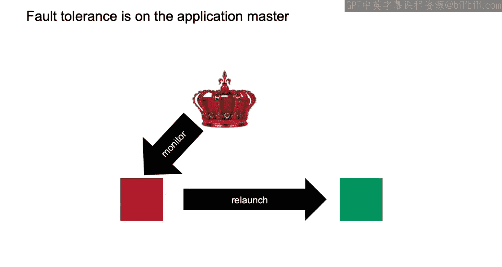

That's the task of the application master。

I just have a few slides because again， I barely explain it anymore。

 but when you schedule the containers， you need a strategy right， how do you schedule the resources？

😊。

A very naive approach is FI first in first out it means somebody uses the entire cluster and when they are done。

 somebody else uses the entire cluster and when they are done。

 somebody else uses the entire cluster now as you can imagine this is not how it can work at the level of a company because you cannot have the whole company wait for a single person to complete So in practice what you do is that you assign maybe in some company C level suite meeting who gets wet sharere of the cluster basically a money thing who gets weshare and so here in the university。

 let's say the department they decide that the mathematicians get 40% the ph get 10% and so on and in is kind of the guideline for the use of the cluster and then the resource manager will keep that in mind to allocate for example it can have cues there might be a queue for the math department and a queue for the computer science department but then they will really preserve the resources and have them for the exclusive use of a department and then within the department you're going to have a succession of use。

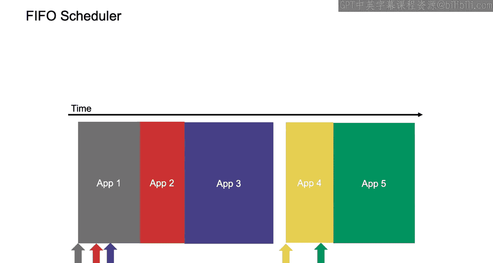

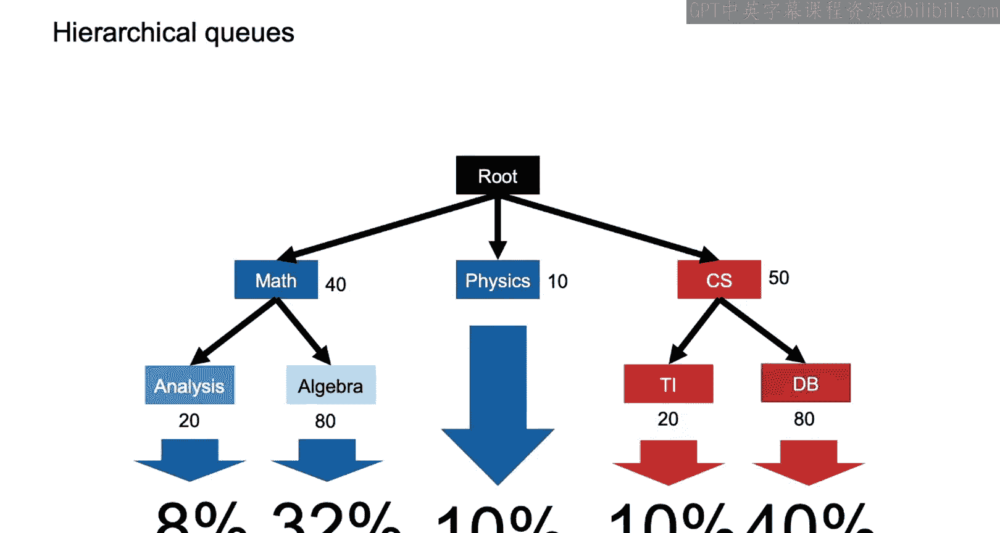

That need to wait for each other right so this is another strategy called the capacity scheduler。

 and we even have a fair scheduler。 The first scheduler is is it's been published。

 I think at Stanford as dominant resource fairness，'s a very good paper。

 The idea is you have some LTT。😊。

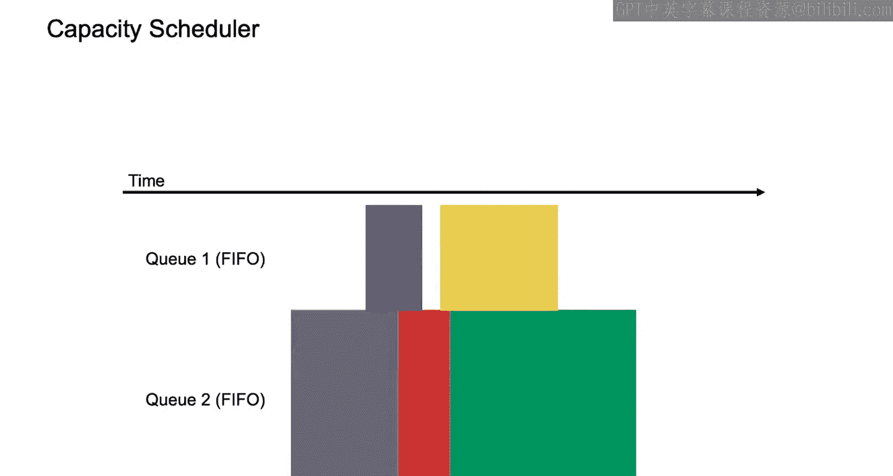

If the mathematic department is not currently using the cluster。

 then why would you block that part of the cluster unused right in that case you elastically redistribute it to everybody else and the fairness is basically the idea that you fairly allocate based on the memory and CPU needs of everybody。

We have a helicopter， all those on Zoo who just passed， okay？嗯。So this is， you don't have， again。

 that I just have a slide to explain， but this is very， very high level。

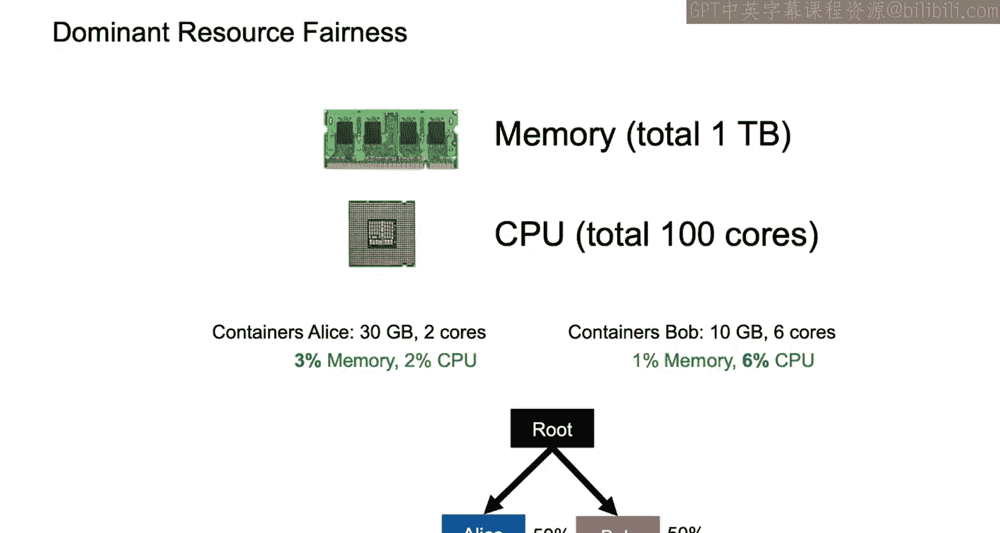

The difficulty that they solve in this fast scheduler is that。

If you allocate the cluster just based on a single dimension。

 like you only look at the course or you only look at the memory。

 then that's easy because it's easy to know what it means to use 40% of the cluster and so on。

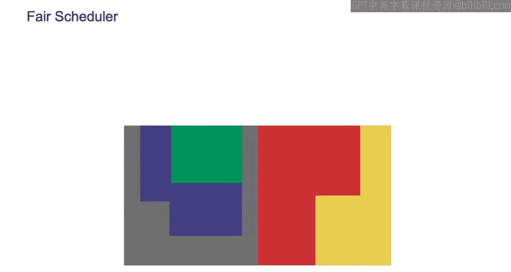

The problem appears when you have multiple resources， you have the memory and the CPU。

 and imagine that Alice from the math departments uses containers of 30 GB and two girls and verb from the computer science departments using containers。

😊，Of 10 GB and6 calls。 How do you deal with the discrepancy， right。

 Because Ali is more memory intensive and Bobby is more CPU intensive。😊。

And so this dominant resource fairness has a smart way of dealing with this kind of situation and of telling you Alice is going to get that and that many containers。

 and Bob is going to get that and that many container right some of you who are interested as an optional read。

 you can read the dominant resource fairness paper。 It's some game theory inside also。 But again。

 I'm not spending time on that， this is just for you to know that there exist algorithms and techniques that deal with memory and CPU to fairly allocate them across across the users right So in that case basically based on the fact that every container of Alices。

 you look at the maximum percent。 So here it's 3% that the memory for Bob it's 6% because it's CPU dominated and basically because Alice's number is3 and Bob's number is6 assuming in the company meeting they are allocated half of the cluster each the intuition is that Alice should get twice the number of containers compared to Bob。

Because her containers are twice as small as bo containers， if you consider the the maximum resource。

 So for example， Alice would get 20 containers and Bob would get 10 and then you see they both get 60% of the cluster for the dominant resource。

 which is fair。Again， our is closed， you don't need to understand that。

 this is just to say that there are very smart people who manage to find strategies to allocate the resources。

And so the result of that is that now you can have these company wide clusters with people doing all sorts of things with that。

 some people might be doing mapre， some others， some Sp that's what I call D distributed processing that would be SP message passing interface MPI graph processing。

 machine learning， training and NLM you know on the same cluster and Jan is taking care of fairly distributing the resources to everybody who is using the cluster right this is what it's about。

So we separate between scheduling and monitoring because now the scheduling is done by the resource manager。

 but the monitoring is delegated to a container that's called an application master。It's scalable。

 So now we can process more more data than we could with the first version of mapre。

 It's well available because you don't block the cluster。Unnecessarily。

 you don't have the bottleneck of the job tracker anymore。 and it's multi tenantant。

 meaning you can mean you can have many people using the same cluster at the same time， right。Okay。

So this is Ym that was just a very small parentheses on resource management。

 so what happened is that after Ym was invented by the engineers。😊，Then came mapRuce version2。

 which is the same logical interface to mapRuce， except that now instead of the job tracker and test tracker。

 it's running on yaon， right？But the look and feel is exactly the same。

 It's just running differently， but it's exactly the same map reduced， the same map function。

 reduce function and so on。😊，But now since we have ya during the map phase。

 we are not going to be using any idle。Reduce slots that are doing nothing。

 You will only allocate the reduce slots at the very last minute when you need to actually start the reduce phase。

 the application master will request the resources for the for the reduced slots only when it needs them。

 So it's it's more efficient。 Well who is that clear。For whom is that not clear。

ButW who is that clear。Okay， thank you。 So introduction to Sp， that's the next。Level。

 so now I'm going back to the logical level in terms of the， the way we use it。 mapre。

If I want to be a bit provocate here， I'm going to call it map shuffle map because if you think about it。

 what's the difference between reduce and map， Red and map are just some parallel phase。

 right so you can look at it like a map followed by a shuffle followed by a map that happens to be dealing with a reduced function。

Now that's very specific。 and the problem is that then people need to chain plenty of mapre jobs one after the other。

 and that's a lot of work。嗯。If I zoom out and put it like this。

 we basically have this input data set that is mapped to an intermediate data set that is reduced into an output data set。

 Well Spark basically generalizes this to any graphs。

 So instead of having specifically just a map and then a reduce like this change you have a fully generic graph of data and you just let the data flow and you can do multiple things with the same data set。

 it's not any graph。 it's a graph that cannot have cycles。😊，Right a directed cyclic graph。

 it just means that if you follow the arrows， there has to be a flow top down。

 you cannot go in circles across across the arrows multiple times， no cycles。So this is Sp。

 this is the new thing about Sp， and that's extremely powerful because now you no longer need to chain the map use jobs anymore。

😊，Because you can just do it within this new paradigm。With a graph。So this is why we have stock。

A bit oftelogy。嗯。You know that in every technology。

 it's like I spend multiple time when you have a hammer， the well。

 everything in the well looks like a nail in mapreuce everything is a key valueU pair in Spk everything is an RDD。

 resilient distributed data sets， so the RDDs are kind of the key valueU pairs of Sp if you want。

So what is an RDD， a resilient distributed data set， it's a very scary term。

 but it really means that it's just a big collection of whatever collection of records。

 a collection of strings， a collection of whatever you want。It's a big collection that is parts。😊。

So it means that you could have a collection with billions of whatever。

And these billions of whatever are spread all over the cluster。

 Maybe there's 1000 machines on every machine。 there is a million of whatever， right。

 I on purpose say whatever， because it can really be anything。

So an L now if you come back to the name distributed basically just means that it's partitions across the cluster and resilience means that if there is a crash somewhere。

 it's automatically recomputed so if you lose back of it Sp is automatically going to figure out and reconstruct it for you So this is what we call resilience So again an RD is just a big collection of whatever that's one thing to remember and that whatever doesn't have to be a keyvalue that's the new thing in mappreuce。

 it's a collection of key values has to be key values in Sp it's really a collection of whatever it can be key values if you want right you could have a collection of key values that you could have a collection of integers。

 you could have a collection of JO objects， you could have a collection of pictures。

 you can just have a collection of whatever you want。It can even be a heterogeneous collection。

 by the way。All right。So the Rs work like water， there is a cycle just like water evaporates from the sea and then forms clouds and then rains and so on and so on。

 RDDs work in the same way， they have a life cycle。It all starts with the creation of an RD。

 How do you create an RD。 Well that can be read from HDFS， You have some data sets stored on HDFS。

 and then you say， okay， make an RD out of that and maybe it's I don't know。

 maybe it's a collection of Jason objects stored on on HDFS and you load it as an RD That's a collection of Jason objects or it could be I don't know a relational table。

 then you just create an RDD of records， an RDD or rows so it works from HDgfs from S3 from Google Cloud from Asia。

 it also works from your local file system。 In fact。

 you can also create an RD from your laptop that would also work and you can even do it on the fly on the fly means in Python。

 you create a list in your memory and you turn that list into an RD right it's technically the same It's still a list It's a collection but now it's an RD。

😊，That would be on the fly so you can create RD。Once you have created an RDD。

 you can transform it transforming an RD means you create another RDD out of the first one with some transformation。

That transformation could be mapping， could be reducing， but it could be many， many。

 many other things。 In fact， there are a whole restaurant menu of transformations that are at your disposal。

 so it's more generic than map reduce so we can transform an LD into another RD in this way。

And then at the end of the life cycle of an RD， we have an action。

 An action takes an RD and does something with it。 What can you do with it， Well。

 maybe your RDD is small enough that you want to print it on your screen， right。

 So this is one way in your Jupyter notebook， for example。

 you can just print your RD if it's small enough。😊，You could also download it to a Python list。

 for example， it's an R on your cluster， but you know that it only have1 thousand0 videos。

 then you just download it and have a local Python list with your  thousand0 values。

 that's also an action。The action could also be。Write it all back to HDGFS right Imagine you have an RDD with a billion values。

 there is no way you can download that。 it's too big right So instead you're going to instruct back to write it all down to HDGFS in parallel and then you're going to create a directory with 1 thousand0 files that is going to contain your RDD。

😊，You can also be downloaded to your local file system。But again， for this to be safe。

 you need to be sure that the RDD is small enough， right， Because if the RD is too big。

 it's going to crash your machine。 So if you know the RD fits on your machine。

 then you can also store it on your local device system。 Write it back。To the local phase system。

 Okay so you create RDDs， you transform RDDs and you act on RDDs at the end。

 So basically you whole the whole way it works in Sp is that you have this graph of RDDs that depend on each other。

 The ones that the top are the ones that get created from HFS or any location。

 and then you transform and transform and transform RDs。

 you can even have transformations that take multiple RDs in that gate。

 you take two Rs and maybe you combine them into another RD that you can also do right you can use an RDD for several transformations right。

 you could not do that in mypreduce Who sees that it's more general than mappreduce。😊。

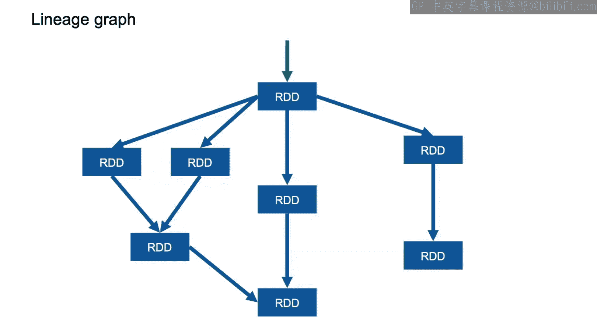

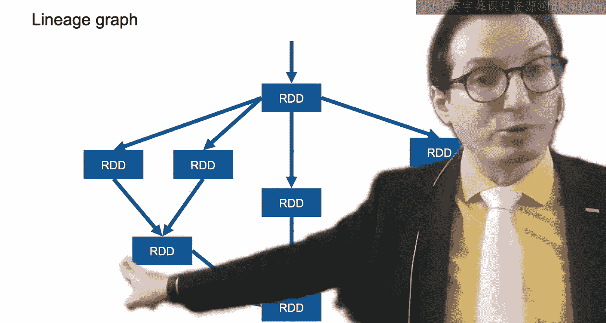

Right awesome， so it's multi general first because it doesn't restrict to key value pairs。

 you can even just have values， not necessarily key value pairs。 Second。

 you have a general graph like this， It doesn't have to be just map and reduce。

 you have you can have any directed thecycl graph。嗯。And， and third。

 it's more general because you can also have。Dozens of different transformations and not just map and reduce。

 Next week， I will show you the whole restaurant menu of transformation。 There's many， many。

 many of them。 It's like a catalog And then you pick from that catalog in order to build your your graph。

 right， So that is the logical level of Elfa spark。 It's extremely powerful。

 It's very popular too very， very appreciated。 lot A lot of people use it。😊。

嗯。

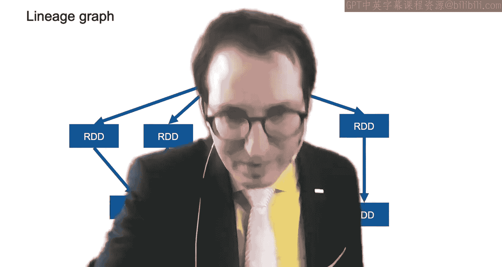

Just before you go。I have a chance to check。Have you been following。Who's reading the textbook。

 by the way。Who already read the chapter on mapreuce？😮，You should read it， right。

's complementaryary to webam thing。 And there is also a chapter on Yn in a chapter of Sp。

 So don't hesitate to to to read it。 It's an opportunity to。To go over the material one more time。

 but at your own pace。So that tells me to slow down a bit， which I will do next week。Yeah， so。

Come with questions next week。 Anything that's unclear。

Come to me and we'll start the lecture with with that， right。

 So I'll take make sure to to touch base with everything we've covered。 And then we。

 we are going to take it from there。Okay， that also reassures you because if you。

Felt like you didn't get everything。 Then you， you see you're not the only one。

 So that probably also gives you， gives you a better feeling。All right， so again read the textbook。

 do the exercises and next week I slow down and we'll make sure to consolidate everything we've learned Thank you very much see you next week don't forget to fill the Vgates form as well I we sit there enjoy the exercise session and thank you for the moderation。

😊。

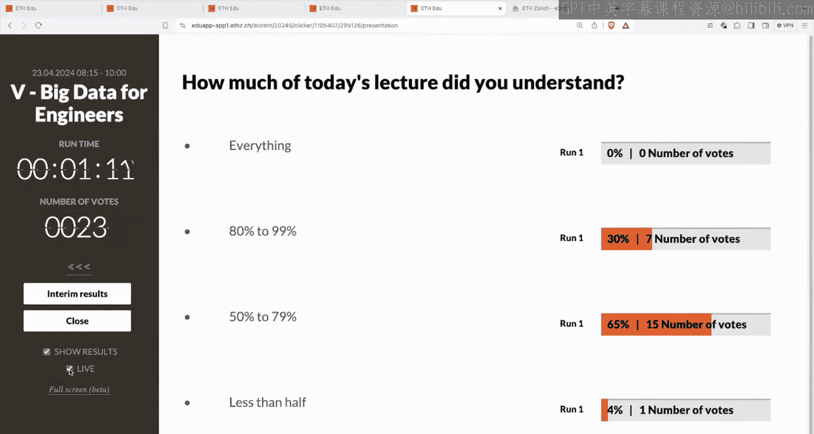

Goodbye。