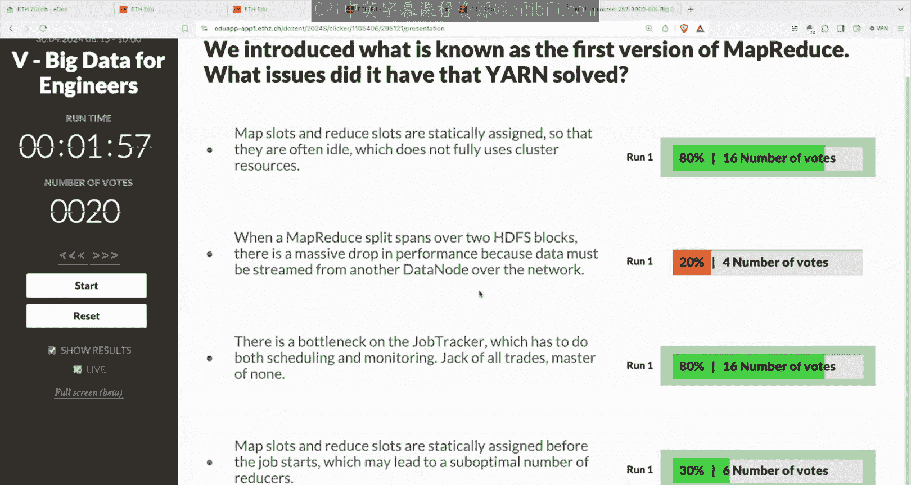
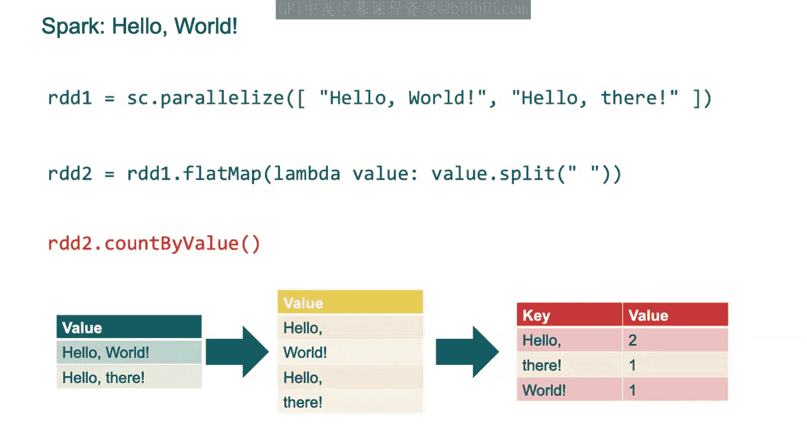

# 苏黎世联邦理工《工程师的大数据｜Big Data for Engineers - ETH Zurich - 2024》中英字幕 p23 9. Spark (2_5) - .zh_en -BV17FAmeFE9K_p23-

Welcome everybody in the lecture hall， welcome everybody on Zoom， welcome everybody from the future。

Today， we are hopefully going to finish this lecture on Spk Apache Sp。

 I have two clicker questions to ask to make sure that you followed。

 and I would also like to take a bit of time at the beginning to answer any questions that you might have from last week。

 I will try to keep the pace not too fast to make sure that all of you are following。

 So what I think I will do is first， I'll ask you the two clicker questions on on the mappreuce and Sp。

 then I'll take any questions that you might have。So my first question is， what is an ugly？

Because I used RDD all of other place today。Is it a resilience distributed data sets or is it a recoverable distributed data sets。

 or is it a recoverable divable data set or a resilient divideidable data sets？So let's have a look。

Wow，100 cents。People have been working this week。Alright， so indeed， this is the correct answer。

 resilience， distributed data set。Distributed because it can be enormous。

 it can be petabyte's worth of data and it can be spread all over the cluster。

 it means it's partitions the same idea as files partitioned in blocks here we have a collections of whatever。

 a collection of values， partitions and the partitions are spread all over the Apache spark cluster。

So this is for distributed resilience， because we'll see I already showed you last week that the RDDs are basically node in some general da in a distributed exactlycycl graph。

😊，And the reason is simple is that we are basically computing RDDs。

 We are computing these collections and every collection depends on one other collection or two other collections and this is this dependency graph that you have right and this dependency graph can be as big as you want right you can have maybe a chain of five transformation with six RDDs that's entirely possible。

 and resilience means that if we lose one along the way because one machine crashes or we run out of memory or whatever that's not a problem we just recompute it and if necessary。

 we even recompute all the way from the beginning right so this is what resilience actually means right。

😊，So resilience distributed data set。 but really on the logical level。

 think of it as a collection of values， a collection of whatever。 right， This is what an R is。

ACoction of whatever that can be very， very large。😊，So that was my first question。

 let's see if you also nail the second one。So we introduced that was two weeks ago in the beginning of last week。

 the first version of mapre right in the very early days of mapre。

 and then we we introduced Yang in order to solve some of the problems of the map Red。

 and that leads to a second generation， a second version of mapre。

So is it that map slots and reduce slots are statically assigned so that they are often id and that doesn't fully uses the clusterar resources or when a map reduce split spans over two HFS blocks。

 there is a massive drop in performance because data must be streamed from another data node over the network right Does Ym solve that。

Or does it thought that there's a bottleneck on the job tracker which has to do both scheduling and monitoring jackoval trade master of none。

Or map slots and reduce slots are statically assigned before the job starts。

 and that may lead to suboptimal numbers of reducers。Multip pro cells are a he。

So what issues does Yang address and solve？So we have a majority team。

With two of them that are quite popular。😮，I see some changes on。Do you have a chance。

And the majority is correct on those two。And。The Foxox went。You could argue。

 I marked it as correct in the sense that the fact that you staticly associates the slotlus puts constraints on the number of radio cells you can have。

 right because the number of red cells you need to book part of the cluster in the first version of my produce。

You need to say that part of the cluster does map and that part of the cluster does reduce。

 And during the mapping phase， the part of the cluster doing reduce does nothing。

 And during the reduce phase， the part of the cluster doing map does nothing right So that puts constraints。

 So this is why I also marked the last one as that could be true。 the third one， this is true。

 job the job tracker in the first version of map reduce has too much to do。

 it both has to schedule the resources and allocates the slots to mapping and reducing and so on。

 but it also has to monitor for crashes and restart if necessary and orchestrates the whole shuffling。

 So this is just too much。 And indeed ya solves that by delegating all of the monitoring to one of the worker node。

 It's no longer done on the coordinator node， it's done on one of the the worker node。

The first one is true。 Also， this is what I told you that you have statically you know what it means statically right。

 Staally means before the job starts before the job starts。

 you need to allocate part of the cluster to mapping and part of the cluster to reducing。

 That's what staticly means as opposed to runtime runtime is when it's actually ongoing once you have launched the job。

 right So this is true in general， in computer science。

 there is the static part or compile time part before you actually run the program。

 and then there is the runtime part or dynamic part while you are running the program right。

 and they are very interesting theoretical problems on the fact that。

When you do you try to do as much as possible statically in order to optimize that you cannot do everything and in particular。

 there is the halting problem that is basically trying to predict if a program is actually going to come to an end。

 this is impossible， it's undecidable so this is this whole tension in computer science between compile time and runtime between static and dynamic right and so in the case of mapreuce version1 at compile time we split the cluster into these two parts but with yan we switch it to the dynamic parts。

 meaning that we first allocate the map slots and we worry later dynamically about the reduced slots。

Okay， the second statement in the middle is correct， but it has nothing to do with Yao， right。

 The fact I wouldn't call it massiveive， though， but it is true that the splits。

 you remember that the splits in mapreuce， they divide between keyvalue pairs right And that might not exactly correspond to where two blocks are separated because for HDFs blocks。

 it's about bits， you look at zeros and ones and you cut wherever you have the end of the block。

 but in mapreduce， you need to be careful。 You can only cut right after a key value that might not exactly coincide with the blocks。

 And so there's a tiny part of it for the part of the last key value pair of every splits that you need to read very often over the network right So this is a slight performance performance drop。

😊，Okay。😊。

So all of that we covered last week。We go back to the slides。

Okay。So now。I'm going to give some time to for questions anything that wasn't clear that you didn't understand on the whole of mapreuce on the on the on what we did about Sp。

 anything you didn't understand that you would like me to repeat knowing that you shouldn't be hesitating to ask questions because if you didn't understand something。

 it's very likely somebody else and many other people didn't either， right。

 So you should really never hesitate to ask a question。

 right there is no such thing as a stupid question。So do you have any question in the room。

 either that you prepared or spontaneously？On Zoom， any questions？You mean a bit of time。

I ask questions then。I'll ask questions。Let me do some sort of FAQ from the previous years。

 the sort of questions that were commonly asked。One question was？

When we talk about the second version of map Red。Do we talk about SPk？And the answer is no。

Spk is completely different。 Spk is a different piece of technology。

 It's been developed by completely different people at Berkeley。

 And now there's a company that was founded called Data Bricks， who heard of Databricks。

RightIt's now a very large private company and and so they are the ones who basically to a spinoff from Berkeley and so they develop Sp Sp is open So right but they also have a proprietary distributionion that they release So Sp is not the same thing as the second version of mapre In fact。

 what's the difference between the first and the second version of mapre。

 Well from a user' perspective none there is absolutely no difference。 exactly the same thing。

 you have this mapping phase。 you have the reuse phase。 That's it。

 the only difference between the two is if you look down at the physical level very deep。

 then you see that the second version is using yan instead of the job tracker and test tracker that from the users perspective。

 there's absolutely no difference exactly the same interface right you might have once in a while they update the Java interface or the Java API but that has nothing to do with with the user young。

Right， so we have the first version of map pre with the job tracker and the task tracker。

 but it had all the issues that we mentioned here。We have the second version of mappreuce that looks exactly the same to the user except that in the background。

 we use yarn and some of the orchestration is dedicated to one of the worker nodes instead of the coordination node。

 We don't have any job tracker and test tracker anymore。 in the second version of Lapreuce。

 Instead we have the application master of yarn and we have the containers that take care of the rest。

 and then we have Apes pack， which is a new generation of the massive parallelette processing。

 So that was first question。Again， a few seconds for you to ask questions。 Otherwise。

 I'll continue to make up questions。Yes， go ahead。 So let's。衣 you。Can I just try to read？

Let meLet me increase the volume so that people hear you。

Because there is some sort of noise otherwise， so I need to。Good。Checkick。I don't know。

 can you hear me， yeah， should worry。Just like generally。

 how is it solved kind of storage wise if you do this massive parallel processing on like the different blocks and so on。

 especially than if we add like huge data processing parts and a lot of different tasks。

 which kind of only if I understood it correct get activated like kind of it's it's saved right the task and then you have to activate it and then it like calculates all of it because it's sleeping until you actually activated。

So how does this work， Are you referring to spa or map pre？Ma produceuce maybe right。

 probably produce messed up there Okay， so I let me try to。We explain a bit all of these。

 So we are talking about the physical aspects right， So again， with daytime dependence。

 you need to separate between the logical aspects and the physical aspects。

 Loly map produces very simple。 You have a collection of key value pass。

 You apply a map function to every key value， and that produces intermediate key values。

 and then you apply you group these intermediate key values by key。

 and then you apply a reduced function to every group that has the same key and you get output value。

 That's the logical level。 This one is relatively simple。 Now， in the physical level。

 How do we make it happen。 And this is where it's absolutely beautiful because all of the physical path is completely hidden from the user。

 but it's very interesting。😊，So。You really need to consider。

The two stages one by one because they do not work in the same way。The map phase。

 the first half of map produced the map phase。😊，Is reading the data from HDFS。

 Let's say it could also be S3 could also be Google Cloud St， Azure， but let's take HDFS。

So in that case the data is stored on HDGFS in blocks all over other cluster right and what you try to do in the map phase is to say every block it's kind of sort of corresponding to a task right I'm saying kind of sort of because there's these last few bits of the last key you pair that might speed over another block but very roughly a block gives you a task right So if you have a data set that has let's say 10000 blocks。

😊，Then you have 10，000 tasks。And a task is just a to do。

 A task consists in evaluating the map function for every key value in a block。

 This is what the task is， right。😊，Now。😮，嗯。Speed in the map face， this is the storage。 Now。

 how do we execute it？When you know that when you have computers， you execute things with CPUs。

 right， central processing units， that's the processors that you have in computers。So。

This is the brain of the computers。😡，So when you need to take care of the tasks。😮。

You need to distribute the tasks。Over the CPUs， right， And more exactly。

 you need to distribute the tasks over the CPU calls， right， Because， you know。

 you know now that CPUs have multiple calls， right in your laptops， You might have 8 calls。

 You might have 16 calls that's advertised when you buy the computer。So， it means that。

Every one of these calls can handle one test scattertype right so imagine that you have a thousand core available in your cluster。

 maybe you have 100 machines with each 10 core typically it's powers of two bits to simplify100 machines with each 10 core so you have a0 core we call them slots right1 thousand slots。

And what happens is that you take your 10，000 tasks。You take a thousand of them。

 the first thousand and you put them all over the thousand slots every slot has one task so at that moment you have a thousand00 tasks that are being executed and the other 9000 tasks they are just waiting to be executed they are just in the queue right so you start with the thousand tasks。

And then in parallel， every one of these calls， every one of these slots is evaluating the map function。

😊，Each of their own task， right， each of their own HGFS block。

 and they are going through the evaluation of the map function。

 and they produce these intermediate key value pairs。No。At some points。

Some of the slots are going to be finished with their task， but not all of them， right。

 not all of them at the same time， right You know how it is。

 you're going to the mens eye and you eat with your friends and one of them is finished first。

 right and the others are not finished yet。 So what do you do when you're finished first where you go get a refill right at least in the EH polymenza you can get a refill。

 So this is exactly what the slotlus are actually doing They are getting a refill。

 So when a core is finished with their task。😊，They get another task。

RightAnd they keep getting out tasks as long as tasks are available as soon as the slot finishes their task they just get an another task and an another task and an another task right so very roughly speaking。

 if you have 10，000 tasks for 1000 slots，1000 core。

 then every core will on average get 10 tasks right？😊，Who's with me？Alright 10000 tasks a000 course。

10 tasks per course it's only on average though because you might have course that are very fast or that were very lurky with easy key values that were easy to process so maybe this will get 20 or 30 tasks and maybe there is another course somewhere maybe because it's less powerful or maybe because it was unlrky and got the task that was more complex maybe it's only going to have five tasks right so one slot will process five tasks while another one is going to process 30 tasks right in the same time。

😊，So this is all dynamic。😊，And very nicely organized and then at some point you run out of tasks and so what happens at that point is that you're going to be to have slots that are done with their tasks and since there are no other task pending they just become id and wait。

 wait wait， wait wait wait right。Then at some point。😮。

All of the slots will be finished right and then that's the end of the map phase。

 all of the intermediate key values are now available。😊，Now， in the simplest case。

What it means with available means in the memory of the machines right you might have 100 machines in your cluster and in the working memory in the Ramm of these machines。

 you have all your intermediate key values that are waiting to be shuffled。😊，Right。

I'll come back to when there's not enough memory in a moment。

 but let's assume that there is enough memory， so you have all of your intermediate key videos。

 there are all of other cluster in the memory of the machines， the working memory。

 so not on the disc， really in the working memory。😊，And then we need the shuffing phase。 So there is。

The path of the cluster， so the reduce slots。😮，Are now going to download their key values right so all the key values。

 the keys are automatically mapped I put something in the Mole about that in the Mole forum there is a mathematical way of saying if you have let's say 20 reduced slotts sorry 20 reduced tasks you create a number of tasks 20 reduced tasks it means that you're going to take all the keys and distribute the keys of all these 20 buckets right every reduced task is the buckets。

😊，And you just arrange to distribute the intermediatemedia keyvalue keys again in these 20 bucket。

 but in a way that all the key videos with the same key。

 they must be in the same bucket that's the only constraint T it's done with hash functions right you put the key through some sort of a smoothie mixer right and you get some integer outs and it's dataministic so the same key we always give you the same integer you take that modular 20 and that gives you the bucket in which it goes right So based on that it's math so everybody can do math all the reduced slots can do math so they compute they know exactly what keys they are supposed to get based on that and they are requesting from the maps slot please send me over the keys that I'm responsible of for example。

 I will be responsible for a test number5 so I'm going to connect to every maps slot and request all of the keys that if I put them in the smoothie mixer。

 give me five。Right， and then I get them from all the map slots。 And then the reduce。

Sluts that is responsible for that reduce task is going to then call the reduce function。

 it keeps them nicely grouped by key right and then it calls the reduce function on every group and the outputs key valueU pairs。

 the final output KV U pairs。😊，Now for the reduce tasks with the reduce slots。

 it's exactly the same idea right you might have I don't know。

 20 reduce tasks and maybe you have 15 reduced slots it means that there's five extra tasks that will be the second ones right so you start with 15 reduced tasks and the other five will be taken by whoever is finished first right。

And then at some point you are done and for every task you speedit out on AGFS file as soon as the reduce slot is done with a reduce task it's the results the output keyvalue pairs are spit out to some AGFS files。

 so if you have 20 reduced tasks you have at the end 20 files on AGFS in the same directory okay。😊。

No。Let me come back rewind a bit and come back to this pre thing。

 right when you have all the intermediate keyword using memory。

Before they are download it by the Red slots。What happens if it doesn't fit in memory？

But if it doesn't fit in memory。We can still。A technique from HB。And you remember that in age base。

 we also had KV use by the way， in age base。😊，When they didn't fit in memory in the me store。

 who remembered the me store in eachbase？any of you， so the main store， when it's full。

 what do we do we？😮，Flulash， yeah， you got it。 So you flush。

 That's exactly what we do with map producer as well。 if it， if it's full。

 there's the memory is completely full of internal K repairs。 you just flush them to disk， right。

 That's okay。 The exact format is is kind of irrelevant。

 It's just a local file on the on the machine。 It's probably a sequence file or something like that。

 but that's something internal。 but it's basically speeds to disk， right。😊，嗯。

And then when you have the memory full again， you flush again and so on and so on。

 And then at some point you might have several files。 So what do you do when you have too many files。

 you。What goes with flushing， you flush and then you。You merge， yes， and that's called。

Melch would be a synonym。 Yeah， and the exact term would be。有。嗯。You reduce the size。

 It's not exactly the same thing as the reduce part of map produce。 Its starts with the C。Compact。

 yes， exactly。 Comp is what I was looking for。嗯。So you flush and you compact。

 But all that flushing and compacting is really some hidden physical layer on in the map， right。

 it's just some spice management， right， It's the way if the memory is full。

 you just use flashing and compaction to put that on disk。😊。

And then the only difference is that when the reduced slots are downloading the key values。😊。

Then you will also get them from disk instead of getting them just from the memory， right。

 but that's really a physical detail， just in case it doesn't fit in memory， right。

Now what I could add。😮，Is this。What would be the ideal number of map tasks compared to map slots and the number of reduced tasks compared to reduced slots？

I'm just going to give you a rule of thumb because people might have different ideas。

For the mapping face。Something like five times or 10 times as many tasks as slots is kind of good。

 right？ So， for example，10000 task for 1000 slots。 That's kind of a。Good numbers， right？

Exactly the same number of tasks and slots。 That's not good because then you're wasting resources because some of them would be finished earlier。

 Right， So you， you want a multi of that。 You， You want maybe 5 or 10 times as many tasks as their are slots。

 So that's for the map face。The reduced phase。Here。

 it's kind of funny because there there are actually two numbers and they kind of dropped from the sky for some reason。

 and people just use these magic numbers。😊，And it's one of two possibilities。嗯。I think。

 if I correctly remember。That one of them is 0。95 times the number of slots。

 so you have slightly a tiny bit less reduced tests than reduced slots and the other one is 1。

75 times so for example， if you have 100 reduced slots， then you have 175 reduced tests。

I think these numbers just came from experience like people played with the system and they realized that these are kind of good numbers right so you do either the one or the other so 1。

75 is my favorite because it's the idea that you have enough extra tasks to not waste resources because the radio sets that are over。

 they will take some extra tasks so it allows you to distribute a little bit while keeping the wholeshuffling under control。

Right。Did I answer your question？But the long answer that。

 it was an opportunity to rehearse on the whole orchestration。Right。Great。Zoom。Oh， yes。

 maybe maybe you can read it and I read the read as well。Can you read it。

 maybe I'la at the same time。We we then question in the lesson， mapreduce had a sorting face。

But he's actually just。Bening to the reduced tasks as an answer and modelle。So in the reduce tasks。

 do the QV U both consult it in arbitrary order？Or is this a difference between the first version mapuse and data version。

 So I can already say that's not about the first or second version of mapuse that has nothing to do with that。

The idea of the。Socking。嗯。There are two things， basically。There is sorting。😮，嗯。

That is done on the map slots in order to to basically keep the intermediate key value pairs sorted。

 which allows you to keep them group right Soing implies grouping right If you sort by key value。

 then you're going to have all the key values with the same key in the sorted list。

 they will be together right So it's kind of。Zbon Fgan inam Tihoda with the fairy tales。嗯。

The idea is that。At the end of the mapping phase， when you're done with the web task。

 you keep the intermediate TVVU pairs sorteded and at the same time you use the hashes of the keys。

To group them by reduce test， right， So the map slots are going to prepare。

By reduced tasks and within one I would call it a chunk of intermediate keyV pairs corresponding to a reduced task。

 it's sorted right so you hash to distribute of other partitions and you keep the key values nicely nicely sorted and then when the reduce slot downloads these intermediate keyVU pairs。

They will be sorted of course the reduce slot might download from 100 different places so it will have to merge these right so it's going to have to merge all of these chunks into a single big sorted P value pairs list right and then when you call the reduce function you just go down the sorted list and since all the keys are together you call the reduce function on every group。

😊，嗯。MapRuce allows you to control this。😮，You can have control about the hash function and the way you put the keys in the buckets in the reduce that you can control that。

 you can change the way it's done you can also have control on the way you sort the key value pairs so you can override the sorting and provide your own way to sort the key value pairs right these are really physical details and I don't think I think it's really advanced users that are going to control this sorting。

So now going back to your answer， so the sorting phase so that basically the shuffling phase and the sorting is part of that shuffling right it's the idea that you sort the key value pairs。

 but it's really a combination of partitioning and sorting you distribute over the reduced task and within every partition you sort the key values on the map slot and then the reduce slots merge theed the sorted list into a single big sorted list for every reduced task。

😊，嗯。With bindinging， I assume binding， right， So binding that would did the hashes。

In the reduce tasks， do the QV pairs consult sorted， yes， every chunk from one map slot comes sorted。

 but you need to merge into a big sorted list for your your reduce task that would be the reduce slot that does that。

In arbitrary order no and no and no difference between the first and second version。

 I think this answersves the whole question， are you satisfied with the answer？Yes， all right。

 we also have a question above， don't they compute the last tasks？😊。

Several times to try to save time out it's a very good question that I come back in the called performance at large scales。

 indeed in some cases you might want to compute some tasks several times and there are good reasons for that。

 but that I would like to keep for the optimization that's really advanced this idea of deuplicating the computations。

😊，Right。😊，So I just postponed。Alright， any other question？Yes， correct。No。W of。

One of the slots is empty， it sits idle why it wouldn't take off past some other slots and is this because we do the shuffling before so that we don't have this type of。

Then， arbitrary。that the key value that they're not sorted anymore。

 So I'd answer for the first and second version of map produce because it's not the same thing。

 So the first version of map produce。嗯。The slots doing the mapping and the reduce thing that's decided in advance。

 So it means that the slots， the reduce slots， they have to remain idle。

For as long as the math phase is not over。When I say they have to remain either。

 I only mean they cannot stop reducing。However。The reduce slot could still start downloading， right。

 They could still start downloading the intermediate Q repairs that are already available in order to to be a bit early。

 They just cannot start coding the reduce function yet。

 because they can only do that once all the map tasks are available， right。

 So it is true and that the partial on your question that the reduce slot。

Can start downloading intermediatemediagate Q U before the map phase is over。

 But the radio phase really starts at the moment thats that the map phase is over。

The reason is that when you merge the sorted list of intermediate QV repairs。

 you need all of them from all the map tests。Before you can start reducing。So it means that。

So the first version of map Reduce， that's the only performance game that you can have。

 it's to start downloading in advance， but apart from that you remain either and indeed you have a waste of resources for this reason。

 which is why in the second version of map Red with YM， we basically allocate the map slots。😊。

But not yet the reduce slots only mapps slot， so the map slots start working and working and working and what happens is that after a while once the application master so that the container that orchestrates the whole thing。

😊，At some point， the application master， I don't know when it's 80% completed or 90% completed。

 So when it's nears the completion of the map task。

The application master is going to start launching containers for the reduce list。

And that it does a bit before the map task is over。 but this is dynamic。 That's the new part。

 meaning you only do it two towards the end of the map phase rather than at the beginning。

And when you have this new container that were launched to to do the reducing。

 then they can also start to download early right so these new containers now maybe a few minutes before it's completed they start downloading the QVU path。

 but again in the second version of mapreduce it's still the case that these reduce slots can only start coding the reduce function when all the map tasks are done Does it answer your question。

Thank you。😊，Any other questions？On Zoom。All right， you're way to go。Okay。

 so I really wanted to take that time to make sure that we work through all of that to make sure that it's crystal clear。

Who has the feeling that now they have a better understanding or a more detailed understanding of what's going on with Mapreduce。

Okay， a lot of race head and on Zoom。Can you raise your hands if you have a better understanding。

Okay， race hands to very good。Okay， so we took almost the entire first hour。

 but this is what I wanted， I really wanted to make sure that you're all following。😊。

And actually I have good news for you because now that you know how it works。

 you will see that on the physical level Sp is not really very different。

 so that's very good news for you because it was worth learning all of that Sp is following exactly the same principles。

 it's just more general， which leads me to another question。😊，How is Sp more general than map Red？😮。

It's more general in several ways。3。The first way is that。In map Reduce。

 you have collections of key value pairs， it has to be key values for the input for intermediatemedias for the output。

 it's all key values all over the place。Fox back。Doesn't have to be heavy U。 it can。

 but it doesn't have to。 So this is why I say collections of whatever and these collections of whatever are called。

RDD remember RDD is the name we give in stock so RDD are more generic than collections of K pairs because they can be collections of whatever you want can be collections of pairs。

 but it can also be collections of anything。😊，That's the first way it's more generic。 The second way。

 it's more generic。Is that in spa？You don't have to have a map phase and then a reduce phase with the shuffing in the middle in Sp。

 you can have plenty of phases all over the other place in a generic dependency way。

 right you can have a map in a reduce， but you could also have a map followed by a map followed by a map followed by a reduce followed by another map followed by a reduce and so on。

 So it's more generic not only that you can chain 10 or 20 transformations instead of just two not only that。

 but you can even have a whole tree or a whole da， a whole directed acycl graph of dependencies。

 because in Sp you can even derive an LD from several LDs， you can join。

 you can do set operations and so on。😊，So that's the third way it's more generic than map Red in Sp you not only have map and Red you have Plamap filter count count by value group by join order and so on and so on you literally have probably 100 different transformations instead of just two right so these are the three ways in which Sp is more general than map Red so map Red then becomes a particular case of Sp right when the RDD is an RD of keyvalue pair when you only have map and Red and you only have these two phases。

 a simple tree with three RDs with map and Red that's the special case of Sp with with me。All right。

So then。Pecically， what I explain to you that kind of the size that are here。 But it's a good way to。

 what did they do with the。I lost my。没有。Eker， oh， there it is， yeah。Okay。

So right my produce looks like this， now you know exactly how it happens physically with the slots and the maps and sorry the slots and the tests and so on。

😊，So this is the particular case of mapre where the blue rectangles are the collections of Kw pairs in Sp these would be RDDs and then in Sp we would have a map transformation and a reduced transformation。

 but again in Sp is' more general， you can have general graphs like this where every rectangle is again an RDD a collection of whatever and then the rows show you the transformations and you see that it's directed exactly graph basically any graph that doesn't go in cycles if you follow the edges。

😊，Following the pointers， you can never come back to where you work。 You cannot cycle basically。

 that's the only thing that's forbidden in there。 It's also called the dependency graph。

If we have physicists and you think of the causal orders。

 that that's kind of also what you get in spatial reactivityivity， right？Okay。😊。

And these are all RDDs。 That's what I told you， everything here is an RDD and an RDD。

 is a collection of whatever， that's the logical way。Now。

 the next thing that I might not have told you， that when you type code in Python that beats that graph。

In fact， nothing's happening on the cluster， absolutely nothing。

It's going to start happening when you call an action right there at the end。

 the moment you trigger the action， then it starts computing and computing and computing right so that's called the lazy execution。

If you don't have any action， then you don't do anything， the moment you trigger the action。

 then it starts。The， the， the cluster stuff starts moving and the computing stuff， right。

 And I'll drive you through that。Okay。😊，嗯。Now， there are many ways to use Sp actually in the same way。

 There are many ways to use map Reduce。One way is to use Java Scala right Spak is actually written in Scala。

 but you know that Scala runs on the same system as Java on the same theral machine so it's already in Scala so you can use the Java Scala API right and I show you how it looks like but there is also Python Python you have to know is a bit slower because it's not the natural language of Sp you can use it it's very popular it's called PyPAak if you want to use Python but again you need to keep in mind that it's less efficient because there is a bit of overhead in the communication。

嗯。The way you use these languages。You have a choice。You can either open what's called the shell。

 you open a command line window and you type live in an interactive way。

 Python or Scala or whatever in the shell， and you immediately see the consequence of what you do。😊。

Or the alternative is that you write a very complex piece of software in Python or in Scala that basically creates a spark job。

😮，And then you execute that application right， then it's not interactive because you first write the code and then you execute your code。

 So either the shell or the application， or who is that here。All right。

 so either live or write the whole code and execute the application So right before the break just so you get a feeling。

I I chose Python for this course， because I think it's。It's kind of the language of the moment。

 right， in 10 years， there will be another one。 But for now， we do that at the exam also。

 we have pi path。嗯。😊，So here's how it works。SC， so there is a bit of paper work first。

 but that's something you don't need to learn by hub because it will all be especially in the exercise and exams。

 you just need to click on the Jupyter notebook to execute that but basically youll get some object called SC and SC is the spark context This is what you use in order to create Rs and so on So SC parallelze basically takes a list So that's a Python list a local list on your machine and parallel turns it into an RD。

 So if you have a list of strings， parallelze turns it into an RDD of strings technically the identity function it doesnt modify the data。

 but what it does modify is that it ships it over the cluster rather than just being on your local machine right。

切。嗯。Then so that's creating an RD， we store it in Python variable RD one， that's a Python variable。😊。

Then we take RDD1 and we apply a transformation。I picked flatmap。 There's many others。

 So let's apply your flatm transformation to RB1。And inside， there is that's called the long diet。

 it's really just a function。😊，That's basically the equivalent of the map function and the reduce function right so if I do a flat map。

 I need to say how I want to map So what the Lada means is that every value coming from the input。😊。

Is split means we take the spaces and every space space we split。

 So we have hello commma and then world and then hello commma and then there， right。

 So you see what's happening in the middle。😊，So we associate every string with a split strip。

Lambda is just a fancy the。 It's called lambmbda calculus。 for those who know a little bit of this。

 It's a way of embodying a function inside of computer program。 and that's just called lambmda。

 right， So this is value that that would be your x right。

 F of x when you have the function in mathematics F of x。 So you have x right here。

 and here you have the definition of F of x。 But since x is called value。

 then obviously that depends on value right， So every value from the input， for example。

 hello world is split into multiple values here。 that would be hello and world for here。

 And then if you apply that lambmbda。Hello there。 you get hello and there。 And then it's a flat map。

 So you flatten everything。 right， now， you no longer know what came from where now you end up with four strings with with me。

So this is what Flmap is doing it's just cutting the strings based on the species and this is a python thing right what's happening here is just a Python function called that takes a string and outputs a list of strings containing all the string components All right。

 then a flatmap and we get that。😊，I put here lazily evaluated it because I put that in here for pedagogical purposes。

 however， the moment you type that in a shell， actually you can open a by pack shell and type exactly that。

😊，嗯。In fact， when you type that and press enter right here。😮，What's going to happen is nothing。

Nothing at all。 It's only going to tell you， yes， fine LD2 is on LD， you know， big deal。

 So the thing is at that point。Nothing is triggered， however。

If you say if you call that' called an action count by value。

 then this triggers the whole computation this is this， then suddenly everything is computed。

 So now I remove the lazyzily evaluated it's actually going on count by value just counts the number of occurrence So hello commma appears twice So it says there's two of it and then there and then well right In fact。

 it's kind of a reduce like mechanism right you could do it with the map reduce as well right so that would be map and that would be reduced for who is that clear。

😊，So that's a very simple example of what you can do with Sp with Python in that case。

 and that's something you can run in the shell or in by the way。

 if forgot forgot to say it don't have to be a shell。

 it can also seem be Jupyterter notebooks right Jupiterter notebooks kinds of act as a shell。😊。

All right。So now we are going to take a break， but basically what will happen after our break is that I'm going to show you the entire restaurant menu a art of all the transformations。

 Platmap con by value are only two of them， but there's 100 different transformations and actions so I'm just going to drive you through them and you will see it's almost a walk in the pack very visual all the kinds of transformations you can have。

So。Have a good break。 I took four more minutes， so we are going to start again at 19 past 9 for the second part。

 Thank you。😊。

