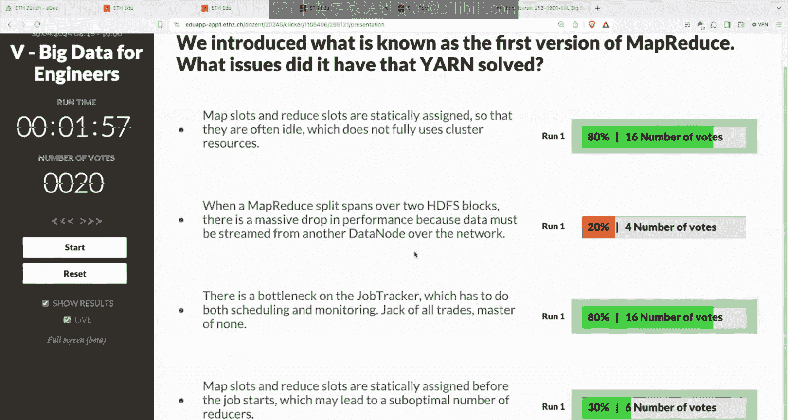
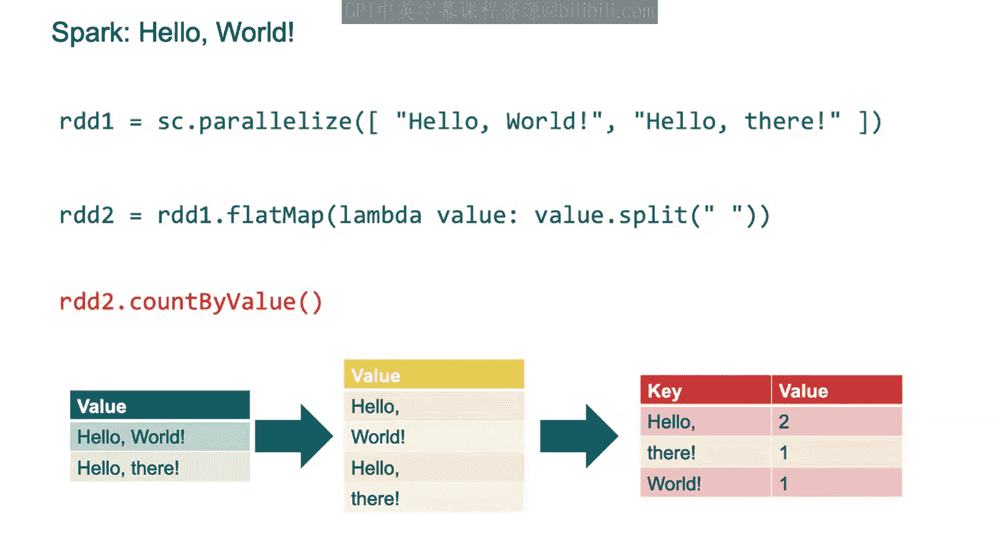

# 工程师的大数据：23：Spark (2_5) - 核心概念与操作 🚀

在本节课中，我们将深入学习Apache Spark的核心概念，特别是弹性分布式数据集（RDD）及其操作。我们将从回顾MapReduce开始，逐步过渡到Spark更通用和强大的数据处理模型。

## 概述

上一节我们详细探讨了MapReduce的工作原理及其物理执行过程。本节中，我们将看到Spark如何在此基础上进行扩展，提供更灵活、更通用的数据处理能力。我们将学习RDD的概念、Spark的惰性执行机制，并通过Python示例了解基本的转换和行动操作。

## RDD：弹性分布式数据集




RDD是Spark中最基本的数据抽象，代表一个**不可变、可分区、可并行计算**的元素集合。

*   **弹性**：RDD通过**血缘关系图**记录其生成过程。如果部分数据丢失，Spark可以利用这些信息重新计算，从而提供容错能力。
*   **分布式**：RDD的数据被划分为多个**分区**，分布在整个集群的节点上。
*   **数据集**：它是一个包含多个数据项的集合。

从逻辑层面看，你可以将RDD视为一个非常大的、分布式的**集合**，集合中的元素可以是任何类型，而不仅仅是键值对。

## Spark与MapReduce的对比

Spark比MapReduce更通用，主要体现在三个方面：

1.  **数据模型**：MapReduce处理的数据必须是**键值对**。而Spark的RDD可以包含任意类型的数据。
2.  **执行模型**：MapReduce只有固定的**Map**和**Reduce**两个阶段。Spark允许你构建一个由多个转换操作组成的**有向无环图**，形成复杂的处理流水线。
3.  **操作丰富度**：MapReduce只提供`map`和`reduce`两种核心操作。Spark提供了数十种转换和行动操作，如`filter`、`groupBy`、`join`、`sort`等。

因此，MapReduce可以看作是Spark的一个特例：当RDD是键值对RDD，并且只进行`map`和`reduce`操作时。

## 惰性执行与行动操作

Spark的一个关键特性是**惰性执行**。当你定义一系列RDD转换操作时（例如`map`、`filter`），Spark并不会立即执行计算，而只是记录下这些操作，构建一个**血缘关系图**。

真正的计算只会在你调用一个**行动操作**时触发。行动操作会向集群提交一个作业，启动计算并返回结果给驱动程序或写入外部存储系统。

**代码示例：惰性执行**
```python
# 创建RDD（转换操作，不立即计算）
rdd1 = sc.parallelize(["hello world", "hello there"])
rdd2 = rdd1.flatMap(lambda x: x.split(" ")) # 另一个转换操作

# 此时，rdd2只是一个逻辑上的RDD，没有实际数据

# 调用行动操作，触发实际计算
result = rdd2.countByValue() # 行动操作
print(result) # 输出：{'hello': 2, 'world': 1, 'there': 1}
```

## Spark编程接口

Spark主要支持Scala、Java、Python和R语言。本课程使用Python（PySpark）进行教学。

你可以通过两种方式使用Spark：

1.  **交互式Shell**：打开Spark Shell（或集成Spark的Jupyter Notebook），逐行输入命令并立即看到结果，适合数据探索和调试。
2.  **提交应用程序**：编写完整的Spark应用程序代码，打包后使用`spark-submit`命令提交到集群执行，适合生产环境。

以下是使用PySpark进行单词计数的简单示例，它演示了创建RDD、转换操作和行动操作。

**代码示例：单词计数**
```python
# 初始化SparkContext (sc)
from pyspark import SparkContext
sc = SparkContext("local", "WordCountApp")

# 1. 从本地集合创建RDD（转换操作）
lines_rdd = sc.parallelize(["hello world", "hi spark", "hello spark"])

# 2. 切分单词（转换操作：flatMap）
words_rdd = lines_rdd.flatMap(lambda line: line.split(" "))

# 3. 映射为(单词, 1)对（转换操作：map）
pairs_rdd = words_rdd.map(lambda word: (word, 1))

# 4. 按单词聚合计数（转换操作：reduceByKey）
word_counts_rdd = pairs_rdd.reduceByKey(lambda a, b: a + b)

# 5. 收集结果（行动操作：collect）
results = word_counts_rdd.collect()

for (word, count) in results:
    print(f"{word}: {count}")
# 输出类似：
# hello: 2
# world: 1
# hi: 1
# spark: 2
```

## 总结



本节课中我们一起学习了Apache Spark的核心概念。我们了解到RDD是Spark处理数据的基石，它具有弹性、分布式的特性。与MapReduce相比，Spark提供了更通用的数据模型、更灵活的执行流程和更丰富的操作集。Spark采用惰性执行策略，只有在调用行动操作时才会触发实际计算。最后，我们通过Python示例体验了Spark编程的基本模式。在接下来的课程中，我们将进一步探索Spark丰富的转换和行动操作“菜单”。