# 苏黎世联邦理工《工程师的大数据｜Big Data for Engineers - ETH Zurich - 2024》中英字幕 p24 9. Spark (3_5) - .zh_en -BV17FAmeFE9K_p24-

Welcome back。 Let's just go ahead and continue。 So that's a very simple example。😊，But actually。

 it's much more general than that because you can have much more complex queries with different transformations with more lines of code and so on and so on。

 You put in your Jupiter on the book。😊，So let's go through the restaurant menu， right。

 It's exactly like ordering your starters and entrees and desserts and so on， Okay。😊。

So a transformation is the generic name that is given to a logical function that turns an RDD into another RDD or that turns several RDDs into another RDD it's a generalization of the concept of map and of reuse。

 but with anything。Right， so now I have plenty of visuals like this where I have a transformation at the top and the resulting transformation at the bottom。

 So， of course， now this is just a generally slide。 So it does， doesn't show anything。

 but let's look at what。收。On the menu， we have the filter transformation。

The filter transformation basically filters a subset of an RDD， and that subset is the output RDD。

How do you specify which subset you want when you need to supply a function。

 It's this Lada that you saw in the code。 You need to supply a function。

That takes a value from your collection and it says yes or no。Yes， I keep it， no I don't keep it。

 right？嗯。So it's a yes， no function and what happens is that stack is going to call that function on every single value in the input RD。

😊，And if it's yes， then it keeps it the value and if it's no。

 it doesn't keep the value right now it's of course going to be done in parallel。

 but that I come back later right but logically this is what happens you have an RD and you get a subset of the R with with me。

😊，Right， that's a simple one， right， Very visual。 So it's just a filter。Here's another one。

 it's called map。😡，Map basically turns an RDD into another RDD。

 it associates every value in the input RDD with one value in the output RDD。😡。

So you have here an example with your Rod。

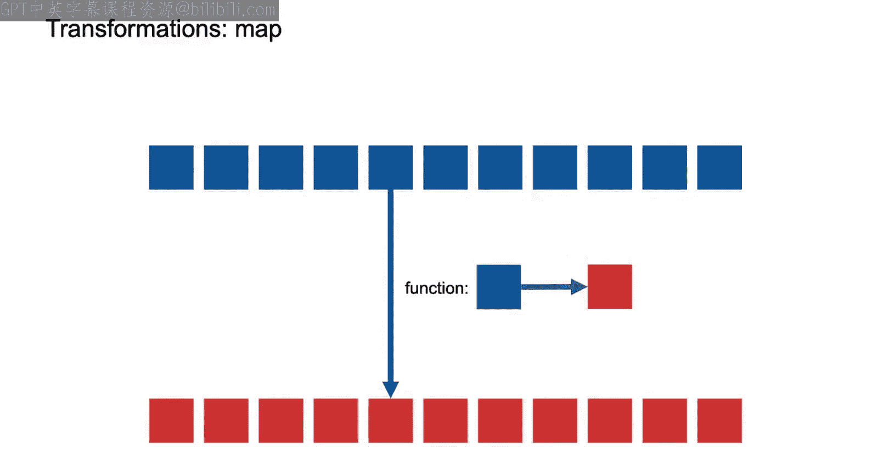

This value got turned into this one， this into this one， this into this one， It's a one to one。

Mapping， right， So in that case， all my function does is that it paints the value orange， right。

 So that's， that's what the function does。 And again， we can apply it in Pael。

 but that will come back later。 This is called the map。😊，Transformation。Ws with me。

It's when it's easy to。This here is the flat map transformation。

 This one you already saw in the example， flatmap。Takes the value from the input RD。

And turns it into0，1 or more。Output videos。Right。So for example， on the drawing。

 you have this specific input value right here that is mapped onto these four right here。

But it's a flat map， So it means that once we've done that for every value here。

 we flatten everything again。 it means we forget which value。

 which values came from where right once we have done that。

 we no longer know that these four came from the same place。's why it's flat map okay。

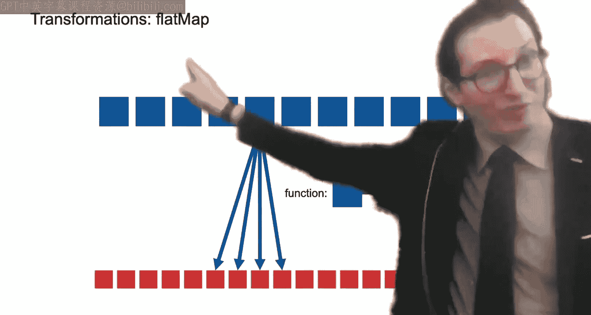

Now， let me ask you a quick question。If you want to implement map reduce， the map phase。

Is this the equivalent or is this the equivalent of map produce， So let's do a part。

 You can answer either of these or these， which is the equivalent of the map produce。麦屏。

Who thinks it's this one。Okay， who think it's this one， the other one。We have more hands， in fact。

 you're right。You shouldn't trust the names。 The actual equivalent of the map part of map produce is flat map。

Do you remember in map Red the map function takes a keyvalue and returns zero1 or more keyvalue right and then we flattened we didn't say it but we actually flattened the intermediate the set of intermediate key values is all flattentered so flatmap is the way to go if you want to simulate map Red or execute something like map Red on topverse back。

 you should use the flatm transformation for your mapping face okay。And even though it's called map。

 this one is different because it forcesoxes you to map each value to one value。Okay。

Here's another one。 This one is called distinct。What this thing does is itines duplicate。

 that's what it does。 Yes， we have a question。😊，What。

Thank you in Flmap is the mapping always the same orative dimension so is it always one to。

 for example， four or three for one specific version of Flmap for to each and be different every time。

Maybe you're going to map the first value to two values。 the second one to none at all。

 the third one to one， the fourth one to5。And so on and so on。

 there is absolutely no nothing that forceses you to always output the same number of values here。

 but it's the same as in produced， right？It'sEx the same in mapRuce。

 you also don't have any constraints as it must be exactly the same number every time。

Think of the example with splitting the string right it might be that you have a string that has two spaces in which case you output three substrings。

 it might be that your string has no space at all， then you output exactly one string and so on and so on。

So there is absolutely no constraint， in other words， it's dynamic。The number of。And in fact。

 you don't even know it in advance， you have a function and that depends on the value you're processing。

All right。I'm removing the noise again。Distinct， so distinct。

Elims thes so I use colors in there right because it's more visual so you can see that I have multiple times the same green。

 I have blue three times So what I do is that I had it three times now just once I just eliminates the duplicates right that's what it does。

😊。

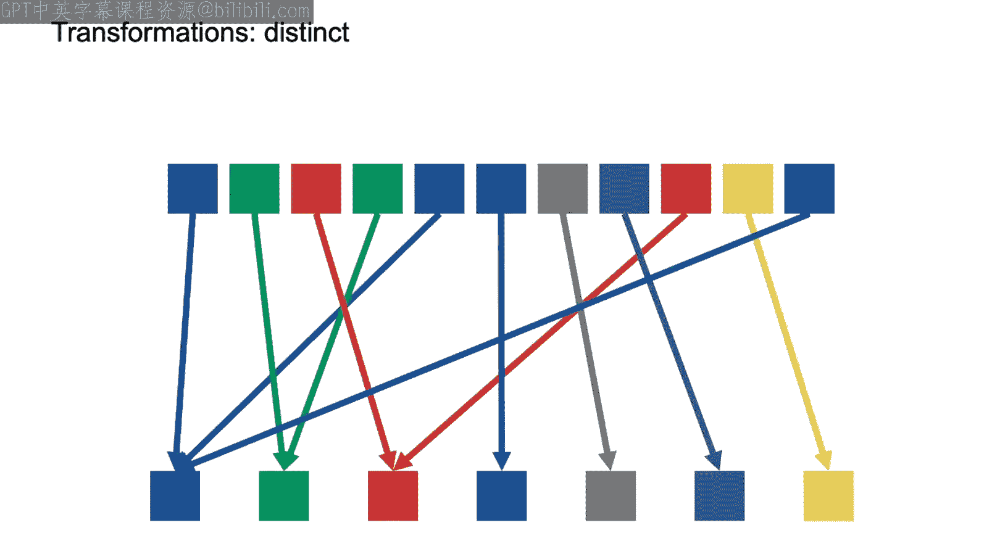

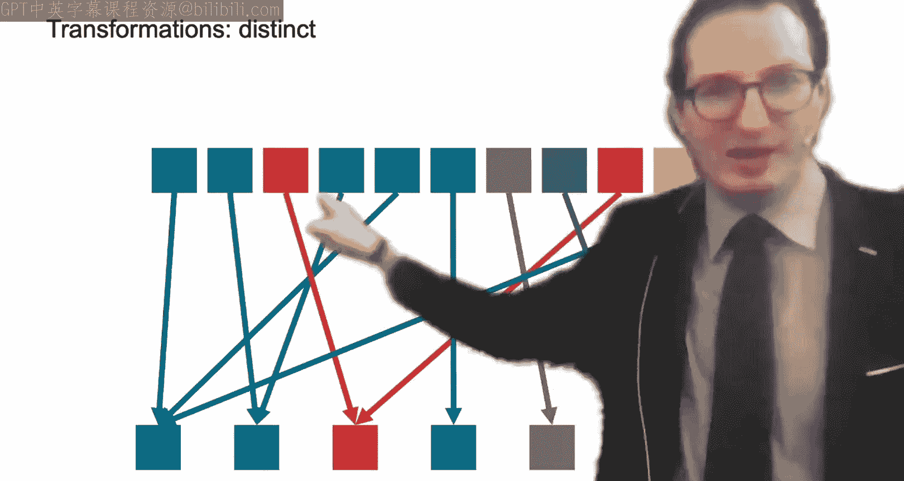

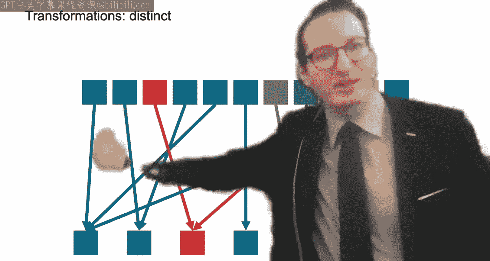

Just a remark， op pass song。Notice that it seems a bit spa E， right？

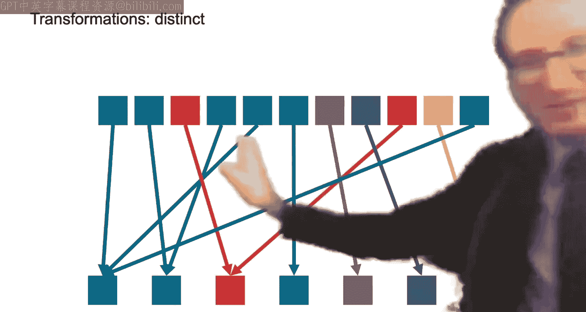

Compared to these or these， right， there's a bit of spaghetti here。 I'll come back to that， right。

 There is， in fact， it actually means something on the physical level。

 whether there is a spaghetti or not。All right， here's another one。 Another transformation。

 This one is called temple。It's a bit like filter， the sense that it outputs a subset of the RDD。

Except that there is no yes， no function or more exactly。 the yes， no function is random。 basically。

Rolls the die every time to see whether you keep it or not and you can say how much you want to give。

 you can say， for example， I want 50% or 25% you specify the fraction that you give。

 but it's all based on random choices。Now you know random choices with computers is not exactly random。

 it's actually pseudo random， we simulate randomness and what you actually do is that you have what's called a seed right and a seed is some value that you feed in there。

 then it looks random right？😊，So you can also control that。

 but that's basically the idea of randomly selecting that and that many percent of your data set can be useful and so in machine learning right you have a huge data set you want to train on 10%。

 then you just say sample 10% of my data and it's going to randomly pick 10% of the videos with with me。

RightThat's also a simpleberg one。Okay， so these only imply1 RDD to1 RDD。

 What happens with two RDs to1 RDD， right， So here's the one that's called union。

Union takes two R and it's con concatenating them， right？Which is an opportunity for me to say。

 not reminded because I might not have told you that。These collections of key values。

 these collections of values， the RDDs have an order in stock。 The order actually is important。

 So it's not it's not a set。 it's a list。 So technically。

 when you use word like union intersection and so on。

 it's kind of a bit of an abuseive language right because technically it's a list and there is an order So union in fact is a concatenation of list right if you're a mathematician think of a monoid that's what it would be called So we concatenate the two RDs and now we have a new RDD and all the first values come from the first RD and the other values from the second one who is with me。

All right， is there spaghetti there？There's no spaghetti， right。

 that's also something to keep in mind for later， okay。Now there is spaghetti。

 This is real spaghetti right here。So we have two Rs， what do we do here。

 we computes the intersection。😮，It means that I'm looking for all the values that appear on the left and on the right。

Right just once。 for example， there's blue on both sides。 There's green on both sides。

 There's orange on both sides， and there's purple on both sides。 So I I would put blue， green。

 orange and purple， yellow， No， because it's only on the right， black， it's only on the left， red。

 It's only on the left and so on and so on。 So this is the intersection。😊，Again。

 spaghetti another other place on that one。Okay。Yet another one， subtract。Subtract。Here。

 you basically output。O。The values from the left， RDD。Except if they are on the right。

 that's called a subtraction。Right？W he with me？And here there is。No spaghetti on the left。

 but there might be a bit of spaghetti on the right。

You see what I mean so what you output is basically nicely parallelel compared to the first RD。

 but you still need a bit of spaghetti to compare with all of the values on the right。

Let's call it half spaghetti， this one。There a question？Oh， that's a very good question。

 No without replacements， I didn't say it explicitly， so you will not output twice the same value。😊。

The way to see it is that。When you have a sample with replacement。

 what you do is that you pick a value at random and then you pick another one at random again from the whole system and then you pick another one at random。

 but this is not that that you cannot paralyize well。

 you could parallellyize if you're a bit smart but。

The way this is executive is not that you pick values at random repeatedly。

What you do here is that you pick the values one by one and then on sorry yes， no。

 So this is why it's without replacement。Does it make sense？Y， all right。

But that's a very good question， very good critical thinking。诶。All right， so this is the subtraction。

 Here's another one。 That's the catn product。The cartron product also takes two RDs。

 but except that the two RDs now I didn't display them in the same way。

 I displayed one on the columns and one on the row。

 so the cattroian product basically looks for all the combinations of values with one value from the left。

 one value from the right and it outputs pairs of values， right。

So if you have three values on the first RDD and 55 on the other。

 then you have 15 values in the output RDD， right， it's the product of the cardities。

 or whom is that here。😊，Who sees that you can crush a cluster with that？

Imagine there's a billion values on the left and a billion values on the right。You end up with。

 if I'm correct， aquintillion values。In total， you can crash the whole cluster。 In fact。

 this thing is so scary and dangerous that by default spark will not even let you do it。

 You have some。😰，Global parameter that you can set to say enable Cartesian product that you need to explicitly do it if you don't。

 you will not be allowed to do that What it means is you need to be mindful of what you're doing if you ever do a cartheian product think twice are you sure that your RDDs are small enough that it's not going to crash your cluster。

Okay， but who is that here？All right。Which is， well， in practice。

 we don't just use a catheian product。 We also filter。 that's technically a join， right。

 But I'll come back to the notion of joining。Okay。Okay， these were transformations。 Transform。

 just turn an LD into an LD。But you remember that lazy evaluation， if all you do is transformations。

 then nothing is actually going to happen， right， because things are only actually happening the moment you trigger an action。

 So let's look at the action。 The action is really at the end， the one that produces some effect。😊。

Here's an action。Ced corrects。As its name indicates， it collects the values in an。Now。

 from a mathematical perspective， it's just the identity function。😊。

You have a list of values and you have that same list of values as the output。

 So why do we actually call it something right， if it's just doing nothing mathematically。

 It's because physically it's not doing nothing。 physicallyically what happens is that collect downloads all the values to your machine。

This is what collects us。 So you have your values， the RD on the top。 That's an RD。

 It's all over the cluster。At the bottom， that's a local Python list on your machine in your memory of your laptop right here。

 So what this does is really download from all the machines to your local machine。😊，Again。

 be careful。You need to be sure that it fits because that can crash your laptop right if you have1 thousand0 values that's going to be okay a million values is going to be okay a billion values。

 a trillion values that's going to crash your laptop so you always need to keep in mind to understand what you are doing know if that's a good idea or not a good idea right？

So this is one thing you can do。By the way， there's also alternative to collect that don't collect it to your machine。

 but that write it to HDFS， right you can also do that and that you can do even with a trillion values。

 It's just going to write the P in Pahalel just like the output of that produce。

 So you can also write to HDFS or S3 or whatever file system you want。

 but collect that will download it to your machine in the memory as a python list right。😊。

Count this one you can do with confidence works all the time， it's not going to crash anything。

Count just sps an integer that is the total number of values in your RD。This is highly paraizable。

In fact， as you can imagine， all the nodes in the cluster will count the number of values they have locally。

And then you ship the accounts and some of our them， right， so this is very efficient to computes。

And then you hold a simple integer on your laptop after you've done that。 That's also an action。

 right， It triggers the whole computations that might have been from transformations before。

Then you have counts by value。Campai value is also an action。 It also downloads to your machine。

A dictionary， it's a Python dict。It's basically mapping every unique value。

To the number of occurrences in the RD， for example。

 if you have the RD with the color of the squares on the top。

 what you get is a python died with three keys， blue。

 yellow and green and the value associated with blue is 12 with yellow is4 and with green is6。Right。

😊，So this is a Python di that is obtained by count the number of occurrenceies again be careful because if you have trillion values in your RD and they are all distinct or there's not a lot of repetition that's going to crash your laptop as well So in order to do that you need to know that the number of unique values is reasonable and fits on your laptop or who is that here。

😊，All right。Here's another one， This is not risky at all it's called take take just picks the n the first n values of your RDD so take four takes the first four values of your RDD。

Okay， it's like a sequel limit。Right。So you take the first four and the other one is called top it takes the last four wait it called top because there is this idea that whatever comes last is kind of the top of the RD and the bottom on the other side right so this is why it's called top so take here。

Furtherold the first， and。The other list， or who is that to you。O。😊，Then we have take sample。

 it's a little bit like the simple transformation， but again， it's an action。😊。

The simple transformation turns an LD into another RD here。 you don't turn an LD into an LD。

 You turn an LD into a Python list locally on your machine。 if you use Python or who is that here。

So you take a sample， but you download it all to your laptop samples。

To your laptop or to whatever machine you're using。Then there is another action called reduceuse。

Readeduse。Is basically。Aggregating the values in some way， for example。

 that might be integers and you use the addition or the multiplication or mean or max or whatever you want right so that's called reduce so in that case it would compute the sum of all the integers。

Or whom does that make sense？RightIt's easy， right， It's a walk in the pack。

 We are just going through all of them and I'm just showing to you what they do。

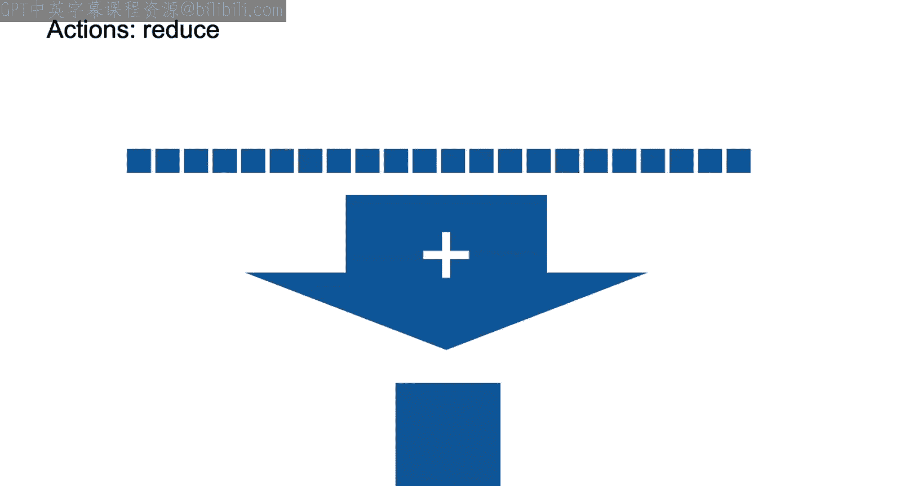

Okay， so now we've looked at transformations， we've looked at actions for generic oddities。

 can be oddities of anything。So I told you that Sp is more generic than mapred because it doesn't have to be KV U pairs。

 but it can be KV U pairs。 And in fact， because it can be an RD of KV U pairs。

 Sp has specific transformations and actions that apply to RDD of KV U pairs。

 right So let's go through them。 So now I have an RDD of KV U pair。 It's a spatial case of RDD。😊。

So I put the keys in blue and the values in great。So there is a transformation。

That turns an RDD of key values into an RDD of keys right。

 but technically the keys are no longer keys at the bottom。

 but it basically takes all the keys and gives gives them to you as an RDD for whom is that clear？

That's easy。 Well， this one should be easy too。 That's values。

 So this one returns all of the values and drops the key， okay。Then there is reduce by key。Rュ by key。

Is going to group the key values that have the same key and it's going to invoke some reduce function in that case addition。

 but it can be anything else you want mean Max and so on and aggregates。 So in fact reduce by key。E。

The reduced equivalent of map produceuce。So flatmap would be the the the map equivalent and reduced by key would be the reduced equivalent。

W sees that。😊，That this is the same as the reduced path map produce。Who doesn't see it yet。Okay。

 so we group all of the key values that have the same key。That's what we do in the shling on mapuse。

 And then we aggregate the values with some function that would be the equivalent of the reduce function in mapuse。

 Okay， then we have group by key。 group by key is almost the same， but it doesn't aggregate。😊。

So group by key means you kind of do the reduce， but instead of aggregating， you keep all the values。

😡，So what it does is that it also outputs key values， but in the output。

 the values are actually the lists。😊，Of every value that was in there。

 So that's the list of four values， this one， this one， this one， this one。

 this is the list of the three values here， so group by key。Okay， wouldn I send this one。

So it outputs an ability of key values， but now the values of the output are Python lists， right？

Associated with a kid and inside or a。Then we have sucked because I told you it can be order so you can sort an L。

 you provide a sorting function that says what it means to be greater or smaller or equal to anything right and then you sort in that case I sorted them the colors nicely by wavelength。

By your， by your decreasing。By increasing wavelength， okay， so you can sort integers。

 you can sort strings nicely， okay。By the way， you could kind of do that with mapRuce but it's a bit tricky with stocks。

 it's much easier to actually sort your key videos。Then we have map values。 What does map value。

 the map value transformation do。It basically maps key values to key values。

 but it doesn't modify the keys。 All it does is map a value to another value。

Keeping the same key or who is that here。You really， you take the key values。

 you keep the key the same， you just modify the video with a math function。W dot。Okay， so map values。

 then you have join。Join is a bit like the relational join。

 It means that you try to put together the key values that have the same key on both sides。

 So in that case it's really just like when you do it on two relational tables right you try to match the records that correspond to records So in that case you have。

 for example， this key and this key are the same So you join them together and what you have here is the key that was the same then the value from the left and the value from the right Imagine that this is a record from a relational table。

 this is a record from a relational table this is the attribute to join on and then you have the larger wider table as an output that join the two records here then you have in the case of blue you have two blue and one blue that that's matched to two records or two values here and then the green matched with the green So this is what the join does for whom is that here。

😊，So it outputs the keys that are on both sides， together with the value from the left and the value on the right。

 It's a tu in Python。 the， the， the the value from the left and the right， you would put it in a tu。

Okay。Then you have subtract by key。Subtract by key outputs all the value from the left R。😮。

But if a key appears on the right， then it drops it， right， It's a little bit like a subtract。

 but working on the keys。 So in that case， we dropped the blue and the orange keys because they appear on the right。

 but the brown key didn't。 So we keep it。W's with me？诶。Coツバ key。

Well it's very similar to count by value， but this one is an action or but it counts the keys instead of the individual values right so blue。

 blue， blue， blue， blue， blue six times green ones， yellow fog times right so count by key。

Ws with me on that。it's an action that was transformations here， now it's an action。

 so that's actually downloading that as a Python di to your laptop。😊，Then you have lookup。

 lookup is a nice one that's also an action， lookup returns。

 the values that are associated with a specific key， so you might have， oh。

 there's a question about that。😊，I hope you haven't been waiting for a long time， I just saw it now。

Oh， sorry， almost me let me increase the volume。There you go。

Just quickly in the subjecttract by key transformation well the so the keys on the left if there's sorry if there's multiple of the same key on the left but they're not present on the right well they also be kind of joined like in the joint transformation like next to each other or not I think they wouldn't I think if you have let's say three keys that are the same on the left you would still output the three keys what it does is remove something but it would preserve because the key values might give print right so I don't think it merges anything。

We could check actually just to be sure if you can take your notes that we can confirm and we'll tell you if I'm wrong。

 but I think it doesn't merge anything it really preserves。Thank you。You can throw that back。Whoa。

You can go to the Olympic Games， you're really good at that。Okay。

So look up just if you have trillions of key values。😮，And you look for a specific key。

 the orange key， then lookup will return the value or the values that are associated with that key。😊。

By the way， I didn't say it explicitly， but the keys can repeat。

 There is no constraint here that you cannot have repeating keys in Jason。

 you cannot in know Jason object， you cannot in X attributes， you cannot。

But here there's no problem at all。 You can have absolutely repeating keys and it map reproduceuce as well。

 by the way。

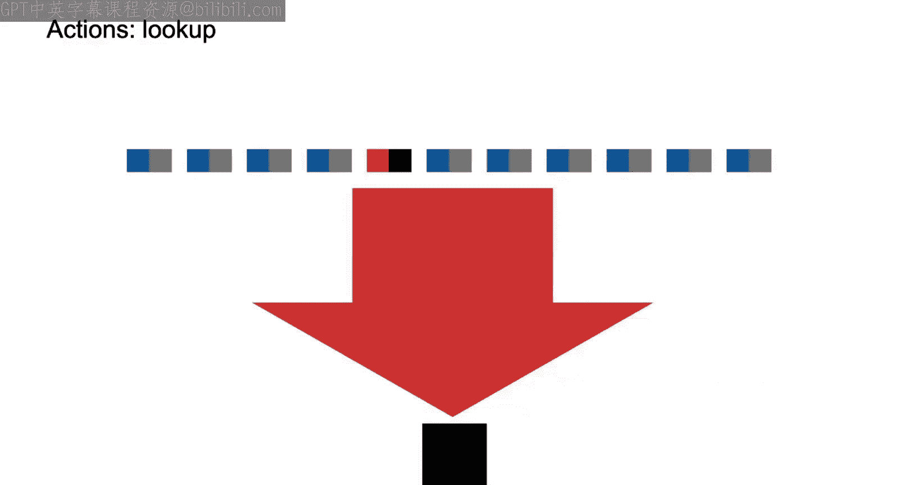

Okay。Okay， that was the logical layer， so I basically walked you through the menu now you can do whatever you want when you write a spark program or a pipe Sp program。

Typically you have a specific problem in mind， you have downloaded the data set from the internet。

 you have put it in the data lake in S3 or HDFS and now you sit in front of your Jupyter notebook trying to write queries to transform the data so typically what you do is that you have the documentation open on a screen maybe or you have a book a reference book and you just look in the menu for the transformations that you need and you assemble that like your Lego game into a spark job。

😊，W's with me？O。That was the logical part and you'll have an opportunity to exercise that at the exam you will have PPA in fact now we manage to find a way to download the entire documentation of Sp and have it on the exam computer How cool is that so you're going to have normally a whole PPA documentation on your exam computer available for you。

😊，All right。And you can thank the students of the last semester for that。 They pushed for it。

 And so we worked out to make it work。ok。Which brings us to the physical layer that's the path the user shouldn't care about。

But still it's interesting to understand how it's executed and now you will see that actually knowing how mapreduce works is very useful to understand how Sp works。

😊。

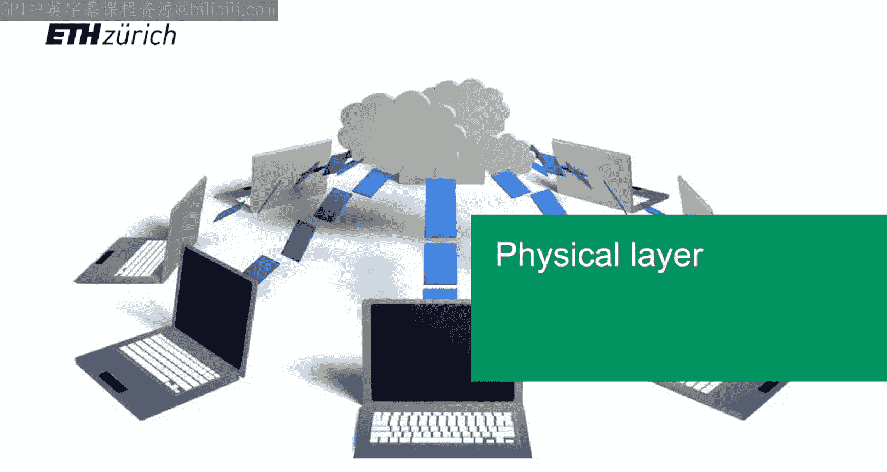

Do you remember how when I showed you the transformation， I said， okay。

 this one is not spaghetti and this one is spaghetti？

So let's start with the transformations that are not spaghetti， when technically。

 the word for that is narrow dependency。It means that the values in the output depend on only very few values。

In the input， in that case， it's a map。 So every value depends on what value in the input。

 Who feels it's parallelizable。It is right。 Paralyzizable。 Let's do it。 Let's split it into tasks。

 right， Now we have tasks。 So now you kind of probably start getting the intuition of what's going on。

 right， we， we， we are going to parallellyize like this。😊，And by default。

 the input we can read an LD from HDGFS right as a data set， for example， from HDGFS。

 and guess what roughly speaking， every HDGFS block gives you one task。😊。

Exactly the same as in produce。But roughly speaking， because again。

 there's this beat versus value separation thing， so you might have a speedover on the next block for a few beats。

 right？Okay， so what it means then。Is that when you have a transformation that turns an L into another L。

 or at least that's how it feels from your repeat or notebook， right。

 you have an L and you invoke a transformation。😊。

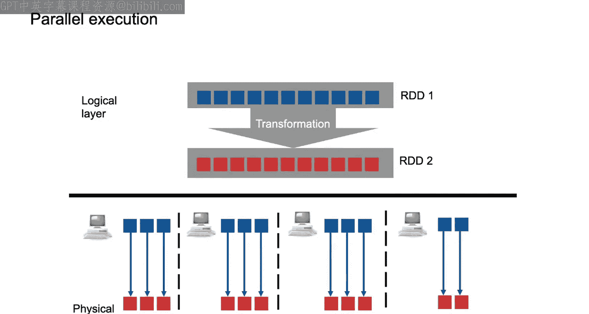

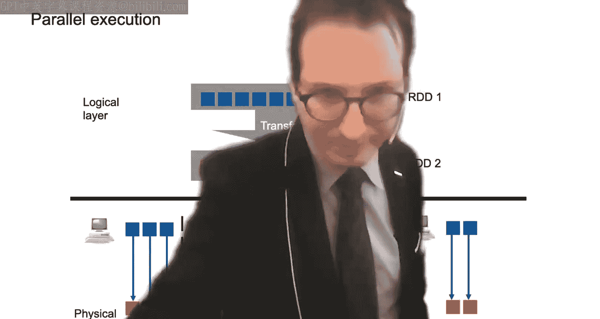

But what actually is happening behind the scenes is that you have a data center。😊。

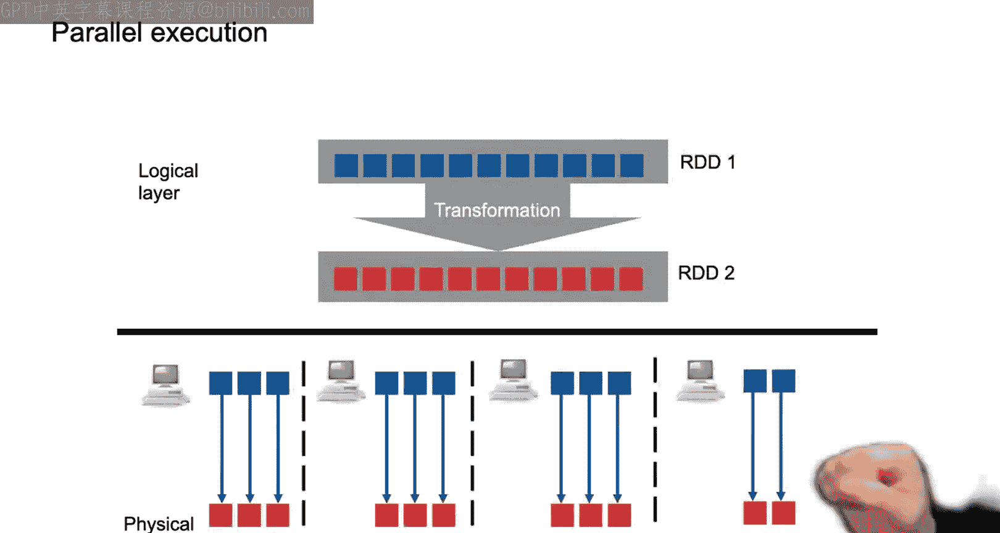

And what's happening is that you might have four machines and every machine is working on a task right so now this is the case where there are as many tasks as slots but you know that in practice this is not how it works you have more tasks and when a slot is finished then they get the next task。

 right。😊。

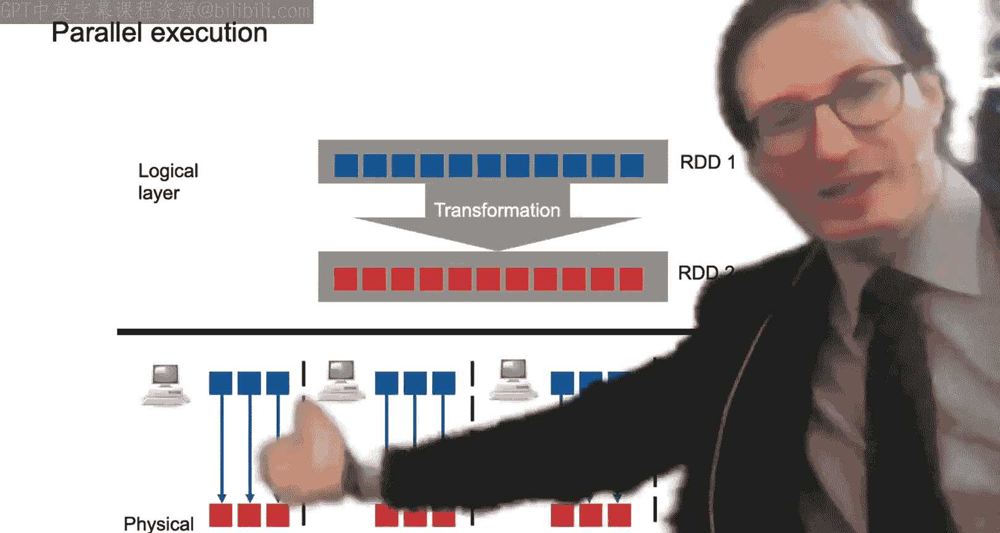

So basically， it looks more like this， right？ in that case， you have 11 tasks and  four slots， right。

 So it's roughly three times as many task as slots， which is kind of nice。😊。

Spak calls these executors right So it's the containers from Ya。 So it calls them executors。

 So in that case， if I assume one slot for every executor。

 I start with four tasks and then this one is finished takes test5 and this one is finished text tasks peaks and so on and then some of them are faster and take more tasks and some of them are slower and take less tasks。

 This is what I re explain in the first hour well right Who understands that。😊。

So technically you split your RBB into partitions that gives you the tasks and then you spread over the tasks on these slots and the slots just consume the tasks as long as there are remain tasks。

 always more tasks than slots。

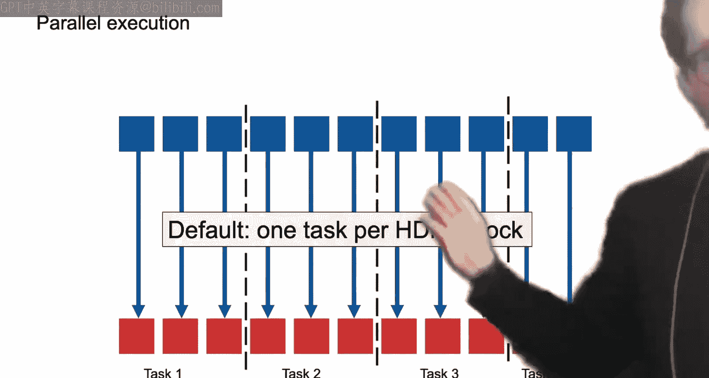

Now， to be more exact， the way that it works in Sp。

Is that you might have multiple con in the same container。 Remember in Ym。

 you can have a container with two core and that and that much memory。 So these are， in fact。

 the slots。 the slots corresponds to CPU calls。😊，But what happens is what we call an executor is that it's different slots that share the same memory。

 they have the memory in common right that gives you a bit of flexibility for the case that imagine that this slot is using more memory than that one。

 it's a bit more flexible。 But between executor， it's rigid。 So if this is using more and less here。

 then there is no sharing right So then you're just wasting resources here and not there。

 So having shared memory allows you to have a bit of flexibility in the usage of the memory or Who is that here。

😊。

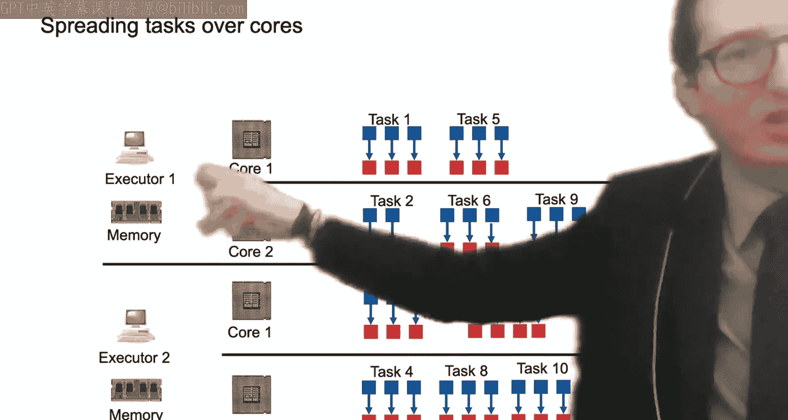

So the executor are the yaum containers and in the executor you have several calls and every core gives you one slot and one slot executes the tasks one after the other sequentially。

😊，Okay。😊，Let's continue then this quest for just one single transformation like the map phase of map Red technically。

 is exactly like the map phase of map Red。So what happens if we have several transformations？😊。

Let's assume these transformations are not spaghetti。

 These are all narrow dependency transformations like filter， like flatm， like map， like sample。

 like this kind of transformations。 So they are not spaghetti。So you might think， okay。

 it's great transformations here， So why don't we just treat it as a map shuffle map shuffle map right we could kind of generalize map reducing in this way so I could have machines that execute the first transformation then other machines that execute the second transformation and then other machines that execute the first transformation and in the middle we might shuffle again。

😊，Do we really need to shuffle because if you look at this。

 it's kind of feel like the shuffle is literally required， right。

 the shuffle is kind of useless in here。 It's just a waste of network。

 Do you see that that we can do better than that， more efficient than that。Who seeize that。

How can we do it better than that more efficient？Does anybody see it。

We see that we are wasting machines and we are wasting network bandwidth within here when we do that。

Let me explain the idea。What do we want logically？Logically， I have this input RD。😊。

And there's three transformations and I get this output A right Anything that happens in the middle it's I'm free to do it in whatever way I want All I want is the correct add at the end do you see。

😊。

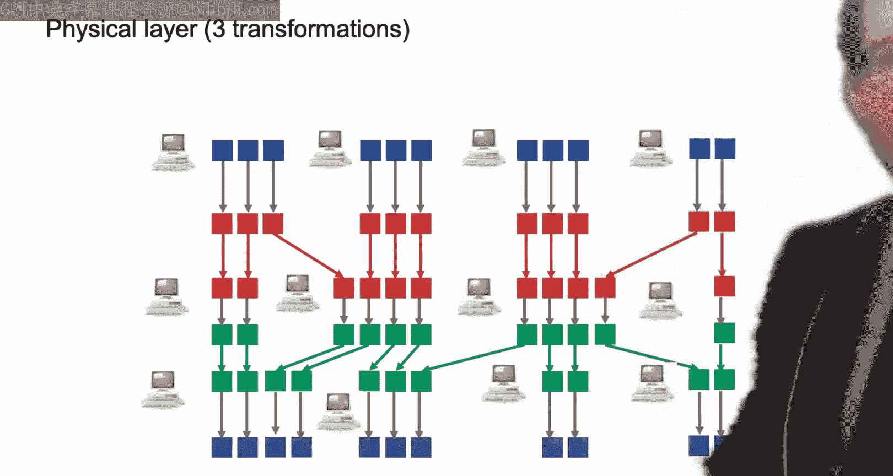

That if you follow the edges here。To compute that video。

It's basically a chain of function calls from here to here， but without any spaaghetti。

Do you see that that could be not on the same machine。

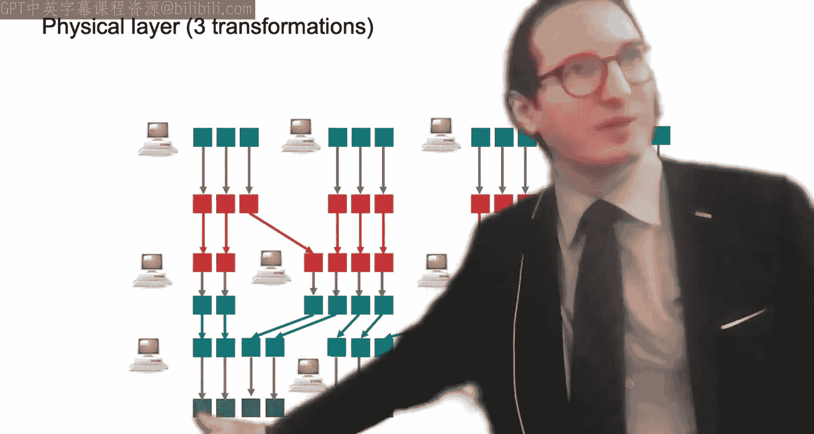

And that too。 and that too。So in fact， you can read that way it's completely equivalent。

 but now it's the same machine for the three transformation for a specific subset of the input and then another machine for all the transformation。

😊，Or another set of the ingredients and so on。 So now we basically share the slot across the transformations for whom is that here。

Okay， this is the same thing， but this is more efficient。

So what happens is that when you have a sequence of transformation。

And these transformations are not spagheti E， then we can squeeze them together onto the same slot。

 This is the same tasks here。 There's one task， two tasks， three tasks， thought tasks in total。

 but within these tasks， we chain the function called that correspond to the transformation。

 but it's all local on a single value at a time there question。😊，Do you mean here？So， yes。

 that's highly inefficient。 This is super inefficient。 That would be the dive way of doing that。

 But the way you do it is like this。😊，And once you do it like this， that's called the stage。

So it's basically a group of transformations that that are all narrow dependent， not no spaghetti。

 in fact。What you do is。Dish。You basically now have exactly the same idea of tasks that are spread all over the machines。

 but do you see that the difference is that now on that slide we have two transformations instead of one transformation that was the with if I rewinded little bit。

That was with one transformation and that is the same thing。

 but now we squeezed two transformations into the game。

 but we still have the tasks organized in this way There is still a follow up on the question。But。

Oh yes， but then you just pick tasks it's exactly the same idea as in Mareduce。

 you just keep picking tasks and at some point you're done with the task。

 but then it's no different than Mareduce right once you run out of tasks then yes you start being id at that point right But since you arrange to have more tasks than slots。

😊，Then that kind of evens it out。Okay， the last side side explains， Very good， okay。

So all of that you can control in fact， when you submit on the command line so that's outside of the Jupyter notebook。

 you can say I want 42 executors， I want two calls on every executor。

 I want five gigy of memory for every executor all of that you can configure right but TP for the exam you don't need to do that this is already preconfigured and automatic but just to say that you could if you wanted to you could control。

Now that only works for the narrow dependencies， if you have spaghetti in the transformation。

 then that doesn't work anymore because what happens when you have spaghetti， you need to。2。

What do you need to do if there're spaghetti。Start with an S。Shuffle， yes， exactly。

 You need to shuffle。 as soon as you have spaghetti the translation， you need to shuffle。

So it means that the transformations that don't have spaghetti you squeeze them together as the same tasks and if you have spaghetti you just shuffle so what typically happens is that every transformation that has spaghetti triggers a shuffle shuffle shuffle shuffle so typically the way a generic spark jobs works is that you have stages separated by shuffling and of course it's like your game you try to minimize the shuffling you try to write your code in such a way that there's as little shuffling as possible because shuffling is what actually takes time。

😊，For whom does that make sense？RightThat's the generic way a map preuse job looks like even more generic if you have joins and that kind of things and the stages are sequential。

 you execute stage one and that' stage two and that stage one is going to shuffle from two places。

 it means it's downloading from the left and downloading from the right but it lands then in the same bucket you without has the same key and so on and so on。

 So this is the most generic you actually get。😊，So again， you need to think of it this way。

 you have transformations， if there are narrow dependency transformations， no spaghetti。

 you can squeeze them into what's called the stage。And the stages are separated by shuffling。

The stages are split horizontally this is the tasks right in order to execute a stage。

 you split it into tasks， more tasks than slots and then you do it over all the data center and a sequence of stages so stage shuffle stage shuffle stage shuffle is a job。

ho is that dear？All right， so it's a generalization of map Red because now we just don't have map shuffle reduce。

 we can have as many stages as we want with as many shufflings as we want in our Sp job。😊。

So I'm going to leave it here for today， I'm going to take to talk next week a bit about performance and about data frames using data frames and SpSQL。

 which is even better than Pi Sp as we will see and you will see why SQL was actually useful to learn or to brush up。

You probably already have an intuition of that right。

 because if you look at softing and grouping and filtering， it kind of smells like SQel already。😊。

Okay， so just before you go， I would like to check。That you actually。Understood。Where is it？

There you go。Just checking that you're with me。Okay， that looks better than last week。

 So it was worth the effort of taking the time。 So next week， I'll finish that。

 Then I talk about performance at large scales， and we might start document stall。

 We are almost there technically， right， document stall， Jasonson E for querying trees。

 and that will be the。😊，The end of the semester。Thank you very much。 I hope you enjoyed it。

 There is no exercise week this week， because it's the 1 of May。 So we， we， even if you're on Friday。

 we basically drop everything this week， I think there's no quiz， right。😊。

There's no quiz at all this week。Yes， we extended the deadline。

 The T A team extended the deadline by one week。 So use that in order to breathe a bit。

 read the textbook and and practice。 And if you have questions。

 then collect them don't hesitate to interact on Google。 Thank you very much， everybody。

 and see you next week。 then for the next lecture。 Thank you very much。😊。

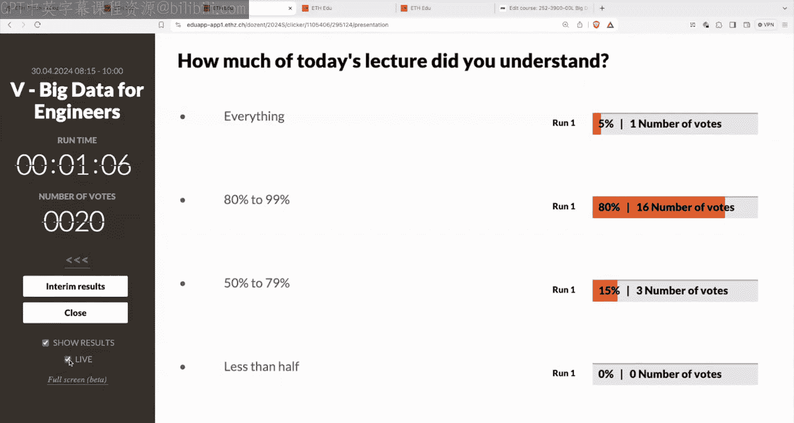