# 工程师的大数据：9：Spark (3_5) - 核心概念与物理执行 🚀

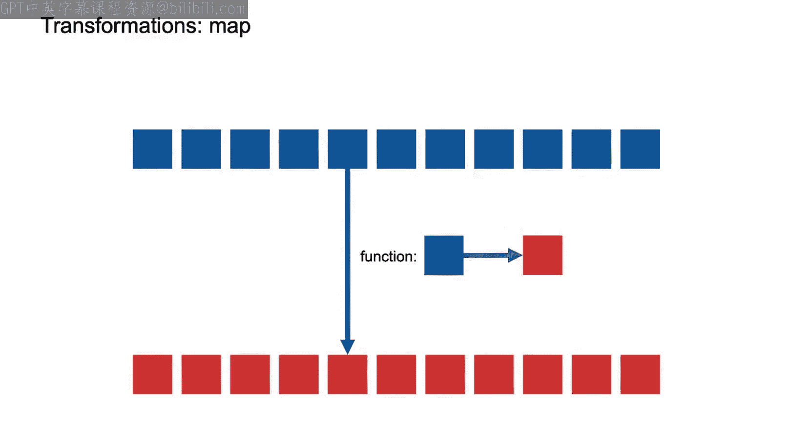

在本节课中，我们将深入学习Spark的核心概念，包括各种**转换**和**行动**操作，并探讨其背后的物理执行模型。我们将从逻辑层面的操作菜单开始，逐步深入到物理层面的任务调度与执行。

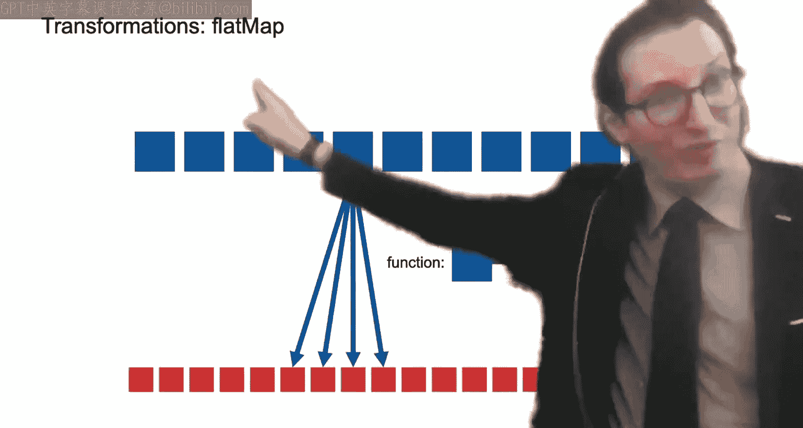

## 逻辑层：转换与行动操作

上一节我们介绍了RDD的基本概念。本节中，我们来看看Spark提供的丰富操作，它们就像餐厅的菜单，允许你灵活地处理和转换数据。

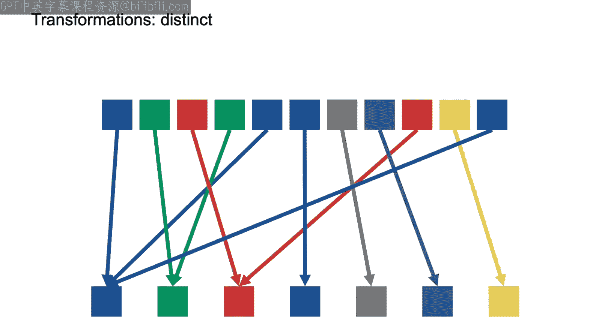

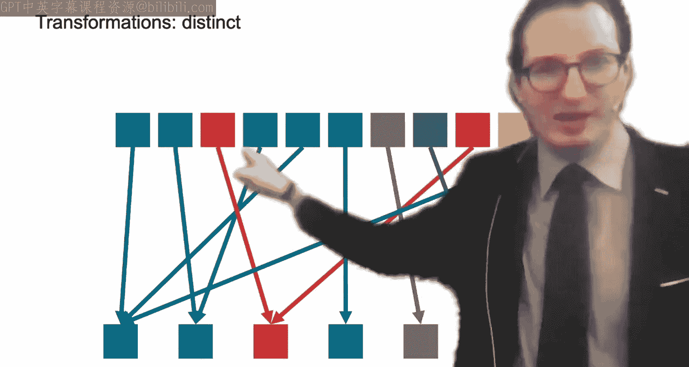

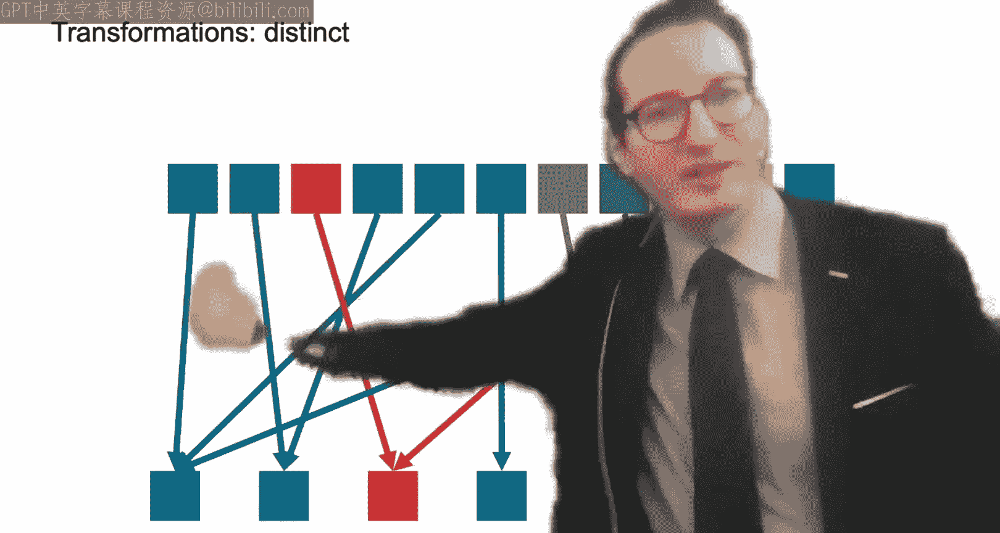

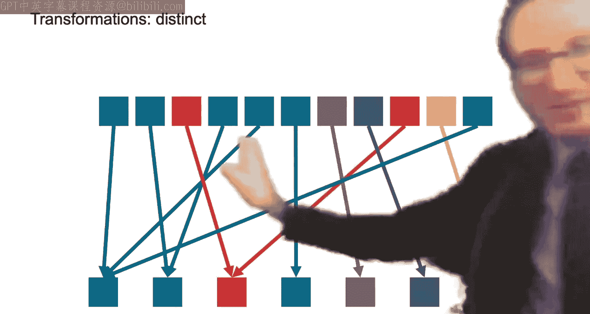

### 转换操作

转换操作将一个RDD转换为另一个RDD。它们是惰性求值的，意味着在触发行动操作前，不会真正执行计算。

以下是常见的转换操作：

*   **Filter**：根据一个返回“是/否”的函数过滤RDD中的元素。其逻辑是：`filter(rdd, func)`，其中`func`对每个元素返回`True`或`False`。
*   **Map**：将输入RDD中的每个元素通过一个函数映射为输出RDD中的一个新元素。这是一个一对一映射：`map(rdd, func)`。
*   **FlatMap**：将输入RDD中的每个元素通过一个函数映射为0个、1个或多个输出元素，然后将所有结果扁平化成一个新的RDD。这是实现MapReduce中Map阶段的等效操作。
*   **Distinct**：去除RDD中的重复元素。
*   **Sample**：随机抽取RDD中指定比例的元素子集（无放回抽样）。
*   **Union**：将两个RDD合并（串联）成一个新的RDD。
*   **Intersection**：返回两个RDD中都存在的元素（交集）。
*   **Subtract**：返回存在于第一个RDD但不存在于第二个RDD中的元素（差集）。
*   **Cartesian**：计算两个RDD的笛卡尔积，输出所有可能的元素对。需谨慎使用，可能导致数据量爆炸。

### 行动操作

行动操作会触发所有累积的转换操作进行计算，并返回一个结果（到驱动程序）或将结果写入外部存储系统。

以下是常见的行动操作：

*   **Collect**：将RDD中的所有数据收集到驱动程序（本地机器）的内存中，返回一个Python列表。需确保数据量适合本地内存。
*   **Count**：返回RDD中元素的总数。这是一个高效且安全的操作。
*   **CountByValue**：返回一个Python字典，记录RDD中每个唯一值及其出现的次数。需注意唯一值的数量。
*   **Take**：返回RDD中的前n个元素。
*   **Top**：返回RDD中的后n个元素（基于排序）。
*   **TakeSample**：随机抽取RDD中指定数量的元素，并返回到驱动程序。
*   **Reduce**：使用一个关联函数（如加法、求最大值）聚合RDD中的所有元素。

### 键值对RDD的专用操作

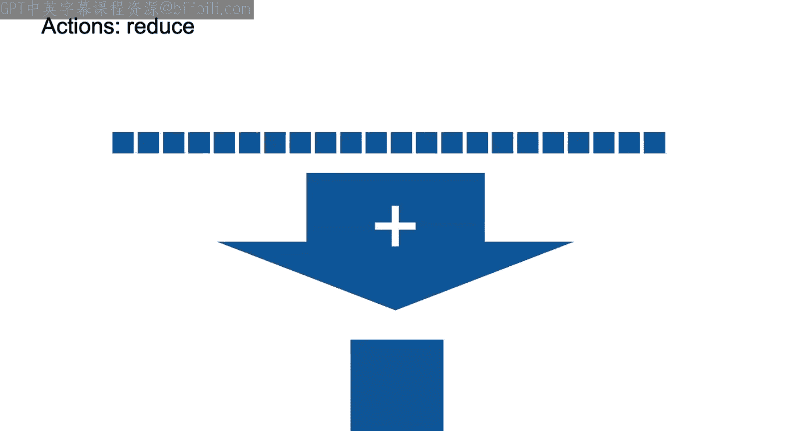

当RDD的元素是键值对时，Spark提供了一些专用操作。

以下是针对键值对RDD的转换和行动操作：

*   **Keys / Values**：分别提取所有键或所有值，形成新的RDD。
*   **ReduceByKey**：将具有相同键的值分组，并使用一个归约函数进行聚合。这是MapReduce中Reduce阶段的等效操作。
*   **GroupByKey**：将具有相同键的值分组，但不进行聚合，输出中每个键对应一个值列表。
*   **SortByKey**：根据键对RDD进行排序。
*   **MapValues**：对每个键值对中的值应用一个函数，而不改变键。
*   **Join**：对两个键值对RDD进行内连接，输出键匹配的所有键值对组合。
*   **SubtractByKey**：返回第一个RDD中那些键不在第二个RDD中的键值对。
*   **CountByKey**：行动操作，返回一个字典，记录每个键出现的次数。
*   **Lookup**：行动操作，返回给定键对应的所有值。

## 物理层：执行模型

了解了逻辑操作后，我们来看看Spark如何在物理集群上执行这些操作。理解MapReduce的执行模型将有助于理解Spark。

### 窄依赖与阶段

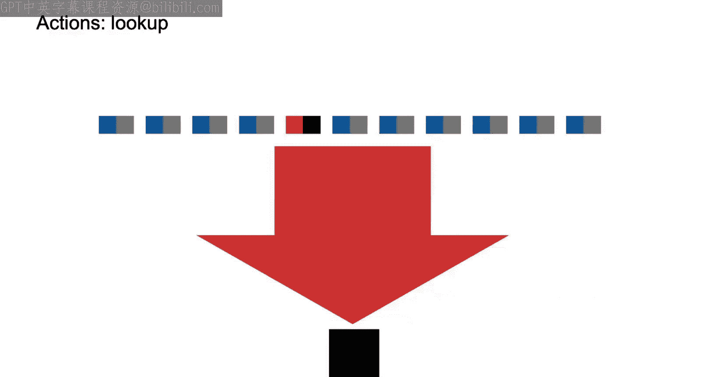

在介绍转换操作时，我们提到了“意面图”（spaghetti）的概念。在物理层面，这对应着**依赖关系**。

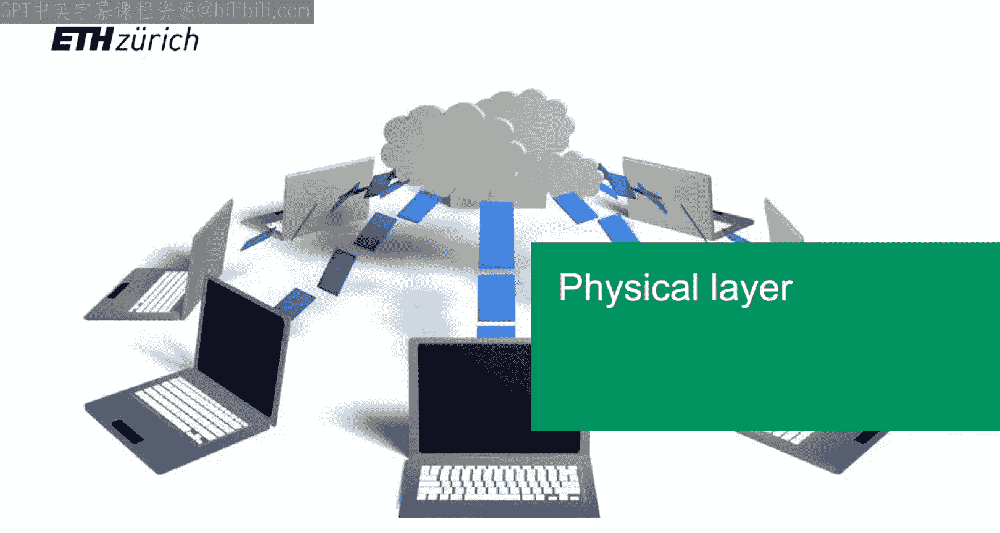

*   **窄依赖**：输出RDD的每个分区只依赖于输入RDD的少量分区（通常是一个）。例如`map`、`filter`、`flatMap`。这类转换没有“意面图”，可以高效地并行化。
*   **宽依赖**：输出RDD的分区依赖于输入RDD的多个分区。例如`groupByKey`、`reduceByKey`、`join`。这类转换会产生“意面图”，需要进行**Shuffle**。

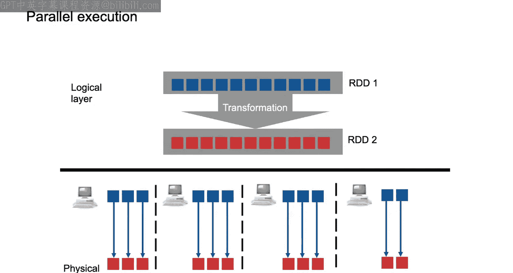

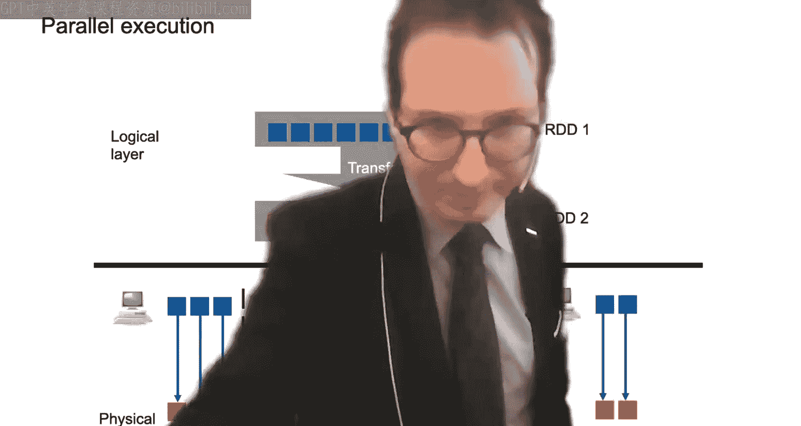

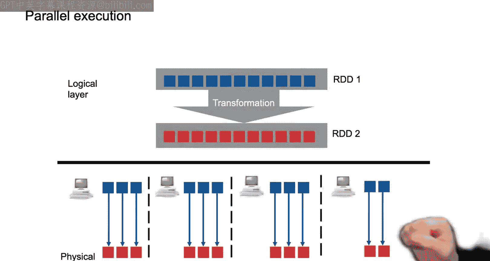

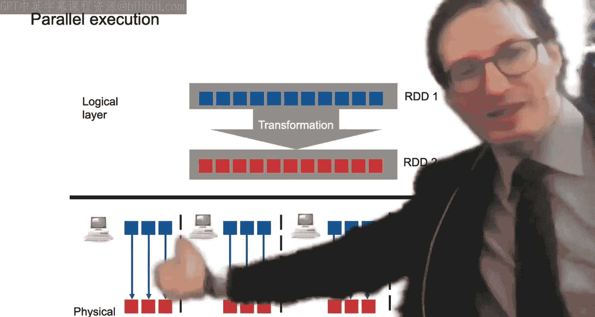

Spark会将一系列连续的窄依赖转换**聚合**在一起，形成一个**阶段**。在一个阶段内，计算可以被分解成许多**任务**，每个任务处理数据的一个分区，并且这些任务可以完全并行地在集群的各个**执行器**上运行。

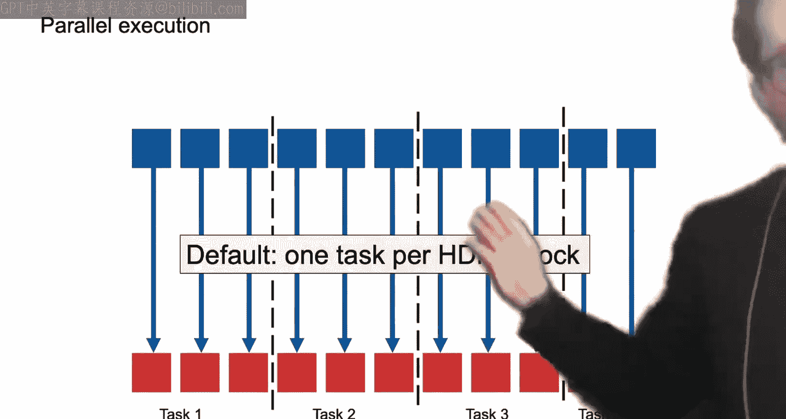

执行器是YARN分配的容器，每个执行器可以包含多个CPU核心（**槽位**）。任务被调度到这些槽位上执行。通常，任务数量会远多于槽位数量，以实现良好的负载均衡。

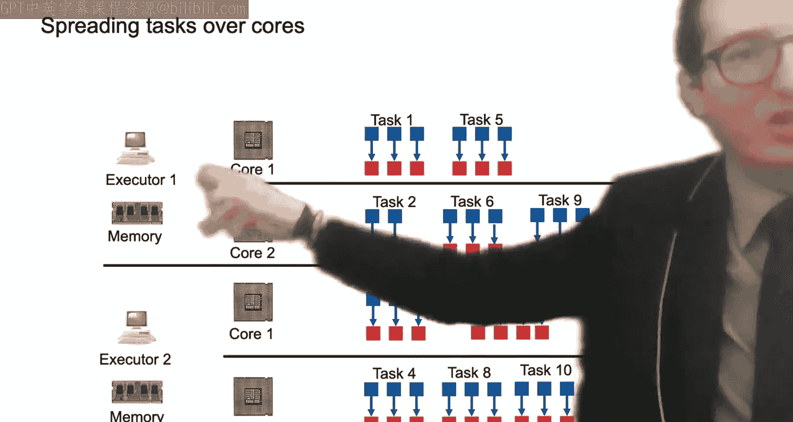

### Shuffle与阶段划分

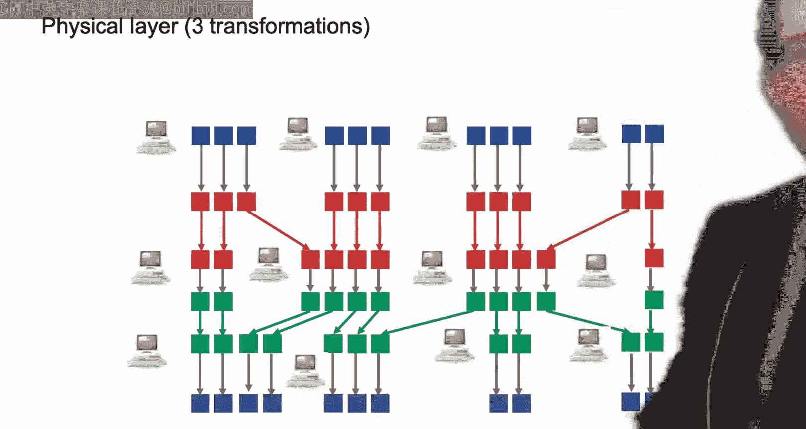

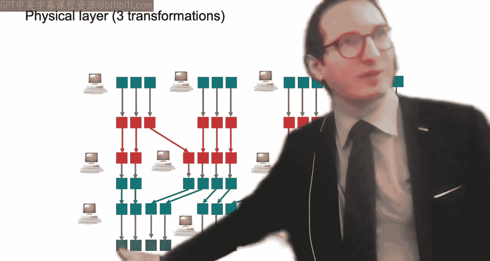

当遇到一个宽依赖转换（需要Shuffle）时，Spark会划定一个阶段边界。Shuffle过程与MapReduce类似：需要将数据根据键重新分区并跨网络传输，以便具有相同键的数据能被聚集到同一个节点上进行下一步计算。

因此，一个典型的Spark作业由多个**阶段**组成，阶段之间由**Shuffle**分隔。执行流程类似于：`Stage 1 -> Shuffle -> Stage 2 -> Shuffle -> Stage 3 ...`。

优化Spark作业的关键之一就是尽量减少Shuffle的次数和数据量，因为Shuffle是网络和磁盘IO密集型操作，非常耗时。

## 总结

本节课中我们一起学习了Spark的核心操作与执行模型。
*   在逻辑层面，Spark提供了丰富的**转换**和**行动**操作，允许像组合乐高积木一样构建数据处理流水线。转换是惰性的，行动会触发实际计算。
*   在物理层面，Spark将作业划分为由Shuffle分隔的**阶段**。阶段内的窄依赖转换被合并并行执行，而宽依赖转换则触发Shuffle。任务在分布式的**执行器**上运行，由集群资源管理器调度。

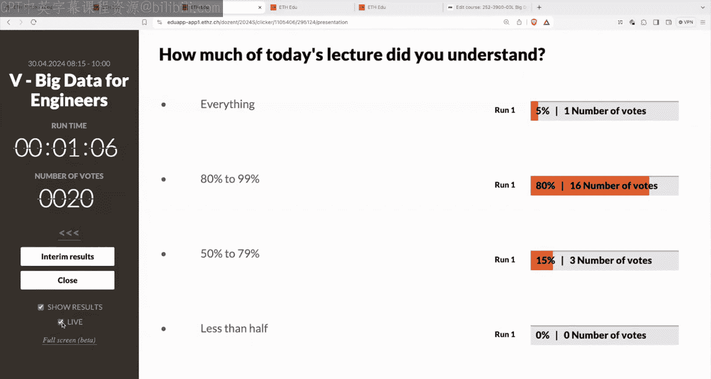

理解这种逻辑与物理的分离，以及阶段划分的机制，对于编写高效的Spark程序至关重要。下一节，我们将探讨Spark的性能优化以及更高级的DataFrame和Spark SQL API。