# 苏黎世联邦理工《工程师的大数据｜Big Data for Engineers - ETH Zurich - 2024》中英字幕 p25 9. Spark (4_5) - .zh_en -BV17FAmeFE9K_p25-

Welcome everybody in the lecture hall， welcome everybody on Zoom。

 welcome everybody from the future Today we are going to finish this chapter on Spk and then eachtime permits we are going to start studying document stars and I will also motivate。

 of course， why we need to do this。😊，嗯。I will ask you a question on clicker， as I usually do。

 And then a quick reminder on what we've covered up so far。

 And then we'll continue mostly with data frames， which is the the last part that we've been。

That we've been。You think。Right right。So you remember for map produce and force pack that we have passed and we have slotlus。

And we discussed the number of tasks that there should be versus the number of slots that we have available。

 so the question is if you have an naive approach and you assign one task per slot you have。

 for example，1 thousand slots and you schedule a thousand tasks， What is the issue with this。

 why do we not want to assign one task per slot， why do we want more tasks or slots or less。

It's a bit of time to wake up in the morning。It's us looking。Whether there's a majority somewhere。

 yes， there is a majority。And。You know， the majority is not a race， correct。But in this case， it is。

 in fact， correct。 Indeed， it is exactly what happens。The slots。

 if they have each one task might take more or less time to complete each task。

 it's like with the postcards that we saw the other as an example feeding the postcard while on vacation。

Some slots are going to be faster and some slots are going to be slower and those that are faster will just be id without doing anything and everybody is waiting for the slots that take more time to complete their tasks So if you have more tasks if you have like five times as many tasks as slots like 1000 slots and 5000 tasks then you spread it a little bit more and those that have finished a bit earlier will complete more tasks and those that finish a bit later will complete less tasks right so you basically spread a little bit the risk that you have regarding the time that it takes。

All right。Let me get back to。The slides then。

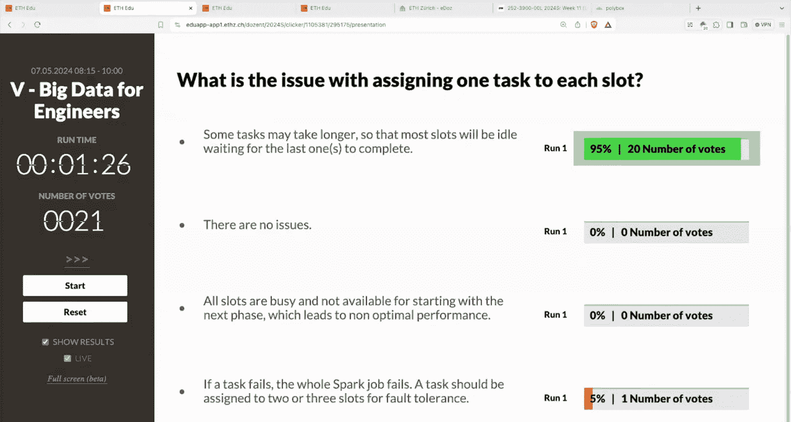

Okay， so where were we？We saw that in map Red， there's just a map in a reduced phase， right。

 You start with a collection of a value key value bears。 Then you have the map phase。

 You shuffle around， then you have the reduce space。

 and then you output a collection of key value pairs。

 We saw that stock is more generic because first， you can have collections of whatever doesn't need to be key value pairs。

 collection of anything you'd like。😊，The second generalization。

Is that instead of a simple two phase process， we can have a fully general da directly the graph that looks like this just cannot have any cycles and also called a dependency graph and every node in there that it's a dataset on intermediate data set that's called an RBD or resilient distributed data set and these are collections of whatever。

😊，All right， and as you might remember it's lazy evening that for the moment nothing happens。

 it's only when you request the contents of one of the RDDs that it's automatically triggering the computations of all the transit closure。

 the reverse transit closure in the past。😊，Okay， this is a reminder of how it looks like when you use it either in a Python notebook or on the command line。

 where you have all these huge restaurant menu of transformations and actions and the methods that you can use to create new RDs and that's a simple example with a flatmap and accounts by the。

We also looked at the physical level。 is all hidden from the user， but what makes it magically fast。

😊，And we saw that there is an optimization that we can do because when the transformations that turn RDDs into other RDDs。

 when these transformations do not have any spaghetti in the sense that the dependencies are narrow remember like filtering like mapping like flatmap and so on So when there is no spaghetti。

 there is noshaling needed and then you can simply merge them into a single stage and as a result。

 when you distribute all the computations you can directly call the functions of multiple transformations。

 for example， the blue orange and green that you see here that might be a flatmap followed by a filter but that you do for every single value in your input in a single go So the one in the middle gets thrown away immediately right so it means the RDD that you would have in the middle。

Never even gets materialized anywhere。 it's just intermediate results。

 you directly get the RDD after the second transformation and then you spread it all over your cluster right every core is basically a slot a slot processes a sequence of tasks and a task consists in repeated calls to the chain of transformation functions that turn an input value into an output value with with me。

Okay， so that's what we covered already in the in the previous weeks right。

 And so this is where we left where this basically can be done every time there's no spaghetti。

 but of course， sometimes there is a bit of spaghetti whenever you group， whenever you sort。

 And in that case， you need to change the stage。 So this is called a stage right when it's group together and whenever there's a shuffling。

 you need to go to another stage， right。😊，And。There are ways to avoid some of the shuffling because shuffling is very expensive and the way you avoid it is do I have it here me。

Shift the rounds， you basically can optimize if you already pre partition the the input data。

 for example， if it's already stored on this in a socket fashion。

 then the data is already parts and if the way you part。Is compatible with the way you shuffle。

 meaning that the data is already organized in buckets that corresponds to where you want them after the shuffling。

 then you can just skip completely the shuffling for that right Who agrees with that。

If the data is already organized in partitions， for example， you want to sort the data。

 it's already sorted， you don't need to do it again， imagine you want to group the data。

 for example you want to group the data based I don't know on birth dates imagine the data is already sorted by birth dates and organized that way across the cluster then you don't need to shuffle because the data is already the data that has the same birth date is already collocated on the cluster right so in these cases you can avoid the shuffling。

So this is why here you have these two straight lines from the right side where you don't need to shuffle anything because the data is already in there okay。

 I actually wanted to talk about something else in the meantime， so this is why I rewind。

As a reminder regarding terminology for transformation stage task job can be daunting right of these all of these cellss so the way to look at it is that the job is the whole when you trigger an action that triggers a job right a job is basically a sequence of stages right stage one stage two stage three。

 stage four that gives you a job right。And then within a stage。

 you might have multiple transformations， that is what we saw here stage is made of multiple transformations。

😊，And then something happens but here it's on the physical level。

 it's not logical on the physical level， you split the stage into tasks right so this is how a stage can both be seen as consisting of many tasks or it can be seen as consisting of many transformations。

 it depends if you look at the logical or at the physical level。😊。

So now this is my battery issue that I might have to sweat for the other one there。There you go。

 So here， let me ask you a question。So imagine that we have this dependency graph。

 These are all the RTDs that we created。It looks like this。

 and then I would like to request the data corresponding to this already over here。😊。

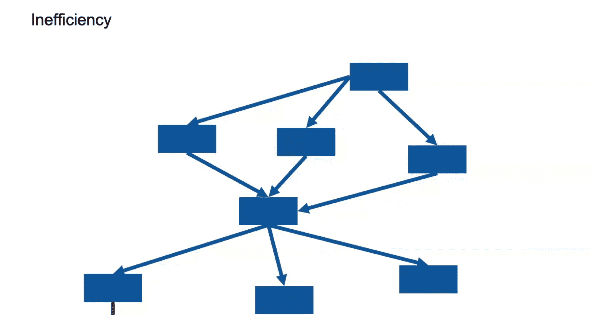

For example， because I want to see it on my screen or because I want to write it back。

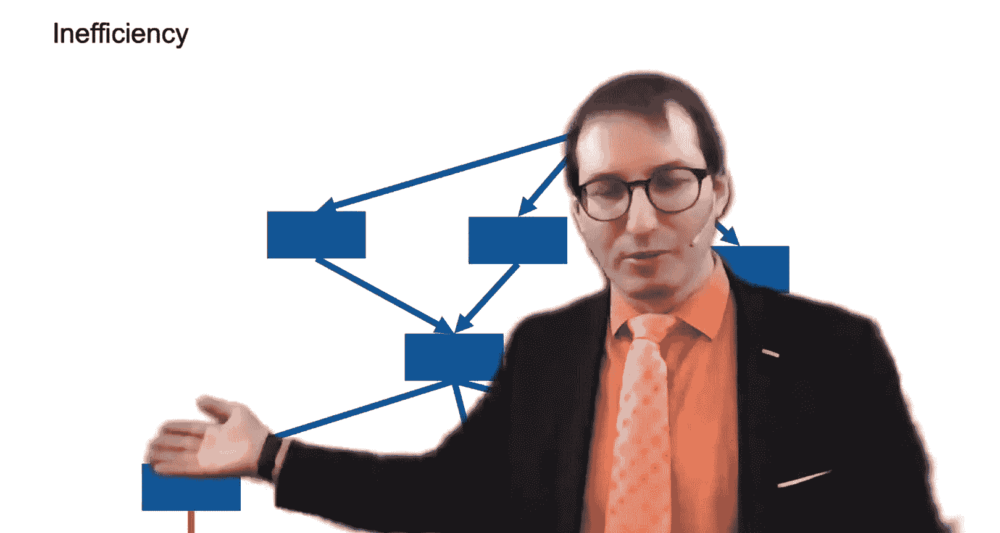

To HFS， so I'm going to pull the trigger here。😊。

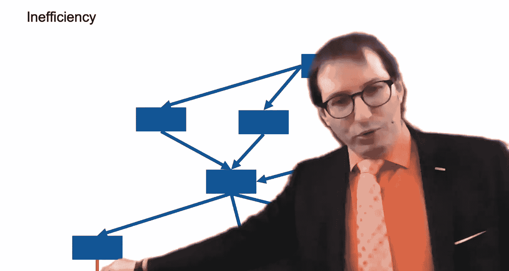

And it's lazy， so suddenly all the cluster moves comes into motion。

 everything gets complete computed stage after stage。

 and then at the end it writes everything down to AGFS。

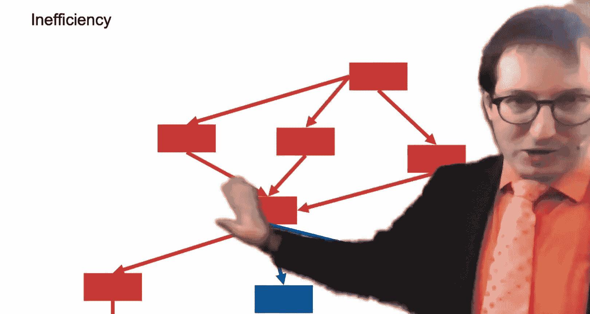

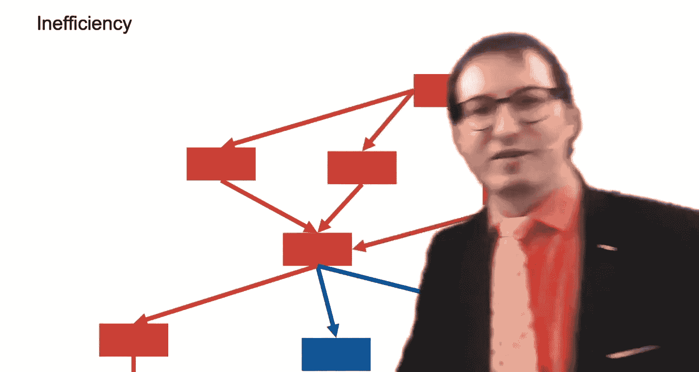

Then you pull the trigger right here on this different ID。

 Now you want to print that to the screen So you pull again again。

 all the computations are basically triggered all of other cluster all of that is computes and you find this on your screen then you decide to have yet another job yet another action you pull the trigger right here and you want this。

 for example， to be counted， you want the count of everything So that triggers all the computations。

Right here。Now， two questions first。Do you see anything inefficient here， and second。

 what can we do about it？Yes， in the microphone， where is the microphone oh here。没你。

And theres a bottleneck。There is a butterneck， yes。

So probably if we have to wait every time for the process to finish。

 it will be very slow so maybe we could parallelize processes if it's possible or we could engineer it differently。

 the architecture。Yes， so the bottleneck， you are right。

 This here in the middle is obviously a bottleneck because there is an RD that that that is common to all three regarding the architecture。

 Yes， we would like to， to adapt something in the architecture to make it more efficient， right。Now。

What I would like to discuss is what we mean exactly with this bottleneck。Because， technically。

When you look at this， if it were only for one action， just this one， for example。

 and you don't care about the others， you do it just once。Basically， if you just do this。

The bottleneck is not a problem， right， because all you get when you take everything that's up there。

 you turn it into action stages。 you have the sequence of stages。 you execute the stages。

 you get the results， right， The fact that it's organized that way is inherent to the query that you're executing right That's the plan that you put there。

 So you are right that if I correctly understood you。

 that the user could change the way that this is organized。

 maybe there are more efficient ways of doing that right So this is one thing that we could have it that the user builds a different graph so that it's a bit more efficient。

 But imagine that you cannot change the graph。 This is what you have。

 it has to be this way and you want to do this three computations right here。

 and can you use to your advantage Basically that it's a bottleneck。Anybody yes， yes， about there。

Right， but you're right， this is exactly the， this bottleneck in the middle is exactly the。

 the center of attention。 Yes， since the logical architecture is not from the queries are。

 is not changing， I can just store the result of the bottleneck and then use it or pre compute it for the auto queries。

Yes， so basically you can tell me if this is what you have in mind。

 Basically you trick out a computation and store， keep stored on that weather bottleneck。

 you keep that stored and when you retri， you don't recompute what's above。

 you reuse what the intermediate results that you've stored there right exactly who sees it。

All right， in fact， this is why it's called resilient distributed data sets because of that sort of thing。

 So the idea。😊。

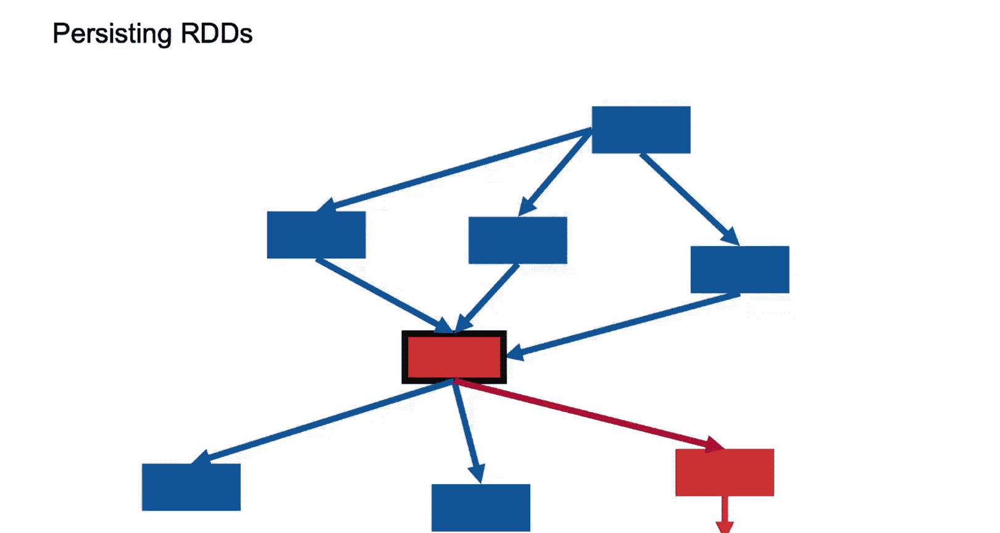

Is that when you write the Python code to create that graph structure with your intermediate computations。

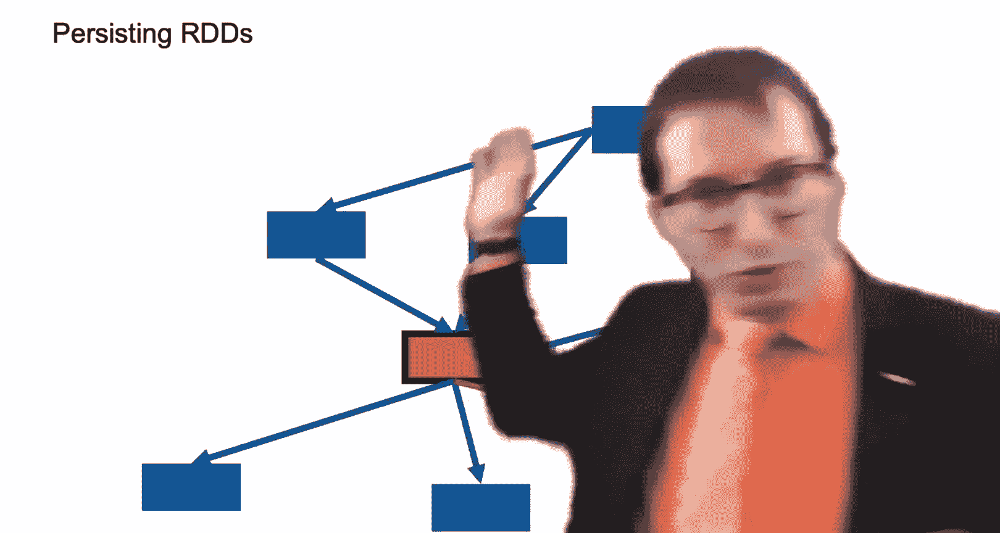

You can also in Python or whatever language you're using。Inin that LEDD， you can。

 you can pin it in the sense of。Heading spark， please keep that in memory。

 Do not throw away these intermedia results。 Keep them in memory。 maybe put them on this。

 if there's not enough memory， you can even ask memory these， you know。

 you can say what your preference is， but you're basically pinning that R here。

 That's why I put this black lines here to basically keep it there。 And that way。

 all of that does not need to be recomputed because you keep in memory these intermediatemedia results。

 right， And then when you trigger the action， only this needs to actually be computed。

 Who understand。

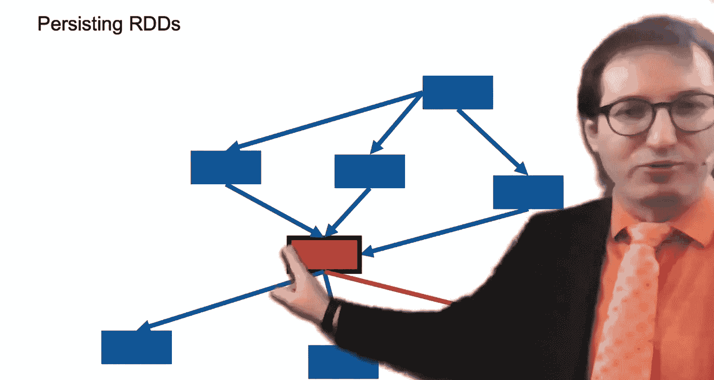

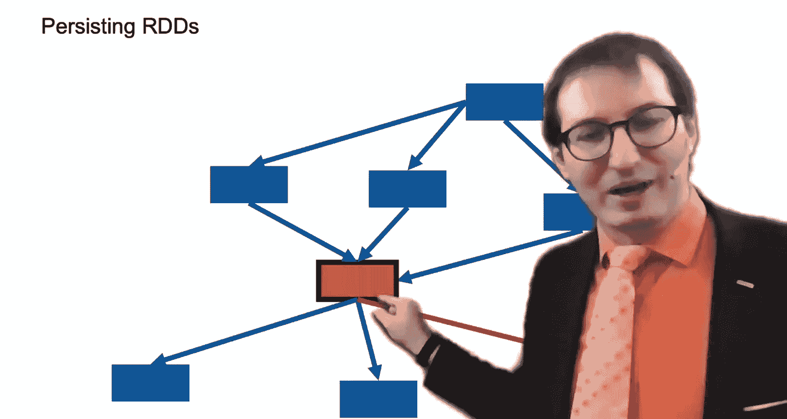

All right， on Zoom， too。

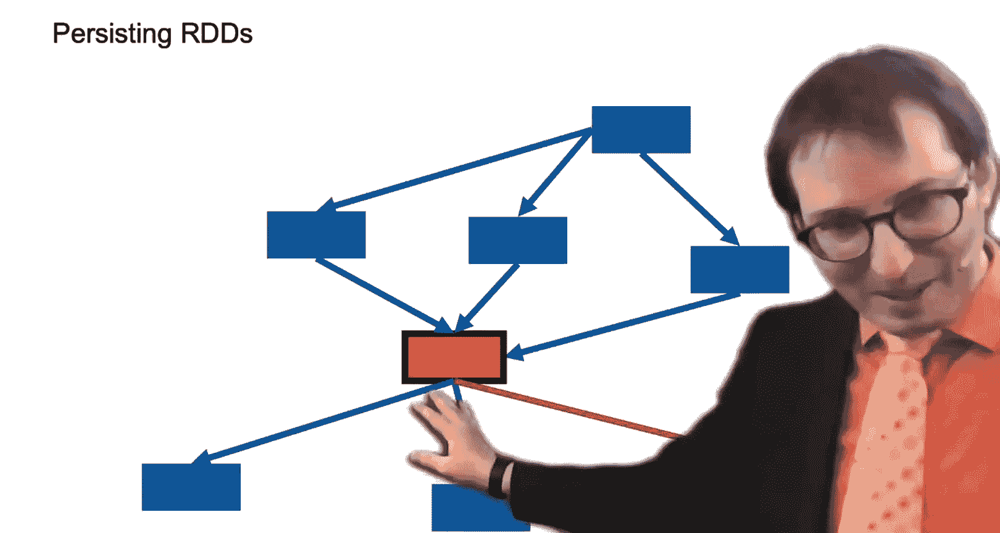

Checking that nobody is actually sleeping。On Zoom， raise your hands on Zoom if you're following。Okay。

 yes， yes， very good。

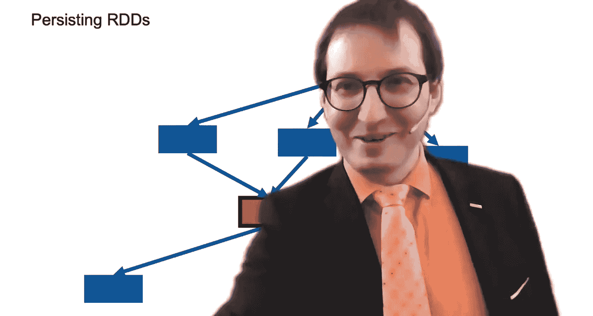

Goods， perfect。嗯。😊。

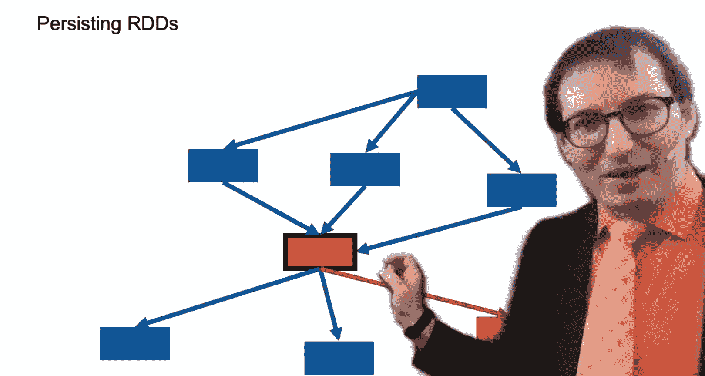

Another reason why it's called resilience is that it might not always work for example。

 if you ask Sp to pin too many RDDs and there's not enough memory。

 it might actually have to really throw some of them away。

 needs to prioritize basically you and have priority but if that happens it's not a problem the worst that can happen is that it's going to recompute that's the worst that can happen so it's going to be slower。

 but you're not actually failing the whole job。

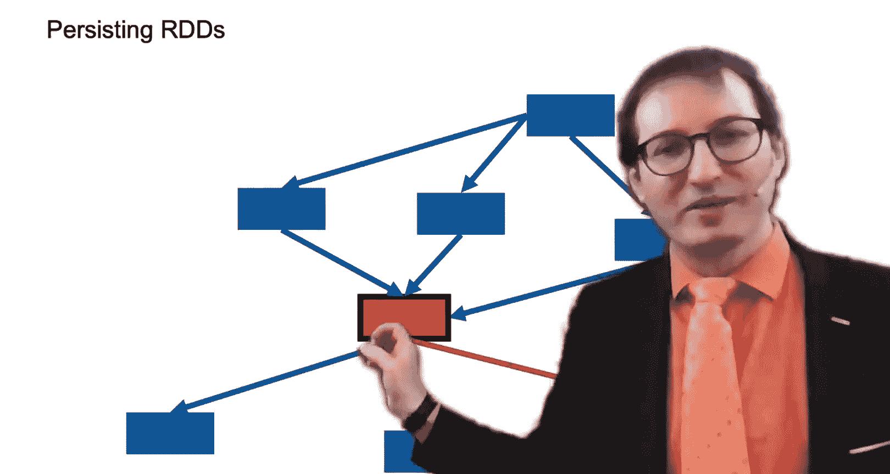

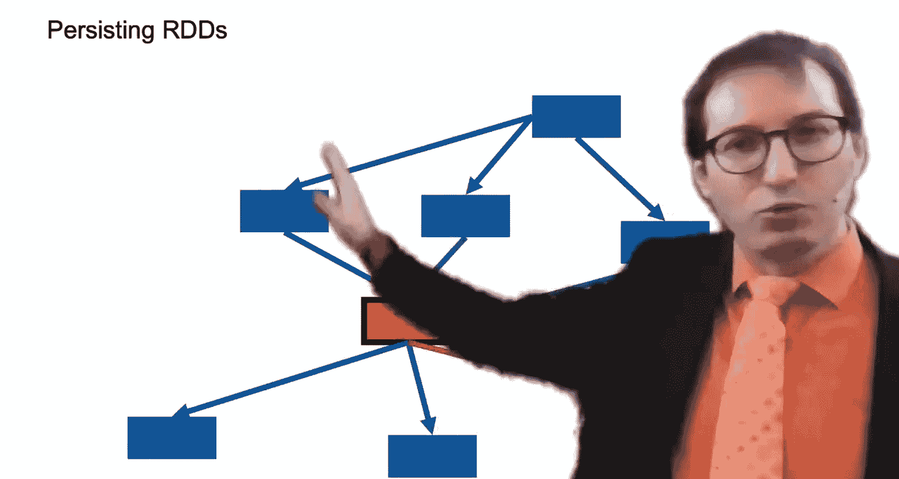

All right。Okay。U。So again regarding the partitioning。

 this is the spaghetti that I told you again about it's when every every piece of data in the output depends on a lot of data in the input or over other place。

 this is where you need to shuffle the data around in the cluster and if it turns out that the input data is already partition and distribute the right way。

 then you don't need to shuffle around right so for example if you want to aggregate based on the birth dates and the data is already grouped by birth dates in the way it's located on the machines then you don't need the shuffling and so this is the cases where you can let go of some of some of the some of the spaghetti here okay。

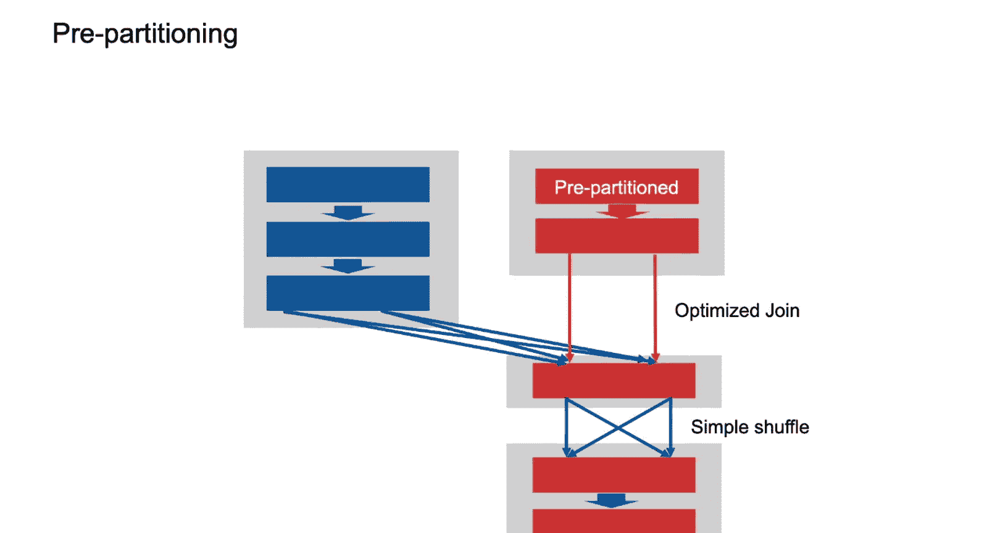

Okay， so this concludes the optimizations and most of that was actually just a reminder of what we've done in the previous weeks。

 so now let's move to new material。So we are going to discuss now data frames who already held data frames。

Weho already have data frames before the validation lecture。Okay， some of you Poas， right。

 you have of Poass。So we are going to connect now this all together。

 basically the Pondla library in Python with the validation of JO because we saw that when you have a collection of valid JON data。

 you can nicely draw a visual that we call a data frame and it turns out that we also have the data frames in Spark。

So。We have RDs， right that are collections of whatever and transformations that turn a collection of whatever into another collection of whatever one way to do that。

 in that case， it's a map transformation that has a function that maps every input value to one output value。

😊，嗯。And when you write the code in Python， it can look like this。嗯。Well。

 if you have a simple use case， that's kind of okay， right。

 you can just write a few lines of code and it can be quick。

But what I would like you to see and hopefully the exercises are going to help is that as soon as your query becomes more complex。

 the code here is going to be more and more difficult to write。 going to be to be incredibly complex。

 even to a point that a human can no longer do it。 And this is kind of the problem that we would like to solve。

 You basically need to see that this code， in fact。

 is what we would consider lowle code from the perspective of of the database system。

 This is something that normally we would not like the user to have to do。😊。

Because we have something better， we have high level languages like SQL。😊。

That is much easier to write more general， and it's easy to optimize。

 So this is the direction in which we are going now。

 This here is a simple use case where you just deal with strings， right， so。You basically for RD2。

 you filter the strings that contain spark。 then you map to the number of the， of the of the， of the。

The number of items that they are in there， then you reduce by key， whatever it does， right。

 But even the fact that it's complicated to figure out what he does already tells us that something's wrong。

 but even worse。Is when you deal with Jason。Spk doesn't know Jason to Spk J is just a whatever that you can have in the RDD。

 but it doesn't know about it。 So if you have an RDD of JO object。

 which you can have because you can have RDD of whatever。

 If you have RDDs of J object from the perspective of Python， a JO object is a diict right。

 It's a di data type。So if you want to deal with Jason， that's fine。

 But you have to do it with the Python method to handle dis， right。

 It's all Python code that deals with Jason。 And then what you end up with is that you have to put these Python codes that deals with Jason。

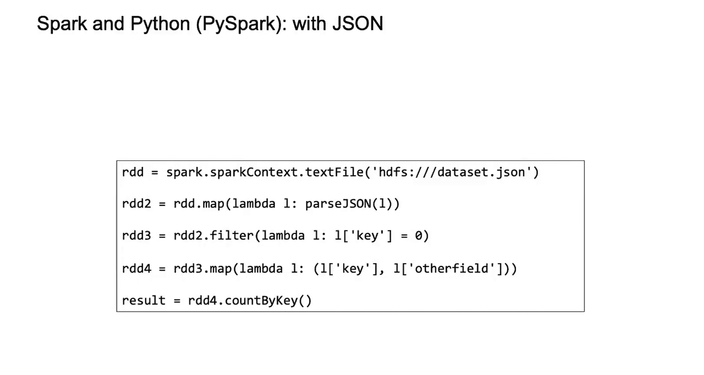

Inside of your functions。 Remember， thes， inside of the functions。

 you have to put all of that codes that is supposed to deal with the Python des。

 which is the way to deal with J objects， right， And again， for a human being。

 this is not easy to read。 It's really not easy to figure out what that does， even less so to write。

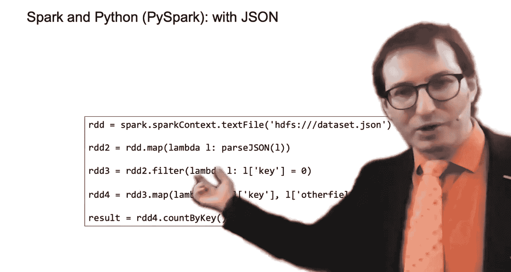

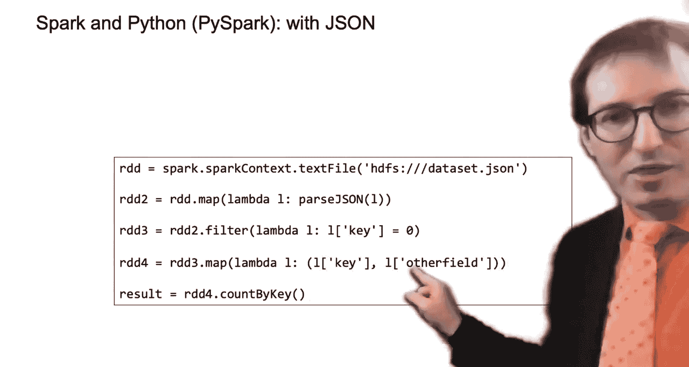

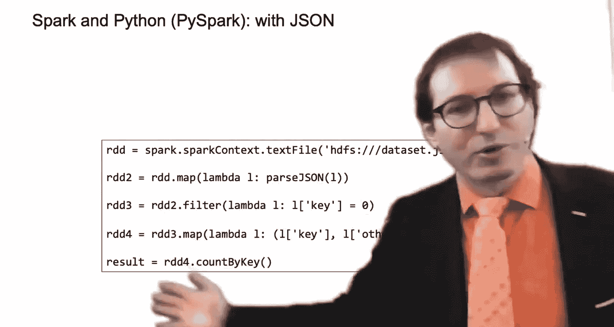

That's good。嗯。😊，So there is a solution that was actually put in place by the engineers of Sp。

 it was not there in the first version of Sp， it's something that was added later because they acknowledged that there was a problem with the complexity of the code when you deal with collections of objects。

And the idea that they had is that。If RDDs are collections of whatever。

Then what if we make that whatever a record or a role or an object？Right。

 so if you have a collection of rows， what is a collection of rows。

If the rose all have the same attributes and type， what is that？A collection of rose。On Zoom。

Whi is a collection of rose， yes， yes， as I see an answer here。 a table。 This is indeed a table。

 right， So if every one of these values in your collection is a row and they have the same attributes and the same types。

 then the entire RDD would correspond to a table， a relational table。 Do you see where we are going。

😊，If we are able， in some cases。To deal with the fact that the values are rows and the RPD is in fact table。

The why don't we use SQL？Because Se is the best way to deal with tables right select from where and so on it's very easy。

 So this is the whole idea in the particular case that the records。

 the values in the RDDs would be rows， the entire RDD would be like a table， and then we can use Se。

 but there's even something better than that。😊，It's that the way we store these tables on the cluster。

 on the machines。Is extremely efficient。 And the reason why it's extremely efficient is that it's going to be stored in the memory of the machines。

Collon Bay Co， rather than Ru Bay room。And if you store it column by column。

Remember that since it's a relational table in the same column， we have the same type。

 So for example， what we have here。😊。

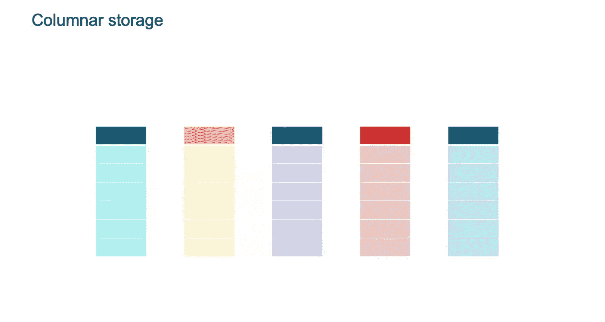

Is inte go about place， It's a list of ins here， maybe it's a list of dates。

 maybe here it's a list of bulls here it's a list of strings， right， So since it's very homogeneous。

😊。

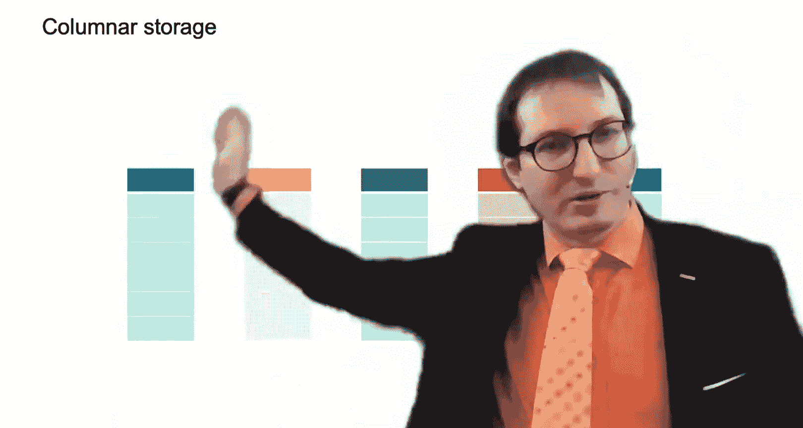

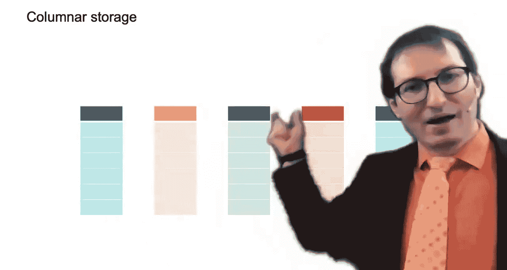

Then we can optimize the storage because storing a sequence of integer of all 32 bits is extremely efficient right and something else that happens when you store the current in that way is that you do not need to repeat the name of the current。

😊。

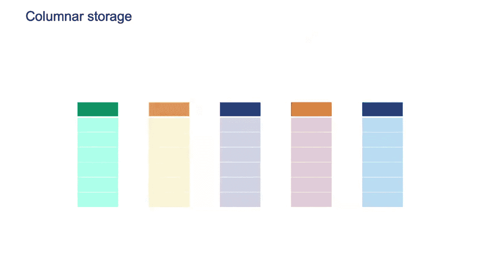

Remember that when you have a collection of JSO objects like in the JSson lines dataset set。

 you have to repeat the keys in every one of the object。 Do you remember that。

The keys has to appear in every single Json object。

 even if it's the same keys over all of other place。

 this is the reason why we saw that we can turn it into a data frame after validating it and then save it as parque right it's the same idea here If it's ors and they are stored together and it's the same column we no longer need to store the name of the column。

😊。

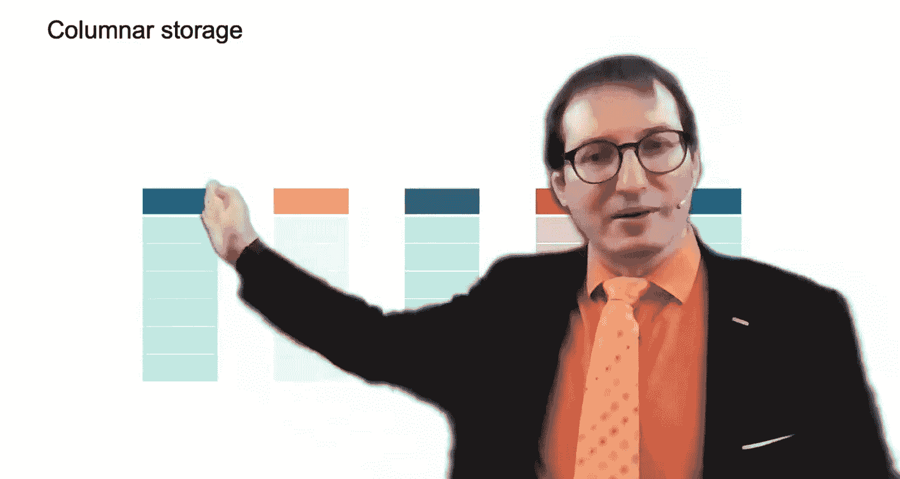

Every type we just store a sequence of integers。 This is something that we know how to do。

 So the concrete benefit of that it's very simple to understand the memory that it takes to store data in in the form of data frames is much more efficient it takes less memory if you have to store the same thing as the collection of JSON objects in Sp as an RBD of JO object would take a lot of memory。

 but the moment you turn it into a data frame it is going to consume less memory。😊，Right。Now。

 just to be extremely clear， because I made an additional jump in here。

This is a relational table in the particular case that the we have a relational schema and it's flat。

 right， So if the rows are flat， we have a relational table。

 you remember from the validation week where we studied a validation of J。😊。

That if you have a collection of very adjacent objects。Then you get a。

What do you get when get would you have a valid collection of Jason objects？On Zoom， I know you know。

Collection of value Jason objects。Is a。那么。That we the。Sorry。Yes， you could， in fact。

 when we study documents saw we see that we can call the objects documents。

But in the particular case， that the documents are all valid against the same schema。

Where do you get， then the entire collection would be a。A data frame yes exactly。

 so in the flat case the rows give you a table and in the case that it's not flat but it's still valid adjacent then you get a data frame all right and in the case that you have data frames which are generalization of tables then you need less space。

😊，Now， this is where it becomes beautiful。Because then。Inside your code。

 you no longer need to write all of this code with the flatmap and filter and the Lombdas and the Python code that deals with Jason。

 instead you can just replace that whole thing with a SQL query。

So you see now why the brush up that we did at the beginning of the semester was useful。

 why it was worth looking into SQ again。Because then you can just write select from where， you know。

 the closes， right select from where group by having order by limit of sets， right。And in fact。

 for a human being， it's much more intuitive to write a select from where query in SQL than it is to write Python code。

 In fact， it is so popular that even business people or of people outside very far away from technical aspects。

 they can also write SQL， they can also learn the SQL language。

So the good news is that in the particular case， that the RBDs are valid JSO objects and can be seen as a data frame。

😊，We gain in memory because it takes less space to store the data in memory。

And we gain in productivity because we can use SQL instead of writing a list of Python transformations。

 Gu understands that。😊，Alright， so this is great news because you already know SQL So now you all you need to do is actually use that so that you'll have at the exam by the way you will have Postgresql Postgreql database with data in there and you'll be asked to write SQL queries and you'll also have JO datas that are values and you will also be asked to to write Sps SQL queries right we call it SpsQL technically call it the SQL of Postgresql and the SQL of Sp is a little bit like the difference between2D Basil Bch Val So is the same thing these are just dialects of the same language right but they are really not so different from each other。

😊，Okay， so this is the thing and by the way in the Jupiter notebook。

 you will not even have to write this Sp dot SQel with the string and so on in the Jupiter notebook you just put the SQel and that's it in the entire cell。

 just the SQel， so it's really made in such a way that it's easy to use。All right。

 so how do you use it then， well， your data might be a CSV file， it can be a Jsonline file。

 can it can have various formats。But Spk is smart enough。To turn this into data frames。

 because it can auto detect that there is some homogeneity and some schema， for example。

If you input that data here， data set dot CSV as a human being。

 you see it immediately right as a human being， you see it's always an integer and then a command then a boolean。

 right， Spk， in fact， can detect that。 And what it's going to do is it's going to create a data frame where the first column is an integer and the second color。

 the second column is a boolean right And the names of the column are。

 of course taken from the first line， the CV file。 Who understands this。😊，Right， okay。

 so here we turn a CSV into a data frame。If we did not have data frames。

 the only thing we could have done is open it as a text file and have an RDD of lines。

 an RDD of strings， right that wouldn't have been very convenient。

 but since now we can directly open it as a data frame。

 then we can use SQL in order to work on that data frame。😊。

Notes that this particular data frame happens to be a table because here it's flats， right。

 but in general it doesn't need to be flat。 CV will be flat， but Jason will not necessarily be flat。

Now we have the same in Jason who bar and then the Boolean。

 you see that you can build the schema against Jason you can see that who is an integer and bar is a Boolean so you want objects with two keys who and bar who is an integer bar is a Boolean。

 then you can turn it into a data frame。You don't even need to supply the schema or build any schema here。

Because there is an automatic detection， Sp will figure it out for you。

 just give the data and Sp will figure out that you have an integer in a Boolean column。All right。

And it even works if the data is nested， if you have a array on objects and so on。

 as long as it's homogeneous and the objects all look alike。

 then Spk is automatically going to build a data frame。Now I love SQL， a lot of people love SQL。

 a lot of people find SQL much easier to write。😊，But there are also people who are big fans of what is called data frame APIs。

 So there are people who don't want to write SQL。 They prefer to have fun with chains of transformations。

 when if that's your case， then don't worry， because you can also instead of SQL writes a chain of transformations like this。

 You just need to be aware that it's not the same list right。

 There's the transformations on Rds here it's transformations on data frames。

 right There's also a whole restaurant menu of them I not going to drive you through them。

So at the exam， you will have a choice。 I strongly encourage you to use SpSQL because it's much easier to learn and also it looks like Postgres SQL。

 But if you really， really want to have to use the data frame API then of course。

 you can do it and if you can solve the same questions then that's totally that with me。😊，Okay。

Who prefers this？😮，It's okay， right？Who pre fell secret？I see more Ray hands raised， right， okay。

All right。Now do you remember in the lecture on validation I gave you a101 on data types what I told you back then is that there are many。

 many different technologies for schema validation for format and so on and every technology will have a list of types right specification of the types available you have types in Java。

 you have types in Python you have types in XmM schema。

 you have types in JSON schema you have types in PAca when you also have types in SpSQl but remember what I told you even though it's going to be different lists of types on the high level if you zoom out and take a bit of distance。

 it's really always the same story the types almost always look the same the names might be different there might be a few differences here and there some of them might not support some types some of them might have additional types but it's always the same when here this is the list of the ones you have in Sp。

So SP data frames， the types you can have in the column。Normally。

 at least if I did my job correctly a few weeks ago when I told you about the types。

 if you look at this， you should be comfortable because there shouldn't be any soft price there right that should feel familiar or whom does that feel familiar。

Perfect。For those of you for which it doesn't don't worry。

 because I have yet another correspondent table where I have Java types， I have python types。

 I have Jsononic types， These are the same as for JO and Xm schema and there is the whole correspondence。

 So you see the only difference really is the way they are called。

 but the kind of types are always the same by chart integer long these are for the fixed number of beats integers。

 right 64 bits， for example， for long。 then you have float and double This is for a floating points。

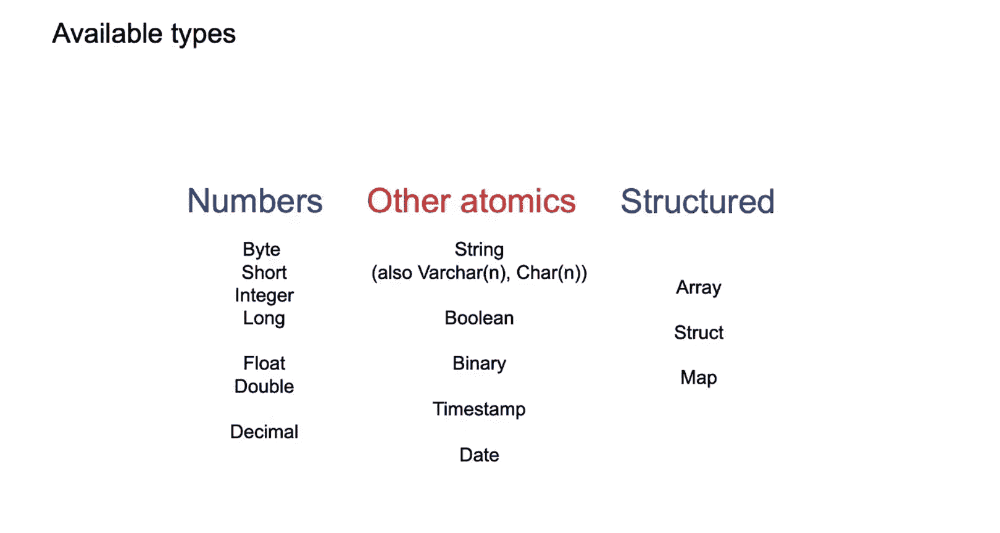

numbers， right， on 32 Bs or 64 Bs。Then you have woody ends， you have strings。

 you have deimmal numbers。You have。Time stamps， date， binary， even and so on。 So no surprise here。

 the names might be new， but it's really just yet another list of types that looks just the same as other list of types in other technologies。

 So who is that intuitive is correspondence table。Right， okay。Very good。 And by the way。

 the correspondence with Python is actually important because when you try to use the transformations or。

 you know get some of the data in Python， it will actually convert back and forth between data frame types and Python types。

 So the correspondence is actually important。

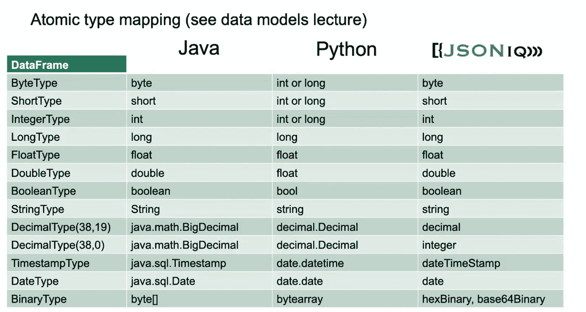

All right， and for people who use Java instead， then of course it's going to convert to Java types。

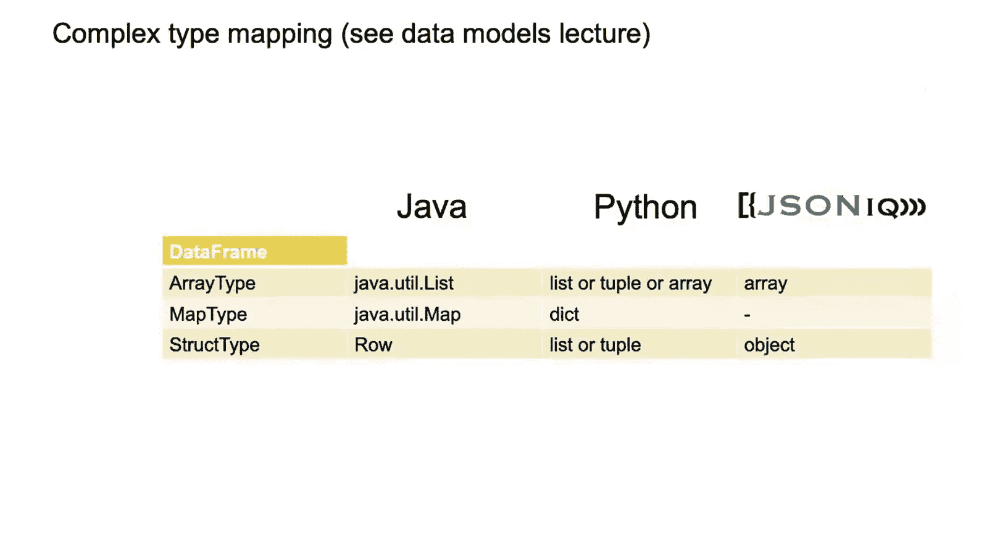

Okay。😊，So these were the atomic types right the ones that are the leaves of the tree and then we have the complex types but here there shouldn't be any of we have arrays and objects right arrays are called array types and objects are calledstruct types in in。

😊。

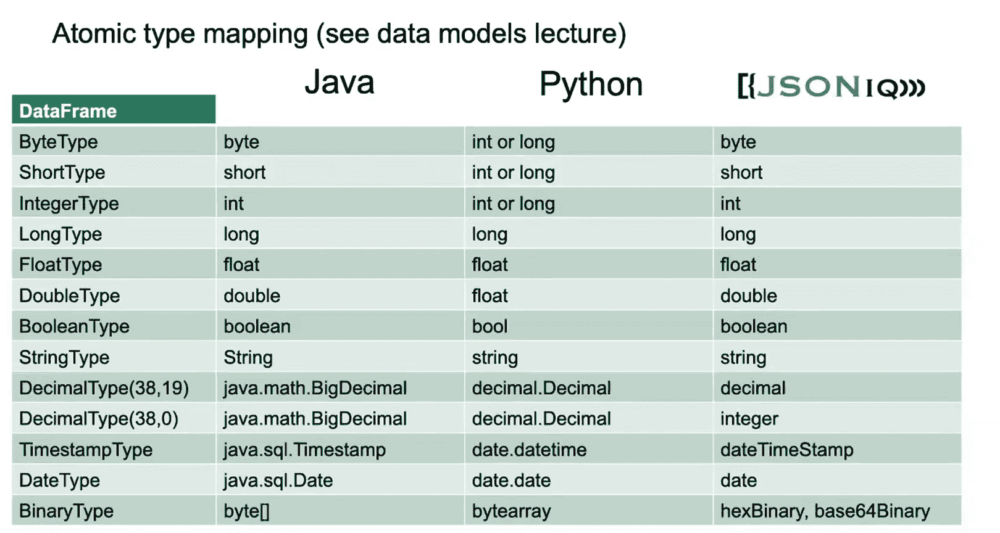

In the data frames， right？And again， in Python， that would be a list for the array type。But and here。

 this is where you have to basically， it's like going to values after each right。

 It's slightly different。 So if you look at the map type， what is a map type， Well， technically。

 it's also an object， right，s just like thestruct type， it's also an object。

 The difference between the two is that in a map type。

All of the values in your object have the same types。That's the difference with astruct In astruct。

 you can have a key that is associated with a date， another key that is associated with a string。

 This is typically what what you are used to in data frames。

 but you can also have map types and and the way its maps to Python can differ technically you could also map astruct type to a in Python without any problem but it can also it can also be done as a list of as a list or as a Tuer。

 I have no idea why personality I would have used the dt rather than done the developerpper。Anyway。

 you see we have this correspondence between the languages。

And we have objects and arrays they are just called arrays andstructs in data frames。All right。

 map type you actually don't see very often， I think it's something that is a bit rarer to use objects in this way。

Okay。Now how do you read the data I already told you it automatically influences the schema well this is how the syntax looks like you have the Spk dotread dots and then your format so Spkread J Spkread P Spread CSV text so then you just put the path to your cloud so it could be HDFS could be S3 could be a Google Cloud could be Azure。

😊，And this is why it's automatically inferring the schema and creating data frames， right。

 so it doesn't matter if you have Jason Park CSV with it with infer a schema text maybe do not push it text it will just create a single column with of type string。

 right。😊，What is JDBC。 Well， that is a connection to Postsgresql because you can， in fact。

 connect back to Postgsql and open a Postgresql table as a data frame and then apply Sp transformations on it。

 So you see how modular it is。 You can connect anything to anything。

 You can use Sp with S3 with AGFS with Google with Asiaure with Postgresql with your local drive and so on and so on。

A row in there， I'm not sure if I mentioned， but that's another format。😊。

Whenever you add new formats， basically it's not going to be directly in here after other reads。

 you just have to put it in a string in there， this is for all the formats that are not known in advance like the not a built in format and then it just depends on what you install on your machine。

 you can just install support for more formats and then you can use them。All right。

 so this is how you create data frames。😊，From data sitting in your data lake in your cloud storage and Sp is going to turn them into data frames。

 by the way。嗯。In one the in one of these cases， when in two of these cases。

 there is no need to infer a schema because the schema is already here。

Can you see the two that I mean， I don't include that row because that row we didn't discuss。

 But if you look at the other five in three cases， you you you you cannot infer really an is schema in two cases。

 you can infer a schema。You already have a ski binding in two cases。

What are the zcases in which you already have a schema？Just need to read it。What do we have here。

 Yes， correct answer。Yeah， so in the zoom pocket and Postgre。 Yes， exactly。 indeed。

 remember that AK is a binary format that directly stop data frames。

 So it means that in that packet file right here， there is already a schema in there。

 So it means that this here is going to be super fast because it doesn't need to infer the schema。

 It already has it。 It will directly read the schema， it already know the structure。

 know the structure of the data frame and populates it with data。

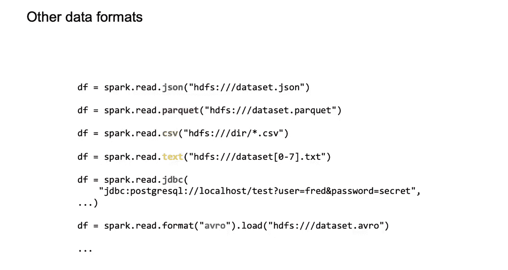

Here it's slower because there is no schema。 It needs to go through the entire data and scan through it in order to install the schema。

 same here in CSV same here。 Well it's just going to take a string。 And JBBC the same。

 There is already a schema。 You know that in a relational database system。

 all tables must have a schema。 And so we just take that same schema in order to。

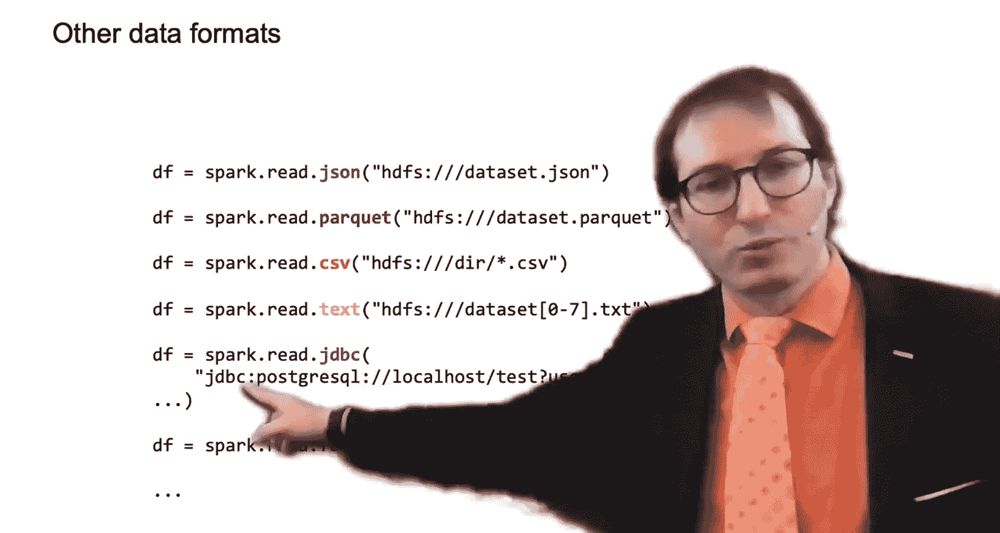

To create out data frame。Who agrees with that？Per Pro already have a schema A also has one too bad again。

 we didn't discuss several so far。Okay。So you see， this is why it was so useful to actually have this brush up on Spock SQL。

 because now you can just go ahead and use it。All right。

So what's going to happen now is that if you do use data frames and you do use Sp SQL。

 Sp will do a lot of things automatically for you。😊。

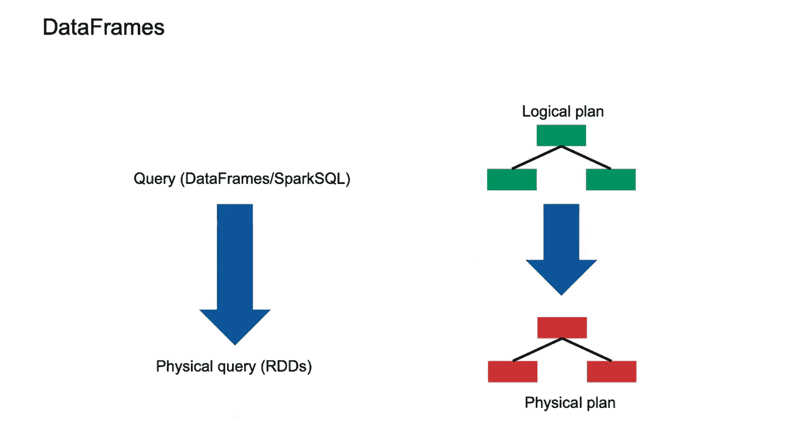

It's， in fact， going to kind of convert。The data frames to RDDs in an optimized way。

 But you don't even need to worry about them or even see them， right， Phically。

 it's going to actually use RDDs in the back。

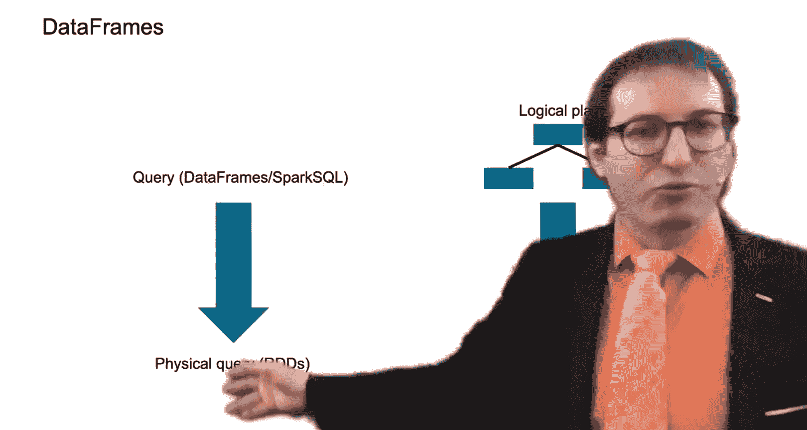

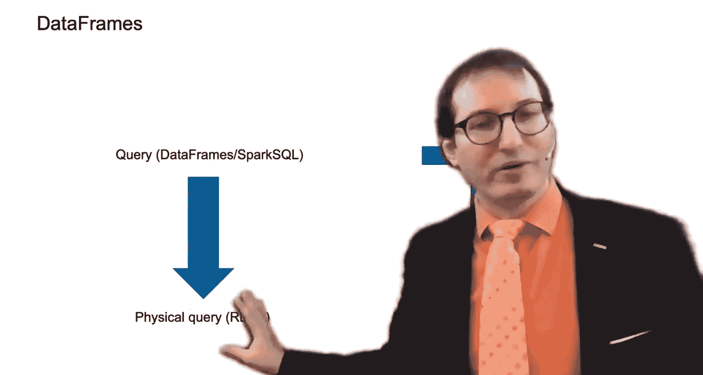

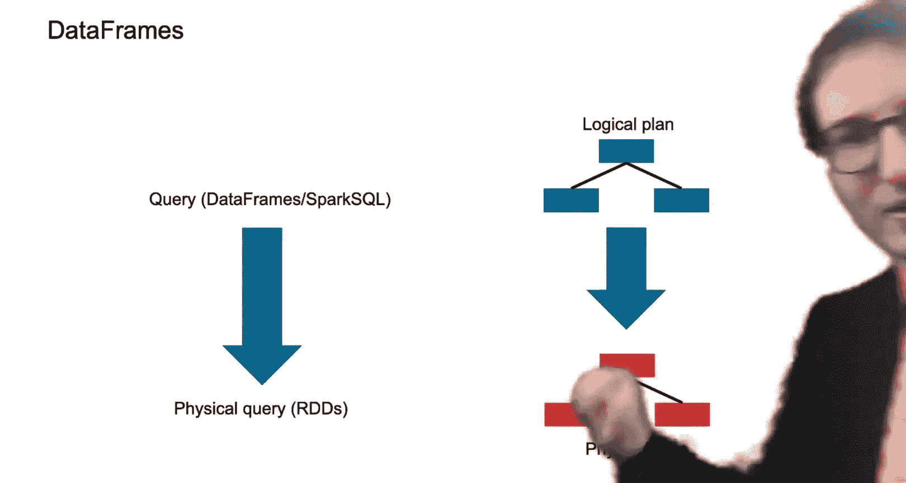

Your plan， so technically when you write SpQL is going to be transformed to something like this which is technically a query plan right this chain of transformations and it's automatically going to be transformed to RDD transformations but the nice thing is that all of that here is hidden from you you don't even need to worry or even understand how this is done is going to be optimized in the best possible way。

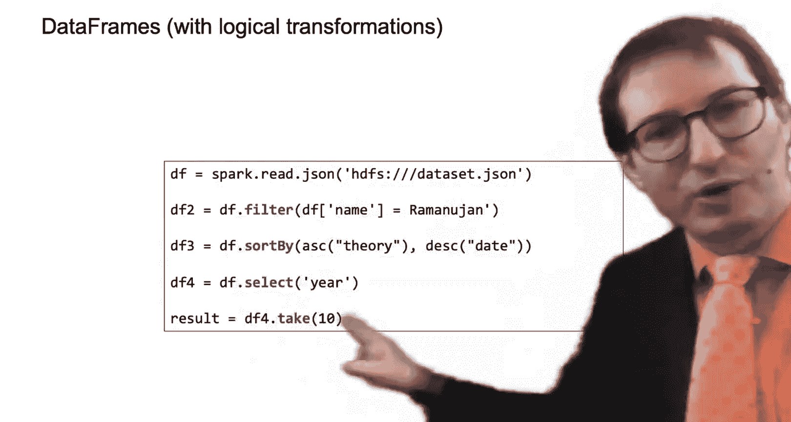

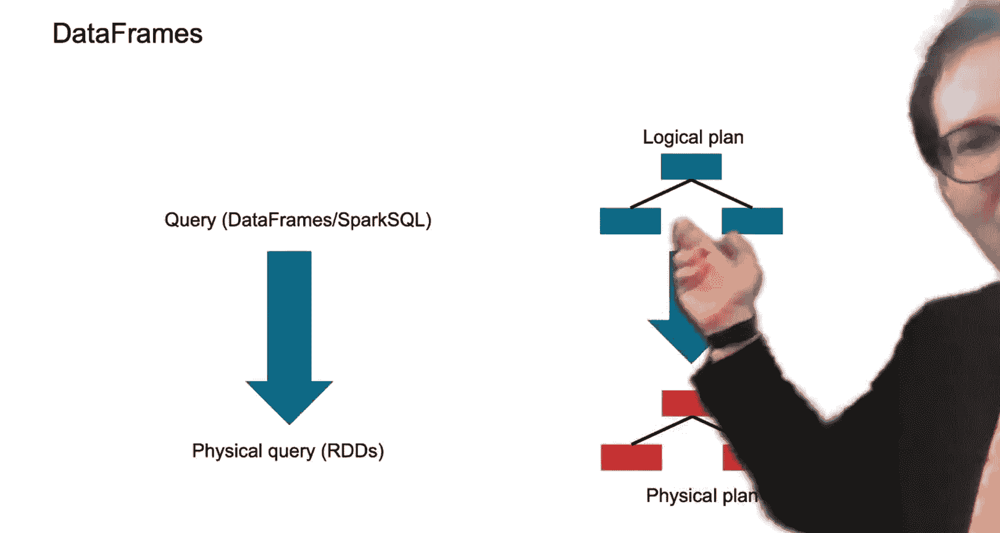

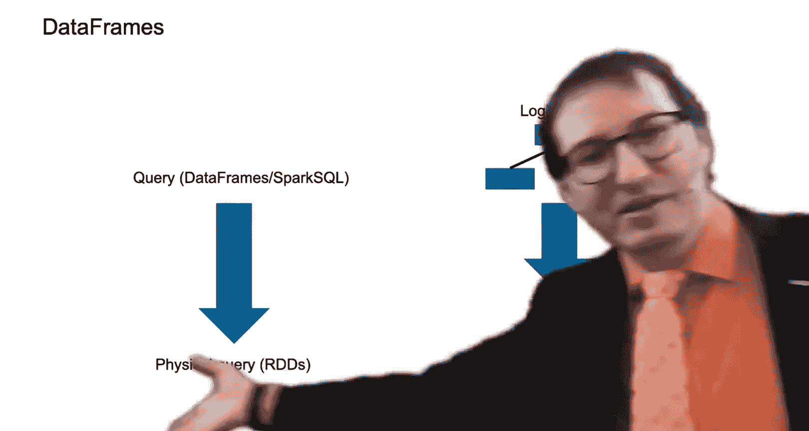

So that the execution is fast so this is an illustration from the paper when they presented it there is a whole pipeline of fancy tools that are able to optimize and make it faster right this is advanced here you don't need to go into the details of that all you need to see is that on the very left you have your data frame and your SQL query that you understand right where the data frame is and the SQL query and it goes through that pipeline of complex things that nobody understands and at the end it spits out some id right so it's all the magic that happens to basically make the SQL execution against data frames super fast。

Now not surprisingly this is how Sp SQL looks like right when you when you look at it shouldn't surprise you that corresponds to the Bup select from where group by having order by limit of set。

 it's not all on that or right you can also have only a subset of these， but this is the whole list。

 it has to be exactly in that order， you cannot put the having at some other place or put the limit at some other place。

 it has to be in exactly that order。Who is comfortable with that syntax？By now， right。

 we had the the brush up。 Very good。 We had the brush up at the beginning of the semester now。

If you look at that specific query and imagine the data flow in the query。😊，嗯。Can anybody tell me。

What in this query is spaghetti and is going to cause shuffling？

Do you see these parts of the queries that are going to cause surfling？

Maybe the where does the where cause shuffling。你叫 goodbye。What is it that causes sh。

Who thinks that the wear clothes is going to cost roughlyly？

The wear clause is going to be a filter right remember the best way to implement a warehouse clause is to filter out the data and to just keep the data that satisfies the criterion。

 A filter is a narrow transformation， There is no spaghetti in a filter so indeed there is no there is no shuffling but other do you see other places where there is going to be shuffling。

Yes， so they there you have。Yes， bingo group by an order by exactly。

 This is what causes the shuffling right a group by because you need to put the data that is in the same group together。

 So you're gonna shuffle around the data so that the data in the same group is located together the same for the order by the order by shuffles the data Well。

 that's what an order right where you reorder the data， you obviously have to shuffle the data。

 I mean， if you play poker and you have to sort the Cal deck。

 then obviously you need to to to shuffle the gap， even though shuffle is used meaning randomness in the case of of cals here shuffling really just means you move the data around。

 So very good。😊，Group by and all all by you。Here's my next question to you。Do you think。

That shuffling will happen twice。Or do you think this is a case where we don't need to actually shuffle every time？

Who things are fleeing with happened twice？Don't see any race sense。

 Who thinks shuffling will happen only onces。I see a lot of resistance why。On Zoom。

 people are less shy on Zoom， usually writing down is kind of easier。Nobody on Zoom。

 why does the second shuffling not need to happen？Time to write down。Yes， what。

 can you read maybe Because the country could already be ordered during the first one。 Yes， exactly。

 you see。What we group by and what we auto by is the same thing。

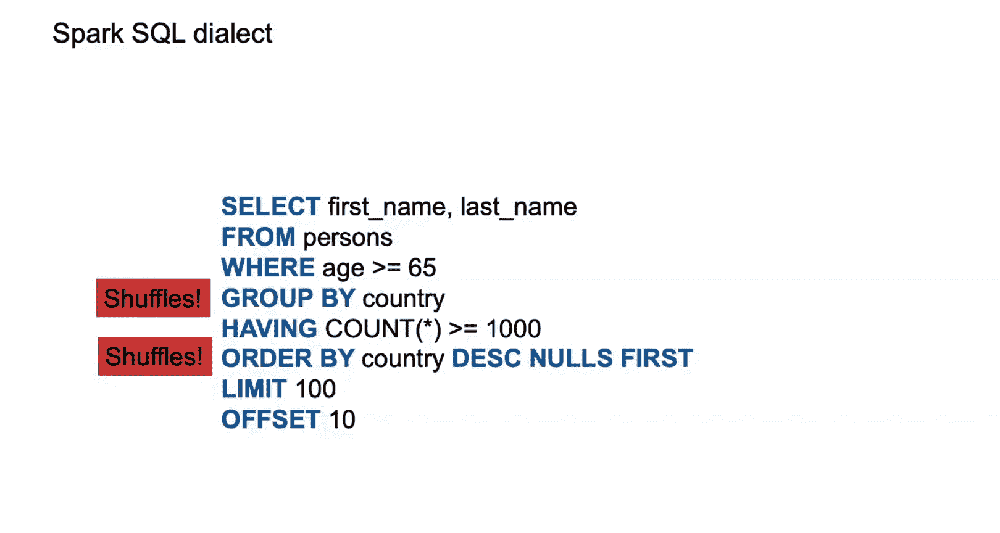

So when you do the group by you're going to put the data together all by country。

 so Switzerland will be together， Germany will be together。

 China will be together and so on so at that point。

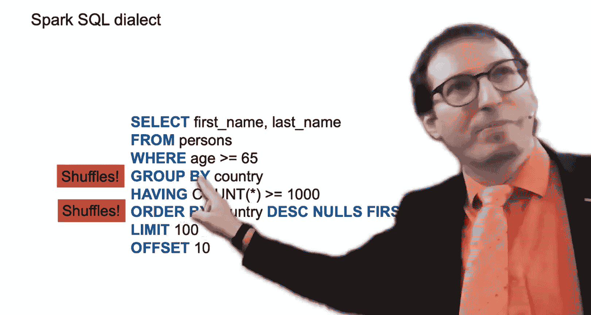

It's all partitioned by country。 the having is like a filter it's just like the web but after all grouping so this doesn't shuffle and now you order by country but that's great The data is already organized by country right so you don't need to shuffle again the data is already where it needs to be who sees that。

😊。

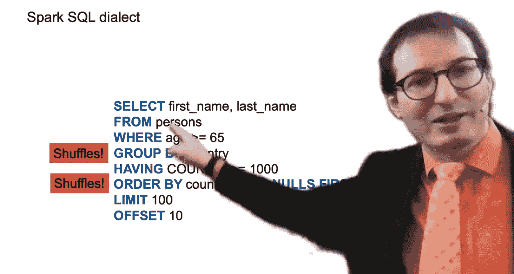

I know you do。 There is a lot of race sensor audio， right， Okay。

 so this actually does not require a second shuffling。

 That is one of the cases that I call pre partitioning。

 If the data is already partition in such a way that the data is already where it needs to be。

 then you don't need to shuffle。 That is an optimization， right。😊。

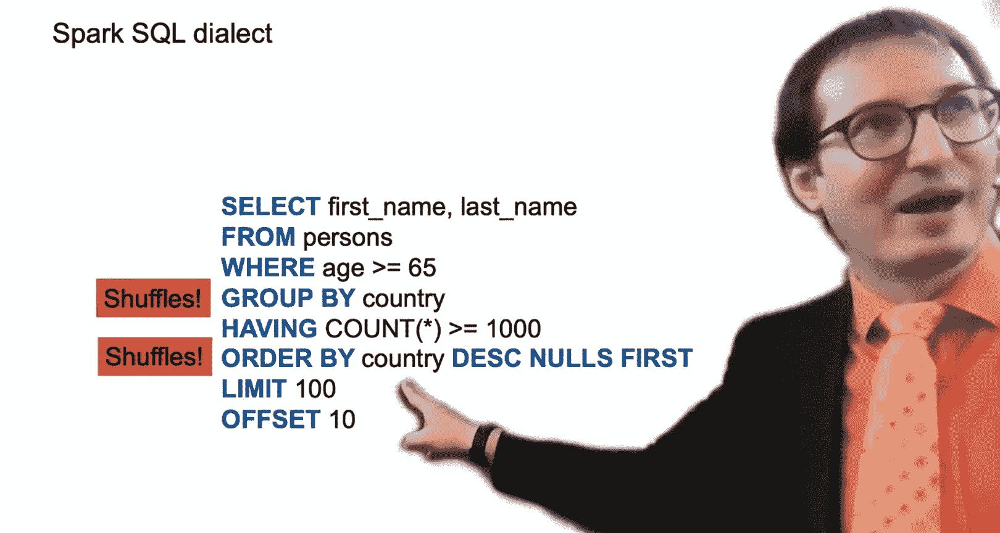

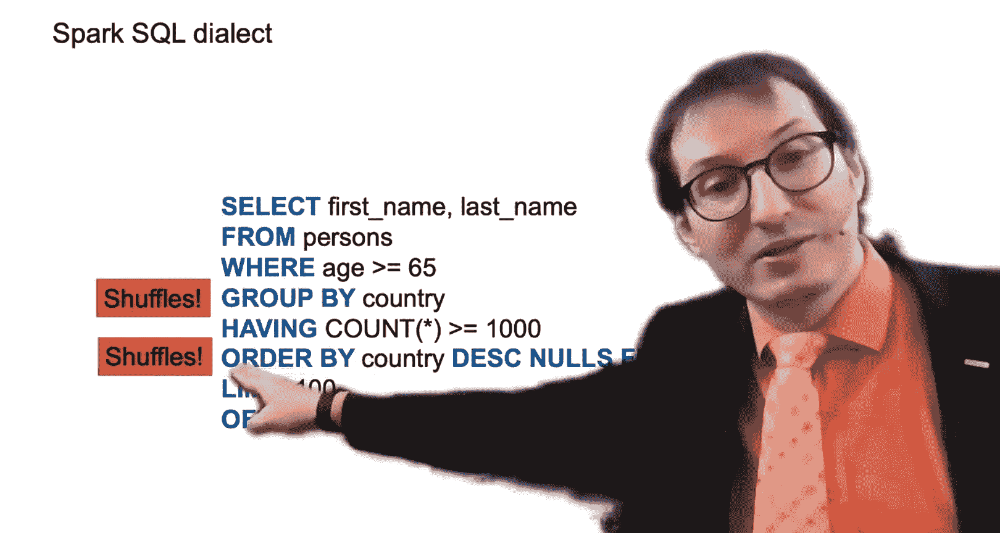

You could still chauffeur if you want， but that would be useless， that's what I'm saying。Yes。

 the question， so what if the attribute is not the same， if the attribute is not the same。

 then you need to shpher it again。Right， that's basically what happens， yes。What if we order by。

 for example， as sending or in a different way than we did in the group by。

 would we still just change the group ordering and then it's still not a shuffle。Exactly。

 it doesn't matter if it's ascing or descending because it's already where it needs to be right you just need to keep track of where itities yeah。

Okay。All right， I'm almost done。Now。I think we need a break actually so it's nine I just have a few slides left what I want to do is show you the limits of data frames and equal I I will break it to show you that it doesn't cover all cases that I will do in a quarter of an hour so I'll see you at two minutes at 17 past9 for the continuation Thank you。

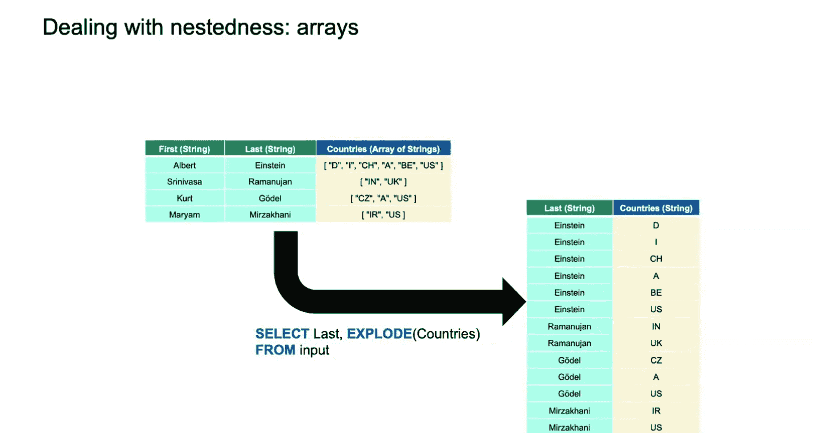