# 苏黎世联邦理工《工程师的大数据｜Big Data for Engineers - ETH Zurich - 2024》中英字幕 p27 10. Document stores (1_3) - .zh_en -BV17FAmeFE9K_p27-

Welcome back now we go to Part 1 which is the continuation where I left you with a big cliff hanger just like at the end of a season final in Netflix so how do we solve that problem that SQL and data frames do not actually solve all of the issues so。

😊，One of the answers or actually the path， the journey to the answer is document stars。

 but then we see an actual language that solves the issue。So in terms of document stars。

 I I'm going to ask you a question on clicker to make you think a bit ahead of time。

 but before I ask you the question， I'm giving you a bit of context。

Document stores store data as collections of documents。Collectctionions of Jason objects。

 collections of XML documents。 It doesn't matter。 There's many formats。

 but it's collection of documents as opposed to relational databases that store the data as collections of rows。

 right， The table is the collection of rows。Now the difference between a document store and the data lake because we already have collections of objects right。

 this is whatever we drop on a data lake， you drop a collection of JO objects in a text file in HDFS or in S3。

 you already have a collection of JO objects， but in a document store。

 it's more integrated a little bit like a PostgresqL or document stores rather than just storing the data in the data lake。

Now is my question to you。How does a document store like Mongo Db。

 That's the one we are going to study， of course the Mo。 How does a document store like Mongo Db。

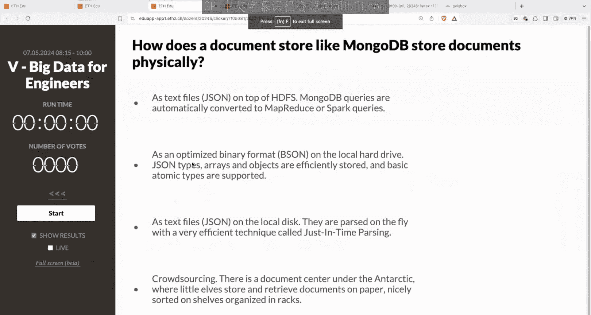

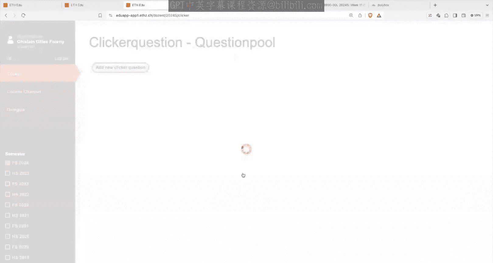

Store the documents on the physical layer。So the first answer。That Mugodb is storing the data。

The first answer is as text files， Jason on top of H GFS， that's called Json lines， right。

 that I told you。 So as text slide on top of H GFS。

 Mongodb queries are automatically converted to map reduce or spark queries on on these text files。

 Second answer。😊，As an optimized binary format called Bieson on the local hard drives。

 JO types arraysing objects are efficiently stored and basic atomic types are reported。

Or on so number three， as text filess Jason on the local disc。

 they are passed on the fly with a very efficient technique called just in time passing。

 it's inspired by just in time compiling with other。Or crowd sourcing。

 there is a document center under the Antarctic where little led store and retrieve documents on paperap nicely sorted on shelvess organized in racks just like the data center。

F of you like my。米 induct。Data center。Oh by the way。

 regarding the field trip we got 77 answers by you。

 some of you who are interested in visiting the data center。

 so we will send out the dates there will be two or three possible dates that we will share and probably in June or something like this right and then you will go there I think it's cap at 60 people in the same group and then they will say a few words about the company and then drive you in groups of I think at most 12 through the data center rooms I think it's really like seeing that once in your life where the data center looks like is is a really nice experience So yeah we'll keep you informed regarding this。

 but at the risk of dis appointing you there are no little levels in in that data center。

 it's actual actual computers organized in Res。😊，嗯。

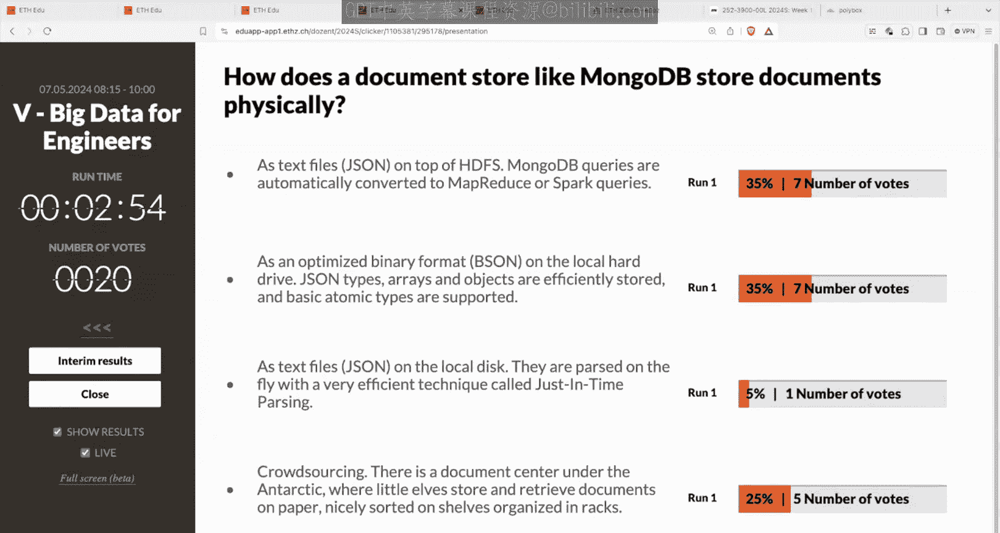

All right。Okay。So documents those。So just a reminder of where we are。

 this is the big technology stack that we are rebuilding from the ground up right on top of the cluster。

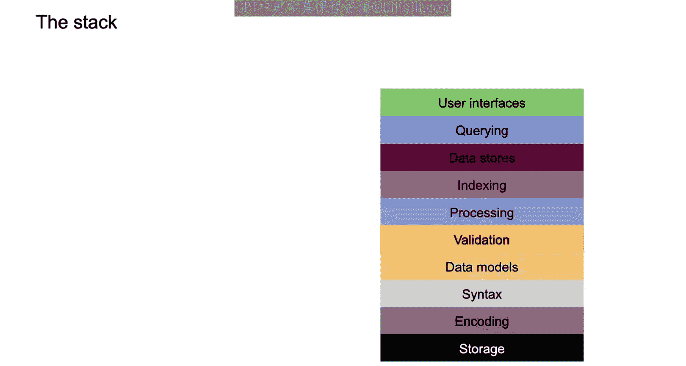

And。So far， we've pretty much done a lot regarding tables。

 including all the way to data frames in sparks so we can store them in the clouds。

En code we have the syntax with CSV。We have data models with data frames and schemas we can validate。

Data frames are validated， we can process with Sp we can even store them also with edge base。

 which is one way of storing it an alternate way and we can use SQL for querying so regarding tables we are in a good shape we have now an ecosystem running on a large cluster that is able to deal with tables that can have billions or even trillions of records right。

😊，But the question is， what about X and Jason？And I showed you that it's tricky at the end of the previous lecture a few minutes ago by showing you all the headache that you get if the tables are no longer flat but they can contain nested XMMR JON or even worse than that。

 it's not even a data frame because the JO is the data is not clean， the JSON is heterogeneous。

So now we are kind of back to square， when not to square1， because we still have half of the stack。

 But there is still a bit of work to do with the nested and heterogeneous data set regarding data stores that would natively sub query languages indexing。

 So this is now the， the rest of the semester will be spent on that gray zone in here that we still haven't covered。

 right。

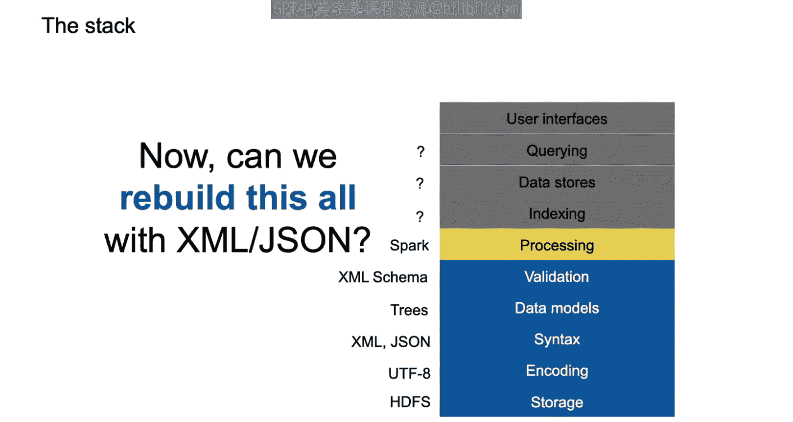

All right， now a few high level considerations。If you look at the beautiful world of relational databases as they。

😊，Started， I was about to say in the 70s， but I should actually say。

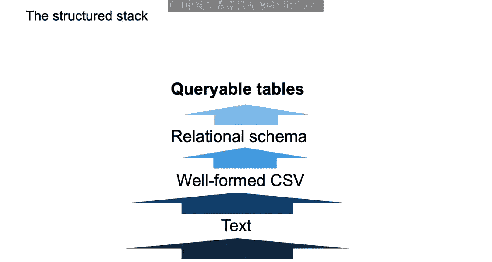

Thousands of years ago， because I showed you that Claar Bled。

That has the first relational database that we are aware of。

The way that it works is that you have bits。Then text where technically if it's a clay tablet it's not the bits is the actual atoms。

 but the ID is the same then you have the wellform CSV then you have a relational schema that tells you the attributes the columns and the data types in every column and then you have tables that are queryable because you can use the SQL on top of these tables now this is the beautiful world of relational databases in which you are first to have a schema nobody asks you for what you want you have to have a schema you can even put data in there if you don't have first schema。

😊，Well， in the world of Excel and Jason， it's a bit different。Because in that world。

 we are a bit flexible。And we don't require you to have a schema。 why it's again。

 back to what I explained earlier， the fact that the data sometimes is not clean because it was accumulated across years and there is no schema。

 So you need a bit of flexibility to allow for that and you no longer require the validation。

 You make it optional。And what happens typically is that you take the data。

 you clean it up and then you validate it because you clean it up in such a way that you can have a schema mind and validate it。

 So this is typically the way it works。 So this is why we make it optional and you can also query it if it's not valid。

 but of course， in that case， the goal of querying it is to clean it up and turn it into valid data。

😊。

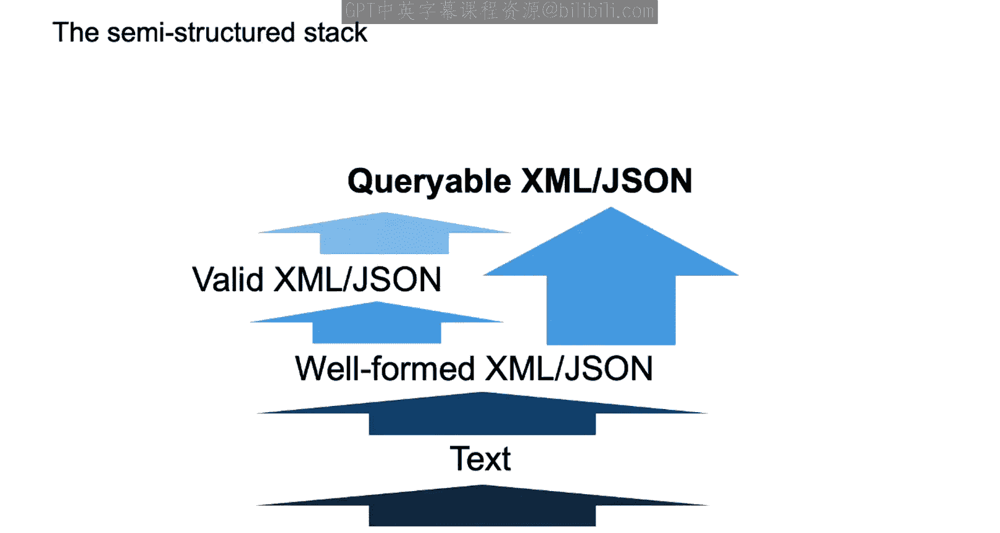

Okay， now let's play the game of putting square pegs into round holes。

 AK A making trees fit into tables， which was what people first tried to do a while ago。

So。When you build when you have new kinds of data that is not covered before。

 you need to build new systems that are able to deal with that data。😡，And they are。

Common pitfalls and common patterns of thought for doing that。 in particular。

 whenever you deal with new kind with a new kind of data。

The question you should already ask yourself at the beginning is。

Can I reuse an existing system instead of building a brand new one。 In that case。

 the existing system that we have is tables。It can be pro well。 It could be。

Blat data frames in spark， I don't know。And you asked the question。

Can we pit trees because in that case Jason and XML of trees。

 can we feed trees in two tables and if the answer is yes。

 that's great because then we can just use a relational database system does the trick。😊。

So let's start with simple cases here we have a tree that is flat， who is a tree here。😊。

We spent an entire week drawing trees with X7N Jason right you should see a flat tree here so with five five leaves it's flat So who sees that this directly corresponds to these stable records below。

😊，Okay， that is easy， but the reason why it's easy is that first it's a single object and second it's flat。

😊，So this is where it works。The same with X M， I can do the same with XM。

 If I have a nice X document like this， it's flat， I can also squeeze it into a table room， right。

 That sounds easy， right， So so far， we can be quite optimistic that we can fit the trees into tables。

😊，Now what about several documents right because that was a single one。

 so it's a single record now I have two documents， so hopefully I can turn them into two records。

Who sees that for that particular case， I can squeeze these two documents into these two words in that way。

Who sees it who agrees with me Yeah very good， but there is a reason first they are flat and second they look alike they have the same schema right I could build the same schema for both of them right there's a decimal number for D and so on。

😊，But do you realize that here we are just lucky we are looking at particular cases where it's flat and homogeneous right I could build a schema。

 by the way， and the XM schema for my documents could directly be mapped into a Post rescueq and schema that has the colon types right the same for JSO that would be a JOund schema and that JSO schema and directly be mapped to a relational database schema which sees that as well。

😊，The correspondence。If you forget that XmM schema is very complicated and only look at the parts that are marked in red。

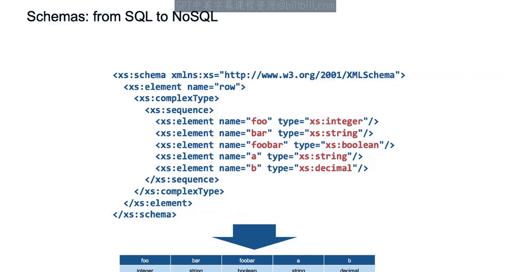

You really see that in that case all matter is the name of the elements and the types of the elements right and that is what you find in the schema here in JSO it's a bit simpler you also have the attributes and the types and you have them in there。

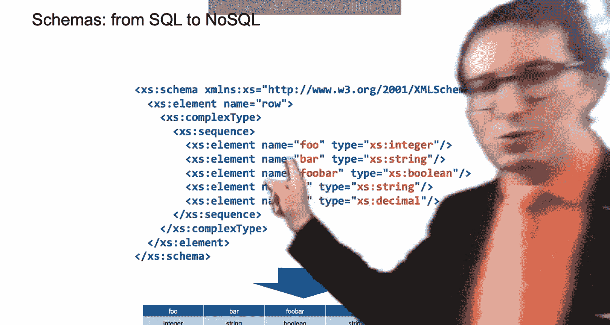

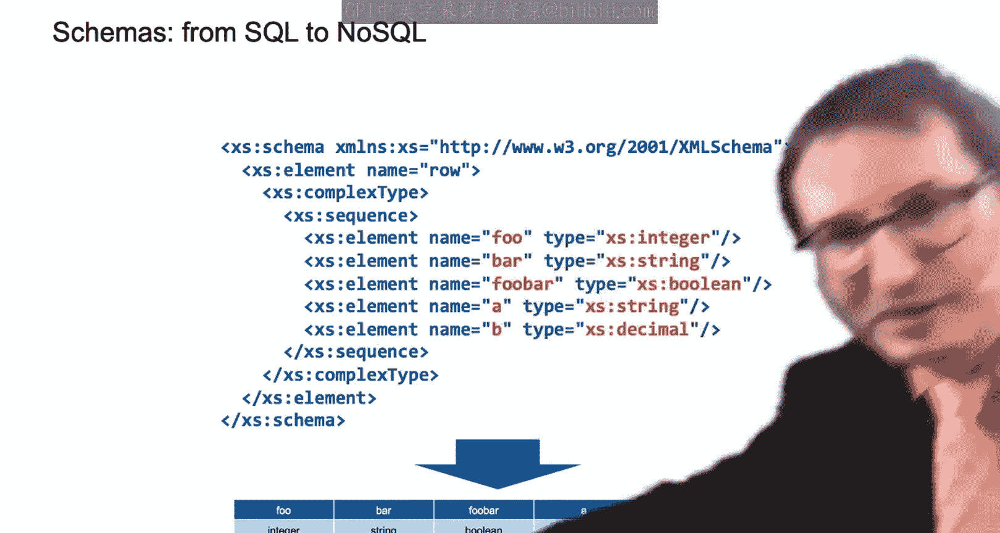

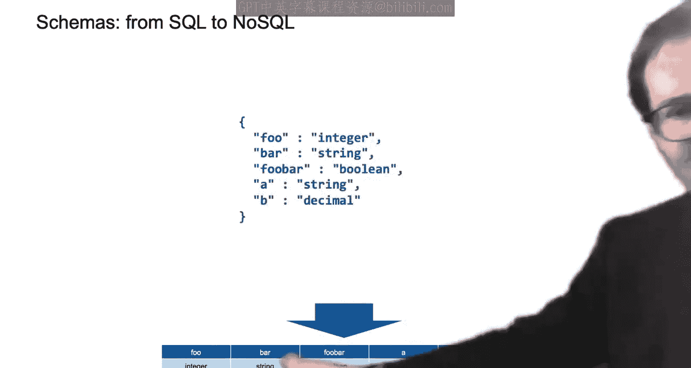

Okay。But here's the problem when the data is not clean。Then the trees might not be flat。

And the documents might not look alike。So the two things that can happen is nestedness。

You get a raisings or raise， a raise in array array， like nastyed a arrays of objects。

 That's the inception movie。 And then heterogeneity， because you don't have a common schema。

 The data is all over the place， and the documents do not look alike。😊，So then you can still try。

 you say okay， fine， let's deal with that。 Let's find ways。 So imagine that now I have nested nest。

 I have as of objects。 I can just create a separate table to store my arrays of objects。 In fact。

 that was the last question asked in the previous lecture and we look at the entire colored as a single table。

 That's exactly what we do here。 We have a single table that stored all of the nested objects across all of the documents。

😊，What I did here technically is that I normalized my data。 It was not in the first normal form。

 I normalized it。 and now I have two flat stables。That kind of works， right。

 So now I can make it work， turning them into tables in this way。 Who agrees with that。I can do it。

What about heterogeneity Well if it's heterogeneous。

 I might have missing missing keys or additional keys and so on。 So what's the big deal。

 I just put nerves everywhere where they are missing fields right And if there is an additional field No problem。

 I just create a column and I put the video and all the rest I filled with Ns。

 What's the big deal right So can still create a table。 there's going to be a lot of nerves。

 But do you see that if it's even more heterogene， I imagine that now we have profession that is normally a string。

 but then we have a genius like John F Neiman， who was a fiist and a chemist studied right in that building by the way in CB computer scientist。

 an economist he was everything like you look at quantum physics， John Fon Neiman game theory。

 John Fon Neiman， the architecture of computers， John F Neiman。

 So here we have these array of strings。😊，We want to store that as a table。

I have no idea how to do that。 Well， technically， people find found ways， but it's very。

 very intricate and difficult to implement。 So do you see the problem now that for some cases we can kind of hit it with a hammer and hope that it fits。

 But in general cases that becomes tedious。Sock really hit it with a hammer。

 It just going to put the entire array as a string， as I showed you earlier， but it has its limits。

So， this is why。We have a problem this is really fitting trees into tables it like putting a square tag into a round hole。

 there is a name for that that we borrowed from from the music or the music industry。

It's called an impedance mismatch technically an impedence mismatch is when you try to connect an extremely powerful device emitting sounds to tiny earphones。

 you're going to to crash them right because the power that goes in there doesn't match on both sides that's an impedance mismatch。

 we have the same thing with data when you have data that has a certain shape and a certain model and you try to hit it with a hammer to fuss it to fit into a different system that was designed for another shape and another model you call that an impedance mismatch and that's really the picture right here should it should be what you have in mind So if you have a collection of trees that can be nested that can be heterogeneous that may not be valid。

😊，And you want to squeeze it into a relational table。 This is a square peg into a round hole。

And that is the motivation or document stores。 We want a system that natively supports these collections of trees without the impedance mismatch。

 So now we have a good reason we know why we are creating this。

 We are creating this because we tried to make it fit in relational systems。 It does not work。😊。

So document those。In a document store。😮，We have collections of documents。Technically。

 you can visualize the little levels in the Antarctica because that is a correct physical implementation if you think of data independence that that would absolutely absolutely be it right so we have all of these documents。

😊，And we scale up in millions to billions or even trillions of these documents。

 we can reach sizes of terabytes on a single machine。

Patabyte because you can also have the document stalls over clusters。

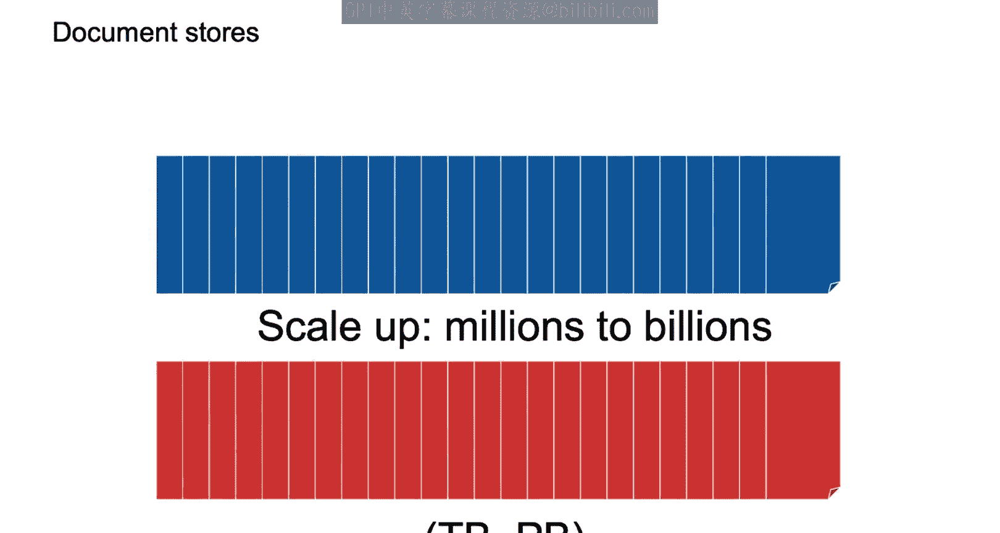

No。There's two kinds of document stores， there's the JON document stores and there's the secret。

 the XM document stores and maybe there's others for other synes。

 but these are the big categories XM and J and they are both okay right it's just two different E steps and a lot of the functionality looks very much alike regardless of whether it is a J document store or an XM document store。

Now here's the idea， you can have collections of trees and you know that Jason objects are trees。

 Xml documents are trees， we spent an entire week drawing them， who sees trees now。

 who sees three trees here。On Zoom， we see trees here。I want you to see trees。Okay。

 if you don't see trees， then go back to the data buding lecture and see all the。

 all the the drawings that we did。 Very good。 So this is a collection of trees。😊。

And the idea is that we take these collections of trees and we feed them into document stores。

 typically the size of the tree is reasonable， typically it's no more than the order magnitude is  10 megabytes。

 maybe 16 megabytes。😊，It's the same order of magnitude， by the way， as the size of an H base said。

 remember in H base， I told you we can also put X adjacent documents into H base up to 10 mebyte。

 you can also do more but it's going to slow down and break。

So here is exactly the same order of magnitude we accept 10 to maybe 16 megabytes for the documents。

However， the number of documents。Can be absolutely gigantic thousandshouand millions， billions。

 trillions， not a problem at all。 So imagine an absolutely enormous collection of small documents。

 That is where to document stories。 Imagine the Library of Alexandria， right。

 with the older bookshels and all this is exactly where to document store。😊，Okay。

So now that you have that。It has two particular cases that are specific cases where the documents happen to be flat。

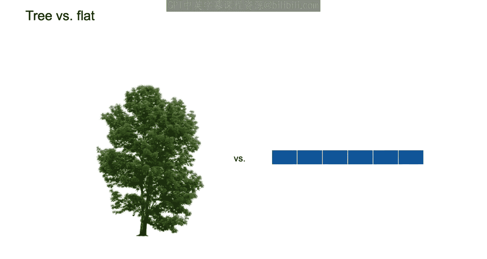

In another case where the documents happen to be homogeneous。

 but these are the two dimensions to look at it， and you need to understand that if it's flat and homogeneous。

 then you get the special case of a radiational table。

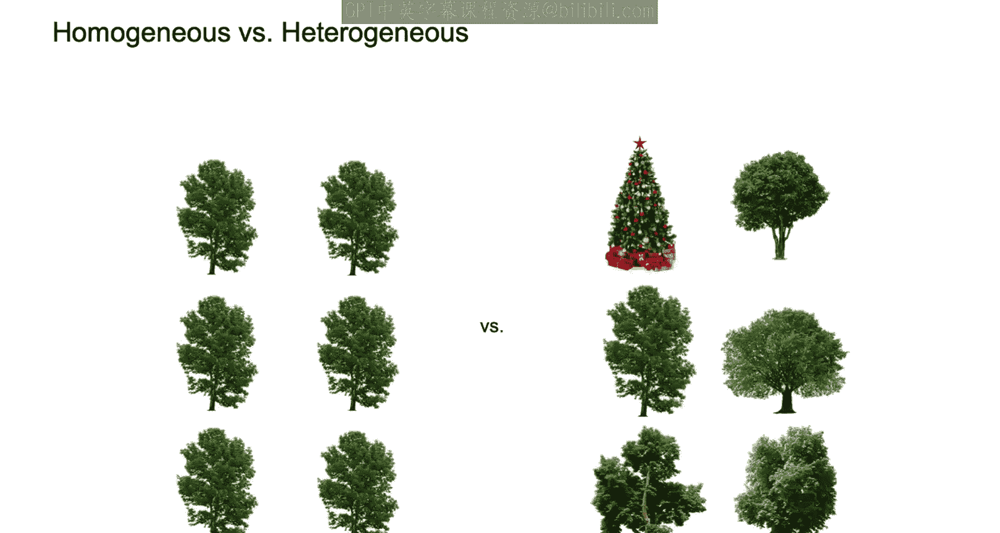

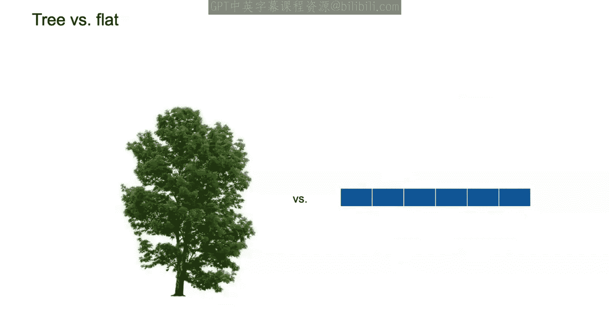

RightSo you really need to see that as a generalization of relational database management systems that support heterogeneity and nestedness。

😊。

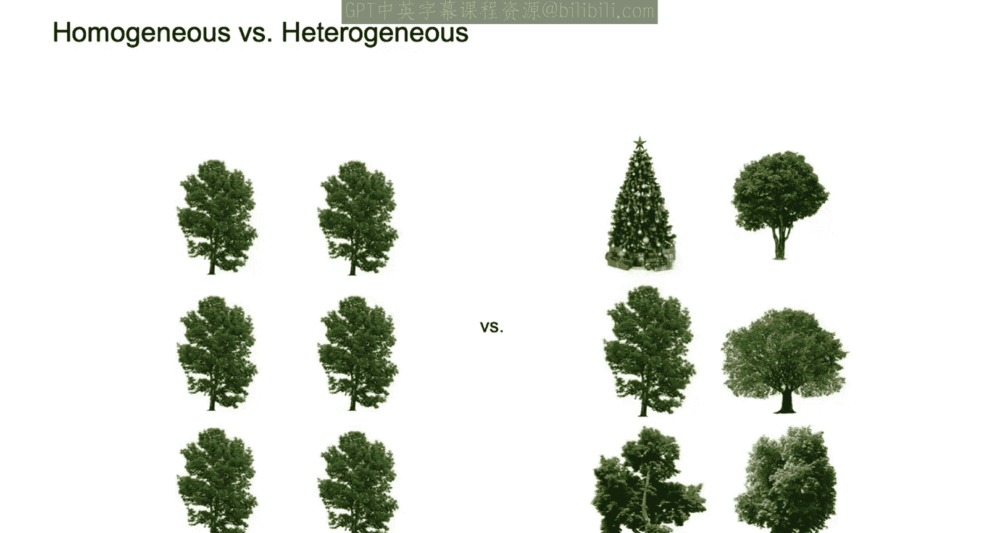

Now。To give you an impression because this， you should compare that with Postgql in spirit。

 just the more generic Po Gsql So you think if it should be like Postgsql。

 it should have a language to deal with it and that language should be able to support some algebra right in tables。

 we can do projection， selection， aggregation， joints and so on。😊，Where many document are are very。

 very good at and scale to the billions and trillions， they can project very well。

 they can select very well， they can aggregate very well。😊。

But joints is something that they are less good at， in fact。

Some of them do not even support joins if you want to do a join you have to do it yourself。

 you need to code in Python or C++ or whatever language you want， right？

And another aspect is that you don't need to validate the data。 you can do it。

 They allow you to do it， but you can do it later。 you can postpon that until after you cleaned up and then you can validate after the data was popularity。

 That is another difference with Postsql where you're forced to validate at once okay so I'm going to end here and let you。

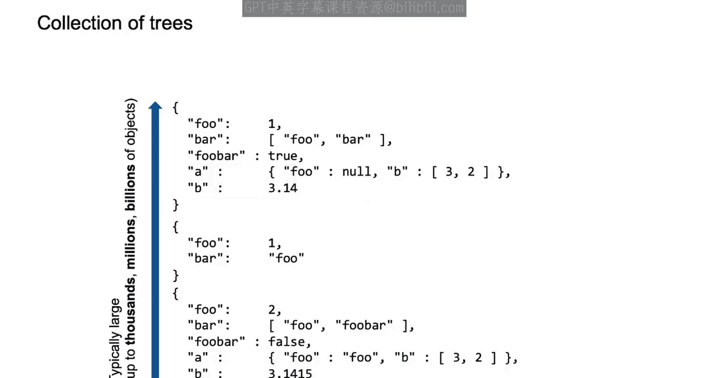

Let me know how you followed， but again， remember a huge collection of small trees。

 that is the summary， a huge collection of small trees。

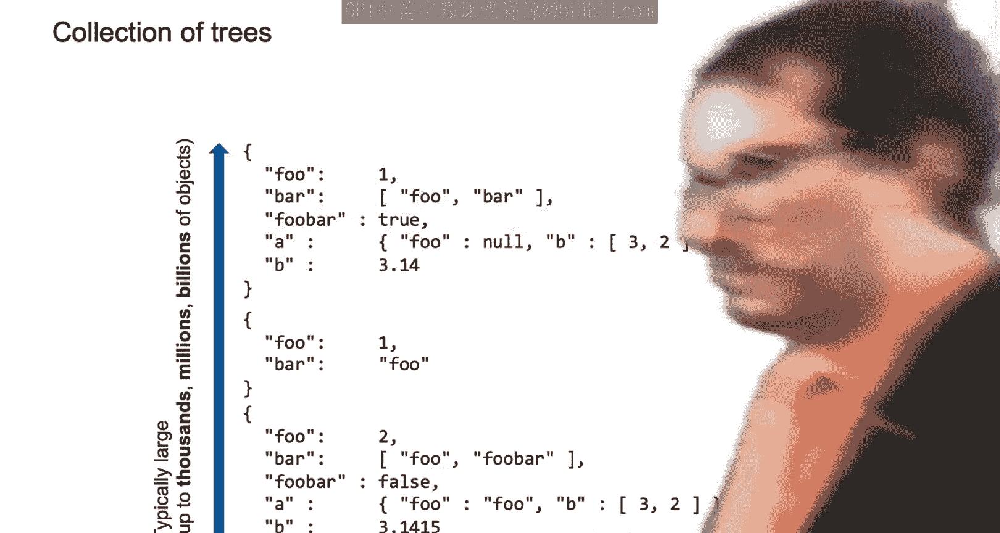

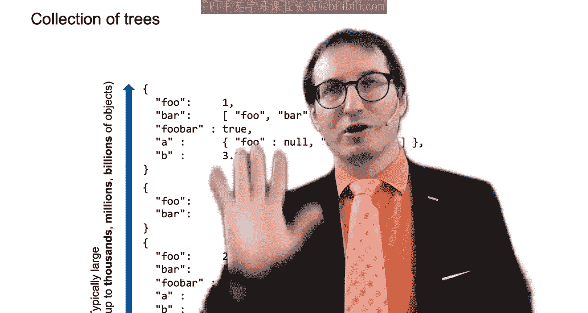

Is a document store。

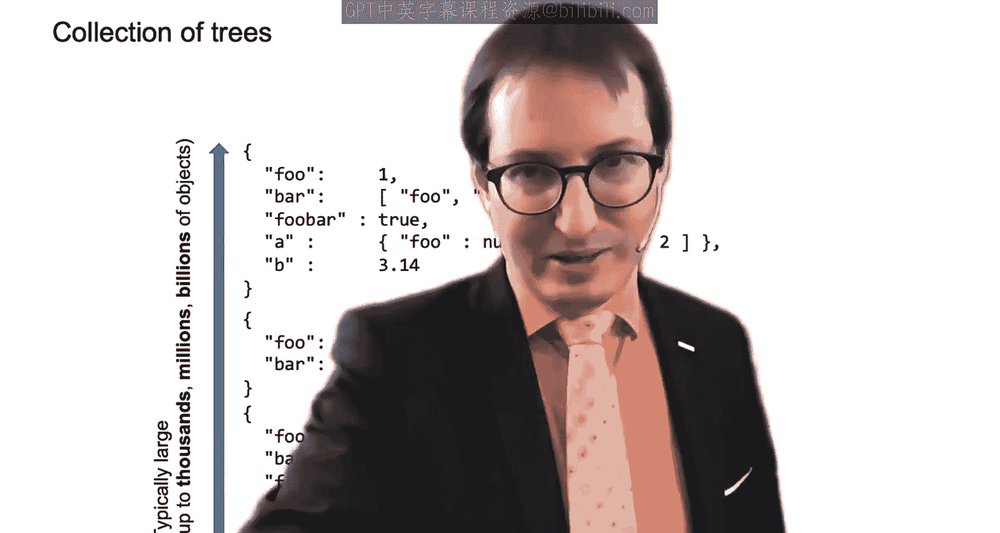

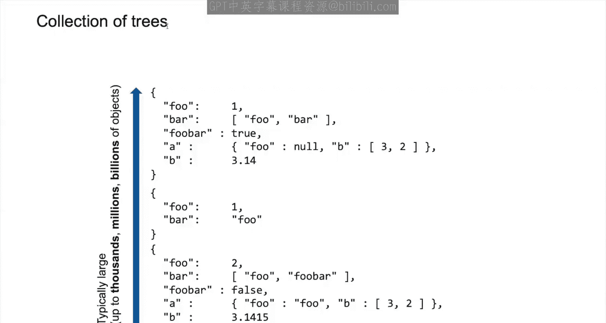

This is your opportunity to slow me down or make me accelerate。😡，By the way。

 you should read the textbook again a reminder， we are here， I'm here， the T is here。

 you can write in the Moodle forum， ask questions。I know that you have a disc server or something where you chat。

 but we are not there。 I mean， I'm not there。 so do not hesitate to also ask questions in the in the。

 in the mood or in the， in the element server。 That looks great。 So my。😊。

Rule is that if you understand everything， then I accelerate。

 And if a majority less than 80% I slow down。 So now the pace is about right。

 So next week I'll finish on document stars， and then I'll move on to query languages for trees。

 and show you they look just like sQL。 but they don't have the headache that you so earlier。

 Thank you very much。 everybody。 Enjoy the exercises。 You had one week of rest with the first of May。

 So now it starts again。 and I'll see you next week at 8 AM for the continuation of the course。

 Thank you very much goodbye。😊。

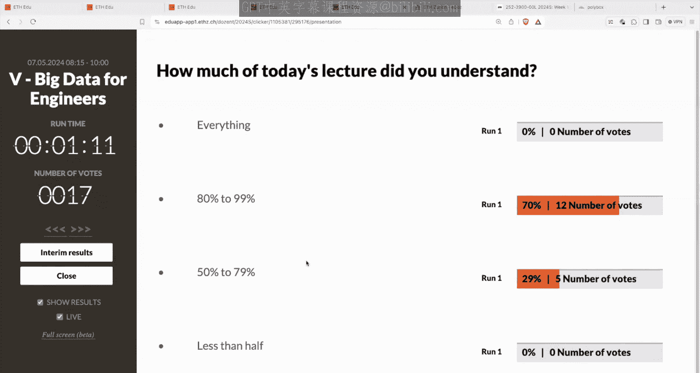