# 工程师的大数据：10：文档存储 (1/3) 🗃️

在本节课中，我们将要学习文档存储的基本概念。我们将探讨为何传统的关系型数据库在处理嵌套和异构数据时会遇到困难，并了解文档存储如何作为解决这一问题的方案。

## 概述

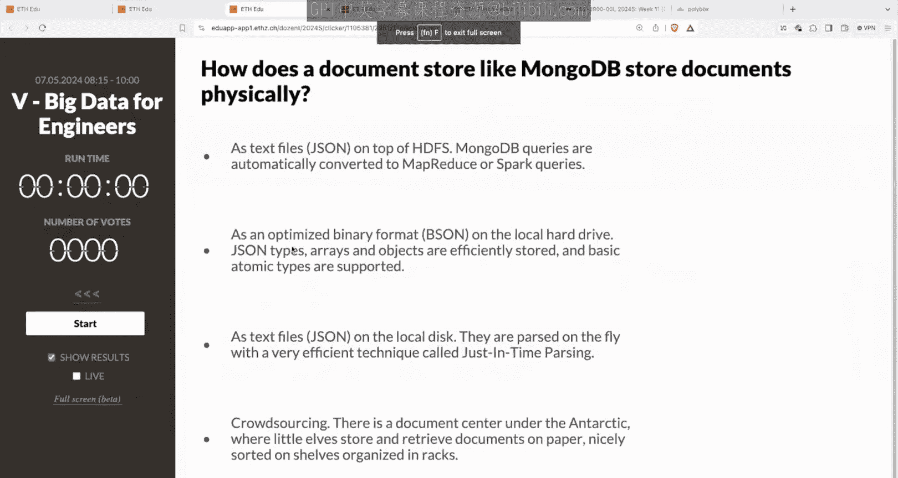

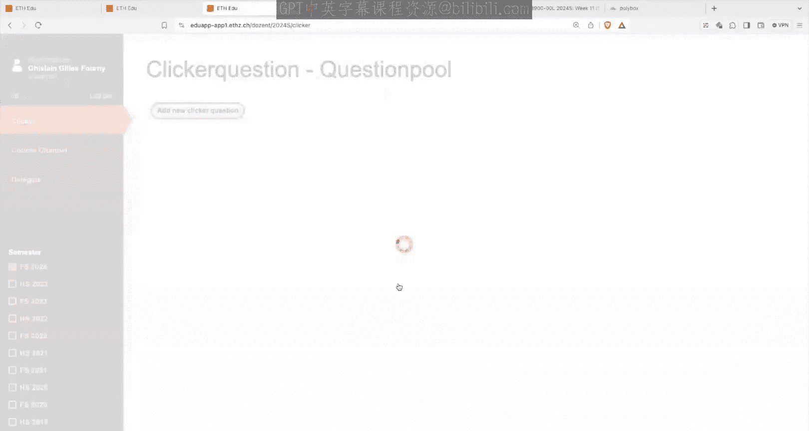

上一节我们介绍了SQL和数据框在处理某些数据时的局限性。本节中，我们来看看文档存储如何解决这些问题。

文档存储将数据存储为文档的集合，例如JSON对象或XML文档的集合。这与关系型数据库将数据存储为行的集合（即表）不同。

文档存储与数据湖的区别在于，文档存储提供了更集成的管理方式，类似于PostgreSQL，而不仅仅是像数据湖那样存储原始文件。

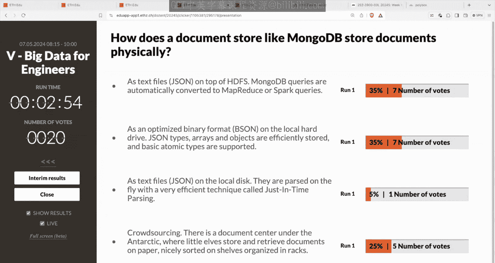

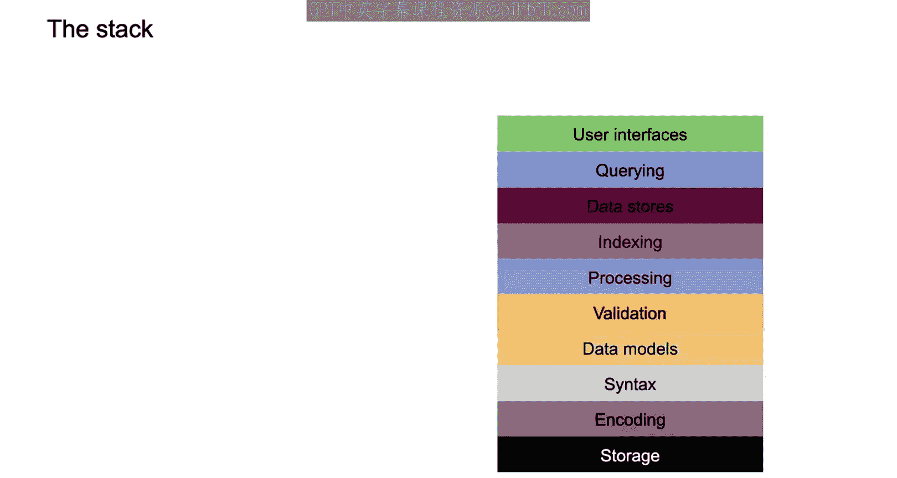

## 文档存储的物理实现

以下是关于文档存储（如MongoDB）如何在物理层存储文档的几种可能方式：

1.  **作为HDFS上的文本文件**：以JSON Lines等格式存储在HDFS上，查询时自动转换为MapReduce或Spark作业。
2.  **作为本地硬盘上的优化二进制格式**：使用名为BSON的格式高效存储JSON类型、数组和对象。
3.  **作为本地磁盘上的文本文件**：使用即时解析等高效技术进行解析。
4.  **作为一种分布式存储的比喻**：可以想象为一个组织有序的文档中心。

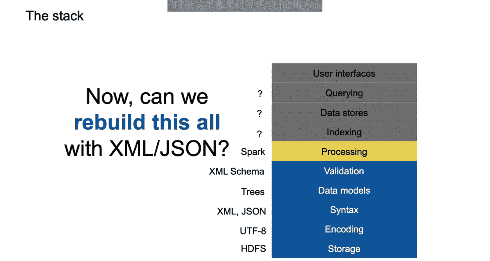

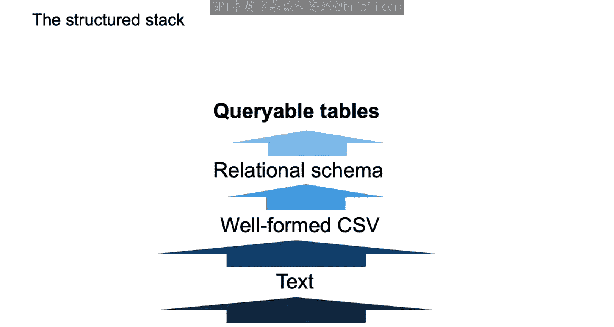

## 技术栈回顾

目前，我们已经在集群上重建了处理表格数据的技术栈。我们可以使用CSV语法、数据框和模式进行数据建模和验证，并能使用Spark处理和SQL查询海量表格数据。

但是，问题在于如何处理XML和JSON数据？上一讲末尾我们展示了，当数据不再是扁平的，而是包含嵌套结构，甚至是异构的、不“干净”的JSON时，处理起来会非常棘手。

因此，我们仍需解决关于原生支持查询语言和索引的文档存储系统的问题，这部分内容将是本学期剩余时间的重点。

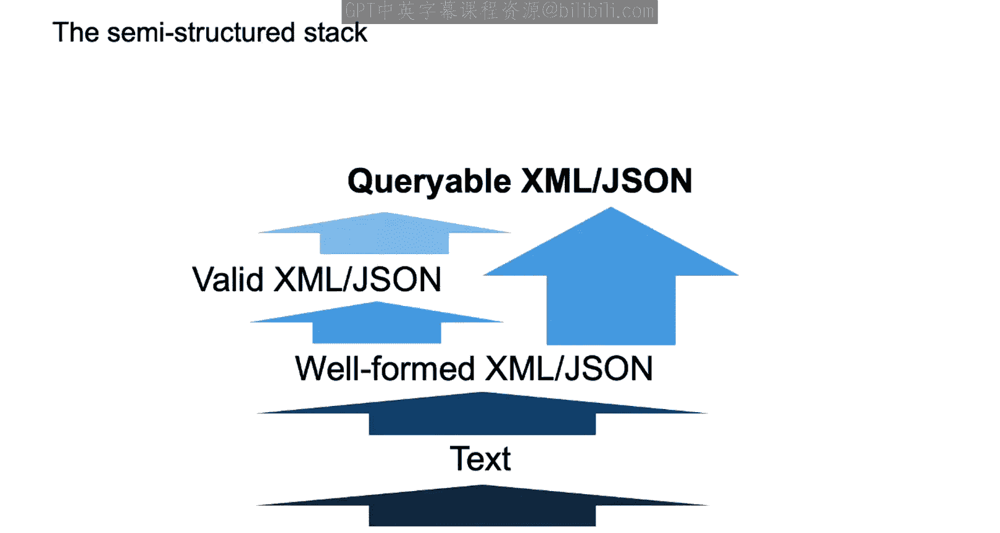

## 数据模型的演进

关系型数据库的世界要求先有模式（Schema），然后才能存入数据。这是一个结构严谨的世界。

而在Excel和JSON的世界里，我们更加灵活。我们不强制要求预先定义模式，因为数据可能因多年积累而不“干净”。验证通常是可选的，目标通常是先清理数据，使其符合某个模式，然后再进行验证。

## 尝试将树形数据塞入表格

当遇到新型数据时，一个自然的思路是：能否复用现有系统（如表格/数据框）来处理它？具体来说，就是尝试将JSON/XML这类树形结构“塞入”关系型表格中。

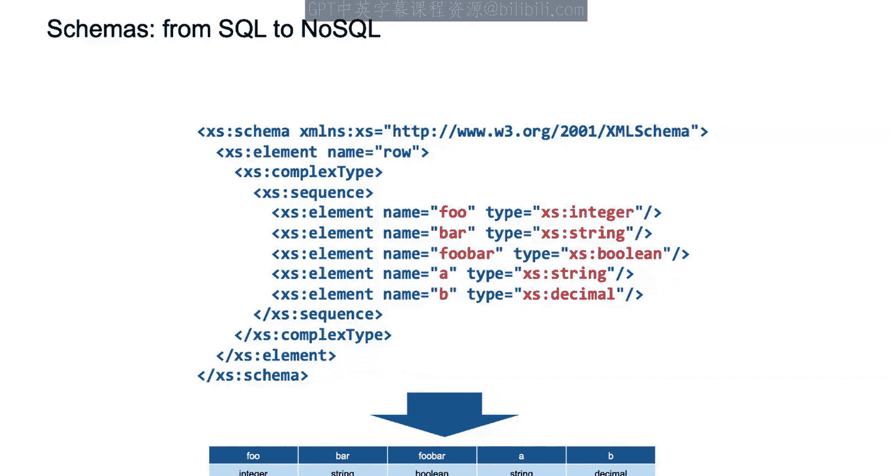

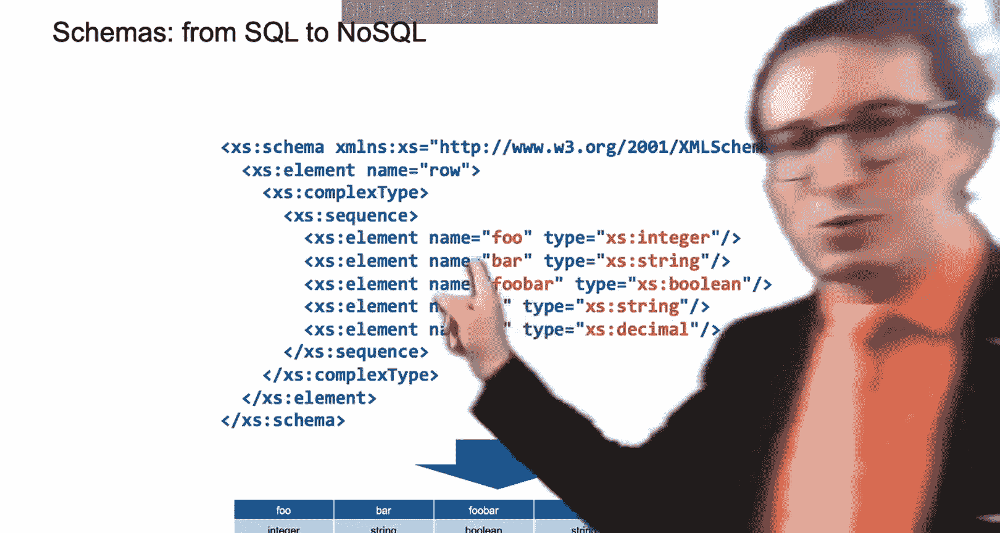

**简单情况：扁平且同构的数据**
当一个树形文档是扁平的（即没有嵌套），并且多个文档结构相似（同构）时，可以轻松地将其映射为表格中的记录。XML模式或JSON模式中的元素名和类型可以直接对应到关系数据库的列名和数据类型。

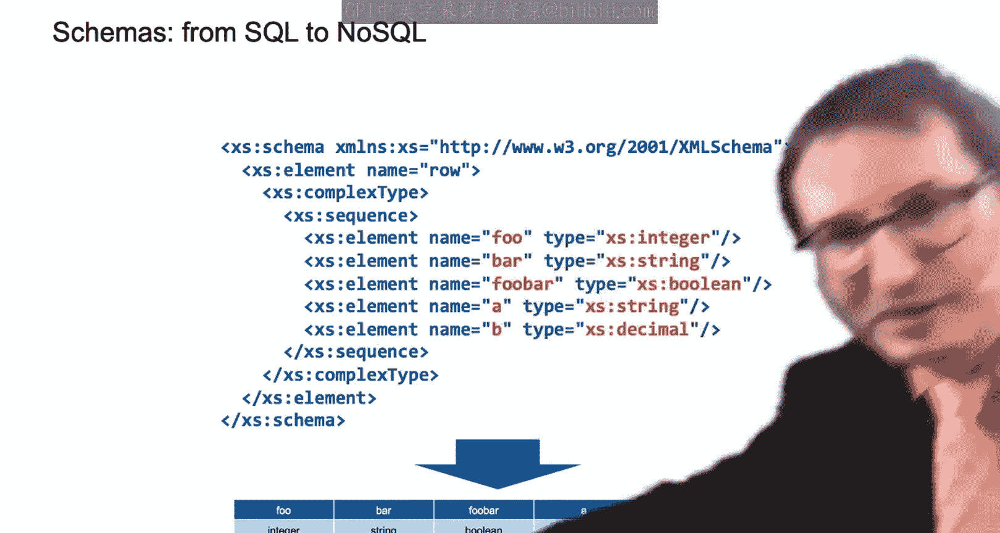

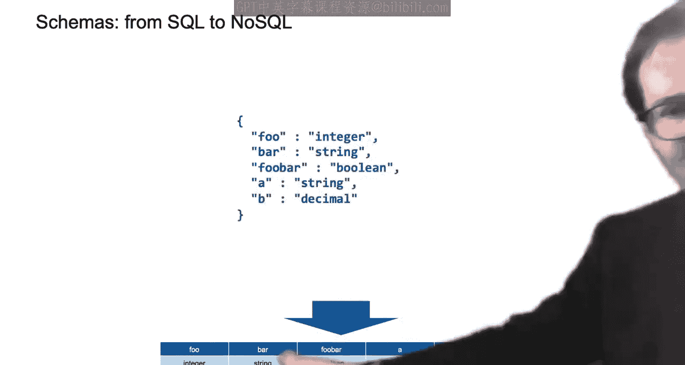

**复杂情况：嵌套与异构**
然而，当数据不“干净”时，问题就出现了：
1.  **嵌套性**：文档中包含数组或对象的数组。
2.  **异构性**：文档之间没有统一的模式，结构各不相同。

对于嵌套数据，一种方法是进行规范化，创建多个扁平表来存储嵌套对象。对于异构数据，可以为缺失字段填充`NULL`，为额外字段创建新列。

但是，当数据结构非常复杂时（例如，某个字段有时是字符串，有时是字符串数组），这种“生搬硬套”的方法会变得异常繁琐和低效。这就像试图把方钉打入圆孔。

## 阻抗不匹配与文档存储的动机

这种将一种形状的数据强行适配到为另一种形状设计的系统中的问题，被称为“阻抗不匹配”。

因此，我们需要一种能够原生支持树形集合的系统，避免这种不匹配。这就是文档存储的动机。

## 什么是文档存储？📄

在文档存储中，我们拥有**文档的集合**。每个文档（如JSON或XML）都是一棵小树。我们可以将其规模扩展到数百万甚至数万亿个文档，总数据量可达TB乃至PB级。

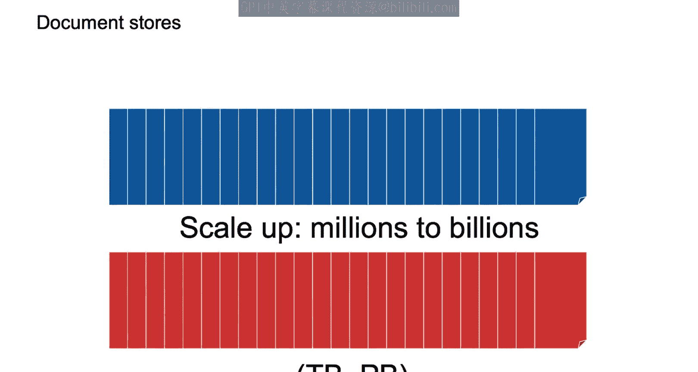

主要有两类文档存储：JSON文档存储和XML文档存储，它们的功能非常相似。

核心思想是：处理大量的小型树形文档。单个文档的大小通常在10MB左右，但文档的数量可以极其庞大。

文档存储可以看作是关系数据库管理系统的泛化。当文档恰好是**扁平且同构**时，它就退化成了关系表。因此，文档存储扩展了对**异构性**和**嵌套性**的支持。

## 文档存储的能力与特点

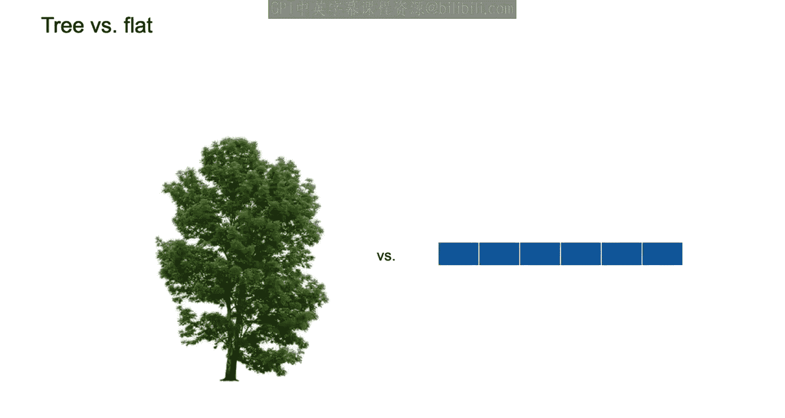

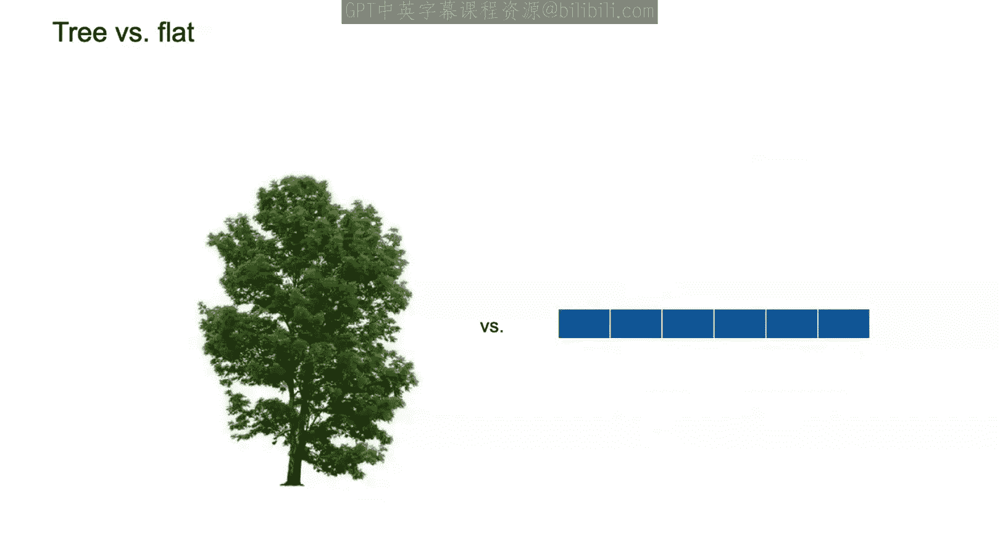

与PostgreSQL这类关系数据库相比，文档存储的查询语言通常也能很好地支持投影、选择和聚合操作，并且能扩展到海量数据。

然而，**连接（Join）操作**是许多文档存储的弱项，有些甚至完全不支持，需要用户自行在应用层编码实现。

另一个关键特点是，文档存储**不强制立即进行数据验证**。你可以先存入原始数据，在清理之后再执行验证，这提供了更大的灵活性。

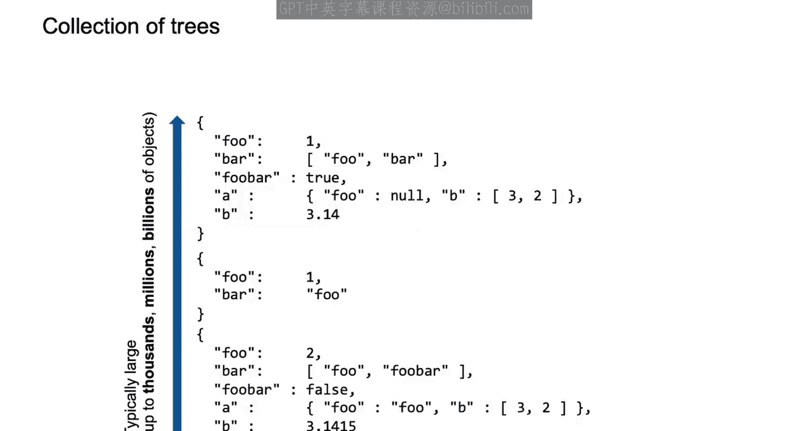

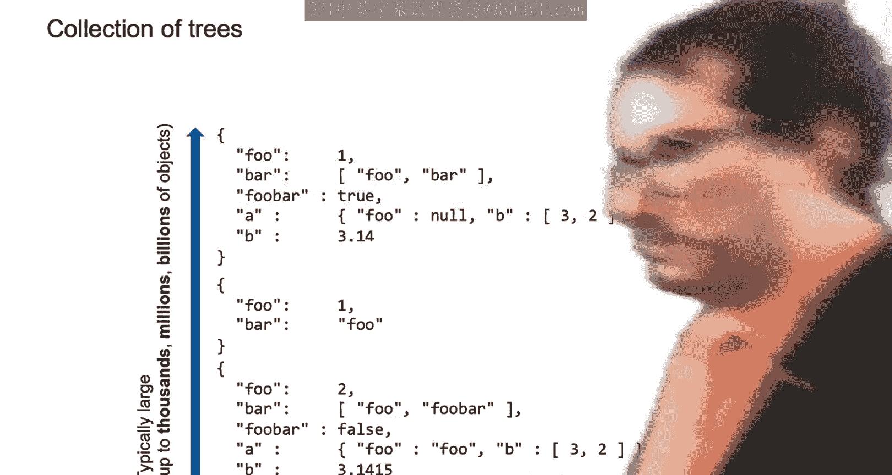

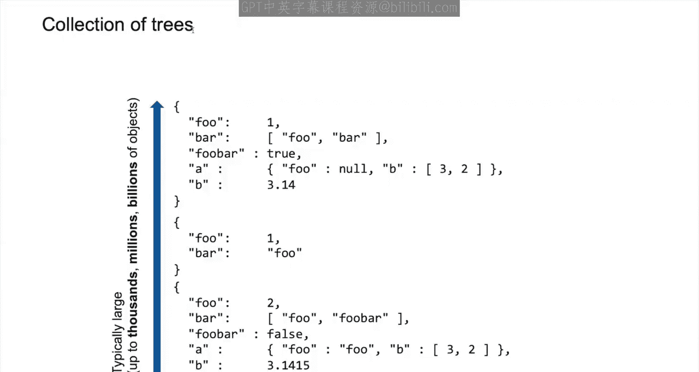

## 总结

本节课中我们一起学习了文档存储的核心概念。我们了解到，文档存储是一种用于管理**海量小型树形文档集合**的系统。它解决了将嵌套、异构的树形数据强行存入关系型表格时产生的“阻抗不匹配”问题。文档存储是关系数据库的泛化，在数据模式灵活多变或结构复杂的场景下尤为适用。

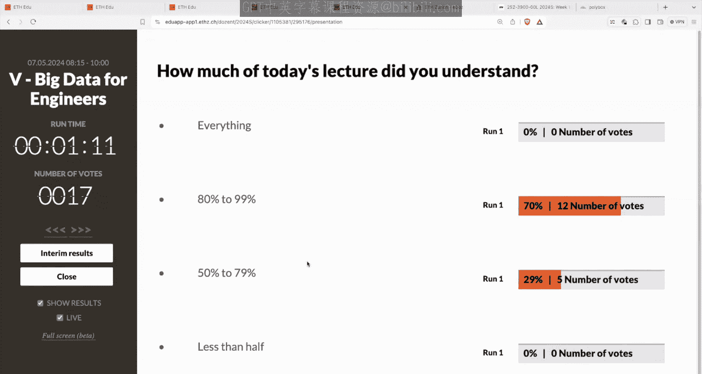

---
*下一讲，我们将继续深入文档存储，并开始学习用于查询树形数据的特定语言。*