# 苏黎世联邦理工《工程师的大数据｜Big Data for Engineers - ETH Zurich - 2024》中英字幕 p28 10. Document stores (2_3) - .zh_en -BV17FAmeFE9K_p28-

Good no， everybody the extra hall， good no， everybody on Zoom， good no， everybody from the future。

 been watching us for the exam。So where are we？嗯。So you remember the whole thing what we did during the semester。

 We first looked at how to store data。 We then looked at higher levels with validation processing and so on。

 We also saw that there are plenty of shapes of data。

 T is the most popular ever thousandshou of years old。 And for this。

 the the technology like it's quite mature。 We even saw that we found tables again with each base。

 And then we found the tables again with spark， which is a special case of data frames， even though。

 of course， data frames can do more than tables。 They can also a little nested nest。

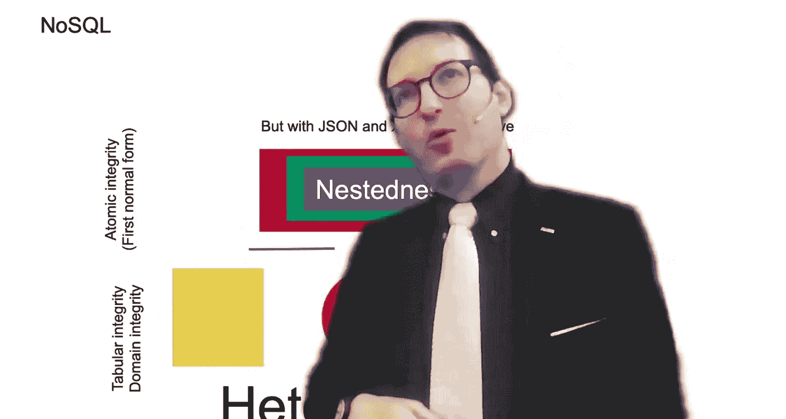

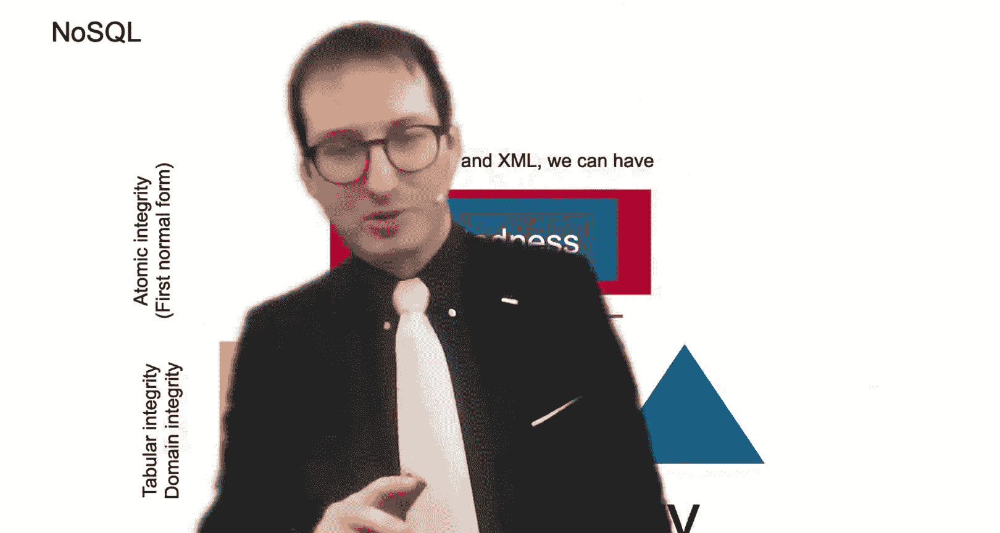

And now it's time to look at something different。 this time， a fully integrated product。

And as a reminder what characterizes trees as opposed to tables is two things。

 The first thing is the nested nest you can have multiple levels of the deeper data it's like a table in a table in a table but now you know that when we say a table in a table we are really talking about an array of objects inside an array of objects inside an array of objects right so an array of objects if the objects are all valid and against the same schema and if they are flat state it's basically a table So this is the nested nest one the second one is heterogeneity and heterogeneity if you drop the schema if you don't have any schema then the objects you would have in an array can all look different and the objects that you could have in a collection on the outer level could also be completely different right。

😊。

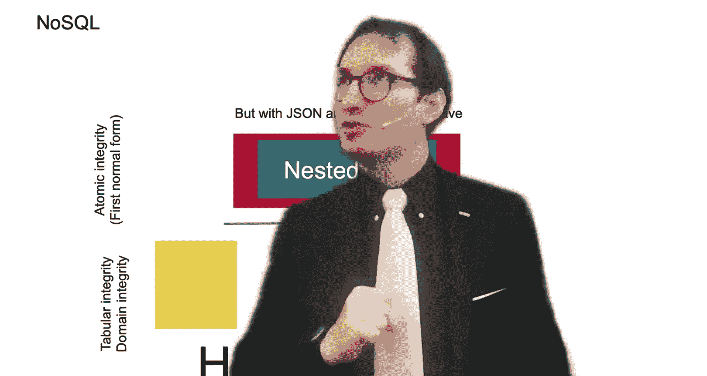

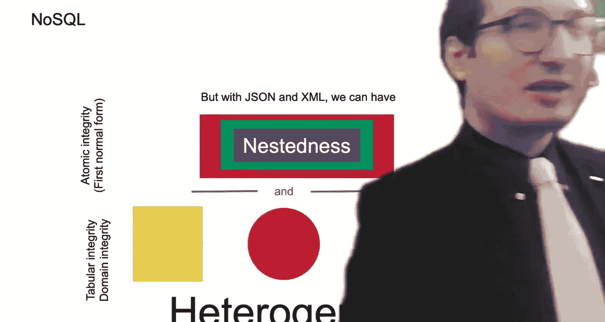

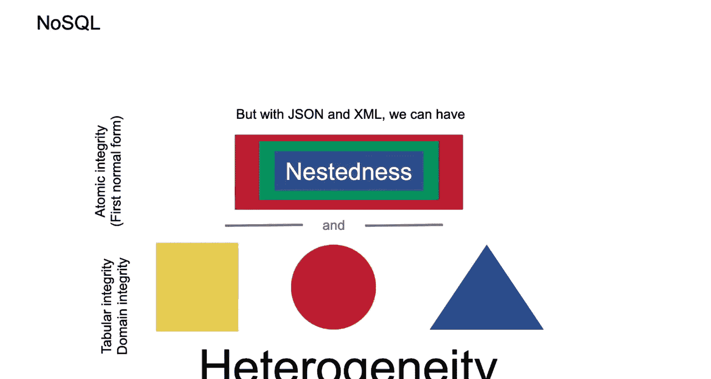

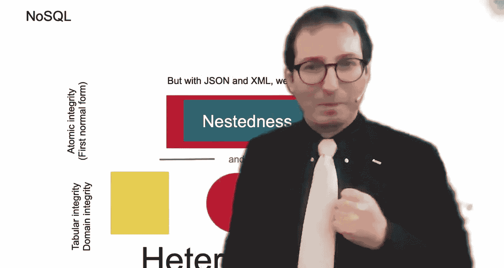

So that's the beautiful world of No sQL， not only sQL， these two things。😊。

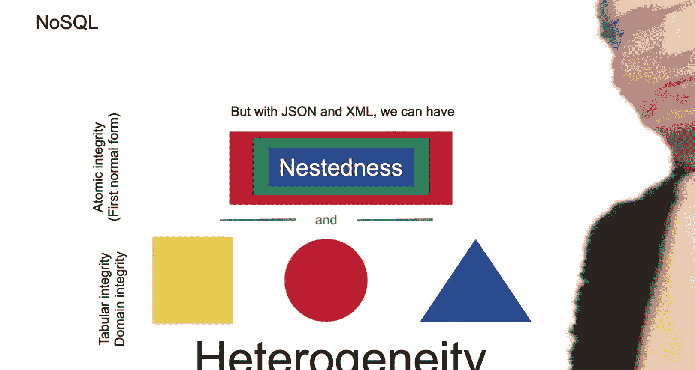

So we need an equivalent of Pogresql for these right So in this kind of data store。

 we actually call it a data store。 I will explain why we don't call it a database management system or like a data store。

 We have collections of trees right just like we have tables in Postgresql in MongoDb in document stores。

 we have collections of trees， and we saw last time that we are talking about millions， billions。

 trillions of trees， but the size of the trees limited right So we can go all the way to maybe 10 mete。

16 mete， but not more than that。 So many systems actually restrict like Mongodb doesn't even allow more than 16 me。

 Other systems will not forbid it， but things can start being slow and go wrong if you have two big objects right。

😊。

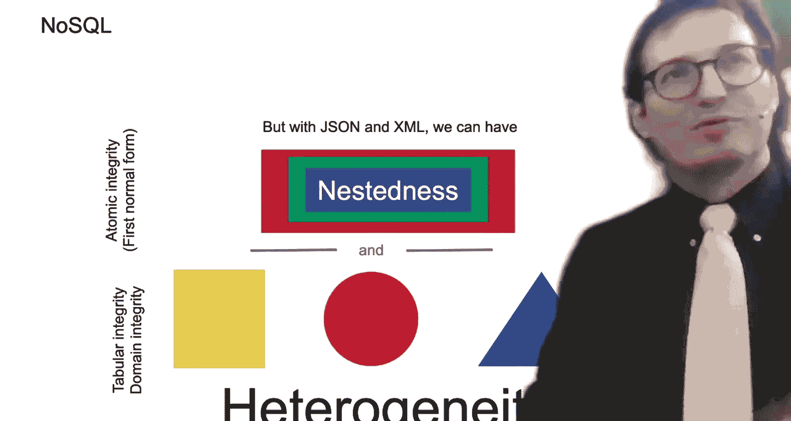

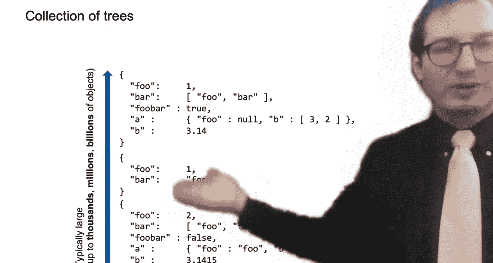

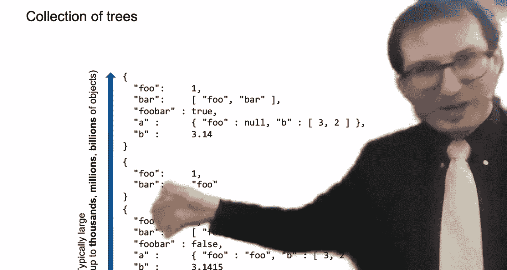

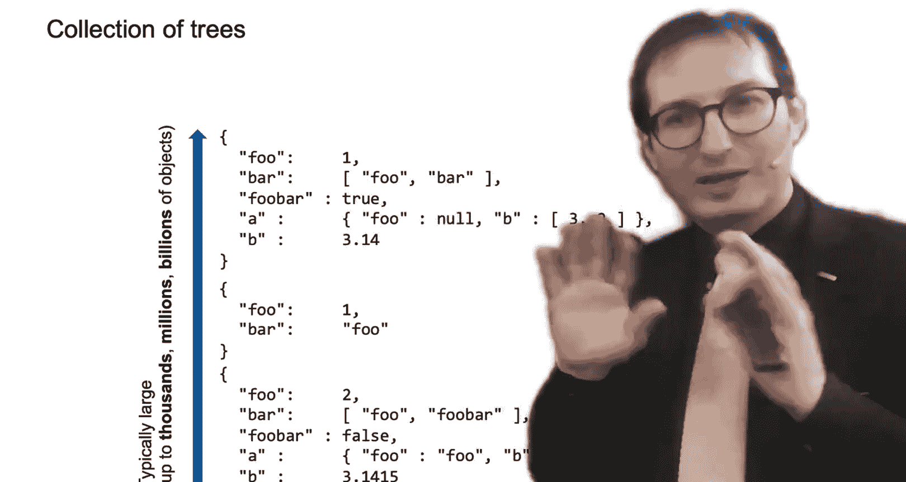

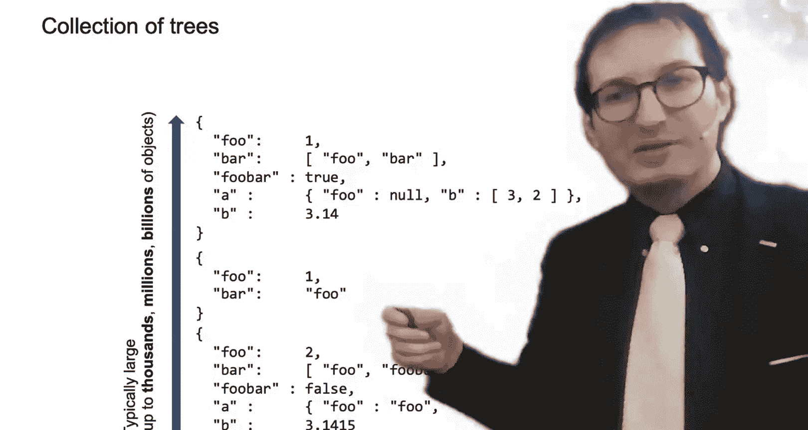

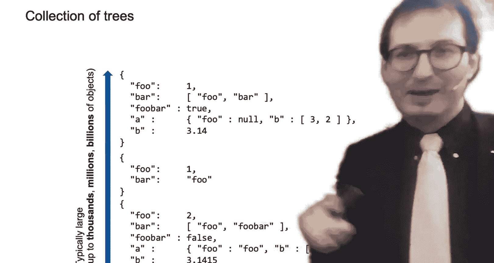

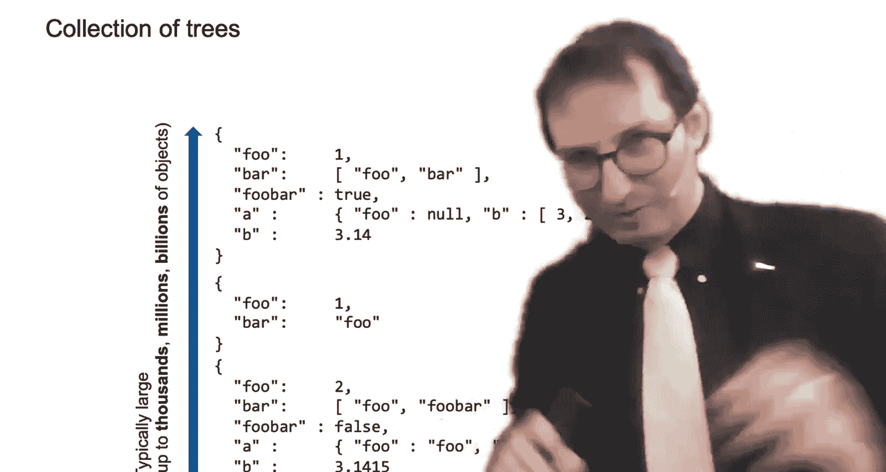

So a huge collection of， let's say medium objects， right。

 I'm not going to say small because small would be like a set in a relational table but or record。

 but here they can actually be medium for whom is that here。

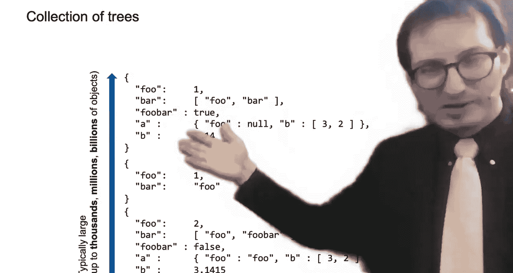

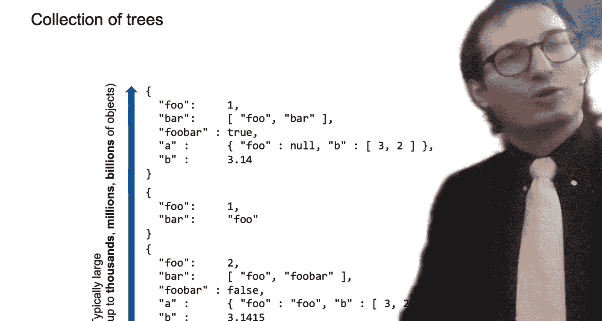

All right。So again， what it means this nested nest and heterogeneity。I that。

We can take a collection of trees and we can recover tables as a special case。😊。

When the trees are flat， meaning that we don't have a ras of objects。

 all the values in the top level object are just atomic values。

 So in that case it looks like the record of a relational table right。

 it's all flat just like what you have on the right as opposed to densityed nets in a tree and the second one is the homogeneity because if it's homogeneous and all the records。

 the flat trees they all have exactly the same types associated with every key and exactly the same keys in every record like on the left here then you recover a relational table。

 So who understands that the table is the homogeneous collection of flat trees。

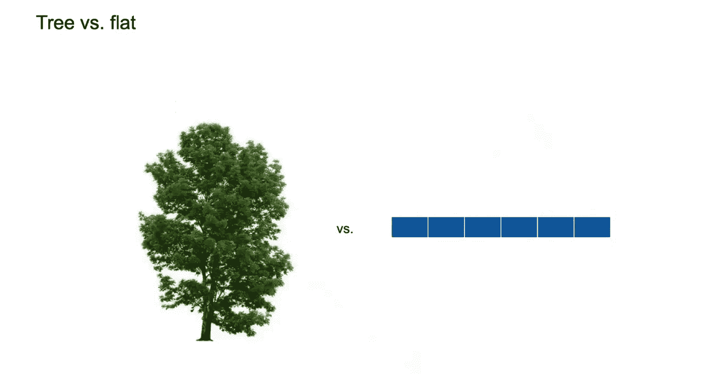

W see that if you don't yet， then think about it， right。

 A table is a homogeneous collection of flat trees。 So it's a special case。

 And if we look at collections of trees， then we look at something bigger， more generic。😊。

Than just tables and we saw that data frames are kind of in between because in data frames you allow nested nest but you don't allow for heterogeneity right so data frame are in the middle data frames are homogeneous collections of possibly nested trees。

😊。

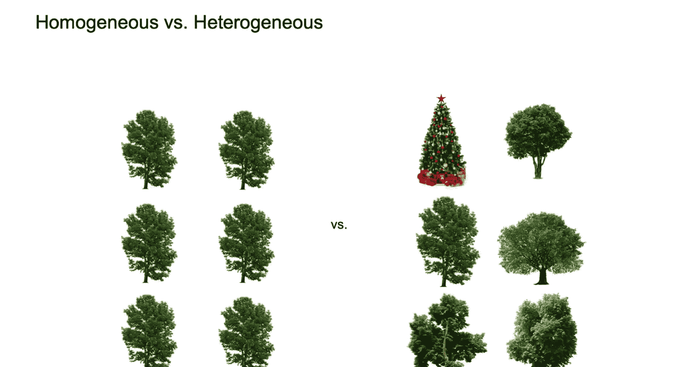

Okay， and by homogeneous， we meet with a schema。 we can validate again the schema against the schema。

 all right。

Now this is where we stopped last time that in a document store。

 typically we can kind of retrieve the components of the relational algebra right kind of the same things we like to do with relational tables。

 projection， selection， aggregation， sorting， we can also do it with collections of trees and we will see how shay。

😊，There are other things that we like to do with relational tables and these are joins。

 but with document stars it's a bit less popular， we don't join so much and the reason we don't join is really that as we saw trees are deommalized and we saw that if you deommize the data then you don't need to join anymore because deomminizing the data is kind of like precomputing a join right you already put in a nested way the second table into the first one。

😊，When you have the arrays of objects， that's kind of a precomputed join。

 So this is why joins are a bit less popular。 It doesn't mean that they don't exist。 Of course， you。

 you can still have them， but many products， including Mongo Db。

 do not even bother to give you an API to do the joints。 It doesn't mean you cannot do them。

 but if you want to do them， you have to program them yourself。

 So you have to use Python C plus plus whatever language you want。

 and you have to implement the joint algorithm。Okay。

 so this is why I marked it as a no3D projection selection aggregation。

Then because I mentioned heterogeneity。In PogsqL you need a schema， if you don't have a schema。

 you cannot even put data in your table。 That's the first thing you need to do in PogresQl is define the schema of the table。

 but not in MongoDb in MongoDb document stores， you can just pour the trees into your collection without a schema and it will just work even if the trees are heterogeneous。

But if you do want a schema， you can。 It has the flexibility。

 So you can either define a schema from the very beginning and then only allow the documents that fit the schema and throw an error if they don't。

 or you can do it the reverse way。 You can first qua the trees in your collection。

Then maybe clean it up and then validate against the schema and then f the validation forever。

 Or like if you add new trees， it will have to be valid against the schema。

 So we have more flexibility because we are not obligate it to validate at the beginning。

 we can do it later， But of course， the challenge and that many machine learning engineers know or data scientists is the cleanup of the data。

 how do we clean up the data because once it's normalized。

 that's it once it's clean and you can even put it in tables， then the job is done。

 But the challenge is really what about the data that heterogeneous and nest。

 how do we manipulate it with the goal of cleaning it up very often。

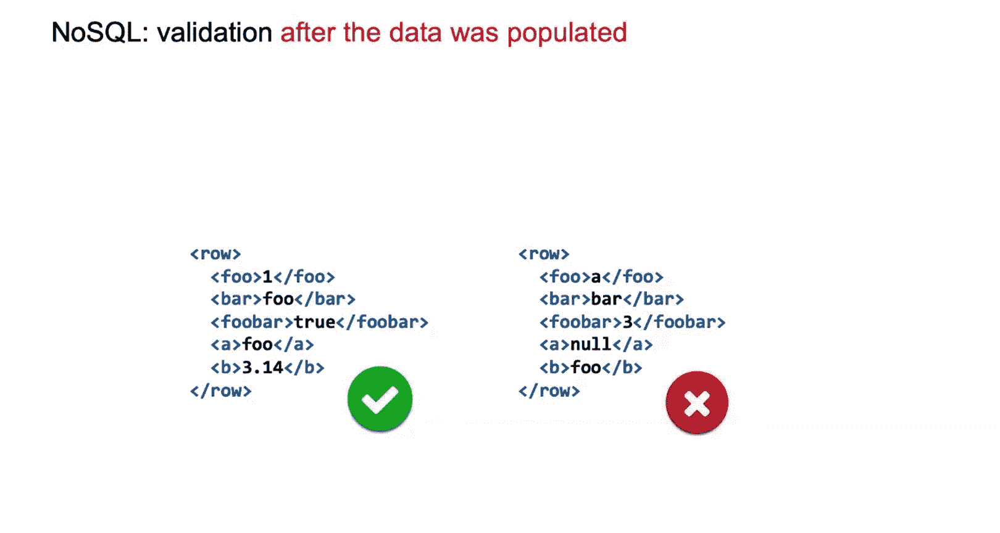

Okay， so when I say document story and I already said Mongodb once in a while already there's a whole ecosystem of them。

 many， many， many Mongodb is one of the most popular as well。😊。

Mlogic is one of the most enterprise ready ones， at least back then probably now a lot made progress。

😊，So are Jason， so are XmL， it's easy to see those who have an access in the name is probably Xm。

And those who don't is probably Jasonson， right， So you have a couch DB is Jason Mongo D B is Jason elastic6 is Jason。

 even though elastic is not for indexing the data。 cloud and is Jason Mac kind does of everything。

 even graphs。 I mean， it's really Microsoft Asiaure has cosmos D B。

 I think that also kind of does everything base X。 and that's XML because of the X X is D B is also XML because of the X。

 But really， it works the same way。 It's pretty much the same thing。

 even the languages the way that the languages work are are quite similar， even though。

The level of the languages might differ， but I'll go back to that Okay， but in that course。

 I'm going to focus on Mongodibi right and you will see if you want to learn any other。

 it will be easy right because again these are the principles that that we cover all right。😊。

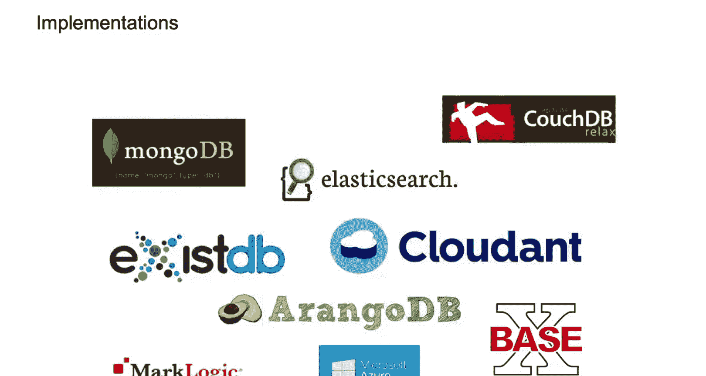

小么个的鼻题。So let's start on the logical level， how do we query the data in Mongodri？😊，So。

What I already told you。Is that Mongodvi stuffs collections of trees。

And I already told you probably a few weeks ago。That we distinguish between two approaches to the way we store data。

There is on the one hand the Google database management systems where we have to first import the data before we can do anything with it。

 that's the case with PostgresqN right if you use PostGresql you have to first populate the tables before you can query them。

😊，But in that case， the way the data is stored is hidden from you it's whatever the system wants to do with it。

 it has ways of optimizing the whole thing on disk you will never get to see the physical layout of the data on the disk except maybe advanced people who are interested in this but you don't ETL means extract transform load is just a synonym for import right and it's a verb you can actually say I ETL U ETL ET ETL and so on right。

Okay， and on the right， we have data eggs and data eggs have become kind of a buzz we。😊，In that case。

 you don't import the data。 You just cook it over on object storage or into a5 system。 In fact。

 this is what we did with S 3 with H GFS with Azure Blob storage， Google Cloud and so on and so on。

 right， all of these are data lakes。 even Agebase would kind of be considered some sort of data lakes。

 even though it's bydial rather than than that flat。Okay。

 and so for weeks what when we studied mappRuce， when we studied Spark and so on and so on。

 we kind of looked at data lakes and again， what characterizing the data lake is that you can see the data。

 you can see the files， you can see the J， you can see the XM， it's all there， the CSV。

 these are actual files you can look at。😊，But today， we are going to deviate from that。

 We are really going to look at a system where you import the data first and you don't get to see the physical layout of the data。

 You won't see any JSON files， you won't see any XML files。

 You will just see a logical model of JO or XML。😊，And again， put it in perspective with Post Gql。

 right， in Post Gql， it's for tables。 Mongodibi is for trees。😊，So far so good， everybody with me。😊。

Okay。Now， I have only just one slide。 I don't want to scare you， but just to have said it。

I told you that since its system from the left where you import the data first。

 MgoDb gets to start the data on disk in any way it was。Didden from you in a physical layer。 And。

 in fact， it so happens that Mongo Db uses a standard called Beon， which kind of means binary Jason。

 It's kind of an improved Jason that is more compact。So now you might think okay， yes。

 but why not parque， but you remember that Parque requires valid data if the data is not valid。

 doesn not have a schema， you cannot use Parque so this is kind of in between it doesn't require a schema but at the same time it's a bit more compressed。

 takes less space than the text JON file right if you would have an actual JO file。😊。

You don't even need to know how that works。 It's just a mapping from the from the syntax of Jason to the to some binary data。

 What you see here is just the base 16， which is just a shorthand for zeros and ones， right。Okay。

 so it's just called bees， right And there's a link for those interested。

 It's not part of the material， but for the curious， there is a website。

 I think it's called bepect do org or something like that where you can see again。

 I didn't want to scare you。 I just wanted to mention it。

 but you don't have to know bees just that it exists。All right， now if we want to query the data。😊。

As we will see。It doesn't have the same glossy finish as post rescue oil。Or no that secret。嗯。

It's slightly more on a low level。The way that we interact with Mongo Db， but don't worry。

 we'll add back your language like SQL shortly。 maybe even we'll start with it。 actually。

 it's Json Nick。 So you're ready so it。So MonDB has a low level API。

It means that it's not really a language because in fact。

 the language would be Javascript or Python or whatever language you want。

 but it's really an API within a language。 right， so it's it's a bit on on a low level。

 And I'm going to show you a little bit how it works。 But again， a word of warninging。 again。

 it's not the same finish as having a language like SQL。When you have a low level like that。

 the paradigm is called crude， create， read， update， delete， right， In fact， in each base。

 it kind of sounds like getput scan delete， right， It's a little bit this this short list of primitives。

 So let's go through them。😊，So here I have a few slides with examples。

I mentioned the language can be Python can be jascript， so there's many ways you can access it。

 but the most popular one is javascript。 So I'm going to be using it。 but dont for me。

 it doesn't mean that you need to learn ja because in fact。

 we focus on the API here and there's also an API in Python， there's a few differences。

 but since most people， when they learn Mogodb， they use the java API。 We focus on that one。

All right。So here's the thing I'm going to have in the middle of the screen。

 these DB scientists find blah blah blah。That's how I query the data using the MongoDB API in JavaScript would be similar in Pyon。

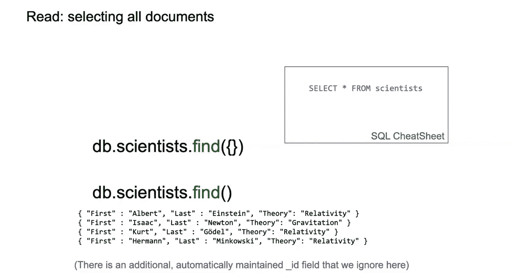

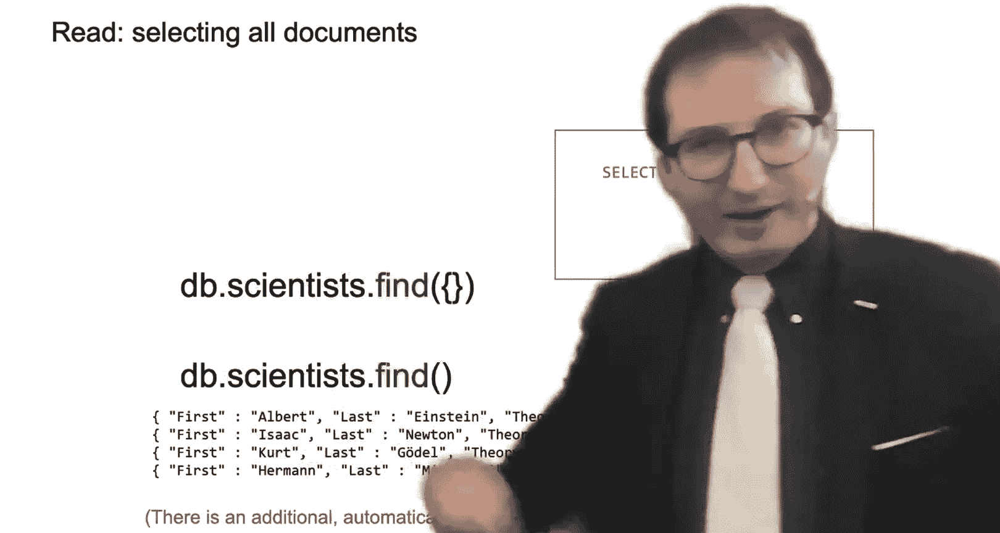

Here I put the results， what is I would put。😊，Here I have a cheat sheet where I put some SQL equivalentence right it's app right it's just to give you an idea of the corresponding SQL command。

 it will not always exist， of course because that's more powerful in terms of because we have trace but just so that you see the points so the select star from a table returns everything right so how do we do the equivalent well we just say DB it's always Db dos the name of the collection So scientists that would be put in here。

😊。

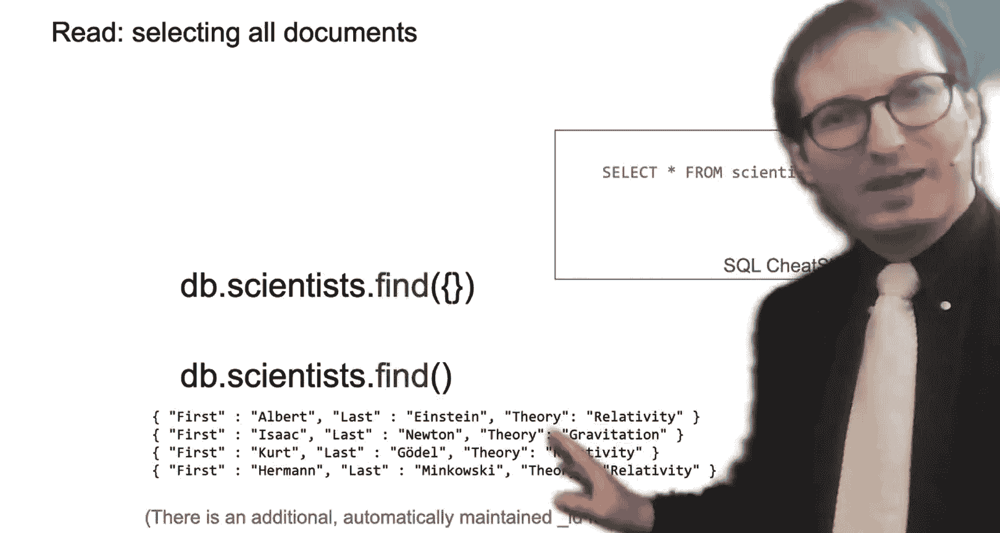

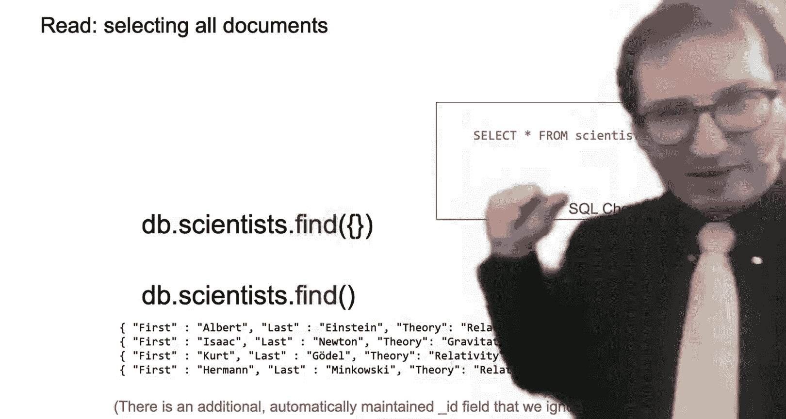

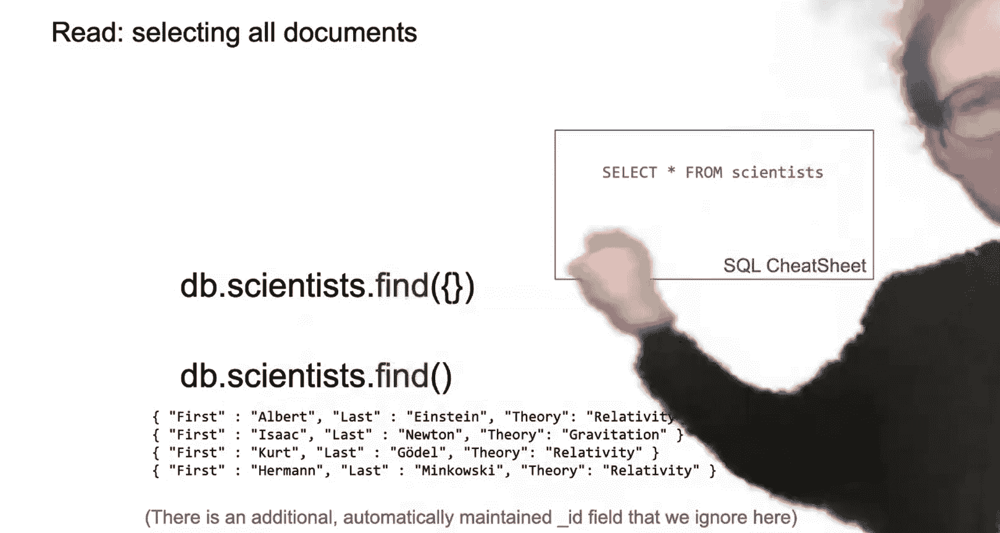

Then we have these fine methods that you apply in the name of the collection。

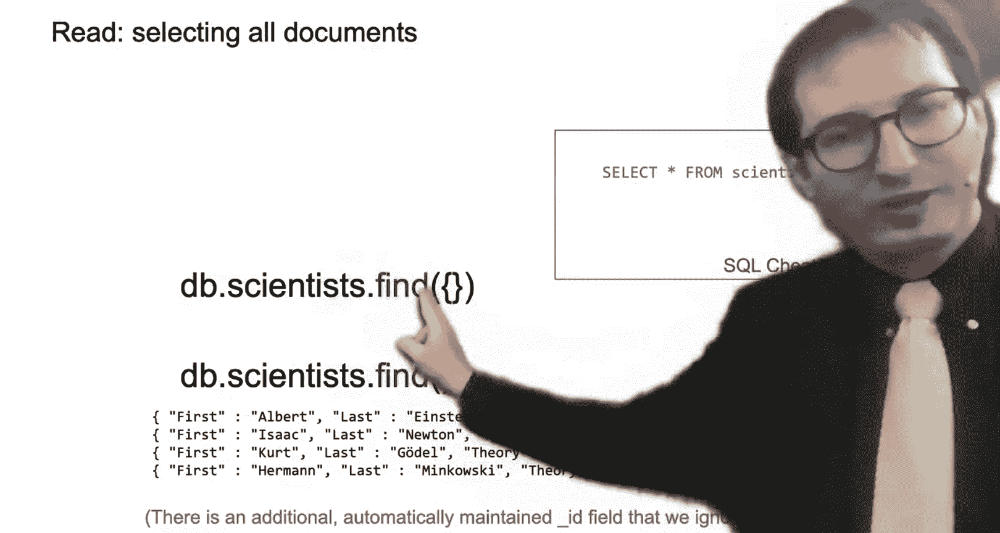

And then you can either pass nothing or an empty object doesn't really matter。

 And then you get everything。 So here， this is my whole collection。 Of course。

 I don't have room for millions or billion of objects on my slide。

 So I just put the objects right here。 Also to not scare you。

 I omitted a special primary key that's called underscoreco I that is just some sort of number in basic 16。

 All objects have that。 It's automatically added by Mongo Db to make them unique。

 but I'm not going to all on my slides with that， right。

 So just so that it looks like a relational table。 I just have put it like this， right。

 Who sees that this actually looks like a relational table in that case。😊。

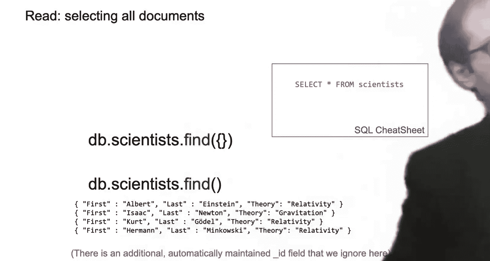

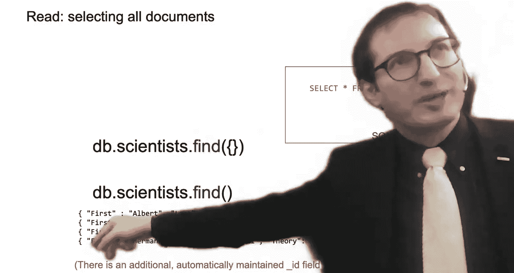

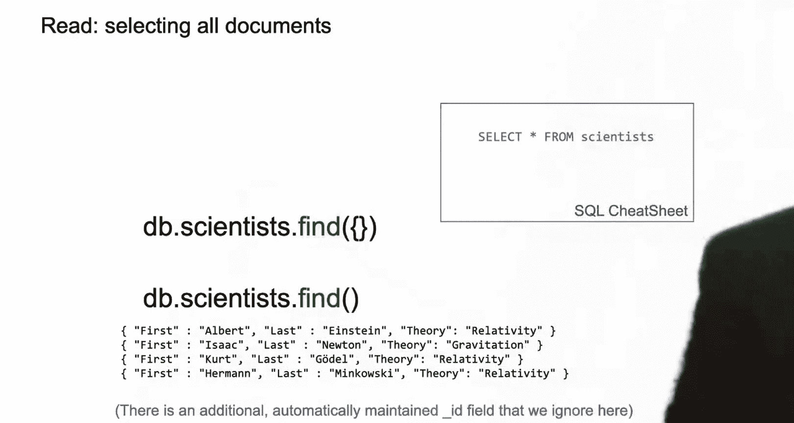

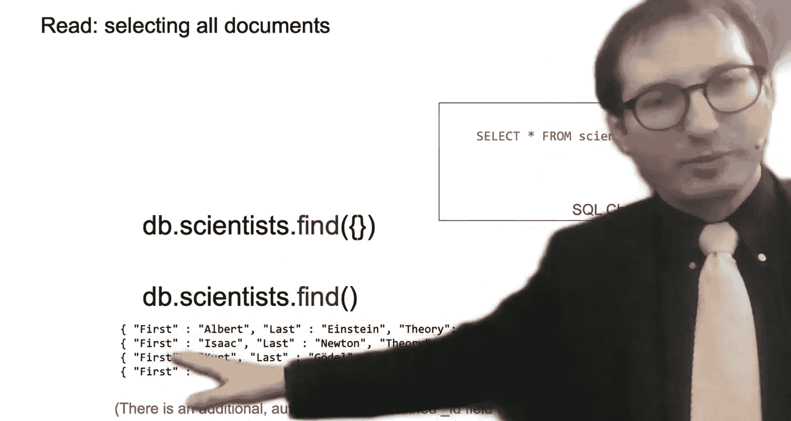

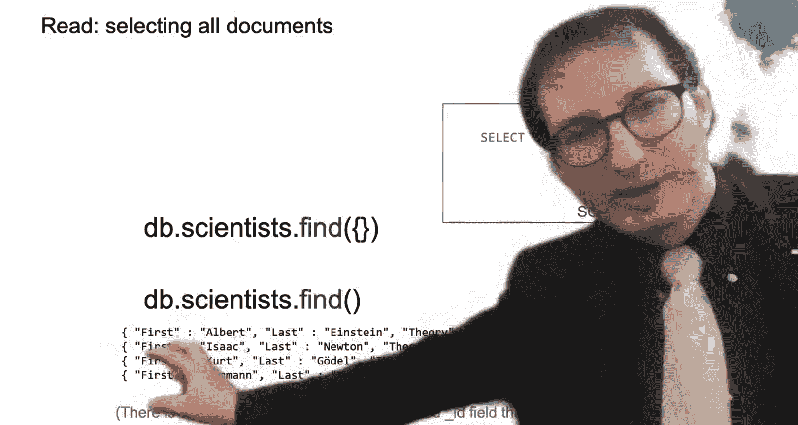

It has a column first， the Q less than a Q theory， and these are all strings。😊。

And I mentioned the ID field right here， but again I don't want to to evaluate my slides al right so this is the select stuff from now what if we want to select something not just star but with a criterion well in SQL we do it with a where clause so here we have where theory equals relativity。

😊，But again， MongoDb doesn't support equalL in MongoDb。

 we would have to put what we want to filter with the selection predicate。

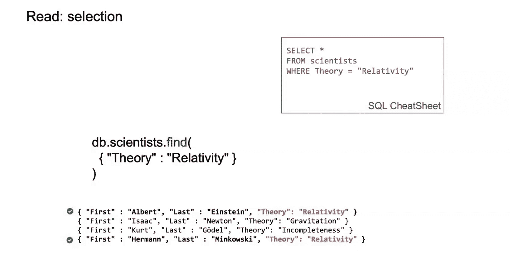

Itside the objects that we feed into defined method。 And now you see it looks like Jason。

 But of course， it's ja， right， So you can actually put Jason in ja。 And here what you're saying。

 it's like this this API says I want to have the object such that theory is equal to reactivity。

 We have a question， I think on Zoom。😊。

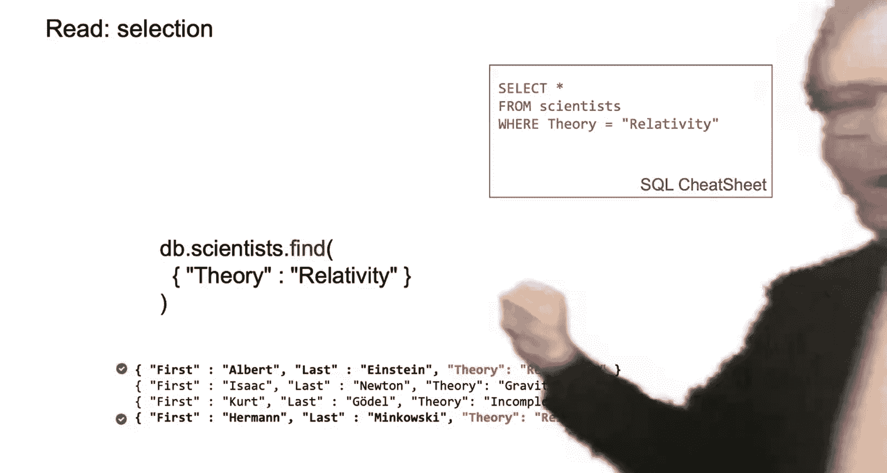

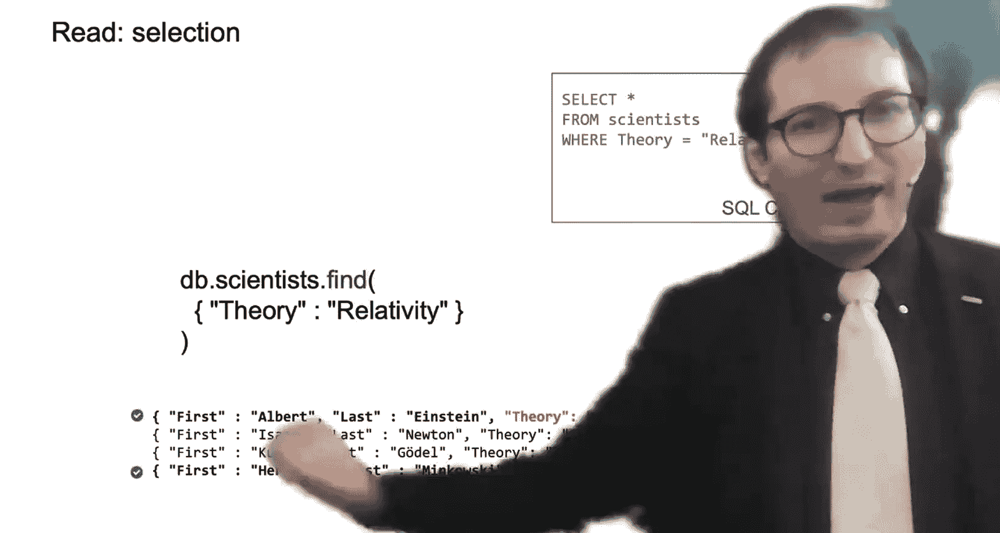

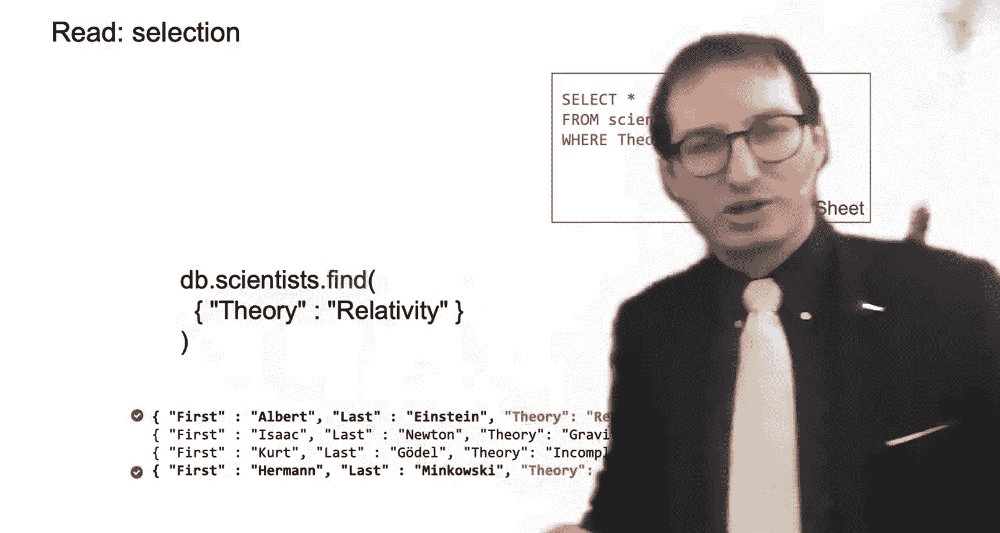

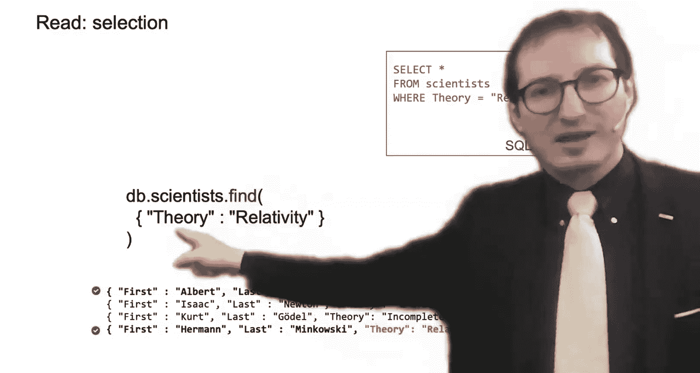

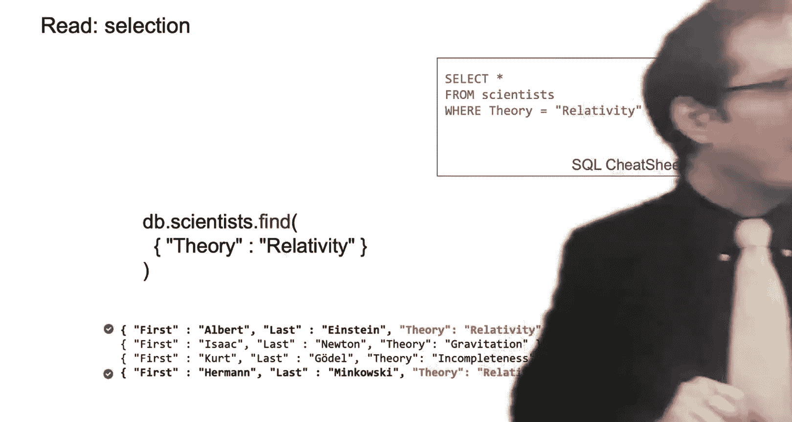

So how does it handle if the Jackson already have an A field。

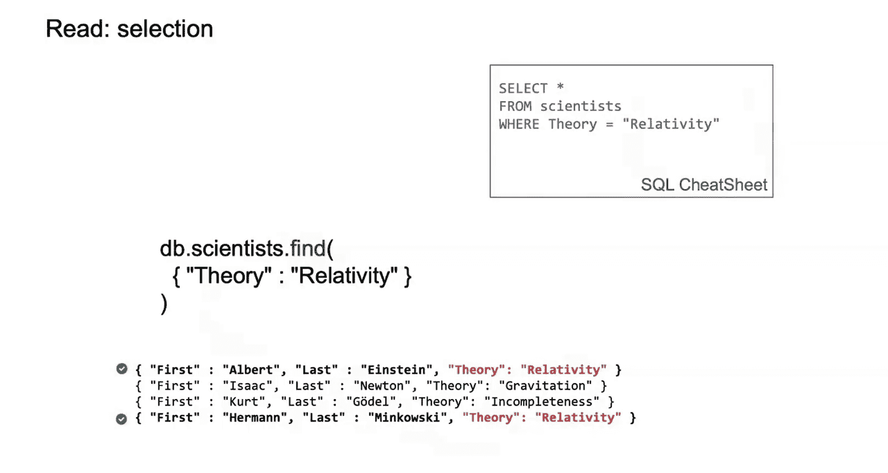

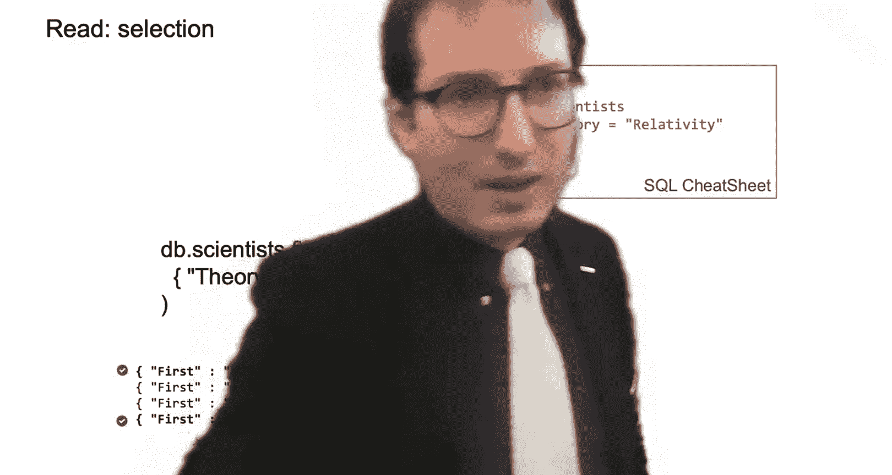

In that case。It just takes it if if you put some JO in there that already have an underscoreco ID field it's going to take it over right I can't remember if it would complain if the value of that underscore score ID is not this base 16 string called an object ID that I cannot tell you we can check offline but if you do put an underscore score ID field and the value is correct and for sure is' going to take it over and if you don't it's just going to make up one for you randomly。

Right。😊，Now it has to be unique that I forgot to mention right， It has to be unique。

 So if you try to insert a new one， then there's two strategies。 I don't know exactly from Mongodb。

 either you can throw an error by saying no it already exists or you can just replace it right and then maybe different products are going to do it differently but it has to be unique。

 This is a primary key is onos already。All right。So that's how we do a selection and we feed that criterion as a adjacent J object inside the find function。

😊，Okay， and you see we return the first and the fourth object in that case。

 but not the second one and the third one， because the value of the doesn't fit relativity。

 who's with me。O。No。We can also project。Projection is due with a second parameter to the method。

Where we specify the fields that we want to project to associated with the value1。

So if we say first one， last one， then we just project to first and last and now theories disappearing right for whom is that clear？

Okay。And now is probably the moment where you start feeling uneasy And like what is that syntax。

 first one， last one， second object and so on， like compared with SQL， it's more complex， right。

 But again， I war you， that's not a language。 It's an API right。

 And I'll show you a language that manipulates no SQL a bit later。😊，So it's an API。Okay。

 now we can we can also have a zero in here， in fact， that's the reason we put a one in here。

 you can also have a zero。😊，0 means projecting away。 Now that's something we didn't have in SQL。

 Projecting away means I want everything except this attribute and that attributes。

 This is called projecting away。 So in that case， when you say theory 0， you're just。

Asking for everything except theory。Right。I'm not talking about the underscoreco ID that behaves a bit strangely。

 so I think you're not technically removing underscoresco ID。You can remove it explicitly。

 but even if you project on soft1 L， it might still include the underscoreos score ID in that case。

 but again， I didn't want to bother you with the the underscoreos score ID thing。

 so let's just forget about underscoreos score ID Al right， so projecting and projecting away。

Then how do we have the equivalent of an end what if you have multiple predicates Well if you are just looking at the values of different attributes and want to for all of them to be fulfilled then you just put them in inside your first object right so the first object is for the selection the second one is for the projection So if you put in your first object more keys than just one。

😊。

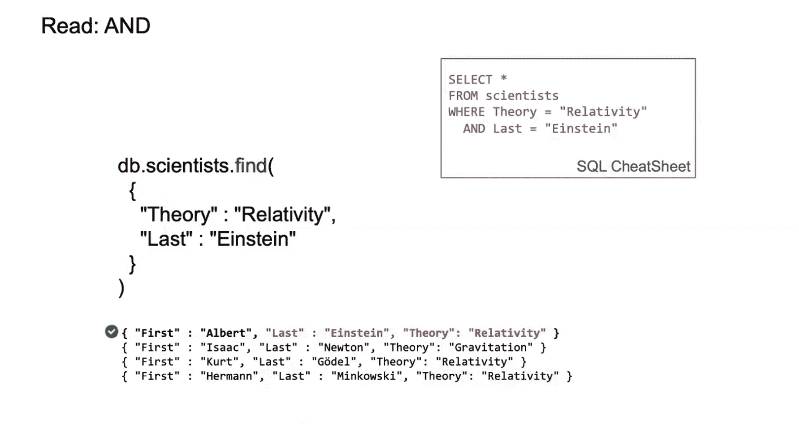

Then you have the equivalent of an end right here。 And now you would only select this one because it's the only one that fulfills both of my criteria。

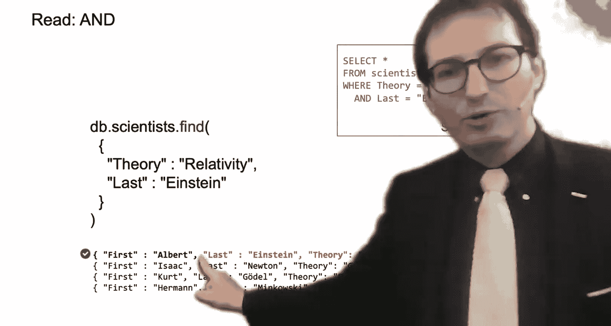

Right。So， this is an end。An or？Please be seated。 Don't be scared。This ist or。And here you see again。

 it's not an language it's an API， so the way you do it is with a special key。

 they start with a dollar， the special keys and you have dollar or and then you have an array with all the possibilities that you want to to allow so either last Newton or last Einstein okay。

😊，And now you probably start seeing that for simple queries， it kind of works。

 but you can imagine that for the more complex queries， it might be simple in SQL。

 but in the API that might actually start requiring work right so just so that you see the limits the limits of that right it's easy to use on simple use cases。

 but then if it becomes more complex that might be a bit more complicated Okay so this is the end。

 this is the or。😊，And now you might ask， okay， what happens if we actually have a key that's called Do or。

Well this is when things start breaking right so it would then start causing issues if you actually have dollar in the keys of the objects right so some products might provide a way to escape then in some way to say I don't really mean dollar or as the or of a selection I really mean dollar or as the actual key some systems would allow you to to do this。

Okay。What do we have other than that。Well， we also have comparison operators right so in SQL it's easy you just write larger than and so on。

 but since we are using this JavaScriptscript API， we can not just put the same sign in this way So what we do is again use these dollar thing So we say that publications and we put in object in there that means greater than or equal GTE。

200， you also have LTE and， and， and and E Q and so on and so on。 right。

 So you have plenty of of combinations。All right， and now we get the publications that are more than 100。

 so we have Einstein and Good。Ws with me。ok。Very good。Who finds secret easier？Okay， so do we。

But again， I'll come back to an equivalent of SQL for querying his feed data。All right。

 now what about heterogeneity， because that's kind of what MongoDb does in the comparison to Bur rescueed。

Well in Mongodi video， collections could have missing fits， could have extra feeds and so on。

 And if you select， it's kind of working naturally， right， even in a heterogeneous collection。

 if you say theory， reactivity is gonna pick those who have it。 It doesn't matter if。

 if the attributes。😊，The other attributes are different or not。If it's missing， that's not a problem。

 You're not going to get an error。's not it's just not going to return it， right。😡。

And if you do want to return it， I don't know if I have a slide for that。 You just say， oh， I do。

 You just say no。So if you say null， then you're looking for either an null value or the absent value。

 so it also will return the last object， so it's not sorry use specifically as funnel so it returns only the last object。

Current places。The behavior of null versus absence。Depends on the system。

The most general way is to distinguish between them and that's the way we did it it's not the same to say that a key is absence or that a key is associated with N right when I taught it to you I taught it to you that way and many systems do the distinction。

😡，MgoDb doesn't MongoDb says N is the same as absent right。

 so just keep it in mind that system dependent， but now you know all you need to do is look at the documentation of the system you're using and then you know if it considers neural and absence to be the same or not the same。

Okay， but here it's the same， so the nerve is actually going to match also with an absent value and it would also match if it's is the same。

😊，Okay， in SQL， you would say where theory is known。But again。

 this is because even those relational tables are homogeneous。

 you still have kind of so soed a bit of heterogeneity because you can have no you know relational tables right。

 but that's about。 you could not have an extra feed or anything。😊，Okay。Now。

 what about testedness and now this is where SQL doesn't help anymore， except if you have Sp SQL。

 then you would have known the dots， right， but the early versions of SQL don't have that。

This query here says name dot first equals Albert。 Now the first thing I'm going to tell you is the dot is a special character just like the dollar。

 so we are not looking at a key that's called name dot first we are really looking at first inside name so this is going to return the first and the second one where you do have first Albert inside。

😊，A key call name associated with a key core name and another one that's also an object with first Albert inside a key call name。

 the other one has name first that would be quote so that's not written who with me。Okay， so the dot。

 just like the dollar， is special。Now a common mistake that many people do is this they think they would write the query in this way thinking that they are looking for a documents where you have a first Albert site name。

 but the thing is if you do that it's looking for an exact match of the object。

 it means that the exact match is only the one in the middle where name is exactly that object like this。

😊。

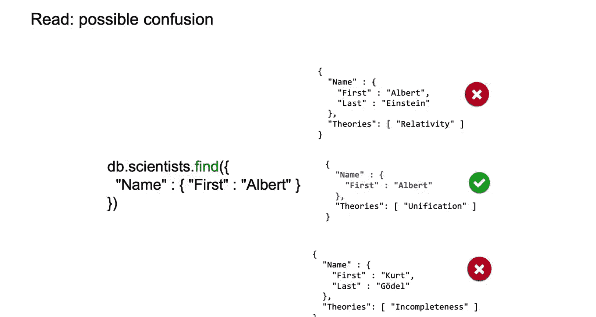

It's not going to return that one， so that's also a common mistake， right？

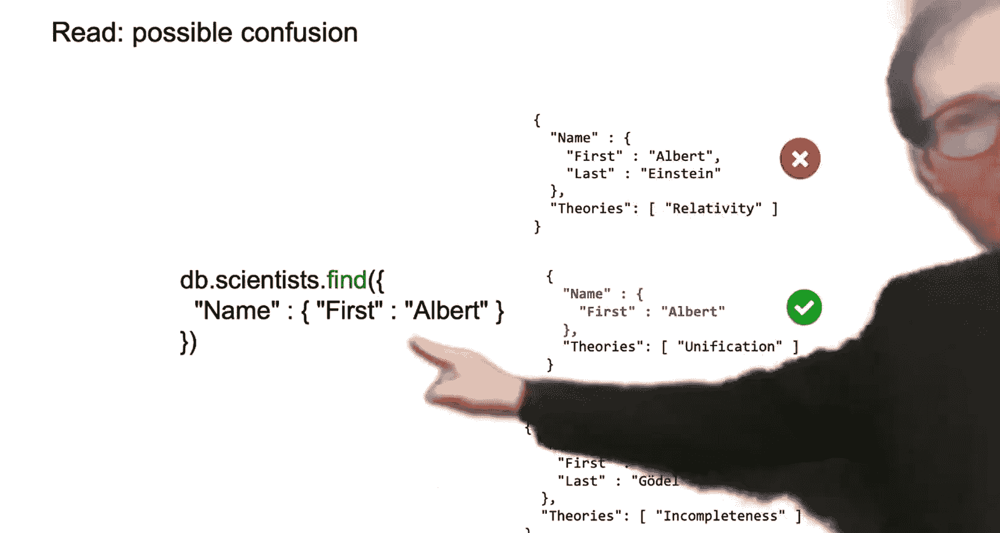

And now you probably start piing up and piing up and piing up all of these conventions of the API。

 and it's going to be different for every document store right， but that's how it is right？

Gives you an idea of how things work。 All right， now there's also a special behavior。 If we have。

 let's say a arrays of strings and in your query， you say theory is special relativity。

 It's not only going to return those that actually have the string， special relativity。

 It also is going to return those that are an array。😊，One member of which is special relativity。Okay。

Another thing you can do is that the dollar in operator， you can ask for a value。

That is one of several values。 so if you look at universities， ETHR or EPFN。

 you can do it in this way。It's dollar in ET or EPFS， so it's going to read on the first one。

Not the second one。Now it would be the same this query right here would be the same as an end。

 sorry as an or Do or University Z or university PL right in that case you could also write it as a dollar or。

😊，Okay。Nin would be not in。 so in that case you're doing the opposite and so on。There are many， many。

 many other operators documenting in Mongo Db。 They start with the dollar。

 and you look at the at the documentation。So that's for the find function。 we can select。

 We can project。 What else can we do， We can count。

 We can count the number of of documents that would be returned by a query。

 And here we do it with an additional method call here。

 dot count that's going to tell us how many objects as that filter。Who is that you？Allright。

What else do we have？We have a way to sort again， you need to call a sort method。

And you pass an object with key that you want to sort by。

 you say one for ascing and minus one for descend sendinging。

 that would be the equivalent in SQL of order by founded desk right with with me。Right。Again。

 please abstract away from the fact that a lot of the conventions that I told you like the zero and the one in the projection。

 the dollar operator， the behavior of the dot， soft and so on。

 it's all arbitrary and specific to Mongodb so I do share out the fact that you have to learn it by hat or look heat up in the documentation that's one of the weaknesses of doing it in this way right so but I wanted to see what an API looks like right。

😊，O。😊，Now you also have remember in SQL， you have offset and limit。

You remember offset set an limit in SQL， it's a great way to limit the size of the output。

 If you don't want to crash your Jupyter notebook， add a limit 10 at the end of your SQL query。😊。

When you can do it here with S 30 limit 10， it means that you skip the first 30 and you output between 31 and 40。

 right？😊，Now we have distinct， so distinct outputs all the distinct values of last， right？😊。

And finally， and that's the last one I'm throwing at you。

 we have a very mighty and powerful method called aggregate。😊。

That does things like first it filters on century 20。

 then it groups by year and does accounts of all the account sorry a sum of other accounts。

 then it sucks by the count field decreasing that limit。5 and sword。That looks scary， right。

Doesn't that remind you of something though in the structure that we've already covereded？

That's the reason I'm， that's the only slate。 all that。

Doesn't that ring a bell on the way that it looks。Who sees that it looks like a sequence of transformations。

Where have we seen sequences of transformations？Anywaybody on Zoom。

 maybe you are less shy to answer where did we see transformations。

 frequencies of transformations on data sets？Yes， in Sp exactly。

 So this is why I'm not showing to you anything else because this is kind of a mini spark in Mongo Db。

 you can also supply transformations。 Now I'm aware it requires looking at the documentation。

 learning yet another language and so on。😊，But it's the idea that I want you to see it has a mini spark。

 the way it works with the transformation is the same thing we cover in Sp。

 it's just a different lipstick， a different finish， but it's basically the same idea。😡。

Right so this is technically you see creation transformation stages and so on， the same thing。Okay。

Now how do we insert data where we we have functions for that where you can insert it's like in SQL like insert into the tables right so here you insert one object。

 you also have insert many update many if you want to update multiple object and set the century to 20 yet another thing to learn。

Update one also exists。 Then you have delete many， delete one in order to delete and so on。Okay。

 but I have good news for you。Because you won't have to actually program Mongodidi at the exam。

Who is relieved of that is relieved okay， you don't have to program in Mongo Mongod the exam is going to be Postgsql SQL going to be a Pi Sp that you've covered Sp SQL or the data frame transformation if you prefer。

 but Sp SQL is probably easier。😊，And Jsonic that you've already seen the tutorial， these are four。

 the rest is theoretical questions。 So we might ask you a few questions on on the syntax of you know how to query Mongodb。

 but you won't have to write an queries yourself right So just to be clear to make sure that you don't feel overwhelmed looking at all of this right I just want to understand the idea the look and feel and the limitations of an API like this and the difference between an API and a language because again。

 we're looking at ja with the Mongodb API It's not a query language。😊。

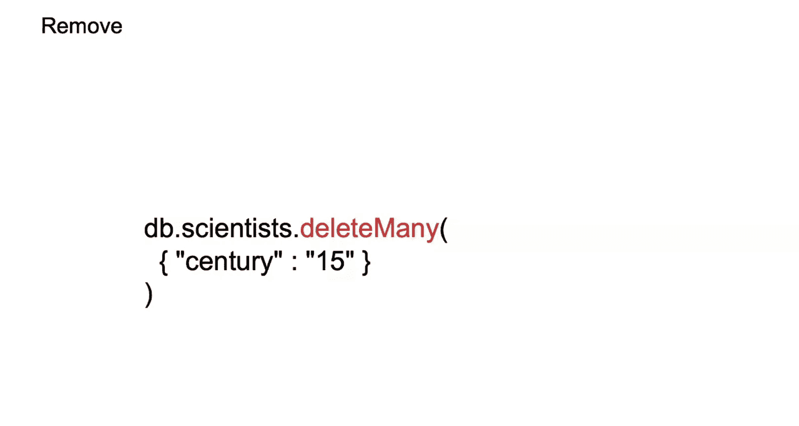

O。Now I can go back to the physical layer， say a few details quickly。Do you remember that in HB。

 I told you？😮，The atomyity of updates is at the row level。 who remembers that。イーベ。

Who doesn't remember that？Okay， let me explain again what it means。 It means that if two users。

 Alice and Bob are trying to update the same row in each base， they won't be able to do that。

 they have to queue So whoever is there first will do an update the other one has to wait and can only do the update after the first one is finished so there is a queue。

Many systems have this notion of Q right where you have some sort of granularity of this。 But again。

 in age base， it's on a row， and it means that if two people are modifying different rows。

 that they can do at the same time。 That's not a problematic right in age base when in Mongo D a granularity。

 it's a bit similar。 It's a document。 It means that two users cannot modify the same document at the same time。

But they can modify different documents at the same time in the same collection。

 that's to edify right So this is what it means that's called atomicity。

 it's the granularity of atomicity。😊，In Postgresql。

 you can actually get that at the level of multiple tables。 It's very， very impressive。

 but MongoDb doesn't offer that。 It only offers that at the level of the documents。😊，Okay。呃。Alright。

😊。

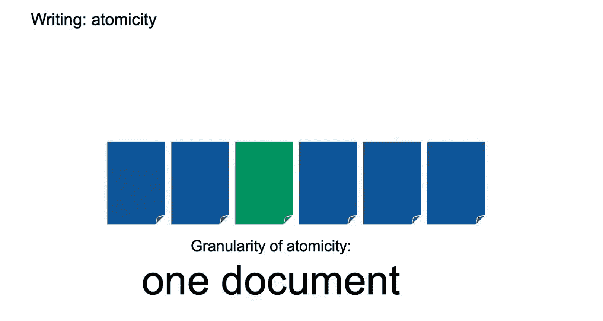

It's good because the fact that its a bit slow slows me down。

 so it gives you also room to digest what I'm telling you。No。

Next week or maybe the next hour next lecture。I'm going to show you that we do have languages on the level of SQL that are a bit easier to learn and allow you to query collections of trees。

 we're going to focus on Jsonic。😊，It's largely based on a W3C standout。

 so standard outized by several companies，20 probably 20 years of work now。

 the underlying standout called X queryry。Ex rayries right there。 Graphql became popular a while ago。

's it's about specifying in Jason in your API a way to project and select some data。

 uncle was also popular at some time， Nel and Ql。 So Nikel was also is also one and there's actually many。

 many others this kind of languages。 Okay， so we study， you'll see what they look like again。

 if you learn one。😊，You will get the spirit and you can learn any other of these languages sadly。

 it's not like tables where you just have SQL and nobody disputes it entries it has not conversed yet。

 so we do have that unknown of where will we be in 10 years or 20 years will there be a unique language everybody uses we'll see but today we are not there yet。

😊。

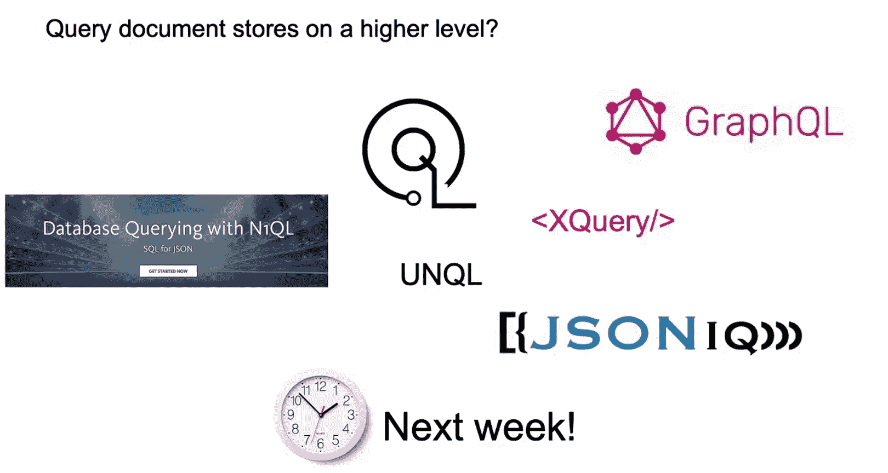

Okay。😊，So now the architecture。So。Now I'm going to tell you two things that should not surprise you。

It's that this collection of trees， we're going to do two things。

 we will replicate it and we will shout it， who is not surprised。

Very good we've done that before right we did it in HGFS。 we also cut into blocks， the files。

 we also replicates them so you know we do that all over the place really the sharding and the replication Okay so we have multiple copies of the collection of trees。

 I just instead of putting a tree， I put a document image right just plenty of documents document is the same as tree right just to be clear adjacent documents adjacent tree it's the same thing Allright so we have multiple copies and on top of that we are going to cut it into partitions you can call them shards。

 chunks， blocks， pleats， partitions in Mongodi we call them replicate assets。😊。

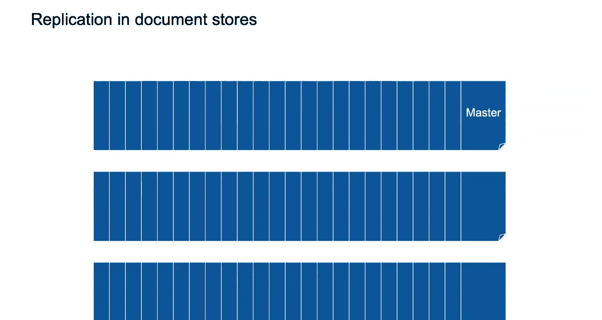

Alright， so for example， you could have some key and you look at fically A2 E's in the first sh and F2 p's in the second sh and Q2 e is in the third child。

 or I could say in the first replica set second repa set。

 third replica set and that's it so you see replication vertically and sharding horizontally who sees that。

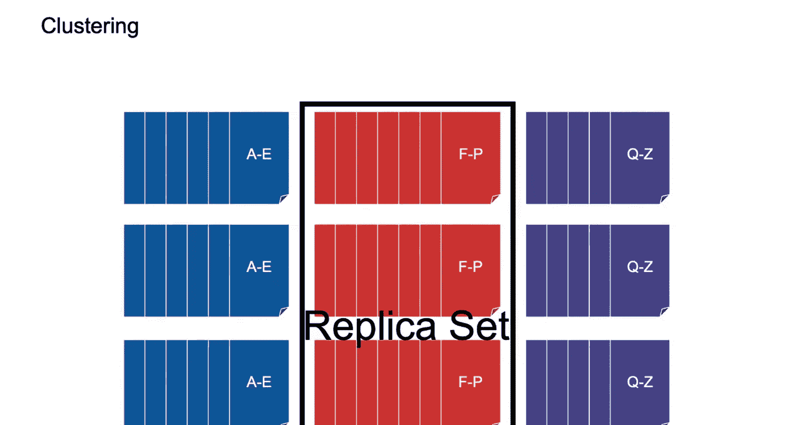

Okay。Now， if you look at machines， this is what it looks like。

 Now that should be a surprise because that doesn't exactly look like what we've seen before because in the case of the HDFS and H base and map reduce at least the version1 and yarn。

 we had a centralized architecture with a coordinator node at the top and plenty of worker nodes otherwise。

😊，But in the case of Mongodi Beach， it's a slightly different architecture because we are going to be a centralized architecture。

 but in every replic asset。So it means that we have a third shell， a second child。

 a third shell and in every one of these shelves we have a coordinator node and we have。Welcom notes。

The number of worker nodes is not going to be in the thousands like you could have with otherwise with AGFS and so right for example you might have just three like one primary node and two secondary nodes in every shot right so the number of of course it's making progress with time but most of the people using MongoDb the number of machines they use is not in the thousands it's more like in the counting on one hand maybe a few dozens most of the people don't scale more than that okay。

But it does allow you to replicate the data on multiple machines。 So if one of them crashes。

 then then that's fine。Plus， since you have multiple shafts。

 you can also process the data in parallel across the shelves。

Who sees these two thing that with this， we if it crashes。

 we don't lose data and we can process in parallelhalel， who sees that here？😊，O。Now another thing。

 so here I show you a replica set with five worker nodes instead of just two。

The reason I put a bit more is that I want to tell you that when you write something。

You add something to the collection， you did it something。

It's going to make you wait a little bit until it has confirmed that a minimum number of machines have implemented your change。

 your update， deion insertion and so on in that case， we assumed three of them。

The primary and two of the workloads and maybe the other three that don't have the the tick。

They don't， they didn't do it yet。But nevertheless， we consider that three is an acceptable core。

 an acceptable number。 And now we are going to confirm to the user that this is done。

And the propagation to the other three machine will just happen in the backgrounds。

 but with the user waiting， or who is that here？Right，The first part is called synchronous。

 We synchronously。 We wait until the first three confirm， and then asynchronously in the backgrounds。

 we propagate to the rest。3 is something you can change。 If you don't like 3， you can make it2。

 you can make it one。 You can make it 6。 if you really want to make sure that it's everywhere。

 This is something you control， right。

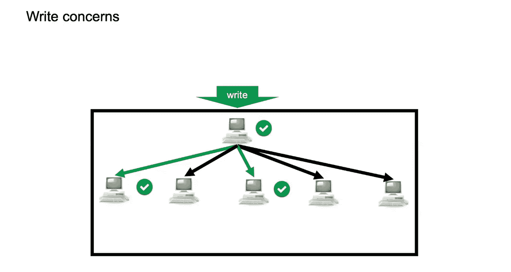

Okay。Everything with me。Okay。Now I'm going to talk about indices。😮，But， in fact。

Who visited information systems for engineers？Okay， that would not be new to you。

 That's the good news。 But I want to make sure that even if you didn't。

 then you know what an index is with Mongo D B。 And this would work in a very similar way for a Post Gql or a relational database。

😊，Ind is。Are a trick on the physical level to make queries faster stop。It's the same query。

 it's just magically faster。😊，Now， even if you don't know in this is from PostgresQ or from information systems。

 I'm sure you've all seen an index at the end of a book who has ever seen an alphabettic or least of wealth at the end of the book with the pages。

That is an index。And it works exactly the same way。

 And you probably see that the fact that you have this alphabettic list at the end of the book fs the lookup of a world。

 right， you immediately find the page and then go to the page。

 It's much faster than reading the whole book and looking for a world。

 right So indices were exactly in that way。 So an additional structure that accelerates。😊。

The queries。And the reason is we might have a very big connection， billions of objects， right。

 we might have a query that we call a point query because it looks for a very specific person like name Euler is going to pick one of them right These are the ones we can accelerate massively。

😊，Then you might have queries that are not very highly filtering， like looking for mathematicians。

 there're going to be more than one， but it's also probably not the entire collection。

So this would be it would not be a point query in that case。Then we have ranrench queries。

My computer would be so kind as to display the next slide。Please， yes。 thank you。嗯。Ranch queries。

 this is the GTE I told you about in SQL。 it would be the greater than like a year greater or equal to 1918。

 That's a ranch query。 And you see， I put in bold and in blue everything that is higher than 1900。

 This is called the Rach query。 This is the kind of queries we would like to make faster thanks to an index if we build an index。

 So how can we make this super fast。 Well， I'm going to show you。😊。

It looks a bit like disimagin that we had fruits。In our collection and they contain colors。

 the idea is that on the left you add some structure with a list of colors sorted in a certain way would be alphabetically。

 would be by wavelength since we are talking about colors。

 but basically we have this sorted list of values and then we have the pointers these little rows that points to the documents corresponding to the colors。

It was built with this， right？ We used that in order to build that structure。

 Now you see that if somebody specifically specifically looks for。

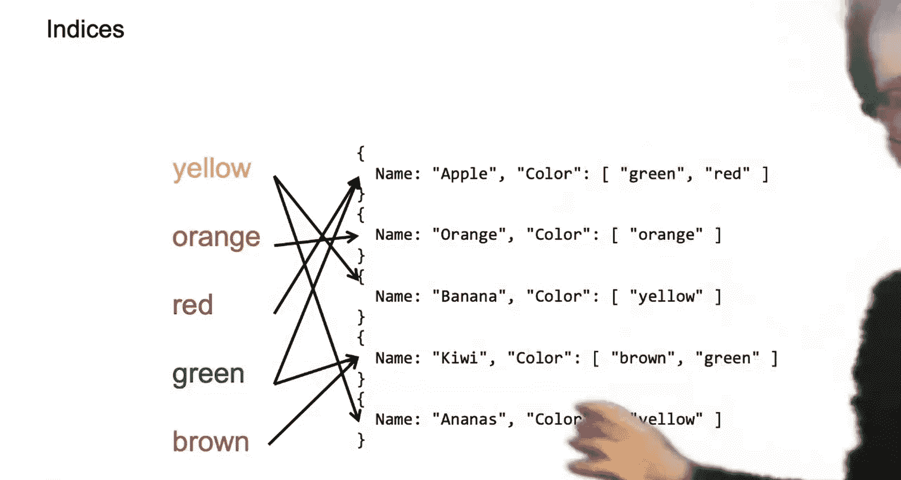

Co。All rich？

Then you will follow the row orange， you can find efficient。

 It's like looking up in a dictionary right if it's sorted in a certain way。

 you look in a dictionary and then you follow the pointer and find the document that has the color orange it might be that there's 10 or 100 of them but then you will instantly see them because you just see the pointer that come from orange So that's the general idea right I'm going to get more into the details So here's an example now I'm dropping the colors imagine that we have a collection of scientists。

😊。

I put six of them。 We have their names。 you see it's a bit heterogeneous like Albert Einstein is a bit different。

 a country and then a century， the country is oh it is everywhere and the century is everywhere。

 right？Now I want to index on C。And that I can do with a comment in in my in my Mongo D B shell。

 I can say create index。 And I'm going to create a hh index on century。 What is the hh index。😊。

You not have the break。Cause it's actually 9 AM。 So after another break。

 I'm just going to finish showing you the index。 It's the last topic for document store。

 So I'm going to finish the indices。 indices is the pro of index。 And then we look at J Soonic。

 which is the final。😊，The the final lecture with materials。

 So thank you very much and see you in 15 minutes。

