# 苏黎世联邦理工《工程师的大数据｜Big Data for Engineers - ETH Zurich - 2024》中英字幕 p29 10. Document stores (3_3) - .zh_en -BV17FAmeFE9K_p29-

Welcome back， everybody， so we left with this teeth hanger on hush indices。

So the we have this collection and we want to build a hash index is how it works。😊。

We have here at the left a table。With a certain number of rows， it's not a relational table。

 I mean it looks like one， but it's not really a relational table。

 but it's more like some data structure in which we will organize the index。

What we' have on the left column is a value and on the right column we are going to have a pointer to the to the records corresponding to that value。

 so for example， here century 20， so I'm going to have a value of 20 together with a pointer to the record。

But now here's the trick with the hash index。嗯。😊，We have a magic function called H This function is called the hash function。

 whoever heard of the hash function。Okay。So a hash function。Is a function that is extremely fast。

It's deterministic。Typically inside， if you look inside the function， you're going to have addition。

 multiplication， modo， that sort of things， and it spits an integer out。

You can feed it with anything you want。 typically you feed it with the value of what you want to index。

And then it speeds an integer， and that integer that is speed by function H give you。

 give you the position in the array。 In that case， it gives 0。

 So we put it at position 0 Note that computer scientists tends to count to sub counting with 0。

whichch might be less natural because mathematicians stop at one。

 but it's just a matter of convention right but since usually these indices are implemented in languages like Java or C++ then we start counting with zero right so just don't be surprised that zero puts that in the first row there。

😊，So what's important is that it's magic。And dataministic。

 So it will always speed 0 if you feed it with 20。 It's like some sort of mixer。

 right like when you do a smoothie。😊，嗯。😊，Now， another feature of that hash function is that it tends to spread things all over the place。

 It means even though it's deterministic， it looks random， right。

So you will see when we have indexed everything。Then we have the second one。

 So we are just building our index now， Right， So the second one， Miyazani 20 feed Na Hamadujan。

19th century that speeds for the H function。 I don't know why it's just based on whatever formula you put in there。

 It can be pretty much anything。😊，Then we have the Euclid。

So century before common error that speeds a 3。 So position 3 and Pthagoras-6 over there speeds a 1。

 and 20， it's thatmin6。 So 20 will always always give us a0， based on that hash function。

 and that's it。 So that's the index。 Now you could pick another hash function。

 It would just distribute things a little bit differently， but that doesn't really matter。

 The only thing that matter is that it kind of spreads the values a little bit over the place。

 And the array is large enough that we avoid collisions。

 So a good feature of a hash function is that the collisions are rare。

 It's rare to find two values that would lead us with the same position， right。

Okay hash functions by the way， are very popular in Bitcoin， for example， where in fact。

 they use the fact that it's very difficult to reverse a hash function and typically to the difficulty level of mining a block fes you to find the hash that is very small basically it starts with a lot of zero and that's very hard to do and this is why it takes2illions of tries during 10 minutes in order to actually find one so just to show you that it's hard to reverse All right。

 so now we have an index and the function H we keep in mind right。

 we don't drop it we just remember it。Now。Building that index takes a while， right。

 You instruct the system to do that。 If the connection is large。

 you might have to wait for two or three hours or even a day until this is built。

You can either say I'm building it and I block a whole database system， nobody can use it。

 or you can say I want people to continue to use the system but it's just going to be slower right so you have these two ways of doing that。

 but it takes time building the index。But once you have built the index and somebody has a query。

 that's going to be fast now。Because now somebody looks for 19， what do we do， we fit that 19 into H。

Very quickly， we get to four。The fourth position that's also very quick to do in memory。

 we know how to do that very quickly with the pointers in memory。

 and then we follow the pointer in the documents。 So now you see that it was worth taking three hours to build the index。

 because now whenever somebody has a point query has a query like this， usually a point query。

 but it doesn't have to be， that is super fast。 In fact。

 it's so fast that it's instant doesn't even take time like oh of what we call it instant。😊。

W understand sense that。That is because of the hash function that makes it possible， right？Okay。Now。

 hash functions have problems。Limitations， or， let's say limitations。

They don't support range queries if I tell you， for example。

 give me all of the centuries that are more than 15。Then with the hash function。

 you cannot do it because the hash functions spread it all over the place。

 So you cannot say it's in that zone。 No it's all over the place。

 So you would have to look for 15 for 16 for 17 for 18。 So you know， it doesn't support wren queries。

 The second problem is that hash functions are not perfect。 Idely， there shouldn't be collisions。

 the array should be large enough。 The table。 but in real life。

 there are collisions and that makes it lower。 And also you need a large amount of space like you really need a lot of memory in order to have the array if you want to avoid collisions。

I repeat that a collision is when two values give you the same position， that's a collision。Okay。

All right。And in cryptography， of course， the fact that it's hard to find collisions is a useful feature for the security。

Okay， all right。And thus， we have a better solution at least four range queries。

 that's the second kind of index。Based on trees， but not trees as in Jasonson or XmL trees lack more physical data structure in memory。

More specifically it's called the B plus3， that's just the name that its inventor gave to me there was first B trees and then B plus3 and B plus3 look a little little like that。

 that kind of structure where you have at the bottom in blue。

 these are all the values that you index。And you notice that they are all soft in the way that they index it's all soft and you basically can look it up here by looking just like you look in the dictionary。

 if you want to look for hour then hour comes BO possessed in the dictionary so it's here then it's before between command E so you look here and then you look okay hour and you see that we were able to locate it quite quickly without needing to scan everything who sees that。

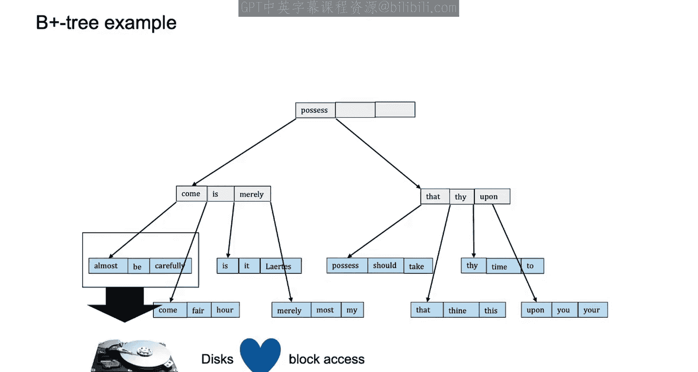

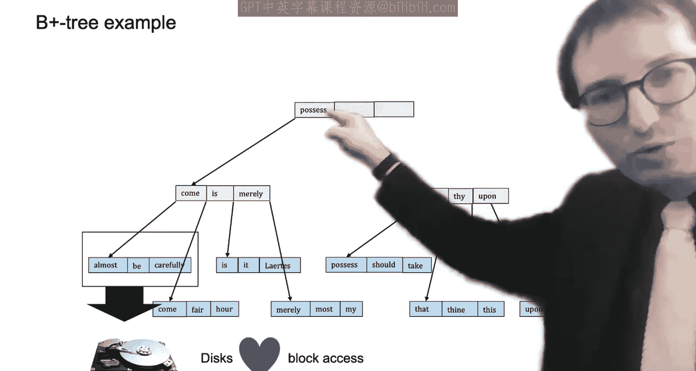

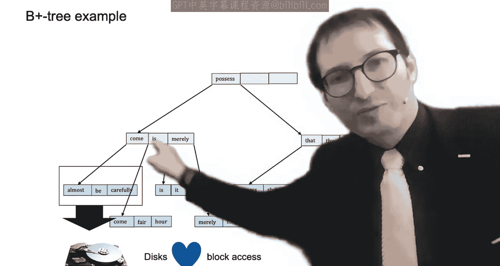

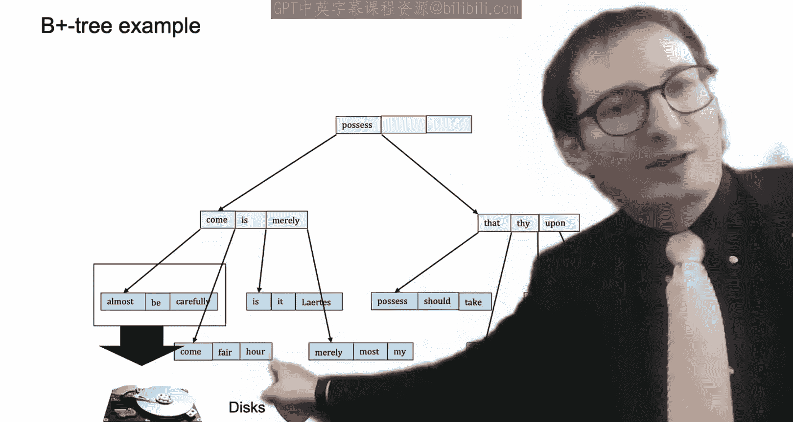

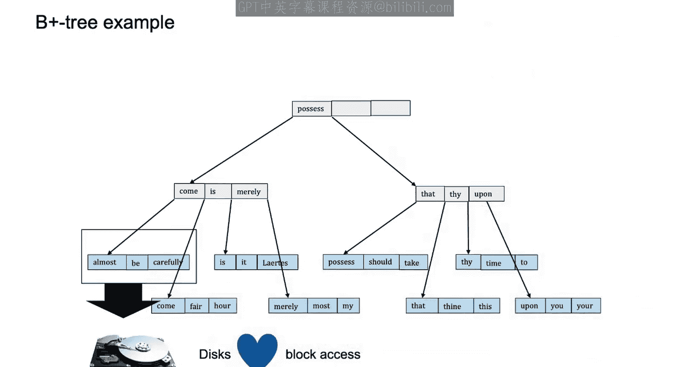

RightThis is called a B plus3 These are very complex to implement I don't want to bother you with the details of that。

 I actually removed slides to make it more lightweight。

 but the idea is that we have these nodes with multiple values here because we love to access the disk in block whenever this is on disk right whenever we read that from disk we would like to not read bit by bits because that would be very slow but we like to read something like 4000 bits at a time。

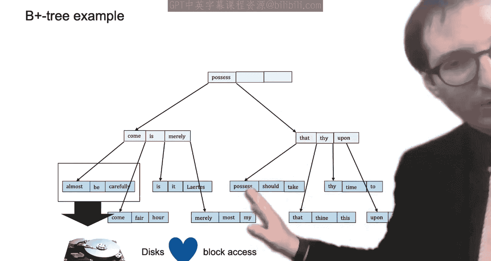

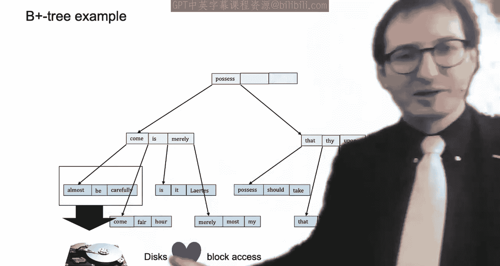

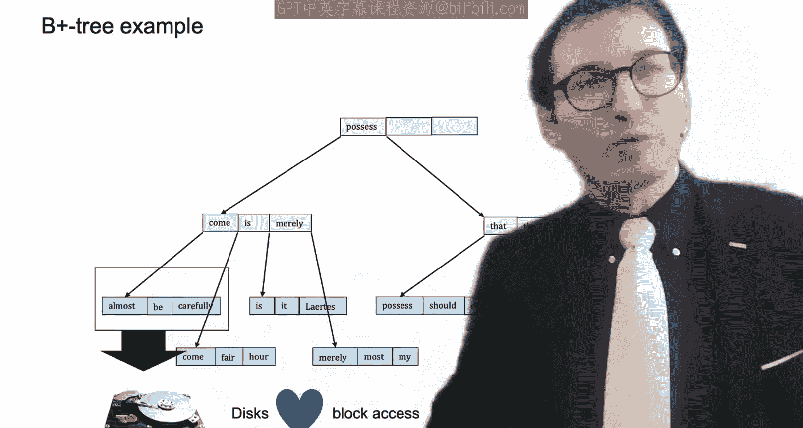

And so we like to group in the same node in that tree， an entire block on the hard drive。

 So this is the reason why we try to to have as many values as would give you a block on a disk very briefly。

But let's just build then such a tree on our example， right here。呃。数。

I'm going to take a no I'm I'm not going to tell you the explanations about 2，3。

 what it means and so on。 It's just a restriction on the number of children that every node can have in the tree。

 but I just want to see you the visual of what we are doing here。 So now I'm saying create index。

 but instead of hush as I say one， it means soed by century right and I want to index century minus-1 would just do it in a descending order。

Now， here's what's going to happen。 I start building my tree。 So at the beginning， there's only 20。

 So it's just one node。 Then we have 21。 So now it's still small enough that it fits in the same node。

 So I have 2021。 Then I have 19。 Now that doesn't fit。

 So imagine that I say I don't want more than two values in there just because I could do it with more。

 but it wouldn't fit on my slides。 So that's why I just picked two as the as the maximal number。

 So basically， because of that， because I cannot have three， I'm going cut it in。 I'm gonna split it。

You know，1920 on one side，21 on the other side。 And on top of that， I'm putting some boundary。

 So everything that's strictly less than 21 is on the left。

 Everything that's greater than or equal to 21 in is on the right。 Who is following。Okay。

 now we continue。 we have minus-4-40。 that's again a problem。

 so we just need to again split it like this。 So now I have three children like this。

Andt two values at the root。 So that's fine。 Then I have-6。 Now I need to split it again。

 But now to keep it simple I'm I'm just moving the 19 over there right And that way I'm still back to2 to two values in every node right So this is again very complex to implement。

 but this is kind of how it works。 and then the 20 it's already there。 So we just add a pointer。

 Now we have inex structure who now understands that this is going to make our queries faster。😊，Okay。

 but there is a cost because that might take hours to beat right can happen in the background or slowing down your system。

 but you have to come back in a few hours。 But once you have done that and somebody now comes with a query。

 for example， a visitor on your website。For example， century greater than or equal to 19。

 Now you see it's easy。 You locate 19 and you take everything on the right and you follow the pointers。

 and you have the documents。 It's that easy。So whenever you connect to a website like I don't know。

 let me， let me take digitite galaxies or Coat home or whatever in Switzerland。

Have you never been amazed that you enter a search term into the system and instantly the page appears in front of you with the results。

Well， that's why。That's the reason why it's instant because they are using structures like that that make it super fast to locate the page。

 but it took hours to build the index。

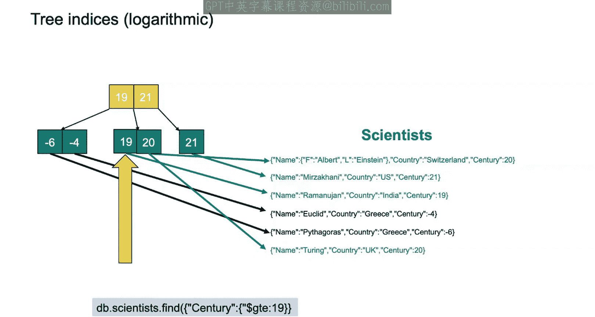

All right。No。The idea， the reason waits faster is that if you don't have an index and you're looking for a documents with a specific name or a specific range of centuries。

😊，The only thing you can do is read everything。You have to read your entire collection that's going to take hours without an index。

 We have a question。Does it also take hours to build。

So does it also take hours to build if you add a new product。So if you add。

 if you insert data in the collection， right， probably mean。No， in that case。

 so after you have built the index and if you modify your collection and delete or add or update documents。

😊，It's not going to take our wells。 You don't have to reat the index。

 You just need to modify the index or the update you've just made。 You just need to modify the index。

 But there is a cost because it means that the update is going to be a1 bit slower。

If you don't have an index， the update is going to be faster when you have an index。

 every update will cost you a tiny bit more， maybe a few more midiseconds or a few more fractions over a seconds。

 right， Does it make sense。So it takes our the first time when you have your collection already there and you build your index。

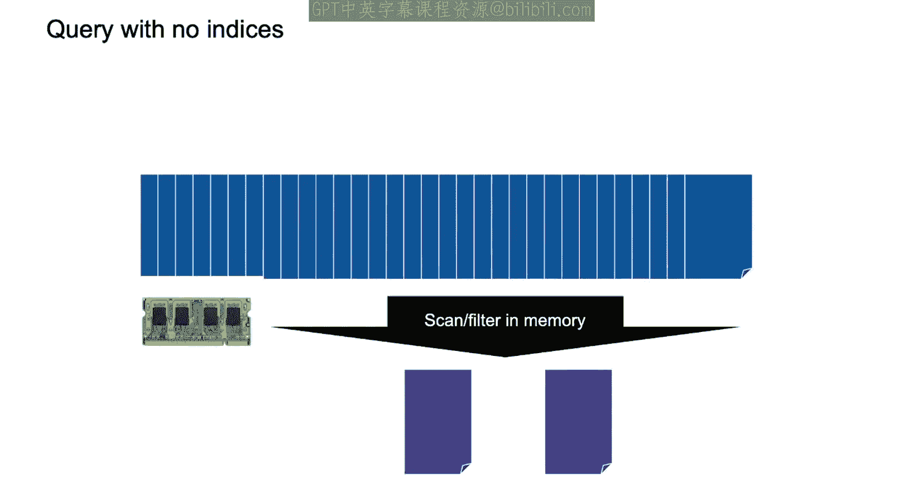

Does it doesn't in the next year， there is another question。

Well， yes。In each case， do you have to rebuild the entire tree， I wouldn't call it rebuildilt。

 but I would call it reorganize。 In fact， that's exactly what happened right there。

Sometimes you end up with things like this or like this where you need to reorganize so in that case when you do that sort of things it's even slower。

 it's still acceptable though， but sometimes it fluctuaates a little bit the sort of things that's going to happen。

Right。😊，Does it make sense？There are systems that have a different way of working now。

Did you take Google。I don't know how it is today。 Maybe it T word。 but in the early days。

They didn't actually update the index every time a new website is back then。

 they would just pile up the updates or you know if anybody signals an update or anything。

What they would do is they would keep an index as it is。😊。

And start building a new index in the background。 but without using it yet。

 So it means that for during two days， like 48 hour world， they just keep using the old index。

And once the new is built， they swap to the new index。

 throw away the old one and start repeating a new one。

 So this is the reason why very often in in search engines。

You have or you had two days of delay until the page would get indexed。 In that case。

 it's not the same as what I described here where you immediately update the index。

 The other solution is to just keep rebuilding a new index。

 but you accept that you might have a delay in seeing the effect in there。 Does that make sense。

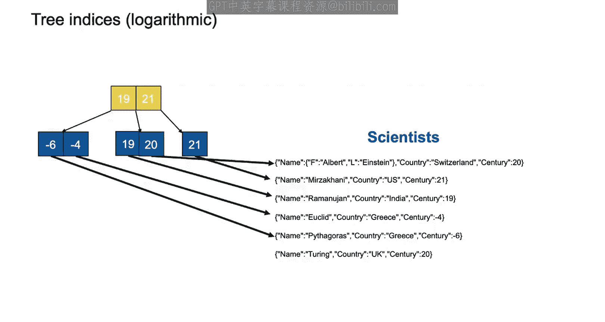

Okay。No。

Without an index， you have to scan the entire collection and takes a lot of time if you have billions of records with an index。

😊。

You can use the index to limit the information you need to reach from disk in fact if you have an index you're going to have only a subset of the collection that you found with the index you might have to do a bit more work after that I will show you why but it's going to be much less so the index basically reduce the amount of data you need to read from the disk because it directly shows you where that data is that you're interested in that's why it's fast right so without an index with an index。

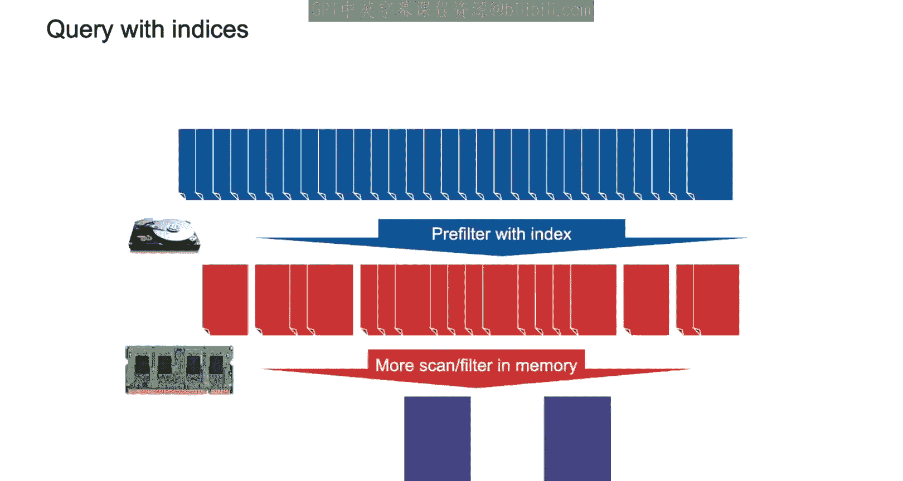

Here's an example where on the top of the slide。 we create an index name last hash that also works on nested fins These D。

 So now we have an index on last within name。Now this is something I do in advance right。

 And then what you have below is the query that write that after I have built that index。

In that case， that query is going to be very fast。Because it's compatible with the index that I bit。

So the index makes the query us who sees that？Because it's the same fit。

 it's named not last in both cases。This。Doesn't make the query instant。

 but it still makes it faster why， because I'm I have a filter on it's an end between two keys。

 I'm looking for a specific value for profession and for theories。 My index is only on profession。

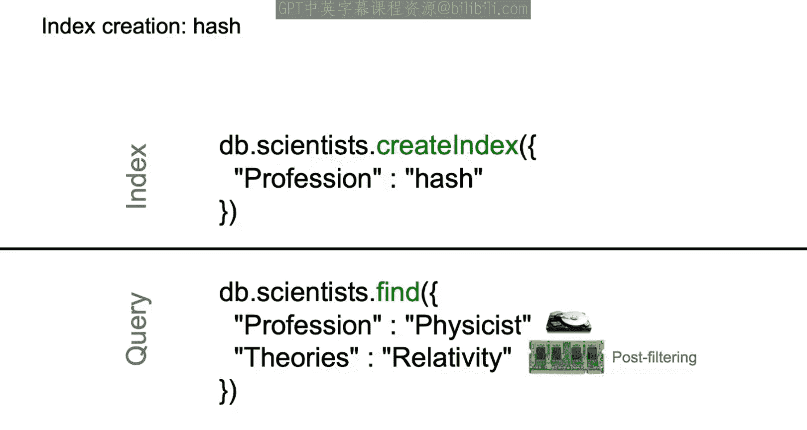

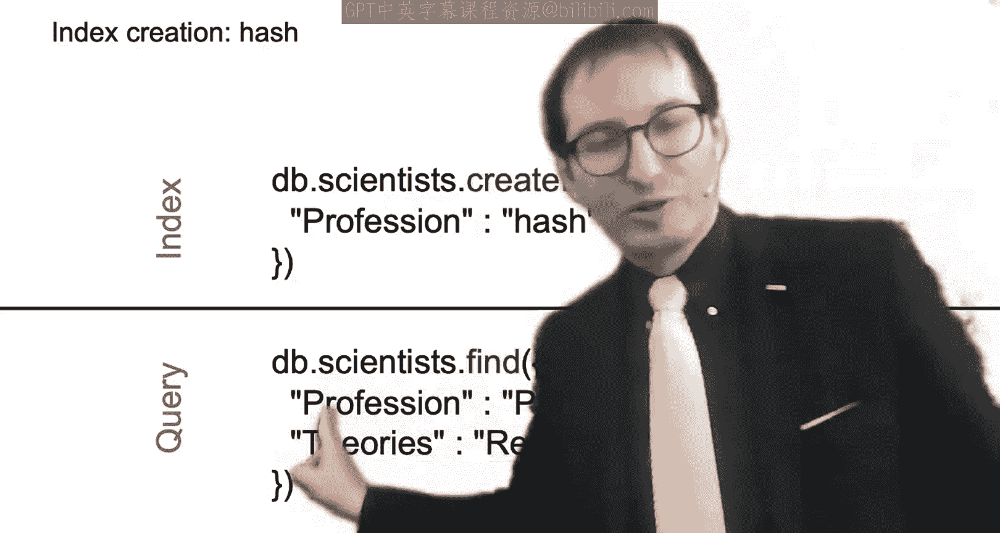

So it means that for that part of my selection criteria and I can use the index。

 So this is going to directly look for the physicists， but then I have a bit of extra work to do。

 I still need to manually manually no of course not manually but programmatically in memory go through the phyist and pinpoints those that have relativity This is not covered by the index that you need to take time to do it。

 but again， it's still faster because you already isolated a subset of the collection corresponding to the physicists for whom does that make sense。

😊。

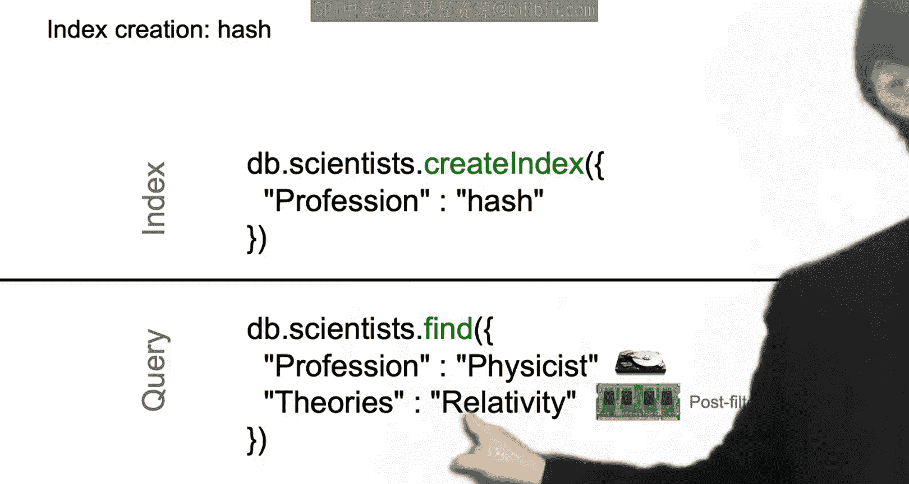

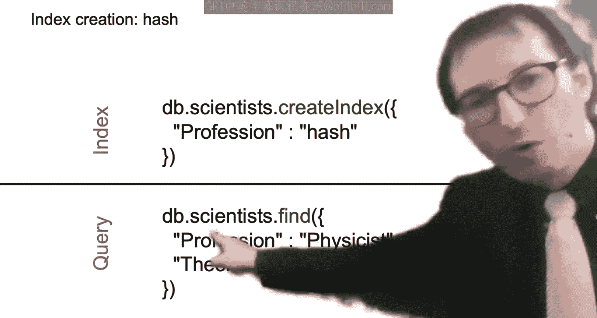

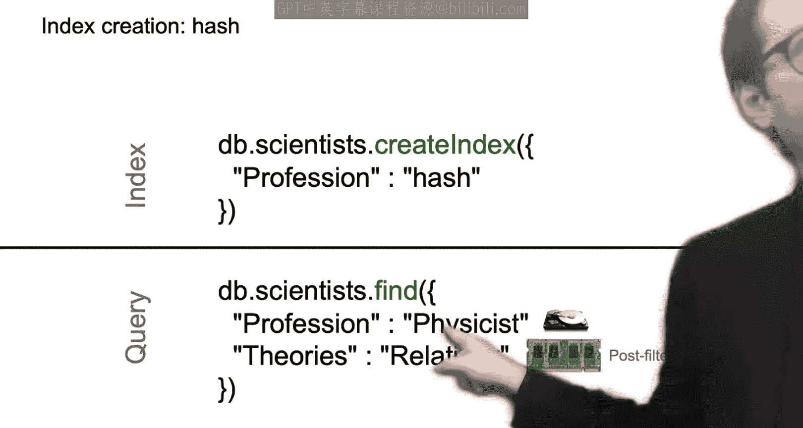

SoThis is what I meant on that slide that you use the index for part of the pre filtering and you might still have a bit more work to do in memory if you have more fields that you wanted to filter on。

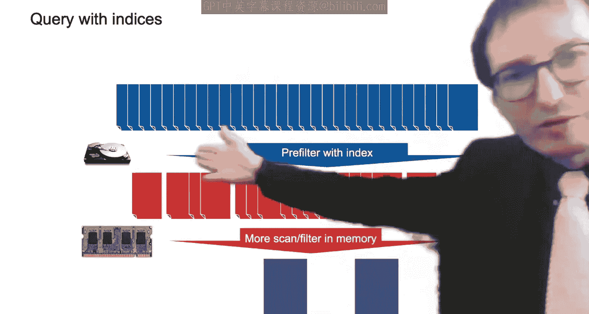

Now here's another one where I have what's called the compound index， it's a tree。

 still using a tree， but I do it on twokis， it means that I so by birth。And if the birth is the same。

 then I sort by death， right， increasing increasing， it's just lexxiographic。

 I just have two criteria just like when in a spreadsheet software。

 you can sort by one column and then you have a secondary column in case of equality in the f column right it is something you've probably seen。

 So now first by birth and then by death。😊，Do you agree that the query below is going to be very fast？

😡，You're looking for exactly the same feed as in the index。 Who sees that。O。

You could also of course reversevert the order， but in that case it's an equality so it doesn't really matter。

 now it's a range query now we are looking for birth dates that are greater than or equal to 1946。

And the index is also on wealth， and it's a tree index。 there's a one， it's not hash， it's one。

 So it means that this ran query is going to be faster。

 It's not going to be instant because that's still an entire world。

 You might still have a lot of people after 1936 that it' going to be faster， Who sees that。

It's a good training for the eye to try to see if an index helps with a query。嗯。Computer。Okay行。Yes。

The way。So now here's another thing that is something not many people know。

Imagine that I have an index that starts by birth first and in case of equality sort by death。

Do you see that if I'm looking for all the people born in 1987？

Given that the index is built on birth and then death。The 1887 will all be together in the index。

 They will even be sorted by death， but they will be together。

 So who sees that that index is also helping for that query， even though the index has extra things。

Who sees that？Okay， but it only works because it's in the right order。

 you have birth and then death in the index right， the order is important。Prenhesis。

 that's a breach of data independence because normally in J。

 there shouldn't be any impact of the order of the keys。I don't like that very much。

 but this is how it is right so the in a Mongo API the order of the keys actually matters when you specify an index or a soft order parentase is closed。

😊，Okay， so it works， but that doesn't work because now death would be the secondary key。

 so you can really use the index because you might have people who died in 1887 who were born in 1800s or who are born in 1801 or who are born in 1902 that's a lot of places to look at in the index because it's sorted by birth。

 so who sees that the index doesn't help here。So it really has to be the first key in the compound index in order to be useful。

 it cannot be the second key without the first one。ok。

And the reason I'm saying it's important is that what happens in real life when people build a website to sell stuff over the internet and they add indices in order for the website to be fast。

You need to figure out what in this is to add。 It's not easy。 It's really engineering work。

 You need to look at how the website is built and the sort of queries that it sends to the database system。

And then you need to decide on which indices to beat。

 You cannot index everything because that takes too much space。 that takes too much time。

 So you cannot have 100 inds， right， So you need to carefully select the indices that actually make your website faster。

 but a reasonable number of them。And many people make the mistake。

Of building too many indices that are redundant， for example。

 imagine that somebody bids an index with birth date。

 death date and name last and another index on birth date and another index on birth date death date that's a waste of space because the first index on the left it already covers the cases of the indices on the right so the indices on the right are totally useless because there are prefixes birth is the first one or the index on the left and birth and death are the first two So in that case you can save yourself space time and money by not building the other two indices you only build this one and it will also take care of the queries that only ask for birth or birth and death or whom does that make sense。

You made it that's the end of this lecture， I think there's no other slides in there。Okay。

Any questions？Yes， me include the microphone。it's not but could you have like in the season parallel where you only thought by death date first。

 for example to in case someone does search for that yes。

 you could have two indices you could have these index plus another index that talk like death but what a problem that this it's superfluous information a bit for us depends on your queries so if you have queries。

That often ask for a specific ver， then you need this one。

 which you also have a lot of queries that ask for a specific depth。

 imagine a Wikipedia where you look for people right， then you would need two indices。

And it's like a game， you basically have all of these queries that come from your website。

You know it because you probably also program the website。

 you need to find the least possible number of indices that cover as many of the queries as possible that's the idea and in many cases you do need two。

 three， four， five indices maybe。100 you have Dote that can have a handful of。Thank you， you。

Any other questions why they moving on？不。Who was scared by the APIs？好， thank you。 Oh some of you。不No。

Okay， let me move on to the slides of the next one， then I'd explain。

Yes。😊，Oh yes yes yes that's exactly why that's much easier， right？

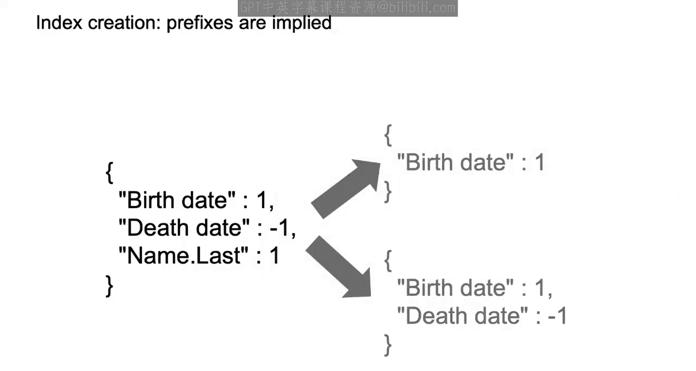

I don't have control about， well， I do have control。

 but I don't have the control that it does that when the volume is actually activated。

ok嗯。Now I need to stop the recording， but I can still edit it in post production but。

