# 苏黎世联邦理工《工程师的大数据｜Big Data for Engineers - ETH Zurich - 2024》中英字幕 p30 11. Querying trees (1_4) - .zh_en -BV17FAmeFE9K_p30-

Welcome back， so let's move on。😡，The most important thing that I want you to understand。

Is what I said about the difference between an API？In a query language。Sequin is a query language。

 Sp Sequin is a query language。IPA is an API。It's in Python and it's an API to to spark if you use data frames transformation。

 that's also an API in Python who gets this difference between the language and an API。Who doesn't。

Okay， let me explain again。嗯。Basically， the intuition is that Python has existed for a very long time。

 right， It existed before Spk。 it existed before Mongodb， and so did ja， right。So。

When you build a database product。And you want to come up with the way that the users interact with your product。

You have several strategies。One strategy is to say， well。

There already exist languages that people use to write computer programs like Python， like Java。

 like C++， like Java and so on。So what you can do is provide a library in that language so a library in Python。

 a library in Java， a library in NC++ that provides access to your database product it's also called a driver right so we could say there's a ja driver for MongoDb there's a Python driver to MongoDb driver is the same name that we use also for a printer or a scanner you basically I mean it's no longer on the case today。

 but when I was young when you added a printer you needed to install a driver so that the computer knows how to communicate with the printer so technically an API does that it's kind of a driver that tells Python or that tells ja how it can speak to MongoDb or to Spar and so on。

And basically， in an API， if you take， for example， the stock API， the Pi Sp。

It's an API because do you remember that list of transformations， filter， flatmap， map。

 reduced by key and so on？In fact， these are just Python functions right It's just Python functions。

 So all is done here is to take the Python language and we just throw in a few new functions that do things against the Sp backend right So this is pretty much the idea of an API。

 But if you think there's many other APIs Who knows nonpi Hos psys and so on and so on。

 These are all other kinds of APIs in Python right So this is an API。

 It's an extension of an existing generic language Python， Java， Javascript and so on。

 a generic language that is extended with new functions and new functionality in order to provide a way to interact with the database management system。

😊，So that's an API A query language is something different。

 A query language is something completely new。😊，SQL has nothing to do with Python or JavaScript or Java or whatever。

 it's a brand new language that's completely on its own。And in fact。

 it's so completely on its own that you can in Jupiter or notebook。

 have a cell that just contains SQL。😊，Right you have this perxend sel or perx and perx and Sequel that does the magic。

Then you write secret。Tpically。It's easier to interact with a database system with the language。😮，嗯。

Because that's less to learn if you learn SQL， you just need to learn this select from where group by having order by limit of set right and then the predicates and so on。

 then you write your SQL it's typically easy to learn in fact the name SQL was originally structured English query language for exactly this reason。

嗯。However， you probably experienced when you try to use spice Sp。😮。

That there is a higher h to using Py Spk why， because not only do you need to learn the Sp API。

 but you also need to learn Python。So that's not things to learn Another way that you see that is more cumbersome in an API is that you're going to have a lot of parentheses all over other place When you use IPAac。

 you have filter parenthsesis parentheses， you have learned does so you have a lot of overhead in the syntax that makes it a bit more complicated to read right as opposed to a query language like SQL that is a bit easier for humans being for human beings to pass。

 it's also easier for non-technical people to learn a query language than an API。😊。

Does it make sense。So this is the intuition and basically what I'm going to do now because on longergo Db what I showed you is an API in JavaScript。

 now I'm going to show you a full flat language just like SQL。😊。

But it's capable of handling collections of trees， nested， heterogeneous， everything。

Now that language you already know it's called Jsonic。😊，By popular demand in previous semesters。

 I give you a few tutorials at the beginning of the semester a little bit every week to smoothly introduce you to it and that should help you follow the lecture that is coming now。

😊，Who did these tutorials？Some of you very good。 if you didn't， then you can still do it， right。

 You can still take the tutorials and use with the Docker。😊。

Another alternative is to use the Triitawood page on the Jsononic dot org。

 there's the Triitawood and there's a public notebook that is listed in the cloud that you can also use。

So anyway， there's plenty of ways， but don't worry。

 because now I'm going to introduce you to Jason Nick anyway。 So if you did the tutorial。

 it's just going to make it easier。All right。So。

Wow， we are here。We are almost done， this is the last lecture with material and then in two weeks that we did a final lecture。

 but this is for fun it's just big quiz and wrap up and so on， so we are almost there。😊。

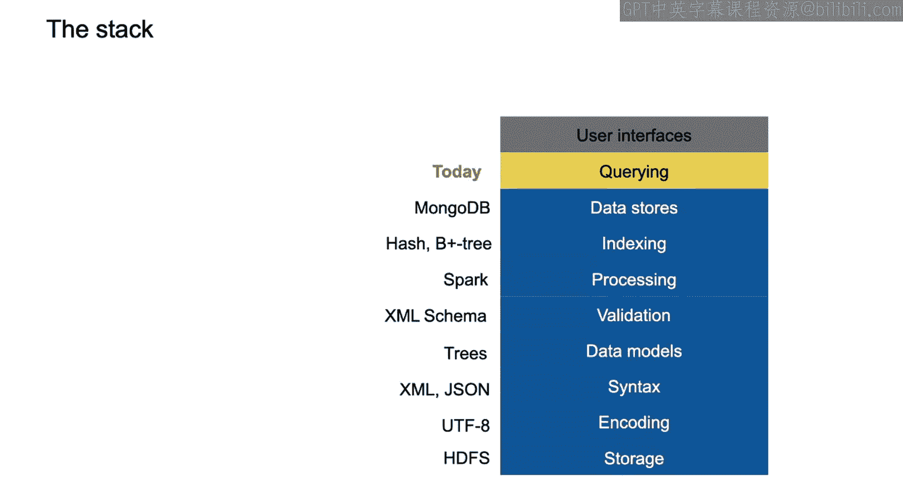

嗯。😊，Do you remember data independence is the idea that you have a language query language and physically it turns out to be PostgsqL。

 but now you know that SQL also exists f Sp so technically you can also use SQL on Spk right it also works on H base there's something called hive that allows you to use SQL on H base。

 It also works on Apache Sp that's the Sp SQL。😊，Now that would be what you could do and well not you actually the implementers of the system。

 you don't have to do it， you as a user writes down the Sp SQl or the SQL internally Sp will map it with the API of Pyth or Java or whatever。

 but what's new with the query language is that you no longer need to bother with that API it's completely hidden the API is still useful for implementing that right internally but the end user will no longer see the API they will just see the query language。

All right。And then in the special case that it's homogene and normalized， you can even use。

 so that was the RBD API， but you can also convert it to the data frame API， right？

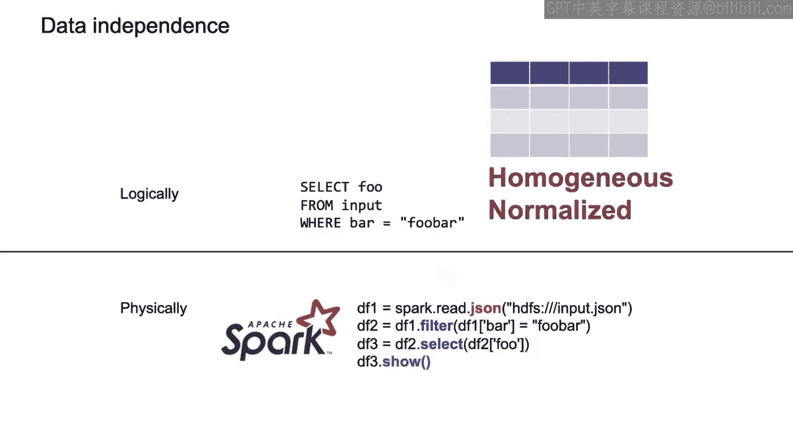

All right， now with SQL is good， but SQL was designed for flat and homogeneous cases and that's what we call a relational table The problem I mean for machine learning this is also what we love to have The problem is that in the real world data is not like that data is not clean data might be heterogeneous nested and so on and so on So if you download real world data sets it might look more like this with missing value extra values invalid values nested tables and so on。

😊，And so there is a bit of work to clean it up the problem is that you cannot do it in SQL and in fact you have to do it。

 if you don't have a language for that， you need to do it in Python with an API and so on that can be very complex。

So now we have a language that covers this nested and heterogeneous case。

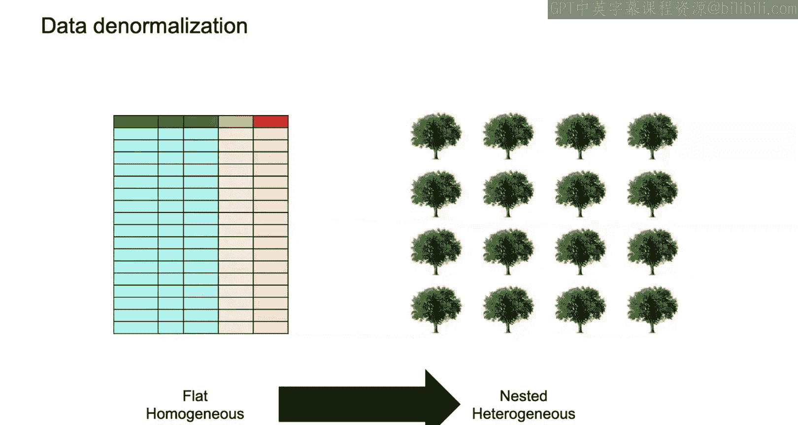

I showed you the limitations of data frames if you try to use PASQL is that if you have in your data some differing types。

 for example， the name might sometimes be an object， sometimes be a string。

 the problem is that if you do have that spark is going to just hit it with some hammer and just forcefe it into a column that is in fact a string。

That is extremely difficult to manipulate with Python after that， because this is a string。

 These are not objects。 It's very， very difficult。 The same here with the countries that might be strings or arrays。

 It's going to heat it with a hammer and get a string。 He eats a lot of nerves。

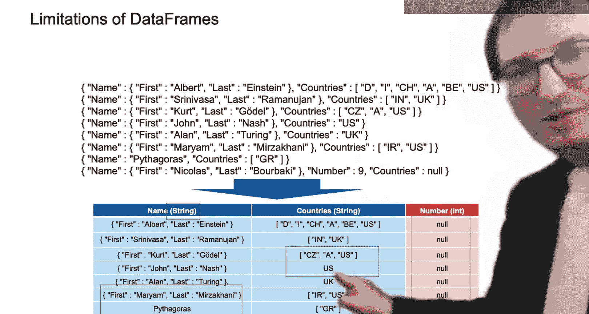

This is basically pushing the burden to the end user。 It's like， okay， your data is heterogeneous。

 I hit it with a hammer， I deal with it right， This is the way。 And if we don't use SQL。

 but the language that is more adequate for heterogeneous data。

 then it makes it easier to deal with it than with SQL。

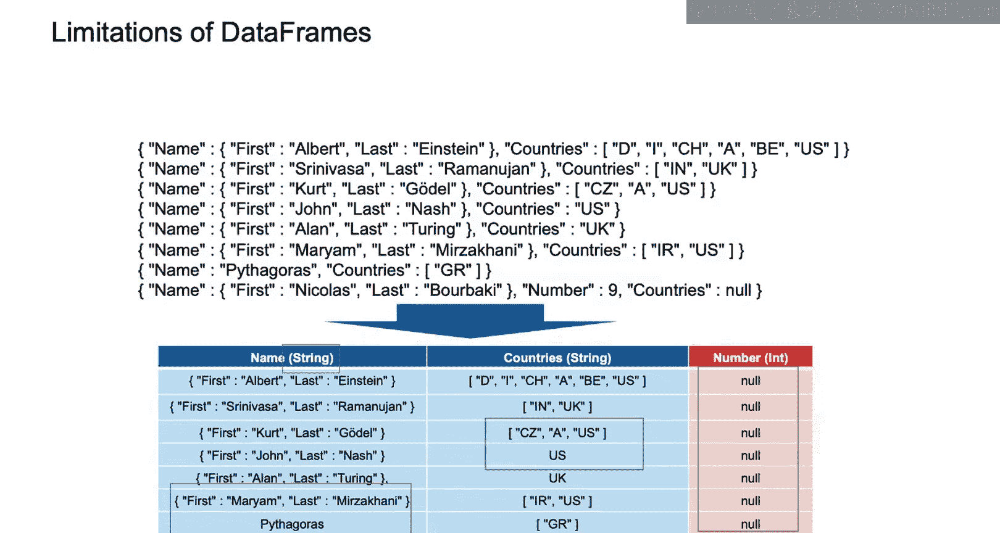

Now we also saw that these queries can become complicated right I told you this can easily give me headaches。

 right these lateral views and explode and so on it's very。

 very difficult to handle I think of the explode thing as some spooky action at a distance a bit like quantum physics because it has an effect on duplicating cells and so on so from a querying perspective it's difficult to comprehend。

😊，Now。Another problem with SQL is that there are questions。That seems simple in English， like。

 for example， who is the top commuteruter for for every event in Github。

And now you need to write it in SQL， and that was by Ingo Willer， he was a head TA father G。

 he wrote that in SQL， something as simple as saying what's the top comm in every event。😊。

When in Jason E， this is what it is。And the reason is the data is nested。

 even though you could do it in SQL， doing it in SQL is extremely costly and would cost you a lot of time。

 but with a language that has been invented to directly natively process trees and deal with nestedness and heterogeneity。

 suddenly it's much simpler。😊，RightSo this is the motivation for a language like this。Whos with me？

We are going to go through the language and that language will be easier to learn than the Mongo Db API is on an API。

 You could implement it on top of the Mongo Db API if you want it， but。

Hopefully the user would use the language computer need to move on with the site。Thank you。 Too fast。

对。Let's not let the let them see of four or rights， but maybe one day we'll get it in the lecture。

Okay， now I don't know what's going on。 I it that I need to。Load it again。 I don't know。

 Maybe I use the keys。 I think it's the battery again。Okay。

We have a data set that you will have in the exercise and that we also use at the exam we almost use it in every exam。

 do you know if we use it again at this exam I think so right？Probably we keep using this one。

 It's a heterogeneous data set that comes from Github。

 It's actually just a portion of it because the data set is gigantic。

But it's heterogeneous because the attributes are not always the same。

10% of the keys have mixed types。 It means that sometimes it's an integer， sometimes it's a string。

 even though it's the same key， right， So it's it breaks all of the rules right of a relational table。

 You cannot use Postgql with that。Or SQl， well you could。

 But it would be very complicated because of this。 So this is the a very good use case。 So the。

 the total data set last time we checked at 7  TB of data， but it keeps growing。

 So now it's even more。 Of course， on exam day， it's not going to be that big。

 I think it's just a couple of meby or something。😊，All right。So now we are moving on instead of SQL。

 we are putting Jonic。That is a language that can be implemented。On top of Spage base， Hadoop。

 Mongo Dbi， whatever you want， right。

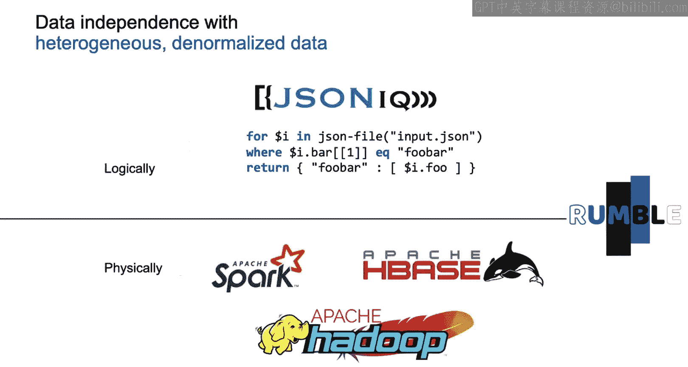

收。SQL like Jsononic， check three boxes that make them  query languages， as opposed to Java Python。

 These are not que languages。 The first thing is that it's declarative in SQL or Jsonic。

 you say what you want。 You want to select these columns where that predicate is。

 That is declarative。In Python， it's not declarative In Python， it's do this， do that。

 and by the way， do this and do that and so on。 So that would be imperative。

 So the first thing is declarative。 The second one is functional， what is meant with functional。😊。

Is that you have expressions in a query language that fit into each other。

 and it corresponds a little bit to function according in math。

But the beauty of a query language is to hide the functions because you would expect if you have a function to have parenthees or of other place。

 in fact that's what happens in the APIs， but the beauty of the query language is to be carefully crafted in such a way that it looks lightweight to the user right it is a functional language but it doesn't look like a functional language to the user right。

😊，But I come back you will see when we start using that， right。

 So it's like a Lego game and you just learn the pieces of Lego。

 There's only 37 in Jsonic and and then you just assemble them in any way you want。😊，And finally。

 the third thing is that it's called the set based language。😊。

The reason is that if you look at Java or Python， the values you return is one at a time。

A pointer to an object， a string and so on， but in SQL。

 you can return a table with a billion row in Jsonique。

 you can return a collection with a trillion records。

So this is why it's called a set based language because a single value can hold petabytes of data that's extremely powerful because we implement that on top of us of a cluster and with very powerful physical lever。

😊。

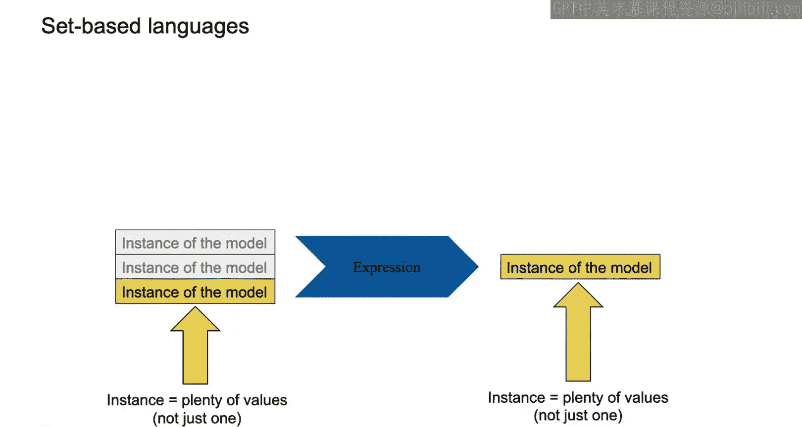

So it's a Le game。 It's really a Le game。We have an implementation that we use for these courserks and for the exam that's called Ruble DB。

 it's made at TTH。It supports S3， HDGFS， HGTP， the local F C Dame Asia， it can read JON。

 CSV packet that we saw text can be read as well roots that's for the high energy physicists at CEM。

 Libbes VM for machine learning and so on。And the vision is that Jason equal so。

Can be used for the entire ecosystem， including machine learning and so on。

 but that I'm not getting into in this course， but just to tell you the vision and Lake House is the fancy name that was dropped three years ago for this fully integrated system that has the database plus the machine learning in the same wood。

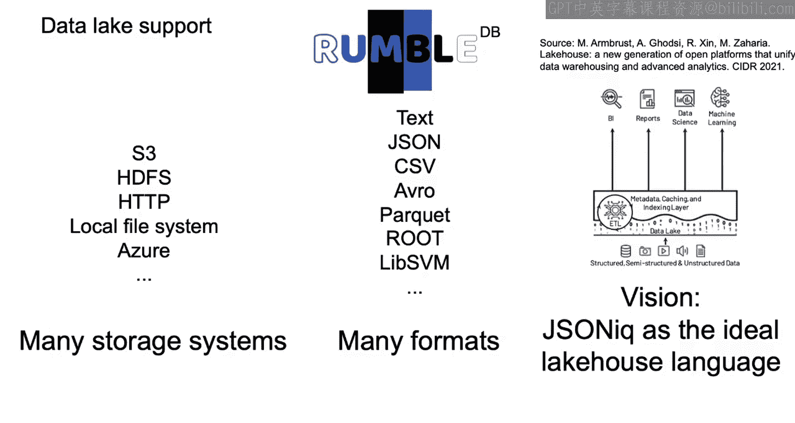

Just to show you how many people contributed to it。

 this was done by you or more exactly your predecessor。

 so this is a students efforts in many different projects and it became very mature with time and raph stable so yeah now I have David who' is currently writing his masterstasis with me。

All right， but what is it， It's really a data calculator， right， If you have a calculator。

1 plus one returns to So this you can do in Jsonic1 plus one return to that's a Jsonic query。😊。

That's also a Jonic query。 that's the Jonic query。 It returns the Boolean right so you enter two lower than five and it says true。

 you can put that in the Jupipyter notebook as Jasoni is going to say true。

But it's a fancy calculator because it can do many， many more powerful things。 For example。

 that's typically in functional languages。😊，You can say please give me Do i plus one knowing that Do I is2 right this is how you should read that if you assume that Do i is 2 then please give me do i plus one and that returns three that is a led variable many functional languages have a lead variable like that。

😊，We cool also is that since we are talking about Jason， Jasonique， Jason。

Arays and objects are also part of the language。 You can literally copy paste any Json。

 And that is also Jsononic。 It's just a Jsononic that returns itself。

 So if you put an array just returns the array， with an object， it returns the object， right。

 So technically， Jsonic is a superet of Json， right Any Json is also Jsononic that returns itself。

 But it's more than that。 because you can also， for example， navigate。

 So if you have an object and dot who that's going to extract the one inside， Who sees that。😊，Right。

 that's no longer Jason， right， now it's Jason， but the dot fu is going to go inside and extract the one that is associated with the fo。

This here， this double square bracket is going to take the first we start count at one in Jsic。

 the first value of the array is three。So you have theA 3，4 five。

 and then you're pickinging the first position。😊，That's a three and so on。

 Now that's a more complex one， you have an object with a key2 associated with the array 345。

 you should say dot who that's taking the array one is extracting the first one that's the three plus3。

61 do sends that。😊，You can also put that in arup on notebook that's going to work。All right。

 now what's also cool is that it I told you it's set based。

 it can also return billions of items like this。 for example， in that case， if I have fo is an array。

 I say dot fo now this square bracket after other fo is an unboxing。

 It's like opening a Christmas present So you take the array Dot who gives you the array and you crack it open3。

4，5。😊，That's basically a sequence of the three integers， you open the array。You can also say1，2。

4 is a range that outputs  one，2，3， and  four a sequence of four integers。

You have follow loops that allow you to iterate but in a functional way so for you for example。

 you're going to return an object with Do I as a key and Do I times Do I as the value for every value of I between three and five so you read for three for four and for five and this is what you get right the key has to be a string so of course the quotes would be automatically added back to make it a string。

😊，Who photos。Okay so this is the language we have I can even replace that with anywhere way I want it's a Lego game you can put anything you'd like anywhere you'd like in JSOonic and it just works then you can start reading data sets that's why I'm going to stop here here you read a data set from S3 you see you can directly pass the S3 path with the bucket and the files can be also HDFS can be your local file system you pass it to JON file it's automatically going into past the JO iterate over it return all the values and keys is a function。

😊，A built in function of Jsonic that extracts the keys。

 So this is telling you in that data set that might have petabytes of data and billions of objects very quickly it's going to return F and bar telling you these are the only keys that I found in that gigantic data set It's magic because actually there is Sp hidden behind that that Sp is completely hidden The only thing the user sees is Jsonic and that is thanks to all the students who manage to hide Sp behind Jsonic。

😊。

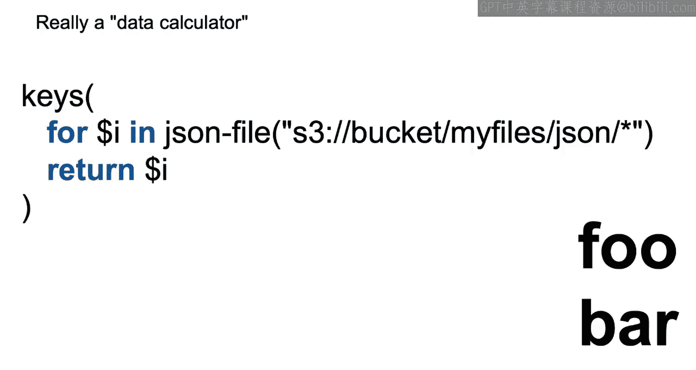

That's it， Thank you very much。😊，Next week we'll continue and end the Jonic lecture。

And then in the final week of the semester， we'll celebrate together the end of the semester。

 I will give you an outlook， we'll talk about the exam we'll have a big quiz like I Gaga Hoer that I like to do in every course if you know the TV show Thank you very much enjoy the exercise this and I will see you next week at 8am for the continuation in the end of the Jonic lecture Thank you very much。

😊。

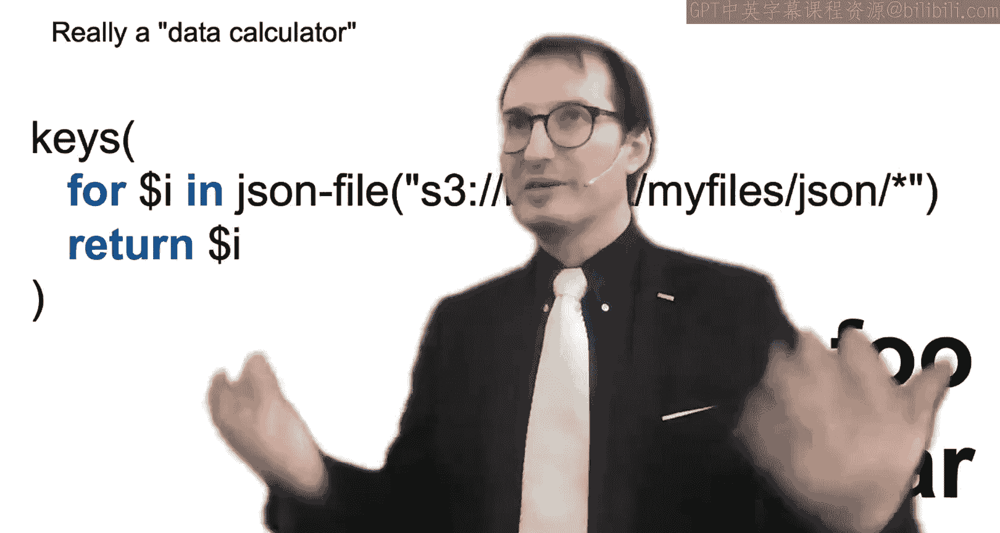

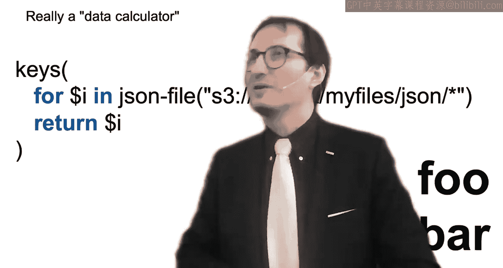