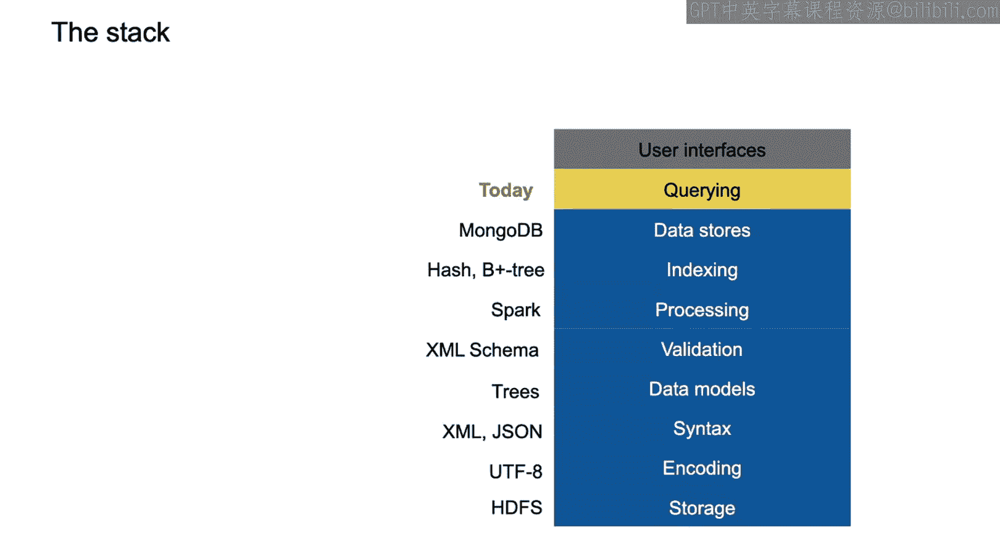
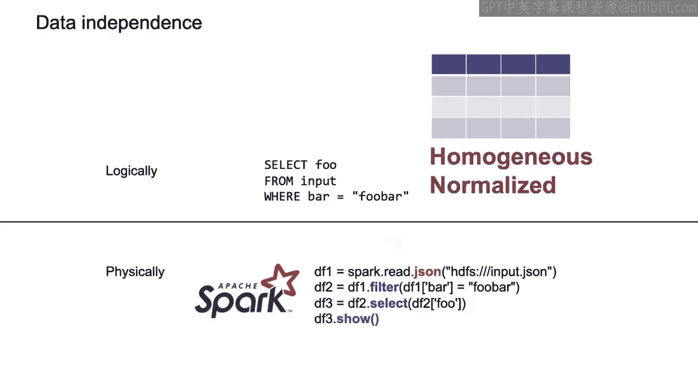
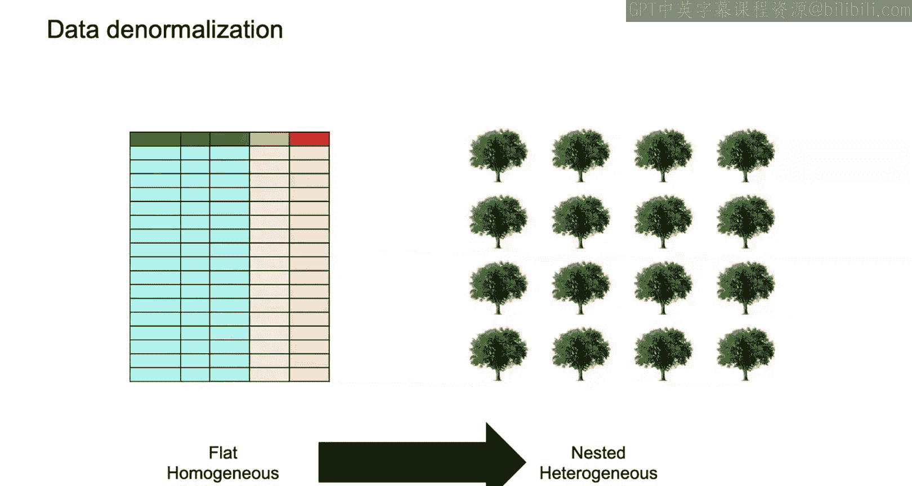
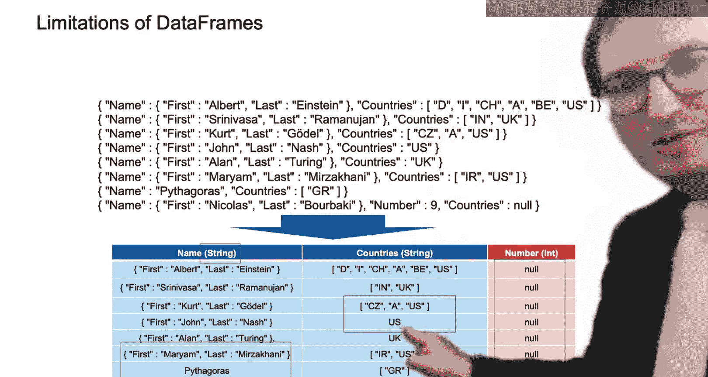
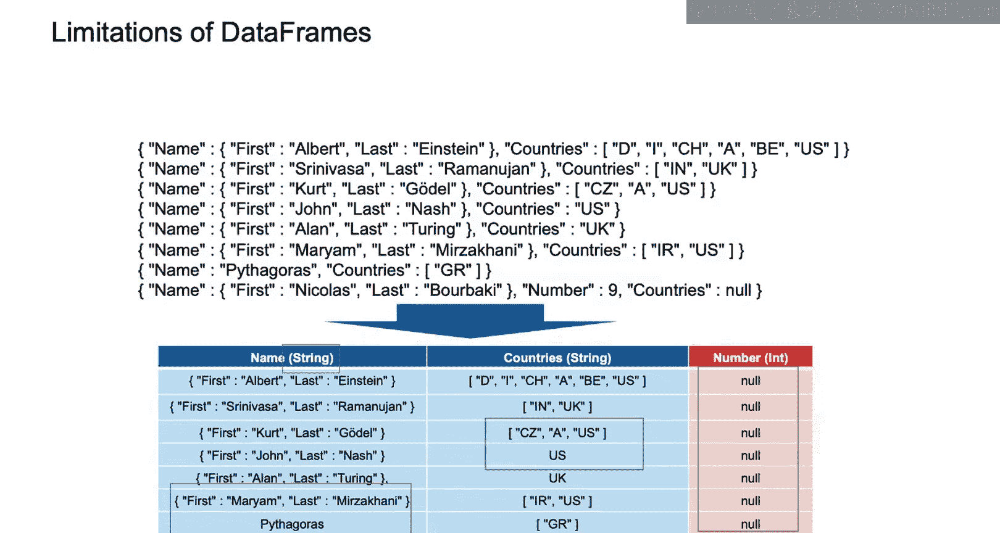
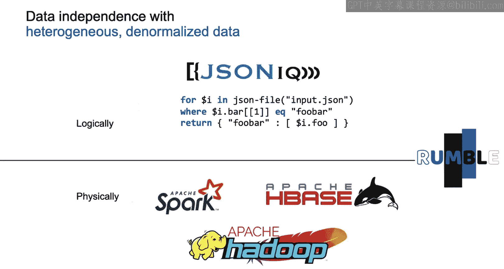
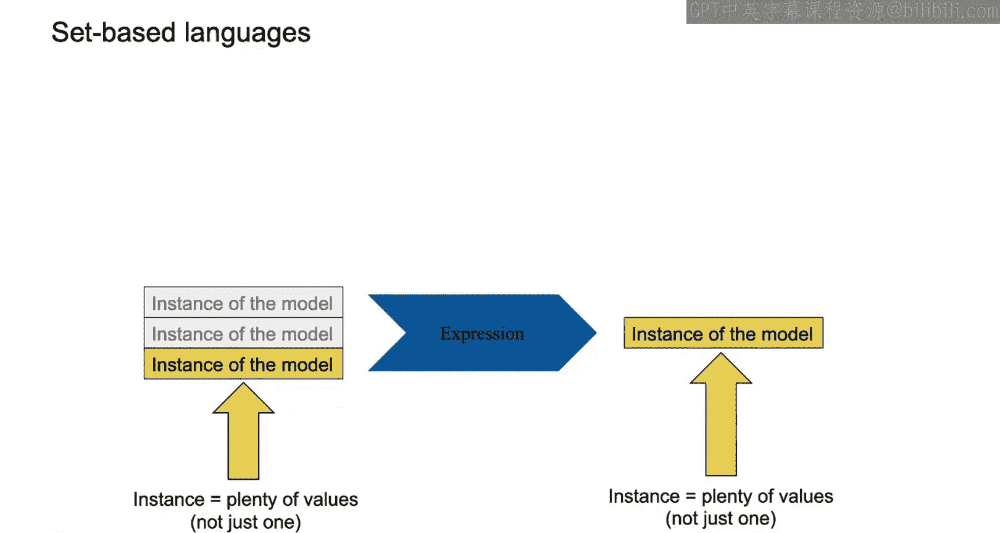
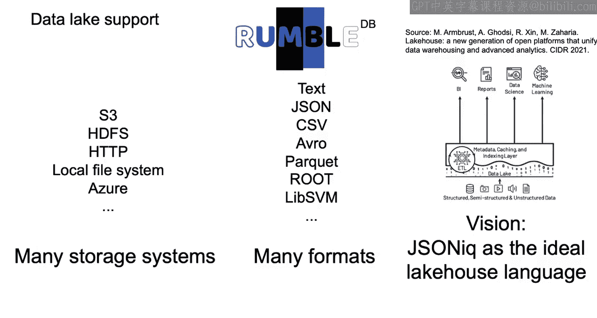
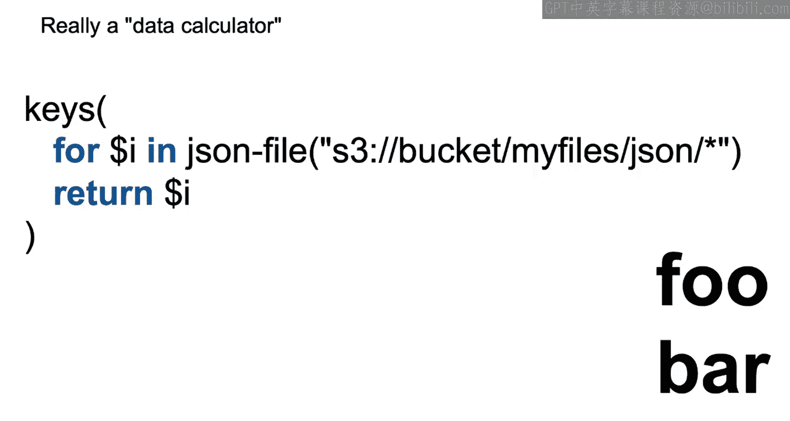

# 工程师的大数据：11：查询树结构数据 (1/4) 🗂️

在本节课中，我们将要学习查询语言与API的核心区别，并引入一种专门用于处理嵌套、异构树结构数据（如JSON）的查询语言——Jsoniq。我们将理解为何在处理真实世界的不规整数据时，传统的SQL和API方法会面临挑战，以及Jsoniq如何通过其声明式、函数式和基于集合的特性来简化这一过程。

## 查询语言与API的区别 🤔

上一节我们介绍了不同的数据处理系统。本节中，我们来看看用户与这些系统交互的两种主要方式：查询语言和API。

理解查询语言和API之间的区别至关重要。

*   **查询语言**：如SQL或Jsoniq，是一种独立的全新语言。它专门为表达数据查询而设计，与Python、Java等通用编程语言无关。
*   **API**：如PySpark的DataFrame API或MongoDB的JavaScript驱动，是对现有通用编程语言（如Python、Java）的扩展。它通过引入新的函数库，让该语言能够与特定的数据库系统（如Spark、MongoDB）进行通信。

使用查询语言通常更容易学习，因为用户只需掌握该语言本身的语法（如SQL的`SELECT ... FROM ... WHERE`）。而使用API则意味着用户需要同时学习通用编程语言（如Python）和该API的具体函数，语法上也可能更繁琐（例如大量的括号）。

## 为何需要新的查询语言？ 🚧

上一节我们明确了语言与API的差异，本节中我们来看看当数据不符合理想的“干净”格式时，传统工具会遇到什么问题。




SQL非常适合处理扁平、同构的关系型表格数据。然而，现实世界的数据往往是嵌套和异构的，可能包含缺失值、额外字段、无效值或嵌套表格。

以下是传统方法在处理此类数据时的局限性：



*   **SQL的局限**：SQL并非为原生处理嵌套和异构数据而设计。虽然可以通过`LATERAL VIEW`、`EXPLODE`等操作进行转换，但查询会变得非常复杂且难以理解。
*   **DataFrame API的局限**：当Spark的DataFrame遇到混合类型（例如，同一字段有时是字符串，有时是对象）时，它会强制进行类型转换（例如，将所有值转为字符串）。这会将数据清洗的负担转移给终端用户，后续在Python中操作会非常困难。

因此，我们需要一种能够原生、优雅地处理树形结构（嵌套、异构）数据的查询语言。




## 引入Jsoniq：树结构数据的查询语言 🌲



认识到传统工具的不足后，本节我们将认识一种专为树结构数据设计的查询语言——Jsoniq。



Jsoniq是一种声明式、函数式、基于集合的查询语言，专为JSON等嵌套、异构数据设计。

以下是Jsoniq作为查询语言的三个核心特征：

1.  **声明式**：用户只需描述“想要什么”（例如，选择哪些数据，满足什么条件），而无需指定“如何一步步获取”。
2.  **函数式**：查询由可以相互嵌套的表达式构成，类似于数学中的函数组合。但Jsoniq的语法经过精心设计，对用户而言显得轻量且直观。
3.  **基于集合**：单个查询可以处理并返回包含海量数据（如数十亿条记录）的集合，这得益于其在集群上的高效实现。

## Jsoniq基础：数据计算器 🧮

了解了Jsoniq的定位后，本节我们来学习它的一些基础语法，你可以将其视为一个强大的“数据计算器”。



Jsoniq语法简洁而强大，以下是一些基本示例：

*   **基本运算**：
    ```jsoniq
    1 + 1
    ```
    （返回 `2`）

*   **布尔运算**：
    ```jsoniq
    2 < 5
    ```
    （返回 `true`）



*   **绑定变量**：
    ```jsoniq
    let $i := 2
    return $i + 1
    ```
    （返回 `3`）



*   **JSON原生支持**：任何合法的JSON本身也是有效的Jsoniq查询，会返回自身。
    ```jsoniq
    {"name": "Alice", "age": 30}
    ```
    （返回该对象）

*   **导航与提取**：
    ```jsoniq
    {"foo": "bar"}.foo
    ```
    （返回 `"bar"`）
    ```jsoniq
    [3, 4, 5][1]
    ```
    （返回 `3`，注意索引从1开始）

*   **组合操作**：
    ```jsoniq
    {"foo": [3, 4, 5]}.foo[1] + 3
    ```
    （返回 `6`）

*   **解构数组（Unboxing）**：
    ```jsoniq
    [3, 4, 5][]
    ```
    （返回序列 `3, 4, 5`）

*   **序列与迭代**：
    ```jsoniq
    1 to 4
    ```
    （返回序列 `1, 2, 3, 4`）
    ```jsoniq
    for $i in 3 to 5
    return { "key": $i, "value": $i * $i }
    ```
    （返回三个对象：`{"key":3,"value":9}`, `{"key":4,"value":16}`, `{"key":5,"value":25}`）

*   **读取数据与函数调用**：
    ```jsoniq
    keys(json-file("s3://bucket/data.json"))
    ```
    此查询会读取S3上的JSON文件，并返回该数据集中所有对象中出现过的键的集合。`json-file`和`keys`都是Jsoniq的内置函数。

## 总结与预告 📚

本节课中我们一起学习了：
1.  **查询语言（如SQL、Jsoniq）与API（如PySpark API）的根本区别**：前者是独立语言，后者是现有语言的扩展库。
2.  **传统SQL在处理真实世界嵌套、异构数据时面临的复杂性和局限性**。
3.  **Jsoniq查询语言的引入**：它是一种声明式、函数式、基于集合的语言，专为高效查询树形结构数据而设计。
4.  **Jsoniq的基础语法**：包括基本运算、JSON导航、序列生成、迭代以及读取外部数据源。




下一讲，我们将继续深入Jsoniq，学习更复杂的查询操作，并完成这部分内容。在学期最后一周，我们将进行课程总结并准备期末考试。


---
**注意**：本教程根据提供的视频字幕内容整理，保留了原讲师的讲解逻辑和核心示例，删除了语气词，并按照要求进行了结构化编排和格式化。文中的代码块（如`1 + 1`）用于直观展示Jsoniq语法。