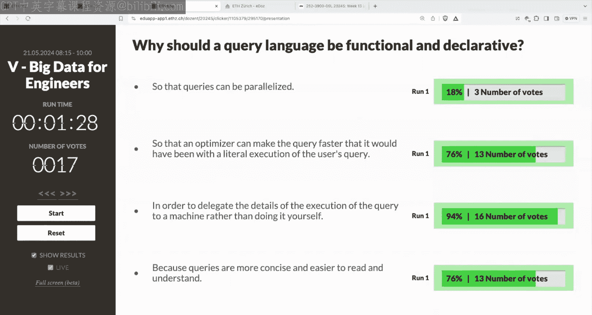
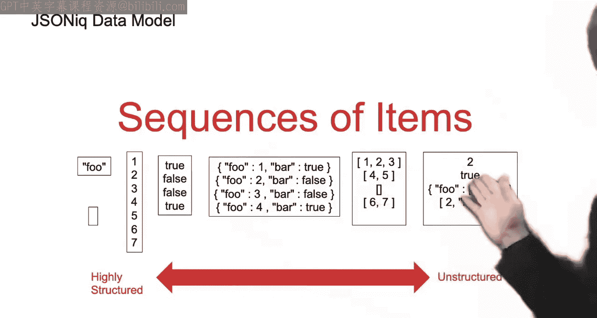
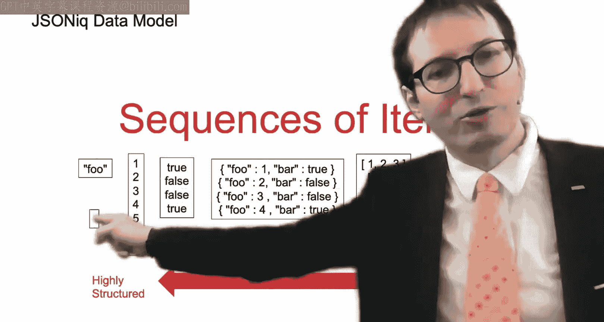
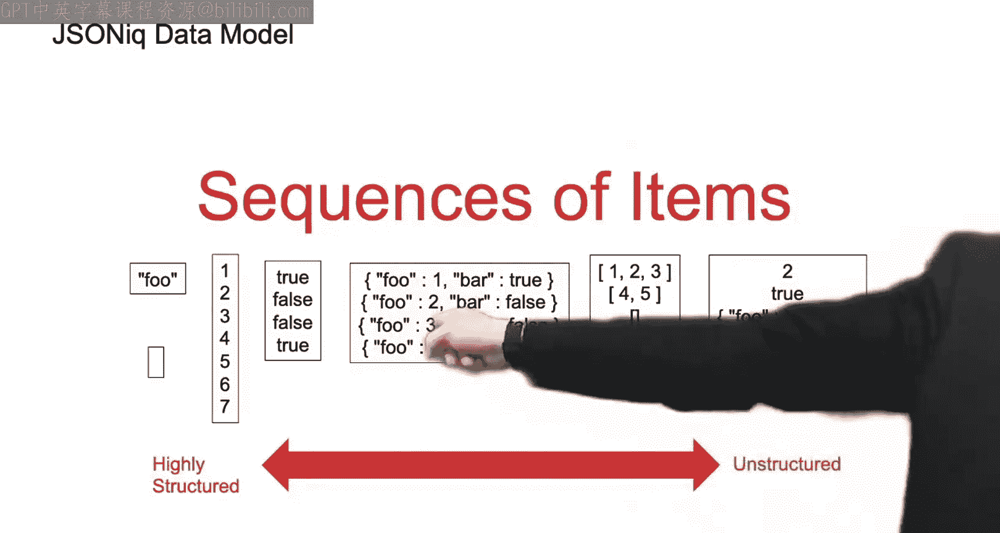
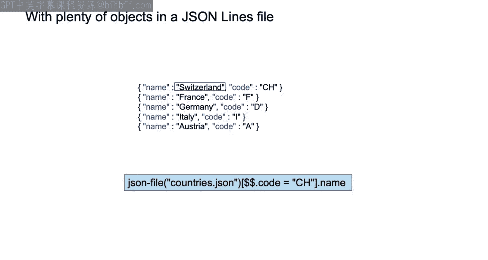
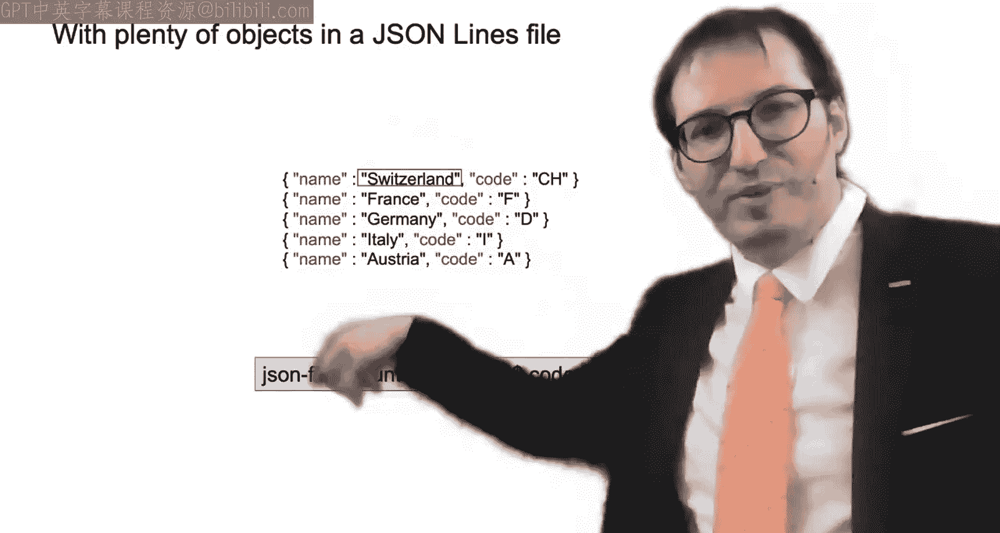
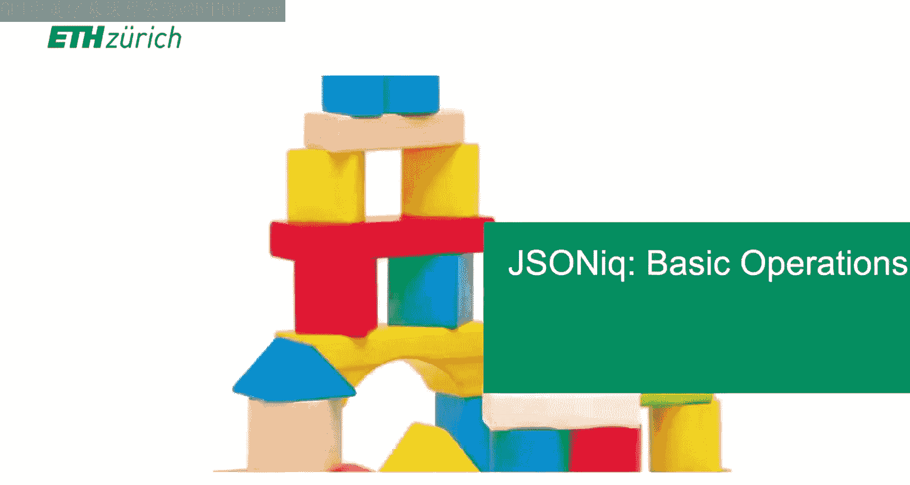
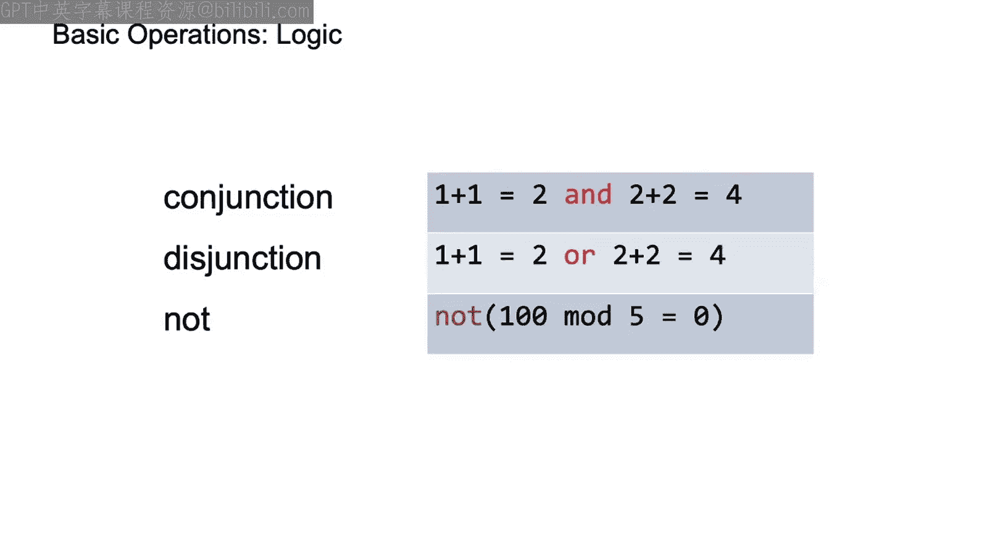

# 苏黎世联邦理工《工程师的大数据｜Big Data for Engineers - ETH Zurich - 2024》中英字幕 p31 11. Querying trees (2_4) - .zh_en -BV17FAmeFE9K_p31-

Welcome everybody on Zoom， welcome everybody in a lecture hall， welcome everybody watching us， build。

 watching us from the future preparing for the exam。

So today is the last lecture in which we will have new material I will simply go through this and finish next week we'll have a wrap up of the of the course we'll have a big quiz game where everybody can participate a little bit like ice gaer wounded and you will play against all the Ts who will be here I hope a few of them and and then that will be then we we let you prepare for the exam the date was announced it's in January I think 20 2021s。

23rd one of the two I have to course is August 20。One or three， I don't know。 Okay。

 so let's go through the through the material before that， I will ask you a few questions。比如说。

Help me wake up， because it's 8 AM。Soup。Here is my question to you which of the following objectives qualify a well designed query language。

 for proposals， two of them are correct， functional， imperative， low level， declarative。

And by the way， it's August 21st， I just checked August 21st at 2 pm and normally you should receive the information in your mailbox。

Okay。So nobody says low level， that's great。 means that data independence。Is well understood。

Imperative is losing grounds。 functional is gaining grounds， declarative。Many people agree。

And the top two1 cells are， in fact， correct， indeed， functional and declarative。

Dlarative means that you just say what you want like think of SQL， select from where and so on。

 you say you want the projection and the selection ordered by this and that。

 this is declarative functional， means that you can build the queries in a Lego game fashion。

 you can nest the query inside a query， which you can not really do in Java C++ but when you have a language like SQL or as we would see Jsononic and you can actually nest the queries inside the queries just like you nest the tables inside the tables。

 there is some dualI here。Low level no， because the whole point of data independence and the whole point of designing query languages and database management systems is so that people do not have to do anything on a low level。

 it's supposed to be all hidden So basically the engineers who design the system go through all of that trouble and agony of implementing in the low level in such a way that nobody else will ever have to deal with that again。

 So this is the whole points of data independence and imperative that would be a language like C plus plus Java and so on and then you tell the computer what to do。

 but again， the spirit of data independence is that you don't have to tell the computer what to do you just write your query and that's it And then the work of writing it in an imperative language is done by the engineers who implement it to implement the system。

 not by the users of the system for whom does that make sense。Okay， so dec clarity and functional。

 that way。😊，Is it so that queries can be paralyzized。

 that we want a query language to be functional in declarative。

 or is it so that an optimizer can make the query faster than it would have been with a literal execution of the user's query。

 or is it in order to delegate the details of the execution of the query to a machine rather than doing it yourself。

 or is it because queries are more concise and easier to read and understand？😊。

Mip per on cells perbo。Why should a query language？Be functional and declarative。

 Think of data independence。Multiple answer possible， so you can put every answer。

That U P is correct。So。See what you're saying。You like。On sales， B， C and D。

 on A is not very popular。Okay。😊，Well in fact， everything is correct all of that are benefits of a functional and declarative  query language and the parallellyism we haven't well we talked about it with mapreduce and Sp。

 but in fact I will show you how we can actually also paraes SQL Jsonic anything So all of these are good reasons right sounds great right to have all of these all of these benefits。

😊，From well designedque languages。Okay， so now I'm going to switch back。To the slides。

Then we'll take it from there。It just needs to let the computer do whatever it needs to do。

Exactly no it's there， okay。So I wanted to ask you these two questions to remind you of the context of why we are doing all of that。

 why did we have SQL， why did we see SQL again with Sp SQL and now why do we have yet another query language that is also functional in declarative and as we will see SQL is for tables and Jsononic is for collections of trees。

Okay， so this is where we are。 You see， we' almost done user interfaces。

 We live out of the scope of the lecture， but I'd say a few words a few words next week。

So just to remind you of why within another language and why SQL is not good enough because a lot of companies are trying to push SQL as also being the solution for collections of trees。

 but here's the problem when you start when you have simple queries that's fine you add a few dots to SQL you add explode and lateral view and so on but as soon as you have more complicated queries and it doesn't need to be complicated in English like what are what are the top comms for every Giub event。

 something thats simple and this is how you end up implementing it in SQL using the older index and this is how it simplifies if you have a language that was designed for semistructured data for collections of trees。

Okay， so now we are going to dive into JOic， you've already had many tutorials during the semester in order to make it a bit smoother so that not everything will be new to you。

Who followed the tutorials this semester？😮，That's great， all right。

 so it will simply it will make it easier for you to understand what I will explain today。😊，Okay。

 the first thing you notice by the way， but I come back to that is that order by group by。

 you see you recognize the four is a little bit like the from the return is a little bit like the select。

 but you see it's actually very similar but with a lot more expressive power。😊，Okay。

 so this is the dataset I told you about last time。

 the Github data sets that we also use at the exam。

 So you will also have the small path of that on the exam computer。

 It's a nested and heterogeneous You have 100 attributes in every event。 But in total。

 there's 1300 different ones。 So you have a lot of sparsity and a lot of missing attributes or extra attributes。

 And you have mixed types。 It means that the same path can be an integer in some event in some objects。

 And it can be a string or an array in some other objects， right。Event， by the way。

 has nothing to do with databases。 Event is a Github。 So right， in Github， they。

 they could it an event。 So each object corresponds to a Gith event when somebody pushes to a repository。

 when somebody commits and so。All right。And again， the overarching goal is to have data independence with JSONI。

 just like we have it in SQL， we can have it on top of Spark on top of mapre on top of age base on top of anything right on top of also reading the data on your laptop。

😊，All right， the language doesn't change an illustration of this， this is where I stopped last time。

😊，Is that this query？That asks for all the keys that there are in a data set。

If you do sQing can be inconvenient right because if you just download a dataset on the internet that you know nothing about。

 you don't even know the schema， you have no ideas what there is in there there is something called data discovery where you try to explore to understand what the data is all about so you don't even need know the schema you don't even know the columns and you have a trillion objects in there with just these lines you can actually get all the keys。

 all the columns basically of of your objects right so here we iterate over all all the JO objects JSO file just reads from the backend it can be anything here it's S3 where you put the S3 you can package it as a URL then you have the name of the buckets and then the name of the objects which may include slashes because that emulate the file system but that will cover right it's just a bucket ID and an object ID really。

So when we iterate over all of these objects and we feed it into the keys function。

 right there's a function called keys， that function is outputting as strings。

 a list of the unique keys， in that case， maybe just to when bar。😊，But the thing is。

 it works exactly the same if it's a small data set that is sitting on your laptop。😊。

Or if it's a petabyte scale data sets on on an Amazon cluster， it's exactly the same query， right。

 and it will sps the Sps the two the， the two keys in that case。 Okay， it works for Jason。

 It works for Paque。 You know， it's exactly the same query for Jason or Paque。

 But now think a little bit。😊，Now， the physical implementation of that， right。

 on the logical level iss the same。 You have， you have a collection of trees Jason of Parkque。

 you want to know the keys。 Who thinks。So what do you think is going to be faster。

 It's the same query。 Do you think it's going to be faster with the adjacent data or with the packet dataset sets。

 Who thinks it's going to be faster with adjacent data sets。

We think it's going to be fast start with the packet data set。A lot of race tense， why？

Why is it going to much faster， like massively faster with parking？Can anybody tell me。Or in Zoom。

Yes this is a binary format so this is part of the explanation。

 so but the binary format means that it takes less space。

 but there is something even more than that it's you don't even need can you understand that if you have a park format you do not even need to read the data。

Why do you not even need to scan through the data with Pque？There is a schema， yes。In a packet file。

 you first have a schema， and then you have the data。😊，But what do we want here， We want the keys。

Who on the sent that they are in the schema。RightAll you need to do is look at the schema so you don't even need to look at the data。

 you can have petabytes of data， just open each file。

 look at the beginning of the file with the schema and take the keys and that's it So you see the magic of data independence is that it's exactly the same query but magically turns out that this implementation is going to be much more efficient and faster than this one but for the user it' the same。

😊，Okay， who's with me on that？😊，Okay， so again， remember， it's exactly the same query。

 It's just magically faster， depending on the implementation。 Now。

 there's a huge ecosystem of languages。 It hasn't consolidated like SQL。

 SQL is completely undisputed。 I don't even think anybody in the world would dare。😊。

Sugest another language than SQL to query tables， flaps tables。But we cannot say the same。

About trees。 somehow it hasn't consolidated yet。It was clear already 20 years ago。

 even to the inventor of the SQL that we needed a different language for trees。

 SQL was not good enough， so some of the ideas behind these languages were also contributed by the inventors of SQL themselves。

But the problem is that first it took a while for people to understand this。

 and even today a lot of people still try to f sel to heat it with a hammer and hope that it's going to work on trees。

But the problem is that what happened there was a turning point at some point that suddenly people starting understanding that we need a language。

 but then they started inventing plenty of them like every time somebody discovers and has the epiphany within a language just even a new one。

 so now we have like 30 plus languages that are out there that kind of do the same thing they are at various stage stages of development。

 some are fully standardized others are just a draft or a tutorial but this is the ecosystem。

What I'm going to do today is I'm going to teach you Jasonic for various reasons first。

 it's one of the oldest ones， it's already 13 years old。It was。

 it's actually highly overlaping with xqueds borrowing。From Xquery， which is a standout。

 there was plenty of companies like IBM， Microsoft， oracle and so on that contributed to Xquery。

 And Jsononic is basically the same as Xque， but for JO instead instead of XMl。

 So that's the reason right there have been several like more than a decade of efforts by a lot of very smart people from a database companies right So I will go through that for this reason。

 but I don't know what will happen in 10 years， if the market consolidates or anything。

 But what I can tell you is that the features will look more or less the same the big ideas behind a language。

 it's just a matter of learning a new one。 but just like learning Python。

 you can easily learn Java or many other languages。 so we'll focus on the concept。Everybody ready？

Okay。So。When you design a query language， let's put ourselves in the head of a query language designer。

To do it cleanly without rushing。When you design a query language， you first need to decide。

What the data looks like， the data model。We call that first class citizens。

 the first class citizens of a query language is basically the objects that it manipulates。

Right in SQL that would be tables， so the data model in SQL would be tables that have rows and columns。

 of the rows some of the columns can be primary keys right and you have the sets or lists or bags of the records and that gives you a table that would be for SQL。

We need to do the same for Jsononic right and we would do the same for a query language for our graphs for a query language for cubes and so on right so we need to say what we are manipulating on the on the data independence level。

 right declarative and functional。So。First。It's called Jasononic manipulates Jason。

 So we're going to have strings。 We are going have numbers， Boolean and， in fact。

 we're going to be made to have many other types， right， But all of that we can manipulate。😊。

But we don't manipulate them one by one， as you would do with Python or or Java or an imperative language。

 typically。We have a language that manipulates millions。

 billions of trillions of these at the same time， it means that the firstclass citizen of the data model here is a sequence of items and sequence of items that will probably repeat 100 times until 10 a so don't worry about that is just because everything is a sequence of items what does an expression in Jsononic consume a sequence of items what does an expression in Jsononic produce a sequence of items Everything is a sequence of items right。

So a sequence of items is just a flat list ordered of items。😊。

It can be heterogeneous because we are talking about collections of trees， right。

 we might not have a schema。 So that that sequence of item。Can be a huge mess。

You might have a mixture of the。Some integers and some strings and some objects and some arrays and so on all mixed with no no order at all right no no order in the sense of no pattern right completely mixed So it's fully generic Now you see how already SQL stops at that point。

 SQL can do that。 SQL can only process homogeneous tables right that all have the same attributes。

 But in Jsononic we can have heterogeneous sequences of item it means that if the data is not clean that's still fine。

 You can still open it with Jsononic。The second thing。

Is that the sequences of items can be denoralized in the sense that the items do not need to be atomic。

 flat， the items can be trees。It means you can have objects and arrays in the items。And remember。

 when you have objects in a race。These are complex structures as opposed to atomic structures。

 so string integer bullolean these are all atomics， but if you have an object in an array。

 it can nest， you can have an object in an array in an array and an object in an array and an object in an object in an array in an array and so on just like the inception movie so this is where you end up with a tree and that we've seen in the data modeling lecture that when you have Jason objects in array and so on you end up with a tree from a data modeling perspective。

 who remembers that。😊，Right。So， we have trees。Okay。Then。

The next thing to know about sequences of item is that a sequence of one item is the same thing as one item。

 to canonequal identification。 if you're a mathematician。

 we just consider that there is no difference between a single item and a sequence of one item。

 sequences are flat。 you cannot nest them。 If you have a sequence and you try to put it inside another sequence。

 it's always flattened just like the flat map in Sp if you will， right。

 So here you combine a sequence of two items with a third item that gives you a flat sequence of three items。

 You never nest sequences。 There is never a sequence in a sequence。 If you want to nest。

 you need to use a race。 a race can nest sequences， it's only the outer level and they cannot nest。😊。

But the reason we do that is that we can have them by the trillions the items in a sequence because it's all flat。

Okay。A sequence can be empty that's totally fine， so a sequence can have zero items， one item。

 two items， three items， a billion item， a trillion item， a quad billionll items， right？And finally。

 the items， but that I've already kind of implied， every item can be an atomic item。

 string inte and on can be an object。😊，Can be an array or in that I'm leaving。

 I'm not touching that today， but just so you know， it can also be some function。

In fact that that could be a machine learning model or an LLM or whatever could be a function that you can also have in an item right but to not overcomplicate things you can forget about that for today we will not have any function items right atomics objects and arrays who is with me。

So everything an expression in Jsonic takes and produces either sequence of items that can be billions of items。

 can be fully heterogeneous， can have nested nests with a raisin objects and so on。Okay。😊。

Everything is a sequence of items。Now， what's nice about sequences of items is that they generalize tables。

😊，Because if you think of that。How could you express a relational table as a sequence of items。

 Do you agree that a relational table would just be。

A huge collection of flat objects that all have the same keys and the same types。 Who sees that。

Some of you focus on that part of the screen。Let me ask you pointing at this year。

 who agrees that this is a relational table。Right two columns who and bar who is an integer bar is a boolean so relational tables are captured by captured by sequences of items。

 but sequences of items are more generic because you can even have a huge mess and that will still be a sequence of items or you can have also a sequence of boolean a sequence of integers or a single value or an empty sequence and here are the relational tables So you see it's much more general than just relational tables that's the power of a language that is built for trees。

So you have the whole spectrum from highly structured to completely unstructured。

 that's all supported。And the reason again， because somebody asked the correct question， like。

 why do we need to support also data that isn't clean， because in the real world。

 the data is often going to be like this。So you need a language that allows you to write in Jsononic or whatever other language。

 you clean it up to turn it into something that looks like this。

 right because that belongs to the same language， once you have cleaned it up。

 then you can start using machine learning on that。 it's a whole ecosystem。

Okay。All right， so that it that's my data model， it means that everything that JOonic manipulates is a sequence of items right it' also refer to as an instance of the data model right an instance of the data model is a sequence of items okay just like an object is an instance of a class in Java or Python。

😊，All right。So let's now start looking into the features of the language。 It's like a Lego game。

 So I just need to give you all the all the Lego pieces。

The first thing you can do is navigate。So imagine that I have。

In that case I'm taking a single document well see also billions of documents but let's take that document it has an array of objects instead inside that's nested if I use JON doc not JON5 JON doc opens one document gives me a sequence of one item it gives a sequence of one object okay so that returns this object right there。

😊，Now， if I add dot countries， it navigates inside that object。

 dot countries is going to go down and take the value associated with countries， which is an array。

 and an array is the same as a sequence of one array。

So this query here returns the sequence of one array。Who's with me？Okay。Now。

 what happens if I added this。This is called unboxing， I open the， right？

I open it up and I take what's inside。 This returns a sequence of five items in that case。

 five objects， right， and that's it。 Who agrees。Okay。

 so that's this double square bracket opens the array into object。 And then if I add dot name。

 it navigates further， but you see it， it， it does it on every object that now I'm going to return a sequence of five strings。

G have send this as well？Okay， so this is called navigation。

 the ancestor of doing things that way' called Xpath that's also a W3C standout。

 it's done with XmL using slashes， but in Jason with dots。

 it works in exactly the same way and the dots shouldn't be very surprising because you also see them in Python to access dictionaries。

 even though the square brackets can also be used and the same in Java in C+ plus in many languages people are used to using dots to navigate objects。

Okay。I could also do it with codes。 Then I also get a sequence of strings。

 But you see this is how it works。 So you see how with very little code。

 I managed to do something like that。😊，Now what's this， this is a filter， it's a preddicate。I'm just。

Looking for all these objects。The ones that I took from the array， I'm looking for all the objects。

The code of which。I speech。So in order to do that， I need to build a predicate it's some sort of formula that would be a lambda in if you think of a spa filter transformation and you put a lambda in there with a predicate function that's the same and here the variable so each object is the dollar dollar the dollar dollar is one object at a time one of them and every time I do dot code so for that when for example overall there dot code will be C then I compare to C returns true so I keep it if I took the second object friends dot code is F equals C that's false so I don't keep it think of a spa filter。

 in fact it is implemented with a spa filter behind the scene you it's just hidden from the user for who does that make sense。

So with this filter， I'm only going to return the first object because it's the only one that passes the filter。

😊，给。And you can combine these dots and scrub brackets and filters in any way you want in any order。

It just streams through the your collection， and then you can even continue with dot name and so on and then access。

 So this answers the query， what is the name of the country， the code of which is CH。Right。

And on the exam， you might have queries like this in English and you'll have to write down the Jsononic that takes care of it。

Okay， now if it's a collection of documents instead of a single one， just use JON files。

 JON F is going to return a huge sequence of objects and then when you have the sequence of objects you add a filter on code equals C right dot name and。

😊。

Alright。😊，So imagine you have billions of them right that's my collection it's the JSON lines that I told you about the format with one object on every line that could be on S3 or Asia or even on your laptop in your localified system。

 you open that file with this function then you filter on the code selects that object and that dot name return suits on this query returns a sequence of one string item。

😊。

Okay， that is Switzerland。Okay， now let's use that to do Schema discovery Schema discovery is again what I tried to explain you with the keys。

 you have some data， you download it from the internet。

 but nobody told you what there is inside and you just have to figure it out because you want to clean it up and prepare it for machine learning。

😊，So。This is a bit more like a geeky screen， right， what you would have if you do it on the shell。

 Of course， you also have the Jupiter notebooks that make it a bit nicer。 But in that case。

 I just delete it on the on the command line the window。So Jason file， blah， blah， blah blah blah。

 notice that it's not as three， it's HttP。 It actually works。 You can use J file or J doc with Http。

 it works just fine right It's just going to download it from the web So in that case we downloads that sample I think it actually exists if you actually type that in Jupiter download notebook book it will work it just wantsns you that that would throw 36000 objects at you and of course since it's so respectful of you it's not going to throw them at you it just wantsns you right and it's only going to show you 200 of them you can modify that。

 but typically if you have a warning like that， it probably means you don't want to print on your screen you want to write it back to a GfS you know some data lake because it's too large to fit on your screen。

对。So。Now you can use， that's a new syntax element， the square bracket one。😊。

Extract an item in a sequence。 We start counting at one in Jsonic， right。

So one means we take the first item in the sequence， so Jason file might return billions of items。

And square bracket one extracts the first one。 So these returns terms exactly one object。

 a sequence of one object， will agree。Who sees that etity？

That could be implemented as the spark collect one action。Who sees that。Inside。

 you can do a collect one。Hden from the user and that is what you then get and display to the user。

 Okay， now you start seeing how it plays with Sp that you can have spark behind。

Now keys is the function you already know so in that case that's a data set Gi archive and it returns here eight different keys。

 so now you can imagine some sort of data frame with with eight different columns right in fact it's not a data frame because the types are a bit of a mess it there's no schema but you kind of get that there are eight different keys in there。

😊，Okay。Then you can also navigate like this。 Imagine that now you see these eight keys。

 You see one of them is type repo aacttop a big type。

 so let's take type and navigate with dot type right now I do Json file dot type that's going to return maybe billions of strings that all correspond to the types and it might be that there are also arrays and objects in there。

 I don't know right just so far they have strings since it's heterogeneous。

 it could also be other things than strings。😊，Okay。

 now what if I would like to know all of the unique values that are in there。

 because here that that might be billions when I just add a function called distinct values。😊。

Arounds the whole thing， because I have a sequence of strings。

 distinct values is going to eliminate the duplicates。

 and now this is it that's just all there is as distinct values。😊，Who sees that again。

 you can actually do it in Sp with a distinct transformation。You remember？

You can all do that in Spk so it means that this also work if they are a trillion object in the collection will work just the same way because in the background can you can actually use Spock。

😊，Then the same we've created that。 So here it's account like imagine that you want to know how many distinct values are therefore created at and it tells you there are 3597。

😊，Right。What if you want to count the number of items in the collection just use counts around the J file telling you there's 36 Now you can scale up it works just fine。

 even if you have a bigger file so here I downloaded a bigger one locally so I don't have HP anymore because I'm reading it from my local local drive I have 200。

😊，What if I want to skate even more， when in fact you can go there and download anything you want。

 it's all these these zipped files that contain the data set。

 there is one every hour technical and new file every hour。

And then you can download them to your laptop。That you will quickly notice。

 it doesn't fit on your laptop。 So it's actually a better I D to download them to S 3 or to to H GFS or whatever system you want。

 But basically， once you have download it， a lot of these data may be a few terabytes or a few payytes to to H GF S。

And assuming that HDFS is the default file system you read from star。

 JsonjegZ is going to take all of these files and you see this query is just one line。

 it's just one line but you might be reading from 1 thousand different files from petabytes of data and here I actually did it I executed that query I put it on S3 I think and executed that on the Amazon cluster and it did answer me。

😊，2 billion13245097 objects， and that was relatively fast because again。

 that's done with Sp in the backgrounds right you just have a creation that opens the collection。

As an RD and then you call counts as a Sp action inside and it returns the total number what's magic is that it's exactly the same query。

 You see it doesn't matter where you read it from， It doesn't matter how large it is。

 it's always the same query and you don't have to to worry about how Sp would do it because that's all hidden and implement for you。

😊，Who is with me？All right。Let's continue so let's do it with a field now you imagine you have an enormous petabyte data set and you do dora dora dot type equals push event so you're asking for the ones that match push push event you could also put an equal sign in there instead of AQ there is a subtle difference but it works too and now it's going to output the subset of the events that are of this type right and you see on the first row of the object type push event right so that fulfills the predi gate。

Okay， so that's how you can filter again， it would be a spark filtering transformation behind the scene。

Okay， so that's a bit of exploration， try it， download the data set from the internet as Jason。

 Parkque， whatever， and you can go ahead and query it in that way to discover the schema。Now， let's。

Dive bit into the language。 What about constructing new items。Well。

 that's actually an easy part because it's a declarative language。

 So if you want to construct a new item， you just write it down。 and in fact。

 every JsonN value is also a Jonic query that returns itself。 This is Jonic。

You can type that in the Jupiter download notebook book like stringingF and it returns itself。

This is all JSsononic you can uselash the backslash escape just like in JON that works in JSOonic2。

 and these are all queries， these are three different queries that return one item one string。Okay。😊。

This is the same with the numbers so you can have 42 blah blah。

 these are three different queries and they just return themselves， they return the numbers。

Note that in Json， they are only numbers， right， just number。

 But Jsik is a bit smarter because it has the whole type system that we saw that we covered out with Jso back then Json schema。

 It's the same as in Xml schema。 It's exactly the same list So it's smart if it see there's no doubt it's going to make an integer。

 if it see that there's no power of 10 is going to turn it into a decimol with the infinite any precision。

 not infinite， but an bounded precision and double for the scientific notation right is this I E 7，5。

4 stand out for 64 bit double computations。 with with me。So these are all queries in Jsonic。

 these are also queries， true false， these are queries that return bullolean。

 right true returns true and false returns false。😊，Now。

 what about other types that's called the cast？So if it's something else。

 you can create any other type like long insh bite and so on。

 all the atomic types just puts the literal inside a string and then wrap up with a casts you can create a nonnegative integers。

 you can create a time if you use the time format or date time and so on any of these even heg binary if you put the base 16 base 64 binary if you use the base 64 encodecoding and so on。

 So that's how you create any types。 So you see how Jsononic doesn't limit itself to just number string Bo nu it can support any of the types that you find in Xm schema。

 Jso and so on。😊，Okay。😊，Goods。Now how do you construct an array when you just write down the array here it's an array of object you agree with that that's Jason right that's well from Jason well it's also a JO E you can put any well from Jason put it in there。

 it's just a JO E it's just returning itself right so that you will get exactly the same thing in the outputs。

What about sequences， when if you want sequences of several items， just use a comma。😊。

So here we have a sequence of four items returned by this query， an array and then a boolean。

 and then a string， and then an object。I told you that it's heterogeneous。

 so you can actually mix that with with any problem， right。

 The items do not need to be of the same type。You can also use two in order to bid sequences。

 this beat the sequence of 100 integer items。who' is with me？Okay， so that returns 100 integer items。

By the way， if you do one to one billion， you could also write one to one billion。

 you end up with a sequence of  one billion items。But Jasonsonique is going to be smart enough to actually do it in parallelhalil。

 So if you're on an Amazon cluster and you type one to1 billion。

 it's going to smartly create this billion inte of in Pahalel on the machines right for example。

 it's going to put on the first machine 1 to 10 billion then on the second machine 10 million and1 to2 to 20 million and so on and so on right So this is going to be very fast。

 even if you create a billion a range of the billion right only in Pahalel。

Okay， so that's to construct。So that you've seen if you did the truth story you already know what about arithmetic when you have addition。

 you have subtraction， you have multiplication， you have division division is DIV， not a slash。

 This is because the slash is actually used for XM in X path that's the reason why the slash is not reused so it's DID is inte division who knows Euclidean division。

😊，It's basically the whole part of the quots， right and then you have the modulo， right？Okay。

 so this is arithmetics。😊，Notes that arithmetics works in the particular case。😊。

That you're manipulating sequence of one item。So you have on the left one item you have on the right one item you add them。

 you get again a sequence of one item right it also works on the empty sequence if you try to use the empty sequence it's just going to return on the empty sequence right however。

 if you try to use it on things that are not numbers like string and so on then that's going to return an error。

For advanced users， it actually works also on date。 If you put a date on the left and a duration。

 a number of days on the right， it is actually going to return the date。

 adding the dates to the date。 So it's actually smart enough to work also for date time。

 But just focus on numbers right now。 So this is an error because you cannot add an integer to a string。

And that is an error too， because here you're trying to work on sequences of more than one item on the left you have a sequence of two items。

 so you cannot add two to a sequence of two items it needs to be at most one item on both sides with with me。

Okay， so that's arithmetics。Now if you want to concatenate。

 you use the double vertical bar or you use the concat function， string join is very。

 very useful if you have a very large sequence of strings like1 thousand strings and you want to concatenate them but put a points or a dash in between the strings。

😊，Whoever tried to do it in Python or Java knows that it's not straightforward because you need to make sure that you don't add it in front of the first one or after the last one。

 So it's actually not so easy， but with a string join in a functional language。

 it's actually much easier substr takes a substr of a string So a part of it string length that would read on6 in that case that's the usual thing you have in many languages right So there's plenty of built functions that work on strings very similar or so to exc formulas if you think of that。

So that's a there's。嗯。Like maybe 200 standardized functions， it's all standardized by the W3C。

 most of them， so all nicely documented and available online。

Then there's comparison comparison is just the typical signs equal different from greater than strictly greater than lower equal greater or equal and so on right so it's just just like in many other languages or even even in Excel with with me。

Right， so that should be the easy part。 Here it's an error because you cannot compare a string to an integer。

 Not that Mongo D B would not throw an error on that， right， But Mongo D B is very flexible。

 But in Gesonic， you do throw an error if， if you try to compare things that are not comparable。

Now a nice feature of this comparison is that it also works on sequences。In fact。

 when you do it on a sequence， it tries to find a match on both sides。

 it's going to return true if it finds an item on the left。

And an item on the right that fulfilled the criteria here is going to return true because you have the one that is equal to one。

In other world， whenever you use a comparison on a sequence of more than one item。

It's going to apply an existential。Quantification。RightThe exists in mathematics it's going to return true if there exists an item on the left and there exists an item on the right that fulfill the comparison criteria。

 who is with me。Okay， so in that case， for example。

 it's true because we have one that is lower than3。 and that's enough。

 You just need to find one pair like that。 And that's enough to be true。

 Here it's false because you will never find anything on the left that is greater than or equal to anything on the right。

So that we told force。Okay， and here it's an error because you're comparing a string to an integral。

 right？😊，Here that would be false， but this is simply because mathematically。

 if you try to use exists on an emity set， it's always going to return false。If you say does。

 does there exist a member of the empty set that fulfills that and that it's the empty set anyway。

 There's nothing thing in the empty set， right， So then there never exists anything in the empty set。

 So this is why if you have the empty sequence， that's going to be for， okay。

And how is it useful in practice Well imagine that you have a huge collection and you navigate it to the names so on the left you have the sequence of the names now you just write equal Switzerland and that's going to find written true if at least one of them is Switzerland so it allows you to have a very compact query that checks if your collection contains Switzerland。

😊，Right， so that's the I Okay， then you have logic and or not right so that's that's just the usual like in many other languages。

 it's just that in some languages like Java and is a Do m sense or is a double vertical bar in some languages here it's an explicit and an explicitlic or an explicit not right。

😊，Ws with me？So that you can combine in any way you want as well。

Okay。I think you did have a break， right？So let's take a break， 15 minutes。😊。

Then I'll talk about composability and I'll keep introducing other Lego components to the to the language Al right。

 so see you in 15 minutes， Thank you。