# 苏黎世联邦理工《工程师的大数据｜Big Data for Engineers - ETH Zurich - 2024》中英字幕 p32 11. Querying trees (3_4) - .zh_en -BV17FAmeFE9K_p32-

Alright， let's continue our journey。 So now I present it to you a few of the components。

 There are more。 But the idea is that it's a legal game。

 You can combine any expression with any other expression。

 The worst thing that happens is that it doesn't make sense。

 and then you you get an error or something that is weird。

 but basically you can put any expression inside any other expression。 Here's an example。😊。

Where you have some complex expression with plenty of expressions inside expressions。

 Let's see what it does， two plus two that gives you four。

 Then you have this big object dot B so that extracts the array。

 Then you have the unboxing of the array pops it open。 Then you have dot a that extracts 4。 then 1，2。

4 gives you 5，5 to 50 gives you this。 Well agree。Who doesn't agree？

You can just look at it offline right， just take this and you just lack your mathematical formula that you compute step by step。

 tech， tech， tech， tech， tech， tech。😊，And that works with any expression， insight。

 any other expression。

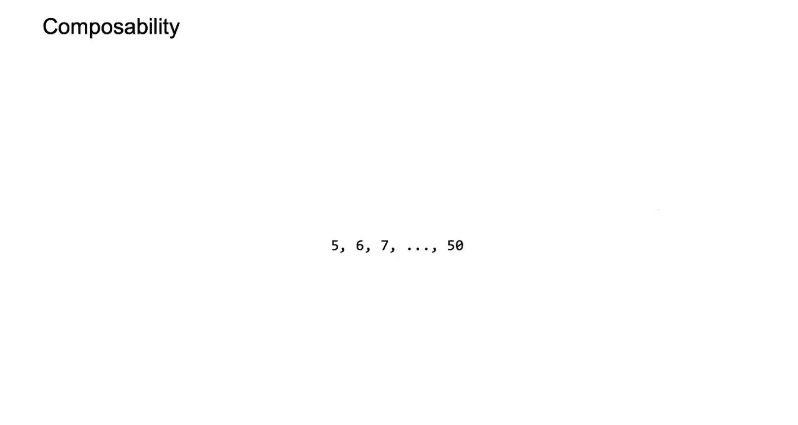

Now， just a word of warninging， you know that in mathematics。

 you learn that multiplication has precedence over addition， right？😊，Do you remember these rules。

 if I tell you2 plus three times4， that's 14 right because the three times4 has to be done before the two plus。

It's the same here。 In fact， when you have a functional language。

 you also need to design a few precedent rules that tells you what has priority of what。

Now I don't know for you， but I'm a human being and my brain is a bit limited。

 so I don't know that who lives by half like we would know for multiplication in addition。

 but you know what to do right just use parentheses right if you want to overwrite precedes you can use parentheses but also if you don't know then use parentheses right then you're sure that you get the prence in order right just for reference I puts the actual order in here mostly with the highest pres at the bottom and the lowest one at the top but again just put parentheses put parentheses you're safe you know exactly what is executed in what order。

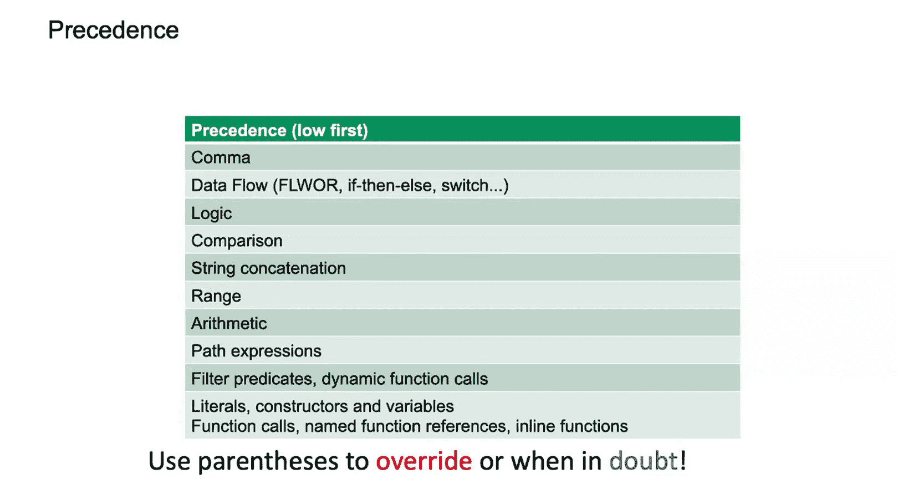

Okay， now one of the benefits of the Lego game is that you can make Jason dynamic。

 it means that you can build something that looks like Jason except that inside you nest a query。

 for example， you can have here an object where you you build some things dynamically for example as the value for at it's the string of fubar that's going to be a6 and then inside the array you can nest a four return expression it's called flower I come back to that for every eye in one to 10 return as a long so here it's an array of long integers64 bits and that's it and you have that object so you see how it's a better Jason it's a dynamic Jason where you just write down something that looks like Jason and then you replace the path that you want to compute for whom does that make sense。

😊，Right by the way， everything I'm showing you， you can put it in the Jupiter notebook in the Docker。

 it just works。Okay now let's throw in a few more of the Lego components。

 there's the if then X expression， the if then expression evaluates the condition。

 if the condition is true， then it's returning whatever is in the then and if it's false it's returning whatever is in the else。

 right？😊，It's a functional if then is right， if you would look for the equivalent in C++ that would be the tanerary operator with question Mark and Colon。

 who's already seen that。😊，Okay， then forget what I said。

 That's just a functional version of the F S。 And it just returns either the Ven pack or the else path。

 depending on the。😊，Under the condition on the top okay。Then you have a switch case re。By the way。

 you don't have to use the switchcase return。 You can always do it with a cascade of if thennet right。

 but some people like the convenience of the switchcase return。

 you basically look at some value and then you look at all possible cases I it C is it F is it is it I and then you return in that case the language is that that are spoken in there right So this is a switchcase return Again。

 it's a functional version of that。 It just returns the sequence of items depending on what a value matches then you have a try catch who has already seen a try catchch。

In some languages like Java Python， it's basically to recover from an issue。

 Imagine that you divide by0 or something like that。

 then you can make sure that it doesn't crush the whole thing with an error but you recover from it。

 for example， imagine that you have country code and then somewhere in your data sets it turns out that it's not an integer and you try to cast it to an integer when instead of throwing an error。

 you instead return a string。So that's what it does。Okay。Now， let's get back here。 What can we do。

 So imagine that I have my data set Gi archive the one at the exam。I have dot payload do commits。

 so that's going to return arrays because if you look inside the object there's an object with a key payload that has a key commits and that's an array of object So if I do dot payload dot commits I get a sequence of the arrays of objects right。

And then if I add this。This unboxed operator， it's opening the arrays and it's flattening everything again because the sequence of item is always flat。

 So you see how I can navigate right now now that I am at that level。

 I open the arrays and get everything that was in the arrays。

 All of the objects that are in the arrays。 So these are all my， all my commits in any Github event。

 And then I can continue with dot author dot email and you see how I end up with all email addresses in the in the repository。

 right。😊，I'm not saying you should do it data protection and so on。

 but that's an example right everything that I teach you has to be done with responsibility right I'm teaching you to you the technology。

嗯。Size of an array。 That's the size function。 So imagine that now I go through the file with the Gi archive dot Jasonson。

 I filter。 what is my filtering credit case。😊，I want the size of the commitit array inside payroll。

 I want the size。To be at least 5，5，6，7， and so on。 So anything that has at least 5， Look at this。

 right。The first one wouldn't work because there's a D three， the second one doesn't work。

 the third one doesn't work the f array works yeah there's exactly five so the f array would make it through right and basically。

I'm returning all of these all of these objects such that the array is more than five and then I'm counting So what that tells me is that in my Github data set there are 5643 events such that if I look inside that events。

 the array located at payload commits has at least five elements with with me。

So that's just an example of combining a query。😊，I can also test for an array at an element as a specific position of an array。

 right， if I have， if I want to look at the first commter， if I， if I have all the commits。😊。

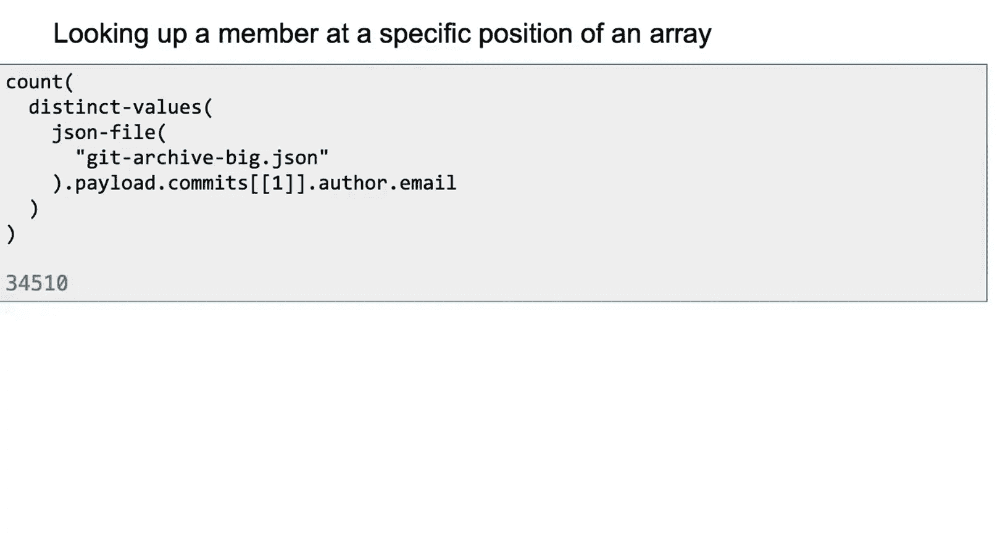

I want to look at the first commit。Then I use a double pair of square brackets。 Why if it's just one。

 it works on a sequence。

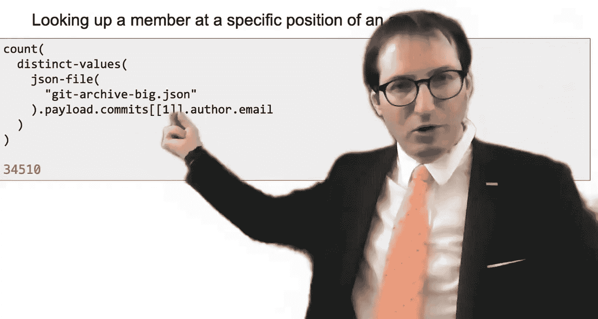

If it's two， it works on an array。 that's the difference。 So here for every one of these arrays。

 I'm taking the first item in there。

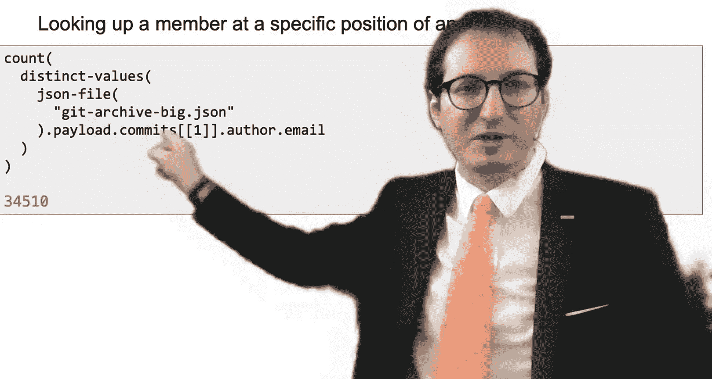

Then the author and then the email and I get 34，000 of them， right？

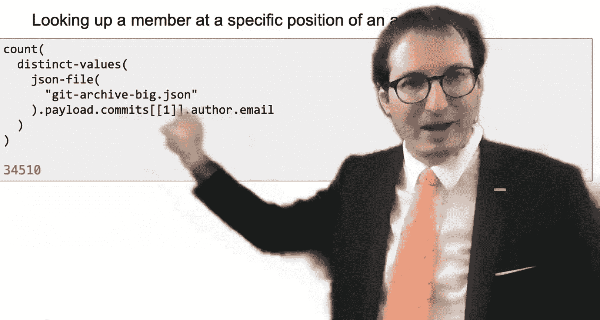

Then。Here's another one。Now I use a cascade of lets that was also in the tutorials that I give you。

 It's just a more step by step way of writing a query。 So I'm looking at the path。

 then I open the file that give me the events， then I look at the actors。

 There's plenty of them right then I look at the logins by navigating inside login。

 then I look at the distinct logins by calling distinct value on logins So you see every variable depends on the preceding variables right So when you write a query you can either do it like these by nesting expression in expressions or if you want to make it easier to read just do it as a cascade of lets the two style are totally okay if you have a larger query and maybe using lets is going to make it easier to read by a human being。

😊，Okay， Cornda sends that query。I just built on top of the past， who understand sense。A few brace。

 Okay， look at the tutorial。 again， I have a whole tutorial that explains that。

Lets are really convenient and almost any functional language that has that like if you look at Haski Camel。

😊，F sharp and so on。 They almost always have let in the syntax。 It's just a way to。

Explain your thinking in terms of step by step。Okay now let's are one thing there's also false for is an iteration It means that for every one of these events in the J in the JSO file。

 I'm going to bind the dollar events to one at a time one after the other and for each one of them NB commits will be the size of the array and for each one of them I'm returning the event ID inside the ID field and I'm returning the number of commits sets to the number of commits right so that's the list of my events but I only have the ID and I have the size of the array in a payload commits one understands that。

Right okay， that's what it does。 You see how now I use a4， I use a let。

 I use an object dynamically because I put the keys in there and then I dynamically populate the values right and you see the magic how it outputs right back at you a collection of objects。

😊，So since we've looked at this4 and thislet， let's look at flower because this is how it's called F is for4 L is for let。

 W is for where or is for order by and R is for return right it's called the flower expression。

 it's on purpose not the same order as the actual flower in English that was how it was called Baghend I suspect that it may have to do with the fact that one of the very early inventors。

 her name is Dana Floressco so it might be as an acknowledgecments to her work。

So here we have an example with the lead clause， so let dollar x equals two return dollar x times dollar x。

 so2 times two is4， right？😊，Then we have here an example of a four。

That iterates through the integers from 1 to 10。 So again one to 10 gives you a sequence of 10 integers。

 then the four is going to one by one binds Do x and for every one of these binding of Do x。

 you contribute one object when number is do x and the square is do x times Do x or whom does that query make sense。

And the results， too。对。All right， now what does the wear do when the where acts as a filter。

It means that here we iterate on all the values between1 and 10， but not all of them。

 the where is going to be picky about them。 It's going to say yes yes， iterate over them。

 but only keep those bindings for which Do x minus2 is strictly greater than5 right I could also by the way I could actually data size I could also have put the greater than sign in there I started to remove the GT Eq and so on because most of the time it's optimized and so you actually don't have to use explicitly Gt G E L E L T Eq and N E right so it's not that fine to just put greater than as the signine but anyway where dollar x minus2 is greater than5 So it means it's6 it's sorry。

7 is not going to work。 Ed 8，9 and 10 are going to work， right，8，9 and 10 past the filter， agree。

Okay， so 8，9 and 10。 So here you have the squares， Do x times Do x of 8，9 and 10。

 So you see that's what the where clauses do。 it just throws away。

 whatever doesn't pass the predcate。 So the way to look at these flower expressions is top down。

 You start at the top and you go close by close and you just go through the the flow of the of the bindings。

😊，Here's another clause orderbi if you know SQL that shouldn't surprise you。

Here we go over the collection， every object is bound once to dota x。

And then the order by is reorganizing the order of the bindings。

 Now we sought by population descending and then we return the name， right， So we have India， China。

 United States， Indonesia and so on， right。Who understands that query？😊，Okay， that's just like SQL。

 in fact， maybe it's starts looking like SQL because that would be in SQL select name from countries or the byp desk。

 right？You see it would be the same equalequQL。Okay， now you have goodbye。😡。

Goodupbye is also like SQL， but it's more powerful than SQL because this you couldn't do with SQL。😊。

So imagine that I have now， I create an object with all my continents。

 Then inside that or I'm going to compute the continents。 How do I do that。

 I iterate over other countries， And I have this group by。

 It means that I'm putting the countries in little packets。 Every packets correspond to a continent。

 So I say group by continent equals x dot continent that creates my packets。😊。

What happens is that after the group I， I'm going to have packet by packet。

 but now dollar x is going to be bound to the sequence of the objects in the same packet before the group by。

 it's one by one。 After the group by X has the packets。 So it means that for each packet。

 I create an object。 Con will be the name of the continent It， that's my grouping key。

 There's only one， right， That's the string。 And you see in countries。😊。

Doular x is the sequence of all the objects from the current continent dot name will list them。

 right， North America， United States， Canada and so on， who understands that query。

That's the group by。 you cannot do it in SQL because in SQL。

 the group by will only work with atomic values。😊，Everything that's not the key。

 you have to count some average and so on， but you see what happened here。

 we do not compute sum of the name or an average or anything。

 We just list them right That's the magic of a language that works with deommalized data because you can actually do this and you can output something that's not actually a table。

's it's nested data。 you have an array in an object in an array in an object。😊。

RightAnd that works with a query like this where you just nest the expressions into expressions。Okay。

😊，So now who understands intuitive what flower expressions do？Okay， so great。

 now I'm going to tell you more formally how to understand them。😊，Most of the time。

 you don't need that formality because it's just intuitive， but in case it becomes more complex。

 I want you to understand。The next thing I would like to tell you。Is that in SQel？

The order of the clauses is fixed。😮，It has to be select。From。Where。Good by。Having。Or by limit。Oset。

 who knows that by heart。Should know that by health， right， But it fixed in s。

 It has to be in that order， and you cannot change the order。 when in Jsonique。

You have full freedom on the order in which you want to put your clothes。There's just two conditions。

The first clause has to be either a four0t。😮，The last clause has to be a original。Apart from that。

 you can put the clothes in any order you want， so you could have。ALet， let for， let， where， let for。

 group by， let order by， let where order by， let group by for order by order by。

 let group by where Ri。And that's fine。 That's a flower expression。Okay， that's super convenient。

 And again， that was designed by the same people who invented SQL so they really were aware of the limitation of the select from where in SQL and they just came up with this generalized select from where that can have any number of clauses in any order right just far let first and return at the end that's the only constraint How does it work Well it's I have a visual for you。

😊，What happens is that you can actually visualize it with data frames， in fact。😊。

It is implemented internally with data frame。When you have this4 dota x。

You basically want to bind one by one。Imagine that each row in your data frame that is hidden somewhere corresponds to one binding and you call the column with the name of the variable so x is bound in turn to the integers from 1 to 10。

 then what happens is that the where clause is going to filter by executing the predicate on every one of the bindings every one of the rows getting full soft true and what happens is that you only keep those for which the where evaluation is true 89。

10 and you return that now you have a new new list of bindings of x to just 8，9 and 10 with with me。

RightAnd then when you compute the return for every row in your data frame。

 you compute that and that gives you the outputs as a sequence of three integraltes。

 This is called the string topper string semantics。😊。

It means that every clause technically returns a topper stream， a close is not an expression。

 an expression always returns a sequence of items， but a close is not an expression。😊。

So this is why it doesn't return a sequence of items。

 it returns a tued stream and think of the tupper stream as a data frame in this way with the visuals there。

This is on your visual because as the user of JO， you don't need to care about that。

 this is just for defining the former dissemantics and for the physical implementation。

Here for example， I have a four from one to five then theette is going to create a second column in my data frame。

 and then I return the product， this is what it returns who agree。😊，RightSo I go top down。

 close by close and I evaluate a data frame or data frame or data frame， Ruble Db。

 the engine actually beats these data frames， it means that it happens on Spk a spark data frames and it even works with billions of trillions of bindings in exactly the same way just because it takes the huges with data frames on a cluster。

😊，Okay， what about the group by Well let's look at it， Dola x score is going to create this。

 The group by。 So we evaluate the key every time。 now you see everything that has a one will be together and everything that has a0 will be together So the first。

 third and fifth row are together and the second and thought row are together and then you do it like this So y is the key So here it has the unique value and x now you group them together So now one。

3 and5 are together it's a sequence of1，3，5 and then the sequence of two4 you basically puts the even numbers on one side and the odd numbers on the other side who is with me。

😊，RightAnd then if you evaluate now using these bindings， the object， it's a dynamic object。

 then you create full one with bar three if you take the account of the sequence， so 13。

5 has a count of three，2，4 has a count of two， it returns this Who agrees， this is what is returned。

😊，Okay， for whom is that intuitive。

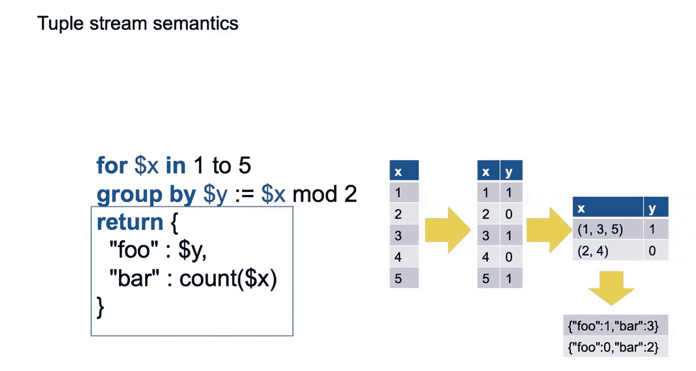

Right， great， so that's the goodbye and so on。 So now if I come back to to my examples here。

 what do I do， I it on the events for every event I look at the number of commits。

 which is the size of my array located at payload commits。😊，Then an order by commits descending。

 So it means that I， I put first those with a huge number of commits。

 and then less and less and less and less。 and then at the bottom。

 I have those that might have one or even zero commits， an M T array。

And then I project projecting means that I don't hit all the keys if I would just return Do events that would be the whole object Project says I only want the keys ID and type right it doesn't look like in SQL where in SQL you would put the names a list of names but that has to do with the fact that it's more flexible than SQL So you might want to to project on the keys dynamically and not as part of the query like in SQL it's again for flexibility So this is why we have a project function okay。

All right， so now you have a list of events by decreasing number of commits What do I have here now I want to group I want to build a histogram。

 what if I want to build a histogram of my events nicely bucketed by number of commits we know what a histogram is。

Okay， awesome， so I just good the number of commits right， look at the size。

 why do I have this0 one that is a trick？😊，That is a trick。 Let me explain why this。

Coma  zero and that one。The idea is that size even payload commits。It's flexible。

 It's a collection of trees。 So it means that commits might be absent。

 You might have some of the objects that don't have any payload commits。

If that's the case that's not going to throw an error， it's just going to return the empty sequence。

 So that's going to be empty。 S is going to be empty。What do we do when it's empty。

 I don't want to have something empty in my histograms If it's empty。

 I want to be zero and there is a small trick。 it's a bit geeky but what people do is that if they want to say if it's empty that's zero。

 they just happened the zero So now you have a sequence the concatetnation of that and that and then you take the first what happens Well if it's not empty this is the first one So if it's not empty it's taking this if that is empty then the first one would be the zero because then there would be no thing in there So this is just a trick to take to fall back to a value in case it's empty that looks like this Who understands it。

That's also something that in SQL would be more demanding。 You could do it in SQL， but makes it easy。

 So you see， even if the data is not clean， you have a way to clean it up。

Then you order by number of commits now you see it's nicely organized and then you have commits is the number number of commits。

 the count， that's the count of my dollar events here， right？😊，And then， you can。Copy paste that。

 save it as CSV or download it and put it in Excel or free office or Lib office or whatever。

 and get a nice plot or use Python Matplot Le for example okay。

So this is the software things you can do using Jonic。

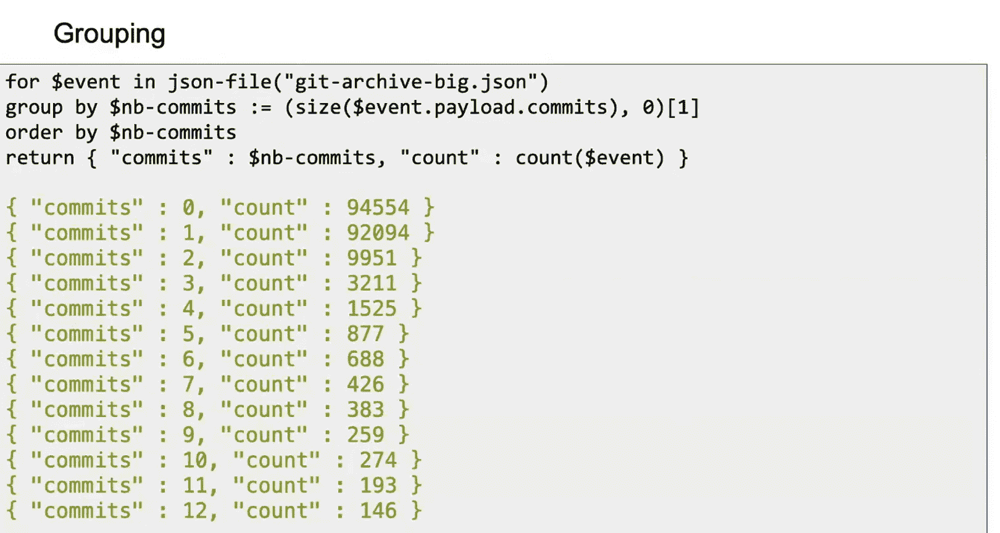

In fact， with Jasononic you can support the whole relational algebra and I'm going to show you with a concrete example。

 it shouldn't surprise you right because these flower expressions look a lot like the select from where so after all there's no reason why we couldn't do the same projection selection and so on。

So I'm taking two collections， imagine a collection of products that have very simple objects that look like this with just three columns。

😊，And on the right， a collection of stall， who agrees that in that case。

 we actually have two relational tables。😊，Who sees that on the left we have a relational table with how many columns。

Three， right， ID type and store and on the right with how many columns。Well I know you know， right。

 who thinks too？Okay， I know you know。 So I D and country。 Okay。

 so let's call it products are Jason and Starboard Jason。 Now we could do it in SQ。 Obviously。

 if we consider them tables， But I want to to show you in the in Jonic。😊，So first。

 how do we do selection we knew that selection in SQL is done with the wear clause， right？😊。

So in Jsononic， it's also the work clause。 So if you want to select some of the objects in your collection that will a certain predicate that satis your predicate。

 just use the work clause， and that's it。😊，How about the projection when the projection is this project function。

 So you just iterate a value collection and for every record of the collection， every object。

 you project to the columns you want IN type， right by the way， that's a way to clean up。

 Imagine that you have a lot of extra columns that you don't care about it and that are very messy just projects to those you want。

 And now you get something that just has these two columns， right IN type。

It might be heterogeneous though， because it might be that ID is sometimes an integer。

 sometimes a string so it doesn't protect you against that right。

 but at least you know that you're just going to have these two keys IDN type。

Ordering is order by right so you can reorganize the collection sorting by Is。😊，喂。

And group by aggregation is using the group I。 Now it's done like SQL because I'm I'm using an aggregation on the on the variables that are not keys。

 right， So E is aggregated to counts。😊，But again， remember that in Jsonic you don't have to aggregate。

 it would also be if fine not to aggregate， then you just create nasty dust structures in the outputs。

Okay， who with me。Seelection， projection， ordering， sorting aggregation， joins。 How do we do joins。

 Well， just with two four。 Remember how you do a join in SQL， select。From table one table 2。

 where the joining criterion。 And then that's it， right？ So that's how you do a join。

 It's very similar here。 for for and where So you iterate on the products and on the store。 Now。

 if you stop here， you would have all combinations That doesn't make sense。

 you only want the combinations where the store matches the product right。

 So you match the idea of the store from the store with the actual store value in the product。

 And that is what you get now you return the type and the country。

 Now you see that that data set is a combination of the original data set， right。

 because the type came from the product collection and the name of the country came from the。

Stall's collection， Who see that？Who sees that heat surgery？Now I have good news for you。

 you can try that with billions of objects on both sides and it will work the reason is that Ruble DB auto detects that there is a join and it will implement it as a join on top of Sp and Sp is also good at computing a join it's a bit less efficient than projectal selection but it works。

Now left out or join is just a special kind of join in the case that not everything has a match。

 for example， imagine that a product doesn't have any store you have an object in the product collection that doesn't correspond to any store you can catch that with the allowing empty you can just say4 dollar as allowing empty in and then you have JO5 stall and you filter the stall that match the ID right instead of a web clause you put it in a filter there this allowing empty。

😊，Is going to say， well， if there is no match that's fine。 Just bind it to the empty sequence。 right。

 So what's going on is that if you have for a specific value of P， no store in there。

 that's the empty sequence。 And because of the alling M， the dollar S。

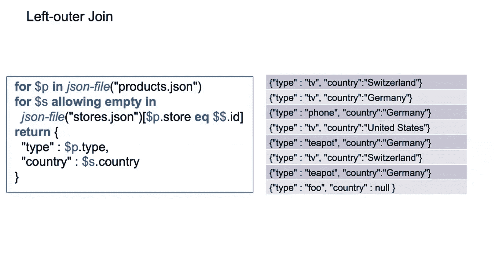

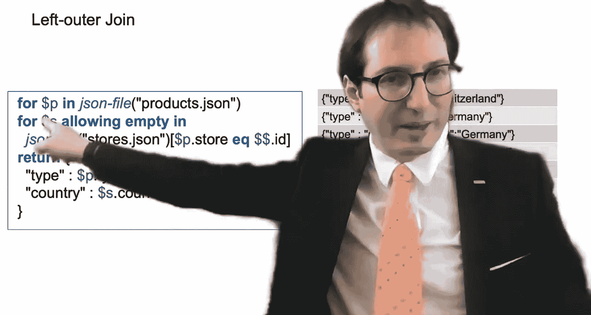

Is going to be bound once to the empty sequence。 What happens is that then this is the empty sequence。

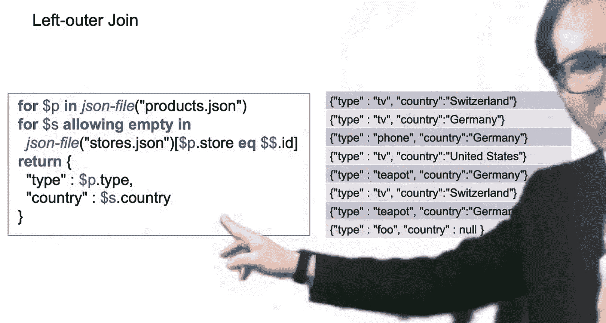

And the empty sequence is automatically converted to an nu when you were executives。

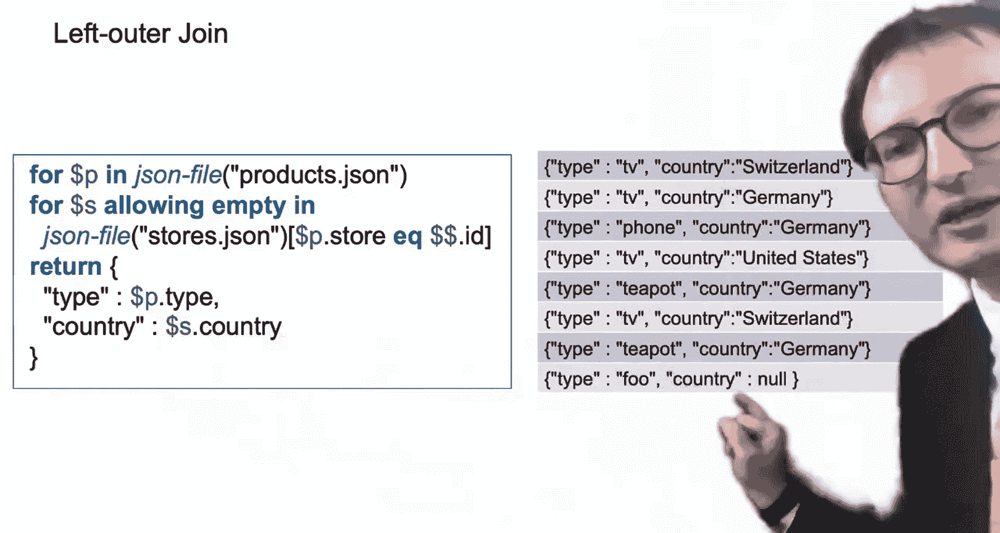

If you didn't have thearrowing M， that would just disappear。

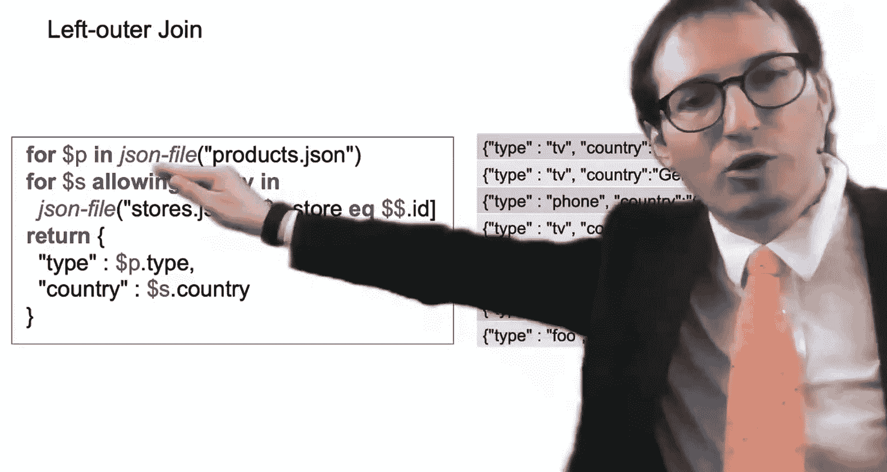

Right， because then that would be empty and there would be no binding at all。

 So without allowinging M。

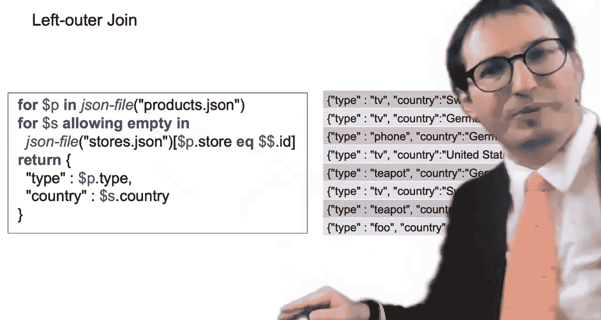

With allowing empty， who with me。

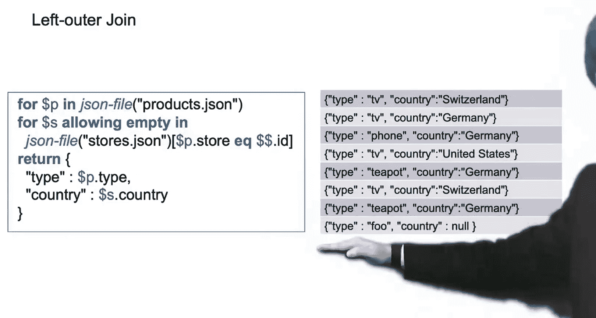

Okay， that's called the left out version joint。Now， what about denominization？

It's kind of a more elaborate kind of join that Swell can nominate not to do。

What if we want to join the countries and the stores？But what I want to do is nest。😡，The， the。

 the products inside the countries。 I basically want to output a a collection of all countries Switzerland。

 Germany， United States。 And in every country， I want to list the products that are sold in the stores。

 How do I do it。Again， something that looks like a joint but I use a lead cloth so I iterate of all the stores right then for every store I list the product so what I do is that I filter through the collection of products I filter on the store so I only keep the products for the current store that I'm looking at。

😊，And I put it in Dora P。 So every binding we have Do S。

 which is a store and Dolap that is the sequence of products in the store。 And then I return。

 imagine there's one store in every country just to keep it simple。

 Then I output the country of the store and inside a nested array of strings。

 I list the Dora P dot type right That's again， the beauty of having a language that is more powerful than SQL and that you denormalized data that you nestedness right Who agrees with that query。

😊，Okay you can try it out again， everything you can play and drop it on notebook books， play with it。

 it's normally it should be very intuitive。😊，What does the dollar dollar do。

 when that's for your predicate whenever you have a filtering predicates like this in the Dora Dora dot store。

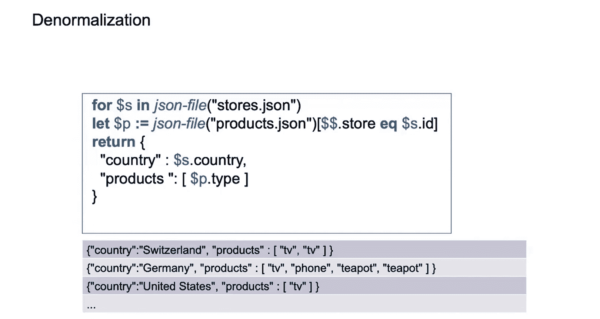

Here。The dollar Do is basically be one by one bound to the items that come from here that can be a billion items。

😮，For every one of these items you need to evaluate this here and the Dola Dolar is the current item it's called the context item so the first time this will be the f product。

 the second time it will be the second product， the third time it's going to be the third product and you evaluate that a billion times as many as product every time this is the current item coming from here right always one。

😊。

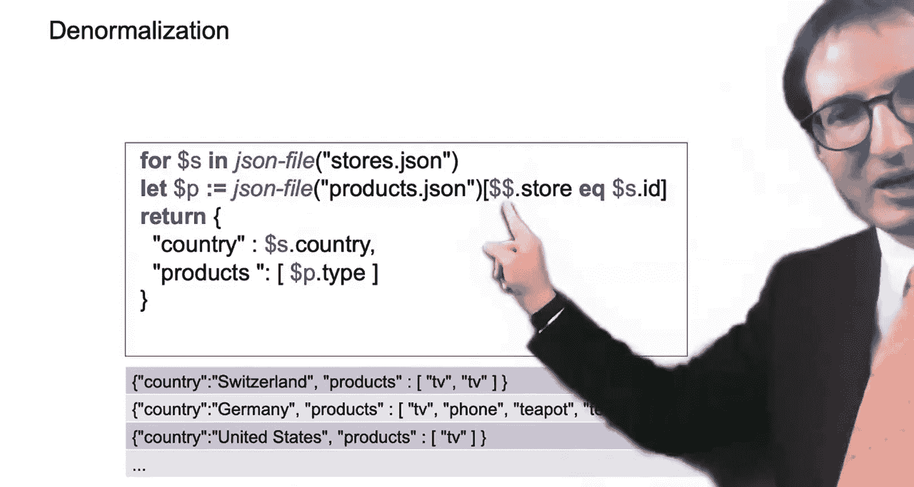

It's Do long door R。If you want to draw a pilot with Sp。

 do you remember when you use the filter function in Python in Py Sp with the lambda filter。

 lambda x row something F of x？Well， it's to avoid having to define a lambda instead of lambda x and then something that depends on x。

 just go ahead with the dollar dollar right and you don't need to to explicitly define the lambda for whom does that make sense。

诶。Good。Alright， but it's good that you ask， right， because this Dora Dora can be confusing at first。

 right， You can only use the dollar dollar when you have a filtering predicates like that。

 If you use the dollarra Dora somewhere else， that's going to be an error。 right。

 It has to be in a filtering preddicate。😊，O。What about types do you remember the whole type system that I introduced you in the data modeling when you have them all here。

 you can check for types。So， you can do。Let Do path as string。 Let Dora events as objects start。

 Remember the occurrence indicators。Star means0，1 or more plus means one or more。

 Quetion max means 0 or1， so you can use the types in this way。

What it does technically is just that it does these additional checks。It executes your query。

 but on top of that， it also checks the types。 If one of the types doesn't match。

 it throws an error at you。 So it's a good idea if you want to be extra safe when you execute your query。

 you might have done a mistake in there。 at the types in there。 and that's a save ga。

 then it will one you or throw an error if any of the types is not what you expect right All you need to do is at this as followed by the type in the let variable right Now this is how they look like Integer is a sequence of exactly one integer item。

 Boolean is a sequence of0 or one Boan item。 So either the empty sequence or a single boolean item。

 array plus means a non empty sequence of a and the one two or more arrays。

 that's the plus and the star means a sequence of object。

 possibly empty The difference between plus and star is that star a for empty plus does not allow for empty。

Who already heard of regular expressions？So if you know about regular expressions。

 that shouldn't surprise you， right， the question mark。

 the plus and the star has have exactly the saving intuition。

So you can put them for example that's let Do x that's a sequence of2 array so it matches array plus that's fine you can also have plenty of more expressions that instances of inte star will return true it's testing whether or not an expression returns a certain type right so that's going to return true or false here。

😊，We thinks its return true。We think it returns first。

It false right because it's not not everything is an individualteger， the second one is a string。

 so that will fail the type test it would have to all be individualss。😊，W much？

Then you have castable， castable， just test。 It tells you whether it would work or not。

 Could you cast 3。14 as a double。 Yes， you could。 So that returns true。

 If you try full castable as double， that would return false， you cannot cast who to a double。Okay。

 then you have functions I didn't show you the functions yet。

 but you can actually use the right functions declare functions and then you can add types to the variable to the parameters of your function and you can have also a type for the return value of the function right I there a question on zoom could you cast a string？

😊，Do you cast a string containing only digits。Yes， absolutely。

 if you put a string with digits with the double quotes and the digits festival as double is going to return to。

 yeah。And then you could do test ads in order to actually guess it， right？Does it make sense？Okay。😊。

So that's a function with types the types are optional if you don't want to put the types in the function that's fine too all the part that is in red just skip it and remove it and that works as well you just don't specify any types by default the the most generic type is item star item star means a sequence of items So if you don't know its item star implicitly。

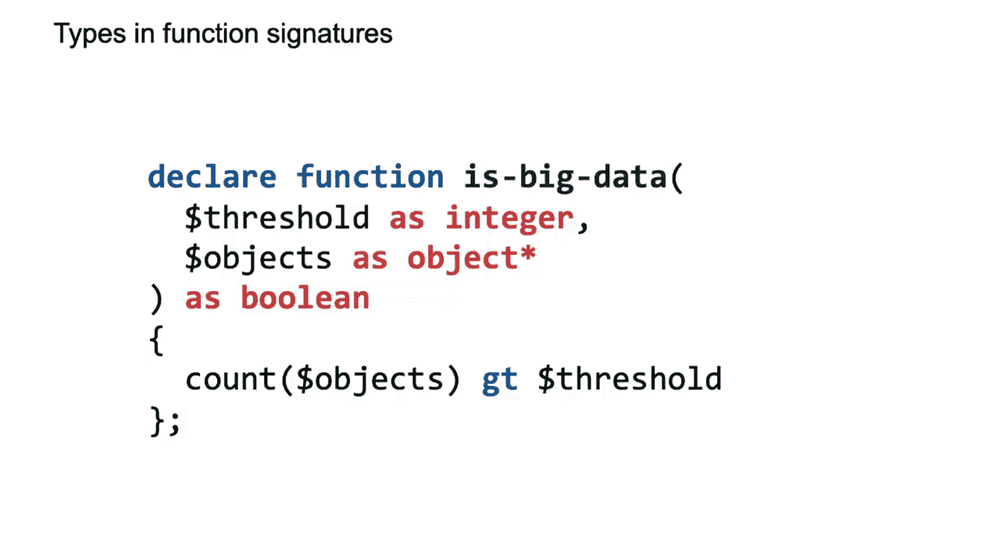

Okay。😊，Now。😮，We can validate data imagine you have some some very messy data set you clean it up so the code inside we've seen before these four events group by that's the histogram remember the histogram we've done before so we built the histogram What if now I would like to validate it because I want to put it in Bque or CSV or whatever when I need to do is define my schema how do I define my schema with a type declaration so all I need to do at the beginning is declare type local histogram commits is a short and counties along I actually had fun here I could have just put commits integer and count integer right but just wanted to make the points that you can put any types in there。

So commits is an integer and count is an integer and then you have this validate type and then it's going to actually check that it's valid against this schema。

😊，What do you get？When you validate a collection of JO objects against the schema。

 Pro that the schema will feed some constraints， you get a。Df。What do you get。

A data frame exactly so when you do that you will automatically get a data frame it's just hidden from you specifically you will have a data frame and it means that you can save that as PA as CSV as Avro as basically a binary format with the sba right so a very common thing to do when you download the data set from the internet in the adjacent format and after cleaning it up。

😊，Create a schema validated， looks just like this。 validate it and save it as packet。

 Then you query the data reading from the packet find is going to be much faster than reading it from J。

 That's one of the few tricks that data scientists can use to accelerate the the queries。😊。

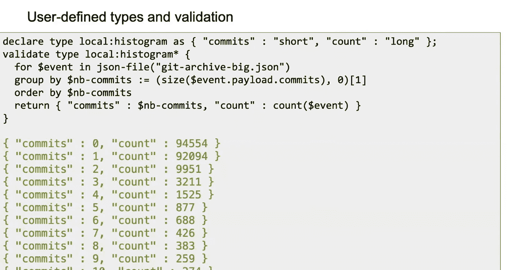

ok。😊，Allright， so here's an example I have the query with that I call query do JQ。 that's my query。

 then I have so of course you use Jupiter notebooks right so you don't need to do it。

 but actually if you want it to save it somewhere you could use a Java command。

 there is just a single J file for rumble Db that you can download then you execute it with Java and then you say where you want to output it So I just called it out but it can be any path on HDgfSS3 or your local file system overall rightt because in case it already exists。

 I want to era erase it number of output partitions is just to make sure that there's only one shot that it's all output to a single file instead of many output format CSv is's going to create a CSv file and header through it's to make sure that it adds the commits and short headers in the CV file。

And after I've executed that， and I double click on it。

 it magically appears in Excel or numbers or Lib fees or whatever you want。

 So this is the whole chain where I executed my Jsononic query， validated the output， save it as CSV。

 and then I can open it。😊，Sorry in the spreadsheets software， okay。

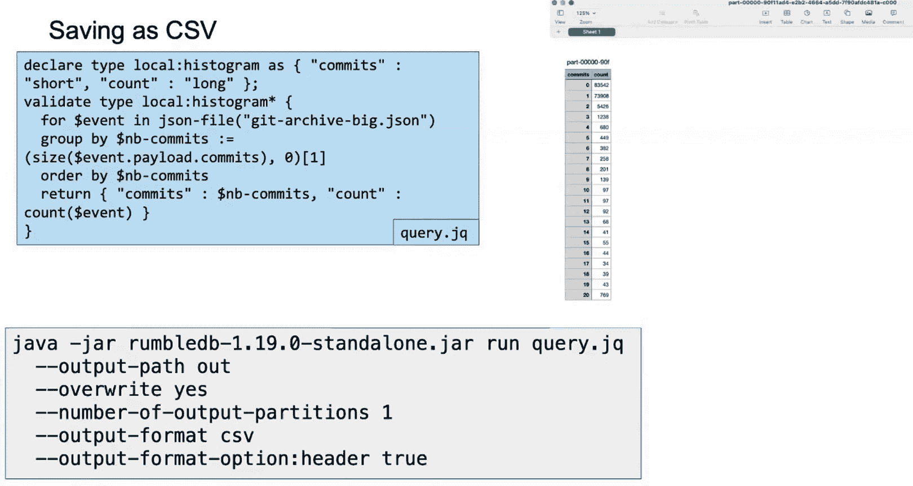

Okay。Now， who is with me？Okay， so that's the practical aspect。 That's how to use it。

 You will have this at the exam。 Not this， of course， but writing the query in Jupyter notebook。

 you will have that。 And in the exam， you will have questions where we ask you how many of these are there。

 What is the most popular singer and that kind of questions， right。

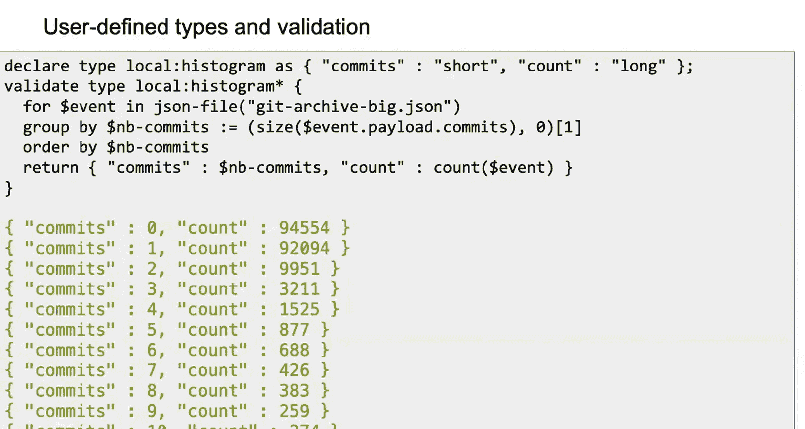

Okay。

No。😡，I want to say a few words about the implementation。

 how is it actually implemented and that was done by your predecessors by masters students。

 bachelor students， 20 different students actually contributed to the NG。

Many of them actually took the big data or the big data for engineers class。So what happens。

Behind the scene， and in fact， a lot of that is also true for SQL and for a relational databases or even for languages in general。

So it's pretty st。When you type your query in the Jupiter notebooks， it's just text。

 the first thing that an engine will do is pack it。

 there is some grammar rules and then it's going to build a tree it's called the abstract syntaxt tree who already heard of that。

😊，It's just an inmeory representation of your query right so the query as understood by the computer is on the right。

 it's just the representation of the say right of the syntax。😊。

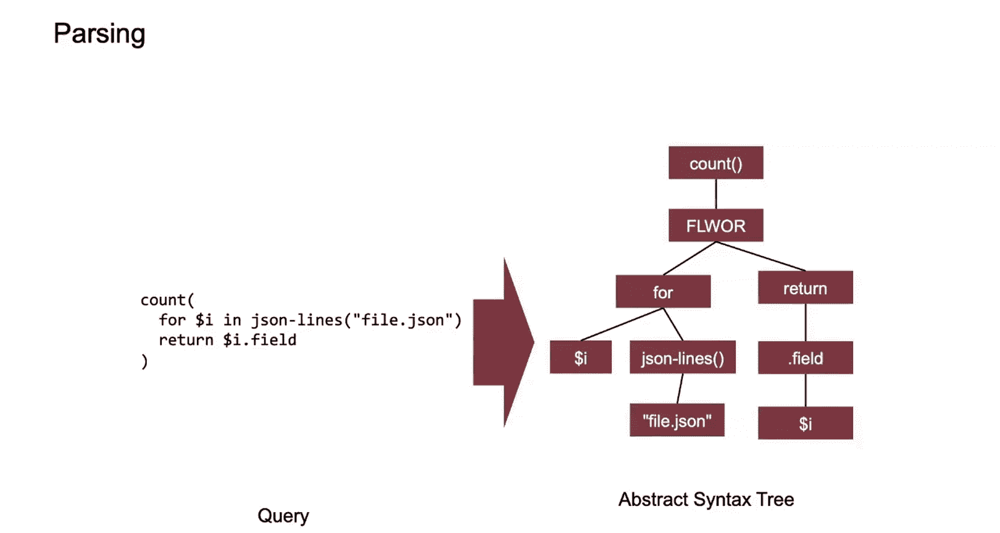

The second thing that happens is that there is a bit of post processing and then you create an expression tree。

 an expression tree is basically when the computer recognizes your Lego pieces right so each expression is a node in there so you can see you have a count and inside the account there as a flower that has a forkclo and a return clause and so on and so on。

😊，So this is only hidden from you but this is what happens。

 so the Lego assembly is the expression tree。😊。

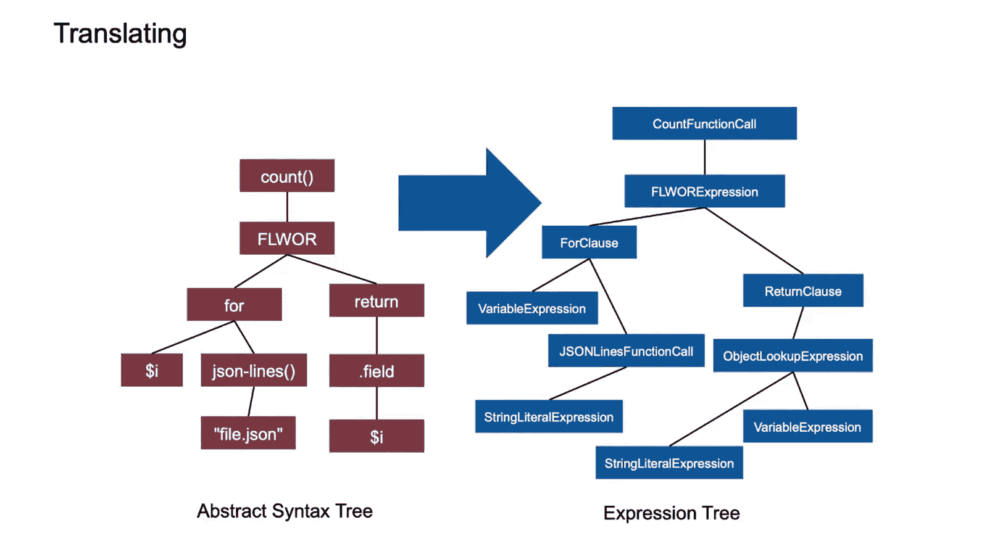

Then the engine is going to optimize。😡，It's going to figure out out a few inefficiencies because maybe you as a user didn't try your query in the most efficient way。

 but that's not a problem because the engine is smart enough to do a few fixes for example。

 it might notice that you put a variable in a let but you're not actually using it So at that point the engine can just remove it。

 It's like this variable is not used， let me just remove it That's a concrete thing that the engine can do So it means that putting unused variables in your query is not going to make it lower because it's automatically removed anyway at that point that's called the optimization。

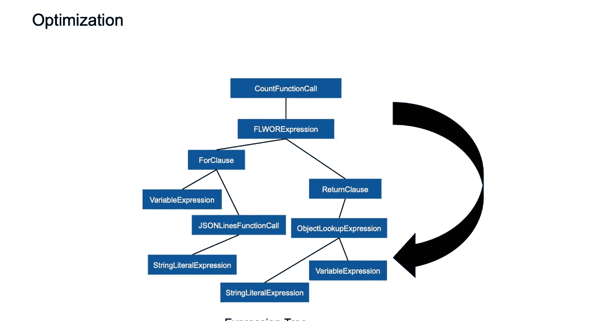

Then we generate an iterator tree。 An iterator tree is kind of the compile code that you output from the query。

 and that is executable。 And the iterator tree is what we are going to use when we evaluate。😊。

The query and the where a iterator of tree works。

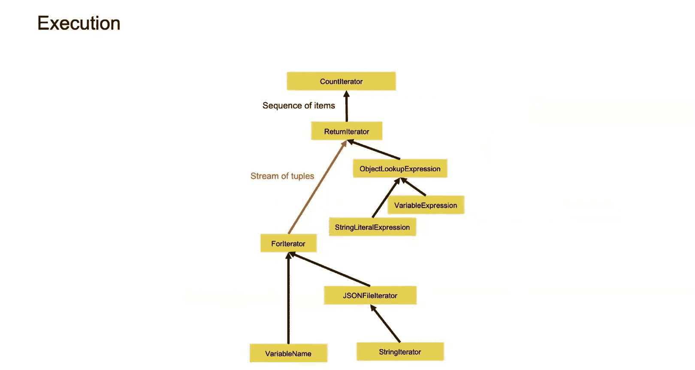

Is that this is the machinery of your query， you basically pull a string here。

 you just pull here and the items come out one by one。

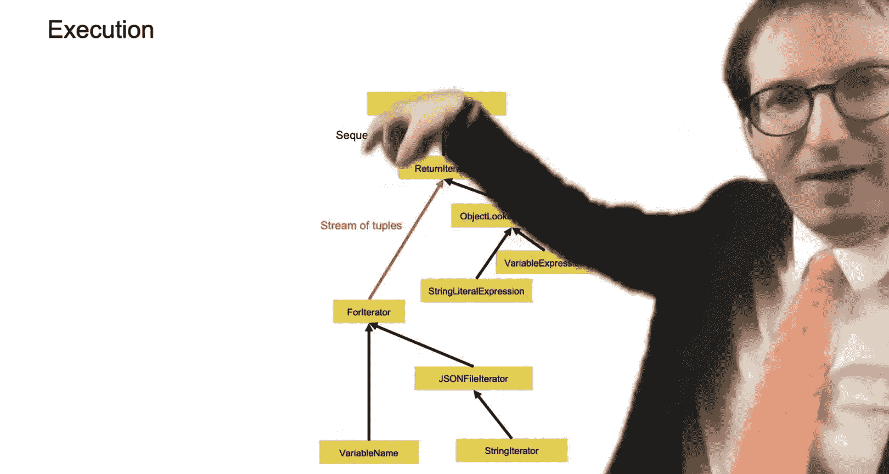

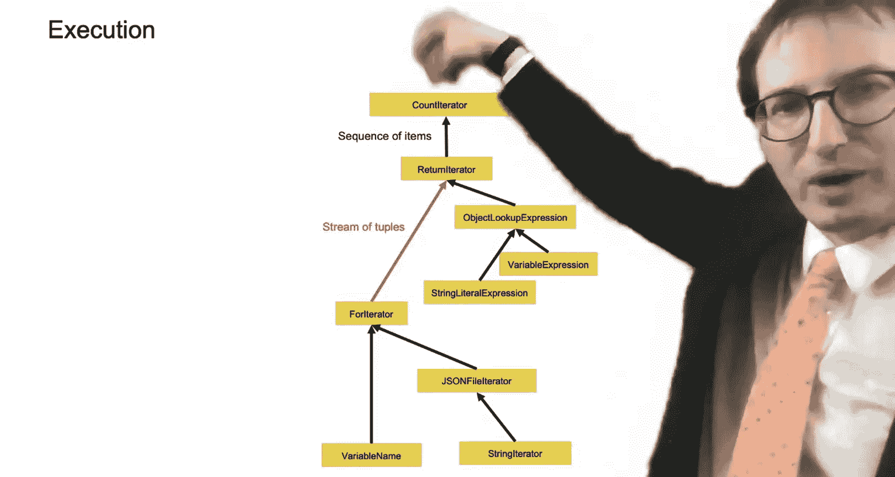

Or they could come out as an RDD or a data frame and so on。 but you just pull a string here。

 And when you pull the string there， it's automatically pulling all the strings recursively in the sequence。

 So you pull here and just lifts all the items up。😊。

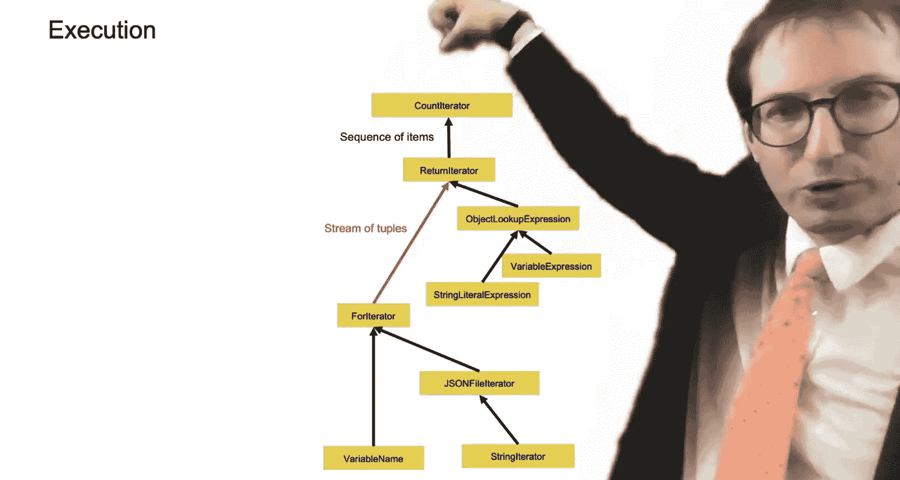

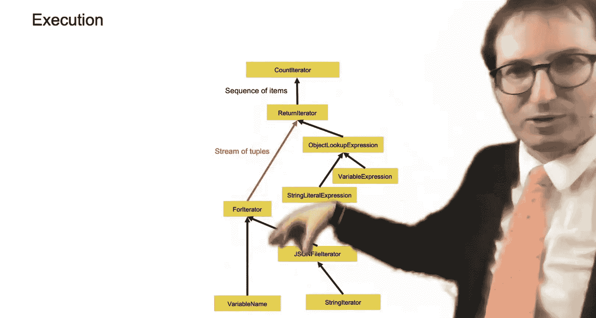

So an iterator tweets called iterator because it sps items one by one with with me。Okay。

 that's very physical。 That's already advanced。 right。

 This is the sort of things that normally we teach in computer science master's degrees。Now。

 just so you understand what's going on， imagine I have a simple iterator just a far return。😊。

You know that it's a clause right the four is a clause so it's going to output streams of stoppers。

 So imagine that I have this collection these stoppers here field。😊，1，6，4，3，2。First。

 I'm going to describe to you what is a materialized execution。

 A materialized execution means that when you have the fourerator。

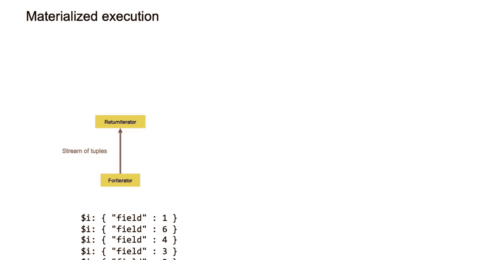

The four iterator。We are going to pull all the items out of it。 all of them。 I just block here。

 I take all the items， ta ta ta ta ta all of them， right。

 That's called the materialization because I actually have them in memory in that order。

 Then I compute with my return iterator the maybe I extract the integers and so on right So this is this is called a materialized execution。

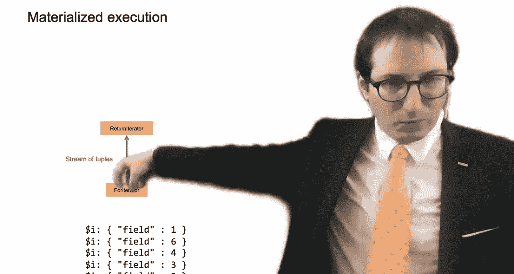

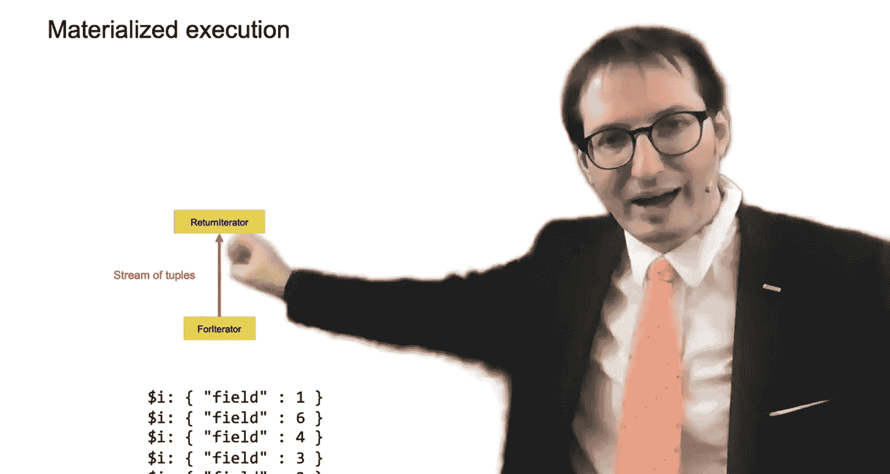

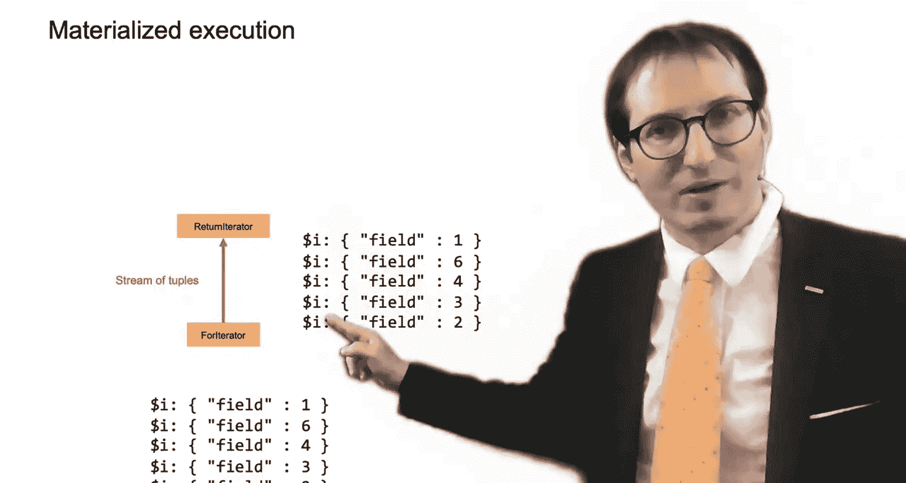

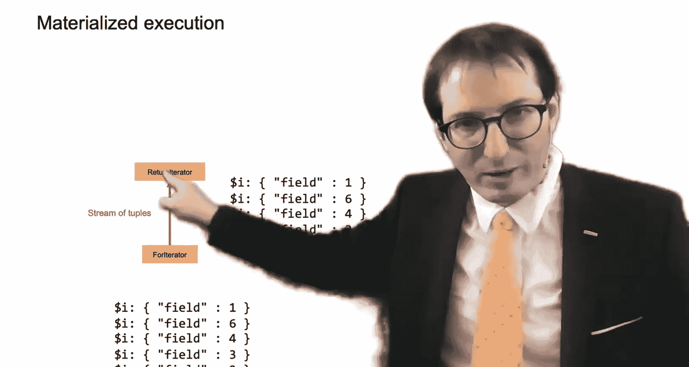

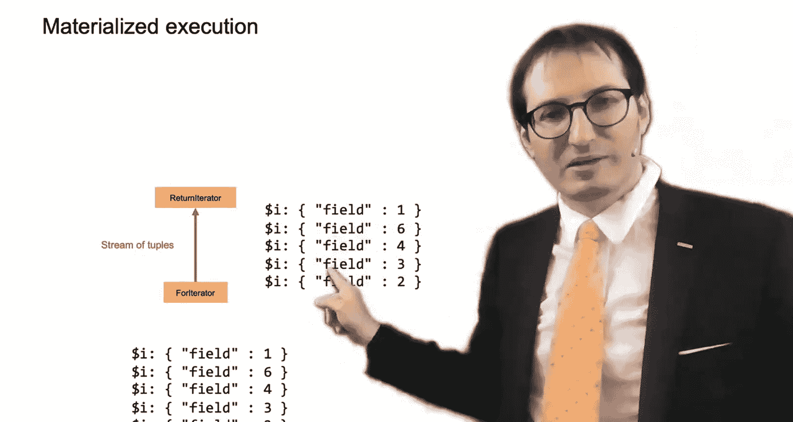

Now you probably see the needs of that because imagine。😊。

That you have a trillion such items right on your hard drive。 Imagine you have a trillion items。

If you try to materialize and really produce them one by one and keep them at some point。

 your memory is going to overflow because you cannot feed a trillion items in a laptop。

 That doesn't work， will Greece。So you cannot materialize a sequence of a trillion items on your laptop。

 So what do you do in that case。You do it like Netflix， you stream。

So it means you take the first item， you process it， you spit out the one， you take the second item。

 process it， sp out the six， take the third item， process it， spit out the four。Take tu， tech， tech。

 Who sees that I can do that trillion a trillion times。

And I will not exhaust my memory because I throw it away every time right This is called streaming just like the same streaming as in video in the on demand right when you watch a movie on Netflix。

 it's downloading a few seconds of the movie or of the series a few seconds。

 then you watch it then it throws it away So this is why you could technically stream 10 hours of movie。

😊，Materializing would mean that you download the entire movie to your laptop right you download the movie streaming means you only have a few seconds at a time and you throw away as soon as you've seen it。

 one understands the difference。So again， downloading a movie and watchheet offline as opposed to streaming is the same difference as between materializing here and streaming。

Right。But it can take a lot of time because the trillion items， you might still be here。

 it the age of the universe might not be enough， right？😊。

There's there's only so many years since the beginning of the of the Uni。

 So it can take a lot of time。 What do we do when things would take a lot of time on a single machine。

 we。I want to hear it。 I know you know， what do we do when it takes too much time on one machine， we。

Plyize exactly so if we parallelize we just use more machines and we spread it over and then we execute notes that we could also stream in parallel and that works together right we could also stream on each machine or we could materialize on each machine。

😊，Right， so that's the idea。 So you， you see how you have so many ways of executing the same thing。

 You can materialize， you can stream， you can parallellyize。

It doesn't always all work sometimes you have something that work。Something that doesn't。

 but in general。You have a choice。And of course that could consume a lot of machines but again there is no free lunch right so that's it I will just finish next week I probably have a few slide to finish but I really want to again insist that this thing works on S3 on HGFS from HTTP you can download from the web just be aware if you use HTTP that will not parallellyize you can parallellyize from the web the web is not parallel but you can parallelize for S3 HDGFS and so on locally Azure。

 Google Cloud， all of these formats now you know that PAA is going to be faster JO is going to be slower and so on and so on。

😊。

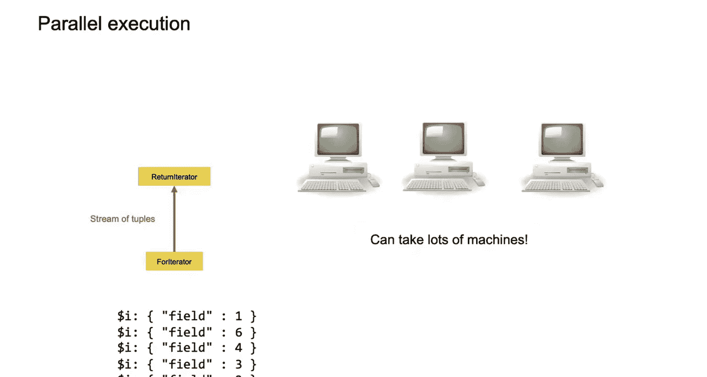

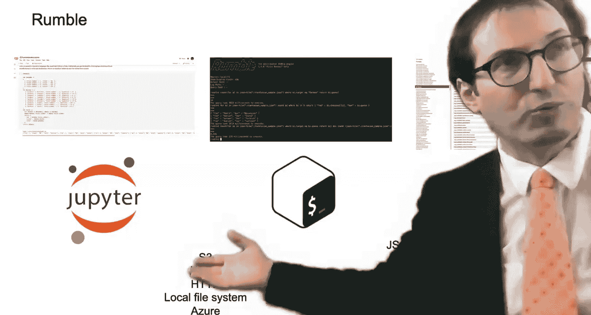

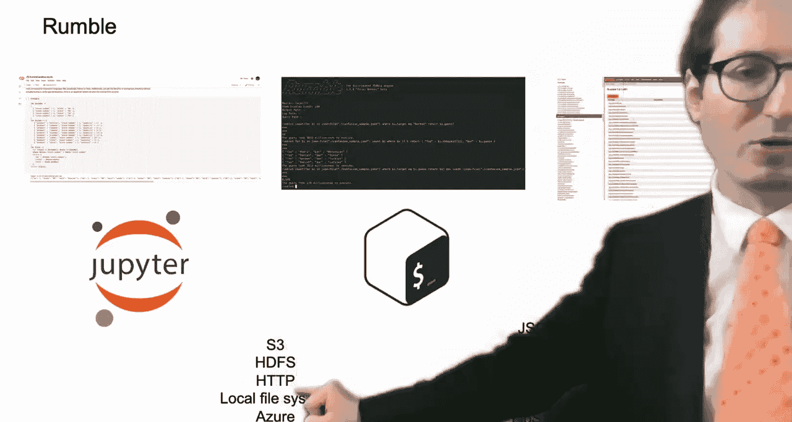

So let's stop here for today and I have a few more slides that I will just maybe 2030 more slides that I finish next week next week I just wrap up everything。

 we'll have a big quiz game so please come it's even more fun if those who usually come on zoom than come to the lecture hall next week maybe well just celebrate together and and play the quiz game right and spread the well to your colleagues even those who usually watch the recordings do come。

 we are going to rehearse for the exam and go through the material Okay so thank you very much everybody enjoy the exercises that the TA team has prepared and see you next week for the celebration of the end of the semester。

 thank you。😊。

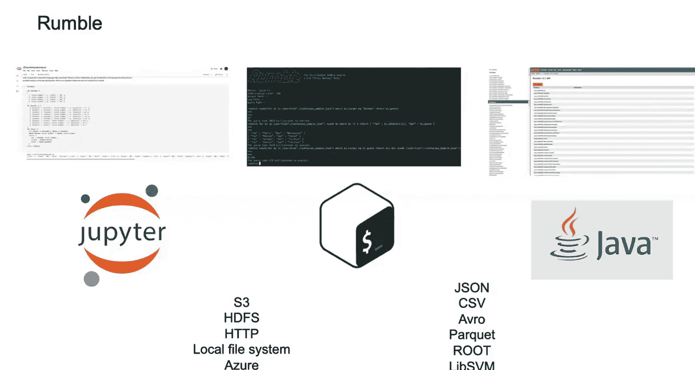