# 苏黎世联邦理工《工程师的大数据｜Big Data for Engineers - ETH Zurich - 2024》中英字幕 p33 11. Querying trees (4_4) - .zh_en -BV17FAmeFE9K_p33-

Welcome everybody in the lecture hall welcomee everybody in Zoom。

 welcome everybody from the future to the final lecture。

 So I' have just a tiny little bit to finish on the implementation of Ruba Lib and J Soic then I'll move on to wrapping things up on the very high level。

 and then we have a quiz game in the in the second part of the of the semester to celebrate the end of the semester。

😊，Soう。

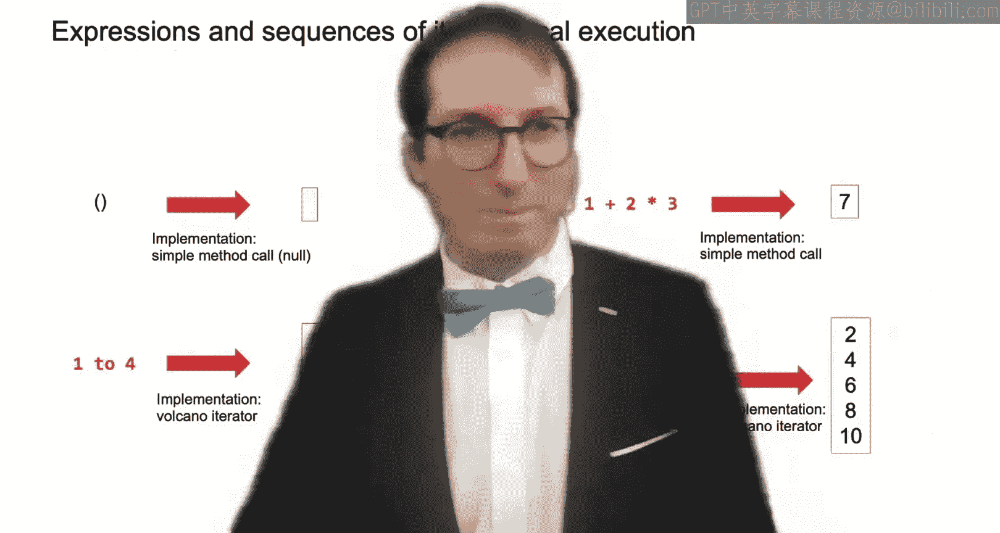

What I need to tell you is about the physical implementation。

 So I told you about the idea that Jsononic is a high level language， just like SQo。

 And it means that Jsononic is exactly the same if it's on a laptop。If it's on a data center。

 if you're querying kilobytes of data， if you're querying petabytes of data。

 if you're querying Jason， Parker， CSV， anything， it looks exactly the same。

But that means that on the physical layer， the implementation layer。

 this is all the hard work that must be done。 and that was actually done by previous students。

 So what's hidden that the users do not see is how all of this is executed and we have plenty of execution mode or ways that it can be executed and the user doesn't see anything。

 The only thing they should notice is fast or slow， but this is prettys。

 So the simple cases are the cases where we have empty sequences of simple values like sequences of just one items。

 when we know in advance before executing the program we can predict that an expression returns exactly one item or atmost one item that we can implement with simple good old methods in Java it's implemented in Java in this case。

 So this is the simple case， right in fact， the one plus two times3。

 we don't even bother with the complexity of Sp or anything we just implemented as a simple method。

Then we have the sequences of more than1 item10。 if they are small enough。 So it's not like billions。

 but just like 1 thousand， maybe a million。 if it's on a machine。

 then we iterate that's called the volcano iterator。

 It means that we have an API that basically has methods like open， has next， yes， no， and then next。

 and then you pull the string one by one， you pull the items has next， next， has next， next。

 has next， next， has next， and maybe it return on false and then you're done and you close the iterator。

 So this is the way it works。 It's called the volcano iterator。You just do item by item。

 you stream your way through the item。And and when you have field dogss like this， for example。

 you have one to 10， and then you filled out the numbers that are even again。

 that's going to be with the next， next， next， next， next。 you do it item by item。

 And every time you check， Yes or no， is it even。 And then at the end。

 you will only get those that are even， right， So， of course。

 the user just sees the final sequence of items in the end。 But internally。

 this is how it's implemented。 So that's the case where it's small enough。Now， what if it's bigger。

 like for example， I'm reading some JO file from the data lake and I open it with JN files。

 So now logically it's just a sequence of objects right so for the user it's simple but what's actually happening behind the scenes is that that file which might have a billion lines of JON that might be heterogeneous we squeeze it into an RDD In Sp we just read the whole thing as an RDD of strings and then we pass them as J and then we have an RDD of JasonO objects。

😊，But heterogeneous， right， which is totally possible。 It's called polymorphism。

 if you know what that means in object orient programming。

 So it means it's totally fine to have an RD of Jason objects。

 even if they are heterogene right And then when you iterate， for example。

 dot countries that's just a flatm， right we just run a flatm against that RD。 but you see the magic。

 The user does not see anything。 The user doesn't see the RD。 the user doesn't see the flatm。

 it's all hidden。 The user just sees the query and the sequence of items right unboxing is also a flatmap。

 because everything is always flattered again。 the UDf means user defined function。

 It's just a detailed in Java that we need to write some Java code and ship it over to the flatm transformation。

😊，Then distinct values we can also ask Sp to do it for us right with some other transformation but you see now we learn Sp and the API as a user。

 but now it's a different perspective because that Sp here is completely hidden the only people who actually saw that Sp are the engineers that implemented RumbledB but the users of Rumbledb do not see that anymore and that's how it works magically on billions on billions of objects right？

😊，Then what happens if the data is valid， for example。

 we open for a back file and it's already valid in that case we will not create an LED internally。

 we will create a data frame because you know that a data frame is when the JO is valid right or when the data is valid。

😊，But you see that for the user， it doesn't make any difference。

 The user still sees a sequence of objects。 You would still see a sequence of objects。

 but it will just be faster。Because the data frame takes less space than an RD and the execution is going to be faster。

 So it's really important on the logical level， the only thing the user sees that fits faster on the physical level。

 we just use the data frame instead of an RD， but that's all hidden from the user。

 So you see if it's heterogene。 We just use RDs of items。😊。

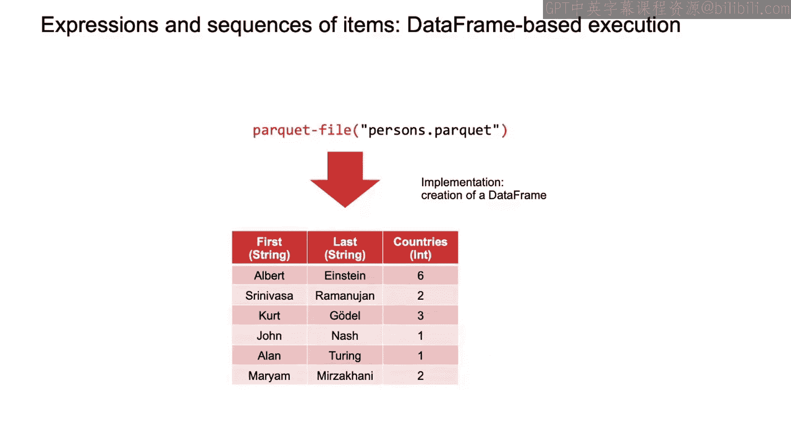

And if it's homogeneous， then we use data frames， We also use data frames for sequences of inte sequences of strings。

 it's just a data frame with a single color right for whom is that clear。😊。

Okay that's all hidden right it's just the implementation So the summary for expressions is that we can have a direct Java method called if it's a single item。

 we can iterate our way sequentially that's the streaming that I told you about next next。

 next next next if it's small enough if we open a file that isn't valid。

 then we just use RD and transformations if it's a packet file or we know that its structure or we validated it then we use data frames and data frame transformations。

😊。

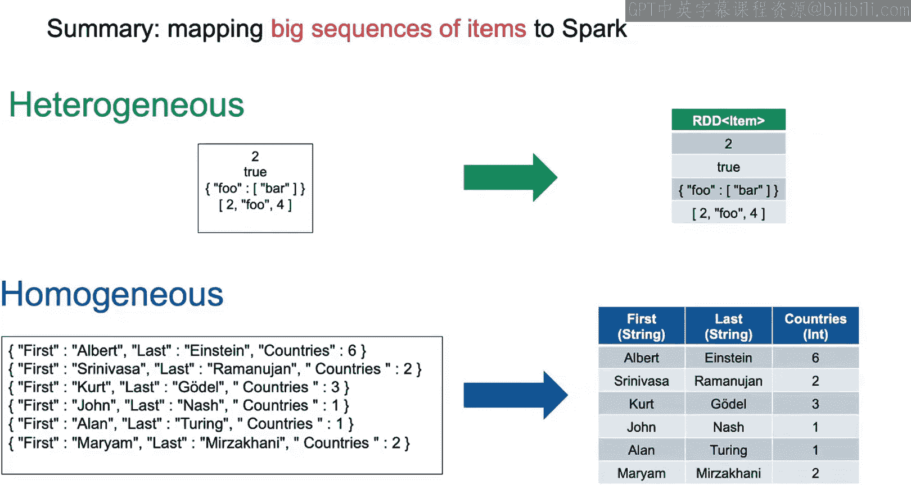

And finally， for the for some cases and that is new。

 we might also convert to Sp SQL and an example here is that when you have an iteration on on some parkque file。

 we know that it's PA air should have a good park here here。😊。

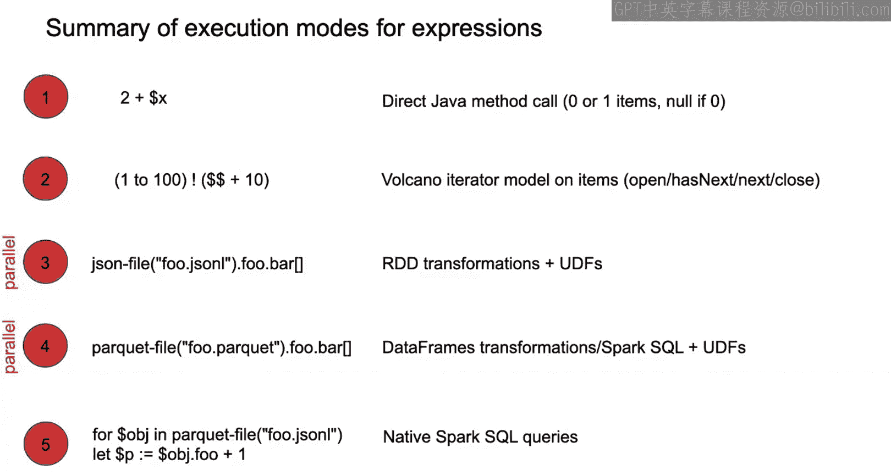

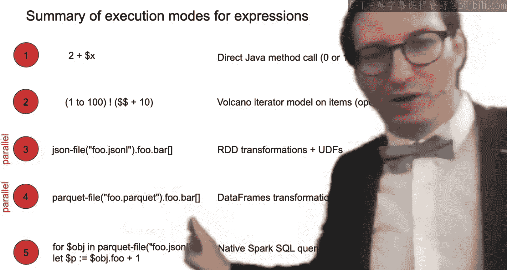

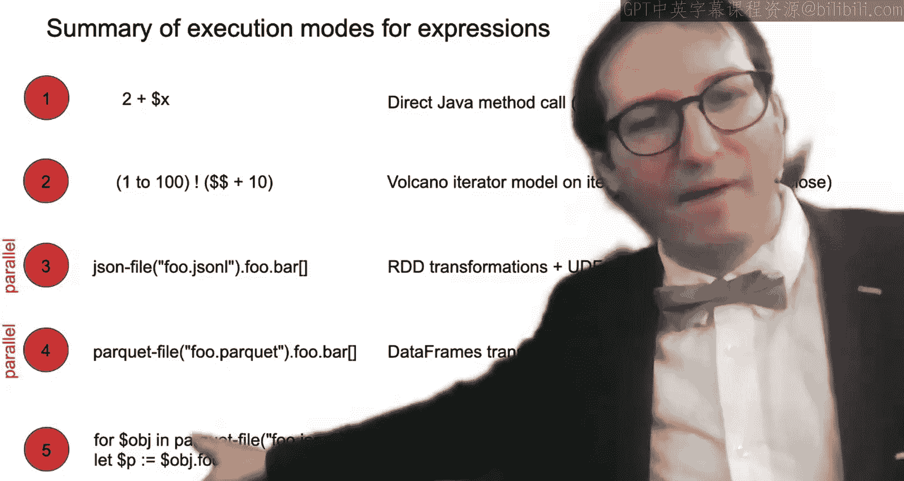

This actually will be converted to Sp SQL。 It means that also that will be converted to Sp SQL as well。

 right， So this is also something that just made it even faster than it already was to to also use native Sp SQel behind the scene。

 Again， I insist the user does not see the Sp SQl。 It's all hidden。 The only thing the user sees it。

 It's faster。😊。

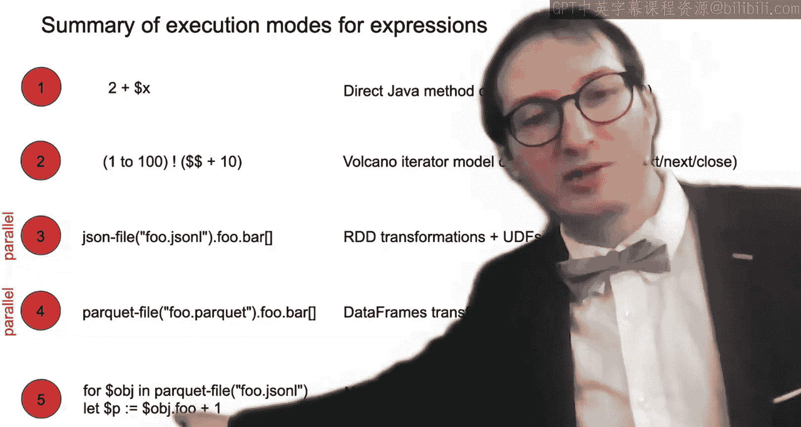

Okay。Then what about the execution of the flower right Because I was talking about expressions。

 What about the clauses， So you know that the clauses in flower expressions。

 they manipulate these toled streams right that it flows top down and every clause takes a tople stream and outputs a tople stream right It doesn't matter if it's selection。

 projection grouping， drain generic and so on。😊，So what happens in order to implement this is that if we have adjacent files。

 So we create an LEDD， right， if we have an iteration。😊，It's heterogeneous。

 so what we do is that we squeeze that RDD into a data frame with a single column that column corresponds to the variable。

 General we have one column for every variable in the flower variable。😊。

And then we just serialerize it to binary。 It means it's just zero and ones internality。

 We don't really have a choice because we cannot make it a structural type because it's heterogeneous。

 If it was homogeneous， we could really have struck type and then have all type。

 But since it's heterogeneous， we just need to just make it bits。

 And it's just a serialerilization to bits of all the objects。 But still， it' it's fast enough。

Then what happens is that if you have another four that creates a second column with the name of the variable。

 and in that case， we detect it's a string。 the type of country a string。

 So we also use a string type in the data frame。 and then where is again going to be a filter on that data frame。

 right we interpret that as a filter。 then a let we add yet another column here we might automatically detect that it's always a string。

 So we put a string type of that column。 And then when we return， this is the end of the flower。

 So now we convert it back to some RDD of items。 But again， I insist what you see here。

 all this animation with the data frame， the user doesn't see that it's all hidden。

 The only thing the user sees is the Jsononic code and there are reading files with sequence of items and the double strings flow around in in the flowers。

 But since it's all done on RDDs and data frames then it's fast and parallel on the cluster。

 or whom is that clear。😊，哎。So of course， I'm not growing too much in the details， right。

 it's just high level。 so in summary。😊，For the flower， if we want them in parallelel。

 we are going to use data frames one column for each variable and then transformations on the data frame。

 so every clause has a different way of transforming the data frames。However。

 what if we have a smaller flower， if we have a flower that only its like 1 thousand items or a million items？

😊，In that case it's too small to justify using data frames。 We could of course use data frames。

 but it's going to be too slow because of the latency。 So if we know， for example。

 in the first case above， there's only0100 items， 100 item is ridiculously small for big data So in that case we will not even bother with the data frame in the first case above will just also iterate1。

23 will just iterate on the to of the values that I can take and that will be fully local on your laptop without Sp。

And again， transparently， if it's small enough， we just do it iteratively on the laptop。

And if it's large， then we use data frames and RDD。 This is all chosen automatically by the system。

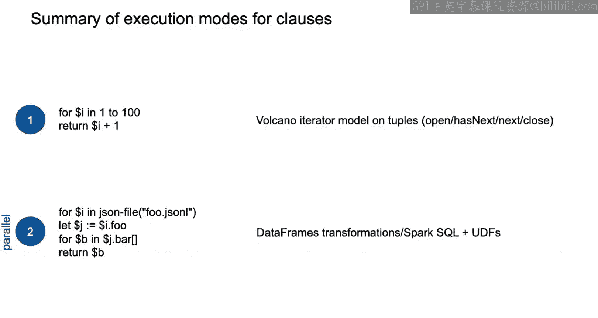

Now what you get internal is that when you pass this query here on the top left you get some tree and then the engine Rumble VB is going to do all of the work it's only implemented that automatically detect is that the sequence of items。

 the stream of topper and so on and it automatically figures out where to use data frames。

 where to use out it is the transformations to use and so on all of that is done automatically by the engine in a way that just works and every year we manage to make it faster we release now probably once a year。

 or so and and it doesn't change the way it's used but it just becoming faster every year as we optimize more。

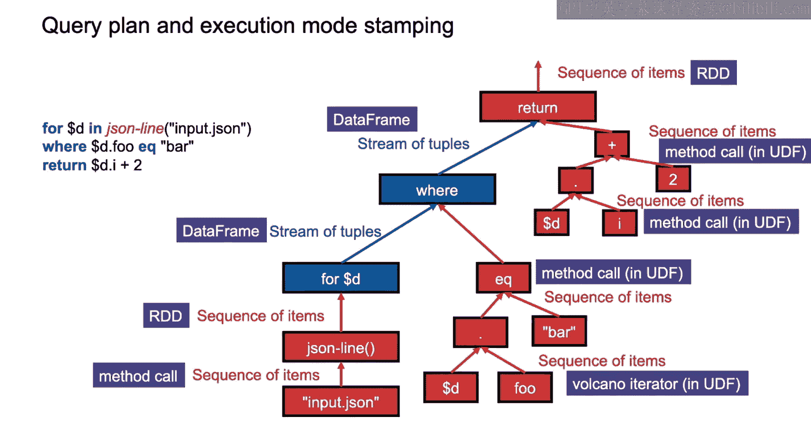

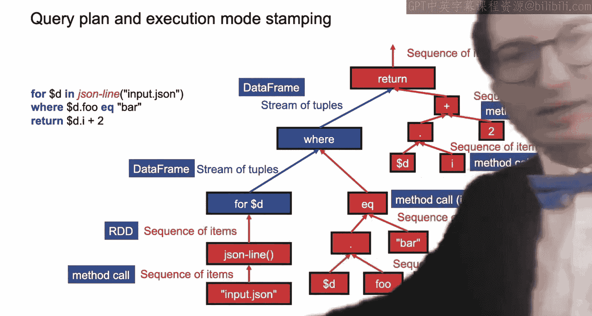

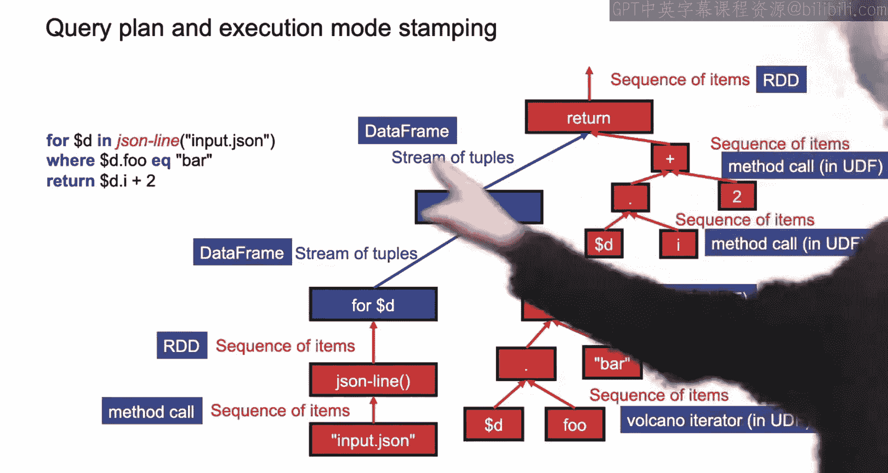

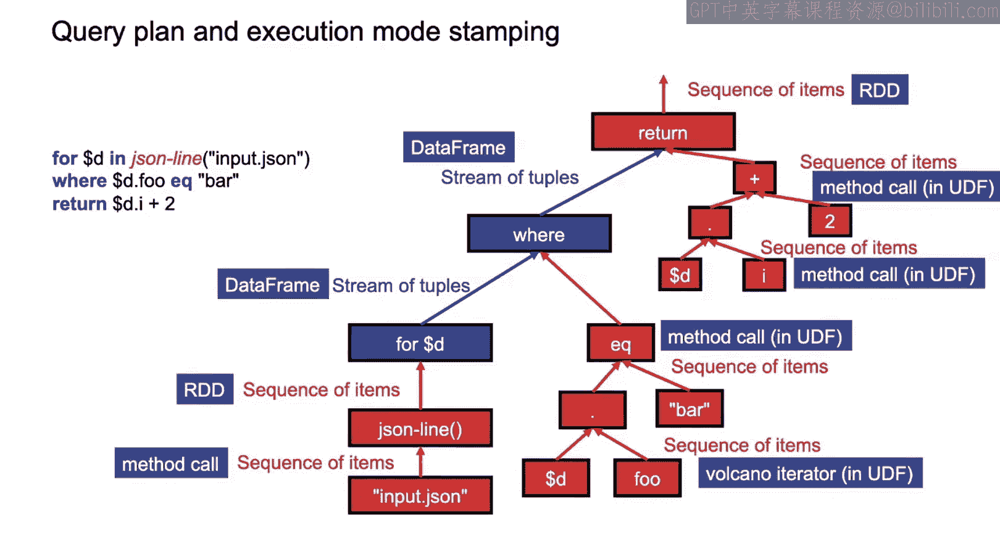

Here's an example where of a simple query that's Pai。

 So we have a J file that's internally going to be an RDD fu bar， fubar。 that's flat maps， right。

 So we just create RDs。 and then the sum can be pushed down to spark。

 push down is what we call when you delegate to spark the execution， and the sum can also be done。😊。

With with the reduce。Action on the on stocks。Okay， so that also works these functions like some maximum average。

That are JOic between functions， they work on billions of items with that with any problem。

 it's automatically going to do it in T。Right， so the modern architectures who heard of data Lake。😊。

Who heard of Lake House。That was a term that was coined in the Sar conference three years ago。

 I think by the same people who invented its back the lake House。

 the idea is that it merges a data lake with a relational database management system It has everything in the same in the same hood and it also supports machine learning。

 So it has the hood stack from the preparation of the data。 putting it in tables。

 making them faster and then learning and training data。 And in fact。

 Jsononic works with that kind of environment。 for example， the cleanup can be done with a schema。

 you can have a data that is not clean。 then you can define a schema in Jso what you see on the top and then you can validate there's a validate expression that is going to validate that it fits the schema and rumble degree will automatically then promotes that to a data frame when you validate against the schema internally it's going to be then certainly a data frame。

 So validation for the user just makes it faster plus once you have。😊。

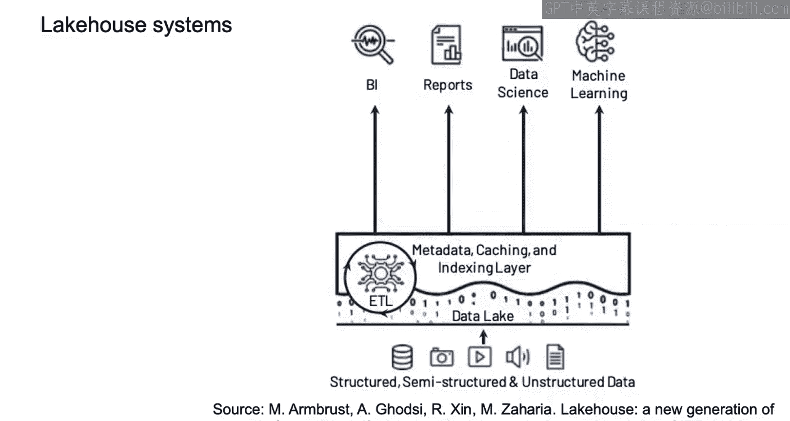

IfPD， you can save it as PAca as Avro and so on。 So Rambabi can also be used to convert and validate Jason。

 then save it to Bca。 It's like a Swiss army knife of of manipulating data。

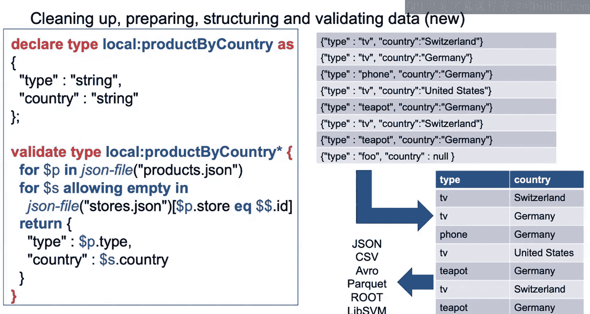

And it also does machine learning。 That's not in the scope of the course， of course。

 but that was a beautiful meta this a while ago， where we can actually take build data frames like these build sequences of objects with the features and the labels and then we use function items。

 those that I said are out of scopepe。 we use function items to implement the machine learning models and then we can train again。

 you recognize the flower expression here using the Jsononic language so just to show that it does the whole stack and in the next updates that should be released soon we will even support updates。

 meaning that you can modify the data and it works who heard of the deelta lake of data bricks。😊。

So the Dta lake is a way of having a data lake to which you can write。

 It automatically handles the right and the modifications of the data in a very smart way。

 And so in the in the next version of Rumble D B， we will even be able to modify the data through systems like the Delta lake。

😊，Okay， but that's completely out of scope。 I'm just saying that it exists。 Okay。

 so that was the last slide ever of the， the material。 Any questions。Yes。😊，你啲微 can。We can use the。

Maybe I missed at the beginning， the concept。If I would be the user， I have 1000 G file。

 let's say from a lock。 And is it I connect the directory and read them all and they will be bound it to the rumble you or is it。

1 by one。No， it's not by one by one， in fact if you have1 thousand files。

 just have them on the data lake， put them on S3， maybe they're already there and what you do is that you use this the the file to open the data so this Json file here。

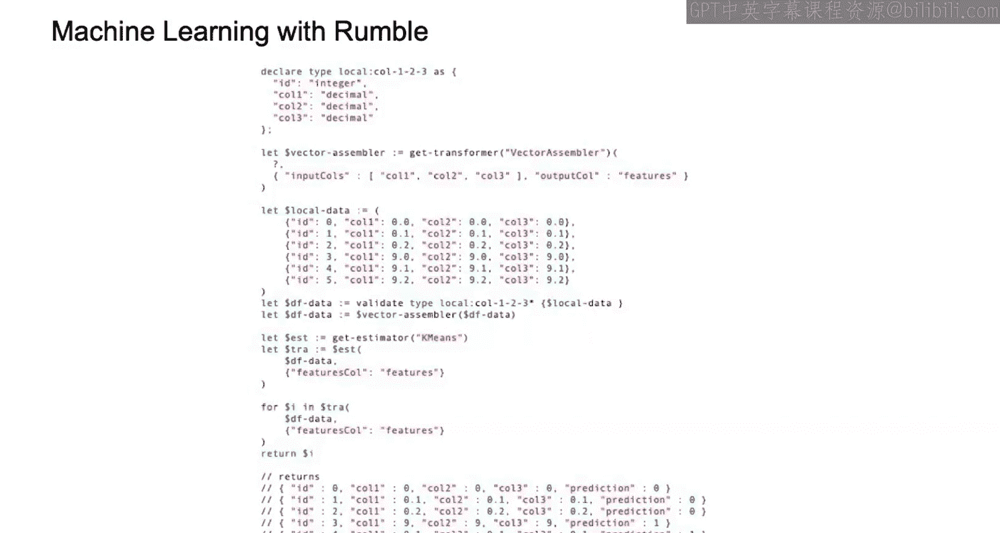

It can also be with a star that you open all the contents of a directory， just like SP so if you say。

 for example， Jason file and then some path slash star do Jason。

It's opening the 1000 files without any problem and in parallel， so Spk is going to take care of it。

There is no extra effort。 Just put it in the data lake， and then you directly open it like this。好。

Okay。And can I。Can I。De from them being。英文。You have validate with a schema， yes。

 you can validate that in Baek and then it can create a data frame and you can save it back as a packet final notes so on the data lake the full ecosystem。

Thank you Thank you。All right， any other questions？😊，Alright， then let's wrap up。

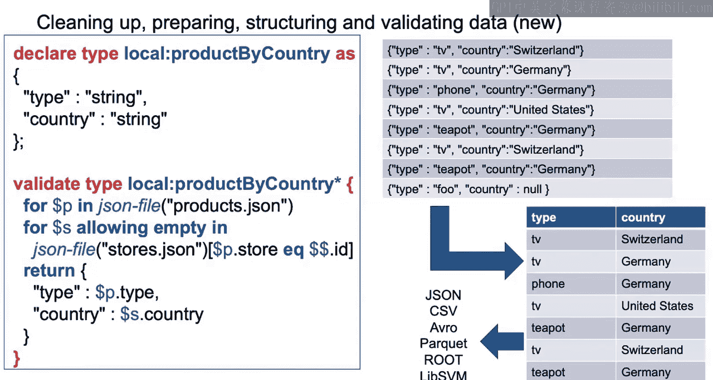

Going to end the recording here。