# 工程师的大数据：4.4：查询树（4/4） 🧠

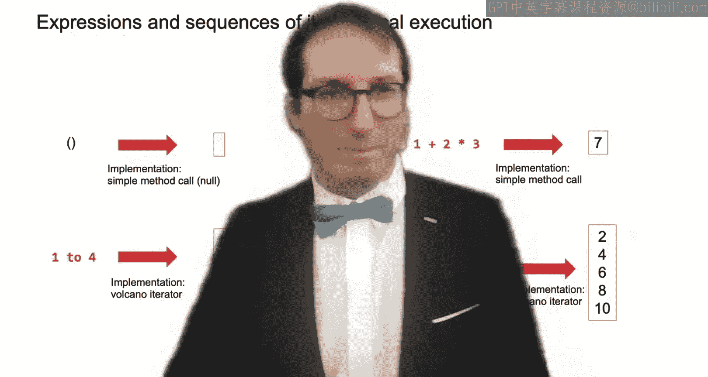

在本节课中，我们将学习RumbleDB查询引擎的物理实现层。我们将了解一个高级查询语言（如JSONiq）如何在不同规模的数据集上，通过不同的底层执行模式（如迭代器、RDD、DataFrame、Spark SQL）透明且高效地运行。

---

上一节我们介绍了JSONiq查询语言的逻辑层面。本节中，我们来看看这些高级查询在物理层面是如何被执行的。关键在于，用户看到的只是简单的查询语法，而引擎在幕后自动选择最佳的执行策略。

## 物理执行模式概览

JSONiq是一种高级语言，类似于SQL。这意味着无论查询是在笔记本电脑上运行，还是在数据中心处理PB级数据，无论数据源是JSON、Parquet还是CSV，查询语句看起来都完全一样。

这种一致性意味着所有复杂的工作都隐藏在物理实现层。用户唯一能感知到的可能是查询速度的快慢。实现层提供了多种执行模式。

以下是主要的执行模式：

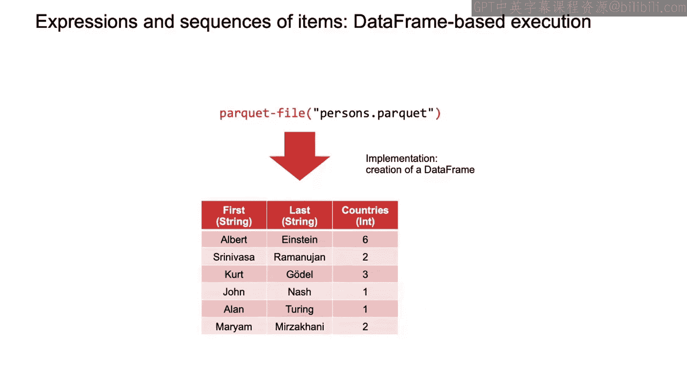

1.  **直接Java方法调用**：适用于可以预先确定只返回单个结果的简单表达式。
    *   **示例**：`1 + 2 * 3`
    *   **实现**：直接作为简单的Java方法执行，无需复杂框架。

2.  **火山迭代器**：适用于数据量较小（例如数千到百万条）且可在单机上处理的情况。
    *   **核心API**：`open()`, `hasNext()`, `next()`, `close()`
    *   **工作原理**：逐个拉取和处理数据项，实现流式处理。
    *   **示例**：`(1 to 10)[$$ mod 2 = 0]` 会逐个检查数字是否为偶数。

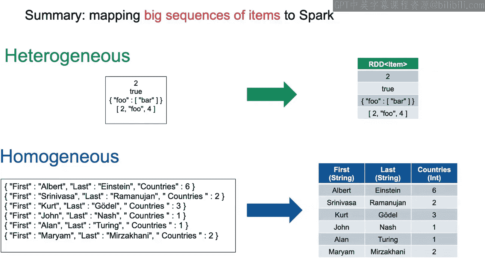

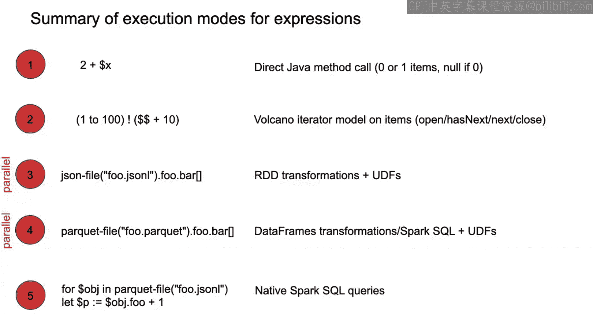

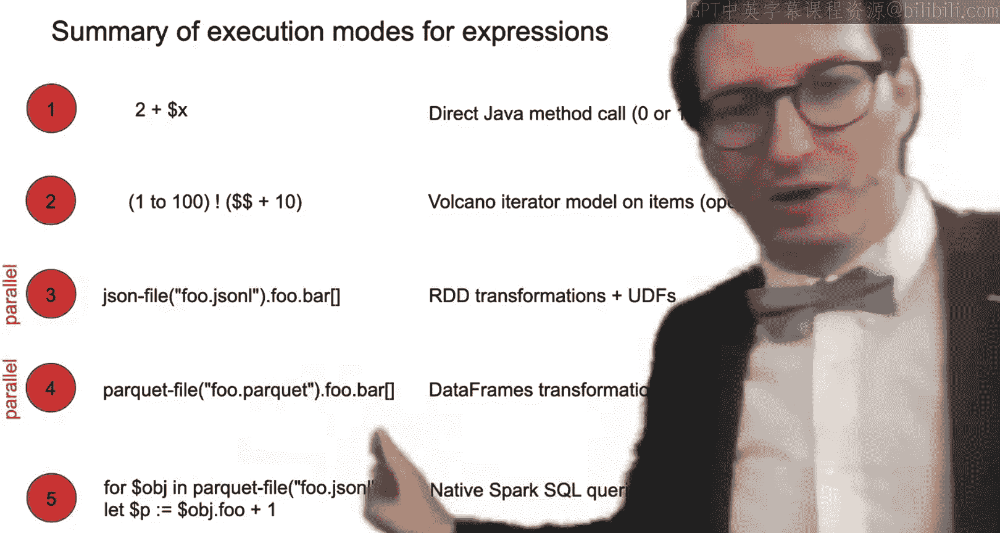

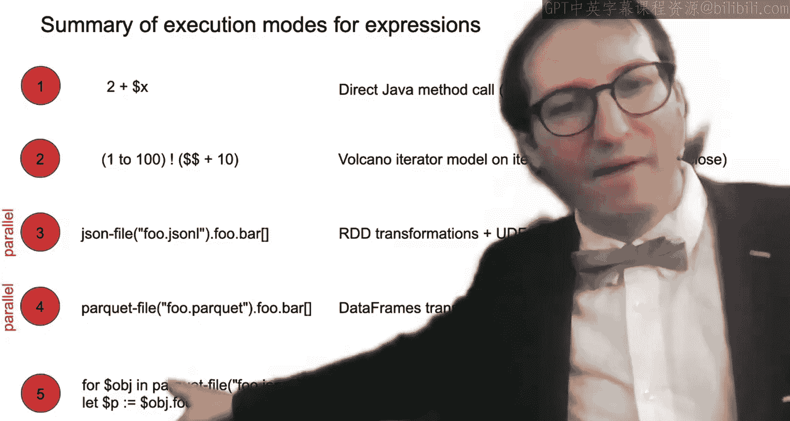

3.  **Spark RDD转换**：当处理来自数据湖的大型、可能异构的JSON文件时使用。
    *   **过程**：将文件作为字符串RDD读入，解析为JSON对象（允许异构），后续的查询操作（如 `.countries`）被转换为 `flatMap` 等RDD转换操作。
    *   **特点**：用户完全看不到RDD和转换细节，查询逻辑保持不变。

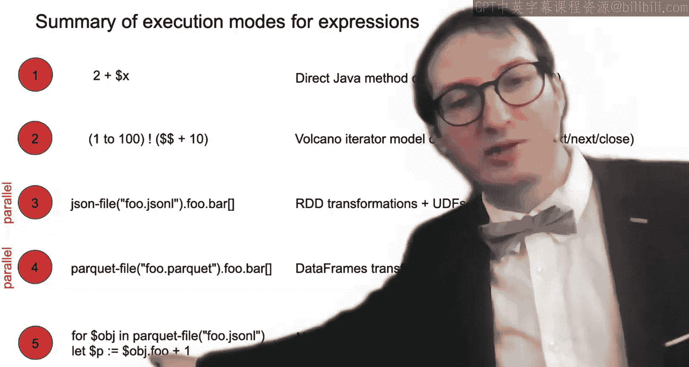

4.  **Spark DataFrame转换**：当数据是同构的或已被验证（例如Parquet文件）时使用。
    *   **优势**：DataFrame比RDD更节省空间，执行速度更快。
    *   **用户感知**：逻辑上仍是一个对象序列，只是物理执行更快。

5.  **Spark SQL转换**：在某些特定情况下（如对Parquet文件进行迭代和过滤），查询会被进一步优化并转换为Spark SQL执行，以获得最佳性能。

所有这些执行模式的选择对用户都是透明的，由RumbleDB引擎自动完成。

## FLWOR表达式的执行

FLWOR表达式通过子句操作元组流。为了实现并行化执行，引擎采用以下策略：

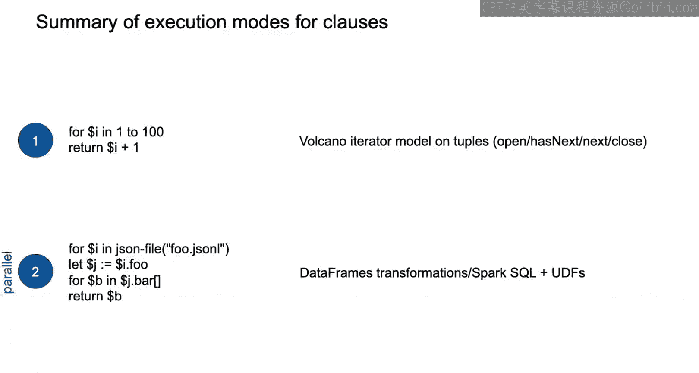

1.  如果数据源是异构的，会先创建一个RDD，然后将其转换为一个单列的DataFrame。该列对应FLWOR中的变量，列中的值是序列化后的二进制对象。
2.  随着FLWOR子句的执行（如`for`、`let`、`where`），会相应地在DataFrame上添加列或应用过滤转换。
3.  每个FLWOR子句都有对应的DataFrame转换方式。
4.  查询结束时，DataFrame会被转换回RDD或结果序列。

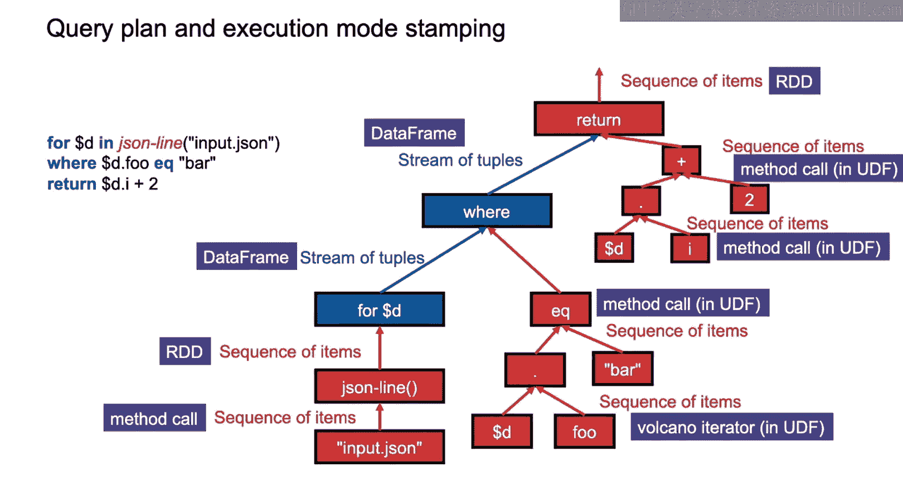

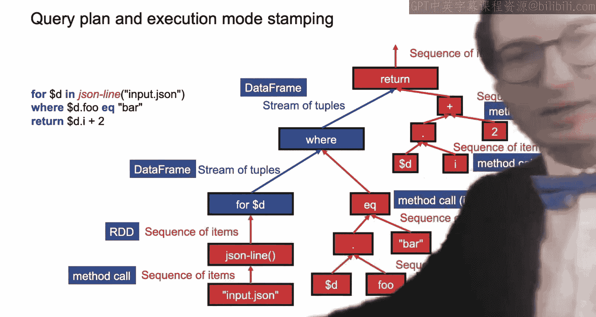

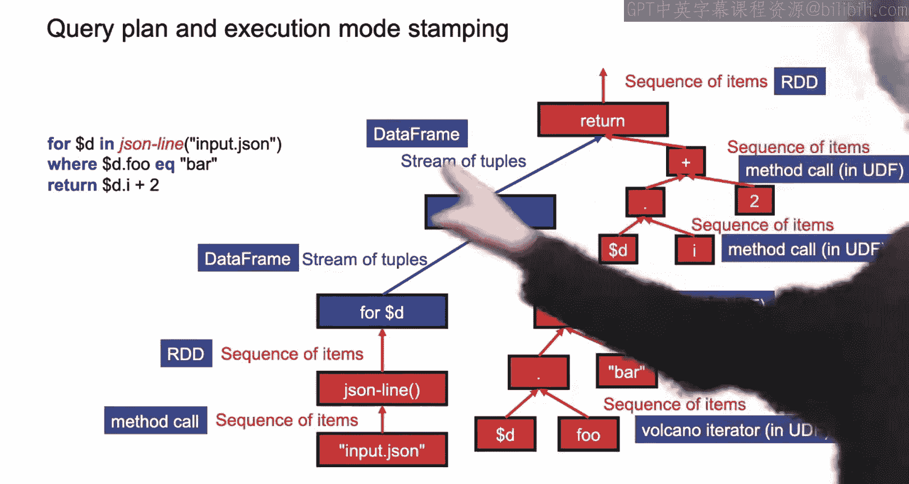

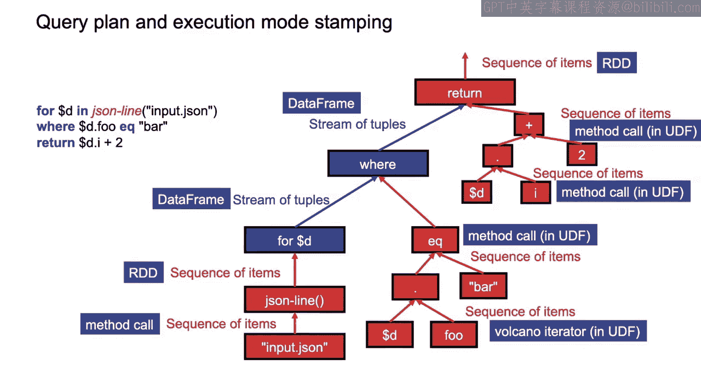

同样，如果FLWOR处理的数据量很小，引擎则会退回到本地的迭代执行模式，避免启动Spark的开销。这一切均由系统自动判断和选择。

## 引擎的自动优化

RumbleDB引擎接收查询后，会生成执行计划树，并自动完成以下工作：
*   分析数据序列和元组流。
*   决定在何处使用DataFrame，在何处使用RDD。
*   选择要应用的转换操作。
引擎每年都会发布更新，在保持接口不变的前提下持续进行性能优化。

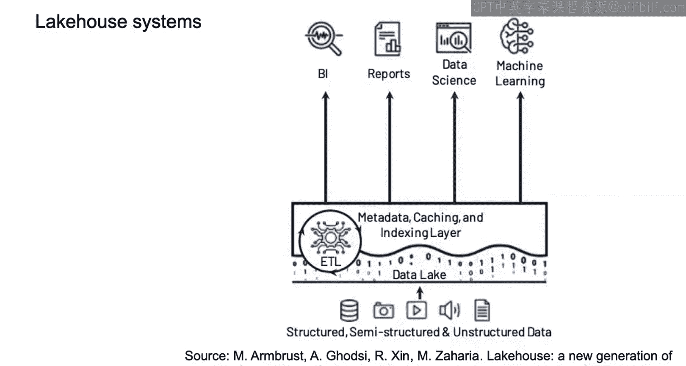

## 在现代数据架构中的应用

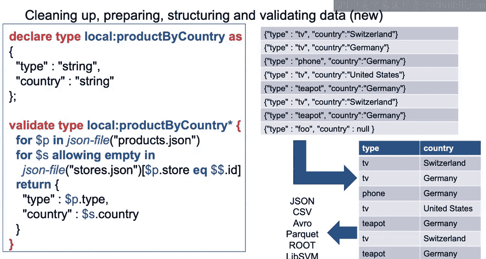

RumbleDB与现代数据架构（如**数据湖**和**湖仓一体**）完美集成。

*   **数据清洗与验证**：可以使用JSON Schema定义数据结构，并通过 `validate` 表达式进行验证。验证通过的数据会自动提升为DataFrame，从而加速后续查询。
*   **格式转换**：可用于读取JSON，验证后保存为Parquet、Avro等高性能列式存储格式。
*   **机器学习**：虽然超出本课程范围，但RumbleDB能够构建包含特征和标签的对象序列，并通过函数项支持机器学习模型的训练。
*   **未来支持**：即将发布的版本将支持通过**Delta Lake**等技术对数据进行修改操作。

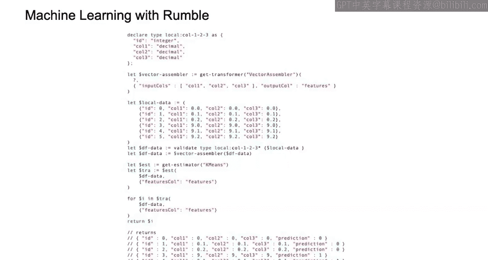

---

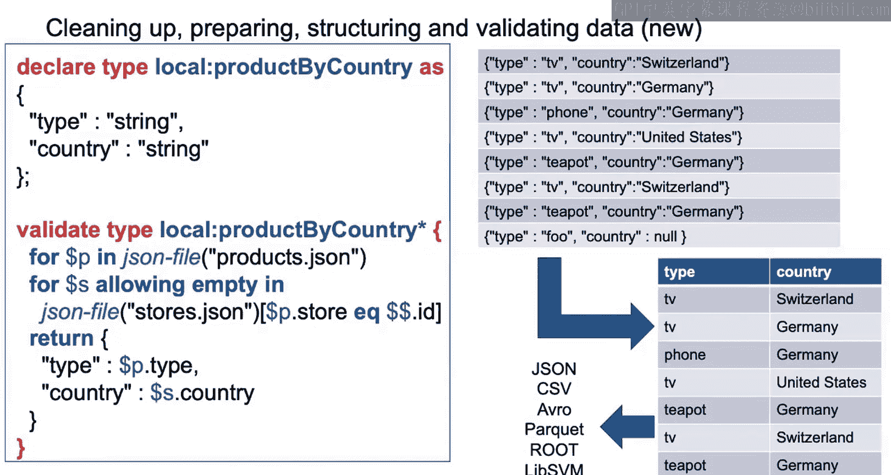

本节课中我们一起学习了RumbleDB查询引擎的物理实现。我们了解到，一个简单的高级查询背后，引擎会根据数据规模、结构和类型，智能地在本地迭代、Spark RDD、DataFrame乃至Spark SQL等多种执行模式间进行选择和切换。这一切优化都对用户透明，使得开发者能够用统一的语言轻松处理从KB到PB级的数据，并融入现代数据湖和湖仓一体架构。