# 苏黎世联邦理工《工程师的大数据｜Big Data for Engineers - ETH Zurich - 2024》中英字幕 p34 12. Wrap up (1_2) - .zh_en -BV17FAmeFE9K_p34-

All right， so now let's wrap up what we've been doing。

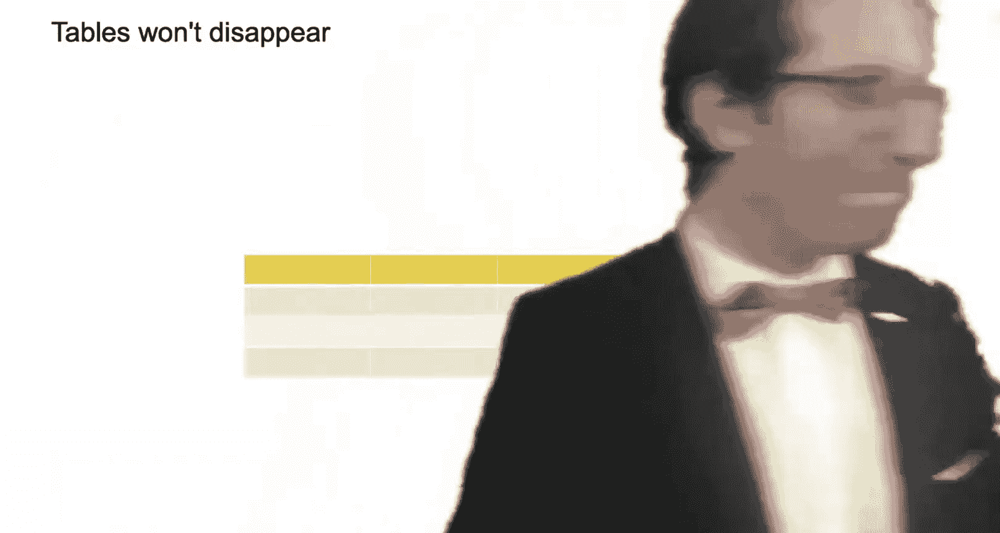

So with a generally high level overview overview of the whole thing。So first。

 word on the fact that in spite of learning all of that， data deormalization， trees。

 the also so graphs and cubes and other shapes。It is still true that for people in the industry staffing a new project。

 tables are still here and in fact， in 80% of the cases tables is what you need a relational relational system is what you need。

 In fact， many people have data that fits on a machine and they have data that is structured In that case。

 just use the good old good old relational database that's good enough。Then even if it's big data。

 you might still have a table， right， This is the whole point of of the of the data frames and and age base hive。

 you can actually still use tables。 So do not underestimate the power of tables。

 right the trees are useful for data that is not clean or in order to denormalize the data and so on。

But in the end， it is still the case that a lot of data has actually a tabular shape。

My computer on strike。Okay， no it's just still。You just choose the keys。 Alright， Now， you know。

 the shapes， right， trees are the are the shape that we studied the most in this class。 Now。

 we know that it's deormalized tables， right， A collection of tree is a more generic case of a table。

 A table， in fact， is a collection of tree that is flat and homogeneous。 Who understands that now。😊。

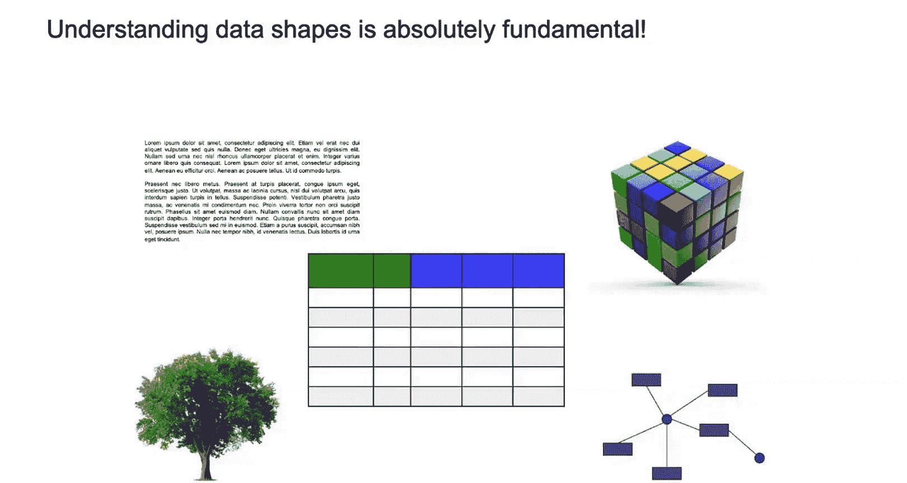

Right， okay， so oh， and now it went all the way to the beginning， I don't know where it's acting up。

Y。So and then what we did not cover is graph databases that I do in the master lecture in the big data。

 so Neo4j for example， but it's the same it has a query language and so on cubes are covered in information systems for engineers and the text and now text has multiple models now we even have vector databases I thought of creating a sixth shape actually for vector databases but then I realized this is just text I mean in the end what we use vector databases for with the world andbeddings of the documents is a way to model text data。

😊。

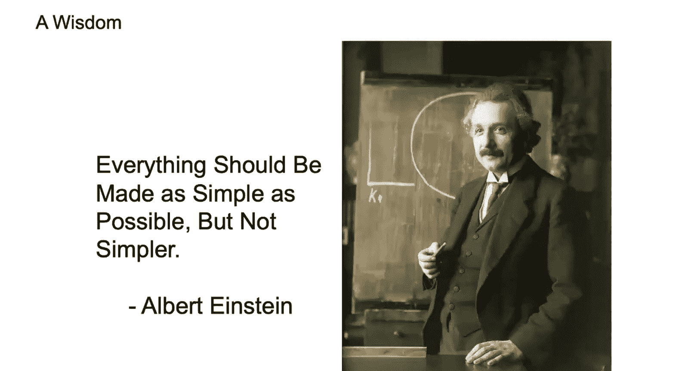

嗯。One of the principles that I hope you saw throughout the semester is simplicity the only way that you can scale to thousands of machines is to keep things simple。

 for example， you have a huge collection of trees right a huge collection like billions。

 trillions of objects。And then each object is a tree。 That's a simple thing。

 Like in S 3 key value pair， you have a key value model。

 you have object I and bucket Is and then a black box with the bits。 That's also simple， right？

 So it's， it's very important to have something that we understand because otherwise。

 it's it's going to to make our brains explode。😊。

So then what's very important is that each one of these data shapes， the five data shapes。

 they have a paradigm， so a story that you tell about them， they have a data model。

 maybe several data models， sometimes they have a syntax， they have query languages。

 they have architectures in the way that you implement the systems。

 and then you can even map them to each other。😊，So the I， for example， is that for tables。

 Let me take the tables。 Tables， you can select project rename group join So union， right。

 that's the good old SQL with Pro Gql cubes。 you can slice dice aggregate roll up pivot or tabulates。

 you might be familiar。 if you visit its information system for engineers。

 Otherwise you're not because that's not the material of this lecture。

 but just as a comparison trees now you can look up， navigate， normalize。

 deormalize when we turn them into nested data when we normalize it to flat data。

 we can validate select project group by also makes sense for trees。😊，Graphs。

 we also did not cover them here， but we can traverse graphs， we can find patterns。

 select soft and so on。 there's plenty of things we can do and when we have text we can filter down map group。

 aggregate and so on， but in fact， we can even find proximity like similar well。

 similar documents and and so on now with vector databases。What about syntax？Tk tables， you know。

 it's CSV one of the the popular syntaxes， even though a lot of people export their tables as a sequence script actually。

 that you can reimbok。 That's a common practice。Trees， now， you know， Jason， X M L。

 Bson would be the binary version used of in Mongodibi， Parkque。 if it's normalized。

 if there's a schema Avro protocol buffers by Google。And then there's also syntax is for cubes。 XVRL。

 for example， is the popular syntax for a financial robots that are cubes used throughout the world。

 Then we have RDF over XML tutle and so on for graphs text when it is just text， right。

 So you just see it as it is。😊，So again， you see that this idea of syntax。Is for every shape。

Then query languages， you know SQL for tabs。Now， you know， Jsononic fories， but there's others。

 Xqueries is actually the the the the cousinine of Jsononic that is on the XML side。 We have A QA。

 Nikel， Lnk， Bati girl， GphQl， I'll come back to that。😊，For graphs， you have sparkle， cipher。

 Graph Ql and so on， but for graphs it is converging。

 there is now a successful round of standardization going on that is that is that is I think it's already there。

 It's an extension of SQL and it's beautiful So it means that now the industry for graphs is agreeing on on a standout that they are now going to only implement。

😊，And for for bunch for text， whether it's the query languages， right， that can be oncode。

 but you can also imagine a query engine when you chat with chat GT， you just talk in English right。

 so you could also argue that for text， it's also natural language the for the query。😊，Al。

 so you remember the progress made that we are now extremely faster with with the quantity of data that we can store in data legs。

 because now it's it's absolutely gigantic。 And now I saw that there is even progress on DNA storage now that it's。

 it's incredible how you can store， I think petabytes of data on a credit card with DNA storage。

 Can you imagine petabytes in my hand。 So this is also going to， to just。😊，Become larger than that。

 But already today， if you compare to the 50s， we are more than billions of times we have billions of times more capacity per unit of volume。

 right， I even looked at it per unit of volume。But the screwputs。

 the speed at which we can read has not increased that much。 And the the let and C it's even worse。

 It， it has only been reduced by an even smaller factor。 And by now， hopefully you， you see that。

All the the things that we built in these cos are because of this we paraize because of the capacity and throughput that didn't increase the same so here the solution is to paras right and for the la C problem the solution is to batch process we have chunks blockss of hundreds of megabytes and we have the lock structure charged most three architecture in each base that allow us to when we write down to the system we write down with huge quantity at a time we don't write down bit by bit but we write down 100 megabyte by 100 megabyte right。

So we saw and again， thats because of this that we scale outs the collections of trees to multiple machines。

 now we have data centers with thousands of machines and we spread the trees all over the machines。

 This is what we call scale outs。 So scale out scale in is the opposite scale up means you build the more expensive machines scale down less expensive machines。

😊，Then we saw that we can go to heterogeneity and nested nest by switching to collections of trees。

 but this is on the individual record level， right every record now is a tree instead of being a flat flat record plus the the records might have different columns。

嗯。F types。We saw that it's more or less universal， I mean it's like a Schcher twitch so the exact names might vary。

 but in fact， the types are more or less the same everywhere。

 no matter what system you look at now you can take any new system that we have not covered you can look at the documentation you can be sure that more or less it's going to feel the same in terms of types right we have strings we have various kinds of numbers。

 integers， decimmos， doubles， we have binary data dates time and we have structured data with typically objects and arrays。

 sometimes objects can also be in the form of either our maps orstructs which is a certainty。

 but in general its3D objects and erase the structure level right。So。

You will very easily learn any new system like this， any new schema language。

 any new formats that should be easy because again， it's the same it's the same paradigm。

 you just need to learn every time the new names， how it's called and the new list。嗯。

Then we saw the two directions when you have data。You can serialize it。

 meaning you store it to the disk， right， You can serialize， for example， trees。 What is he doing。

 You can serialize trees as XML as Jason as X query and so as as in all kinds of format。

 Then you can use you can validate it with X Ml， schema， Jason， schema and so on。

 you can query it with Xquery， Jasononic storageor as Spker Avro and so on。 So now you know。

 all of these technologies。😊，And and。Yep， that's pretty much what I want to say so remember the names serialerize means you take something in the memory serialerize you store it as bits on disk。

 the opposite side is called Paing， you pass you serialerilize。

 you pass you serialerilize these are the the two worlds。Okay。

 then something that we didn't really cover is the fact that we can in fact map shapes to each other。

 it means that we can store trees in tables， we can store tables in trees。

 storing tables in trees actually is very natural because the table is just a flat tree。

 flat collection of trees。Trees are easy to store as graphs because the graphs have cycles。

 but the trees do not。 So graphs are more generic than trees。 A graph can be stored as a table。 How。

 because a graph is just a collection of nodes and energiess， right。

 So you can just store it as a table with three columns with the source。

 the destination and the property。 And then you， you just store a graph as a table。

A bunch of text can also be stored as a table， even as a。

 as a vector database that would be tables with the vectors in their， in their columns and so on。

 Why do we do that。Because sometimes you have a specific system available or a specific license。

 or maybe you have a system that scales very well， but you do not find any system that you pass a different shape So typically when people implement a first prototype they will use an existing system and then implement a mapping like that and typically a few years later they are going to switch to a native system where they do everything themselves。

 but this of course is more work So it means that the very early versions of graph databases or of documents does in fact were implemented on relational tables for this reason and it's later that came the native versions of for trees and for graphs。

The same goes by the way for vector database now there's vector extensions for relational database。

 but now we are going to move on to native support for collections of vectors for large language models。

Okay， so now the idea of an architecture by now I hope I convince you because of data independence is that the way you store the data should be completely hidden。

 you shouldn't care what it looks like that's hidden from the user。

 the user sees a data model and they think in a data model， they see tables， they see trees。

 they see graphs， you know。😊，The execution layer should also be hidden， right。

 You might use a system that looks like mapre of spark， but in the end。

It is not desirable that the end users learn Spark or that they have to use Spar directly。

Sack or map Red normally should be just for the engineers to implement the systems。

 the end user should have a fancy decorative language SQL Jsononic MDX is for cubes。

 cipher for graphs and so on and so on。This is how you make it more accessible to users and I could even add on top I'd come back to that but natural language that in the end with large language models this might go in this direction right so this is the language landscape where you have the software engineering landscape with the assembly code and then Java C Python and so on that's the software engineering。

With this distinction between the low level languages and high level languages and the same gross for beta。

 we have the lowle languages that I call proto declarative and here I have mapreuce the mapreduce APIs I have the Spk API in mind and so on。

 So these are all the low level languages and then you have the highle languages like SQL like Jsononic and so on。

😊，And then this is autocope of the lecture， but the same goes for machine learning right now you have machine learning libraries。

 Tensofflow， Pytorch and so on。 But again， these are APIs you use Python with an API to do machine learning This in fact is very similar to the Sp how they map produce API and in the same way that that in Sp or in any system you can have a higher level query language the same is going on for machine learning they are people。

😊，Designing higher level languages for machine learning instead of having to use Pytch or Tensorflow and having to code in an API。

People are designing higher level languages with which you directly declare that you want to train that data set in this and that way。

 right？

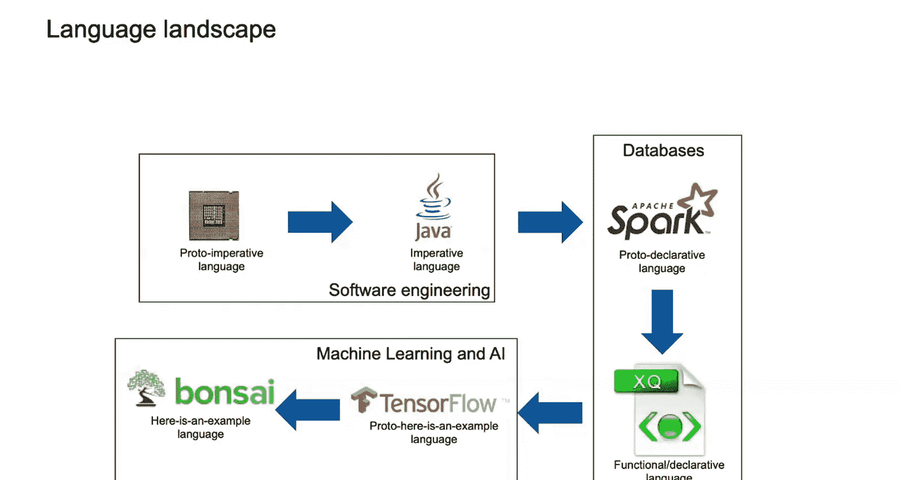

嗯。Okay， but that's the the landscape。So that's now by now you know Ruble DB it will also be in the exam you'll have an installation of that。

 it is relatively stable so that's actually a stable release and that will be the one we use for the exam。

嗯。So now you know that there's the Docker， you can use the Docker to use it on exam day it's not going to be Docker。

 it's just going to be installed on the machine， right。

 but it will just work so you don't have an exam day to worry about to worry about that。

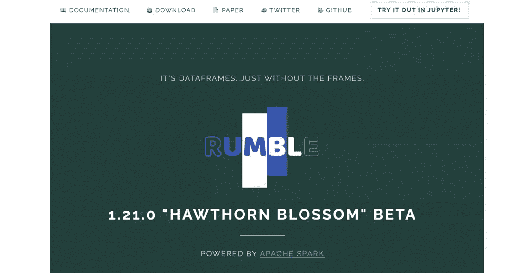

What we saw too is the idea of sharding and replicating the data。

 right many systems at large scale do this。 So sharding is the idea of having blocks right we have blocks in a GFS。

 We have splits in map reduce。 We have parts for RDDs in Spar and so on。

 So we sharp the data and that's how we spread it of our machines。

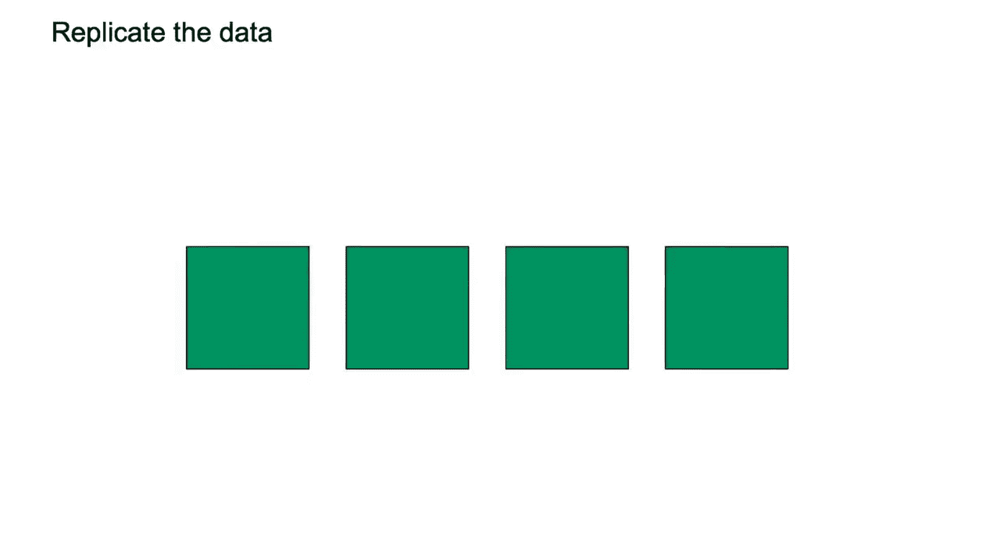

And then we have the replication of the data， it means that every one of these shards or chunk or block or splits or partition or whatever we call it。

 every one of these shards is replicated。😊。

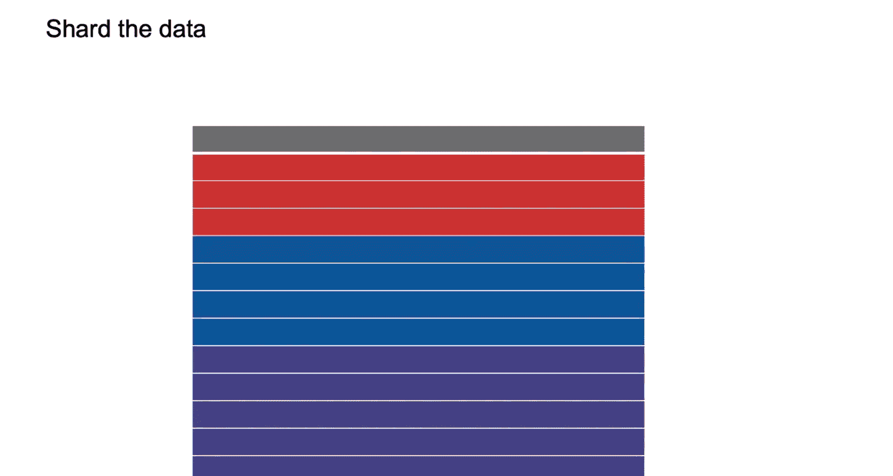

Typically， we like to do it three times because it keeps moving the sides。

Typically three is a good number by default， we tend to store everything three times。

 but you can also change it if you really want to be sure you can have it four times。

 five times and so on。And that's the importance of doing backups。 And in fact。

 there was a recent piece of news that taught us that it's also important to do backups across cloud providers right to not just be only on AWS or only your Google Cloud or only on Asia but be on several providers and make sure you have at least a backup of your data in a different cloud provider just in case you lose it on the first one and it actually saved the company recently that they had a backup because otherwise。

That could have been a huge mess with hundreds of billions of dollars。嗯。

So this is a good point and then the companies that have maybe more customers or that are even more bigger。

They don't only have backups。 They in fact， really use the three clouds at the same time， right。

 Ty if you if you look at Netflix or upper and so on， in fact， they use multiple providers。

 not just for the backup， but really for production like whenever you connect。

 it might be to Google might be to AWS might be to Asia， they just use all of them。

 So even if one of them says it's going to work with another one。Okay， so replication。Sreety green。

俾时做定。Allright， so then we have batch process。 batch process is this idea that we like to group the data we want to process in batches in chunks。

 right， So that's what we did with age based where we needed to write new data to HFS。

 But instead of writing the data every time something happens， we accumulate the data in memory。

 and only when the memory is full。 we start the data because it needs to be sorted。

 That's the that's the reason。 And then we merge and merge and merge。 Remember， we flush， we compact。

 we flush， we compact， compact and so on。😊，Right， so now with everything you've learned。

 you should be able to learn。New product it's they more or less work the same。 So if you know Sp。

 you know equivalent products， you will learn newchema， formats and so on should be easy。

You should be in a position to choose which product to use now because you can look at the characteristics and in particular。

 what's the shape of your data， what's the quantity of data that you need to store and so on。

 so do you need PostgsqL do you need a data lake and so on and maybe for some of you even not so for computer scientists design a whole new technology because then you might realize that it's not enough and nothing on the market does what you're looking for in that case you could design a new product but at this if you know what exists you will realize when you do not need to design a new product because you can just reuse existing product。

不。All right。So again， to make these decisions you need to look at the shape of your data。

 you need to look at the size of your data， does it fit on your laptop。

 does it not fit on your laptop？I really have seen a lot of startups。In a， in a young age， in the。

 in the early days。嗯。I saw a lot of success in some startups that managed to squeeze all their data in a single machine because then they didn't even need to bother with the cloud and clusters and spark and so on。

 you wouldn't imagine all the money you can save when you manage to make it work on a single machine。

 this is really something that is very important to consider if that actually can be done with a single computer before bothering to go to the clouds。

Then you need to consider what you want to do with your data that determines the indices that you are going to build。

And so on。And you really need to ask yourself， are you reinventing the wheel very often。

People write code。In Python in Java and so on， but actually they are writing code that was already written by a million other people and it is just a waste of resources to see that done all over and over and over and over and over again。

 because very often things already exist， things already have been designed people already made mistakes and learn from them and in many cases you can really just use existing technologies。

 existing languages before you need to invent new one。

 So always whenever you feel like you invent something new， first check if it doesn't already exist。

 right a bit of critical thinking。In depth。Right， and here I insist on the using one laptop right normally you should only start using a second computer or even a cluster of machines once you know how to use the first one right you would really be surprised what you can do with these laptops just these small laptops here。

 it's incredible with all the core now there are 16 calls nowadays8 or 16 calls you can do really。

 really， really a lot even on a single laptop。😊，Right。

 so that's a reminder of my definition right big data is we are solving the problem that there's the discrepancy between capacity throughput and la C and because of that problem。

 we needed to invent completely new technologies like data lakes， AGGFS， mappre， PARC。

 and so on and so on。

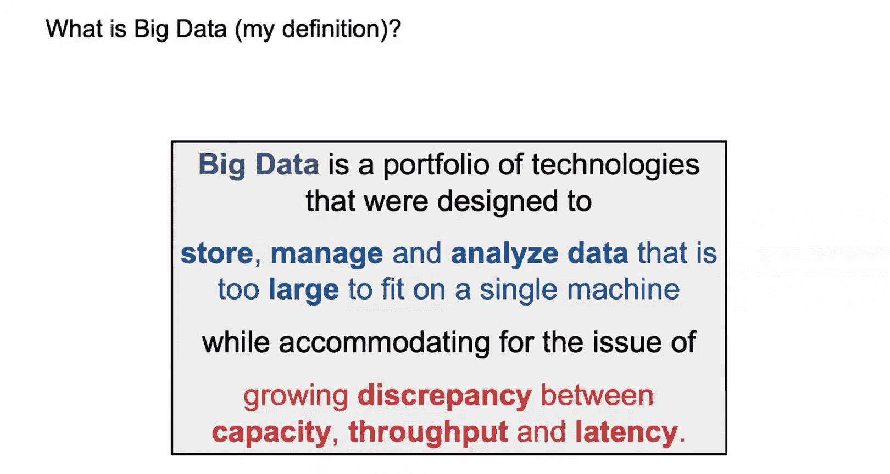

So what's in for the future。I have a few thoughts， some of them actually went kind of realized or making progress in the meantime。

I really think and I'm repeating myself that Spark mapreuce and so on。

 they are really not meant for the end user。 Now there's a lot of excitement also on social media aities to use ponds and Python and so on。

 but really the end user in the end shouldn't have to deal with that。

 there should be a higher level query language that they can use that's the spirit of data independence。

 and this is what happened with SQL and relational database that should be in the end In。

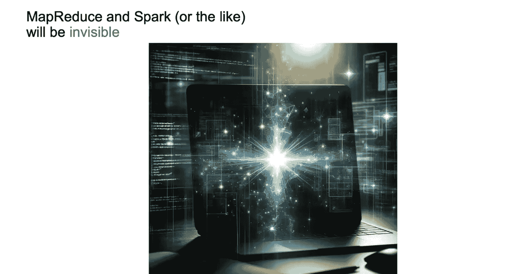

嗯。Hopefully people will realize that the data shapes are important。Why。

 because that's data meaning how much resources and how much money you put in it right It's about productivity。

 It's about performance。 It has a huge impact on how fast your system will be if you select if you select the right data shape and maybe new shapes are going to be discovered。

 In fact， vectors vector databases are kind of a new shape of data right I didn't yet add it as a sixth1。

 I still keep it on the text， but maybe one day I'll just split it and make it a shape of its own right so it means that this is not forever we're going to have these shapes but there will be new shapes that might emerge over time but remember that for every shape is's the same story。

 you'll have a syntax you'll have a data model you'll have a language you'll have an implementation。

 the first implementation will be on top of it of shapes。

 then at some point you'll have a native implementation of its own that is something that we can learn from history right。

Even if we have new data shapes。嗯。😊，Querrying should hopefully get standardized。 I mean。

 it's already the case for tables with SQL。 It's already the case for graphs now as querying graph is also being standardizeded there is a bit more work to be done with trees because in trees。

 I think this situation is best summarized with this XkD who likes say XkCD The popular comics on the internet。

 All right， so this is one of my favorites right and this is exactly what's going on with language is for trees situations there are stock in competing standardout。

😊，I even keep a list of them， so this is just a few of them， but I think now it's even by 30 plus。

And then once in a while， at some company， engineers realize that we need a language for trees。

 and so they invent a new language for trees。😊，Or they want to unify the language for the languages that already exist because they think they know better。

And then what happens is that there are a fancy new website that introduces the new language。

 If they have a lot of money， they might even get adoption and so on。嗯。

And then you basically land in this situation that you just have one more language and it keeps increasing and increasing and increasing and increasing and the risk keeps growing。

 right？And it's a shame because technically Xque is already 20 years old。

 it was designed for x for XML。 It was already standardized because there were people from IBM from Oracle from Microsoft。

 I mean， from plenty of companies that worked for years to standardize that。

 It's already standardize Jsononic is just Xque for JasonO。

 but it's again following the same standout。 Sos what's a bit sad is that many of these languages do not have a specifications。

 they are put online there might be an implementation。 There might be a few examples。😊。

But people underestimate the years of work and the number of people you need in order to have a precise specification that handles all the corner cases that throws all the errors and so on。

 it's basically the design of a language costs millions of dollars so before companies invent new languages。

 they should really consider if there's not an existing standout。That can be that can be taken over。

 right？But the features are similar， I mean， I told you J Soic and you will see you can take any of the other languages you will find the similar features so you can use you can learn any of these languages very easily。

😊，With what you have。Then it goes in the direction with TraGT that we talk to databases and now it's becoming clearer and clearer every year。

 I mean a few years ago I was just showing this Star Trek。

 the voyage home where Midtasco was just talking to the computer。

Now I think nobody would even laugh anymore because it's just normal I mean this this is becoming a normal thing to do and that's probably going to develop don't forget that we need to overestimate the speed at which these develops in the short term so might be slower than we actually think in the coming year but in the coming 10 years than 20 years typically it's faster than we think so here we tend to underestimateimate the changes。

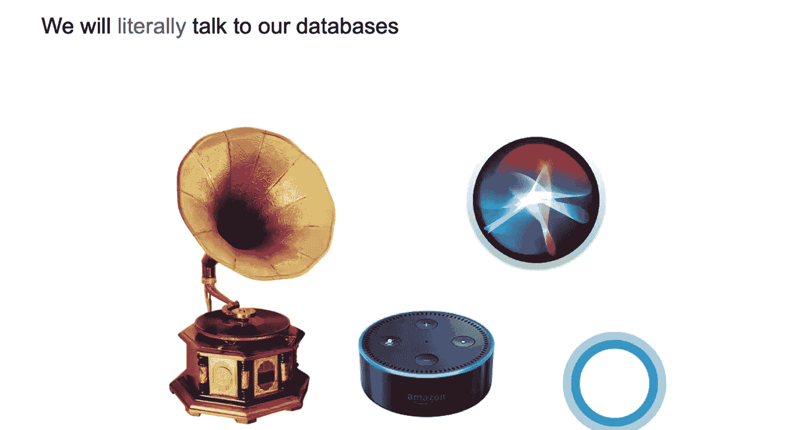

Data might become fungible。 that has to do also a little bit with the efforts to stock some of the data on on the distributed lettersgers like blockchains and so on。

 When you consider collections of like graphs， for example。

 it's just the collections of nodes and edges， right。

 So you can easily sharp them and share them and so on。 So this is the the notion of。

Fungibility of the of the data in the way that it's。

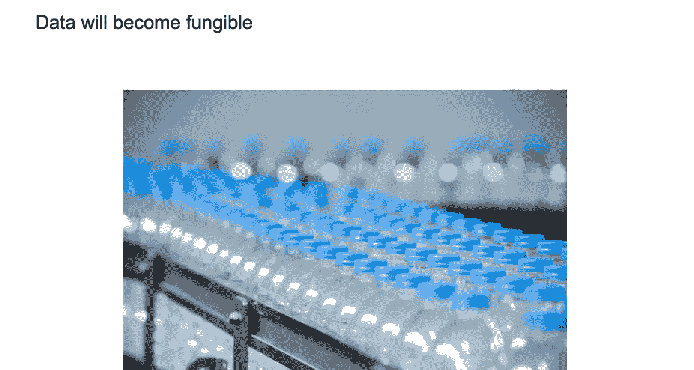

Flowing around。 This is directly related to the notion of cryptocurrencies。

 which in the end I'm not saying any cryptocurrency in particular is a good investment or anything that's absolutely not what I'm saying。

 But I'm saying that the principle of that is just to realize that the notion of private property or the notion of owning money or of owning something in the end is a matter of agreeing between humans。

 who has wet。 And when you agree on who has wet， it comes down to just keeping track of who has wet。

 And so this in the end ends up being data right So this is why there is some some sort of of convergence here。

 Of course that comes with risks and this is why now there's important topics like data protections and legal aspects which are very。

 very important。 And now it's also something that more and more companies become aware of and are even folks to do by law in the EU and in Switzerland and。

 So just because you can do all of that doesn't mean。

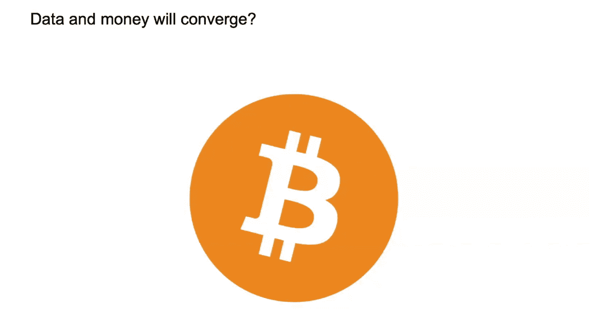

That you shouldn't be careful with doing all of that and you need to remember that that the data might be sensitive or that it might belong to other people。

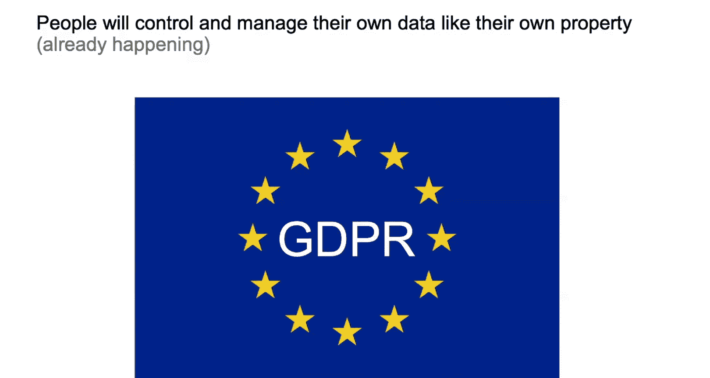

Then we have some interesting interaction between machine learning and databases and there's this ongoing joke that we don't know is machine learning with each databases or databases with eat machine learning。

 but some of the interesting developments in this direction is that， for example。

 people are building indices based on machine learning instead of hash indices instead of B3 B plus3 indices。

 people just learn indices like the index is a machine learning model that tells you where the data is because it's learned it So this is very impressive after things that are going on now。

 So this is an example here of learned index instead of a hash or B plus3 So it's interesting to see the evolution This is at MIT currently。

😊，嗯。Quantum computing is is also on the right。 I realize maybe I'm almost done， actually。

 but maybe we should take a break because it's 9。 I'm almost done。

 Then I will take talk about the exam。 we'd move over to the quiz， right。

 let me leave quantum for right after right after break。 All。

 so I'd see you in 15 minutes at Quata past past 9。😊。

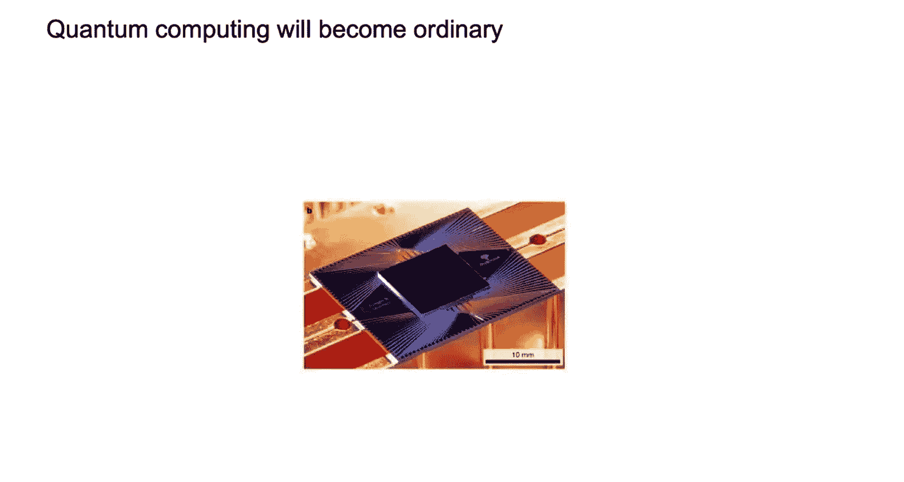