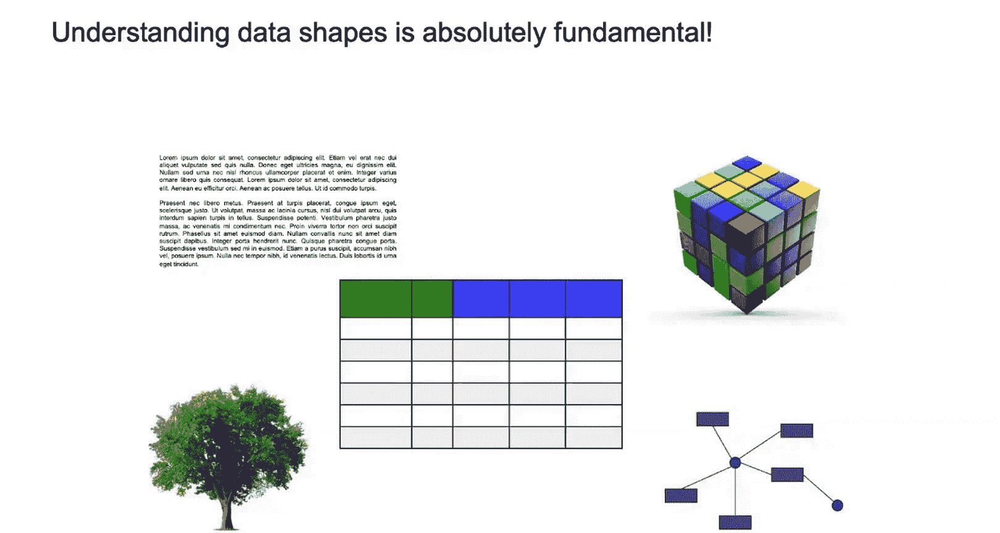
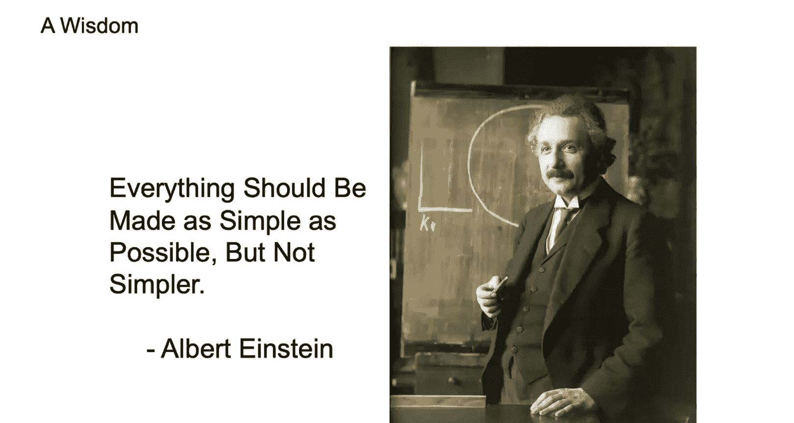
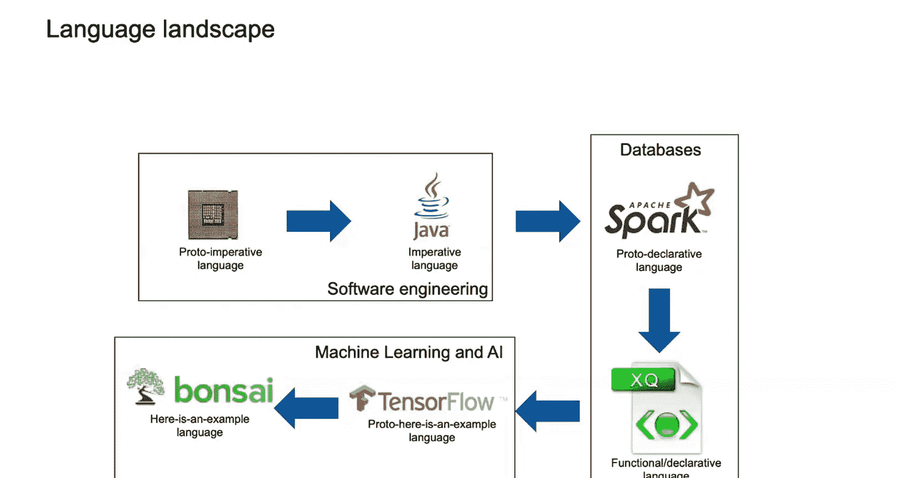
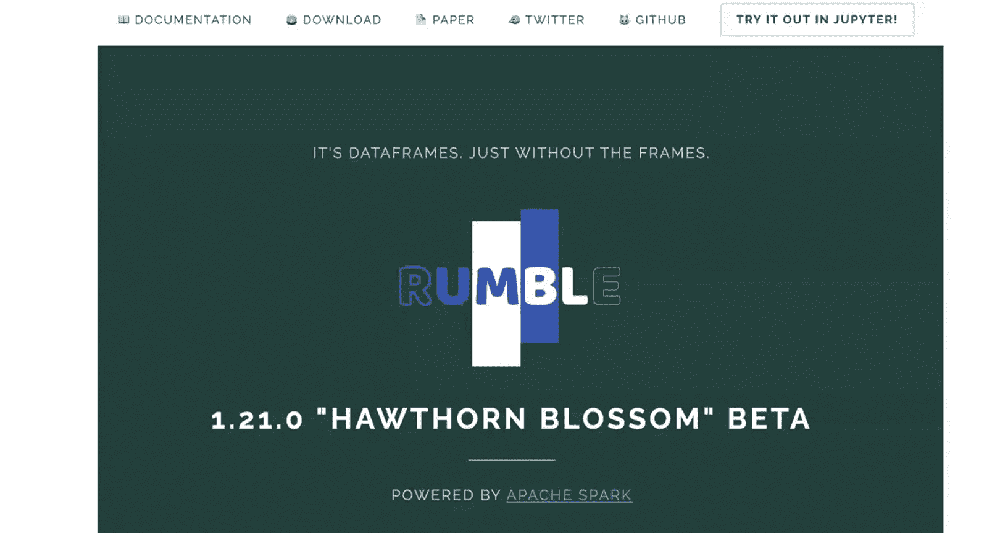
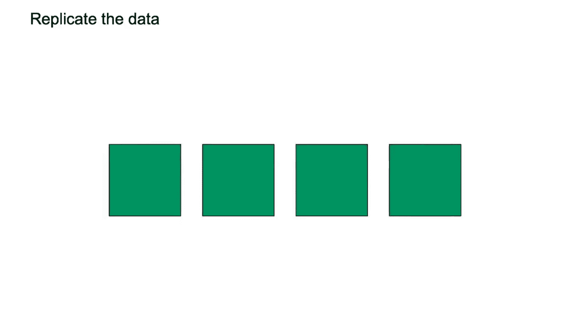
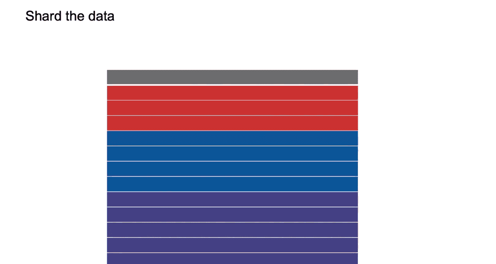
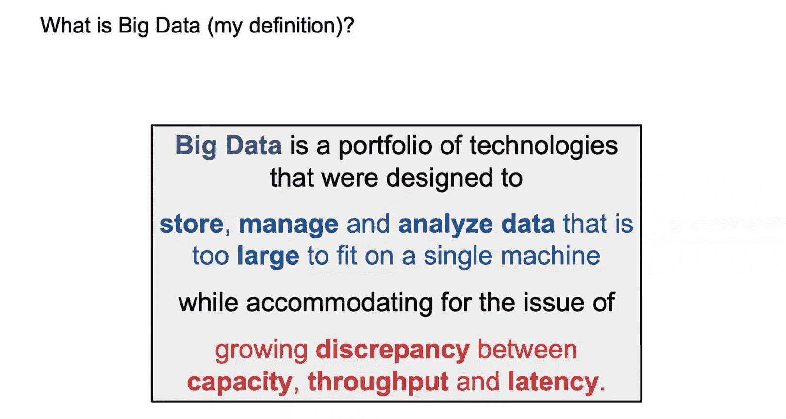
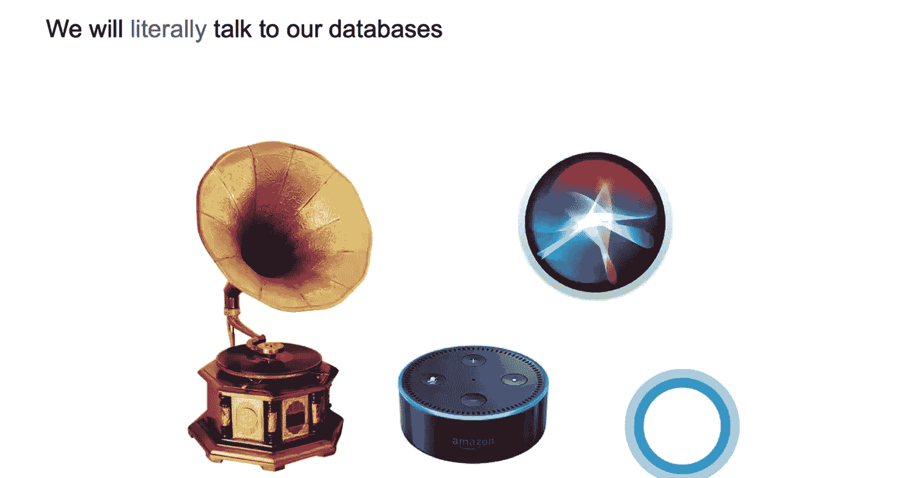
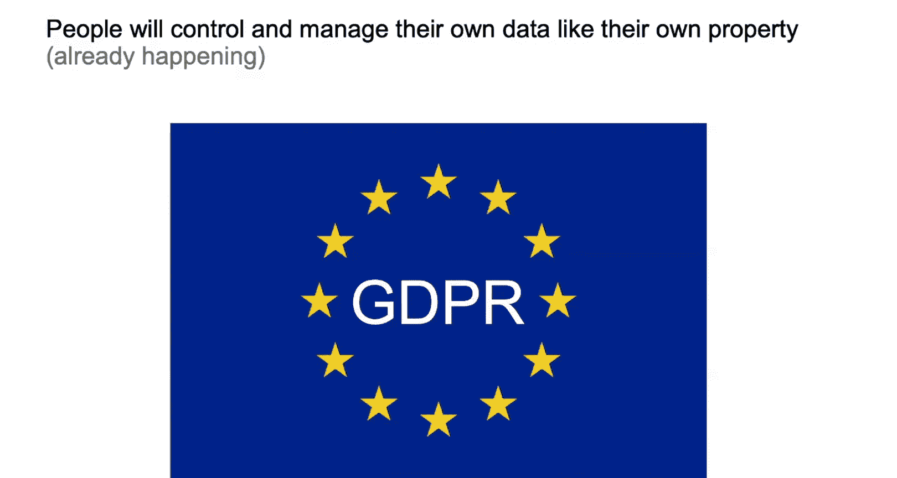

# 工程师的大数据：12：课程总结 (1/2) 🎯

在本节课中，我们将对《工程师的大数据》课程的核心内容进行总结。我们将回顾所学的关键概念、数据形状、技术架构以及未来的发展趋势，帮助你构建一个完整的大数据知识体系。

## 课程核心回顾 📚

首先，我们从宏观层面回顾整个课程的内容。尽管我们学习了数据反规范化、树、图、立方体等多种数据形状，但需要明确一个事实：对于行业中的新项目，**表格**仍然是主流。在80%的情况下，你需要的仍然是关系型系统。

许多人的数据可以存储在一台机器上，并且是结构化的。在这种情况下，使用经典的关系型数据库就足够了。即使是大数据，你仍然可能使用表格，这正是数据框架和Hive等技术的核心。因此，不要低估表格的力量。

树形结构适用于数据不干净或需要进行反规范化的场景。但归根结底，大量数据实际上仍然具有表格形状。

## 数据形状的演变 🌳

上一节我们强调了表格的持久性，本节中我们来看看其他数据形状。我们在这门课中研究最多的形状是**树**。我们现在知道，反规范化的表格就是树的集合。一个表格实际上是扁平且同质的树集合。

我们未在本课程中涵盖图数据库（例如Neo4j），这在大数据硕士课程中会涉及。立方体在《工程师信息系统》课程中涵盖。文本数据则有多种模型，现在我们甚至有了向量数据库。我曾考虑为向量数据库创建第六种形状，但后来意识到这本质上仍是对文本数据的一种建模方式。

## 系统设计原则：简单性 ⚙️

我希望你们在整个学期中看到的一个原则是**简单性**。扩展到数千台机器的唯一方法是保持简单。例如，拥有一个巨大的树集合（数十亿甚至数万亿个对象），每个对象都是一棵树，这就是一个简单的事物。就像S3的键值对模型，或者对象存储桶中的黑盒比特。理解我们所构建的东西至关重要，否则复杂度会让我们的大脑爆炸。

## 数据形状的范式与组件 🧩

非常重要的一点是，这五种数据形状中的每一种都有一个**范式**（即关于它们的故事）、一个或多个**数据模型**、一种**语法**、**查询语言**、实现系统的**架构**，并且它们之间可以相互映射。

以下是每种形状的核心操作：
*   **表格**：选择（Select）、投影（Project）、重命名（Rename）、分组（Group）、连接（Join）、并集（Union）。这就是经典的SQL。
*   **立方体**：切片（Slice）、切块（Dice）、聚合（Aggregate）、上卷（Roll-up）、透视（Pivot）。这在《工程师信息系统》课程中会涉及。
*   **树**：查找（Look up）、导航（Navigate）、规范化（Normalize）、反规范化（Denormalize）。当我们将它们转换为嵌套数据或规范化为扁平数据时，也可以进行选择、投影和分组。
*   **图**：（未在本课详述）遍历（Traverse）、寻找模式（Find patterns）、选择（Select）、排序（Sort）等。
*   **文本**：过滤（Filter）、映射（Map）、分组（Group）、聚合（Aggregate）。现在借助向量数据库，我们甚至可以查找相似文档。

## 语法与查询语言 📝

每种数据形状都有其语法和查询语言。

以下是常见的数据序列化格式：
*   **表格**：CSV、序列化脚本。
*   **树**：JSON、XML、BSON（MongoDB使用的二进制格式）、Parquet（若已规范化）、Avro、Protocol Buffers。
*   **立方体**：例如金融报表中全球使用的XHTML。
*   **图**：RDF over XML、Turtle等。
*   **文本**：就是文本本身。

以下是主要的查询语言：
*   **表格**：SQL。
*   **树**：JSONiq（用于JSON）、XQuery（用于XML，是JSONiq的“表亲”）。
*   **图**：SPARQL、Cypher、GQL。图查询语言正在标准化，目前有一个成功的标准化进程，是SQL的扩展，非常出色。
*   **文本**：可以是编码查询，也可以想象成与ChatGPT用自然语言对话，因此对于文本，查询语言也可以是自然语言。

## 技术进步与挑战 🚀

我们见证了数据存储量的巨大进步，如今数据湖的存储容量绝对庞大。甚至出现了DNA存储的进展，可以在信用卡大小的介质上存储PB级数据。与50年代相比，我们的单位体积存储容量增长了数十亿倍。

然而，读取速度（吞吐量）的增长并没有那么快。而写入延迟的改善甚至更小。正因为如此，我们在这门课中构建的所有东西都依赖于**并行化**。为了解决容量和吞吐量增长不同步的问题，解决方案是并行化。为了解决高延迟问题，解决方案是**批处理**。

我们使用数百MB的块（chunks/blocks），并采用日志结构合并树（LSM-Tree）等架构（如HBase），允许我们在写入系统时一次性写入大量数据，而不是逐位写入。

## 扩展与数据模型 🌐

正因为如此，我们将树的集合扩展到多台机器上。如今我们拥有数千台机器的数据中心，并将树分布到这些机器上。这就是我们所说的**横向扩展（Scale-out）**。纵向扩展（Scale-up）指构建更昂贵的机器，横向收缩（Scale-in）则相反。

我们通过切换到树的集合来实现异构性和嵌套性，但这是在单个记录级别。现在每个记录都是一棵树，而不仅仅是扁平记录，并且记录可能具有不同的列和类型。

## 数据类型的普遍性 🔤

我们看到数据类型或多或少是通用的。无论你看什么新系统，其类型大致相同。我们有字符串、各种数字（整数、小数、双精度数）、二进制数据、日期时间，以及结构化数据（通常是对象和数组）。对象有时也可以是映射（Maps）或结构体（Structs）的形式。

因此，你将能轻松学习任何新的系统、模式语言或格式，因为范式是相同的，你只需要学习新的名称和语法列表。

## 序列化与反序列化 🔄

我们看到了处理数据的两个方向。你可以**序列化**数据，即将其存储到磁盘。例如，可以将树序列化为XML、JSON等格式。然后可以使用XML Schema、JSON Schema等进行验证，使用XQuery、JSONiq等进行查询。

记住这些术语：**序列化**意味着将内存中的东西作为比特存储到磁盘。相反的过程称为**解析**。

## 数据形状间的映射 🗺️

我们未深入涵盖但很重要的一点是，我们实际上可以在不同数据形状之间进行映射。这意味着我们可以将树存储在表格中，也可以将表格存储在树中。将表格存储在树中实际上非常自然，因为表格只是扁平的树集合。

树很容易存储为图，因为图可以有环，而树没有。所以图比树更通用。图可以存储为表格，因为图只是节点和边的集合。你可以将其存储为一个包含源节点、目标节点和属性的三列表格。

一堆文本也可以存储为表格，甚至可以作为向量数据库存储，即表格的列中包含向量。

我们这样做是因为有时我们只有特定的系统可用，或者某个系统扩展性很好，但找不到处理其他形状的系统。通常，人们在实现第一个原型时，会使用现有系统并实现这样的映射。几年后，他们可能会切换到原生系统，但这当然需要更多工作。图数据库或文档存储的早期版本实际上就是在关系表上实现的，后来才出现了树和图的原生版本。向量数据库也是如此，现在有关系数据库的向量扩展，但我们将转向针对大语言模型的向量集合的原生支持。

## 架构与数据独立性 🏗️

现在，我希望我已经说服你，由于**数据独立性**，存储数据的方式应该完全隐藏。用户不应该关心数据在底层的样子。用户看到的是一个数据模型，他们用数据模型思考，看到的是表格、树或图。

执行层也应该被隐藏。你可能使用类似MapReduce或Spark的系统，但最终用户不应该学习Spark或直接使用Spark。Spark或MapReduce通常应该只供工程师实现系统。最终用户应该拥有一个高级的声明式语言，如SQL、JSONiq、用于立方体的MDX、用于图的Cypher等。这样可以使系统对用户更易用。我甚至可以补充说，借助大语言模型，最终可能会走向自然语言交互的方向。

这就是语言格局：在软件工程领域，有汇编代码，然后是Java、C、Python等高级语言。大数据领域也是如此，有低级的“准声明式”语言（如MapReduce API、Spark API），以及高级语言（如SQL、JSONiq）。机器学习领域同样如此，现在有TensorFlow、PyTorch等机器学习库，但这些是API。就像在Spark中可以有更高级的查询语言一样，机器学习领域也有人在设计更高级的语言，让你可以直接声明想要以某种方式训练某个数据集。

## 分片与复制 🔀

我们看到的另一个重要概念是数据的**分片**和**复制**。许多大规模系统都这样做。分片是指将数据分成块（GFS中的块、MapReduce中的分割、Spark RDD中的分区），从而将数据分布到多台机器上。

然后是数据的**复制**，意味着每一个分片或块都会被复制。通常，我们喜欢复制三份，这是一个不错的默认值。你可以根据需求调整复制因子。这凸显了备份的重要性。事实上，最近有新闻提醒我们，跨云提供商进行备份也很重要，而不仅仅是在单一云上。一些拥有更多客户或规模更大的公司，实际上会同时使用多个云提供商，不仅用于备份，也用于生产环境。

## 批处理 ⏳

**批处理**是指我们喜欢将待处理的数据分组为批次或块。这就是我们在HBase中的做法，需要将新数据写入HDFS时，我们不是每次发生事件都写入，而是在内存中累积数据，只有当内存满了（因为需要排序）才刷写数据。然后我们不断合并（flush, compact, flush, compact...）。

## 如何选择技术方案 🤔

学习了所有内容后，你应该能够学习新产品，因为它们的工作原理大同小异。如果你了解Spark，你就会了解等效的产品。学习新的模式、格式等应该很容易。

你现在应该有能力选择使用哪种产品，因为你可以查看其特性，特别是你的数据形状、需要存储的数据量等。你需要PostgreSQL还是数据湖？甚至对于计算机科学家来说，可能不需要设计全新的技术，因为你会发现现有产品已经足够。只有在市场上没有产品能满足你的需求时，才需要考虑设计新产品。

要做出这些决策，你需要审视数据的形状和大小：数据是否能装进你的笔记本电脑？是否无法装进笔记本电脑？我见过很多初创公司在早期成功地将所有数据压缩到单台机器上，这样他们甚至不需要操心云、集群和Spark等。在考虑上云之前，先认真考虑是否可以用单台计算机完成，这非常重要。

你还需要考虑想用数据做什么，这决定了你要构建的索引类型。并且要经常问自己：你是否在重复造轮子？人们经常用Python或Java编写代码，但实际上他们编写的代码已经被无数人写过了。在很多时候，你完全可以利用现有的技术和语言。每当你觉得自己在发明新东西时，先检查一下它是否已经存在。

我坚持强调先使用一台笔记本电脑。通常，只有在你知道如何使用第一台计算机后，才应该开始使用第二台计算机甚至机器集群。你会惊讶于如今这些小型笔记本电脑（现在有8核或16核）的强大能力。

## 大数据的定义与未来展望 🔮

最后，回顾一下我的定义：**大数据**是我们为了解决容量、吞吐量和延迟之间的不匹配问题而需要发明全新技术（如数据湖、GFS、MapReduce、Spark等）的领域。

关于未来，我有一些思考。我坚信Spark、MapReduce等并不适合最终用户。最终用户不应该处理这些，他们应该使用更高级的查询语言，这是数据独立性的精神，也是SQL和关系数据库最终实现的目标。

希望人们能认识到数据形状的重要性，因为它关系到你需要投入多少资源和金钱，关系到生产力和性能。选择正确的数据形状对你的系统速度有巨大影响。未来可能会有新的数据形状被发现。事实上，向量数据库就可以算是一种新的数据形状。我还没有把它列为第六种形状，仍然将其归在文本下，但也许有一天我会将其独立出来。这意味着这些形状不是一成不变的，未来可能会出现新的形状。但请记住，对于每一种形状，故事都是相似的：会有语法、数据模型、语言、实现。最初的实现可能建立在其他形状之上，最终会有其自身的原生实现。

查询语言有望实现标准化。表格的SQL已经标准化，图的查询语言也正在标准化。树的情况则更复杂，可以用流行的网络漫画XKCD来概括：我们陷入了竞争性标准的困境。我甚至保留了一个列表，现在可能有30多种语言。时不时地，某家公司的工程师意识到需要一种树查询语言，于是他们发明了一种新的，或者他们想统一现有语言，因为他们认为自己更懂。结果就是又多了一种语言，风险不断增长。这很可惜，因为技术上XQuery已经存在20年了，它是为XML设计的，并且已经标准化。JSONiq只是XQuery的JSON版本，也遵循相同的标准。许多新语言没有规范，只有在线文档、一个实现和一些例子。人们低估了制定一个精确规范、处理所有边界情况和错误所需的多年工作和大量人力。设计一门语言的成本高达数百万美元。因此，公司在发明新语言之前，应该认真考虑是否已有可以采纳的现有标准。功能都是相似的，学习了JSONiq后，你会发现可以轻松学习任何其他类似语言。

随着ChatGPT等技术的发展，我们与数据库对话的趋势越来越明显。几年前我展示《星际迷航：航海家号》中角色与计算机对话的场景时，大家可能会笑，但现在没人会觉得可笑了。这正在成为常态。短期内的发展速度可能比我们想象的要慢，但在未来10年、20年，变化通常比我们想象的要快。

数据可能变得**可互换**。这与将数据存储在分布式账本（如区块链）上的努力有关。当你考虑像图这样的集合时，它只是节点和边的集合，因此可以轻松地分片和共享。这与数据的可互换性和流动性概念直接相关。这最终与加密货币的原理有关（我并非推荐任何特定的加密货币投资），其原理在于认识到所有权或拥有某物最终是人类之间达成共识的问题。当你们就谁拥有什么达成一致时，就归结为跟踪谁拥有什么，而这最终就是数据。当然，这伴随着风险，因此数据保护和法律方面的话题现在变得非常重要，甚至在欧盟和瑞士等地有法律强制要求。仅仅因为你能做所有这些事情，并不意味着你应该不加小心地去做。你需要记住，数据可能是敏感的，或者可能属于他人。

机器学习和数据库之间有一些有趣的互动。有一个持续的笑话：不知道是机器学习吞噬数据库，还是数据库吞噬机器学习。这个方向的一些有趣发展包括，例如，人们正在构建基于机器学习的索引，而不是哈希索引或B+树索引。索引就是一个机器学习模型，它通过学习告诉你数据在哪里。这是目前正在进行的一些令人印象深刻的工作。例如，MIT正在研究的“学习型索引”。量子计算也在发展中。

---

**本节课总结**：
在本节课中，我们一起回顾了《工程师的大数据》课程的核心内容。我们从表格的持久重要性出发，探讨了树、图等多种数据形状及其范式。我们深入理解了系统设计的简单性原则、数据形状的组件（语法、查询语言、架构）以及它们之间的映射关系。我们回顾了推动大数据技术发展的根本挑战——容量、吞吐量与延迟的不匹配，以及由此催生的并行化、批处理、分片与复制等核心技术。最后，我们展望了未来，包括查询语言的标准化、自然语言交互、数据可互换性以及机器学习与数据库的融合等趋势。希望这门课程为你构建了一个坚实的大数据知识基础，使你能在面对实际工程问题时，做出明智的技术选型和架构决策。