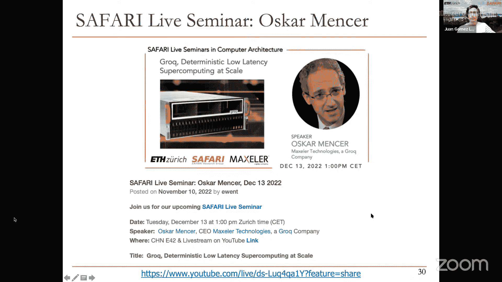
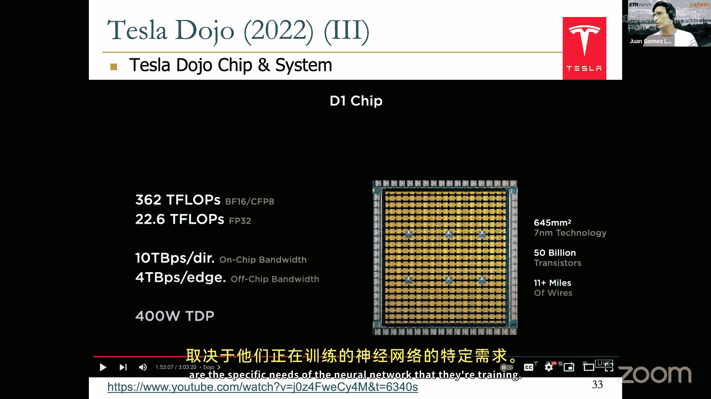
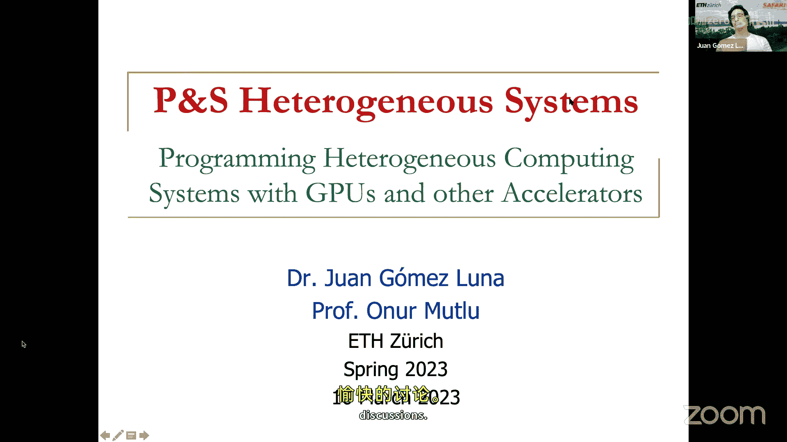

# 001：课程介绍与异构计算概述


在本节课中，我们将学习异构计算系统的基本概念、课程目标以及现代计算系统中各种加速器（如GPU、TPU等）的概览。我们将从经典的弗林分类法开始，探讨单指令多数据（SIMD）架构，并了解其在当前CPU扩展和专用加速器中的应用。

## 课程概述

欢迎来到“异构系统编程：基于GPU和加速器”课程的第一讲。本课程旨在教授如何为包含GPU和其他加速器的异构计算系统进行编程。我们将介绍异构系统的需求、各种设备类型，并重点学习GPU并行编程。从下一次讲座开始，我们将深入探讨GPU架构、编程模型和并行模式。

## 异构计算的需求

现代重要工作负载（如机器学习、人工智能、生物信息学、医学成像等）对性能和能效的扩展提出了挑战。这催生了对异构设备的需求。除了传统的中央处理器（CPU），图形处理器（GPU）、现场可编程门阵列（FPGA）以及张量处理单元（TPU）等专用加速器在现代计算系统中变得越来越普遍。

## 计算机架构分类：弗林分类法

理解异构系统的一个起点是回顾迈克尔·弗林在1966年提出的计算机分类法。他根据设备如何处理数据，将计算机分为四类：

*   **单指令单数据（SISD）**：一条指令操作一个数据元素。这是传统的顺序处理器。
*   **单指令多数据（SIMD）**：一条指令流同时操作多个数据元素。这是本课程的重点，也是GPU的基础架构之一。
*   **多指令单数据（MISD）**：多条指令操作一个数据元素。现实中例子较少，脉动阵列是近似例子。
*   **多指令多数据（MIMD）**：多条指令流操作多个数据元素。例如多核处理器。

## SIMD架构实例：CPU扩展

即使在CPU内部，也存在异构性。一个典型的例子是CPU中的SIMD指令集扩展。其核心思想是：**一条指令同时处理多个数据元素**。

例如，我们可以使用一个32位寄存器，将其划分为4个8位部分。通过修改算术逻辑单元（ALU），阻止这4个8位值之间的进位传播，就能用一条指令同时完成4个独立的加法运算。

一个开创性的例子是英特尔在90年代推出的MMX扩展。它主要用于多媒体和图形操作。以下是一个使用MMX指令进行图像合成的伪代码示例，其核心操作是并行比较和筛选像素：

```assembly
; 假设 MM0 寄存器包含多个像素数据（例如，8个8位像素值）
; MM1 寄存器预先加载了“蓝色”的参考值（例如，8个相同的代表蓝色的8位值）

; 并行比较：生成一个掩码，标记哪些像素是蓝色
PCMPEQB MM1, MM0  ; 比较 MM0 和 MM1，结果掩码存入 MM1



; 使用生成的掩码，并行地从背景图（Y）和前景图（X）中筛选出需要的像素
; （此处省略具体的位操作指令）
; ...



; 合并筛选后的像素，生成最终图像
POR MM2, MM3  ; 合并结果
```

## 现代异构计算系统概览

现代片上系统（SoC）或计算系统通常集成多种设备：

1.  **GPU（图形处理器）**：不仅用于图形，也广泛用于通用并行计算。其内部也有异构性，例如包含用于通用计算的CUDA核心和用于机器学习的专用张量核心。
2.  **专用加速器**：
    *   **TPU（张量处理单元）**：谷歌设计的用于神经网络训练的脉动阵列，专精于矩阵乘法。
    *   **Wafer-Scale Engine（晶圆级引擎）**：Cerebras公司推出的巨型机器学习加速器。
    *   **Groq张量流处理器**：采用确定性执行模型，专为规则并行负载设计。
    *   **特斯拉Dojo**：特斯拉自研的神经网络训练系统。
3.  **近内存/存内处理（PIM）**：为了缓解“内存墙”问题，将处理单元放置在内存芯片内部。例如：
    *   **UPMEM的PIM引擎**：在DRAM芯片内集成小型处理器（DPU）。
    *   **三星HBM-PIM**：在高带宽内存（HBM）中集成AI处理单元。
    *   **SK海力士GDDR6-AiM**：在GDDR6内存中集成加速单元。

## 设备间通信与一致性

在包含多种设备的系统中，高效的通信和数据一致性至关重要。诸如CCIX、OpenCAPI和最新的**Compute Express Link（CXL）** 等一致性互连标准，旨在为不同设备提供统一的内存视图，实现更紧密的集成和更细粒度的协作，从而提升性能、能效和可编程性。

## 课程目标与要求

本课程的主要目标是学会如何通过编程、分析工作负载、提出卸载与调度策略来利用现有的异构设备。

**课程关键收获：**
*   加深对计算机体系结构和异构系统的理解。
*   获得异构架构（如GPU/FPGA）编程的技术技能。
*   培养批判性思维和分析能力。
*   熟悉异构计算的前沿研究方向。
*   提升技术演讲能力。

**先修知识：** 需要具备数字设计和计算机体系结构的基础，熟悉C/C++编程。对FPGA或GPU编程有基本了解更佳，但最重要的是对计算机架构和解决系统效率问题有浓厚兴趣。

## 课程安排与资源

*   **形式**：讲座将以预录制视频为主，在每周五上午提供。我们会有定期的在线会议讨论项目和答疑。
*   **项目**：课程核心是个人实践项目。下周将详细介绍项目选题，之后学生将与指定的导师定期会面，开展项目工作。
*   **资源**：所有课程材料（幻灯片、视频、推荐阅读）均可在课程网站找到。也推荐参考过往学期的资料。

## 下节预告：SIMD处理器与GPU

下一讲我们将深入探讨**数据并行**的利用。我们将详细讲解SIMD处理器，包括阵列处理器与向量处理器的区别，并阐述现代GPU如何融合这两者的特性。我们也将初步了解如何将计算任务在CPU（处理串行部分）和GPU（处理大规模并行部分）之间进行分配，引导大家建立并行编程思维。

例如，一个简单的数组加法 `C[i] = A[i] + B[i]` 在GPU上的并行化，其核心思想是将每个循环迭代映射到一个独立的线程上：
```c
// 每个GPU线程执行以下操作
int i = threadIdx.x + blockIdx.x * blockDim.x;
if (i < N) {
    C[i] = A[i] + B[i];
}
```

## 总结



本节课我们一起学习了异构计算的基本动机，回顾了弗林分类法，并重点了解了SIMD架构在CPU扩展中的应用。我们还概览了现代计算系统中丰富的异构设备生态，包括GPU、TPU、PIM等，以及连接它们的一致性互连技术。最后，我们明确了本课程的学习目标、要求和安排。希望这为大家后续深入学习异构系统编程打下坚实的基础。