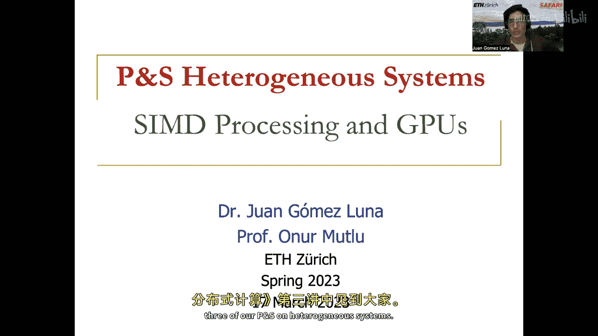

# 002：SIMD处理与GPU架构 🚀


在本节课中，我们将学习SIMD处理器的基本架构和编程模型，并了解现代图形处理单元如何作为SIMD处理器的一种实现。我们将从SIMD的基本概念开始，逐步深入到向量处理器和GPU的工作原理。

## 概述

SIMD是一种计算范式，其中单个指令同时对多个数据元素进行操作。这种范式是现代高性能计算，尤其是GPU加速计算的核心。理解SIMD是理解GPU编程和异构系统优化的基础。

## SIMD处理：时间与空间

上一节我们介绍了SIMD的基本概念，本节中我们来看看SIMD的两种主要实现方式：在时间上或在空间上执行。

SIMD处理的核心是**单个指令操作多个数据元素**。这可以通过两种方式实现：
*   **空间并行**：使用多个处理单元在同一时间执行同一指令。
*   **时间并行**：使用同一个处理单元在连续的时间步上对多个数据元素执行同一指令。

以下是两种经典SIMD处理器的例子：
1.  **阵列处理器**：属于空间并行。它拥有多个相同的处理单元，每个单元在同一时钟周期内对不同的数据元素执行相同的操作。
2.  **向量处理器**：属于时间并行。它拥有多个**专用**的功能单元，一条向量指令中的不同操作（如加载、加法、存储）由不同的单元在流水线上依次处理。

## 向量处理器详解

现在，让我们更详细地探讨向量处理器，它是理解现代SIMD架构的重要基础。

向量是一维的数字数组。向量处理器的指令直接对向量进行操作，而非标量值。要实现这一点，需要满足几个基本要求：

以下是向量处理器的核心组件：
*   **向量寄存器**：用于存储向量。其大小为 `n`，意味着它可以容纳 `n` 个 `m` 位的数据值。总容量为 `n * m` 位。
*   **向量控制寄存器**：
    *   **向量长度寄存器**：定义当前操作的向量长度。
    *   **向量步长寄存器**：定义内存中连续向量元素之间的地址间隔。
    *   **向量掩码寄存器**：用于条件执行，指示对哪些向量元素进行操作。

## 存储系统：体交织内存

为了能够每个周期加载/存储一个向量元素（即使单次内存访问延迟很高），向量处理器使用**体交织内存**。

内存被划分为多个可以独立访问的**体**。数据字以交错方式分布在这些体上。例如，元素0在体0，元素1在体1，依此类推。这样，处理器可以每个周期向不同的体发起访问请求。虽然每个请求仍有延迟，但在初始延迟后，每个周期都可以从不同的体获得一个数据，从而实现了高带宽的向量数据流。

## 代码向量化

程序要在向量处理器上高效运行，其代码必须是**可向量化**的。

一个循环可向量化的关键条件是：每次迭代之间相互独立。例如，对于循环 `for(i=0; i<50; i++) C[i] = (A[i] + B[i]) >> 1`，每次 `i` 的迭代计算都不依赖于其他 `i` 的结果，因此它可以被转换为向量指令。

向量化后的伪代码大致如下：
```
VL = 50        // 设置向量长度为50
VS = 1         // 设置步长为1
V0 = load[A]   // 向量加载A
V1 = load[B]   // 向量加载B
V2 = V0 + V1   // 向量加法
V2 = V2 >> 1   // 向量右移（等价除以2）
store[C] = V2  // 向量存储到C
```

## 性能优化技术

在理解了基础执行过程后，我们来看看如何优化向量处理器的性能。

以下是两种关键优化技术：
1.  **链接**：允许将一个功能单元的结果直接转发给下一个功能单元，无需等待整个向量操作完成。这减少了操作间的空闲时间。
2.  **多端口内存体**：为每个内存体增加负载/存储端口，允许同时进行多个向量加载/存储操作，使它们能够重叠执行。

通过结合使用链接和多端口内存，可以显著减少总执行周期数。

## 条件执行与向量掩码

当循环中包含条件语句时，我们需要使用**向量掩码**来实现条件执行。

向量掩码寄存器为每个向量元素包含一个标志位。在执行一条向量指令时，只有掩码位为“真”的对应元素才会被实际计算和更新。这允许向量处理器高效地处理像 `if (A[i] != 0) C[i] = A[i] * B[i]` 这样的条件循环。

## 体冲突与解决方案

当数据访问模式与内存体组织不匹配时，会发生**体冲突**，降低内存带宽利用率。

体冲突的一个典型例子是：当访问步长与体数量有公因数时（例如，16个体，步长为2），多个请求会指向同一个体，造成排队等待。解决方案包括：
*   增加体的数量。
*   为每个体增加更多访问端口。
*   改变数据布局以匹配访问模式（例如，矩阵转置）。
*   使用随机或伪随机交织策略将地址映射到体。

## 现代SIMD：从CPU到GPU

SIMD思想已广泛应用于现代计算设备。

在CPU中，通过**SIMD指令集扩展**实现，如x86的SSE、AVX指令集，它们提供了越来越宽的向量寄存器。在机器学习加速器中，如谷歌的TPU，也大量使用SIMD处理。

然而，当今SIMD最主要的代表是**图形处理单元**。GPU本质上是一个大规模并行的SIMD引擎。其核心由许多**流多处理器**组成，每个SM内部包含多个标量核心、寄存器文件和共享内存（一种体交织内存）。

## GPU编程模型：SPMD

GPU的独特之处在于其**编程模型**与**执行模型**的分离。

*   **编程模型**：程序员使用**单程序多数据**模型编写代码。程序员创建大量**线程**，每个线程执行相同的核函数代码，但处理不同的数据。
*   **执行模型**：硬件将多个线程（例如32个）动态分组为一个**线程束**。线程束中的所有线程以锁步方式执行相同的指令，就像一个SIMD单元。这就是**SIMT**执行模型。

这种设计结合了编程的灵活性和硬件执行的效率。线程可以独立发散，而硬件则通过掩码等技术管理控制流分支。

## GPU执行：细粒度多线程

为了进一步隐藏长延迟操作（如访问全局内存），GPU采用了**细粒度多线程**技术。

GPU的SM会同时管理多个活跃的线程束。当一个线程束因等待内存数据而停滞时，SM会立即切换到另一个就绪的线程束执行。这种快速的上下文切换使得计算单元始终保持忙碌，极大地提高了硬件利用率。

## 总结



本节课中我们一起学习了SIMD处理的基本原理。我们从阵列处理器和向量处理器的概念出发，探讨了向量化、体交织内存、条件执行等关键技术。随后，我们将这些概念与现代GPU架构联系起来，理解了GPU如何通过SPMD编程模型和SIMT执行模型，将标量线程程序映射到底层的大规模SIMD硬件上高效执行。掌握这些基础知识是后续进行高效GPU编程和优化的关键。