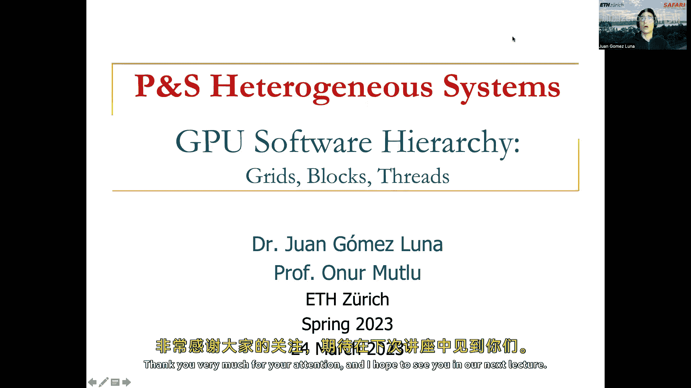

# 003： GPU软件层次结构

在本节课中，我们将开始学习GPU编程，并重点介绍GPU的软件层次结构。我们将探讨计算如何分配给不同的执行线程，以及这些线程如何被分组以实现更高效的执行并映射到GPU硬件上。

## 概述

上一讲我们介绍了GPU和SIMD处理器的硬件架构与编程模型。GPU本质上是一种SIMD引擎。即使像NVIDIA H100 GPU这样的架构看起来是同质的，深入其核心会发现不同的执行单元，这让人联想到我们之前讲解的向量处理器和SIMD处理器。GPU核心包含用于32位整数、32位浮点或64位浮点运算的单元，也有用于内存加载/存储的专用单元，以及用于神经网络和机器学习的专用张量核心。GPU核心可以访问不同的内存空间：寄存器、L1数据缓存、共享内存（一种暂存器内存），而在GPU核心之外，还有L2内存和片外DRAM（全局内存）。我们将在下一讲详细讨论GPU内存，本节课我们聚焦于软件层次结构。

同时要记住，GPU内部以线程束为单位执行指令，线程束是基本的SIMD单元。在GPU核心的流水线上，我们采用细粒度多线程执行，这意味着每个周期我们从不同的线程束获取指令。通过这种方式，线程束的执行在GPU流水线上交错进行，这种细粒度多线程执行能够容忍长延迟操作，例如访问片外内存的指令，其延迟可以通过在流水线中执行其他指令来隐藏。

现在，让我们开始讨论GPU编程。在上一讲的幻灯片中，我们引用了Fisher在1983年ISCA上的论文，其中阐述了为SIMD处理器编程的难度。幸运的是，GPU编程相对容易一些。GPU通用编程的兴起始于十多年前，在某种意义上代表了高性能计算的民主化，因为人们可以以相对较低的成本在个人电脑上获得具有极高浮点运算吞吐量的强大GPU。许多工作负载，如矩阵计算、图像处理、神经网络等，都能从这类设备中受益。但我们需要学习如何为这类系统编程，理解新的编程模型，并了解编程时的关键瓶颈以及缓解这些瓶颈的方法。

## 从CPU到GPU：异构计算的基本流程

异构计算通常从CPU和CPU内存（系统主内存）开始，主要包含三个步骤：
1.  将输入数据从CPU内存传输到GPU内存（通常称为全局内存）。
2.  启动一个在内核（将在GPU上运行的函数）上执行。
3.  内核执行完毕后，CPU获取结果，将其从GPU内存移回CPU内存。

这三个步骤体现在典型的CPU-GPU异构系统编程结构中：我们通常在CPU上运行顺序或适度并行的代码段，而将大规模并行代码段卸载到GPU上执行。通常流程如下：首先，一个或多个线程在CPU上运行代码；在某个时刻，它们会将一些计算任务卸载到GPU设备端，这个计算任务称为内核；内核使用大量线程执行，这些执行线程被分组为线程块（在NVIDIA CUDA术语中）。内核完成后，控制权返回给CPU，可能还会有一些顺序或适度并行的执行，之后CPU可能启动另一个内核。

## GPU编程模型：SPMD/SIMT

GPU编程采用单程序多数据编程模型。我们通常为单个标量线程编写代码，但这些线程随后会被分组为SIMD单元（在NVIDIA术语中称为线程束），并在类似SIMD硬件的GPU核心上执行。

在SIMD编程模型中，每个程序或线程处理不同的数据，可以执行不同的控制流路径，但也可以同步。因为底层硬件是SIMD的，当我们把许多线程或过程分组到同一个线程束时，我们希望它们执行基本相同的计算，这样执行速度最快。否则，我们将不得不使用谓词执行、掩码等技术，先为线程束中的部分线程运行计算，再为其他线程运行，这虽然可行且大大方便了编程，但为了编写更优化的程序，我们必须意识到这一点。

CUDA和OpenCL是使用SPMD（也称为SIMT，单指令多线程）的编程模型。它们通常被称为同步编程框架，因为同步执行内核的不同线程或所有线程的方式是终止内核，这被称为全局或栅栏同步。

主机（通常是CPU）负责分配内存、复制数据和启动内核。设备（通常是GPU）则执行内核。

## GPU执行层次：网格、线程块与线程

那么GPU如何执行内核呢？GPU运行线程，但单个内核的所有线程被分组为网格（在OpenCL中称为NDRange）。在网格内部，有多个线程块（在NVIDIA术语中简称为块，在OpenCL中称为工作组）。在同一线程块内运行的所有线程可以共享内存和同步，原因是它们将在同一个GPU核心内执行。然后我们还有线程（在OpenCL中称为工作项）。

以下是CUDA程序的典型结构：
*   包含在CPU上运行的函数原型（如幻灯片中所示的串行函数）。
*   包含在GPU上运行的内核函数。注意，GPU内核总是以 `__global__` 限定符开头。
*   然后是主机代码，即执行开始的地方。在某个时刻，主机（CPU）会将计算任务卸载到GPU端。

在主机的主函数中，我们首先在设备（GPU）上分配内存，使用 `cudaMalloc` API 来分配一定字节数的空间给指针 `d_in`。然后需要将数据从主机传输到设备，即使已经在GPU内存中分配了空间，数据最初仍驻留在CPU内存中，因此我们需要从 `h_in` 数组复制到 `d_in` 数组。接着，我们需要定义执行配置，即网格中的块数和每个块的线程数。然后我们可以调用内核，这是将计算任务卸载到GPU的时刻，内核带有参数以及之前定义的执行配置。内核终止后，我们可以将结果从GPU内存传输回CPU内存，再次使用 `cudaMemcpy` 操作，但这次目标是在CPU内存中分配的 `h_out`，源是在GPU内存中分配的 `d_out`。这个复制、启动内核、再复制回CPU的序列可以根据需要重复，例如在多次调用同一内核的迭代算法中，或者在其他具有多个内核卸载到GPU的应用程序中。

在内核内部，我们可以使用自动变量，这些变量透明地分配给GPU核心的寄存器。我们还可以使用共享内存，这是所有在同一线程块、同一GPU核心内运行的线程都可以访问的共享内存空间，我们使用 `__shared__` 限定符来标识那些分配在共享内存中的数组。在同一线程块内，线程也可以同步，这被称为块内同步，我们使用 `__syncthreads()` 指令来实现。

## 代码示例：向量加法

为了开始更深入地理解如何为GPU系统编程，我们将从一个简单的代码示例——向量加法开始。幻灯片上显示的代码是主机代码，是一个名为 `vecAdd` 的函数。假设这个函数是从主机CPU的 `main` 函数调用的。如你所见，在 `vecAdd` 函数中，我们首先做的是分配GPU内存，为输入数组 `A` 和 `B` 以及输出数组 `C` 分配内存。然后我们将数据从主机复制到设备，如参数所示，我们将所有字节从驻留在CPU内存中的数组 `A` 复制到驻留在GPU内存中的数组 `A_d`。我们对数组 `B` 执行相同的操作。接着，我们将在GPU上启动计算，这是内核调用，我们将在后面的幻灯片中详细查看。最后，当内核终止时，我们将结果从设备内存（GPU内存）复制回主机内存（CPU内存），最后可以释放GPU内存中的这些空间。

向量加法作为我们的第一个编程示例，就是执行两个数组的逐元素加法。在最直接的实现中，我们可以为输入和输出向量中的每个元素分配一个GPU线程。因此，每个线程将只负责一次加法操作：它需要访问内存，读取 `A[0]` 和 `B[0]`，将它们相加，然后将结果 `C[0]` 写入内存。这是线程0执行的计算，线程1执行类似的计算，依此类推。所有这些线程的集合，如前所述，称为网格。但我们需要一种方法将这些线程分配给GPU核心。GPU核心的数量因GPU而异，因此我们将线程分组为线程块。例如，这四个线程可能属于块0、块1、块2和块3。在这个简单的示例中，每个块只有四个线程，通常我们至少会有32个（NVIDIA GPU的线程束大小），更典型的是这个线程束大小的倍数。

## 启动网格与内核编写

我们如何启动一个网格呢？首先，同一网格中的线程执行相同的函数，即内核。网格可以通过调用内核并使用适当的网格和块大小配置来启动。记住，我们需要先定义执行配置，即每个块的线程数（本例中为512）和总块数，然后我们可以使用这行代码调用内核。

这就是我们在向量加法主机代码示例中缺失的部分：定义执行配置，然后使用这里的执行配置和括号内的参数启动内核。现在这是主机代码，但GPU代码呢？在GPU代码中，我们将有类似这样的内容。在这个例子中，向量加法内核非常简单。注意它是一个内核，因为它以 `__global__` 限定符开头。这里我们可以看到输入数组 `A`、`B`，输出数组 `C` 和元素总数 `n`。如果元素总数是块大小的倍数，我们可以编写像这样简单的代码：对于每个单独的线程，每个线程有自己的线程索引，每个块有自己的块索引和块大小（即 `blockDim.x`）。对于每个单独的线程，我们获得一个索引 `i`。使用这个 `i`，每个线程可以访问内存，从 `A` 和 `B` 中获取相应的元素，将它们相加，并将结果存储在输出数组 `C` 中。如果元素数量不是每个块线程数的倍数，那么我们需要检查边界条件。因此，在内核代码中，我们将不得不添加一个 `if` 语句，检查 `i` 是否小于 `n`（即向量中的元素总数）。这是一个简单的步骤。

## 多维网格与线程块

这就是我们所说的一维网格，其中线程块被认为是单维的。因为它们只有一个维度，所以当我们定义网格维度（网格中的块数）和块维度（每个块的线程数）时，我们使用 `.x`。同样，我们使用 `blockIdx.x` 和 `threadIdx.x`，因为我们使用的是单一维度。我们可以将这种一维线程块和网格也应用于不需要是一维的数据结构。例如，我们可以将不同的线程和线程块分配给图像（一个二维数据结构）进行计算。如图所示，图像的这部分分配给块0，这部分分配给块1，这部分分配给块2，依此类推。然后，对于每个块，我们将有一定数量的线程（在这个简单示例中是四个）。为了访问图像中的任何元素，我们需要使用这个二维数据结构，需要使用块索引、块维度和线程索引。例如，这里的这个元素是图像的第25个元素或像素，我们通过使用块索引（6）、块维度（4，记住在这个简单示例中我们只有四个线程）和线程索引（1，因为这是分配给块6中线程1的像素）来计算并获得了确切的地址。

但线程块也可以是二维或三维的，甚至更多维，因为当我们处理二维或三维数据结构时，使用多维块可能更方便。因此，在二维块的情况下，我们将有 `gridDim.x` 和 `gridDim.y`，如你所见，在这个简单示例中，两者的值都是4。这个块也将有一个二维索引，我们有 `blockIdx.x` 和 `blockIdx.y`，对于这个特定的块，x是2，y是1。然后，同样，每个线程块中的单个线程也有相同的x和y索引。现在，我们计算图像中特定像素位置的方式是通过使用块和线程在y维度和x维度上的相应索引和维度来获取其行和列。例如，我们在上一张幻灯片中检查的同一个像素，现在我们看到这个像素在第3行第1列。

## 总结与下节预告

本节课的内容就到这里。你可以通过阅读推荐教材《大规模并行处理器编程》中与本讲对应的章节（第1、2、3章）来了解更多。你也可以通过访问本幻灯片中的链接，重新观看本讲的更长版本。

在下一讲中，我们将继续讨论GPU编程，这次将重点放在GPU的内存层次结构上，探讨在使用CUDA或OpenCL编程时如何处理GPU内部不同的内存空间，以及不同线程块中的线程如何访问全局内存（片外内存），或者同一线程块内的线程如何使用共享内存共享数据。

希望你觉得本讲内容有趣。非常感谢你的关注，期待在下一讲中与你再见。

