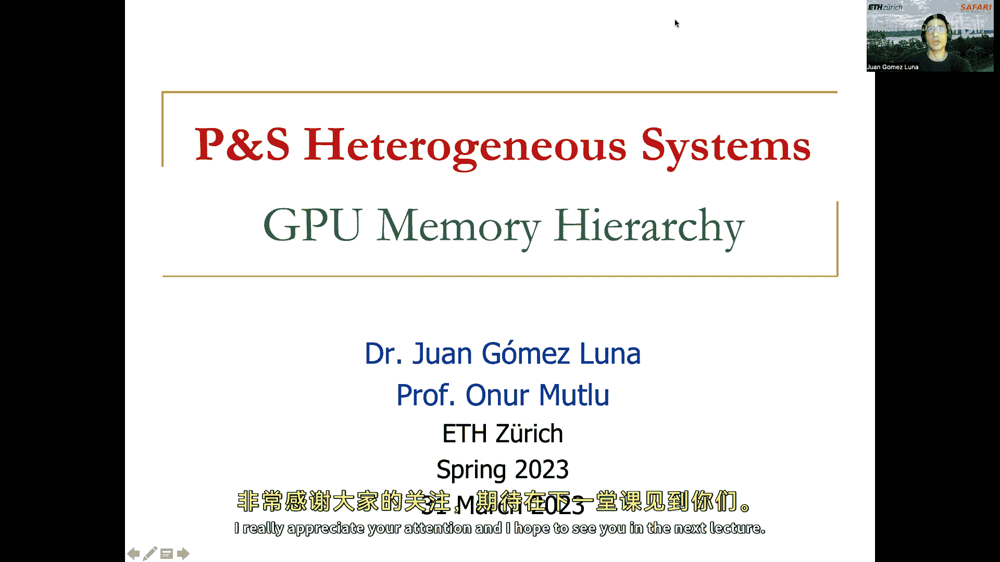

# 004：GPU内存层次结构


在本节课中，我们将要学习GPU的内存层次结构，即线程在GPU编程中可以使用的不同内存空间。我们将快速深入细节，但首先，让我们简要回顾一下上一讲关于GPU编程的内容。

## 课程回顾与背景

上一讲我们介绍了GPU编程的基础。本课程的参考书是《Programming Massively Parallel Processors》。当使用CPU和GPU编程异构系统时，我们通常使用在CPU上运行的CPU线程和在GPU上运行的GPU内核。CPU线程执行在CPU上运行的顺序或适度并行的代码段，而大规模并行的代码段则在GPU上运行。

我们通常从主机（CPU）开始执行，运行一些串行或适度并行的代码，然后通过启动一个GPU内核将计算卸载到GPU。启动GPU内核时，我们需要首先定义执行配置，通常是每个网格的块数（即总块数）和每个块的线程数。GPU内核执行完毕后，控制权返回给主机，主机可能会执行更多串行代码，最终可能启动另一个内核。

我们的第一个例子是向量加法。以下是向量加法的主机端代码：

```c
// 分配GPU内存
cudaMalloc(&d_A, size);
cudaMalloc(&d_B, size);
cudaMalloc(&d_C, size);

// 将数据从CPU内存复制到GPU内存
cudaMemcpy(d_A, h_A, size, cudaMemcpyHostToDevice);
cudaMemcpy(d_B, h_B, size, cudaMemcpyHostToDevice);

// 定义执行配置并启动内核
int threadsPerBlock = 512;
int blocksPerGrid = (N + threadsPerBlock - 1) / threadsPerBlock;
vectorAdd<<<blocksPerGrid, threadsPerBlock>>>(d_A, d_B, d_C, N);

// 将结果从GPU内存复制回CPU内存
cudaMemcpy(h_C, d_C, size, cudaMemcpyDeviceToHost);

// 释放GPU内存
cudaFree(d_A);
cudaFree(d_B);
cudaFree(d_C);
```

GPU软件层次结构由线程、线程块和网格组成。线程是最低层级，它们被分组到线程块中，线程块被映射到不同的GPU核心上，所有线程块的集合构成了网格。

在NVIDIA最新的H100架构中，在**线程块**和**网格**之间引入了一个新的层级：**线程块簇**。现在，网格由线程块簇组成，而线程块簇又由线程块组成。线程块簇的优点是，簇内的线程块可以通过H100架构引入的新网络直接通信。

## GPU内存架构概述

在回顾了GPU软件层次结构之后，让我们来讨论GPU内存。任何NVIDIA GPU的布局都包含GPU核心（也称为流多处理器或SM）。在GPU核心内部，有不同的内存空间，如寄存器、L1缓存或称为共享内存的暂存器内存。

GPU核心可以访问L2缓存，也可以访问片外内存（在H100上是HBM3内存）。每个SM都有一些控制硬件和CUDA核心，用于执行来自不同线程束的指令。从这些CUDA核心，我们可以访问寄存器。

每个单独的线程都可以访问自己的寄存器，访问速度极快（大约一个周期）。线程也可以访问L1数据缓存或附近的共享内存。共享内存是一个软件管理的缓存，可用于在同一线程块内的线程之间共享数据。访问共享内存和L1缓存的延迟大致相同（大约5个周期）。我们还可以访问常量缓存，这是用于常量数据的另一个缓存。

如果需要访问片外内存（称为全局内存），延迟会高得多，大约数百个周期（例如500个周期）。在全局内存和SM之间是L2缓存。

H100 GPU的新特性包括：可以直接从全局内存复制到共享内存，而无需经过GPU核心中的寄存器和通道；在同一线程块簇内的SM之间可以直接通信。

H100 GPU拥有相当大的L2缓存（约50 MB）和全局内存（HBM3内存，80 GB），其全局内存带宽也非常高，达到3 TB/s，大约是上一代A100 GPU带宽的两倍。

## GPU内存空间详解

现在我们知道存在不同的内存空间：寄存器、常量缓存、共享内存、L1缓存、L2缓存、全局内存。在我们的程序中，有不同的方式来使用它们。

我们将使用限定符来定义特定值或数组的分配位置：
*   **自动变量**会直接进入寄存器，由编译器分配。
*   在GPU内核中定义的数组，例如 `float temp[N];`，将是每个线程的私有数组。如果可能，编译器会将其分配在寄存器中；如果寄存器不足（例如N太大），则必须分配在片外内存中。
*   当我们想在共享内存中分配时，使用 `__shared__` 限定符。
*   当我们想将数据分配在常量内存中以便从常量缓存访问时，使用 `__constant__` 限定符。
*   当我们想在全局内存中分配时，可以使用 `__device__` 限定符。

从运行在GPU核心上的GPU线程的角度来看：
*   它可以访问自己的寄存器供私有使用。
*   属于同一线程块的线程可以访问共享内存中的相同数据。
*   不同线程块中的线程可以从外部片外内存（称为全局内存）以及常量内存中访问相同或不同的数据。常量内存也分配在片外内存中，但可以在每个SM内缓存。

## 共享内存与数据复用

接下来，我们将重点讨论共享内存，看看不同的线程如何共享分配在共享内存中的数据，以及如何使用共享内存进行通信。

当同一线程块内存在数据复用时，共享内存将特别有用。例如，如果我们需要对图像应用一个滤波器，并将图像的每个像素分配给GPU中的一个线程。在应用滤波器时，我们通常需要读取围绕特定像素的邻近像素，并使用这些邻近像素进行计算。

你可以观察到，如果一个像素被分配给一个线程，而另一个邻近像素被分配给同一线程块中的另一个线程，它们将共享一些都需要读取的值。这就是我们所说的**数据复用**。

在最直接的代码实现中，我们可能会像下面这样编写高斯滤波的代码：

```c
for (int i = -1; i <= 1; i++) {
    for (int j = -1; j <= 1; j++) {
        sum += image[row + i][col + j] * filter[i + 1][j + 1];
    }
}
```

但这里存在大量的数据复用，因为多个线程会重复读取相同的像素数据。我们可以利用这种数据复用，采用一种称为**分块**的技术。

在GPU的特定情况下，我们将把这个数据块放入共享内存中，因为共享内存可以被属于同一线程块的所有线程访问。具体做法是：
1.  在共享内存中定义一些空间。
2.  将整个数据块从全局内存加载到共享内存中。
3.  然后线程从共享内存中的数组访问它们计算所需的像素。

在将数据块加载到共享内存和实际计算之间，我们需要使用 `__syncthreads()` 指令或函数来同步一个块内的所有线程。这是为了避免当同一线程块内的线程访问共享内存或全局内存时，发生读后写或写后读等危险。

这一点很重要，因为线程块通常有超过32个线程（一个线程束的大小是32）。如果一个线程块有64个线程，就意味着有两个线程束。请记住，GPU核心管道通过从不同线程束发出指令来执行。这意味着，即使指令相同，来自不同线程束的指令也在不同的时间执行。因此，如果有两个线程束正在将数据从全局内存加载到共享内存，我们需要确保所有需要的数据（整个数据块）在开始使用该数据块中的数据之前都已加载完毕。这就是为什么在加载之后，我们需要使用 `__syncthreads()` 进行同步。

## 案例研究：矩阵乘法

为了更好地理解如何利用数据复用，我们将分析一个非常重要的内核：矩阵乘法。

在矩阵乘法中，我们对两个矩阵A和B进行行乘以列的操作，得到一个输出矩阵C。最简单的并行化方法是将输出矩阵C的每个元素分配给一个线程。

在GPU中，这些线程被分组到线程块中。因此，我们已经将输出矩阵C划分为多个块，分配给不同的线程块。一个线程块负责计算C的一个子块。

一个特定的线程将读取A的整行和B的整列，执行这两个向量的点积运算，并将结果累加到C的相应输出元素中。

以下是基本的矩阵乘法内核代码：

```c
__global__ void matrixMul(float* A, float* B, float* C, int M, int N, int K) {
    int row = blockIdx.y * blockDim.y + threadIdx.y;
    int col = blockIdx.x * blockDim.x + threadIdx.x;
    if (row < M && col < N) {
        float sum = 0.0f;
        for (int i = 0; i < K; i++) {
            sum += A[row * K + i] * B[i * N + col];
        }
        C[row * N + col] = sum;
    }
}
```

但这里的观察是存在大量的数据复用。为什么？因为计算C的某个子块的四个线程都需要访问矩阵A的同一行的所有元素，以及矩阵B的同一列的所有元素。

我们可以通过执行**分块矩阵乘法**来利用这种数据复用。在分块矩阵乘法中，我们将输入矩阵A和B划分为块，逐步将块加载到共享内存中，然后使用共享内存中的数据执行计算，因为访问共享内存的速度比访问全局内存快得多（大约快两个数量级）。

负责C的某个块的线程块将执行以下操作：
1.  从内存中读取A的一个块和B的一个块。
2.  将它们放入共享内存。
3.  执行部分矩阵乘法以获得中间结果。
4.  对下一个块重复此过程，直到计算出C的该块的所有元素的最终结果。

以下是分块矩阵乘法的代码框架：

```c
__global__ void matrixMulTiled(float* A, float* B, float* C, int M, int N, int K) {
    __shared__ float sA[TILE_SIZE][TILE_SIZE];
    __shared__ float sB[TILE_SIZE][TILE_SIZE];

    int bx = blockIdx.x, by = blockIdx.y;
    int tx = threadIdx.x, ty = threadIdx.y;

    int row = by * TILE_SIZE + ty;
    int col = bx * TILE_SIZE + tx;

    float sum = 0.0f;
    for (int i = 0; i < (K + TILE_SIZE - 1) / TILE_SIZE; i++) {
        // 协作将A和B的块加载到共享内存
        if (row < M && (i * TILE_SIZE + tx) < K) {
            sA[ty][tx] = A[row * K + i * TILE_SIZE + tx];
        } else {
            sA[ty][tx] = 0.0f;
        }
        if (col < N && (i * TILE_SIZE + ty) < K) {
            sB[ty][tx] = B[(i * TILE_SIZE + ty) * N + col];
        } else {
            sB[ty][tx] = 0.0f;
        }
        __syncthreads(); // 等待块加载完成

        for (int j = 0; j < TILE_SIZE; j++) {
            sum += sA[ty][j] * sB[j][tx];
        }
        __syncthreads(); // 确保块内所有线程用完当前共享内存数据后再加载下一块
    }

    if (row < M && col < N) {
        C[row * N + col] = sum;
    }
}
```

请注意，在内层for循环之后也需要 `__syncthreads()`，因为线程需要等待，以确保在将共享内存中的数据替换为下一个块的内容之前，当前块中的数据已被充分使用。

## 总结

本节课我们一起学习了GPU的内存层次结构。我们回顾了GPU编程的基本流程和软件层次，并详细介绍了GPU中不同的内存空间，包括寄存器、共享内存、常量缓存、L1/L2缓存和全局内存，以及它们的特点和访问方式。

我们重点探讨了共享内存的作用，它作为线程块内线程间通信和协作的高速暂存器，对于存在数据复用的算法（如图像滤波、矩阵乘法）性能提升至关重要。我们通过高斯滤波和矩阵乘法的例子，深入分析了如何利用分块技术将数据加载到共享内存中，并通过 `__syncthreads()` 进行同步以避免内存访问冲突。

最后，我们简要提及了NVIDIA H100架构在内存层次方面的新特性，如线程块簇和直接内存复制。要了解更多细节，建议阅读《Programming Massively Parallel Processors》第5章，或观看本讲的长版本视频。



