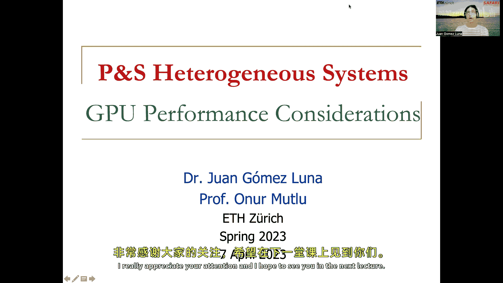

# 005：GPU性能考量 🚀


在本节课中，我们将学习GPU编程中的关键性能考量因素。我们将探讨影响GPU程序性能的主要瓶颈，并介绍优化内存访问、提高线程利用率和重叠计算与通信等核心技巧。

---

## 课程回顾

上一节我们介绍了GPU的内存层次结构，包括寄存器、共享内存和全局内存。我们以矩阵乘法为例，学习了如何使用**分块**技术，将数据从全局内存加载到共享内存中，以减少全局内存访问延迟并提高数据复用率。

核心代码片段展示了分块加载和同步的过程：
```cuda
// 从全局内存加载A和B的块到共享内存
__shared__ float As[TILE_SIZE][TILE_SIZE];
__shared__ float Bs[TILE_SIZE][TILE_SIZE];
As[ty][tx] = A[row * N + (bx * TILE_SIZE + tx)];
Bs[ty][tx] = B[(by * TILE_SIZE + ty) * N + col];
__syncthreads();

// 使用共享内存中的块进行计算
for (int k = 0; k < TILE_SIZE; ++k) {
    sum += As[ty][k] * Bs[k][tx];
}
__syncthreads();
```

---

## GPU性能瓶颈

GPU程序主要有两个性能瓶颈，均与数据移动有关：
1.  **CPU与GPU之间的数据传输**：在拥有独立GPU的系统中，数据需要通过PCIe等总线传输，其带宽有限。
2.  **对全局内存的访问**：从全局内存读取数据需要数百个时钟周期，延迟很高。

我们的优化目标就是通过充分的计算来分摊数据移动的成本，并优化内存访问模式。

---

## 内存访问优化

GPU是细粒度多线程架构，能够通过交错执行不同线程束的指令来隐藏长延迟操作（如全局内存访问）。为了实现有效的延迟隐藏，我们需要关注以下几个关键点。

### 占用率

**占用率** 是指活跃线程束数量与GPU流多处理器所能支持的最大线程束数量之比。高占用率意味着有足够多的线程可以交错执行，从而更好地隐藏内存访问等操作的延迟。

占用率受限于GPU核心的资源，例如：
*   每个线程块的最大线程数
*   每个线程使用的寄存器数量
*   每个线程块使用的共享内存大小

虽然高占用率通常是好的，但并非所有内核都需要100%的占用率才能达到最佳性能，因为过高的占用率可能导致对共享内存等资源的争用。

### 内存布局与合并访问

在C/C++中，二维数组（如矩阵）通常按**行主序**存储。这意味着矩阵的第一行所有元素在内存中是连续的，接着是第二行的所有元素，依此类推。

为了高效访问全局内存，我们应该尽量让同一个线程束内的线程访问**连续的、物理上相邻的**内存地址。这种访问模式称为**合并内存访问**。

以下是不合并与合并访问的对比：
*   **不合并访问**：线程束中的线程访问跨距很大的内存地址（例如，访问矩阵中不同行的相同列）。这会导致多个内存事务，降低有效带宽。
*   **合并访问**：线程束中的线程访问连续的内存地址（例如，访问矩阵中同一行的连续列）。这通常只需一次内存事务，能最大化内存带宽。

利用共享内存可以改善合并访问。例如，在分块矩阵乘法中，我们首先以合并的方式将数据块从全局内存加载到共享内存，然后在共享内存中进行可能不合并的访问，从而避免了低效的全局内存访问。

### DRAM访问与存储体

DRAM芯片内部由存储单元阵列组成。访问数据时，需要先将一整行数据激活到**行缓冲区**中，然后才能读写该行中的特定列。

*   **行命中**：如果后续访问的数据在同一行（即同一DRAM页）中，则可以直接从行缓冲区读取，速度很快。
*   **行冲突**：如果访问的数据在不同行，则需要先关闭当前行，再激活新的一行，这个过程延迟很高。

为了进一步提高带宽，现代内存系统采用了**多存储体**和**多通道**技术：
*   **多存储体**：将内存地址交错分布到多个可以并行访问的存储体上。当一个存储体在激活新行时，其他存储体可能正在服务数据访问，从而重叠了延迟。
*   **多通道**：使用多个独立的内存总线和DRAM阵列，进一步增加总带宽。

然而，如果同一个线程束内的多个线程试图访问**同一个存储体**或**同一个通道**内的数据，就会发生**存储体冲突**或**通道冲突**，导致访问被序列化，降低性能。可以通过地址哈希或**填充**等技术来缓解冲突。

填充示例：如果线程访问步长为32（存储体数量），所有线程都会访问存储体0。通过在每个数据元素后添加一个空位（填充），可以改变地址映射，将冲突分散到不同存储体。
```cuda
// 原始数组，可能引起存储体冲突
__shared__ int array[32 * N];
// 填充后的数组，有助于减少冲突
__shared__ int array_padded[33 * N]; // 每行多一个元素
```

---

## 线程束利用与分支发散

GPU以**线程束**为单位执行指令，同一个线程束内的32个线程是**锁步执行**的。这意味着所有线程在同一周期执行相同的指令。

**分支发散** 发生在同一个线程束内的线程根据数据不同走上不同的执行路径时（例如，有的线程执行`if`分支，有的执行`else`分支）。GPU会先执行所有走`if`分支的线程，再执行所有走`else`分支的线程，导致线程束的有效利用率降低，执行时间翻倍甚至更多。

优化方法：尽可能重新组织数据或计算，让同一个线程束内的线程执行相同的控制流路径。例如，在向量归约的朴素实现中，大量线程会提前闲置，导致严重发散。通过调整线程与数据元素的映射关系，可以让活跃的线程保持连续，减少发散。

---

## 原子操作

**原子操作** 确保对同一内存地址的“读-修改-写”操作是不可分割的，常用于避免数据竞争，例如在并行归约或直方图计算中更新累加器。

原子操作虽然保证了正确性，但可能导致**串行化**。当多个线程同时原子访问同一地址时，这些操作必须一个一个顺序执行，成为性能瓶颈。

因此，应谨慎使用原子操作，并考虑是否能用不同的算法（如先局部归约再全局归约）来避免或减少其使用。

---

## 异步数据传输与流

为了缓解CPU与GPU间数据传输的瓶颈，可以尝试**重叠计算与通信**。这通过**CUDA流**来实现。

**CUDA流** 是一个操作序列（如内存拷贝、内核执行），其中的操作按顺序发布，但GPU可以并行执行不同流中的操作。

基本思想：将输入数据分成若干独立的块。我们可以在流0中传输数据块0，然后在流0中启动处理数据块0的内核。与此同时，可以在流1中开始传输数据块1。这样，数据块的传输和计算就在时间上重叠了起来。

性能提升估算：
*   若内核计算是主要耗时部分，重叠通信可隐藏部分通信时间。
*   若数据传输是主要耗时部分，重叠计算可隐藏部分计算时间。

这种方法在视频处理等应用中非常有效，可以独立处理不同的视频帧块。

---

## 总结

本节课我们一起学习了GPU编程的核心性能考量：

1.  **数据移动是关键瓶颈**：需优化CPU-GPU数据传输和全局内存访问。
2.  **利用延迟隐藏**：通过保持足够的**占用率**，让GPU的细粒度多线程架构能够隐藏内存访问延迟。
3.  **优化内存访问模式**：确保**合并内存访问**，并利用**共享内存**进行数据复用和访问模式转换。
4.  **最大化硬件利用率**：避免线程束**分支发散**，并谨慎使用可能导致串行化的**原子操作**。
5.  **重叠计算与通信**：使用**异步传输**和**CUDA流**，将数据分块处理，以隐藏数据传输延迟。

掌握这些性能考量原则，是编写高效GPU程序的基础。在后续课程中，我们将深入更多并行模式及其优化实践。



---
*推荐阅读：《Programming Massively Parallel Processors》第6章及第20章第5节。也可观看本讲加长版视频以获取更多细节。*