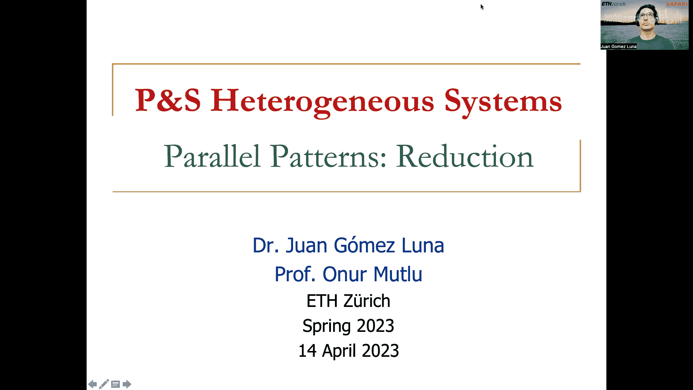

# 006：归约


在本节课中，我们将要学习并行编程中的一个核心模式：归约。我们将从归约的基本概念开始，逐步深入到其在GPU上的高效实现，包括如何避免性能瓶颈、利用共享内存和Warp Shuffle指令，以及应用线程协作等优化技术。

## 概述

归约是一种将一组值合并为单个值的操作，例如求和、求积、求最大值或最小值。它是许多并行程序（如MapReduce模型）的关键原语，也广泛应用于神经网络和机器学习工作负载中。本节课将介绍归约的串行实现、经典的树形归约并行算法，并重点讲解如何在GPU上高效地实现归约，同时考虑内存访问、线程利用率和同步等关键性能因素。

## 回顾：GPU性能考量

在深入归约之前，让我们简要回顾上一讲关于GPU性能考量的内容。优化GPU代码时，内存访问模式是关键。为了充分利用带宽，我们需要实现**合并内存访问**，即连续的线程访问连续或相邻的内存地址。当所有线程访问的数据位于同一缓存行或几个连续的缓存行时，可以实现最佳带宽利用。

共享内存是改善合并访问的有效工具。例如，在处理矩阵时，我们可以将数据块加载到共享内存中，以合并的方式访问全局内存，然后从共享内存中读取数据，从而避免对全局内存的非合并访问。

另一个重要考量是**线程利用率**。当同一Warp内的线程遵循不同的控制流路径时，会发生**Warp内部分歧**，导致指令执行效率低下。通过重新分配计算任务，可以避免这种分歧，提高Warp利用率。这一点对于归约操作尤为重要。

## 什么是归约？🔍

归约是一种操作，它将一组值减少为单个值。常见的归约操作包括求和、求积、求最大值和求最小值。这些操作具有结合律、交换律和单位元等数学性质。例如，加法的单位元是0。

归约是并行计算中的关键原语，广泛应用于各种并行程序。MapReduce编程模型就是一个很好的例子。此外，归约也常见于神经网络和其他现代机器学习工作负载中。

## 串行归约

串行归约的实现非常简单。我们遍历整个输入数组，使用一个累加器逐步合并每个元素。

以下是串行求和的伪代码：
```cpp
sum = 0; // 单位元
for (i = 0; i < n; i++) {
    sum = sum + array[i];
}
```
对于一个包含 `n` 个元素的数组，串行归约需要 `n` 次迭代。然而，归约操作中的许多步骤是独立的，这为并行化提供了机会。

## 并行树形归约 🌳

经典的并行归约方法是**树形归约**。其核心思想是将数组元素配对，由不同的线程或工作单元计算部分和，然后递归地归约这些部分和，直到得到最终结果。

对于一个包含 `n` 个元素的数组，树形归约只需要 `log₂(n)` 次迭代，远少于串行归约的 `n` 次迭代。

在GPU上映射树形归约时，我们通常：
1.  将输入数组划分为多个数据块，分配给不同的线程块。
2.  在每个线程块内部，进一步将数据块分配给不同的Warp。
3.  线程在Warp内执行部分归约，将中间结果存储在共享内存或寄存器中。
4.  由于同一线程块内的Warp并非严格同步执行，需要使用 `__syncthreads()` 进行块内同步，确保所有线程能看到最新的中间结果。
5.  每个线程块产生一个部分结果。
6.  最后，需要对这些跨线程块的部分结果进行最终归约。

## 跨线程块同步

在获得每个线程块的部分结果后，需要进行跨线程块同步以完成最终归约。主要有三种方法：

以下是几种实现跨块同步的方法：
*   **CPU端归约**：将所有部分结果复制到CPU内存，在CPU上完成最终归约。
*   **启动新内核**：在GPU上启动一个新的归约内核，以上一步的部分结果为输入，继续执行归约直到得到单个值。
*   **原子操作**：每个线程块使用一个线程，通过原子操作将其部分结果累加到全局内存中的一个原子变量上。

## 提高Warp利用率

在树形归约的初始实现中，我们可能让偶数编号的线程负责相加连续的元素对。这会导致严重的Warp利用率低下问题，因为在第一次迭代后，就有一半的线程（奇数编号线程）闲置，造成Warp内部分歧。

为了解决这个问题，我们可以采用**避免分歧的映射**方式。让连续的线程负责处理连续的数据对。这样，在归约的早期阶段，活跃的线程会集中在少数Warp中，而不是分散在所有Warp里，从而最大化Warp的利用率。

## 利用Warp Shuffle指令 🚀

在归约的最后阶段，当活跃线程仅剩一个Warp时，我们可以使用 **Warp Shuffle** 指令来进一步提升性能。这些指令允许同一Warp内的线程直接交换寄存器中的数据，无需通过共享内存。

Warp Shuffle指令比先写入共享内存再同步读取的方式更快，延迟更低。它们自Kepler架构引入，有多种变体，例如：
*   `__shfl_sync`: 从指定通道（线程）直接复制数据。
*   `__shfl_up_sync`: 从ID较低的通道复制数据。
*   `__shfl_down_sync`: 从ID较高的通道复制数据。
*   `__shfl_xor_sync`: 基于位异或操作交换数据。

在归约中，我们可以在最后一个Warp内使用 `__shfl_down_sync` 指令来高效地累加部分和。

## 归约代码示例（含Warp Shuffle）

以下是一个在GPU上实现并行归约的核函数示例，它结合了共享内存树形归约和最后的Warp Shuffle优化：

```cpp
__global__ void reduction_kernel(int* input, int* partial_sums, int n) {
    __shared__ int s_data[BLOCK_SIZE];
    int tid = threadIdx.x;
    int i = blockIdx.x * blockDim.x + threadIdx.x;

    // 每个线程加载两个元素到共享内存（假设grid size是数组大小的一半）
    if (i * 2 < n) s_data[tid] = input[i*2] + input[i*2+1];
    else s_data[tid] = 0;
    __syncthreads();

    // 在共享内存中进行树形归约
    for (int s = blockDim.x / 2; s > 0; s >>= 1) {
        if (tid < s) {
            s_data[tid] += s_data[tid + s];
        }
        __syncthreads();
    }

    // 最后一个Warp使用Warp Shuffle完成最终归约
    if (tid < 32) {
        int val = s_data[tid];
        for (int offset = 16; offset > 0; offset >>= 1) {
            val += __shfl_down_sync(0xffffffff, val, offset);
        }
        if (tid == 0) {
            partial_sums[blockIdx.x] = val; // 存储该线程块的部分和
        }
    }
}
```
> 注意：这是一个简化示例，实际应用中需要考虑数组大小与线程网格的匹配、边界条件等。

## 现代GPU的Warp级归约指令

自Compute Capability 8.0（如NVIDIA Ampere架构）起，引入了更高效的 **Warp级归约内在函数**，例如 `__reduce_add_sync`。这些指令可以直接在硬件上执行Warp内的归约操作，进一步简化代码并提升性能。我们可以用一行指令替代之前需要循环和Shuffle指令的Warp内归约步骤。

## 线程协作优化 🧵

另一个重要的优化技术是**线程协作**。其核心思想是让每个线程处理输入数组中的多个元素，而不是只处理一两个。这样，我们可以用更少的线程块覆盖整个数组，减少需要启动的线程块总数和相应的同步开销。

实现方式是：每个线程使用一个循环，以**网格总线程数**为步长，遍历并累加分配给它的那些元素。每个线程先计算一个本地和，然后再与其他线程在共享内存中汇合，进行后续的树形归约。这种方法在数据量很大时尤其有效，因为它减少了线程块的数量和 `__syncthreads()` 的调用次数。

## 总结

本节课我们一起学习了并行编程中的核心模式——归约。我们从归约的基本定义和串行实现开始，深入探讨了在GPU上实现高效归约的多种技术：

*   理解了**树形归约**这一并行算法如何将复杂度从O(n)降低到O(log n)。
*   认识到**内存访问模式**和**Warp利用率**对GPU性能至关重要，并学习了如何通过重新映射计算来避免Warp内部分歧。
*   掌握了使用**共享内存**作为中间存储来进行块内归约，并使用 `__syncthreads()` 进行同步。
*   学习了利用 **Warp Shuffle** 指令在Warp内高效交换数据，避免额外的共享内存访问。
*   了解了**跨线程块同步**的几种策略：CPU归约、启动新内核或使用原子操作。
*   探讨了**线程协作**优化，通过让每个线程处理更多工作来减少线程块数量和同步开销。
*   提及了现代GPU提供的**专用Warp归约指令**（如 `__reduce_add_sync`）可进一步简化代码并提升性能。

归约的实现拥有巨大的优化空间，不同的库和编译器会自动探索各种代码变体以适应特定硬件架构。掌握这些基础技术，是编写高性能GPU程序的关键一步。



