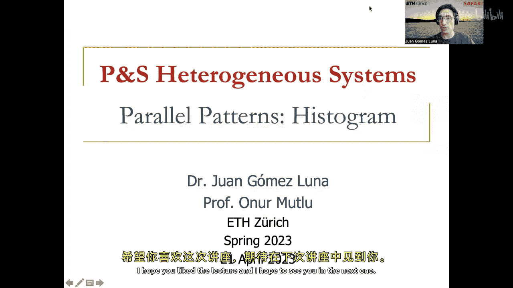

# 007：直方图


在本节课中，我们将学习一个新的并行模式：直方图计算。我们将从回顾上一节的内容开始，然后介绍直方图的基本概念、其串行与并行实现，并重点讨论如何使用原子操作来确保并行计算的正确性。最后，我们将探讨一些优化技术，如私有化和合并原子操作，以提高直方图计算的性能。

## 回顾：归约操作

上一节我们介绍了归约操作。归约是一种将一组值减少为单个值的操作，它具有结合律、交换律和单位元等特性。

我们解释了如何在GPU上实现基于树的归约。通常的做法是将输入数组划分为不同的块，分配给不同的线程块。在每个线程块内部，再将数据分配给不同的线程束。每个线程束会得到一个部分归约结果，这些结果会进一步归约为每个线程块的部分结果。经过一些线程块间的同步后，最终得到完整的归约结果。

我们还讨论了避免线程束分化的映射方法，以确保活跃线程始终属于同一个或少数几个线程束，从而提高计算核心利用率和最终性能。

此外，我们提到了原子操作可以作为实现归约的一种方式。原子操作能保证读-修改-写操作的原子性，可用于共享内存或全局内存。它们对于防止多个线程更新同一内存位置时的数据竞争非常有用。

## 直方图简介

直方图是一种数据结构，用于从大型数据集中降维并提取显著的特征和模式。它广泛应用于图像处理和欺诈检测等领域。

在基础直方图中，我们将输入值的可能范围划分为若干个“桶”。每个桶关联一个计数器。对于输入中的每个元素，我们检查其值，确定它属于哪个桶，然后递增该桶对应的计数器。

## 串行直方图计算

串行直方图计算非常简单。我们只需逐个遍历输入元素，并更新对应的直方图桶计数器。

例如，给定一个输入数组和一个直方图，单个线程会迭代地读取每个输入元素，并递增相应的计数器。

以下是串行直方图计算的伪代码：
```c
for (int i = 0; i < input_size; i++) {
    value = input[i];
    histogram[value]++;
}
```

## 并行直方图计算

为了提高效率，我们尝试并行实现直方图计算。多个线程可以同时处理输入数组的不同部分。

一个直观的并行内核可能如下所示：
```c
__global__ void histogram_kernel(int *input, int *histogram, int size) {
    int tid = blockIdx.x * blockDim.x + threadIdx.x;
    int stride = blockDim.x * gridDim.x;
    int idx = tid;
    while (idx < size) {
        int value = input[idx];
        histogram[value]++; // 这里存在数据竞争风险
        idx += stride;
    }
}
```
在这个内核中，每个线程处理输入数组中相隔`stride`距离的元素。线程读取输入值后，尝试直接递增直方图中对应的桶。

然而，这个实现存在一个问题。当多个线程同时尝试更新同一个直方图桶时，会发生数据竞争，导致结果错误。

## 使用原子操作

为了解决数据竞争问题，我们需要使用原子操作来确保对直方图桶的更新是原子的。

以下是使用原子操作的正确并行直方图内核：
```c
__global__ void histogram_kernel_atomic(int *input, int *histogram, int size) {
    int tid = blockIdx.x * blockDim.x + threadIdx.x;
    int stride = blockDim.x * gridDim.x;
    int idx = tid;
    while (idx < size) {
        int value = input[idx];
        atomicAdd(&histogram[value], 1); // 使用原子加操作
        idx += stride;
    }
}
```
通过使用`atomicAdd`，我们保证了即使多个线程同时更新同一个桶，计数器也能被正确递增。但代价是，当发生原子冲突时，这些操作会被序列化，可能增加延迟。

## 优化：私有化

在处理自然图像等数据时，像素值分布可能具有空间相似性，导致大量线程更新少数几个桶，从而引发频繁的原子冲突。为了优化性能，我们可以采用私有化技术。

私有化是一种优化技术，它维护输出的多个私有副本，待计算完成后再更新全局副本。此技术要求操作满足结合律和交换律，而直方图使用的加法操作正好满足。

私有化的优势在于减少了全局副本的争用。如果输出足够小，我们可以将其放在共享内存等快速存储器中，从而降低原子操作的延迟。

以下是结合了私有化和合并的优化思路：
1.  将图像划分为多个块，每个块分配给一个线程块。
2.  每个线程块在共享内存中维护自己的子直方图。
3.  线程块处理完分配的数据块后，得到完整的子直方图。
4.  最后，通过一次并行归约，将所有子直方图合并到全局内存中的最终直方图。

结合合并技术，可以让每个线程块处理多个图像块，从而减少需要合并的子直方图数量，并减少直方图初始化的开销。

以下是使用私有化和合并的并行直方图内核伪代码结构：
```c
__global__ void histogram_privatized(int *input, int *global_hist, int size) {
    __shared__ int s_hist[NUM_BINS]; // 每个块的私有直方图
    int tid = blockIdx.x * blockDim.x + threadIdx.x;
    // 初始化共享内存中的直方图
    if (threadIdx.x < NUM_BINS) s_hist[threadIdx.x] = 0;
    __syncthreads();

    // 计算每个块的子直方图
    int idx = tid;
    while (idx < size) {
        int value = input[idx];
        atomicAdd(&s_hist[value], 1); // 在共享内存中使用原子操作
        idx += blockDim.x * gridDim.x;
    }
    __syncthreads();

    // 将子直方图合并到全局内存
    if (threadIdx.x < NUM_BINS) {
        atomicAdd(&global_hist[threadIdx.x], s_hist[threadIdx.x]);
    }
}
```
在这个内核中，大部分时间花费在计算共享内存中的子直方图上。虽然最后一步在全局内存中使用原子操作成本较高，但由于只执行一次，对整体性能影响很小。

## 进一步优化：合并原子操作

我们还可以利用线程束同步原语进一步优化原子操作。例如，使用`__shfl`、`__ballot`等函数。

合并原子操作的基本思想是：当同一个线程束中的多个线程需要更新同一个内存位置时，先在线程束内部进行一次局部归约，得到一个总和，然后只让一个线程执行一次原子操作来更新目标内存位置。这样可以显著减少原子操作的次数和冲突。

以下是合并原子操作的简化思想（具体实现更复杂）：
1.  识别出线程束中所有需要更新同一桶的线程。
2.  在这些线程内部，使用线程束洗牌函数进行局部求和归约。
3.  指定一个线程（如`lane 0`）代表整个线程束，执行一次原子加操作，将归约后的总和写入目标桶。

这种方法可以进一步优化原子操作的使用效率。

## 总结

本节课我们一起学习了直方图这一并行模式。我们首先回顾了归约操作和原子操作的基础知识。然后，我们介绍了直方图的概念及其串行实现。

在并行实现部分，我们指出了直接更新全局直方图会导致数据竞争，因此必须使用原子操作来保证正确性。接着，我们探讨了通过私有化技术来减少原子冲突的优化方法，即在共享内存中维护每个线程块的子直方图，最后再合并到全局内存。

我们还简要介绍了利用线程束同步原语进行合并原子操作的进一步优化思路。

直方图计算是许多应用中的基础操作，理解其并行实现和优化技巧对于编写高效的GPU程序至关重要。



