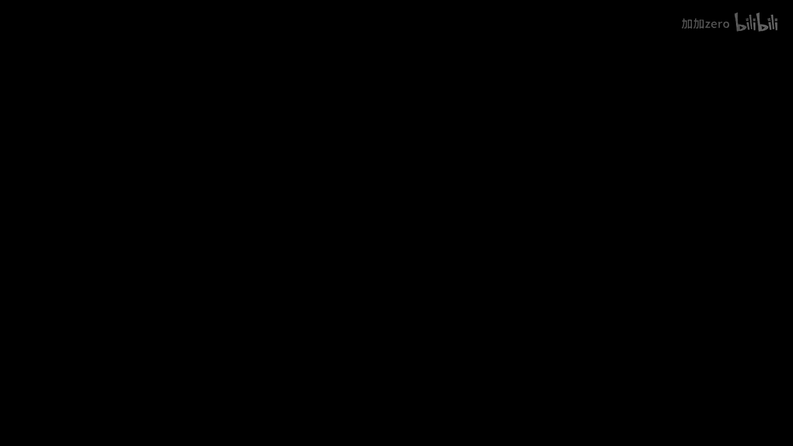
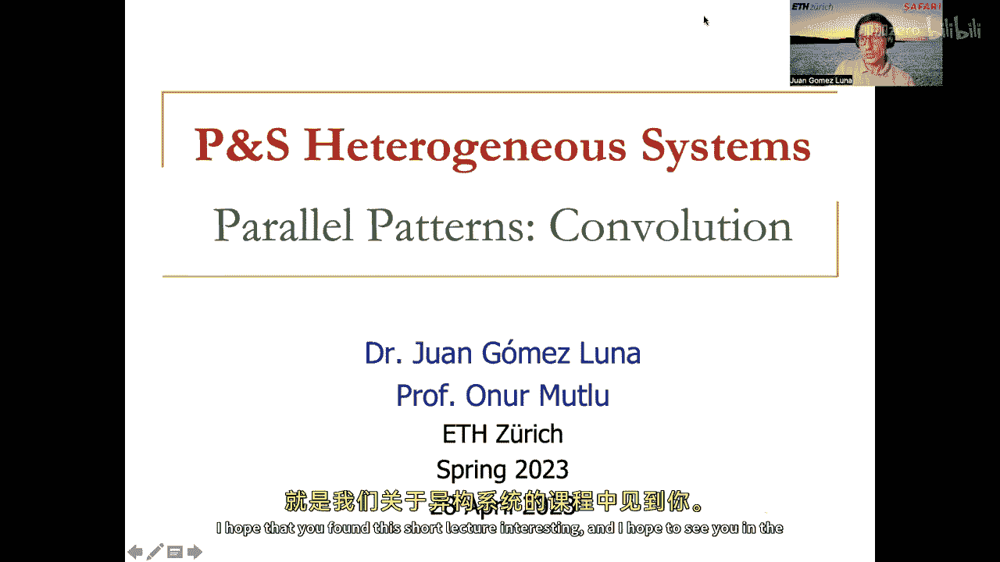

# 008：卷积




在本节课中，我们将学习一个新的并行模式：卷积。卷积在信号处理、图像处理和机器学习等领域有广泛应用。我们将从一维卷积的基本概念开始，逐步深入到如何在GPU上高效实现卷积，包括利用常量内存、分块技术以及将卷积转换为矩阵乘法等优化策略。

---

## 卷积简介

上一节我们讨论了直方图计算，本节中我们来看看卷积操作。卷积是一种广泛应用于信号处理、图像处理、视频处理和计算机视觉的运算。其基本思想是，将一个滤波器（或称为掩码）应用于输入的每个元素（如信号、图像或视频帧），通过计算该元素及其邻域元素的加权和，得到一个新的输出值。这在图像处理中可用于平滑、锐化、模糊、边缘检测或去噪。如今，卷积在机器学习和人工智能中也至关重要，特别是作为卷积神经网络中的卷积层。

---

## 一维卷积示例

让我们从一个常用于音频处理的一维卷积示例开始。假设我们有一个由连续元素组成的音频输入，以及一个通常包含奇数个元素的掩码（本例中为5个元素）。

为了计算输出中的某个元素（例如 `P2`），我们需要将掩码中心对准输入中对应的元素。然后执行逐元素乘法（部分乘积），最后将这些部分乘积求和。得到的值（本例中为57）存储在输出数组的相应位置。

**核心计算过程**可以用以下伪代码描述：
```
对于输出中的每个元素 i：
    sum = 0
    对于掩码中的每个偏移量 j：
        input_index = i + j - (mask_size / 2)
        sum += input[input_index] * mask[j]
    output[i] = sum
```

---

## 边界条件处理

计算卷积时，必须注意边界条件。当计算靠近输入数组边界的输出元素时，掩码可能会超出输入数组的范围。我们需要处理这些“幽灵”元素。

以下是几种常见的边界处理策略：
*   **零填充**：假设边界外的元素值为0。
*   **边界值复制**：使用边界上的值来填充外部元素。
*   **其他方法**：如环绕或镜像。

在零填充的例子中，超出边界的输入元素被视为0，因此对应的部分乘积为0，最终输出值为38。

---

## 基础GPU卷积内核

在GPU上实现基础卷积时，可以为输出数组的每个元素分配一个线程。每个线程需要计算其对应输出元素的值。

以下是实现的关键步骤：
1.  计算线程对应的输出索引。
2.  确定需要访问的输入元素的起始地址。
3.  循环遍历掩码的所有元素。
4.  在循环中，检查当前输入索引是否越界，并根据边界处理策略（如零填充）获取输入值。
5.  执行输入值与对应掩码值的乘法，并累加结果。
6.  将最终累加值写入输出数组。

---

## 利用常量内存存储掩码

GPU架构中的常量内存是一种缓存型内存，每个GPU核心都有专用的常量缓存。由于卷积操作中的掩码是常数、数据量小且被所有线程访问，因此非常适合存放在常量内存中。当同一个线程束中的所有线程访问相同的常量值时，效率尤其高。

要使用常量内存，需要执行以下步骤：
1.  使用 `__constant__` 限定符在全局作用域声明掩码变量。
2.  在主机端，使用 `cudaMemcpyToSymbol` 函数将掩码数据从主机内存复制到设备的常量内存。

示例代码：
```cuda
__constant__ float MASK[MASK_SIZE];

// 主机端代码
cudaMemcpyToSymbol(MASK, host_mask, MASK_SIZE * sizeof(float));
```

---

## 使用分块技术优化卷积

之前课程中讨论过的分块（或平铺）技术，同样可以应用于卷积以利用数据局部性。对于一维卷积，我们可以将输入和输出数组划分为多个块，由不同的线程块处理。

每个线程块将其负责的输入数据块（包括计算边界输出所需的额外“光晕”区域）加载到共享内存中。这样，线程在计算卷积时可以从快速的共享内存中读取数据，减少对全局内存的访问。

加载数据到共享内存通常分为三步：
1.  **加载左光晕**：加载当前数据块左侧边界外的元素。
2.  **加载内部元素**：加载数据块本身的元素。
3.  **加载右光晕**：加载当前数据块右侧边界外的元素。

加载过程中需要进行地址计算和边界检查，以确保不会访问无效的输入区域。所有数据加载完毕后，需要调用 `__syncthreads()` 来确保共享内存中的数据对块内所有线程可见。

---

## 二维卷积与机器学习中的应用

卷积在机器学习中，特别是作为卷积神经网络中的层，非常有用。与全连接层相比，卷积层具有只使用局部权重、参数数量相对较少的优势。这使得权重可以轻松放入GPU的片上内存（如共享内存或常量内存），从而让分块技术大显身手。

二维卷积的操作与一维类似，只是掩码在二维平面上移动。在CNN中，输入可能是特征图，通过对局部窗口内的输入值与滤波器权重进行乘加运算，得到输出特征图上的一个点。

一个简化的二维卷积层前向传播内核可能包含以下步骤：
1.  计算当前线程对应的输出特征图位置坐标。
2.  循环遍历所有输入通道。
3.  在每个通道内，循环遍历滤波器（如KxK大小）的每个元素。
4.  执行乘积累加操作。
5.  将最终结果写入输出特征图。

---

## 将卷积转换为矩阵乘法

卷积运算可以通过“im2col”（图像到列）等方法转换为矩阵乘法。这种转换非常有益，因为矩阵乘法是计算密集型操作，而GPU（特别是其张量核心）对此类运算进行了深度优化。

基本思想是将输入特征图的局部感受野展开成矩阵的一列，并将多个卷积滤波器展开成矩阵的行。这样，一次大型矩阵乘法就能完成整个卷积层的计算。这种方法不仅提升了性能，还有助于在CNN的不同层之间保持稳定的并行度。

在更现代的GPU架构（如Volta及以后的架构）中，可以使用专门的张量核心来加速这种矩阵乘法，从而获得极高的吞吐量。

---

## 总结



本节课我们一起学习了卷积这一重要的并行模式。我们从一维卷积的基本原理和边界条件处理开始，探讨了如何在GPU上实现基础卷积内核。接着，我们介绍了利用常量内存存储掩码以提升访问效率，以及使用共享内存分块技术来优化数据重用。我们还了解了卷积在机器学习中的应用，并学习了通过将卷积运算转换为矩阵乘法来充分利用GPU计算能力的高级优化技术。掌握这些概念和技术，对于在GPU上高效实现图像处理、信号处理和深度学习算法至关重要。