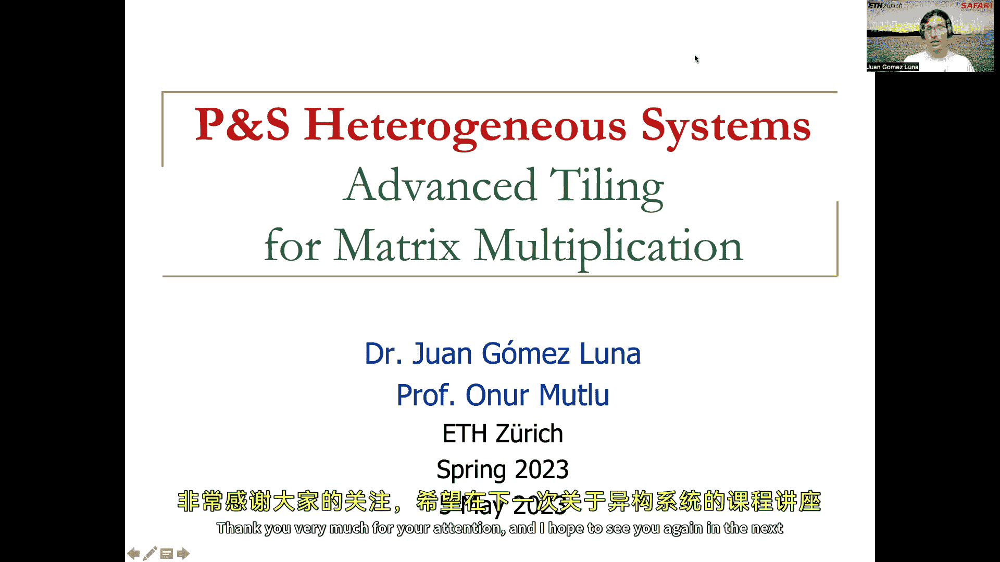

# 009： 高级矩阵乘法分块技术 🧩

在本节课中，我们将学习如何为矩阵乘法应用高级分块技术，特别是结合使用寄存器和共享内存，以实现更高的数据复用和计算性能。

上一节我们介绍了卷积操作及其与矩阵乘法的关系。本节中，我们将深入探讨如何将卷积层高效地转化为矩阵乘法，并应用更精细的分块策略。

## 概述：从卷积到矩阵乘法

卷积是信号处理、图像处理和卷积神经网络中的核心操作。为了在GPU上高效执行卷积，一种常见策略是将其转化为矩阵乘法，从而利用GPU擅长矩阵运算的特性。

在卷积神经网络的前向传播中，输入特征图与卷积滤波器进行卷积运算，生成输出特征图。通过将输入特征图和滤波器“展开”成矩阵形式，我们可以将卷积层计算转化为一个大型矩阵乘法问题。

## 矩阵乘法的分块策略回顾

为了高效地在GPU上执行矩阵乘法，我们通常使用分块技术。基本思想是将输出矩阵划分为多个小块，每个线程块负责计算一个输出块。

以下是实现分块矩阵乘法的关键步骤：
1.  从全局内存加载输入矩阵A和B的相应数据块到共享内存。
2.  线程协作，利用共享内存中的数据执行部分矩阵乘法计算。
3.  将部分结果累加到输出矩阵C的对应块中。

这种方法的核心优势在于数据复用：加载到共享内存中的数据可以被线程块内的多个线程多次使用，减少了对全局内存的访问。

## 联合寄存器与共享内存分块 🚀

为了进一步提升性能，我们可以采用更高级的联合寄存器与共享内存分块技术。这种方法的核心思想是利用不同层级存储器的特性：
*   **寄存器**：访问速度极快，但为每个线程私有，需要线程协作才能实现数据共享。
*   **共享内存**：访问速度比寄存器慢，但比全局内存快得多，并且对同一线程块内的所有线程可见。

在这种策略中，我们为两个输入矩阵使用不同大小的分块：
*   将矩阵M的一个垂直分块存储在**寄存器**中。
*   将矩阵N的一个水平分块存储在**共享内存**中。
*   输出矩阵P的对应分块也存储在**寄存器**中。

### 关键计算模式

假设我们为矩阵M设置的分块宽度为 `Tile_M`，为矩阵N设置的分块宽度为 `Tile_N`。
*   每个线程块拥有 `Tile_M` 个线程。
*   每个线程负责计算输出分块P中的一行，即 `Tile_N` 个元素。这实现了**线程协作**，协作因子为 `Tile_N`。
*   从矩阵M加载到寄存器的每个数据元素，可以被重用 `Tile_N` 次。
*   从矩阵N加载到共享内存的每个数据元素，可以被重用 `Tile_M` 次。

### 优化：平衡线程负载

在基础方案中，可能只有少数线程参与将N的分块加载到共享内存，导致线程束分化，降低效率。

一个更平衡的优化方案是让线程块内的所有线程协作加载一个**矩形分块**的数据到共享内存。这个矩形分块的尺寸是 `Tile_N x K`，其中 `K = Tile_M / Tile_N`。这样，所有线程都参与加载工作，消除了线程束分化。

同时，每个线程可以加载K个矩阵M的元素到其私有寄存器中。此时，每个线程在每个迭代中计算K个步骤，最终完成 `Tile_N x Tile_M` 个输出元素的计算。

## 实际应用中的参数选择

在实际内核实现中，参数选择需考虑硬件限制：
*   `Tile_N` 的典型值为16。其上限受限于可用寄存器数量，因为输出元素也需存储在寄存器中。
*   `Tile_M` 至少为64，即每个线程块至少64个线程，对应输出分块的行数。
*   变量K受限于每个线程可用的寄存器数量，因为它决定了每个线程能加载的M矩阵元素数量。

## 总结

本节课我们一起学习了用于矩阵乘法的高级分块技术。我们首先回顾了将卷积层转化为矩阵乘法的动机，然后深入探讨了如何联合使用寄存器和共享内存进行分块计算。这种技术通过**线程协作**和**数据复用**，显著提升了计算效率。关键点在于为不同矩阵设计不同大小的分块，并利用所有线程协作加载数据，以实现负载均衡和高内存带宽利用率。

---
**进一步学习资源**：
*   欲深入了解此技术，可参考《大规模并行处理器编程》一书的第7、8、16章。
*   可观看本课程以往学期的加长版讲座视频获取更多细节。