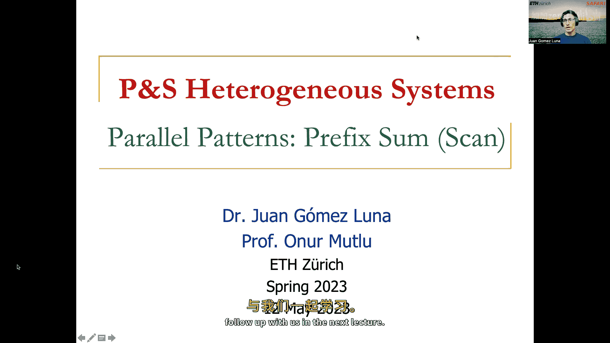

# 010：前缀和（扫描）🔢


在本节课中，我们将学习另一个重要的并行模式：前缀和，也称为扫描操作。我们将介绍其基本概念、两种主要类型（包含式与排除式），并深入探讨如何在GPU上高效地实现分层扫描算法。

## 概述

前缀和（扫描）是一种并行原语，它接收一个输入数组和一个满足结合律的运算符（例如加法、乘法、最大值、最小值），并返回一个输出数组。输出数组的每个元素是输入数组从起始位置到当前（或前一个）位置所有元素递归应用该运算符的结果。它在许多并行算法中作为基础构建块，例如流压缩、分区、排序等。

## 前缀和的定义与类型

前缀和操作有两种主要形式：排除式扫描和包含式扫描。

*   **排除式扫描**：对于输出数组的每个索引 `i`，其值 `Y[i]` 是输入数组从 `0` 到 `i-1` 所有元素运算的结果。公式表示为：
    `Y[i] = input[0] op input[1] op ... op input[i-1]`
    其中 `op` 是满足结合律的运算符。输出数组的第一个元素通常被初始化为该运算符的**单位元**（例如，加法为0，乘法为1）。

*   **包含式扫描**：对于输出数组的每个索引 `i`，其值 `Y[i]` 是输入数组从 `0` 到 `i` 所有元素运算的结果。公式表示为：
    `Y[i] = input[0] op input[1] op ... op input[i]`
    输出数组的第一个元素就是输入数组的第一个元素。

让我们看一个具体的例子。假设输入数组为 `[3, 1, 7, 0, 4, 1, 6, 3]`，运算符为加法。

*   **排除式扫描**输出：`[0, 3, 4, 11, 11, 15, 16, 22]`
    （第一个元素是单位元0，后续每个元素是前一个输出元素加上当前输入元素）

*   **包含式扫描**输出：`[3, 4, 11, 11, 15, 16, 22, 25]`
    （第一个元素是输入的第一个元素3，后续每个元素是前一个输出元素加上当前输入元素）

## 在GPU上实现分层扫描

在具有多层次并行性的机器（如GPU）上实现扫描，我们采用分层方法。GPU的计算由线程块组织，因此我们可以将输入数组划分给不同的线程块处理。

上一节我们介绍了前缀和的基本概念，本节中我们来看看如何在GPU架构上具体实现它。整体流程分为三个主要步骤：

1.  **每个线程块内扫描**：每个线程块负责处理输入数组的一个连续块，并计算该块内的包含式扫描，得到中间结果。
2.  **扫描部分和**：收集每个线程块中间结果的最后一个元素（即该块的部分和），对这些部分和数组执行一次扫描操作。
3.  **添加偏移量**：将第二步计算得到的对应偏移量，加到每个线程块的中间结果上，得到最终的全局扫描结果。

这种方法需要全局同步。在第一步完成后，所有线程块的部分和必须就绪，才能开始第二步。在GPU上，这通常通过**内核终止**（结束一个内核，再启动新内核）或使用**原子操作**来实现。

## 线程块内的高效扫描：Kogge-Stone算法

现在，我们聚焦于如何在一个线程块内高效地实现包含式扫描。我们将介绍Kogge-Stone算法。

该算法为每个输入元素分配一个线程。它通过迭代方式工作，每次迭代中，每个线程将其当前值与一定“跨度”之前的另一个值进行运算。跨度在每次迭代中翻倍（1， 2， 4， ...），直到覆盖整个数组。

以下是该算法的核心代码逻辑（以加法为例）：

```cpp
// 假设每个线程处理一个元素，`input` 和 `output` 在全局或共享内存中
int idx = threadIdx.x; // 线程索引
int val = input[idx];  // 当前线程负责的输入值

// 初始化输出为输入值（对于包含式扫描）
output[idx] = val;
__syncthreads(); // 块内同步

// 迭代 log2(blockDim.x) 次
for (int stride = 1; stride < blockDim.x; stride *= 2) {
    int element_to_add;
    if (idx >= stride) {
        element_to_add = output[idx - stride];
    }
    __syncthreads(); // 确保所有线程已完成读取
    if (idx >= stride) {
        output[idx] += element_to_add; // 执行加法操作
    }
    __syncthreads(); // 确保所有线程已完成写入，再进行下一轮
}
```

为了提升性能，我们可以进行两项优化：

1.  **使用共享内存**：将数据缓存到速度更快的共享内存中，利用数据重用。
2.  **双缓冲技术**：使用两个共享内存缓冲区，在每次迭代后交换输入和输出角色，从而消除一次 `__syncthreads()` 调用。

## 进一步的优化：Warp级扫描与分层融合

我们可以在线程块内部继续应用分层思想。一个线程块包含多个Warp（通常是32个线程）。我们可以：

1.  **每个Warp内扫描**：首先，每个Warp使用其内部的线程独立计算一个Warp级的包含式扫描。这里可以使用**洗牌指令**，这是一种允许同一Warp内线程快速交换寄存器值的硬件原语，速度极快。
    ```cpp
    // 简化的Warp内扫描函数（加法）
    __device__ int warpScan(int val) {
        for (int offset = 1; offset < 32; offset *= 2) {
            int y = __shfl_up_sync(0xffffffff, val, offset); // 洗牌指令
            if (lane_id >= offset) val += y; // lane_id 是线程在Warp内的索引
        }
        return val;
    }
    ```
2.  **扫描Warp的部分和**：收集每个Warp扫描结果的最后一个值（即该Warp的部分和），由一个Warp（例如第一个Warp）对这些部分和执行一次扫描。
3.  **添加Warp偏移量**：将第二步得到的偏移量加到对应Warp的每个元素上，完成线程块内的最终扫描。

这种方法将计算进一步细化，并利用Warp内的高效同步和通信机制。

## 算法变体与性能分析

根据不同的实现策略，扫描算法在全局内存访问量上有显著差异：

*   **Scan-Scan-Add**：先进行块扫描（写回全局内存），再扫描部分和，最后添加偏移。总访问量约为 **4N**（N为元素总数）。
*   **Reduce-Scan-Scan**：先进行块**归约**（只计算部分和，不写完整中间结果），再扫描部分和，最后在一个内核中完成块扫描并添加偏移。总访问量约为 **3N**，对于大数组通常性能更好。

## 使用原子操作进行块间同步

为了进一步减少全局内存访问和内核启动开销，我们可以使用**相邻块同步**技术。其核心思想是使用全局内存中的原子操作和标志数组，让线程块动态协调，隐式地完成部分和的扫描与传播。

1.  每个线程块计算完自己的部分和后，将其写入一个全局数组。
2.  该线程块的一个领导线程（如0号线程）会**轮询检查**前一个线程块设置的“完成标志”。
3.  一旦前一个块标志就绪，当前块就读取前一个块的部分和结果，将其与自己的部分和相加，更新自己的全局部分和值。
4.  当前块设置自己的“完成标志”，通知下一个块可以开始工作。

由于GPU调度线程块的顺序不确定，我们需要使用一个**全局原子计数器**为线程块分配“虚拟ID”，以确保同步顺序的正确性。这种方法可以将总全局内存访问量降低到约 **2N**，从而获得最佳性能。

## 前缀和的应用

正如开头所提，前缀和是一个极其有用的并行原语，是许多并行算法的构建基石。以下是部分应用：

*   **流压缩**：从一个数组中筛选出满足特定条件的元素。
*   **分区**：根据条件将数组元素重新排列。
*   **选择/筛选**：选出排名第k的元素。
*   **去重**：在排序数组中移除重复项。
*   **基数排序**：一种高效的整数排序算法。

在我们的研究中，通过使用基于相邻块同步的高效扫描实现，我们开发了一套**原地数据滑动算法**（如流压缩、分区等），其输出直接覆盖输入内存空间，节省了大量内存。实验表明，该实现相比标准库（如Thrust）获得了约3倍的加速，几乎达到了内存带宽的理论上限。

## 总结

本节课中，我们一起学习了并行编程中的核心模式——前缀和（扫描）。我们从其定义和两种类型（包含式与排除式）开始，详细探讨了在GPU上实现高效扫描的分层方法，包括线程块内的Kogge-Stone算法和Warp级扫描。我们还分析了不同算法变体（Scan-Scan-Add， Reduce-Scan-Scan）的性能，并介绍了使用原子操作进行相邻块同步以最大化性能的高级技术。最后，我们了解了扫描在流压缩、分区等多种并行算法中的关键作用。掌握前缀和的实现，是理解许多复杂并行算法的基础。



