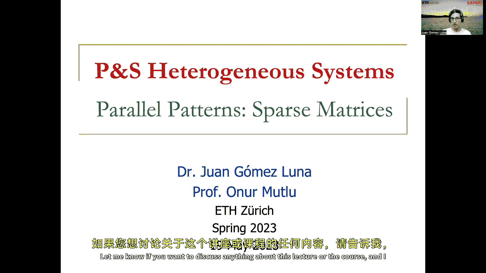

# 011：稀疏矩阵

在本节课中，我们将要学习稀疏矩阵及其压缩格式，并以稀疏矩阵向量乘法（SpMV）为例算法进行讲解。

首先，让我们快速回顾一下本课程中已经介绍过的其他并行模式。

我们以归约操作开始，这是一种将一组值缩减为单个值的操作。归约需要具备三个主要属性：结合律、交换律和单位元。它是并行计算中的关键原语。我们讨论了如何在GPU上实现无分支映射以最大化利用率。

接下来是直方图计算，这是一种常用于降低数据维度和提取显著特征的操作。在直方图计算中，我们通常逐个读取输入元素，并递增直方图中的计数器或“桶”。问题在于，当多个线程更新直方图时，需要使用原子操作来确保结果正确，而原子操作会串行化执行。因此，我们需要找到减轻这种串行化的方法，其中一种方法称为“私有化”，其基本思想是在共享内存中放置多个子直方图，每个子直方图由不同的线程块创建，当所有子直方图计算完成后，再合并成最终的直方图。

在后续课程中，我们介绍了卷积。在卷积中，我们对输入的每个元素应用一个滤波器或掩码，并通过加权和来计算输出元素。卷积在信号处理、图像处理、视频处理、计算机视觉以及当今的机器学习和人工智能（例如卷积神经网络）中应用非常广泛。我们讨论了如何执行一维卷积，例如应用一个大小为5的掩码到输入的每个元素，计算部分乘积后进行最终归约。我们还讨论了如何进行二维卷积。在另一讲中，我们探讨了如何将卷积层实现为矩阵乘法，这基本上要求我们将输入特征图和卷积滤波器的矩阵展开并排列成矩阵形式，从而像执行矩阵乘法一样进行计算，这对于GPU来说是非常适合的操作。我们确实讨论了更高级的优化技术，如寄存器平铺和共享内存平铺，以及如何结合它们来高效地实现矩阵乘法。

在上一讲中，我们讨论了前缀和（扫描）操作。这是一种操作，我们取一个输入和一个结合性运算符，通过递归地对输入数组的元素应用该运算符来计算输出元素。请记住，有独占扫描和包含扫描之分。我们讨论了如何实现一种称为包含扫描的层次结构，该结构可以适应具有两级或更多级并行性的系统，例如在GPU中，我们有线程块、线程束和线程。我们首先要做的是在线程块之间划分输入，每个线程块将执行一个块扫描。但在线程块内部，我们也会使用线程束和单个线程。在这种层次化扫描中，有不同的步骤，幻灯片上展示的是“扫描-扫描-相加”实现，我们首先执行每个块的扫描，然后扫描部分和，最后执行相加操作，将偏移量添加到每个对应块的扫描元素中。这是一种实现方式。我们讨论的另一种是“归约-扫描-扫描”实现，它节省了一些内存访问，特别适用于非常大的数组。

今天，我们将讨论稀疏矩阵及其计算。首先，让我们定义什么是稀疏矩阵。我们都知道什么是稠密矩阵，即大多数元素不为零的矩阵。而在稀疏矩阵中，大多数元素为零。这是一个许多元素为零的矩阵，这在许多现实世界的系统中都会出现。但稀疏矩阵也提供了一些机会。首先，不需要为零元素分配空间，这可以节省内存容量。其次，不需要将零从内存加载到处理器，这可以节省内存带宽。最后，不需要对零进行计算，这将节省计算时间。例如，在稀疏矩阵向量乘法中，乘以零是没有意义的，因为我们知道结果将是零。这些都是机会，但要利用这些机会也带来了一些挑战，因为以压缩格式存储需要更复杂的数据访问方式，而如果我们以稠密矩阵存储一切，则访问方式会简单得多。因此，我们今天将对此进行一些讨论，如果你想了解更多，可以观看本讲座的扩展版本。

让我们从一些动机开始。稀疏矩阵在今天非常普遍，你可以在推荐系统、图分析（如广度优先搜索等算法）以及神经网络（包括稀疏深度神经网络或图神经网络）中找到它们。现实情况是，现实世界的矩阵具有很高的稀疏性。如果我们观察连接图，例如Facebook或YouTube的图，我们会发现它们非常稀疏。因此，良好的稀疏矩阵压缩对于实现高效的存储和计算至关重要。确实，稀疏矩阵有许多存储格式，最著名的是坐标格式（COO）和压缩稀疏行格式（CSR），我们今天将简要讨论这两种格式。但还有其他更复杂的格式，可能对GPU上的某些内核或算法带来更好的性能，例如LPAac格式、ELL格式或JDS格式。此外，还有更多格式，例如基于位图的格式，对于某些矩阵来说至少在存储上非常高效。在选择存储格式时，需要考虑一些设计因素。首先是空间效率，即它们消耗多少内存。其次是灵活性，即添加或重新排序元素的难易程度。然后是访问性，即查找所需数据的难易程度。我们将看到这些因素的一些例子。还有内存访问模式，即在像GPU这样的并行系统中，它们是否能够实现合并内存访问。最后是负载均衡，即它们能在多大程度上最小化控制流分支，因为矩阵的稀疏性可能导致不同行具有不同数量的元素，如果我们让不同的线程处理不同的行，这可能会成为分支的来源，我们将在后面看到一些例子。

我们将以SpMV为例。最佳存储格式的选择取决于计算和矩阵特性，主要是稀疏性。如前所述，我们将使用稀疏矩阵向量乘法作为例子来研究不同的格式。在矩阵向量乘法中，我们有一个稀疏矩阵（可以在图的左侧看到）和一个稠密向量，结果将是一个输出稠密向量。

让我们从坐标格式（COO）开始。请注意，这里我们有原始矩阵，这里我们以稀疏压缩格式存储矩阵。注意，对于稀疏矩阵的每个元素，我们存储非零元素及其行索引和列索引。例如，这个值为1的元素具有索引0和0，这就是我们在稀疏矩阵格式中存储的内容。

当使用COO执行矩阵向量乘法（稀疏矩阵向量乘法）时，一种典型的并行化方法是给每个非零元素分配一个线程，就像我们在图中做的那样。然后每个线程必须访问输入向量的对应元素，执行乘法，然后累加。问题在于，我们有多个线程写入同一个输出向量的同一个元素，这将要求我们使用原子操作。例如，你可以在这张幻灯片上看到示例代码。在这个SpMV COO内核中，首先要定义每个线程将要处理的元素的索引。使用这个索引，我们首先访问矩阵（稀疏压缩矩阵）中的行和列索引，然后读取该特定元素的值。使用这个值以及由列索引给出的输入向量中的对应元素，我们执行部分乘法，然后需要累加。如前所述，因为我们有多个线程，或者可能有多个线程在同一行上工作并更新输出向量的同一个元素，我们需要使用原子加法来避免数据竞争。COO有一定的权衡，它有优点也有缺点。在优点方面，它很灵活，因为很容易向矩阵添加新元素。非零元素可以按任何顺序存储，因为每个非零元素都伴随着其行索引和列索引，所以添加新元素非常容易，只需将其放在末尾即可。在访问性方面，给定一个非零元素，很容易找到其行和列。在使用SpMV时，它具有合并内存访问，因为连续的线程访问矩阵的连续元素，这保证了合并内存访问。同时，没有控制流分支，你可以在前面的代码中检查这一点。然而，它也有缺点。首先，如果给定一行或一列，要求找到该行或列的所有非零元素，那将不容易，我们必须扫描整个稀疏矩阵，除非它们已经排序，或者我们在搜索前进行预排序。其次，使用COO的SpMV版本需要使用原子操作，正如我们所见。

我们将简要讨论另一种重要的稀疏矩阵格式，它可能应用更广泛，即压缩稀疏行格式（CSR）。在这种情况下，CSR有一个关键优势，即通常提供高压缩比，并且在许多CPU和GPU的库和框架中广泛使用。在压缩稀疏行格式中，关键是拥有一个行指针数组。我们将同一行的非零元素连续存储，并且有一个索引或指针指向每行的第一个元素。因此，现在我们不再为每个值存储行和列，我们仍然存储列索引，但由于我们基于同一行的所有值将相邻存储的假设来实现CSR格式，我们可以使用这个行指针数组来指示列索引数组和值数组中每行对应元素的起始位置。

现在，当为SpMV实现并行化方法时，通常的做法是给不同的线程分配不同的行。这样，每个线程将负责计算一行元素与输入向量的部分乘积和累加。例如，如果线程从这里开始，在每次迭代中，它们将访问矩阵，读取矩阵的一个元素，然后访问向量，读取向量的对应元素，执行部分乘法并累加，在下次迭代中，它们将访问下一个元素，依此类推。请注意，我们已经可以看到的一件事是，很可能存在线程分支，即线程束间的分支。为什么会这样？因为不同的线程在不同的行上工作，不同的行可能具有不同数量的非零元素，这将成为CSR格式的缺点之一。在这里你可以看到代码。首先，我们根据块索引、块维度和线程索引确定要处理的行。基本上，每个线程处理一行。然后我们遍历该行的所有元素，读取列索引，然后读取值，并根据列索引和稀疏矩阵的值与向量的对应元素执行乘法。之后，我们累加这个`sum`变量，最后将其写入输出向量。

与COO相比，CSR也有一些权衡，有优点也有缺点。例如，在优点方面，它空间效率高，因为行指针比行索引小。注意，现在我们不需要为每个线程保留行索引，我们只为每行保留一个指向矩阵中该行起始位置的指针。在访问性方面，给定一行，很容易找到所有非零元素，如果我们给定一行，所有非零元素将在同一行中相邻存储。在优点方面，SpMV的实现，正如我们刚刚看到的，不需要原子操作，因为每个线程拥有自己的输出，并分配一个输出元素。在缺点方面，灵活性不太好，因为很难向矩阵添加新元素，我们需要重新排列或重组不同行中的数据。在访问性方面，给定一个非零元素，很难找到其所在行；给定一列，很难找到该列的所有非零元素，我们必须遍历所有行段，查找哪些元素在我们正在寻找的特定列中。正如我们所见，SpMV实现中的内存访问不是合并的，原因在于我们在压缩格式中按行存储，并且将不同的行分配给不同的线程，所以一个线程访问这里，另一个线程访问那里，它们之间有一定的距离，因此不是合并访问。最后，如前所述，它存在控制流分支，因为每行非零元素的数量不同，所以每个线程必须执行的迭代次数也不同。

SpMV通常是一个具有挑战性的算法，难以在并行机器上高效实现。但它还有一个额外的缺点，即它是一个内存受限的计算。内存受限意味着它需要许多内存访问，内存访问非常密集。请注意，正如我们刚刚在SpMV实现中看到的，我们不仅需要访问非零值，而且在CSR格式中，我们还必须使用行指针数组，并且还必须访问列索引数组，因此有许多内存访问，而计算量并不大，因为每个元素只有一次乘法和一次加法。在这个意义上，它是一个内存受限的操作。如果我们使用屋顶线模型进行分析，我们会发现SpMV落在屋顶线的内存受限区域。正因为如此，SpMV被认为是内存处理系统中的一个重要且合适的原语。在内存处理系统中，我们通常有一种称为PIM的内存，其中DRAM存储体或内存阵列与某种计算单元或处理元素（或PIM核心）集成在一起，允许我们在内存附近进行计算。这样，这些核心享有低内存访问延迟和大内存带宽。随着UPMEM的出现，以及三星、海力士等公司的原型，这些PIM系统正在成为现实。在我们的研究中，我们对SpMV进行了广泛的分析，并为真实的处理内存系统创建了一个SpMV库。这个库包含25个SpMV内核，适用于不同的压缩格式、数据类型、数据分区技术、负载均衡技术和同步方法。我们还提供了对首个真实世界处理内存系统（来自UPMEM）上SpMV实现的全面分析，使用了多达26个稀疏矩阵。正如你在这项工作中将看到的，我们探索了不同的分区技术，例如一维分区或二维分区。在一维分区中，我们可以在各个PIM核心上执行完整的计算。在二维分区中，我们需要在CPU上合并结果，但同时我们节省了主内存和PIM内存之间的数据移动，因此这里存在有趣的权衡。在这里，你可以找到包含该库的存储库链接，该库包含所有不同的一维和二维版本，使用不同的稀疏矩阵、不同的负载均衡、同步方法和数据类型。同样，在本课程中，我们提供了一个关于这个SpMV库的简短介绍讲座，如果你有兴趣了解更多关于SpMV及其关键限制，以及如何通过处理内存系统克服这些限制，可以在这里找到链接。

如果你总体上对学习更多关于稀疏矩阵计算感兴趣，我推荐你阅读《大规模并行处理器编程》的第14章，当然还有本讲座的更长版本，在那里我们讨论了更多的压缩格式，包括一些使用位图的新格式，这些格式非常高效，并且允许在SpMV或SpMM和其他稀疏矩阵运算上进行更快的计算。这就是今天的全部内容，非常感谢你的关注。如果你想讨论关于本讲座或课程的任何内容，请告诉我，希望在下一次讲座中见到你。

