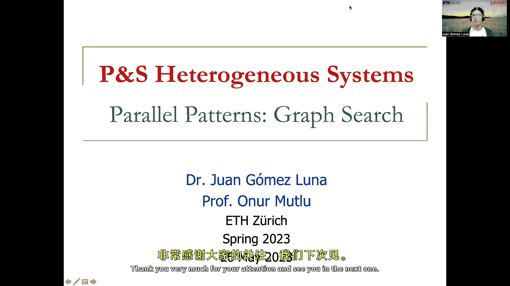

# 012：图搜索 🕸️

在本节课中，我们将学习另一种重要的并行模式：图搜索。这是继规约、直方图、卷积、前缀和以及稀疏矩阵之后，我们介绍的又一个核心并行模式。图搜索在社交网络分析、路径规划、电子设计自动化等许多领域都有广泛应用。

## 概述

在前几节课中，我们学习了多种并行模式。我们首先从规约开始，这是一种将一组值合并为单个值的操作，并讨论了通过发散前映射来最大化资源利用率的实现方法。接着，我们介绍了直方图计算，这是一种用于降低数据维度并提取大型数据集特征的计算。在直方图计算中，我们通常需要使用原子操作，并讨论了通过私有化来缓解串行化的方法。今天，我们将在图搜索的背景下再次讨论私有化技术。

之后，我们学习了卷积操作，它通过对输入的每个元素应用滤波器或掩码来计算加权和，这在机器学习和人工智能的卷积层中非常常见。我们还学习了前缀和，这是一种基于先前输出递归计算输出的操作，并讨论了其分层实现方法。在上节课中，我们讨论了稀疏矩阵及其压缩格式，例如压缩稀疏行格式。由于图通常非常稀疏，这些压缩格式在图搜索中也将至关重要。

图搜索在处理动态数据结构时面临重要挑战，因为数据布局不易实现局部性、合并访问和避免争用。此外，每个计算阶段的并行工作量可能增长或收缩。在本节课中，我们将以广度优先搜索为例，探讨如何应对这些挑战。

## 图与稀疏矩阵

图与稀疏矩阵表示密切相关，因为图通常表示为邻接矩阵。压缩这种邻接矩阵需要使用稀疏矩阵格式。

例如，我们可以使用压缩稀疏行格式来表示一个无权图的邻接矩阵。该格式包含一个行指针数组，指向列索引数组，列索引数组存储每条边的目标顶点。由于是无权图，非零元素数组中的所有值均为1。

**CSR格式示例：**
*   `row_ptr`: 行指针数组，指向每个源顶点的边在`col_idx`中的起始位置。
*   `col_idx`: 列索引数组，存储每条边指向的目标顶点。
*   `values`: 非零值数组（在无权图中通常全为1）。

## 广度优先搜索

广度优先搜索的目标是确定从源节点到目标节点（或所有目标节点）所需的最小跳数。

例如，在下图中，以节点0为源节点，不同顶点到源节点的距离（跳数）不同：两个顶点距离为1跳，五个顶点距离为2跳，一个顶点距离为3跳。

## 并行化图处理的方法

并行化图处理主要有两种方法：顶点中心法和边中心法。

### 顶点中心法

在顶点中心法中，我们为每个顶点分配一个线程来处理相关操作，并通常使用CSR或CSC等压缩格式存储图，因为给定一个顶点，很容易找到其所有邻居。

顶点中心法又分为两种策略：自顶向下和自底向上。

**自顶向下策略**：从单个源顶点开始，创建一个待访问顶点集合（称为“前沿”）。在每次算法迭代中，处理当前前沿中的顶点，并发现它们的邻居，这些邻居构成下一次迭代的前沿。这是我们本节课将详细讲解的方法。

**自底向上策略**：同样为每个顶点分配一个线程。在每次迭代中，每个线程检查其对应的顶点，看是否有邻居顶点在前一次迭代中被访问过。如果是，则将该顶点标记为属于当前迭代。这种方法在初始阶段所有线程都处于活动状态，计算量更恒定。

### 边中心法

在边中心法中，我们为每条边分配一个线程，并对该边执行一些计算，例如查找源顶点和目标顶点。这种方法通常使用坐标格式存储图，因为给定一条边，很容易找到其源和目标顶点。还有一些混合方法，例如为每条边分配线程，但需要查找源顶点和目标顶点的邻居，这时结合使用COO和CSR/CSC格式可能更有效。

## 自顶向下的BFS算法

让我们聚焦于使用顶点中心法、自顶向下策略的BFS。

我们以源节点0开始，识别并标记所有可以在1、2、3跳内到达的节点。这些节点将在BFS算法的每次连续迭代中被发现。

*   **第一次迭代**：我们发现顶点1和2，将它们放入输出队列，该队列将成为下一次迭代的输入队列。
*   **第二次迭代（前沿）**：我们处理顶点1和2的邻居，即节点3到7，并将它们加入输出队列。
*   **第三次迭代**：最后的前沿将是节点8。

至此，我们得到了以节点0为源的BFS最终结果。如果选择其他节点作为源，前沿会不同，但经过几次迭代后，最终会访问到图中的所有节点。

## 处理前沿与并行化挑战

当处理一个前沿时，我们需要访问源数组、目标数组以及一个标签数组。在标签数组中，我们将标记每个特定节点是在算法的哪个阶段被发现的。

我们可以尝试简单地并行化这个过程。假设当前输入前沿中有三个节点（5、6、7）。我们可以为队列中的不同节点分配不同的线程并行处理。然而，当线程需要将其发现的邻居加入全局输出队列时，为了避免数据竞争，必须使用原子操作来更新一个全局计数器以获取写入位置。虽然这能保证结果正确，但原子操作会导致串行化，严重损害性能。

## 解决方案：层次化队列与私有化

我们已经知道如何处理原子操作带来的问题，一种方法就是私有化。我们在直方图计算的课程中解释过，这里将以不同的方式应用它。

我们不使用所有GPU线程共享的单个全局输出队列，而是使用位于共享内存中的**本地队列**。每当一个线程块中的线程发现新邻居并需要将其加入前沿时，它们会先写入这个私有队列。当计算完成或私有队列满时，我们再通过更新一个全局计数器（或进行一次扫描操作，如果我们知道每个本地队列的确切元素数量）来确定在全局队列中的写入位置。

这就是我们所说的**两层层次结构**：块队列（通常驻留在共享内存）和全局队列（驻留在全局内存）。我们只在块计算完成时才将块队列中的元素插入全局队列。

在块队列中仍然可能存在冲突，但由于使用了私有化且共享内存速度更快，其危害远小于全局队列中的冲突。我们还可以根据算法复杂度、图的大小以及可用内存（如寄存器和片上内存）向此层次结构添加更多级别，例如线程级队列或线程束级队列。

## 全局同步与内核执行

我们将启动多次迭代，每次迭代启动一个新的内核。这就需要创建全局屏障，而创建全局屏障的方法就是终止一个内核，然后为算法的下一次迭代调用下一个内核。

这种内核终止和重新启动可能会带来很大开销。因此，人们提出了一些解决方案。

### 分层内核安排

一种解决方案是分层内核安排，即根据前沿的大小使用不同类型的内核。

*   **对于非常小的前沿**：我们可能只需要一个GPU核心和一个线程块。这个线程块可以使用`__syncthreads()`进行线程块内同步，处理速度快，主要涉及共享内存和全局内存访问。
*   **对于较大的前沿**：我们需要启动更大的内核，利用更多GPU核心。当前沿处理完成后，仍需终止内核并重新启动新内核以进行下一次迭代。

在许多情况下，如果内核内部有足够多的计算量，这种内核启动开销是可以接受的。但对于像BFS这样主要涉及内存访问和简单更新的计算，内核启动开销可能仍然显著。

### 动态并行

使用动态并行可以在不终止父内核的情况下启动新的子内核来处理新发现的邻居，这可能会减少一些开销。我们将在后续课程中详细讨论动态并行。

### 持久化线程与块间同步

最后一种解决方案是使用持久化线程和块间同步。这种方法结合了上述两种内核的优点，通过避免内核重新启动来减少开销。

其核心思想是：我们不启动足够多的线程块来覆盖整个输入前沿，而是只启动能在现有GPU核心上并发运行的线程块数量。例如，如果两个流式多处理器最多只能同时容纳四个线程块，我们就只启动四个持久化的线程块。

这些线程块会处理当前前沿的一部分，完成后，它们会通过原子操作和全局内存进行同步，然后去处理前沿中尚未被处理的部分。这样，多个迭代可以在同一个内核中完成，无需反复启动和终止内核。

## 总结

本节课我们一起学习了并行模式中的图搜索，重点以广度优先搜索为例。

我们回顾了图与稀疏矩阵表示的关系，介绍了并行化图处理的顶点中心法和边中心法，并深入探讨了自顶向下的BFS策略。我们分析了简单并行化面临的原子操作串行化挑战，并提出了通过层次化队列和内存私有化来提升性能的解决方案。最后，我们讨论了管理BFS多迭代执行的几种全局同步策略，包括分层内核安排、动态并行和持久化线程。

图搜索是处理不规则、动态数据结构的典型范例，理解其并行化策略对于高效利用GPU等加速器至关重要。